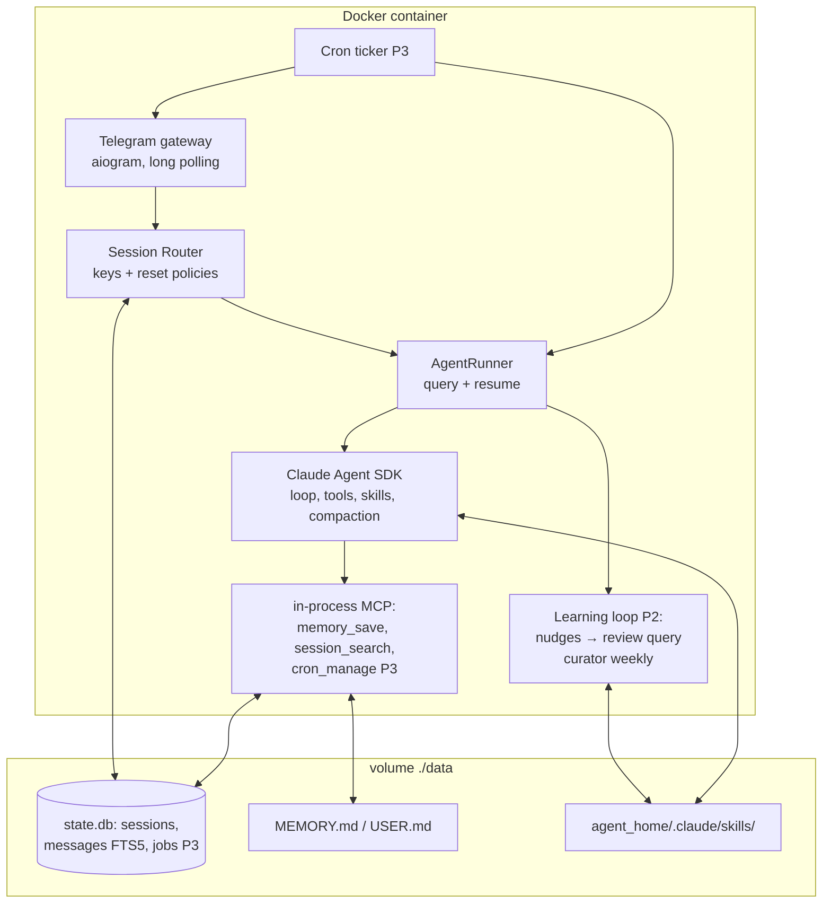

# claude-hermes — Product Requirements Document (PRD)

| | |
|---|---|
| **Product** | claude-hermes — self-improving personal AI agent |
| **Status** | Draft v1.0 |
| **Date** | 2026-07-12 |
| **Owner** | project maintainers |
| **Related docs** | [Phase 1 plan](superpowers/plans/2026-07-12-claude-hermes-phase1-core.md) · [Phase 2 plan](superpowers/plans/2026-07-12-claude-hermes-phase2-learning-loop.md) · [Phase 3 plan](superpowers/plans/2026-07-12-claude-hermes-phase3-cron.md) |

---

## 1. Overview

claude-hermes is a persistent, self-improving personal AI agent built on the **Claude Agent SDK (Python)**. It lives on a VPS in Docker, is reached through **Telegram**, and — unlike a stateless chatbot — accumulates capability over time: it maintains bounded persistent memory about its user and environment, writes and improves its own **skills** from experience, recalls past conversations via full-text search, and runs scheduled automations that deliver results back to chat.

The product is an independent reimplementation of the ideas behind [NousResearch/hermes-agent](https://github.com/NousResearch/hermes-agent), rebuilt on the Claude Agent SDK so that the agent loop, context compaction, tool execution, skills runtime, subagents, permissions, and prompt caching come from the SDK instead of bespoke infrastructure. Our code focuses on the four things the SDK does not provide: the messaging gateway, the learning loop, scheduled automations, and cross-session recall.

### 1.1 Problem statement

Chat assistants forget everything between conversations. Users repeat the same context ("my server is at…", "I prefer answers in Russian", "deploys go through docker compose"), re-teach the same workflows, and cannot delegate recurring tasks. Existing agent products either run on the user's laptop (dies when the lid closes), don't learn, or lock the user into a hosted service.

### 1.2 Solution

A single always-on agent process the user owns, that:
1. **Remembers** — durable facts about the user and environment survive across sessions.
2. **Learns** — successful workflows sediment into reusable skills, automatically, with quality controls.
3. **Recalls** — "what did we decide about X last month?" is answerable via full-text search over all past sessions.
4. **Acts on schedule** — "every morning send me a digest" becomes a cron job with delivery to Telegram.
5. **Is reachable anywhere** — Telegram first; the architecture keeps the door open for more platforms.

---

## 2. Goals and non-goals

### 2.1 Goals

- G1. A user can converse with their agent over Telegram (private chats and groups) with full agentic capability: shell, files, web search/fetch, and custom tools, executed inside the agent's container.
- G2. The agent persists knowledge across sessions with **zero user effort** (automatic learning loop) and **full user control** (all state is plain files/SQLite in one directory the user owns).
- G3. The agent's operating cost is dominated by useful work, not overhead: prompt-cache discipline and session reuse are first-class requirements, not optimizations.
- G4. One-command deployment (`docker compose up -d`) on any VPS; no public inbound port required.
- G-next. The same agent is reachable from a browser (**CladeX**): every lane —
  Telegram chats, topics and web threads — in one thread list, turns streamed step
  by step, files in and out, and scheduled Routines managed from a page. Telegram
  keeps working unchanged; the two channels are two views of one session per lane.
  See `docs/superpowers/specs/2026-09-08-cladex-web-ui-design.md`.
- G5. The system is safe to run autonomously: container sandboxing, command guards, injection scanning on scheduled prompts, and reversible-only autonomous maintenance (archive, never delete).

### 2.2 Non-goals (explicitly out of scope)

- Multi-tenant SaaS: this is a single-user (or single-household) deployment; no billing, org management, or per-tenant isolation beyond session keys.
- Provider-agnosticism: we target the Claude Agent SDK and Claude models only. (Hermes spends enormous complexity on 6+ provider adapters; we deliberately do not.)
- A TUI/desktop app: the UI is Telegram and the CladeX browser client (G-next). A local CLI REPL may exist for debugging only.
- Voice/video generation, computer-use, browser automation: not in v1 (possible Phase 4+ extensions).
- Training-data/trajectory tooling (Hermes' batch runner, RL toolsets).

---

## 3. Users and key scenarios

**Primary persona:** a technical individual (developer/founder) who self-hosts, lives in Telegram, and wants a durable assistant for ops, research, and personal automation. Comfortable with Docker and API keys. Primary language: Russian (the agent must respond in the user's language).

Key scenarios (acceptance-level):

- S1 **Ops assistant.** "Проверь, что стало с диском на сервере" → agent runs `df -h` via Bash in its container (or over SSH in later phases), replies with analysis. A follow-up an hour later continues the same session.
- S2 **Durable preference.** User says "отвечай короче". Weeks later, in a new session, replies are still concise — the fact was saved to `USER.md` and injected at session start.
- S3 **Skill sedimentation.** User walks the agent through publishing a release (build → changelog → upload) once. Days later "сделай релиз" works in one step — the workflow was captured as a skill by the background review pass, without the user asking.
- S4 **Recall.** "Что мы решили по схеме БД в прошлом месяце?" → agent uses `session_search`, quotes the decision with date.
- S5 **Scheduled digest.** "Каждое утро в 8 присылай сводку новых issues" → cron job created; digest arrives in Telegram daily; "покажи мои автоматизации" lists it; "останови утреннюю сводку" pauses it.
- S6 **Group mention.** In a team group, `@bot разверни staging` triggers the agent for that user only; unrelated group chatter is ignored.

---

## 4. Product principles (adopted from hermes-agent analysis)

These are binding design constraints, not aspirations. Every feature and PR is reviewed against them.

- P1. **Prompt caching is sacred.** The system prompt is byte-stable for the life of a session (date-only timestamp, frozen memory snapshot at session start). Nothing mutates past context, swaps toolsets, or rebuilds the prompt mid-session. State changes (memory, skills) take effect at the next session.
- P2. **Narrow waist.** New capability lands, in order of preference: prompt/skill → in-process MCP tool gated by config → external MCP server → core change (last resort). Every always-on tool schema is paid for on every API call.
- P3. **Learning never competes with the user.** Self-improvement (review pass, curation) runs after the user's reply is delivered, out-of-band, with a restricted toolset.
- P4. **Reversible autonomy.** Autonomous maintenance may archive, consolidate, or demote — never delete. Provenance separates agent-created artifacts (curatable) from user-created ones (untouchable).
- P5. **Truthful reporting.** The agent must not be able to claim work it didn't do; failed tool calls surface in the reply.
- P6. **Declarative memory.** Memory stores facts ("User prefers X"), never imperatives ("Always do X"); facts that will be stale in a week don't belong in memory. Procedures belong in skills.
- P7. **Secrets in env, behavior in config.** `.env` holds tokens only; every behavioral knob lives in `config.yaml`.
- P8. **No inbound ports on the host.** All platform connectivity is outbound (Telegram long polling; the web channel is reached through an outbound Cloudflare Tunnel). The single public surface is an HTTPS URL behind that tunnel, behind Telegram-identity authorization.

---

## 5. Functional requirements

Requirements are tagged by phase. **P1** = Phase 1 (core, planned in detail), **P2** = learning loop, **P3** = scheduling, **P4** = extensions. Priority: **MUST / SHOULD / MAY**.

### 5.1 Gateway & sessions (Phase 1)

- FR-1 (P1, MUST): Telegram gateway via long polling; handles private chats, groups, and supergroups; text messages in v1.
- FR-2 (P1, MUST): Deterministic session keys: `tg:{chat_type}:{chat_id}` (private), `tg:{chat_type}:{chat_id}:{user_id}` (groups — per-user isolation).
- FR-3 (P1, MUST): Group policy: respond only when mentioned or replied-to (configurable `group_require_mention`).
- FR-4 (P1, MUST): Session continuity via SDK `resume`; reset policies: idle (default 24h) and daily boundary (default 04:00), both configurable.
- FR-5 (P1, MUST): Turns within one session serialize (per-key lock); different sessions run concurrently.
- FR-6 (P1, MUST): Replies chunked to Telegram's 4096-char limit on paragraph boundaries; typing indicator during turns; non-empty fallback text when a turn produces no output.
- FR-7 (P4, MAY): Voice message transcription; streaming draft-edit replies; Telegram topics (`thread_id` in session key); second platform (Discord).

### 5.2 Agent runtime (Phase 1)

- FR-8 (P1, MUST): One SDK `query()` per turn with `resume`; system prompt = `claude_code` preset + per-session append stored in SQLite and reused byte-identical on every resumed turn.
- FR-9 (P1, MUST): Built-in tools enabled: Bash, Read, Write, Edit, Glob, Grep, WebSearch, WebFetch, TodoWrite. Model and `max_turns` configurable.
- FR-10 (P1, MUST): In-process MCP tools: `memory_save`, `session_search`.
- FR-11 (P1, MUST): `PreToolUse` bash guard denying catastrophic commands (fs-root deletion, device writes, fork bombs) and `.env` access; `permission_mode=bypassPermissions` **only** inside the container sandbox.
- FR-12 (P1, MUST): All user/assistant turns recorded into an FTS5 index for recall.

### 5.3 Memory (Phase 1)

- FR-13 (P1, MUST): `MEMORY.md` (environment/project facts, ≤2200 chars) and `USER.md` (user facts, ≤1375 chars); add/replace/remove operations; over-limit adds are rejected with an instruction to consolidate.
- FR-14 (P1, MUST): Frozen-snapshot injection: memory enters the system prompt only at session creation (P1 cache rule).

### 5.4 Skills (Phase 1 foundation, Phase 2 authoring)

- FR-15 (P1, MUST): Skills directory at `agent_home/.claude/skills/`, loaded natively by the SDK (`SKILL.md` format, progressive disclosure).
- FR-16 (P2, MUST): Skill authoring standard enforced by prompts: description ≤60 chars ending in a period, fixed section order (When to Use / Prerequisites / How to Run / Quick Reference / Procedure / Pitfalls / Verification), scripts in `scripts/`, references in `references/`.
- FR-17 (P2, MUST): `/learn` command: user-directed skill creation from a URL, directory, or the current conversation.

### 5.5 Learning loop (Phase 2)

- FR-18 (P2, MUST): Nudge counters: memory review every N user turns (default 10); skill review every N tool iterations without a skill write (default 15). Counters survive restarts.
- FR-19 (P2, MUST): Background review pass: after the reply is delivered, a second `query()` reviews the conversation with a restricted toolset (memory + skill writes only) and Hermes-grade review prompts: prefer patching an existing umbrella skill over creating new ones; user frustration is a first-class signal; **never** capture "tool X is broken" or environment-dependent failures.
- FR-20 (P2, MUST): Provenance: skills created by the review pass are marked `created_by: agent` in a sidecar usage file (`use_count`, `last_used`, `state`, `pinned`); user-created skills are never auto-modified.
- FR-21 (P2, MUST): Curator job (weekly, idle-triggered): ages agent-created skills active → stale (30d unused) → archived (90d, moved to `.archive/`, restorable); pinned skills exempt; **no deletion path exists**.
- FR-22 (P2, SHOULD): Curator consolidation pass (opt-in, dry-run by default): merges narrow agent-created skills into umbrella skills, reporting planned changes for approval.

### 5.6 Scheduled automations (Phase 3)

- FR-23 (P3, MUST): `cron_manage` tool + natural-language schedules ("every morning at 8", "in 30m", 5-field cron, one-shot ISO timestamp); job store in SQLite; in-process ticker.
- FR-24 (P3, MUST): Delivery: job output posted to the originating chat by default, or an explicit chat id; failures compacted to one line with full logs on disk.
- FR-25 (P3, MUST): Injection scanning on cron prompts (destructive-command and instruction-override patterns) before a job is stored; hard per-job timeout (default 3 min) so a runaway job cannot monopolize the scheduler.
- FR-26 (P3, MUST): Cron sessions are separate from chat sessions (never spliced into a live conversation's transcript).
- FR-27 (P3, SHOULD): User management surface in chat: list / pause / resume / delete jobs by name.

### 5.7 Operations & administration

- FR-28 (P1, MUST): Single state directory `CH_HOME` (Docker volume `./data`): `config.yaml`, `MEMORY.md`, `USER.md`, `state.db`, `agent_home/` (skills, workspaces), `logs/`.
- FR-29 (P1, MUST): `docker compose up -d` is the complete deployment; restart-safe (`restart: unless-stopped`); graceful degradation with a clear error when tokens are missing.
- FR-30 (P2, SHOULD): Access control: allowlist of Telegram user ids (`allowed_users` in config); unknown users get a polite refusal. Default: first user to DM the bot is prompted to claim ownership.
- FR-31 (P3, SHOULD): Basic observability: per-session token/cost accounting from SDK result messages, queryable in chat ("сколько ты потратил за неделю?").

---

## 6. Non-functional requirements

- NFR-1 **Cost.** ≥60% of input tokens served from prompt cache in steady-state conversation (measurable from SDK usage data). Main-loop model configurable; default `claude-sonnet-5`; review/curator MAY use a cheaper model.
- NFR-2 **Latency.** Time-to-first-reply for a simple conversational turn ≤15s p90 (long agentic tasks are exempt; typing indicator must show within 2s).
- NFR-3 **Reliability.** Agent process uptime target 99% monthly on a single VPS; a crashed turn must never lose the session mapping (SQLite committed before reply delivery); Telegram polling reconnects automatically.
- NFR-4 **Security.** Container is the sandbox: non-root user where possible, no public ports, `.env` unreadable by the agent (guard rule + file permissions), catastrophic-command deny list, cron prompt injection scan. Memory content is user-visible plain text (auditable).
- NFR-5 **Data ownership.** All state in one directory; `tar` of `./data` is a complete backup; no state outside it.
- NFR-6 **Testability.** Every module unit-tested without network or a live SDK (fakes for `query()`); TDD per the implementation plan; CI runs `pytest` on push.
- NFR-7 **Language.** The agent responds in the user's language (Russian-first user); all repo docs and code in English.

---

## 7. System architecture (summary)

Single asyncio Python process in Docker:

**Build vs buy:** the SDK provides the agent loop, streaming, retries, tool dispatch, context compaction, prompt caching, skills runtime, subagents, hooks/permissions, and session transcripts. We build: gateway, session routing, memory policy, recall index, learning loop, curator, cron, and delivery — ~10 focused modules instead of Hermes' ~3000 files.

**Data model (SQLite `state.db`):**

| Table | Purpose | Key fields |
|---|---|---|
| `sessions` | session_key → SDK session | `session_key` PK, `sdk_session_id`, `system_append`, `created_at`, `updated_at` |
| `messages_fts` (FTS5) | cross-session recall | `session_key`, `role`, `content`, `ts` |
| `jobs` (P3) | cron store | `id`, `name`, `schedule`, `prompt`, `deliver_chat_id`, `next_run_at`, `state` |

---

## 8. Release plan & milestones

| Phase | Scope | Definition of done |
|---|---|---|
| **1 — Core** | Gateway, sessions, runner, memory, recall, guard, Docker | All S1/S2/S4/S6 scenarios pass against a live bot on a VPS; test suite green; deploy is one command. Detailed plan: `docs/superpowers/plans/2026-07-12-claude-hermes-phase1-core.md` |
| **2 — Learning loop** | Nudges, background review, provenance, usage sidecar, `/learn`, curator | S3 passes: an untaught repeat task succeeds via an auto-created skill; curator dry-run produces a sane report on a month-old skill set |
| **3 — Automations** | cron_manage, ticker, delivery, injection scan, cost reporting | S5 passes: daily digest arrives ≥7 consecutive days incl. one process restart |
| **4 — Extensions** | Voice (STT), streaming replies, topics, Discord, subagent roles | Prioritized by usage after Phase 3 |

---

## 9. Risks & mitigations

| Risk | Impact | Mitigation |
|---|---|---|
| SDK API drift (options/decorator signatures change between versions) | build breaks | Pin SDK version in `pyproject.toml`; adapter seams noted in plan tasks 6/8; CI catches on upgrade |
| Auto-created skills degrade quality (skill spam) | prompt bloat, worse behavior | Umbrella-first review prompt, provenance + curator aging, pinning, 60-char description limit (P4 reversible autonomy) |
| Prompt-injection via web content or group messages | unauthorized actions | Container sandbox, bash guard, cron prompt scan, group mention policy, allowlist (FR-30) |
| Long-session cost creep | budget burn | SDK auto-compaction, `max_turns` cap, session reset policies, NFR-1 cache target, cost reporting (FR-31) |
| Telegram rate limits on long outputs | dropped replies | Paragraph chunking, no streaming edits in v1, backoff in aiogram defaults |
| Single-process SPOF | downtime | `restart: unless-stopped`, stateless turns (all state in SQLite/files) make restarts safe by construction |

---

## 10. Open questions

1. **Main-loop model default** — `claude-sonnet-5` vs `claude-opus-4-8` vs `claude-fable-5`. **Default: sonnet**, config-overridable; revisit after cost data (FR-31).
2. **Review-pass model** — same as main loop (warm cache, Hermes' finding: same-model replay is ~26% cheaper than it looks) vs cheaper model on a digest. **Default: same model**; measure in Phase 2.
3. **Access control default** — open bot vs first-user-claims-ownership vs mandatory allowlist. **Default: first-user-claims + allowlist thereafter** (FR-30).
4. **Cron catch-up semantics** after downtime — skip missed fires vs run once if within half the period. **Default: Hermes rule** (catch-up window = min(period/2, 2h)).
5. **Workspace exposure** — should the agent's Bash operate over the whole volume or a `workspaces/` subdir? **Default: whole `agent_home/`**, revisit if the user stores sensitive files in the volume.

---

## 11. Glossary

- **Session key** — deterministic string identifying one conversation lane (`tg:private:42`); the routing/isolation primitive.
- **System append** — the custom portion of the system prompt (persona + memory snapshot + date), frozen per session.
- **Nudge** — a counter-triggered, out-of-band self-review pass; never injected text in the live conversation.
- **Provenance** — recorded origin of a skill (`agent` vs `user`), gating autonomous maintenance.
- **Curator** — the periodic maintenance job that ages/consolidates agent-created skills; archive-only.
- **Umbrella skill** — a class-level skill covering a family of tasks, preferred over many narrow single-task skills.
- **CH_HOME** — the single state directory (Docker volume) owning all agent data.
