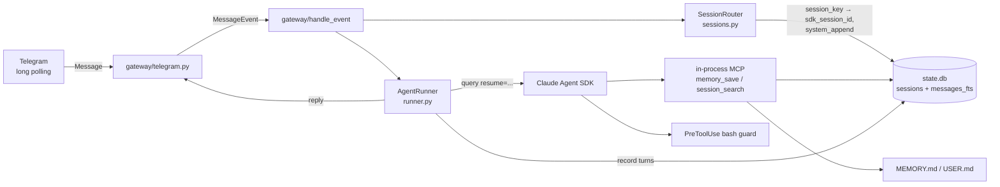

# claude-hermes Phase 1 (Core Agent + Telegram Gateway) Implementation Plan

> **For agentic workers:** REQUIRED SUB-SKILL: Use superpowers:subagent-driven-development (recommended) or superpowers:executing-plans to implement this plan task-by-task. Steps use checkbox (`- [ ]`) syntax for tracking.

**Goal:** A persistent personal agent on the Claude Agent SDK (Python), reachable via Telegram, with Hermes-style session routing, bounded persistent memory, a skills directory, full-text recall over past conversations, and Docker deployment.

**Architecture:** A single asyncio process: an aiogram long-polling Telegram gateway normalizes messages into `MessageEvent`s, a `SessionRouter` maps deterministic session keys to SDK session ids (SQLite) with idle/daily reset policies, and an `AgentRunner` executes one `query()` per turn with `resume`, a byte-stable per-session system-prompt append (frozen memory snapshot, date-only timestamp), an in-process MCP server (`memory_save`, `session_search`), and a `PreToolUse` bash guard. All state lives under one `CH_HOME` directory (a Docker volume in production).

**Tech Stack:** Python 3.12, `claude-agent-sdk`, `aiogram` 3.x, `aiosqlite` (SQLite + FTS5), `pyyaml`, `pytest` + `pytest-asyncio`. Docker: `python:3.12-slim` + Node 20 (Claude Code CLI).

## Locked Decisions

- **Session key wire format:** `tg:{chat_type}:{chat_id}` for private chats, `tg:{chat_type}:{chat_id}:{user_id}` for groups (per-user isolation in groups, copied from Hermes). This string is the primary key in SQLite and must never change shape.
- **One `query()` per turn with `resume`** (no persistent `ClaudeSDKClient` pool) — stateless workers, prompt cache preserved by a byte-stable prefix; a client pool is a later optimization, not a v1 requirement.
- **System prompt = preset `claude_code` + per-session append.** The append is built once when a session is created, stored in the `sessions` table, and reused verbatim on every resumed turn (Hermes cache rule: never rebuild mid-session). Timestamp inside is date-only.
- **Frozen memory snapshot:** `MEMORY.md` / `USER.md` content is injected into the append at session creation only; `memory_save` writes to disk immediately but takes effect next session.
- **Memory limits are character-based:** `MEMORY.md` ≤ 2200 chars, `USER.md` ≤ 1375 chars (model-independent budgeting, from Hermes).
- **Data layout:** everything under `CH_HOME` (env var; default `~/.claude-hermes`, `/data` in Docker): `config.yaml`, `MEMORY.md`, `USER.md`, `state.db`, `agent_home/` (SDK `cwd`; skills live at `agent_home/.claude/skills/`).
- **Secrets in env only, behavior in `config.yaml`** (Hermes rule): `TELEGRAM_BOT_TOKEN` and `ANTHROPIC_API_KEY` come from env/`.env`; everything else from `config.yaml`.
- **Permissions:** `permission_mode="bypassPermissions"` inside the Docker container (container is the sandbox) + a `PreToolUse` hook that denies catastrophic bash patterns and reads of `.env`.
- **Telegram transport: long polling** — no public inbound port on the VPS (same posture as Hermes' relay design).
- **Recall store:** our own FTS5 table in `state.db` indexing user/assistant turns we route (not parsing SDK JSONL transcripts).

## Global Constraints

- Python ≥ 3.12; all I/O async (`aiosqlite`, aiogram 3); tests run with `pytest` + `pytest-asyncio` in `asyncio_mode = "auto"`.
- No new env vars for non-secret config — behavioral settings go in `config.yaml`.
- Never hardcode `~/.claude-hermes` outside `paths.py`; always resolve through `get_home()`.
- All file writes to state files must be atomic where practical (write temp + `os.replace`).
- Deferred to later plans: learning loop (background review, provenance, curator) — Phase 2 plan; cron scheduler + delivery — Phase 3 plan. Nothing in this plan may preclude them (e.g. `sessions` table keeps `updated_at` for idle detection reuse; memory/skills layout already SDK-compatible).

## Architecture Diagram



---

### Task 1: Project scaffold, paths and config

**Files:**
- Create: `pyproject.toml`
- Create: `src/claude_hermes/__init__.py`
- Create: `src/claude_hermes/paths.py`
- Create: `src/claude_hermes/config.py`
- Create: `config.yaml.example`
- Create: `.env.example`
- Create: `.gitignore`
- Test: `tests/test_paths_config.py`

**Interfaces:**
- Produces: `paths.get_home() -> Path` (resolves `CH_HOME` env var, default `~/.claude-hermes`, creates subdirs `agent_home/.claude/skills`, `logs`); `config.Config` dataclass (fields below); `config.load_config(home: Path) -> Config`.

- [ ] **Step 1: Initialize repo and package layout**

```bash
cd D:/projects/claude-hermes
git init -b main
mkdir -p src/claude_hermes tests
```

- [ ] **Step 2: Write `pyproject.toml`**

```toml
[project]
name = "claude-hermes"
version = "0.1.0"
description = "Self-improving personal agent on the Claude Agent SDK"
requires-python = ">=3.12"
dependencies = [
    "claude-agent-sdk>=0.1.0",
    "aiogram>=3.7",
    "aiosqlite>=0.20",
    "pyyaml>=6.0",
]

[project.optional-dependencies]
dev = ["pytest>=8", "pytest-asyncio>=0.23"]

[build-system]
requires = ["setuptools>=68"]
build-backend = "setuptools.build_meta"

[tool.setuptools.packages.find]
where = ["src"]

[tool.pytest.ini_options]
asyncio_mode = "auto"
testpaths = ["tests"]
```

- [ ] **Step 3: Write `.gitignore` and `.env.example`**

`.gitignore`:
```
.venv/
__pycache__/
*.egg-info/
.env
.pytest_cache/
```

`.env.example`:
```
# Secrets ONLY (behavior goes in config.yaml)
TELEGRAM_BOT_TOKEN=123456:replace-me
ANTHROPIC_API_KEY=sk-ant-replace-me
```

- [ ] **Step 4: Write the failing test**

`tests/test_paths_config.py`:
```python
from pathlib import Path

from claude_hermes.paths import get_home
from claude_hermes.config import Config, load_config


def test_get_home_respects_env_and_creates_layout(tmp_path, monkeypatch):
    monkeypatch.setenv("CH_HOME", str(tmp_path / "home"))
    home = get_home()
    assert home == tmp_path / "home"
    assert (home / "agent_home" / ".claude" / "skills").is_dir()
    assert (home / "logs").is_dir()


def test_load_config_defaults_when_missing(tmp_path):
    cfg = load_config(tmp_path)
    assert cfg.model == "claude-sonnet-5"
    assert cfg.max_turns == 50
    assert cfg.idle_reset_hours == 24.0
    assert cfg.daily_reset_hour == 4
    assert cfg.group_require_mention is True
    assert cfg.memory_max_chars == 2200
    assert cfg.user_max_chars == 1375


def test_load_config_reads_yaml_and_env_secret(tmp_path, monkeypatch):
    (tmp_path / "config.yaml").write_text(
        "model: claude-haiku-4-5\nmax_turns: 10\n", encoding="utf-8"
    )
    monkeypatch.setenv("TELEGRAM_BOT_TOKEN", "tok-123")
    cfg = load_config(tmp_path)
    assert cfg.model == "claude-haiku-4-5"
    assert cfg.max_turns == 10
    assert cfg.telegram_token == "tok-123"
```

- [ ] **Step 5: Run test to verify it fails**

Run: `python -m pytest tests/test_paths_config.py -v`
Expected: FAIL with `ModuleNotFoundError: No module named 'claude_hermes'`

- [ ] **Step 6: Implement `paths.py` and `config.py`**

`src/claude_hermes/__init__.py`:
```python
__version__ = "0.1.0"
```

`src/claude_hermes/paths.py`:
```python
import os
from pathlib import Path


def get_home() -> Path:
    """Resolve the state directory. Never hardcode this path elsewhere."""
    home = Path(os.environ.get("CH_HOME", str(Path.home() / ".claude-hermes")))
    (home / "agent_home" / ".claude" / "skills").mkdir(parents=True, exist_ok=True)
    (home / "logs").mkdir(parents=True, exist_ok=True)
    return home
```

`src/claude_hermes/config.py`:
```python
import os
from dataclasses import dataclass
from pathlib import Path

import yaml


@dataclass
class Config:
    model: str = "claude-sonnet-5"
    max_turns: int = 50
    idle_reset_hours: float = 24.0
    daily_reset_hour: int | None = 4
    group_require_mention: bool = True
    memory_max_chars: int = 2200
    user_max_chars: int = 1375
    telegram_token: str = ""


def load_config(home: Path) -> Config:
    cfg = Config()
    path = home / "config.yaml"
    if path.is_file():
        data = yaml.safe_load(path.read_text(encoding="utf-8")) or {}
        for key, value in data.items():
            if hasattr(cfg, key) and key != "telegram_token":
                setattr(cfg, key, value)
    cfg.telegram_token = os.environ.get("TELEGRAM_BOT_TOKEN", "")
    return cfg
```

`config.yaml.example`:
```yaml
# Behavioral settings (secrets go in .env)
model: claude-sonnet-5
max_turns: 50
idle_reset_hours: 24
daily_reset_hour: 4          # null to disable daily reset
group_require_mention: true
memory_max_chars: 2200
user_max_chars: 1375
```

- [ ] **Step 7: Install and run tests to verify they pass**

```bash
python -m venv .venv && .venv/Scripts/pip install -e ".[dev]"
.venv/Scripts/python -m pytest tests/test_paths_config.py -v
```
Expected: 3 PASSED

- [ ] **Step 8: Commit**

```bash
git add -A
git commit -m "feat: project scaffold with paths and config loading"
```

---

### Task 2: SQLite state store with FTS5 recall index

**Files:**
- Create: `src/claude_hermes/db.py`
- Test: `tests/test_db.py`

**Interfaces:**
- Reuses: `paths.get_home()` from Task 1 (callers pass `home / "state.db"`).
- Produces: `db.Database` with `await Database.open(path) -> Database`, `await close()`, `await get_session(session_key) -> dict | None` (keys: `session_key, sdk_session_id, system_append, created_at, updated_at`), `await upsert_session(session_key, sdk_session_id, system_append, now)`, `await touch_session(session_key, now)`, `await reset_session(session_key)` (deletes row), `await record_message(session_key, role, content, ts)`, `await search_messages(query, limit=8) -> list[dict]` (keys: `session_key, role, snippet, ts`).

- [ ] **Step 1: Write the failing test**

`tests/test_db.py`:
```python
from claude_hermes.db import Database

NOW = "2026-07-12T10:00:00+00:00"


async def test_session_roundtrip(tmp_path):
    db = await Database.open(tmp_path / "state.db")
    assert await db.get_session("tg:private:1") is None
    await db.upsert_session("tg:private:1", "sdk-abc", "APPEND", NOW)
    row = await db.get_session("tg:private:1")
    assert row["sdk_session_id"] == "sdk-abc"
    assert row["system_append"] == "APPEND"
    assert row["updated_at"] == NOW
    await db.touch_session("tg:private:1", "2026-07-12T11:00:00+00:00")
    row = await db.get_session("tg:private:1")
    assert row["updated_at"] == "2026-07-12T11:00:00+00:00"
    await db.reset_session("tg:private:1")
    assert await db.get_session("tg:private:1") is None
    await db.close()


async def test_fts_search_returns_snippets(tmp_path):
    db = await Database.open(tmp_path / "state.db")
    await db.record_message("tg:private:1", "user", "we discussed kubernetes ingress", NOW)
    await db.record_message("tg:private:1", "assistant", "ingress fixed via nginx annotation", NOW)
    await db.record_message("tg:private:2", "user", "recipe for borscht", NOW)
    hits = await db.search_messages("ingress")
    assert len(hits) == 2
    assert all("ingress" in h["snippet"] for h in hits)
    assert hits[0]["session_key"] == "tg:private:1"
    assert await db.search_messages("nonexistenttoken") == []
    await db.close()
```

- [ ] **Step 2: Run test to verify it fails**

Run: `.venv/Scripts/python -m pytest tests/test_db.py -v`
Expected: FAIL with `ModuleNotFoundError` / `ImportError` on `claude_hermes.db`

- [ ] **Step 3: Implement `db.py`**

```python
from __future__ import annotations

from pathlib import Path

import aiosqlite

_SCHEMA = """
CREATE TABLE IF NOT EXISTS sessions (
    session_key    TEXT PRIMARY KEY,
    sdk_session_id TEXT,
    system_append  TEXT,
    created_at     TEXT NOT NULL,
    updated_at     TEXT NOT NULL
);
CREATE VIRTUAL TABLE IF NOT EXISTS messages_fts USING fts5(
    session_key, role, content, ts UNINDEXED
);
"""


class Database:
    def __init__(self, conn: aiosqlite.Connection):
        self._conn = conn

    @classmethod
    async def open(cls, path: Path) -> "Database":
        conn = await aiosqlite.connect(path)
        conn.row_factory = aiosqlite.Row
        await conn.executescript(_SCHEMA)
        await conn.commit()
        return cls(conn)

    async def close(self) -> None:
        await self._conn.close()

    async def get_session(self, session_key: str) -> dict | None:
        cur = await self._conn.execute(
            "SELECT * FROM sessions WHERE session_key = ?", (session_key,)
        )
        row = await cur.fetchone()
        return dict(row) if row else None

    async def upsert_session(
        self, session_key: str, sdk_session_id: str | None,
        system_append: str, now: str,
    ) -> None:
        await self._conn.execute(
            """INSERT INTO sessions (session_key, sdk_session_id, system_append,
                                     created_at, updated_at)
               VALUES (?, ?, ?, ?, ?)
               ON CONFLICT(session_key) DO UPDATE SET
                 sdk_session_id = excluded.sdk_session_id,
                 system_append  = excluded.system_append,
                 updated_at     = excluded.updated_at""",
            (session_key, sdk_session_id, system_append, now, now),
        )
        await self._conn.commit()

    async def touch_session(self, session_key: str, now: str) -> None:
        await self._conn.execute(
            "UPDATE sessions SET updated_at = ? WHERE session_key = ?",
            (now, session_key),
        )
        await self._conn.commit()

    async def reset_session(self, session_key: str) -> None:
        await self._conn.execute(
            "DELETE FROM sessions WHERE session_key = ?", (session_key,)
        )
        await self._conn.commit()

    async def record_message(
        self, session_key: str, role: str, content: str, ts: str
    ) -> None:
        await self._conn.execute(
            "INSERT INTO messages_fts (session_key, role, content, ts) VALUES (?, ?, ?, ?)",
            (session_key, role, content, ts),
        )
        await self._conn.commit()

    async def search_messages(self, query: str, limit: int = 8) -> list[dict]:
        try:
            cur = await self._conn.execute(
                """SELECT session_key, role, ts,
                          snippet(messages_fts, 2, '[', ']', ' … ', 12) AS snippet
                   FROM messages_fts WHERE messages_fts MATCH ?
                   ORDER BY bm25(messages_fts) LIMIT ?""",
                (query, limit),
            )
        except aiosqlite.OperationalError:
            return []  # malformed FTS query from the model — return empty, not a crash
        return [dict(r) for r in await cur.fetchall()]
```

- [ ] **Step 4: Run test to verify it passes**

Run: `.venv/Scripts/python -m pytest tests/test_db.py -v`
Expected: 2 PASSED

- [ ] **Step 5: Commit**

```bash
git add src/claude_hermes/db.py tests/test_db.py
git commit -m "feat: sqlite state store with fts5 recall index"
```

---

### Task 3: Session keys and reset-policy router

**Files:**
- Create: `src/claude_hermes/sessions.py`
- Test: `tests/test_sessions.py`

**Interfaces:**
- Reuses: `db.Database` (Task 2), `config.Config` (Task 1).
- Produces: `sessions.build_session_key(chat_type: str, chat_id: int | str, user_id: int | str | None = None) -> str`; `sessions.SessionRouter(db, cfg)` with `await route(session_key, now: datetime) -> dict | None` — returns the stored session row if it is still fresh under idle/daily policy, otherwise deletes it and returns `None` (meaning: start a new SDK session). Also `await bind(session_key, sdk_session_id, system_append, now_iso)` and `await touch(session_key, now_iso)` thin wrappers.

- [ ] **Step 1: Write the failing test**

`tests/test_sessions.py`:
```python
from datetime import datetime, timezone

from claude_hermes.config import Config
from claude_hermes.db import Database
from claude_hermes.sessions import SessionRouter, build_session_key


def dt(s: str) -> datetime:
    return datetime.fromisoformat(s).replace(tzinfo=timezone.utc)


def test_build_session_key_private_and_group():
    assert build_session_key("private", 42) == "tg:private:42"
    assert build_session_key("supergroup", -100, user_id=7) == "tg:supergroup:-100:7"


async def make_router(tmp_path, **cfg_kw):
    db = await Database.open(tmp_path / "state.db")
    return db, SessionRouter(db, Config(**cfg_kw))


async def test_route_returns_fresh_session(tmp_path):
    db, router = await make_router(tmp_path)
    await router.bind("tg:private:1", "sdk-1", "APPEND", "2026-07-12T10:00:00+00:00")
    row = await router.route("tg:private:1", dt("2026-07-12T12:00:00"))
    assert row is not None and row["sdk_session_id"] == "sdk-1"
    await db.close()


async def test_route_idle_reset(tmp_path):
    db, router = await make_router(tmp_path, idle_reset_hours=24.0)
    await router.bind("tg:private:1", "sdk-1", "APPEND", "2026-07-10T10:00:00+00:00")
    assert await router.route("tg:private:1", dt("2026-07-12T12:00:00")) is None
    assert await db.get_session("tg:private:1") is None  # stale row purged
    await db.close()


async def test_route_daily_reset_at_4am(tmp_path):
    db, router = await make_router(tmp_path, daily_reset_hour=4, idle_reset_hours=999.0)
    # last activity yesterday 23:00, now today 09:00 → crossed the 04:00 boundary
    await router.bind("tg:private:1", "sdk-1", "APPEND", "2026-07-11T23:00:00+00:00")
    assert await router.route("tg:private:1", dt("2026-07-12T09:00:00")) is None
    # same day, before → after boundary not crossed: 01:00 → 03:00 stays alive
    await router.bind("tg:private:2", "sdk-2", "APPEND", "2026-07-12T01:00:00+00:00")
    assert await router.route("tg:private:2", dt("2026-07-12T03:00:00")) is not None
    await db.close()


async def test_route_unknown_key_is_none(tmp_path):
    db, router = await make_router(tmp_path)
    assert await router.route("tg:private:404", dt("2026-07-12T09:00:00")) is None
    await db.close()
```

- [ ] **Step 2: Run test to verify it fails**

Run: `.venv/Scripts/python -m pytest tests/test_sessions.py -v`
Expected: FAIL with `ImportError` on `claude_hermes.sessions`

- [ ] **Step 3: Implement `sessions.py`**

```python
from __future__ import annotations

from datetime import datetime, timedelta, timezone

from .config import Config
from .db import Database


def build_session_key(
    chat_type: str, chat_id: int | str, user_id: int | str | None = None
) -> str:
    """Deterministic routing/isolation primitive (Hermes pattern).

    Private chats share one lane; group chats isolate per user.
    """
    key = f"tg:{chat_type}:{chat_id}"
    if user_id is not None and chat_type != "private":
        key += f":{user_id}"
    return key


class SessionRouter:
    def __init__(self, db: Database, cfg: Config):
        self._db = db
        self._cfg = cfg

    async def route(self, session_key: str, now: datetime) -> dict | None:
        row = await self._db.get_session(session_key)
        if row is None:
            return None
        last = datetime.fromisoformat(row["updated_at"])
        if last.tzinfo is None:
            last = last.replace(tzinfo=timezone.utc)
        if self._expired(last, now):
            await self._db.reset_session(session_key)
            return None
        return row

    def _expired(self, last: datetime, now: datetime) -> bool:
        if now - last > timedelta(hours=self._cfg.idle_reset_hours):
            return True
        hour = self._cfg.daily_reset_hour
        if hour is not None:
            boundary = now.replace(hour=hour, minute=0, second=0, microsecond=0)
            if boundary > now:
                boundary -= timedelta(days=1)
            if last < boundary:
                return True
        return False

    async def bind(
        self, session_key: str, sdk_session_id: str, system_append: str, now_iso: str
    ) -> None:
        await self._db.upsert_session(session_key, sdk_session_id, system_append, now_iso)

    async def touch(self, session_key: str, now_iso: str) -> None:
        await self._db.touch_session(session_key, now_iso)
```

- [ ] **Step 4: Run test to verify it passes**

Run: `.venv/Scripts/python -m pytest tests/test_sessions.py -v`
Expected: 5 PASSED

- [ ] **Step 5: Commit**

```bash
git add src/claude_hermes/sessions.py tests/test_sessions.py
git commit -m "feat: deterministic session keys with idle/daily reset router"
```

---

### Task 4: Bounded persistent memory store

**Files:**
- Create: `src/claude_hermes/memory.py`
- Test: `tests/test_memory.py`

**Interfaces:**
- Reuses: `config.Config` limits (Task 1); files live at `home / "MEMORY.md"` and `home / "USER.md"`.
- Produces: `memory.MemoryStore(home: Path, memory_max: int, user_max: int)` with `snapshot() -> str` (formatted block for the system-prompt append; `""` when both files are empty) and `save(target: str, action: str, content: str, old_content: str = "") -> str` where `target ∈ {"memory","user"}`, `action ∈ {"add","replace","remove"}`; returns a human-readable status string (the tool result). Entries are `- ` bullet lines. Char limits enforced on the whole file; over-limit `add` returns an error string instructing consolidation, without writing.

- [ ] **Step 1: Write the failing test**

`tests/test_memory.py`:
```python
from claude_hermes.memory import MemoryStore


def make(tmp_path, memory_max=200, user_max=100):
    return MemoryStore(tmp_path, memory_max=memory_max, user_max=user_max)


def test_add_and_snapshot(tmp_path):
    store = make(tmp_path)
    assert store.snapshot() == ""
    out = store.save("memory", "add", "Project X deploys via docker compose on VPS")
    assert "Saved" in out
    store.save("user", "add", "User prefers concise answers in Russian")
    snap = store.snapshot()
    assert "## Agent memory" in snap and "docker compose" in snap
    assert "## User profile" in snap and "concise answers" in snap
    # snapshot is read from disk state, not cached
    assert (tmp_path / "MEMORY.md").exists() and (tmp_path / "USER.md").exists()


def test_add_over_limit_rejected(tmp_path):
    store = make(tmp_path, memory_max=50)
    store.save("memory", "add", "short fact")
    out = store.save("memory", "add", "x" * 100)
    assert "full" in out.lower()
    assert "x" * 100 not in (tmp_path / "MEMORY.md").read_text(encoding="utf-8")


def test_replace_and_remove(tmp_path):
    store = make(tmp_path)
    store.save("memory", "add", "Server IP is 10.0.0.1")
    out = store.save("memory", "replace", "Server IP is 10.0.0.2", old_content="10.0.0.1")
    assert "Replaced" in out
    assert "10.0.0.2" in (tmp_path / "MEMORY.md").read_text(encoding="utf-8")
    out = store.save("memory", "remove", "", old_content="10.0.0.2")
    assert "Removed" in out
    assert store.snapshot() == "" or "10.0.0.2" not in store.snapshot()


def test_replace_missing_old_content_errors(tmp_path):
    store = make(tmp_path)
    out = store.save("memory", "replace", "new", old_content="never-existed")
    assert "not found" in out.lower()
```

- [ ] **Step 2: Run test to verify it fails**

Run: `.venv/Scripts/python -m pytest tests/test_memory.py -v`
Expected: FAIL with `ImportError` on `claude_hermes.memory`

- [ ] **Step 3: Implement `memory.py`**

```python
from __future__ import annotations

import os
import tempfile
from pathlib import Path

_FILES = {"memory": "MEMORY.md", "user": "USER.md"}
_HEADERS = {"memory": "## Agent memory", "user": "## User profile"}


class MemoryStore:
    """Char-bounded persistent memory (Hermes pattern).

    Writes hit disk immediately; the system prompt injects a snapshot only at
    session creation, so mid-session writes take effect next session (this
    keeps the prompt prefix byte-stable and the provider cache warm).
    """

    def __init__(self, home: Path, memory_max: int, user_max: int):
        self._home = home
        self._limits = {"memory": memory_max, "user": user_max}

    def _path(self, target: str) -> Path:
        return self._home / _FILES[target]

    def _read(self, target: str) -> list[str]:
        path = self._path(target)
        if not path.is_file():
            return []
        lines = path.read_text(encoding="utf-8").splitlines()
        return [ln for ln in lines if ln.startswith("- ")]

    def _write(self, target: str, entries: list[str]) -> None:
        path = self._path(target)
        fd, tmp = tempfile.mkstemp(dir=str(self._home))
        with os.fdopen(fd, "w", encoding="utf-8") as f:
            f.write("\n".join(entries) + ("\n" if entries else ""))
        os.replace(tmp, path)

    def save(self, target: str, action: str, content: str, old_content: str = "") -> str:
        if target not in _FILES:
            return f"Error: unknown target '{target}' (use 'memory' or 'user')."
        entries = self._read(target)
        if action == "add":
            new = entries + [f"- {content.strip()}"]
            if len("\n".join(new)) > self._limits[target]:
                return (
                    f"Error: {target} store is full "
                    f"({self._limits[target]} chars). Consolidate with "
                    "action='replace' instead of adding."
                )
            self._write(target, new)
            return f"Saved to {target}."
        matches = [e for e in entries if old_content and old_content in e]
        if not matches:
            return f"Error: old_content not found in {target}."
        if action == "replace":
            new = [f"- {content.strip()}" if e in matches else e for e in entries]
            if len("\n".join(new)) > self._limits[target]:
                return f"Error: replacement would exceed the {target} limit."
            self._write(target, new)
            return f"Replaced entry in {target}."
        if action == "remove":
            self._write(target, [e for e in entries if e not in matches])
            return f"Removed entry from {target}."
        return f"Error: unknown action '{action}' (use add/replace/remove)."

    def snapshot(self) -> str:
        parts = []
        for target in ("user", "memory"):
            entries = self._read(target)
            if entries:
                parts.append(_HEADERS[target] + "\n" + "\n".join(entries))
        return "\n\n".join(parts)
```

- [ ] **Step 4: Run test to verify it passes**

Run: `.venv/Scripts/python -m pytest tests/test_memory.py -v`
Expected: 4 PASSED

- [ ] **Step 5: Commit**

```bash
git add src/claude_hermes/memory.py tests/test_memory.py
git commit -m "feat: char-bounded MEMORY.md/USER.md store with frozen-snapshot contract"
```

---

### Task 5: System-prompt append builder

**Files:**
- Create: `src/claude_hermes/prompt.py`
- Test: `tests/test_prompt.py`

**Interfaces:**
- Reuses: `memory.MemoryStore.snapshot()` output (Task 4).
- Produces: `prompt.build_system_append(memory_snapshot: str, today: date) -> str`. The string is built once per session, persisted in `sessions.system_append`, and reused verbatim on resume (never rebuilt mid-session). Contains: persona + operating rules (constant `prompt.PERSONA`), memory snapshot section (omitted when empty), and a **date-only** timestamp line (Hermes cache rule — minute precision would invalidate the prompt prefix cache).

- [ ] **Step 1: Write the failing test**

`tests/test_prompt.py`:
```python
from datetime import date

from claude_hermes.prompt import build_system_append


def test_append_contains_persona_memory_and_date_only():
    out = build_system_append("## User profile\n- Likes Rust", date(2026, 7, 12))
    assert "personal agent" in out.lower()
    assert "## User profile" in out
    assert "2026-07-12" in out
    assert ":" not in out.splitlines()[-1]  # date-only stamp, no clock time


def test_append_stable_for_same_inputs():
    a = build_system_append("snap", date(2026, 7, 12))
    b = build_system_append("snap", date(2026, 7, 12))
    assert a == b  # byte-stable → provider prompt cache stays warm


def test_append_omits_memory_section_when_empty():
    out = build_system_append("", date(2026, 7, 12))
    assert "Persistent memory" not in out
```

- [ ] **Step 2: Run test to verify it fails**

Run: `.venv/Scripts/python -m pytest tests/test_prompt.py -v`
Expected: FAIL with `ImportError` on `claude_hermes.prompt`

- [ ] **Step 3: Implement `prompt.py`**

```python
from __future__ import annotations

from datetime import date

PERSONA = """\
You are a persistent personal agent for your user, reachable via Telegram.

Operating rules:
- Persist durable knowledge with the `memory_save` tool: stable facts about \
the user (target='user') and about the environment/projects (target='memory'). \
Write declarative facts ("User prefers X"), never imperatives ("Always do X"). \
If a fact will be stale in a week, it does not belong in memory.
- Recall past conversations with the `session_search` tool before saying \
"I don't remember".
- Keep Telegram replies concise; long output belongs in files.
- You run inside a container; the user's data directory is your working area."""


def build_system_append(memory_snapshot: str, today: date) -> str:
    parts = [PERSONA]
    if memory_snapshot:
        parts.append("# Persistent memory (snapshot at session start)\n\n" + memory_snapshot)
    parts.append(f"Today's date: {today.isoformat()}")
    return "\n\n".join(parts)
```

- [ ] **Step 4: Run test to verify it passes**

Run: `.venv/Scripts/python -m pytest tests/test_prompt.py -v`
Expected: 3 PASSED

- [ ] **Step 5: Commit**

```bash
git add src/claude_hermes/prompt.py tests/test_prompt.py
git commit -m "feat: byte-stable system prompt append with date-only stamp"
```

---

### Task 6: In-process MCP tools (`memory_save`, `session_search`)

**Files:**
- Create: `src/claude_hermes/tools.py`
- Test: `tests/test_tools.py`

**Interfaces:**
- Reuses: `memory.MemoryStore` (Task 4), `db.Database.search_messages` (Task 2); `tool` / `create_sdk_mcp_server` from `claude_agent_sdk`.
- Produces: `tools.build_hermes_server(store: MemoryStore, db: Database)` → returns `(server, tool_names)` where `server` goes into `ClaudeAgentOptions.mcp_servers={"hermes": server}` and `tool_names == ["mcp__hermes__memory_save", "mcp__hermes__session_search"]` goes into `allowed_tools`. Also exposes the raw handlers as `tools.make_handlers(store, db) -> dict[str, callable]` so tests (and Phase 2's review agent) can call them without the MCP envelope.

- [ ] **Step 1: Write the failing test**

`tests/test_tools.py`:
```python
from claude_hermes.db import Database
from claude_hermes.memory import MemoryStore
from claude_hermes.tools import build_hermes_server, make_handlers


async def test_memory_save_handler_writes(tmp_path):
    store = MemoryStore(tmp_path, 2200, 1375)
    db = await Database.open(tmp_path / "state.db")
    handlers = make_handlers(store, db)
    result = await handlers["memory_save"](
        {"target": "user", "action": "add", "content": "Speaks Russian"}
    )
    assert "Saved" in result["content"][0]["text"]
    assert "Speaks Russian" in (tmp_path / "USER.md").read_text(encoding="utf-8")
    await db.close()


async def test_session_search_handler_finds(tmp_path):
    store = MemoryStore(tmp_path, 2200, 1375)
    db = await Database.open(tmp_path / "state.db")
    await db.record_message("tg:private:1", "user", "postgres backup cron broke", "2026-07-01")
    handlers = make_handlers(store, db)
    result = await handlers["session_search"]({"query": "postgres backup"})
    text = result["content"][0]["text"]
    assert "postgres" in text and "tg:private:1" in text
    empty = await handlers["session_search"]({"query": "zzzznope"})
    assert "No matches" in empty["content"][0]["text"]
    await db.close()


async def test_build_server_returns_tool_names(tmp_path):
    store = MemoryStore(tmp_path, 2200, 1375)
    db = await Database.open(tmp_path / "state.db")
    server, names = build_hermes_server(store, db)
    assert names == ["mcp__hermes__memory_save", "mcp__hermes__session_search"]
    assert server is not None
    await db.close()
```

- [ ] **Step 2: Run test to verify it fails**

Run: `.venv/Scripts/python -m pytest tests/test_tools.py -v`
Expected: FAIL with `ImportError` on `claude_hermes.tools`

- [ ] **Step 3: Implement `tools.py`**

```python
from __future__ import annotations

from claude_agent_sdk import create_sdk_mcp_server, tool

from .db import Database
from .memory import MemoryStore


def make_handlers(store: MemoryStore, db: Database) -> dict:
    async def memory_save(args: dict) -> dict:
        text = store.save(
            target=args.get("target", "memory"),
            action=args.get("action", "add"),
            content=args.get("content", ""),
            old_content=args.get("old_content", ""),
        )
        return {"content": [{"type": "text", "text": text}]}

    async def session_search(args: dict) -> dict:
        hits = await db.search_messages(args.get("query", ""), limit=8)
        if not hits:
            text = "No matches in past conversations."
        else:
            lines = [
                f"[{h['ts']}] {h['session_key']} ({h['role']}): {h['snippet']}"
                for h in hits
            ]
            text = "\n".join(lines)
        return {"content": [{"type": "text", "text": text}]}

    return {"memory_save": memory_save, "session_search": session_search}


def build_hermes_server(store: MemoryStore, db: Database):
    handlers = make_handlers(store, db)

    memory_save = tool(
        "memory_save",
        "Persist a durable fact. target='user' for facts about the user, "
        "'memory' for environment/project facts. Declarative facts only; "
        "takes effect next session.",
        {"target": str, "action": str, "content": str, "old_content": str},
    )(handlers["memory_save"])

    session_search = tool(
        "session_search",
        "Full-text search across past conversations (FTS5). "
        "Use before claiming you don't remember something.",
        {"query": str},
    )(handlers["session_search"])

    server = create_sdk_mcp_server(
        name="hermes", version="1.0.0", tools=[memory_save, session_search]
    )
    return server, ["mcp__hermes__memory_save", "mcp__hermes__session_search"]
```

- [ ] **Step 4: Run test to verify it passes**

Run: `.venv/Scripts/python -m pytest tests/test_tools.py -v`
Expected: 3 PASSED
Note: if the installed `claude-agent-sdk` version's `tool` decorator signature differs (schema dict vs type map), adapt the call to the installed version — check with `python -c "import claude_agent_sdk, inspect; print(inspect.signature(claude_agent_sdk.tool))"`.

- [ ] **Step 5: Commit**

```bash
git add src/claude_hermes/tools.py tests/test_tools.py
git commit -m "feat: in-process MCP server with memory_save and session_search"
```

---

### Task 7: PreToolUse bash guard

**Files:**
- Create: `src/claude_hermes/guard.py`
- Test: `tests/test_guard.py`

**Interfaces:**
- Produces: `guard.check_command(cmd: str) -> str | None` (pure function: returns a denial reason or `None`) and `guard.bash_guard(input_data, tool_use_id, context) -> dict` (async SDK hook; wraps `check_command`, returns `{}` to allow or the PreToolUse deny envelope). Wired in Task 8 via `HookMatcher(matcher="Bash", hooks=[bash_guard])`.

- [ ] **Step 1: Write the failing test**

`tests/test_guard.py`:
```python
from claude_hermes.guard import bash_guard, check_command


def test_check_command_blocks_catastrophic():
    assert check_command("rm -rf /") is not None
    assert check_command("rm -rf / --no-preserve-root") is not None
    assert check_command("mkfs.ext4 /dev/sda1") is not None
    assert check_command("dd if=/dev/zero of=/dev/sda") is not None
    assert check_command(":(){ :|:& };:") is not None
    assert check_command("cat /app/.env") is not None
    assert check_command("cat ~/.env") is not None


def test_check_command_allows_normal_work():
    assert check_command("ls -la && rm -rf ./build") is None
    assert check_command("grep -r TODO src/") is None
    assert check_command("git commit -m 'env update'") is None


async def test_bash_guard_hook_envelope():
    deny = await bash_guard(
        {"tool_name": "Bash", "tool_input": {"command": "rm -rf /"}}, "t1", None
    )
    out = deny["hookSpecificOutput"]
    assert out["permissionDecision"] == "deny"
    assert out["hookEventName"] == "PreToolUse"
    allow = await bash_guard(
        {"tool_name": "Bash", "tool_input": {"command": "ls"}}, "t2", None
    )
    assert allow == {}
```

- [ ] **Step 2: Run test to verify it fails**

Run: `.venv/Scripts/python -m pytest tests/test_guard.py -v`
Expected: FAIL with `ImportError` on `claude_hermes.guard`

- [ ] **Step 3: Implement `guard.py`**

```python
from __future__ import annotations

import re

_RULES: list[tuple[re.Pattern, str]] = [
    (re.compile(r"\brm\s+(-[a-zA-Z]*r[a-zA-Z]*f|-[a-zA-Z]*f[a-zA-Z]*r)\s+/(\s|$|--)"),
     "recursive delete of filesystem root"),
    (re.compile(r"\bmkfs\.?\w*\s"), "filesystem format command"),
    (re.compile(r"\bdd\b.*\bof=/dev/"), "raw write to a block device"),
    (re.compile(r":\(\)\s*\{.*\};\s*:"), "fork bomb"),
    (re.compile(r"(^|[\s/])\.env\b"), "access to .env secrets file"),
]


def check_command(cmd: str) -> str | None:
    for pattern, reason in _RULES:
        if pattern.search(cmd):
            return reason
    return None


async def bash_guard(input_data: dict, tool_use_id, context) -> dict:
    cmd = (input_data.get("tool_input") or {}).get("command", "")
    reason = check_command(cmd)
    if reason is None:
        return {}
    return {
        "hookSpecificOutput": {
            "hookEventName": "PreToolUse",
            "permissionDecision": "deny",
            "permissionDecisionReason": f"Blocked: {reason}.",
        }
    }
```

- [ ] **Step 4: Run test to verify it passes**

Run: `.venv/Scripts/python -m pytest tests/test_guard.py -v`
Expected: 3 PASSED
Note: `git commit -m 'env update'` must pass — the `.env` rule anchors on a path-ish boundary (`^`, whitespace, or `/` before `.env`), not the substring `env`.

- [ ] **Step 5: Commit**

```bash
git add src/claude_hermes/guard.py tests/test_guard.py
git commit -m "feat: PreToolUse bash guard denying catastrophic commands"
```

---

### Task 8: AgentRunner — one query per turn with resume

**Files:**
- Create: `src/claude_hermes/runner.py`
- Test: `tests/test_runner.py`

**Interfaces:**
- Reuses: `SessionRouter` (Task 3), `MemoryStore.snapshot` (Task 4), `build_system_append` (Task 5), `build_hermes_server` (Task 6), `bash_guard` (Task 7), `Database.record_message` (Task 2); SDK: `query`, `ClaudeAgentOptions`, `AssistantMessage`, `TextBlock`, `ResultMessage`, `HookMatcher`.
- Produces: `runner.AgentRunner(cfg: Config, home: Path, db: Database, router: SessionRouter, store: MemoryStore)` with `await run_turn(session_key: str, user_text: str) -> str`. Behavior contract: per-session-key `asyncio.Lock` (turns in one chat serialize; different chats run concurrently); new session → fresh memory snapshot baked into `system_append` and persisted via `router.bind`; resumed session → the stored `system_append` reused verbatim; user and assistant turns recorded into FTS; returns final assistant text (or an apology string on empty result).

- [ ] **Step 1: Write the failing test**

`tests/test_runner.py`:
```python
from datetime import datetime, timezone

import claude_hermes.runner as runner_mod
from claude_agent_sdk import AssistantMessage, TextBlock
from claude_hermes.config import Config
from claude_hermes.db import Database
from claude_hermes.memory import MemoryStore
from claude_hermes.runner import AgentRunner
from claude_hermes.sessions import SessionRouter


class FakeResult:
    """Duck-typed ResultMessage stand-in (runner matches on attributes)."""

    def __init__(self, session_id, result):
        self.session_id = session_id
        self.result = result
        self.is_error = False


def make_fake_query(captured, session_id="sdk-xyz", reply="hello from agent"):
    async def fake_query(*, prompt, options):
        captured.append(options)
        yield AssistantMessage(content=[TextBlock(text=reply)], model="m")
        yield FakeResult(session_id, reply)

    return fake_query


async def make_runner(tmp_path):
    cfg = Config()
    db = await Database.open(tmp_path / "state.db")
    router = SessionRouter(db, cfg)
    store = MemoryStore(tmp_path, 2200, 1375)
    return AgentRunner(cfg, tmp_path, db, router, store), db, store


async def test_new_session_binds_and_replies(tmp_path, monkeypatch):
    runner, db, store = await make_runner(tmp_path)
    store.save("user", "add", "Name is Alex")
    captured = []
    monkeypatch.setattr(runner_mod, "query", make_fake_query(captured))
    reply = await runner.run_turn("tg:private:1", "hi")
    assert reply == "hello from agent"
    row = await db.get_session("tg:private:1")
    assert row["sdk_session_id"] == "sdk-xyz"
    assert "Name is Alex" in row["system_append"]
    assert captured[0].resume is None
    # both turns recorded for recall
    hits = await db.search_messages("hello")
    assert any(h["role"] == "assistant" for h in hits)
    await db.close()


async def test_resumed_session_reuses_stored_append(tmp_path, monkeypatch):
    runner, db, store = await make_runner(tmp_path)
    captured = []
    monkeypatch.setattr(runner_mod, "query", make_fake_query(captured))
    await runner.run_turn("tg:private:1", "first")
    # memory written mid-life must NOT change the append (frozen snapshot)
    store.save("user", "add", "New fact after session start")
    await runner.run_turn("tg:private:1", "second")
    assert captured[1].resume == "sdk-xyz"
    assert "New fact after session start" not in _append_of(captured[1])
    await db.close()


def _append_of(options):
    sp = options.system_prompt
    return sp["append"] if isinstance(sp, dict) else sp


async def test_empty_result_yields_fallback_text(tmp_path, monkeypatch):
    runner, db, _ = await make_runner(tmp_path)

    async def silent_query(*, prompt, options):
        yield FakeResult("sdk-1", None)

    monkeypatch.setattr(runner_mod, "query", silent_query)
    reply = await runner.run_turn("tg:private:9", "hi")
    assert reply  # non-empty fallback, never a blank message to Telegram
    await db.close()
```

- [ ] **Step 2: Run test to verify it fails**

Run: `.venv/Scripts/python -m pytest tests/test_runner.py -v`
Expected: FAIL with `ImportError` on `claude_hermes.runner`

- [ ] **Step 3: Implement `runner.py`**

```python
from __future__ import annotations

import asyncio
from collections import defaultdict
from datetime import datetime, timezone
from pathlib import Path

from claude_agent_sdk import (
    AssistantMessage,
    ClaudeAgentOptions,
    HookMatcher,
    TextBlock,
    query,
)

from .config import Config
from .db import Database
from .guard import bash_guard
from .memory import MemoryStore
from .prompt import build_system_append
from .sessions import SessionRouter
from .tools import build_hermes_server

_BUILTIN_TOOLS = [
    "Bash", "Read", "Write", "Edit", "Glob", "Grep", "WebSearch", "WebFetch",
    "TodoWrite",
]
_FALLBACK_REPLY = "I finished the turn but produced no text — please try rephrasing."


class AgentRunner:
    def __init__(
        self, cfg: Config, home: Path, db: Database,
        router: SessionRouter, store: MemoryStore,
    ):
        self._cfg = cfg
        self._home = home
        self._db = db
        self._router = router
        self._store = store
        self._locks: dict[str, asyncio.Lock] = defaultdict(asyncio.Lock)
        self._server, self._mcp_tool_names = build_hermes_server(store, db)

    async def run_turn(self, session_key: str, user_text: str) -> str:
        async with self._locks[session_key]:
            return await self._run_turn_locked(session_key, user_text)

    async def _run_turn_locked(self, session_key: str, user_text: str) -> str:
        now = datetime.now(timezone.utc)
        row = await self._router.route(session_key, now)
        if row is not None:
            resume_id = row["sdk_session_id"]
            append = row["system_append"]
        else:
            resume_id = None
            append = build_system_append(self._store.snapshot(), now.date())

        options = ClaudeAgentOptions(
            model=self._cfg.model,
            max_turns=self._cfg.max_turns,
            cwd=str(self._home / "agent_home"),
            setting_sources=["project"],
            permission_mode="bypassPermissions",
            system_prompt={"type": "preset", "preset": "claude_code", "append": append},
            allowed_tools=_BUILTIN_TOOLS + self._mcp_tool_names,
            mcp_servers={"hermes": self._server},
            hooks={"PreToolUse": [HookMatcher(matcher="Bash", hooks=[bash_guard])]},
            resume=resume_id,
        )

        final_text: str | None = None
        sdk_session_id: str | None = resume_id
        async for msg in query(prompt=user_text, options=options):
            if isinstance(msg, AssistantMessage):
                parts = [b.text for b in msg.content if isinstance(b, TextBlock)]
                if parts:
                    final_text = "\n".join(parts)
            elif hasattr(msg, "session_id"):  # ResultMessage (duck-typed for tests)
                sdk_session_id = msg.session_id or sdk_session_id
                if getattr(msg, "result", None):
                    final_text = msg.result

        now_iso = datetime.now(timezone.utc).isoformat()
        if sdk_session_id:
            if row is None:
                await self._router.bind(session_key, sdk_session_id, append, now_iso)
            else:
                await self._router.touch(session_key, now_iso)

        reply = final_text or _FALLBACK_REPLY
        await self._db.record_message(session_key, "user", user_text, now_iso)
        await self._db.record_message(session_key, "assistant", reply, now_iso)
        return reply
```

- [ ] **Step 4: Run test to verify it passes**

Run: `.venv/Scripts/python -m pytest tests/test_runner.py -v`
Expected: 3 PASSED
Note: if `ClaudeAgentOptions` in the installed SDK version uses different field names (e.g. `setting_sources` unsupported, or `system_prompt` accepting only `str`), check `python -c "from claude_agent_sdk import ClaudeAgentOptions; help(ClaudeAgentOptions)"` and adapt — the contract that must survive: preset+append shape, resume, hooks, in-process MCP server, allowed_tools.

- [ ] **Step 5: Commit**

```bash
git add src/claude_hermes/runner.py tests/test_runner.py
git commit -m "feat: agent runner with resume, frozen append, per-session locking"
```

---

### Task 9: Telegram gateway (events, policy, chunking, aiogram wiring)

**Files:**
- Create: `src/claude_hermes/gateway/__init__.py`
- Create: `src/claude_hermes/gateway/events.py`
- Create: `src/claude_hermes/gateway/telegram.py`
- Test: `tests/test_gateway.py`

**Interfaces:**
- Reuses: `AgentRunner.run_turn` (Task 8), `build_session_key` (Task 3), `Config.group_require_mention` (Task 1).
- Produces: `events.MessageEvent` dataclass (`chat_type: str, chat_id: int, user_id: int, text: str, mentioned: bool`); `telegram.handle_event(runner, cfg, event) -> list[str]` (reply chunks; empty list = stay silent); `telegram.chunk_text(text: str, limit: int = 4000) -> list[str]`; `telegram.create_dispatcher(runner, cfg, bot_username: str) -> aiogram.Dispatcher` (thin wiring, exercised via the Docker smoke run, not unit tests).

- [ ] **Step 1: Write the failing test**

`tests/test_gateway.py`:
```python
from claude_hermes.config import Config
from claude_hermes.gateway.events import MessageEvent
from claude_hermes.gateway.telegram import chunk_text, handle_event


class FakeRunner:
    def __init__(self, reply="ok"):
        self.calls = []
        self.reply = reply

    async def run_turn(self, session_key, text):
        self.calls.append((session_key, text))
        return self.reply


def ev(**kw):
    base = dict(chat_type="private", chat_id=1, user_id=7, text="hi", mentioned=False)
    base.update(kw)
    return MessageEvent(**base)


async def test_private_message_routes_to_private_key():
    runner = FakeRunner()
    chunks = await handle_event(runner, Config(), ev())
    assert chunks == ["ok"]
    assert runner.calls[0][0] == "tg:private:1"


async def test_group_without_mention_is_ignored():
    runner = FakeRunner()
    chunks = await handle_event(
        runner, Config(group_require_mention=True),
        ev(chat_type="supergroup", chat_id=-5, mentioned=False),
    )
    assert chunks == [] and runner.calls == []


async def test_group_with_mention_uses_per_user_key():
    runner = FakeRunner()
    await handle_event(
        runner, Config(),
        ev(chat_type="supergroup", chat_id=-5, user_id=7, mentioned=True),
    )
    assert runner.calls[0][0] == "tg:supergroup:-5:7"


def test_chunk_text_splits_on_paragraphs():
    text = "para1\n\n" + "x" * 3990 + "\n\npara3"
    chunks = chunk_text(text, limit=4000)
    assert all(len(c) <= 4000 for c in chunks)
    assert "".join(chunks).replace("\n", "") == text.replace("\n", "")
    assert len(chunks) >= 2


def test_chunk_text_hard_splits_monolith():
    chunks = chunk_text("y" * 9000, limit=4000)
    assert [len(c) for c in chunks] == [4000, 4000, 1000]
```

- [ ] **Step 2: Run test to verify it fails**

Run: `.venv/Scripts/python -m pytest tests/test_gateway.py -v`
Expected: FAIL with `ImportError` on `claude_hermes.gateway`

- [ ] **Step 3: Implement the gateway package**

`src/claude_hermes/gateway/__init__.py` — empty file.

`src/claude_hermes/gateway/events.py`:
```python
from dataclasses import dataclass


@dataclass
class MessageEvent:
    chat_type: str
    chat_id: int
    user_id: int
    text: str
    mentioned: bool
```

`src/claude_hermes/gateway/telegram.py`:
```python
from __future__ import annotations

import logging

from ..config import Config
from ..sessions import build_session_key
from .events import MessageEvent

log = logging.getLogger(__name__)


async def handle_event(runner, cfg: Config, event: MessageEvent) -> list[str]:
    if event.chat_type != "private" and cfg.group_require_mention and not event.mentioned:
        return []
    key = build_session_key(event.chat_type, event.chat_id, user_id=event.user_id)
    reply = await runner.run_turn(key, event.text)
    return chunk_text(reply)


def chunk_text(text: str, limit: int = 4000) -> list[str]:
    if len(text) <= limit:
        return [text]
    chunks: list[str] = []
    current = ""
    for para in text.split("\n\n"):
        candidate = f"{current}\n\n{para}" if current else para
        if len(candidate) <= limit:
            current = candidate
            continue
        if current:
            chunks.append(current)
        while len(para) > limit:  # hard-split an oversized paragraph
            chunks.append(para[:limit])
            para = para[limit:]
        current = para
    if current:
        chunks.append(current)
    return chunks


def create_dispatcher(runner, cfg: Config, bot_username: str):
    """aiogram wiring — exercised by the Docker smoke run, not unit tests."""
    from aiogram import Dispatcher, types

    dp = Dispatcher()

    @dp.message()
    async def on_message(message: types.Message):
        if not message.text:
            return
        mention = f"@{bot_username}"
        mentioned = mention in message.text or (
            message.reply_to_message is not None
            and message.reply_to_message.from_user is not None
            and message.reply_to_message.from_user.username == bot_username
        )
        event = MessageEvent(
            chat_type=message.chat.type,
            chat_id=message.chat.id,
            user_id=message.from_user.id if message.from_user else 0,
            text=message.text.replace(mention, "").strip(),
            mentioned=mentioned,
        )
        try:
            await message.bot.send_chat_action(message.chat.id, "typing")
            for chunk in await handle_event(runner, cfg, event):
                await message.answer(chunk)
        except Exception:
            log.exception("turn failed for chat %s", message.chat.id)
            await message.answer("Something went wrong on my side — try again.")

    return dp
```

- [ ] **Step 4: Run test to verify it passes**

Run: `.venv/Scripts/python -m pytest tests/test_gateway.py -v`
Expected: 5 PASSED

- [ ] **Step 5: Commit**

```bash
git add src/claude_hermes/gateway tests/test_gateway.py
git commit -m "feat: telegram gateway with mention policy and paragraph chunking"
```

---

### Task 10: Entrypoint, Docker, deployment

**Files:**
- Create: `src/claude_hermes/main.py`
- Create: `Dockerfile`
- Create: `docker-compose.yml`
- Create: `README.md`
- Test: `tests/test_main.py`

**Interfaces:**
- Reuses: everything above; aiogram `Bot(token).get_me()` + `Dispatcher.start_polling`.
- Produces: `main.build_app() -> tuple` (constructs `(cfg, db, runner)` from `get_home()` — factored out so tests build the object graph without polling); `python -m claude_hermes.main` runs the bot; Docker image with Node 20 + Claude Code CLI + the package; compose file mounting `./data` as `CH_HOME` with `.env` secrets.

- [ ] **Step 1: Write the failing test**

`tests/test_main.py`:
```python
from claude_hermes.main import build_app


async def test_build_app_constructs_graph(tmp_path, monkeypatch):
    monkeypatch.setenv("CH_HOME", str(tmp_path))
    monkeypatch.setenv("TELEGRAM_BOT_TOKEN", "t")
    cfg, db, runner = await build_app()
    assert cfg.telegram_token == "t"
    assert (tmp_path / "agent_home" / ".claude" / "skills").is_dir()
    assert await db.get_session("tg:private:1") is None
    await db.close()
```

- [ ] **Step 2: Run test to verify it fails**

Run: `.venv/Scripts/python -m pytest tests/test_main.py -v`
Expected: FAIL with `ImportError` on `claude_hermes.main`

- [ ] **Step 3: Implement `main.py`**

```python
from __future__ import annotations

import asyncio
import logging

from .config import load_config
from .db import Database
from .memory import MemoryStore
from .paths import get_home
from .runner import AgentRunner
from .sessions import SessionRouter


async def build_app():
    home = get_home()
    cfg = load_config(home)
    db = await Database.open(home / "state.db")
    router = SessionRouter(db, cfg)
    store = MemoryStore(home, cfg.memory_max_chars, cfg.user_max_chars)
    runner = AgentRunner(cfg, home, db, router, store)
    return cfg, db, runner


async def run() -> None:
    logging.basicConfig(level=logging.INFO)
    cfg, db, runner = await build_app()
    if not cfg.telegram_token:
        raise SystemExit("TELEGRAM_BOT_TOKEN is not set")

    from aiogram import Bot

    from .gateway.telegram import create_dispatcher

    bot = Bot(cfg.telegram_token)
    me = await bot.get_me()
    dp = create_dispatcher(runner, cfg, bot_username=me.username or "")
    logging.info("claude-hermes polling as @%s", me.username)
    try:
        await dp.start_polling(bot)
    finally:
        await db.close()


if __name__ == "__main__":
    asyncio.run(run())
```

- [ ] **Step 4: Run test to verify it passes, then run the full suite**

Run: `.venv/Scripts/python -m pytest -v`
Expected: all tests PASS

- [ ] **Step 5: Write `Dockerfile` and `docker-compose.yml`**

`Dockerfile`:
```dockerfile
FROM python:3.12-slim

RUN apt-get update && apt-get install -y --no-install-recommends \
        curl git ripgrep ca-certificates \
    && curl -fsSL https://deb.nodesource.com/setup_20.x | bash - \
    && apt-get install -y --no-install-recommends nodejs \
    && npm install -g @anthropic-ai/claude-code \
    && rm -rf /var/lib/apt/lists/*

WORKDIR /app
COPY pyproject.toml ./
COPY src ./src
RUN pip install --no-cache-dir .

ENV CH_HOME=/data
VOLUME /data

CMD ["python", "-m", "claude_hermes.main"]
```

`docker-compose.yml`:
```yaml
services:
  agent:
    build: .
    restart: unless-stopped
    env_file: .env            # TELEGRAM_BOT_TOKEN, ANTHROPIC_API_KEY
    volumes:
      - ./data:/data
```

- [ ] **Step 6: Build and smoke-test the container**

```bash
docker compose build
cp .env.example .env   # fill in real tokens
mkdir -p data && cp config.yaml.example data/config.yaml
docker compose up -d && docker compose logs -f --tail 20
```
Expected: log line `claude-hermes polling as @<botname>`; sending the bot a DM returns an agent reply; `data/state.db` appears; asking the bot to "remember that I prefer answers in Russian" produces a `USER.md` entry (visible next session).

- [ ] **Step 7: Write `README.md`**

```markdown
# claude-hermes

Self-improving personal agent on the Claude Agent SDK. Phase 1: Telegram
gateway, persistent memory, skills directory, cross-session recall.

## Run (Docker)
1. `cp .env.example .env` — set `TELEGRAM_BOT_TOKEN`, `ANTHROPIC_API_KEY`.
2. `mkdir -p data && cp config.yaml.example data/config.yaml`
3. `docker compose up -d`

State lives in `./data` (memory, skills, sessions DB). Skills are standard
`SKILL.md` directories under `data/agent_home/.claude/skills/`.

## Develop
python -m venv .venv && .venv/Scripts/pip install -e ".[dev]"
.venv/Scripts/python -m pytest
```

- [ ] **Step 8: Commit**

```bash
git add -A
git commit -m "feat: entrypoint, dockerfile and compose deployment"
```

---

## Open Questions

1. **Model for the main loop?** Options: `claude-sonnet-5` / `claude-opus-4-8` / `claude-fable-5`. **Default: `claude-sonnet-5`** — best cost/quality for a chat-first personal agent; overridable per-deployment in `config.yaml` without code changes.
2. **Should assistant replies stream into Telegram via message edits?** Options: yes (draft-edit like Hermes) / no (final message only). **Default: no in Phase 1** — edit-throttling and rate limits add complexity; revisit after the learning loop ships.
3. **Group chats: reply-thread awareness (topics/threads in supergroups)?** Options: include `thread_id` in the session key now / add later. **Default: add later** — the key format has room (`tg:{type}:{chat}:{user}`); adding `:{thread}` before `:{user}` when Topics support lands is a one-line change plus a migration note, and no user data depends on group keys yet.
4. **Voice messages?** Options: transcribe via a Whisper API in Phase 1 / defer. **Default: defer to Phase 4** — reply "voice not supported yet" for non-text messages.
