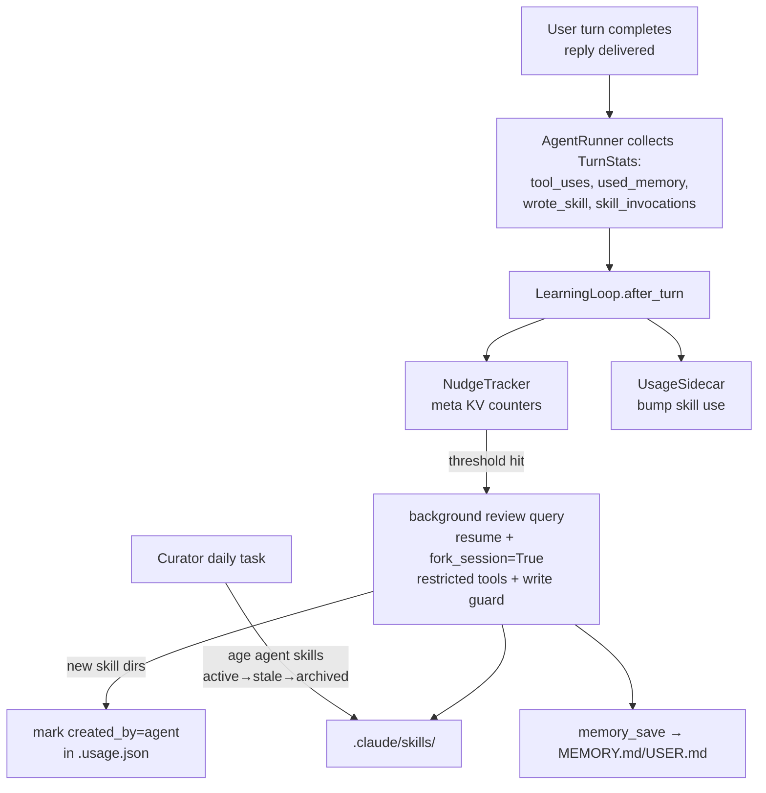

# claude-hermes Phase 2 (Learning Loop) Implementation Plan

> **For agentic workers:** REQUIRED SUB-SKILL: Use superpowers:subagent-driven-development (recommended) or superpowers:executing-plans to implement this plan task-by-task. Steps use checkbox (`- [ ]`) syntax for tracking.

**Goal:** The agent improves itself: nudge counters trigger an out-of-band background review pass (a forked SDK session) that saves memory and creates/patches skills; provenance and a usage sidecar separate agent-created skills from user-created ones; a curator ages unused agent skills (archive, never delete); `/learn` gives users deliberate skill authoring; an allowlist gates who can talk to the bot.

**Architecture:** After a turn's reply is delivered, `AgentRunner` reports turn statistics (tool uses, memory/skill activity, skill invocations) to a `LearningLoop`. When a nudge counter (stored in a `meta` KV table, restart-proof) crosses its threshold, the loop spawns a single-flight background `query()` that resumes the conversation with `fork_session=True` — the SDK-native equivalent of Hermes' background-review fork: full conversation context, warm prompt cache (same byte-stable `system_append`), zero impact on the live session. The review query runs with a restricted toolset and a `PreToolUse` guard that only permits writes inside the skills directory. New skill directories that appear during a review are marked `created_by: agent` in a `.usage.json` sidecar; a daily curator task ages agent-created, unpinned skills active → stale (30d) → archived (90d, moved to `.archive/`).

**Tech Stack:** No new dependencies. Reuses Phase 1: `claude-agent-sdk` (`query`, `fork_session`, `HookMatcher`, `ToolUseBlock`), `aiosqlite`, `aiogram`, `pytest`/`pytest-asyncio` (`asyncio_mode=auto`).

## Locked Decisions

- **Review = SDK session fork.** The review pass runs `query(resume=<sdk_session_id>, fork_session=True)` with the session's stored `system_append` verbatim — same prefix, warm provider cache, and the user's live session is never touched (Hermes P1/P3 principles).
- **Nudge counters are global, in a `meta` KV table** (`turns_since_memory_review`, `iters_since_skill_write`), not per-session — they survive both process restarts and session resets, so short daily sessions still accumulate toward a review.
- **Counters reset on fire AND on organic use** (agent called `memory_save` / wrote a skill on its own) — a session that keeps saving doesn't get re-nudged (Hermes rule).
- **Provenance lives in a sidecar**, `agent_home/.claude/skills/.usage.json` — never in SKILL.md frontmatter (keeps telemetry out of user-authored content). Schema: `{"skills": {"<name>": {"created_by", "created_at", "last_used", "use_count", "state", "pinned"}}}`.
- **Curator never deletes.** Max destructive action is a move to `agent_home/.claude/skills/.archive/`. Only `created_by == "agent"`, unpinned skills are eligible. `/learn`-created and hand-written skills are user-owned and untouchable.
- **Review pass toolset:** `Read, Glob, Grep, Write, Edit` + `mcp__hermes__memory_save` only. A `PreToolUse` hook denies `Write`/`Edit` outside the skills dir and denies touching `.usage.json`/`.archive`.
- **Access control:** first private-chat user becomes owner (stored in `meta` under `owner_user_id`); after that only owner + `allowed_users` (config) are served. Unknown users: silent ignore in groups, polite one-line refusal in private.
- **`/learn` is foreground** — it runs in the user's normal session wrapped in the authoring prompt; resulting skills are NOT marked agent-created.

## Global Constraints

- All Phase 1 invariants hold: byte-stable `system_append` per session, frozen memory snapshot, secrets in env only, behavior in `config.yaml`, no hardcoded `CH_HOME` paths outside `paths.py`.
- The review pass must never delay or reorder the user's reply: counter updates are two SQLite ops inline; the review itself is `asyncio.create_task` after the reply is computed.
- Skill authoring standard (enforced by prompts, checked by tests where possible): `description` ≤ 60 chars ending with a period; SKILL.md section order When to Use / Prerequisites / How to Run / Quick Reference / Procedure / Pitfalls / Verification; scripts in `scripts/`.
- Sidecar writes are atomic (temp file + `os.replace`), best-effort (a sidecar failure must never fail a turn).

## Architecture Diagram



---

### Task 1: Config extensions and `meta` KV table

**Files:**
- Modify: `src/claude_hermes/config.py`
- Modify: `src/claude_hermes/db.py`
- Modify: `config.yaml.example`
- Test: `tests/test_paths_config.py` (extend), `tests/test_db.py` (extend)

**Interfaces:**
- Reuses: `Config` dataclass and generic YAML loader in `config.py:20-29`; `Database` + `_SCHEMA` executescript in `db.py:7-31` (all `CREATE ... IF NOT EXISTS`, so adding a table is migration-safe for existing `state.db`).
- Produces: `Config` fields `memory_nudge_interval: int = 10`, `skill_nudge_interval: int = 15`, `review_model: str = ""` (empty ⇒ main model), `review_max_turns: int = 16`, `curator_enabled: bool = True`, `stale_after_days: int = 30`, `archive_after_days: int = 90`, `allowed_users: list[int]` (default empty). `Database.get_meta(key) -> str | None`, `Database.set_meta(key, value: str)`.

- [ ] **Step 1: Write the failing tests**

Append to `tests/test_paths_config.py`:
```python
def test_phase2_config_defaults(tmp_path):
    cfg = load_config(tmp_path)
    assert cfg.memory_nudge_interval == 10
    assert cfg.skill_nudge_interval == 15
    assert cfg.review_model == ""
    assert cfg.review_max_turns == 16
    assert cfg.curator_enabled is True
    assert cfg.stale_after_days == 30
    assert cfg.archive_after_days == 90
    assert cfg.allowed_users == []


def test_allowed_users_from_yaml(tmp_path):
    (tmp_path / "config.yaml").write_text("allowed_users: [1, 2]\n", encoding="utf-8")
    assert load_config(tmp_path).allowed_users == [1, 2]
```

Append to `tests/test_db.py`:
```python
async def test_meta_kv_roundtrip(tmp_path):
    db = await Database.open(tmp_path / "state.db")
    assert await db.get_meta("owner_user_id") is None
    await db.set_meta("owner_user_id", "42")
    assert await db.get_meta("owner_user_id") == "42"
    await db.set_meta("owner_user_id", "43")  # overwrite
    assert await db.get_meta("owner_user_id") == "43"
    await db.close()
```

- [ ] **Step 2: Run tests to verify they fail**

Run: `.venv/Scripts/python -m pytest tests/test_paths_config.py tests/test_db.py -v`
Expected: new tests FAIL (`AttributeError` on Config fields, `AttributeError: get_meta`)

- [ ] **Step 3: Implement**

In `src/claude_hermes/config.py` — change imports and the dataclass:
```python
from dataclasses import dataclass, field
```
Add to `Config` (after `telegram_token: str = ""`):
```python
    # Phase 2 — learning loop
    memory_nudge_interval: int = 10
    skill_nudge_interval: int = 15
    review_model: str = ""            # empty → use main model (warm cache)
    review_max_turns: int = 16
    curator_enabled: bool = True
    stale_after_days: int = 30
    archive_after_days: int = 90
    allowed_users: list[int] = field(default_factory=list)
```

In `src/claude_hermes/db.py` — extend `_SCHEMA` (inside the same string, after `messages_fts`):
```python
CREATE TABLE IF NOT EXISTS meta (
    key   TEXT PRIMARY KEY,
    value TEXT NOT NULL
);
```
Add methods to `Database`:
```python
    async def get_meta(self, key: str) -> str | None:
        cur = await self._conn.execute("SELECT value FROM meta WHERE key = ?", (key,))
        row = await cur.fetchone()
        return row["value"] if row else None

    async def set_meta(self, key: str, value: str) -> None:
        await self._conn.execute(
            "INSERT INTO meta (key, value) VALUES (?, ?) "
            "ON CONFLICT(key) DO UPDATE SET value = excluded.value",
            (key, value),
        )
        await self._conn.commit()
```

Append to `config.yaml.example`:
```yaml

# Phase 2 — learning loop
memory_nudge_interval: 10    # review memory every N user turns
skill_nudge_interval: 15     # review skills every N tool iterations without a skill write
review_model: ""             # empty = same as main model (reuses warm prompt cache)
review_max_turns: 16
curator_enabled: true
stale_after_days: 30
archive_after_days: 90
allowed_users: []            # Telegram user ids; owner is claimed by first private chat
```

- [ ] **Step 4: Run tests to verify they pass**

Run: `.venv/Scripts/python -m pytest tests/test_paths_config.py tests/test_db.py -v`
Expected: all PASS

- [ ] **Step 5: Commit**

```bash
git add src/claude_hermes/config.py src/claude_hermes/db.py config.yaml.example tests/test_paths_config.py tests/test_db.py
git commit -m "feat: phase 2 config knobs and meta kv table"
```

---

### Task 2: Usage sidecar with provenance

**Files:**
- Create: `src/claude_hermes/learning/__init__.py` (empty)
- Create: `src/claude_hermes/learning/usage.py`
- Test: `tests/test_learning_usage.py`

**Interfaces:**
- Reuses: skills dir layout from `paths.py` (`home / "agent_home" / ".claude" / "skills"`).
- Produces: `usage.UsageSidecar(skills_dir: Path)` with sync methods (file I/O is tiny): `mark_created(name, created_by: str, now_iso: str)`, `bump_use(name, now_iso)`, `get(name) -> dict | None`, `set_state(name, state)`, `set_pinned(name, pinned: bool)`, `all() -> dict[str, dict]`, `list_skill_dirs() -> set[str]` (directories containing `SKILL.md`, excluding `.archive`). Entry schema per Locked Decisions. All writes atomic; every method best-effort (never raises on corrupt sidecar — starts fresh).

- [ ] **Step 1: Write the failing test**

`tests/test_learning_usage.py`:
```python
import json

from claude_hermes.learning.usage import UsageSidecar

NOW = "2026-07-12T10:00:00+00:00"


def make_skill(skills_dir, name):
    d = skills_dir / name
    d.mkdir(parents=True)
    (d / "SKILL.md").write_text(f"---\nname: {name}\ndescription: X.\n---\n", encoding="utf-8")


def test_mark_created_and_get(tmp_path):
    sc = UsageSidecar(tmp_path)
    sc.mark_created("release-flow", "agent", NOW)
    entry = sc.get("release-flow")
    assert entry["created_by"] == "agent"
    assert entry["state"] == "active"
    assert entry["pinned"] is False
    assert entry["use_count"] == 0
    # persisted to disk
    data = json.loads((tmp_path / ".usage.json").read_text(encoding="utf-8"))
    assert "release-flow" in data["skills"]


def test_bump_use_and_state(tmp_path):
    sc = UsageSidecar(tmp_path)
    sc.mark_created("s", "agent", NOW)
    sc.bump_use("s", "2026-07-13T00:00:00+00:00")
    entry = sc.get("s")
    assert entry["use_count"] == 1
    assert entry["last_used"] == "2026-07-13T00:00:00+00:00"
    sc.set_state("s", "stale")
    assert sc.get("s")["state"] == "stale"
    sc.set_pinned("s", True)
    assert sc.get("s")["pinned"] is True


def test_bump_use_unknown_skill_creates_user_entry(tmp_path):
    sc = UsageSidecar(tmp_path)
    sc.bump_use("hand-written", NOW)  # skill existed before sidecar tracking
    assert sc.get("hand-written")["created_by"] == "user"


def test_list_skill_dirs_excludes_archive(tmp_path):
    make_skill(tmp_path, "a")
    make_skill(tmp_path / ".archive", "old")
    sc = UsageSidecar(tmp_path)
    assert sc.list_skill_dirs() == {"a"}


def test_corrupt_sidecar_starts_fresh(tmp_path):
    (tmp_path / ".usage.json").write_text("{broken", encoding="utf-8")
    sc = UsageSidecar(tmp_path)
    sc.mark_created("s", "agent", NOW)
    assert sc.get("s") is not None
```

- [ ] **Step 2: Run test to verify it fails**

Run: `.venv/Scripts/python -m pytest tests/test_learning_usage.py -v`
Expected: FAIL with `ModuleNotFoundError` on `claude_hermes.learning`

- [ ] **Step 3: Implement `learning/usage.py`**

```python
from __future__ import annotations

import json
import os
import tempfile
from pathlib import Path

_FILE = ".usage.json"


def _new_entry(created_by: str, now_iso: str) -> dict:
    return {
        "created_by": created_by,
        "created_at": now_iso,
        "last_used": None,
        "use_count": 0,
        "state": "active",
        "pinned": False,
    }


class UsageSidecar:
    """Provenance + usage telemetry for skills, outside SKILL.md content."""

    def __init__(self, skills_dir: Path):
        self._dir = skills_dir
        self._dir.mkdir(parents=True, exist_ok=True)

    def _load(self) -> dict:
        path = self._dir / _FILE
        try:
            return json.loads(path.read_text(encoding="utf-8"))
        except (OSError, ValueError):
            return {"skills": {}}

    def _save(self, data: dict) -> None:
        try:
            fd, tmp = tempfile.mkstemp(dir=str(self._dir))
            with os.fdopen(fd, "w", encoding="utf-8") as f:
                json.dump(data, f, indent=2)
            os.replace(tmp, self._dir / _FILE)
        except OSError:
            pass  # telemetry is best-effort; never fail a turn over it

    def mark_created(self, name: str, created_by: str, now_iso: str) -> None:
        data = self._load()
        data["skills"][name] = _new_entry(created_by, now_iso)
        self._save(data)

    def bump_use(self, name: str, now_iso: str) -> None:
        data = self._load()
        entry = data["skills"].setdefault(name, _new_entry("user", now_iso))
        entry["use_count"] += 1
        entry["last_used"] = now_iso
        self._save(data)

    def get(self, name: str) -> dict | None:
        return self._load()["skills"].get(name)

    def set_state(self, name: str, state: str) -> None:
        data = self._load()
        if name in data["skills"]:
            data["skills"][name]["state"] = state
            self._save(data)

    def set_pinned(self, name: str, pinned: bool) -> None:
        data = self._load()
        if name in data["skills"]:
            data["skills"][name]["pinned"] = pinned
            self._save(data)

    def all(self) -> dict[str, dict]:
        return self._load()["skills"]

    def list_skill_dirs(self) -> set[str]:
        return {
            d.name
            for d in self._dir.iterdir()
            if d.is_dir() and d.name != ".archive" and (d / "SKILL.md").is_file()
        }
```

- [ ] **Step 4: Run test to verify it passes**

Run: `.venv/Scripts/python -m pytest tests/test_learning_usage.py -v`
Expected: 5 PASSED

- [ ] **Step 5: Commit**

```bash
git add src/claude_hermes/learning tests/test_learning_usage.py
git commit -m "feat: usage sidecar with skill provenance"
```

---

### Task 3: Nudge tracker

**Files:**
- Create: `src/claude_hermes/learning/nudges.py`
- Test: `tests/test_nudges.py`

**Interfaces:**
- Reuses: `Database.get_meta`/`set_meta` (Task 1), `Config` intervals (Task 1).
- Produces: `nudges.NudgeTracker(db: Database, cfg: Config)` with `await observe_turn(used_memory: bool, wrote_skill: bool, tool_uses: int) -> set[str]` — returns due review kinds ⊆ `{"memory", "skills"}`. Counter semantics: `turns_since_memory_review` +1 per turn, reset to 0 when `used_memory` or when the memory nudge fires; `iters_since_skill_write` += `tool_uses`, reset when `wrote_skill` or when the skills nudge fires.

- [ ] **Step 1: Write the failing test**

`tests/test_nudges.py`:
```python
from claude_hermes.config import Config
from claude_hermes.db import Database
from claude_hermes.learning.nudges import NudgeTracker


async def make(tmp_path, **kw):
    db = await Database.open(tmp_path / "state.db")
    return db, NudgeTracker(db, Config(**kw))


async def test_memory_nudge_fires_and_resets(tmp_path):
    db, nt = await make(tmp_path, memory_nudge_interval=3, skill_nudge_interval=100)
    assert await nt.observe_turn(False, False, 0) == set()
    assert await nt.observe_turn(False, False, 0) == set()
    assert await nt.observe_turn(False, False, 0) == {"memory"}
    assert await nt.observe_turn(False, False, 0) == set()  # counter reset on fire
    await db.close()


async def test_organic_memory_use_resets_counter(tmp_path):
    db, nt = await make(tmp_path, memory_nudge_interval=3, skill_nudge_interval=100)
    await nt.observe_turn(False, False, 0)
    await nt.observe_turn(False, False, 0)
    assert await nt.observe_turn(True, False, 0) == set()   # used memory → reset
    assert await nt.observe_turn(False, False, 0) == set()  # 1 of 3 again
    await db.close()


async def test_skill_nudge_counts_tool_iterations(tmp_path):
    db, nt = await make(tmp_path, memory_nudge_interval=100, skill_nudge_interval=10)
    assert await nt.observe_turn(False, False, 6) == set()
    assert await nt.observe_turn(False, False, 6) == {"skills"}   # 12 ≥ 10
    assert await nt.observe_turn(False, False, 4) == set()        # reset on fire
    await db.close()


async def test_counters_survive_restart(tmp_path):
    db, nt = await make(tmp_path, memory_nudge_interval=3, skill_nudge_interval=100)
    await nt.observe_turn(False, False, 0)
    await nt.observe_turn(False, False, 0)
    await db.close()
    db2 = await Database.open(tmp_path / "state.db")
    nt2 = NudgeTracker(db2, Config(memory_nudge_interval=3, skill_nudge_interval=100))
    assert await nt2.observe_turn(False, False, 0) == {"memory"}
    await db2.close()
```

- [ ] **Step 2: Run test to verify it fails**

Run: `.venv/Scripts/python -m pytest tests/test_nudges.py -v`
Expected: FAIL with `ImportError` on `claude_hermes.learning.nudges`

- [ ] **Step 3: Implement `learning/nudges.py`**

```python
from __future__ import annotations

from ..config import Config
from ..db import Database

_MEMORY_KEY = "turns_since_memory_review"
_SKILL_KEY = "iters_since_skill_write"


class NudgeTracker:
    """Hermes-style self-nudges: counters, never injected text (cache-safe)."""

    def __init__(self, db: Database, cfg: Config):
        self._db = db
        self._cfg = cfg

    async def _get(self, key: str) -> int:
        raw = await self._db.get_meta(key)
        return int(raw) if raw and raw.isdigit() else 0

    async def observe_turn(
        self, used_memory: bool, wrote_skill: bool, tool_uses: int
    ) -> set[str]:
        due: set[str] = set()

        turns = 0 if used_memory else await self._get(_MEMORY_KEY) + 1
        if turns >= self._cfg.memory_nudge_interval:
            due.add("memory")
            turns = 0
        await self._db.set_meta(_MEMORY_KEY, str(turns))

        iters = 0 if wrote_skill else await self._get(_SKILL_KEY) + tool_uses
        if iters >= self._cfg.skill_nudge_interval:
            due.add("skills")
            iters = 0
        await self._db.set_meta(_SKILL_KEY, str(iters))

        return due
```

- [ ] **Step 4: Run test to verify it passes**

Run: `.venv/Scripts/python -m pytest tests/test_nudges.py -v`
Expected: 4 PASSED

- [ ] **Step 5: Commit**

```bash
git add src/claude_hermes/learning/nudges.py tests/test_nudges.py
git commit -m "feat: restart-proof nudge counters in meta kv"
```

---

### Task 4: Review and learn prompts

**Files:**
- Create: `src/claude_hermes/learning/prompts.py`
- Test: `tests/test_learning_prompts.py`

**Interfaces:**
- Reuses: skill authoring standard from Global Constraints (distilled from hermes-agent's HARDLINE rules).
- Produces: `prompts.AUTHORING_STANDARDS: str`; `prompts.build_review_prompt(kinds: set[str]) -> str` (adapts to memory-only / skills-only / combined); `prompts.build_learn_prompt(user_text: str) -> str` (the `/learn` wrapper).

- [ ] **Step 1: Write the failing test**

`tests/test_learning_prompts.py`:
```python
from claude_hermes.learning.prompts import (
    AUTHORING_STANDARDS,
    build_learn_prompt,
    build_review_prompt,
)


def test_review_prompt_variants():
    both = build_review_prompt({"memory", "skills"})
    assert "memory_save" in both and "SKILL.md" in both
    mem = build_review_prompt({"memory"})
    assert "memory_save" in mem and "SKILL.md" not in mem
    sk = build_review_prompt({"skills"})
    assert "SKILL.md" in sk


def test_review_prompt_encodes_hermes_policies():
    p = build_review_prompt({"memory", "skills"})
    # anti-patterns: never capture tool-is-broken or env failures
    assert "broken" in p
    # umbrella-first preference order
    assert "existing" in p.lower()
    # doing nothing is allowed
    assert "Nothing to save." in p


def test_authoring_standards_and_learn_prompt():
    assert "60" in AUTHORING_STANDARDS          # description length rule
    assert "Pitfalls" in AUTHORING_STANDARDS    # section order rule
    lp = build_learn_prompt("научись деплоить через ansible")
    assert "научись деплоить через ansible" in lp
    assert "SKILL.md" in lp
```

- [ ] **Step 2: Run test to verify it fails**

Run: `.venv/Scripts/python -m pytest tests/test_learning_prompts.py -v`
Expected: FAIL with `ImportError`

- [ ] **Step 3: Implement `learning/prompts.py`**

```python
from __future__ import annotations

AUTHORING_STANDARDS = """\
Skill authoring standards (mandatory):
- The skill is a directory under .claude/skills/<name>/ with a SKILL.md.
- Frontmatter: `name` (lowercase-hyphenated) and `description` — one sentence,
  MAXIMUM 60 characters, ending with a period. Count the characters: anything
  past 60 is silently cut from the index and never routes. No marketing words.
- Body section order: # Title, 2-3 sentence intro, ## When to Use,
  ## Prerequisites, ## How to Run, ## Quick Reference, ## Procedure,
  ## Pitfalls, ## Verification. Target ~100-200 lines.
- Commands must be VERBATIM from what actually worked — never invent flags.
- Non-trivial helper logic goes in scripts/ inside the skill directory;
  reference files in references/. Do not inline long scripts into SKILL.md."""

_SKILL_SECTION = f"""\
SKILLS — review the conversation for durable know-how:
- Signals: the user corrected your approach, style, or verbosity (frustration
  is a first-class signal); a multi-step workflow succeeded after trial and
  error; a loaded skill turned out to be wrong or incomplete.
- STRICT preference order: (1) patch an existing skill that covers this class
  of task, (2) add a references/ or scripts/ file to an existing skill,
  (3) only then create a NEW class-level umbrella skill. Never create narrow
  one-session skills named after today's task or an error message.
- NEVER capture: environment-dependent failures (missing binaries, "command
  not found"), negative claims that a tool is broken (these harden into
  refusals you will cite against yourself for months), transient errors that
  resolved, or one-off task narratives. If a tool failed due to setup, capture
  the FIX, never "this tool is broken".
- Use Read/Glob/Grep to inspect .claude/skills/, and Write/Edit to change it.
{AUTHORING_STANDARDS}"""

_MEMORY_SECTION = """\
MEMORY — review the conversation for durable facts worth persisting with the
memory_save tool:
- target='user': who the user is — preferences, language, style, constraints.
- target='memory': environment and project facts — hosts, paths, conventions.
- Declarative facts only ("User prefers concise replies"), never imperatives.
- If a fact will be stale in a week, it does NOT belong in memory.
- Procedures belong in skills, not memory."""

_FOOTER = """\
Work directly: make the writes, then reply with a one-line summary of what you
saved, or exactly: Nothing to save.
A smooth routine session legitimately produces nothing — but a session with
corrections, new workflows, or new durable facts should produce at least one
write. Do not ask questions; there is no user present."""


def build_review_prompt(kinds: set[str]) -> str:
    parts = [
        "You are running an out-of-band self-review of the conversation above. "
        "The user has already been answered; nothing you output will be shown "
        "to them."
    ]
    if "memory" in kinds:
        parts.append(_MEMORY_SECTION)
    if "skills" in kinds:
        parts.append(_SKILL_SECTION)
    parts.append(_FOOTER)
    return "\n\n".join(parts)


def build_learn_prompt(user_text: str) -> str:
    return (
        "The user wants you to learn a new skill. Their request:\n"
        f"<request>\n{user_text}\n</request>\n\n"
        "Gather what you need (read files, fetch URLs, or draw on this "
        "conversation), then author ONE skill directory under "
        ".claude/skills/ with a SKILL.md.\n\n"
        f"{AUTHORING_STANDARDS}\n\n"
        "When done, reply with the skill name and a one-line summary."
    )
```

- [ ] **Step 4: Run test to verify it passes**

Run: `.venv/Scripts/python -m pytest tests/test_learning_prompts.py -v`
Expected: 3 PASSED

- [ ] **Step 5: Commit**

```bash
git add src/claude_hermes/learning/prompts.py tests/test_learning_prompts.py
git commit -m "feat: review and learn prompts encoding hermes learning policies"
```

---

### Task 5: Turn observation in AgentRunner

**Files:**
- Create: `src/claude_hermes/learning/observe.py`
- Modify: `src/claude_hermes/runner.py`
- Test: `tests/test_runner.py` (extend)

**Interfaces:**
- Reuses: `runner._execute` message loop (`runner.py:106-117`); `ToolUseBlock` from `claude_agent_sdk` (blocks appear inside `AssistantMessage.content` alongside `TextBlock`).
- Produces: `observe.TurnStats` dataclass (`tool_uses: int = 0`, `used_memory: bool = False`, `wrote_skill: bool = False`, `skill_invocations: list[str]` default empty) and `observe.observe_block(stats, block) -> None` (mutates stats from one `ToolUseBlock`). `AgentRunner.__init__` gains optional `learning=None` (duck-typed: `await learning.after_turn(session_key, stats)`); `_execute` returns `(final_text, sdk_session_id, stats)`; `_run_turn_locked` calls `learning.after_turn` after recording messages, guarded so a learning failure never breaks the reply.

- [ ] **Step 1: Write the failing tests**

Append to `tests/test_runner.py`:
```python
from claude_agent_sdk import ToolUseBlock

from claude_hermes.learning.observe import TurnStats, observe_block


def test_observe_block_classifies():
    stats = TurnStats()
    observe_block(stats, ToolUseBlock(id="1", name="Bash", input={"command": "ls"}))
    observe_block(stats, ToolUseBlock(id="2", name="mcp__hermes__memory_save",
                                      input={"target": "user"}))
    observe_block(stats, ToolUseBlock(id="3", name="Write",
                                      input={"file_path": "/x/.claude/skills/deploy/SKILL.md"}))
    observe_block(stats, ToolUseBlock(id="4", name="Skill", input={"skill": "deploy"}))
    assert stats.tool_uses == 4
    assert stats.used_memory is True
    assert stats.wrote_skill is True
    assert stats.skill_invocations == ["deploy"]


async def test_runner_reports_stats_to_learning(tmp_path, monkeypatch):
    runner, db, _ = await make_runner(tmp_path)

    class FakeLearning:
        def __init__(self):
            self.calls = []

        async def after_turn(self, session_key, stats):
            self.calls.append((session_key, stats))

    learning = FakeLearning()
    runner._learning = learning

    async def fake_query(*, prompt, options):
        yield AssistantMessage(
            content=[
                ToolUseBlock(id="1", name="Bash", input={"command": "ls"}),
                TextBlock(text="done"),
            ],
            model="m",
        )
        yield FakeResult("sdk-1", "done")

    monkeypatch.setattr(runner_mod, "query", fake_query)
    await runner.run_turn("tg:private:1", "hi")
    assert len(learning.calls) == 1
    key, stats = learning.calls[0]
    assert key == "tg:private:1" and stats.tool_uses == 1
    await db.close()


async def test_learning_failure_does_not_break_reply(tmp_path, monkeypatch):
    runner, db, _ = await make_runner(tmp_path)

    class Boom:
        async def after_turn(self, session_key, stats):
            raise RuntimeError("boom")

    runner._learning = Boom()
    monkeypatch.setattr(runner_mod, "query", make_fake_query([]))
    assert await runner.run_turn("tg:private:1", "hi") == "hello from agent"
    await db.close()
```

- [ ] **Step 2: Run tests to verify they fail**

Run: `.venv/Scripts/python -m pytest tests/test_runner.py -v`
Expected: new tests FAIL (`ImportError` on `claude_hermes.learning.observe`)

- [ ] **Step 3: Implement**

`src/claude_hermes/learning/observe.py`:
```python
from __future__ import annotations

from dataclasses import dataclass, field

_SKILLS_MARKER = ".claude/skills"


@dataclass
class TurnStats:
    tool_uses: int = 0
    used_memory: bool = False
    wrote_skill: bool = False
    skill_invocations: list[str] = field(default_factory=list)


def observe_block(stats: TurnStats, block) -> None:
    stats.tool_uses += 1
    name = getattr(block, "name", "")
    args = getattr(block, "input", None) or {}
    if name == "mcp__hermes__memory_save":
        stats.used_memory = True
    elif name in ("Write", "Edit"):
        path = str(args.get("file_path", "")).replace("\\", "/")
        if _SKILLS_MARKER in path:
            stats.wrote_skill = True
    elif name == "Skill":
        skill = args.get("skill") or args.get("name")
        if skill:
            stats.skill_invocations.append(str(skill))
```

Modify `src/claude_hermes/runner.py`:

Add imports:
```python
import logging

from claude_agent_sdk import ToolUseBlock  # add to the existing SDK import list

from .learning.observe import TurnStats, observe_block

log = logging.getLogger(__name__)
```

`__init__` — add the optional collaborator (after `self._server, ... = build_hermes_server(...)`):
```python
        self._learning = None  # set by main.py when the learning loop is enabled
```

`_execute` — change signature/return and observe blocks:
```python
    async def _execute(
        self, user_text: str, resume_id: str | None, append: str
    ) -> tuple[str | None, str | None, TurnStats]:
```
Inside the message loop, in the `AssistantMessage` branch:
```python
            if isinstance(msg, AssistantMessage):
                parts = []
                for b in msg.content:
                    if isinstance(b, TextBlock):
                        parts.append(b.text)
                    elif isinstance(b, ToolUseBlock):
                        observe_block(stats, b)
                if parts:
                    final_text = "\n".join(parts)
```
with `stats = TurnStats()` initialized before the loop and `return final_text, sdk_session_id, stats` at the end.

`_run_turn_locked` — unpack the third value at both `self._execute(...)` call sites:
```python
            final_text, sdk_session_id, stats = await self._execute(...)
```
and after the two `record_message` calls, before `return reply`:
```python
        if self._learning is not None:
            try:
                await self._learning.after_turn(session_key, stats)
            except Exception:
                log.exception("learning after_turn failed")
        return reply
```

- [ ] **Step 4: Run the full suite**

Run: `.venv/Scripts/python -m pytest -v`
Expected: all PASS (old runner tests unaffected: they never read `_execute`'s return arity)

- [ ] **Step 5: Commit**

```bash
git add src/claude_hermes/learning/observe.py src/claude_hermes/runner.py tests/test_runner.py
git commit -m "feat: per-turn tool observation feeding the learning loop"
```

---

### Task 6: Background review pass (forked session)

**Files:**
- Create: `src/claude_hermes/learning/review.py`
- Test: `tests/test_review.py`

**Interfaces:**
- Reuses: `Database.get_session` (session row with `sdk_session_id` + `system_append`), `UsageSidecar.list_skill_dirs`/`mark_created` (Task 2), `build_review_prompt` (Task 4); SDK `query`, `ClaudeAgentOptions`, `HookMatcher`.
- Produces: `review.skills_write_guard_factory(skills_dir: Path)` → async PreToolUse hook denying `Write`/`Edit` outside `skills_dir` (and always denying `.usage.json` / `.archive` paths); `await review.run_review(cfg, home, db, sidecar, session_key, kinds) -> str | None` — resolves the session, forks it, runs the review query with restricted tools, marks new skill dirs as agent-created, returns the review's final text (or `None` when the session is gone). Review tool list: `["Read", "Glob", "Grep", "Write", "Edit", "mcp__hermes__memory_save"]` — note `memory_save` requires the hermes MCP server, passed in via a `server` parameter.

- [ ] **Step 1: Write the failing test**

`tests/test_review.py`:
```python
from pathlib import Path

import claude_hermes.learning.review as review_mod
from claude_hermes.config import Config
from claude_hermes.db import Database
from claude_hermes.learning.review import run_review, skills_write_guard_factory
from claude_hermes.learning.usage import UsageSidecar

NOW = "2026-07-12T10:00:00+00:00"


async def test_write_guard_scopes_to_skills_dir(tmp_path):
    guard = skills_write_guard_factory(tmp_path / "skills")
    deny = await guard(
        {"tool_name": "Write", "tool_input": {"file_path": str(tmp_path / "other.txt")}},
        "t1", None,
    )
    assert deny["hookSpecificOutput"]["permissionDecision"] == "deny"
    ok = await guard(
        {"tool_name": "Write",
         "tool_input": {"file_path": str(tmp_path / "skills" / "s" / "SKILL.md")}},
        "t2", None,
    )
    assert ok == {}
    sidecar_deny = await guard(
        {"tool_name": "Edit",
         "tool_input": {"file_path": str(tmp_path / "skills" / ".usage.json")}},
        "t3", None,
    )
    assert sidecar_deny["hookSpecificOutput"]["permissionDecision"] == "deny"


async def make_env(tmp_path):
    db = await Database.open(tmp_path / "state.db")
    await db.upsert_session("tg:private:1", "sdk-abc", "APPEND", NOW)
    skills = tmp_path / "agent_home" / ".claude" / "skills"
    skills.mkdir(parents=True)
    return db, UsageSidecar(skills), skills


async def test_run_review_forks_and_marks_provenance(tmp_path, monkeypatch):
    db, sidecar, skills = await make_env(tmp_path)
    captured = {}

    async def fake_query(*, prompt, options):
        captured["prompt"] = prompt
        captured["options"] = options
        # the "review agent" creates a skill mid-run
        d = skills / "release-flow"
        d.mkdir()
        (d / "SKILL.md").write_text("---\nname: release-flow\ndescription: R.\n---\n")

        class R:
            session_id = "fork-1"
            result = "Saved skill release-flow"

        yield R()

    monkeypatch.setattr(review_mod, "query", fake_query)
    out = await run_review(
        Config(), tmp_path, db, sidecar, "tg:private:1", {"memory", "skills"},
        server=object(),
    )
    assert out == "Saved skill release-flow"
    opts = captured["options"]
    assert opts.resume == "sdk-abc"
    assert opts.fork_session is True
    assert opts.system_prompt["append"] == "APPEND"       # byte-identical → warm cache
    assert "Bash" not in opts.allowed_tools               # restricted toolset
    assert "mcp__hermes__memory_save" in opts.allowed_tools
    assert sidecar.get("release-flow")["created_by"] == "agent"
    await db.close()


async def test_run_review_skips_when_session_missing(tmp_path, monkeypatch):
    db, sidecar, _ = await make_env(tmp_path)
    assert await run_review(
        Config(), tmp_path, db, sidecar, "tg:private:404", {"memory"}, server=object()
    ) is None
    await db.close()
```

- [ ] **Step 2: Run test to verify it fails**

Run: `.venv/Scripts/python -m pytest tests/test_review.py -v`
Expected: FAIL with `ImportError`

- [ ] **Step 3: Implement `learning/review.py`**

```python
from __future__ import annotations

import logging
from datetime import datetime, timezone
from pathlib import Path

from claude_agent_sdk import ClaudeAgentOptions, HookMatcher, query

from ..config import Config
from ..db import Database
from .prompts import build_review_prompt
from .usage import UsageSidecar

log = logging.getLogger(__name__)

REVIEW_TOOLS = ["Read", "Glob", "Grep", "Write", "Edit", "mcp__hermes__memory_save"]
_PROTECTED = (".usage.json", ".archive")


def skills_write_guard_factory(skills_dir: Path):
    root = skills_dir.resolve()

    async def guard(input_data: dict, tool_use_id, context) -> dict:
        raw = (input_data.get("tool_input") or {}).get("file_path", "")
        try:
            path = Path(raw).resolve()
            inside = path.is_relative_to(root)
        except (OSError, ValueError):
            inside = False
        protected = any(p in str(path) for p in _PROTECTED)
        if inside and not protected:
            return {}
        return {
            "hookSpecificOutput": {
                "hookEventName": "PreToolUse",
                "permissionDecision": "deny",
                "permissionDecisionReason":
                    "Review pass may only write inside the skills directory.",
            }
        }

    return guard


async def run_review(
    cfg: Config, home: Path, db: Database, sidecar: UsageSidecar,
    session_key: str, kinds: set[str], *, server,
) -> str | None:
    row = await db.get_session(session_key)
    if row is None or not row["sdk_session_id"]:
        return None

    skills_dir = home / "agent_home" / ".claude" / "skills"
    before = sidecar.list_skill_dirs()

    options = ClaudeAgentOptions(
        model=cfg.review_model or cfg.model,
        max_turns=cfg.review_max_turns,
        cwd=str(home / "agent_home"),
        setting_sources=["project"],
        permission_mode="bypassPermissions",
        system_prompt={"type": "preset", "preset": "claude_code",
                       "append": row["system_append"]},
        allowed_tools=REVIEW_TOOLS,
        mcp_servers={"hermes": server},
        hooks={"PreToolUse": [HookMatcher(
            matcher="Write|Edit", hooks=[skills_write_guard_factory(skills_dir)]
        )]},
        resume=row["sdk_session_id"],
        fork_session=True,
    )

    final: str | None = None
    async for msg in query(prompt=build_review_prompt(kinds), options=options):
        if getattr(msg, "result", None):
            final = msg.result

    now_iso = datetime.now(timezone.utc).isoformat()
    for name in sidecar.list_skill_dirs() - before:
        sidecar.mark_created(name, "agent", now_iso)
        log.info("review created skill %s", name)
    return final
```

- [ ] **Step 4: Run test to verify it passes**

Run: `.venv/Scripts/python -m pytest tests/test_review.py -v`
Expected: 3 PASSED
Note: `Path.is_relative_to` exists since 3.9; if the installed SDK's `ClaudeAgentOptions` lacks `fork_session`, check `python -c "from claude_agent_sdk import ClaudeAgentOptions; print(ClaudeAgentOptions.__dataclass_fields__.keys())"` and adapt the field name (`fork_session` is the documented Python SDK spelling).

- [ ] **Step 5: Commit**

```bash
git add src/claude_hermes/learning/review.py tests/test_review.py
git commit -m "feat: background review pass on a forked session with write guard"
```

---

### Task 7: LearningLoop orchestrator

**Files:**
- Create: `src/claude_hermes/learning/loop.py`
- Test: `tests/test_learning_loop.py`

**Interfaces:**
- Reuses: `NudgeTracker` (Task 3), `UsageSidecar` (Task 2), `run_review` (Task 6), `TurnStats` (Task 5).
- Produces: `loop.LearningLoop(cfg, home, db, sidecar, tracker, server)` with `await after_turn(session_key: str, stats: TurnStats)` — bumps skill usage for `stats.skill_invocations`, feeds the tracker, and when kinds are due spawns `run_review` via `asyncio.create_task` with single-flight (`self._review_task`); a due nudge while a review is in flight is dropped (the counters have already reset — acceptable: the next interval will fire again). Exposes `review_running: bool` property for tests/ops.

- [ ] **Step 1: Write the failing test**

`tests/test_learning_loop.py`:
```python
import asyncio

import claude_hermes.learning.loop as loop_mod
from claude_hermes.config import Config
from claude_hermes.db import Database
from claude_hermes.learning.loop import LearningLoop
from claude_hermes.learning.observe import TurnStats
from claude_hermes.learning.usage import UsageSidecar


async def make(tmp_path, monkeypatch, review_calls, block=False):
    db = await Database.open(tmp_path / "state.db")
    skills = tmp_path / "agent_home" / ".claude" / "skills"
    skills.mkdir(parents=True)
    sidecar = UsageSidecar(skills)
    cfg = Config(memory_nudge_interval=2, skill_nudge_interval=100)
    from claude_hermes.learning.nudges import NudgeTracker

    gate = asyncio.Event()

    async def fake_review(*args, **kwargs):
        review_calls.append((args, kwargs))
        if block:
            await gate.wait()
        return "ok"

    monkeypatch.setattr(loop_mod, "run_review", fake_review)
    ll = LearningLoop(cfg, tmp_path, db, sidecar, NudgeTracker(db, cfg), server=object())
    return ll, db, sidecar, gate


async def test_after_turn_spawns_review_on_nudge(tmp_path, monkeypatch):
    calls = []
    ll, db, _, _ = await make(tmp_path, monkeypatch, calls)
    await ll.after_turn("tg:private:1", TurnStats())
    assert calls == []                       # 1 of 2
    await ll.after_turn("tg:private:1", TurnStats())
    await asyncio.sleep(0)                   # let the task start
    assert len(calls) == 1
    await db.close()


async def test_single_flight_review(tmp_path, monkeypatch):
    calls = []
    ll, db, _, gate = await make(tmp_path, monkeypatch, calls, block=True)
    await ll.after_turn("k", TurnStats())
    await ll.after_turn("k", TurnStats())    # fires, review starts and blocks
    await asyncio.sleep(0)
    await ll.after_turn("k", TurnStats())
    await ll.after_turn("k", TurnStats())    # due again, but review in flight → dropped
    await asyncio.sleep(0)
    assert len(calls) == 1
    gate.set()
    await asyncio.sleep(0)
    assert ll.review_running is False
    await db.close()


async def test_after_turn_bumps_skill_usage(tmp_path, monkeypatch):
    calls = []
    ll, db, sidecar, _ = await make(tmp_path, monkeypatch, calls)
    await ll.after_turn("k", TurnStats(skill_invocations=["deploy"]))
    assert sidecar.get("deploy")["use_count"] == 1
    await db.close()
```

- [ ] **Step 2: Run test to verify it fails**

Run: `.venv/Scripts/python -m pytest tests/test_learning_loop.py -v`
Expected: FAIL with `ImportError`

- [ ] **Step 3: Implement `learning/loop.py`**

```python
from __future__ import annotations

import asyncio
import logging
from datetime import datetime, timezone
from pathlib import Path

from ..config import Config
from ..db import Database
from .nudges import NudgeTracker
from .observe import TurnStats
from .review import run_review
from .usage import UsageSidecar

log = logging.getLogger(__name__)


class LearningLoop:
    def __init__(
        self, cfg: Config, home: Path, db: Database,
        sidecar: UsageSidecar, tracker: NudgeTracker, *, server,
    ):
        self._cfg = cfg
        self._home = home
        self._db = db
        self._sidecar = sidecar
        self._tracker = tracker
        self._server = server
        self._review_task: asyncio.Task | None = None

    @property
    def review_running(self) -> bool:
        return self._review_task is not None and not self._review_task.done()

    async def after_turn(self, session_key: str, stats: TurnStats) -> None:
        now_iso = datetime.now(timezone.utc).isoformat()
        for name in stats.skill_invocations:
            self._sidecar.bump_use(name, now_iso)

        kinds = await self._tracker.observe_turn(
            stats.used_memory, stats.wrote_skill, stats.tool_uses
        )
        if not kinds:
            return
        if self.review_running:
            log.info("review already in flight; dropping nudge %s", kinds)
            return
        self._review_task = asyncio.create_task(
            self._run(session_key, kinds), name="learning-review"
        )

    async def _run(self, session_key: str, kinds: set[str]) -> None:
        try:
            out = await run_review(
                self._cfg, self._home, self._db, self._sidecar,
                session_key, kinds, server=self._server,
            )
            log.info("review finished (%s): %s", ",".join(sorted(kinds)), out)
        except Exception:
            log.exception("review pass failed")
```

- [ ] **Step 4: Run test to verify it passes**

Run: `.venv/Scripts/python -m pytest tests/test_learning_loop.py -v`
Expected: 3 PASSED

- [ ] **Step 5: Commit**

```bash
git add src/claude_hermes/learning/loop.py tests/test_learning_loop.py
git commit -m "feat: learning loop orchestrator with single-flight review"
```

---

### Task 8: Curator (aging, archive-not-delete)

**Files:**
- Create: `src/claude_hermes/learning/curator.py`
- Test: `tests/test_curator.py`

**Interfaces:**
- Reuses: `UsageSidecar` (Task 2), `Config.stale_after_days`/`archive_after_days`/`curator_enabled` (Task 1).
- Produces: `curator.apply_aging(skills_dir: Path, sidecar: UsageSidecar, cfg: Config, now: datetime) -> list[str]` (returns human-readable action log; pure aside from sidecar/file moves) and `await curator.curator_loop(skills_dir, sidecar, cfg, interval_hours=24)` (asyncio ticker for `main.py`). Aging rules: only `created_by == "agent"`, unpinned, dir exists; last activity = max(`last_used`, `created_at`); active → stale after `stale_after_days`; stale → archived after `archive_after_days` (dir moved to `.archive/<name>`; on name collision, `<name>-2`, `<name>-3`, …). Never deletes anything.

- [ ] **Step 1: Write the failing test**

`tests/test_curator.py`:
```python
from datetime import datetime, timezone

from claude_hermes.config import Config
from claude_hermes.learning.curator import apply_aging
from claude_hermes.learning.usage import UsageSidecar


def make_skill(skills_dir, name):
    d = skills_dir / name
    d.mkdir(parents=True, exist_ok=True)
    (d / "SKILL.md").write_text("---\nname: x\ndescription: X.\n---\n")


def dt(s):
    return datetime.fromisoformat(s).replace(tzinfo=timezone.utc)


def setup(tmp_path, name, created_at, created_by="agent", pinned=False):
    make_skill(tmp_path, name)
    sc = UsageSidecar(tmp_path)
    sc.mark_created(name, created_by, created_at)
    if pinned:
        sc.set_pinned(name, True)
    return sc


def test_active_goes_stale_after_30d(tmp_path):
    sc = setup(tmp_path, "old", "2026-06-01T00:00:00+00:00")
    log = apply_aging(tmp_path, sc, Config(), dt("2026-07-12T00:00:00"))
    assert sc.get("old")["state"] == "stale"
    assert any("stale" in line for line in log)


def test_stale_archives_after_90d_moves_dir(tmp_path):
    sc = setup(tmp_path, "ancient", "2026-01-01T00:00:00+00:00")
    sc.set_state("ancient", "stale")
    apply_aging(tmp_path, sc, Config(), dt("2026-07-12T00:00:00"))
    assert sc.get("ancient")["state"] == "archived"
    assert not (tmp_path / "ancient").exists()
    assert (tmp_path / ".archive" / "ancient" / "SKILL.md").exists()


def test_pinned_user_and_recent_skills_untouched(tmp_path):
    sc = setup(tmp_path, "pinned", "2026-01-01T00:00:00+00:00", pinned=True)
    make_skill(tmp_path, "user-skill")
    sc.mark_created("user-skill", "user", "2026-01-01T00:00:00+00:00")
    make_skill(tmp_path, "fresh")
    sc.mark_created("fresh", "agent", "2026-07-10T00:00:00+00:00")
    apply_aging(tmp_path, sc, Config(), dt("2026-07-12T00:00:00"))
    assert sc.get("pinned")["state"] == "active"
    assert sc.get("user-skill")["state"] == "active"
    assert sc.get("fresh")["state"] == "active"


def test_recent_use_keeps_skill_active(tmp_path):
    sc = setup(tmp_path, "used", "2026-01-01T00:00:00+00:00")
    sc.bump_use("used", "2026-07-10T00:00:00+00:00")
    apply_aging(tmp_path, sc, Config(), dt("2026-07-12T00:00:00"))
    assert sc.get("used")["state"] == "active"
```

- [ ] **Step 2: Run test to verify it fails**

Run: `.venv/Scripts/python -m pytest tests/test_curator.py -v`
Expected: FAIL with `ImportError`

- [ ] **Step 3: Implement `learning/curator.py`**

```python
from __future__ import annotations

import asyncio
import logging
import shutil
from datetime import datetime, timedelta, timezone
from pathlib import Path

from ..config import Config
from .usage import UsageSidecar

log = logging.getLogger(__name__)


def _last_activity(entry: dict) -> datetime:
    stamp = entry.get("last_used") or entry.get("created_at")
    dt = datetime.fromisoformat(stamp)
    return dt if dt.tzinfo else dt.replace(tzinfo=timezone.utc)


def _archive_dir(skills_dir: Path, name: str) -> Path:
    base = skills_dir / ".archive"
    base.mkdir(exist_ok=True)
    target, n = base / name, 2
    while target.exists():
        target = base / f"{name}-{n}"
        n += 1
    return target


def apply_aging(
    skills_dir: Path, sidecar: UsageSidecar, cfg: Config, now: datetime
) -> list[str]:
    """Age agent-created skills. Max destructive action: move to .archive/."""
    actions: list[str] = []
    for name, entry in sidecar.all().items():
        if entry["created_by"] != "agent" or entry["pinned"]:
            continue
        if not (skills_dir / name).is_dir():
            continue
        idle = now - _last_activity(entry)
        if entry["state"] == "active" and idle > timedelta(days=cfg.stale_after_days):
            sidecar.set_state(name, "stale")
            actions.append(f"{name}: active -> stale (idle {idle.days}d)")
        elif entry["state"] == "stale" and idle > timedelta(days=cfg.archive_after_days):
            shutil.move(str(skills_dir / name), str(_archive_dir(skills_dir, name)))
            sidecar.set_state(name, "archived")
            actions.append(f"{name}: stale -> archived (idle {idle.days}d)")
    return actions


async def curator_loop(
    skills_dir: Path, sidecar: UsageSidecar, cfg: Config, interval_hours: float = 24
) -> None:
    while True:
        try:
            for line in apply_aging(skills_dir, sidecar, cfg,
                                    datetime.now(timezone.utc)):
                log.info("curator: %s", line)
        except Exception:
            log.exception("curator pass failed")
        await asyncio.sleep(interval_hours * 3600)
```

- [ ] **Step 4: Run test to verify it passes**

Run: `.venv/Scripts/python -m pytest tests/test_curator.py -v`
Expected: 4 PASSED

- [ ] **Step 5: Commit**

```bash
git add src/claude_hermes/learning/curator.py tests/test_curator.py
git commit -m "feat: curator aging for agent-created skills, archive only"
```

---

### Task 9: Access control, `/learn`, and wiring

**Files:**
- Create: `src/claude_hermes/acl.py`
- Modify: `src/claude_hermes/gateway/telegram.py`
- Modify: `src/claude_hermes/main.py`
- Test: `tests/test_acl.py`, `tests/test_gateway.py` (extend)

**Interfaces:**
- Reuses: `Database.get_meta`/`set_meta` (Task 1), `Config.allowed_users` (Task 1), `handle_event` (`gateway/telegram.py:12-17`), `build_learn_prompt` (Task 4), `build_app` (`main.py:14-21`).
- Produces: `acl.AccessControl(db, cfg)` with `await check(user_id: int, chat_type: str) -> str` returning `"allow" | "claimed" | "deny"` (claim: owner unset + private chat → user becomes owner). `handle_event` gains an `acl` parameter: deny in private → one-line refusal; deny in group → silence; `/learn <text>` is wrapped via `build_learn_prompt` before `run_turn`. `main.build_app()` now returns `(cfg, db, runner, learning_parts)` and wires `LearningLoop` into `runner._learning`; `main.run()` starts `curator_loop` as a background task when `cfg.curator_enabled`.

- [ ] **Step 1: Write the failing tests**

`tests/test_acl.py`:
```python
from claude_hermes.acl import AccessControl
from claude_hermes.config import Config
from claude_hermes.db import Database


async def test_first_private_user_claims_ownership(tmp_path):
    db = await Database.open(tmp_path / "state.db")
    acl = AccessControl(db, Config())
    assert await acl.check(7, "private") == "claimed"
    assert await acl.check(7, "private") == "allow"
    assert await acl.check(8, "private") == "deny"
    await db.close()


async def test_group_message_cannot_claim(tmp_path):
    db = await Database.open(tmp_path / "state.db")
    acl = AccessControl(db, Config())
    assert await acl.check(7, "supergroup") == "deny"   # no owner yet, not private
    await db.close()


async def test_allowed_users_config(tmp_path):
    db = await Database.open(tmp_path / "state.db")
    await db.set_meta("owner_user_id", "7")
    acl = AccessControl(db, Config(allowed_users=[9]))
    assert await acl.check(9, "private") == "allow"
    assert await acl.check(10, "private") == "deny"
    await db.close()
```

Append to `tests/test_gateway.py`:
```python
class AllowAcl:
    async def check(self, user_id, chat_type):
        return "allow"


class DenyAcl:
    async def check(self, user_id, chat_type):
        return "deny"


async def test_denied_private_user_gets_refusal():
    runner = FakeRunner()
    chunks = await handle_event(runner, Config(), ev(), acl=DenyAcl())
    assert runner.calls == []
    assert len(chunks) == 1 and "not" in chunks[0].lower()


async def test_denied_group_user_gets_silence():
    runner = FakeRunner()
    chunks = await handle_event(
        runner, Config(), ev(chat_type="supergroup", mentioned=True), acl=DenyAcl()
    )
    assert chunks == [] and runner.calls == []


async def test_learn_command_wraps_prompt():
    runner = FakeRunner()
    await handle_event(runner, Config(), ev(text="/learn деплой через ansible"),
                       acl=AllowAcl())
    sent = runner.calls[0][1]
    assert "деплой через ansible" in sent
    assert "SKILL.md" in sent           # learn wrapper applied
```

Also update the three existing `handle_event` tests in `tests/test_gateway.py` to pass `acl=AllowAcl()`.

- [ ] **Step 2: Run tests to verify they fail**

Run: `.venv/Scripts/python -m pytest tests/test_acl.py tests/test_gateway.py -v`
Expected: FAIL (`ImportError` on `claude_hermes.acl`; `TypeError` on `handle_event` acl kwarg)

- [ ] **Step 3: Implement**

`src/claude_hermes/acl.py`:
```python
from __future__ import annotations

from .config import Config
from .db import Database

_OWNER_KEY = "owner_user_id"


class AccessControl:
    """First private-chat user claims ownership; then owner + allowlist only."""

    def __init__(self, db: Database, cfg: Config):
        self._db = db
        self._cfg = cfg

    async def check(self, user_id: int, chat_type: str) -> str:
        owner = await self._db.get_meta(_OWNER_KEY)
        if owner is None:
            if chat_type == "private":
                await self._db.set_meta(_OWNER_KEY, str(user_id))
                return "claimed"
            return "deny"
        if user_id == int(owner) or user_id in self._cfg.allowed_users:
            return "allow"
        return "deny"
```

Modify `src/claude_hermes/gateway/telegram.py` — new `handle_event` (replace lines 12-17) plus import:
```python
from ..learning.prompts import build_learn_prompt

_REFUSAL = "Sorry, this agent is private and you're not on its allowlist."


async def handle_event(runner, cfg: Config, event: MessageEvent, *, acl) -> list[str]:
    if event.chat_type != "private" and cfg.group_require_mention and not event.mentioned:
        return []
    verdict = await acl.check(event.user_id, event.chat_type)
    if verdict == "deny":
        return [_REFUSAL] if event.chat_type == "private" else []

    text = event.text
    if text.startswith("/learn"):
        text = build_learn_prompt(text[len("/learn"):].strip())

    key = build_session_key(event.chat_type, event.chat_id, user_id=event.user_id)
    reply = await runner.run_turn(key, text)
    return chunk_text(reply)
```
In `create_dispatcher`, accept and thread the acl: signature becomes
`create_dispatcher(runner, cfg, bot_username, acl)` and the call site inside
`on_message` becomes `await handle_event(runner, cfg, event, acl=acl)`.

Modify `src/claude_hermes/main.py`:
```python
from .acl import AccessControl
from .learning.curator import curator_loop
from .learning.loop import LearningLoop
from .learning.nudges import NudgeTracker
from .learning.usage import UsageSidecar
```
In `build_app()`, after `runner = AgentRunner(...)`:
```python
    skills_dir = home / "agent_home" / ".claude" / "skills"
    sidecar = UsageSidecar(skills_dir)
    learning = LearningLoop(
        cfg, home, db, sidecar, NudgeTracker(db, cfg), server=runner._server
    )
    runner._learning = learning
    acl = AccessControl(db, cfg)
    return cfg, db, runner, acl, sidecar, skills_dir
```
In `run()`:
```python
    cfg, db, runner, acl, sidecar, skills_dir = await build_app()
    ...
    dp = create_dispatcher(runner, cfg, bot_username=me.username or "", acl=acl)
    if cfg.curator_enabled:
        asyncio.create_task(curator_loop(skills_dir, sidecar, cfg))
```
Update `tests/test_main.py` to unpack the new tuple:
```python
    cfg, db, runner, acl, sidecar, skills_dir = await build_app()
```

- [ ] **Step 4: Run the full suite**

Run: `.venv/Scripts/python -m pytest -v`
Expected: all PASS

- [ ] **Step 5: Smoke-test in Docker**

```bash
docker compose build && docker compose up -d && docker compose logs -f --tail 20
```
Expected: bot polls; first DM from your account replies normally (ownership claimed — check `sqlite3 data/state.db "SELECT * FROM meta"`); a second Telegram account gets the refusal line; `/learn` on a small topic produces a directory under `data/agent_home/.claude/skills/`; after `memory_nudge_interval` turns, the log shows `review finished`.

- [ ] **Step 6: Commit**

```bash
git add -A
git commit -m "feat: access control, /learn command, learning loop wiring"
```

---

## Open Questions

1. **Should the review pass also run for group sessions?** Options: all sessions / private only. **Default: all sessions** — group keys are per-user, so the fork still reviews one user's lane; revisit if group noise produces junk skills.
2. **Dropped nudges during an in-flight review** — queue them instead? **Default: drop** — counters re-accumulate naturally; a queue adds state for a rare case.
3. **Consolidation pass (umbrella merging, Hermes' curator LLM mode)** — Phase 2 or later? **Default: defer to Phase 4** — aging alone controls skill sprawl at this scale; consolidation needs dry-run UX to be safe.
4. **`last_used` fidelity** — `Skill` tool-use blocks may not capture every skill activation (the SDK may load skills without a visible tool call), so a skill can look more idle than it is and age early. **Default: accept** — the windows are long (30d/90d), archiving is fully reversible (move to `.archive/`, restorable by hand), and pinning exempts anything the user cares about. Revisit only if real skills get archived prematurely.
