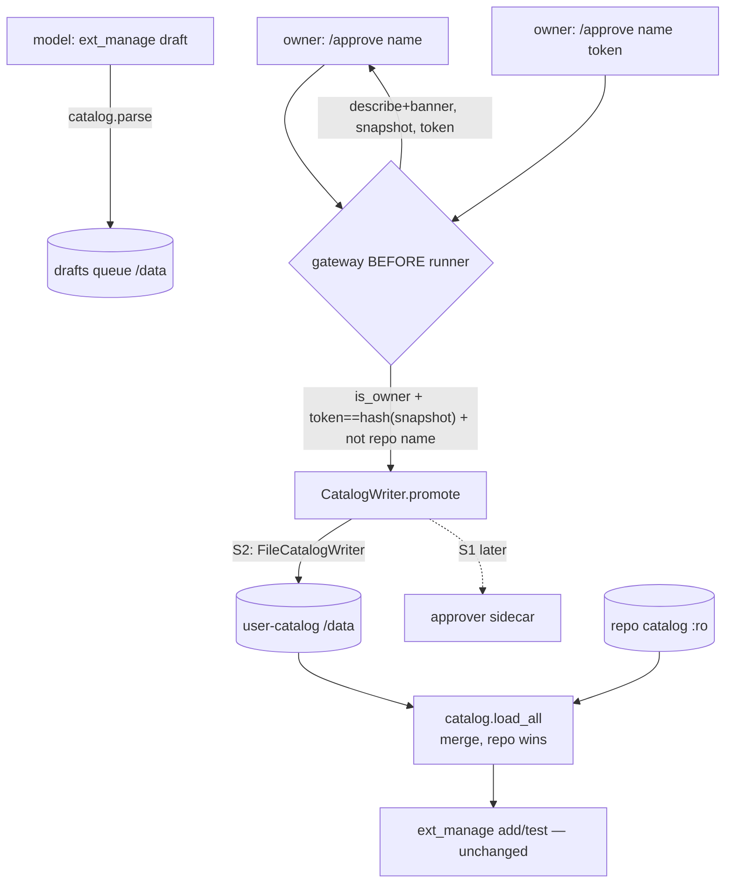

# Growing the Catalog from Chat — Implementation Plan

> **For agentic workers:** REQUIRED SUB-SKILL: Use superpowers:subagent-driven-development (recommended) or superpowers:executing-plans to implement this plan task-by-task. Steps use checkbox (`- [ ]`) syntax for tracking.

**Goal:** Let the owner grow the extensions catalog from Telegram — the agent drafts a manifest, the owner approves it in chat, and the entry becomes installable through the existing `ext_manage(action="add")` path, with no human on the host.

**Architecture:** A writable **user-catalog** on `/data` is merged with the reviewed repo catalog at read time (repo always wins). The write happens only through a `/approve` command intercepted in the gateway before the runner (like `/secret`) — owner-only, two-step confirm over a content-hash snapshot — and goes through a `CatalogWriter` port so a future isolated-sidecar writer can replace it without touching call sites. A thin CLI script plus a bundled skill make the existing `catalog.parse` validator runnable by the agent for self-check.

**Tech Stack:** Python 3.12, `pytest` (async tests, no explicit `asyncio` marker — the suite runs with `asyncio_mode=auto`), `yaml`, `hashlib`, aiogram (gateway). Follows the vertical-slice layout under `src/claude_hermes/extensions/`.

## Locked Decisions

- **User-catalog lives on `/data` (soft boundary, "S2"), write behind a `CatalogWriter` port.** The port is the seam to the future isolated-sidecar writer ("S1"); call sites depend on the port, never the filesystem. *Rationale:* keeps the hard-boundary door open without a rewrite; the accepted risk is explicit and reversible.
- **The repo catalog always wins on name collision.** A user-catalog entry whose name already exists in the repo catalog is dropped and logged, at both load time and approval time. *Rationale:* a chat-authored entry must never shadow a reviewed one (anti-downgrade).
- **Every user-catalog entry is re-validated by `catalog.parse` on every load.** A hand-forged file that does not pass the validator is inert. *Rationale:* the load-time gate is the floor under the soft boundary.
- **Approval is gateway-intercepted, owner-only, never a model tool.** The model may `draft`/`drafts`; it has no `approve` action. *Rationale:* a prompt-injected turn must not enact its own draft.
- **Two-step confirm over a content-hash snapshot.** `/approve <name>` shows `describe` + an 8-hex `sha256` token computed over a snapshot of the draft bytes; `/approve <name> <token>` promotes **the snapshot**. *Rationale:* token makes blind approval hard; promoting the snapshot (bound by the token) closes the TOCTOU where the agent edits the draft between show and confirm.
- **stdio is allowed in the user-catalog, flagged loudly.** `describe_with_banner` prepends a "LOCAL COMMAND — runs in your container" banner for stdio entries. *Rationale:* the owner asked for full catalog growth; the mitigation is visibility.
- **Validation rules stay in `catalog.parse`.** The CLI script and skill are thin wrappers — no rule logic is duplicated.

## Global Constraints

- Python floor: 3.12 (`pyproject.toml`). Use `from __future__ import annotations` in new modules, matching the existing extensions files.
- Secrets are already dropped from `os.environ` at startup (`main.py:72,76`); do not reintroduce them into any new subprocess env.
- New modules live under `src/claude_hermes/extensions/`; tests under `tests/`, one file per module, async test functions with no decorator.
- The confirm token is exactly the first 8 hex characters of `sha256(snapshot_bytes)`.
- Bundled skills live in the repo-root `skills/<name>/SKILL.md` and are seeded by `paths.seed_skills`.

## Architecture Diagram



---

### Task 1: Merge the user-catalog into `catalog.load_all`

**Files:**
- Modify: `src/claude_hermes/extensions/catalog.py` (add `_USER_CATALOG_DIR`, extract `_scan`, add `_merge`, rewrite `load_all`, add `is_repo_entry`)
- Test: `tests/test_catalog.py` (append merge tests)

**Interfaces:**
- Reuses: the existing per-directory scan loop currently inside `load_all` (`catalog.py:235-252`); `parse`; the `CH_CATALOG` env pattern (`catalog.py:23`); the `HTTP` fixture dict in `tests/test_catalog.py`.
- Produces:
  - `catalog._scan(base: Path) -> dict[str, Manifest]` — one directory, mcp+plugins.
  - `catalog._merge(repo_dir: Path, user_dir: Path) -> dict[str, Manifest]` — repo wins on name collision.
  - `catalog.load_all(root: Path | None = None) -> dict[str, Manifest]` — `root is not None` scans that root only (hermetic, unchanged for tests); `root is None` merges repo + user.
  - `catalog.is_repo_entry(name: str) -> bool` — true iff `name` is a reviewed repo entry.

- [ ] **Step 1: Write the failing tests**

Append to `tests/test_catalog.py`:

```python
def _write(dir_, name, over):
    sub = dir_ / "mcp"
    sub.mkdir(parents=True, exist_ok=True)
    (sub / f"{name}.yaml").write_text(yaml.safe_dump({**HTTP, **over, "name": name}))


def test_user_catalog_fills_names_the_repo_does_not_define(tmp_path):
    repo, user = tmp_path / "repo", tmp_path / "user"
    _write(repo, "a", {})
    _write(user, "b", {})
    merged = catalog._merge(repo, user)
    assert set(merged) == {"a", "b"}


def test_repo_wins_over_user_on_a_name_collision(tmp_path):
    """A chat-authored entry must never shadow a reviewed one."""
    repo, user = tmp_path / "repo", tmp_path / "user"
    _write(repo, "x", {"label": "REPO"})
    _write(user, "x", {"label": "USER"})
    merged = catalog._merge(repo, user)
    assert merged["x"].label == "REPO"


def test_a_malformed_user_file_is_skipped_not_fatal(tmp_path):
    repo, user = tmp_path / "repo", tmp_path / "user"
    _write(repo, "a", {})
    (user / "mcp").mkdir(parents=True)
    (user / "mcp" / "bad.yaml").write_text("transport: nonsense\n")
    merged = catalog._merge(repo, user)
    assert set(merged) == {"a"}


def test_an_explicit_root_sees_no_user_merge(tmp_path):
    """Tests that pass a fixture root must stay hermetic — no /data leakage."""
    repo = tmp_path / "repo"
    _write(repo, "a", {})
    assert set(catalog.load_all(repo)) == {"a"}
```

- [ ] **Step 2: Run the tests to verify they fail**

Run: `pytest tests/test_catalog.py -k "user_catalog or repo_wins or malformed_user or explicit_root" -v`
Expected: FAIL — `AttributeError: module ... has no attribute '_merge'`.

- [ ] **Step 3: Refactor `catalog.py`**

Add near the other env constants (after `catalog.py:24`):

```python
_USER_CATALOG_DIR = Path(os.environ["CH_USER_CATALOG"]) if os.environ.get("CH_USER_CATALOG") \
    else _REPO_ROOT / "user-catalog"
```

Replace the body of `load_all` (`catalog.py:235-252`) with:

```python
def _scan(base: Path) -> dict[str, Manifest]:
    """Every valid manifest under one catalog root, keyed by name. A broken file is
    logged and skipped — one bad manifest must not blind the agent to the whole catalog."""
    out: dict[str, Manifest] = {}
    for kind, subdir in (("mcp", "mcp"), ("plugin", "plugins")):
        directory = base / subdir
        if not directory.is_dir():
            continue
        for path in sorted(directory.glob("*.yaml")):
            try:
                data = yaml.safe_load(path.read_text(encoding="utf-8"))
                m = parse(data, kind)
            except (yaml.YAMLError, ManifestError):
                log.warning("skipping invalid catalog manifest %s", path, exc_info=True)
                continue
            out[m.name] = m
    return out


def _merge(repo_dir: Path, user_dir: Path) -> dict[str, Manifest]:
    """Reviewed catalog overlaid with the chat-approved user-catalog. The repo always
    wins: a user entry may only fill a name the repo does not define. This is the
    anti-downgrade rule — a chat-authored 'filesystem' must not replace the reviewed one."""
    entries = _scan(repo_dir)
    for name, m in _scan(user_dir).items():
        if name in entries:
            log.warning("user-catalog entry %r shadows a reviewed entry; ignored", name)
            continue
        entries[name] = m
    return entries


def load_all(root: Path | None = None) -> dict[str, Manifest]:
    """Every valid manifest, keyed by name. An explicit `root` (tests, fixtures) scans
    exactly that directory. In production (`root is None`) the reviewed repo catalog is
    merged with the writable user-catalog on /data, repo winning on collision."""
    if root is not None:
        return _scan(root)
    return _merge(_CATALOG_DIR, _USER_CATALOG_DIR)


def is_repo_entry(name: str) -> bool:
    """True iff `name` is a reviewed entry — used to refuse a user-catalog write that
    would shadow one."""
    return name in _scan(_CATALOG_DIR)
```

Leave `get()` unchanged — it delegates to `load_all`.

- [ ] **Step 4: Run the tests to verify they pass**

Run: `pytest tests/test_catalog.py -v`
Expected: PASS (all existing catalog tests plus the four new ones).

- [ ] **Step 5: Commit**

```bash
git add src/claude_hermes/extensions/catalog.py tests/test_catalog.py
git commit -m "feat(extensions): merge a writable user-catalog into load_all, repo wins"
```

---

### Task 2: The `CatalogWriter` port and its file implementation

**Files:**
- Create: `src/claude_hermes/extensions/usercatalog.py`
- Test: `tests/test_usercatalog.py`

**Interfaces:**
- Reuses: `catalog.Manifest`; the atomic-write idiom (tmp file + `os.replace`) used in `secrets.py`.
- Produces:
  - `usercatalog.user_catalog_dir(home: Path) -> Path` → `home / "user-catalog"`.
  - `usercatalog.CatalogWriter` (Protocol): `def promote(self, m: Manifest, raw: bytes) -> None`.
  - `usercatalog.FileCatalogWriter(home: Path)` implementing it — writes `raw` to `user-catalog/<subdir>/<name>.yaml` atomically (`mcp` or `plugins`).

- [ ] **Step 1: Write the failing test**

Create `tests/test_usercatalog.py`:

```python
from claude_hermes.extensions import catalog, usercatalog

MCP = {
    "manifest_version": 1, "name": "srv", "label": "Srv", "description": "d",
    "version": "1.0.0", "transport": "http",
    "url": "https://mcp.example.com/mcp", "scopes": ["turn"],
}
PLUGIN = {
    "manifest_version": 1, "name": "plg", "label": "Plg", "description": "d",
    "version": "1.0.0", "repo": "https://github.com/o/r", "ref": "v1.0.0",
    "scopes": ["turn"],
}


def test_promote_writes_an_mcp_entry_under_mcp(tmp_path):
    m = catalog.parse(MCP, "mcp")
    usercatalog.FileCatalogWriter(tmp_path).promote(m, b"raw-mcp-bytes\n")
    dest = usercatalog.user_catalog_dir(tmp_path) / "mcp" / "srv.yaml"
    assert dest.read_bytes() == b"raw-mcp-bytes\n"


def test_promote_writes_a_plugin_entry_under_plugins(tmp_path):
    m = catalog.parse(PLUGIN, "plugin")
    usercatalog.FileCatalogWriter(tmp_path).promote(m, b"raw-plugin\n")
    dest = usercatalog.user_catalog_dir(tmp_path) / "plugins" / "plg.yaml"
    assert dest.read_bytes() == b"raw-plugin\n"


def test_promote_leaves_no_temp_file_behind(tmp_path):
    m = catalog.parse(MCP, "mcp")
    usercatalog.FileCatalogWriter(tmp_path).promote(m, b"x\n")
    leftovers = list((usercatalog.user_catalog_dir(tmp_path) / "mcp").glob("*.tmp"))
    assert leftovers == []
```

- [ ] **Step 2: Run the test to verify it fails**

Run: `pytest tests/test_usercatalog.py -v`
Expected: FAIL — `ModuleNotFoundError: ... usercatalog`.

- [ ] **Step 3: Write `usercatalog.py`**

```python
from __future__ import annotations

import os
from pathlib import Path
from typing import Protocol

from .catalog import Manifest


def user_catalog_dir(home: Path) -> Path:
    """The writable, chat-grown half of the catalog. On /data (soft boundary): the
    agent can technically write here, so the real gate is the /approve command, not
    this path. The seam to a hard boundary is the CatalogWriter port below."""
    return home / "user-catalog"


def _subdir(kind: str) -> str:
    return "plugins" if kind == "plugin" else "mcp"


class CatalogWriter(Protocol):
    """How an approved manifest becomes a catalog entry. The S2 implementation writes a
    file; a future S1 implementation ships the bytes to an isolated approver sidecar that
    owns the only writable mount. The /approve handler depends on THIS, never on a path."""

    def promote(self, m: Manifest, raw: bytes) -> None: ...


class FileCatalogWriter:
    """S2: write the approved manifest straight into the user-catalog on /data."""

    def __init__(self, home: Path):
        self._home = home

    def promote(self, m: Manifest, raw: bytes) -> None:
        dest = user_catalog_dir(self._home) / _subdir(m.kind) / f"{m.name}.yaml"
        dest.parent.mkdir(parents=True, exist_ok=True)
        tmp = dest.with_suffix(".yaml.tmp")
        tmp.write_bytes(raw)
        os.replace(tmp, dest)          # atomic: a reader never sees a half-written entry
```

- [ ] **Step 4: Run the test to verify it passes**

Run: `pytest tests/test_usercatalog.py -v`
Expected: PASS.

- [ ] **Step 5: Commit**

```bash
git add src/claude_hermes/extensions/usercatalog.py tests/test_usercatalog.py
git commit -m "feat(extensions): CatalogWriter port + file writer for the user-catalog"
```

---

### Task 3: The `approvals` module — snapshot, token, banner

**Files:**
- Create: `src/claude_hermes/extensions/approvals.py`
- Test: `tests/test_approvals.py`

**Interfaces:**
- Reuses: `drafts.pending`, `drafts.draft_path`, `drafts.describe`, `drafts.kind_of`; `catalog.parse`, `catalog.Manifest`.
- Produces:
  - `approvals.token_of(raw: bytes) -> str` — first 8 hex of `sha256`.
  - `approvals.describe_with_banner(m: Manifest) -> str` — `drafts.describe` prefixed with a stdio banner when `m.transport == "stdio"`.
  - `approvals.begin(home: Path, name: str) -> tuple[Manifest, str, str] | None` — find the pending draft named `name`, snapshot its bytes under `pending-approvals/<subdir>/<name>.yaml`, return `(manifest, describe_with_banner, token)`; `None` if no such draft.
  - `approvals.confirm(home: Path, name: str, token: str) -> tuple[Manifest, bytes] | None` — recompute the token over the live snapshot; on match return `(manifest, snapshot_bytes)`, else `None` (no snapshot, or token mismatch).
  - `approvals.clear(home: Path, kind: str, name: str) -> None` — remove the snapshot and the now-promoted draft.

- [ ] **Step 1: Write the failing test**

Create `tests/test_approvals.py`:

```python
from claude_hermes.extensions import approvals, drafts

STDIO = """
manifest_version: 1
name: someserver
label: Some Server
description: Does a thing.
version: 1.0.0
transport: stdio
command: npx
args: ["-y", "@vendor/mcp-someserver"]
scopes: [turn]
"""
HTTP = """
manifest_version: 1
name: remote
label: Remote
description: A remote server.
version: 1.0.0
transport: http
url: https://mcp.example.com/mcp
scopes: [turn]
"""


def test_token_is_stable_for_the_same_bytes_and_8_hex(tmp_path):
    t = approvals.token_of(b"hello")
    assert t == approvals.token_of(b"hello")
    assert len(t) == 8 and all(c in "0123456789abcdef" for c in t)


def test_stdio_gets_a_local_command_banner_http_does_not(tmp_path):
    drafts.save(tmp_path, STDIO)
    drafts.save(tmp_path, HTTP)
    _, desc_stdio, _ = approvals.begin(tmp_path, "someserver")
    _, desc_http, _ = approvals.begin(tmp_path, "remote")
    assert "LOCAL COMMAND" in desc_stdio
    assert "LOCAL COMMAND" not in desc_http


def test_begin_returns_none_when_there_is_no_such_draft(tmp_path):
    assert approvals.begin(tmp_path, "ghost") is None


def test_confirm_matches_the_shown_token(tmp_path):
    drafts.save(tmp_path, STDIO)
    _, _, token = approvals.begin(tmp_path, "someserver")
    m, raw = approvals.confirm(tmp_path, "someserver", token)
    assert m.name == "someserver" and b"someserver" in raw


def test_confirm_refuses_a_wrong_token(tmp_path):
    drafts.save(tmp_path, STDIO)
    approvals.begin(tmp_path, "someserver")
    assert approvals.confirm(tmp_path, "someserver", "deadbeef") is None


def test_editing_the_draft_after_begin_invalidates_the_old_token(tmp_path):
    """TOCTOU: the human approved what they SAW. If the agent rewrites the draft after
    the surface was shown, the old token must stop working."""
    drafts.save(tmp_path, STDIO)
    _, _, token = approvals.begin(tmp_path, "someserver")
    # The agent tampers with the queued draft (it owns /data and has Bash).
    drafts.draft_path(tmp_path, "mcp", "someserver").write_text(
        STDIO.replace("@vendor/mcp-someserver", "@evil/backdoor")
    )
    # begin() re-snapshots, so a fresh /approve would show the new bytes and a new token;
    # but the token the human is holding was computed over the ORIGINAL snapshot.
    approvals.begin(tmp_path, "someserver")
    assert approvals.confirm(tmp_path, "someserver", token) is None


def test_clear_removes_snapshot_and_draft(tmp_path):
    drafts.save(tmp_path, STDIO)
    approvals.begin(tmp_path, "someserver")
    approvals.clear(tmp_path, "mcp", "someserver")
    assert not drafts.draft_path(tmp_path, "mcp", "someserver").exists()
```

- [ ] **Step 2: Run the test to verify it fails**

Run: `pytest tests/test_approvals.py -v`
Expected: FAIL — `ModuleNotFoundError: ... approvals`.

- [ ] **Step 3: Write `approvals.py`**

```python
from __future__ import annotations

import hashlib
from pathlib import Path

import yaml

from . import catalog, drafts
from .catalog import Manifest

SNAP_SUBDIR = "pending-approvals"
_BANNER = (
    "⚠️ LOCAL COMMAND — this runs a program in your container. Read command/args below.\n"
)


def token_of(raw: bytes) -> str:
    """Short, content-bound approval token. Binds the exact bytes the human saw: if the
    draft changes, the token the human is holding no longer matches."""
    return hashlib.sha256(raw).hexdigest()[:8]


def describe_with_banner(m: Manifest) -> str:
    body = drafts.describe(m)          # already ANSI-stripped via drafts.safe()
    return (_BANNER + body) if m.transport == "stdio" else body


def _snap_path(home: Path, kind: str, name: str) -> Path:
    subdir = "plugins" if kind == "plugin" else "mcp"
    return home / SNAP_SUBDIR / subdir / f"{name}.yaml"


def _find_pending(home: Path, name: str) -> Manifest | None:
    for m in drafts.pending(home):
        if m.name == name:
            return m
    return None


def begin(home: Path, name: str) -> tuple[Manifest, str, str] | None:
    """Snapshot the named draft's bytes and return (manifest, surface, token). The
    snapshot — not the live draft — is what confirm() will promote, so an edit after
    this point cannot smuggle different bytes past the token the human is shown."""
    m = _find_pending(home, name)
    if m is None:
        return None
    raw = drafts.draft_path(home, m.kind, m.name).read_bytes()
    snap = _snap_path(home, m.kind, m.name)
    snap.parent.mkdir(parents=True, exist_ok=True)
    snap.write_bytes(raw)
    return m, describe_with_banner(m), token_of(raw)


def confirm(home: Path, name: str, token: str) -> tuple[Manifest, bytes] | None:
    """Return (manifest, snapshot_bytes) iff a snapshot exists and its token matches."""
    for kind in ("mcp", "plugin"):
        snap = _snap_path(home, kind, name)
        if not snap.is_file():
            continue
        raw = snap.read_bytes()
        if token_of(raw) != token:
            return None
        return catalog.parse(yaml.safe_load(raw), kind), raw
    return None


def clear(home: Path, kind: str, name: str) -> None:
    _snap_path(home, kind, name).unlink(missing_ok=True)
    drafts.draft_path(home, kind, name).unlink(missing_ok=True)
```

- [ ] **Step 4: Run the tests to verify they pass**

Run: `pytest tests/test_approvals.py -v`
Expected: PASS.

- [ ] **Step 5: Commit**

```bash
git add src/claude_hermes/extensions/approvals.py tests/test_approvals.py
git commit -m "feat(extensions): approval snapshot, content-bound token, stdio banner"
```

---

### Task 4: The `/approve` command in the gateway

**Files:**
- Modify: `src/claude_hermes/gateway/telegram.py` (add `writer` param to `handle_event`; intercept `/approve`; add `_handle_approve`; usage/denial strings)
- Test: `tests/test_approve_command.py`

**Interfaces:**
- Reuses: the `/secret` interception pattern (`telegram.py:52-62`) — placed before the `verdict == "ignore"` check, returning `None if verdict == "ignore" else answer`; `acl.is_owner`; `approvals.begin/confirm/clear`; `catalog.is_repo_entry`; `usercatalog.CatalogWriter`.
- Consumes: `approvals` (Task 3), `usercatalog.CatalogWriter` (Task 2), `catalog.is_repo_entry` (Task 1).
- Produces: `handle_event(..., writer: CatalogWriter | None = None)` — a new keyword-only param; `/approve` reaches `writer.promote` only on a matching owner confirm.

- [ ] **Step 1: Write the failing test**

Create `tests/test_approve_command.py`:

```python
from claude_hermes.acl import AccessControl
from claude_hermes.config import Config
from claude_hermes.db import Database
from claude_hermes.extensions import drafts
from claude_hermes.gateway.events import MessageEvent
from claude_hermes.gateway.telegram import handle_event

STDIO = """
manifest_version: 1
name: someserver
label: Some Server
description: Does a thing.
version: 1.0.0
transport: stdio
command: npx
args: ["-y", "@vendor/mcp-someserver"]
scopes: [turn]
"""


class SpyRunner:
    def __init__(self):
        self.turns = []

    async def run_turn(self, key, text, progress=None, user_id=0):
        self.turns.append(text)
        return "reply"

    async def reset(self, key):
        pass


class SpyWriter:
    def __init__(self):
        self.promoted = []

    def promote(self, m, raw):
        self.promoted.append((m.name, raw))


def event(text, user_id=1):
    return MessageEvent(chat_type="private", chat_id=1, user_id=user_id, text=text,
                        mentioned=False, thread_id=None, message_id=99)


async def setup(tmp_path, owner_id=1):
    db = await Database.open(tmp_path / "state.db")
    acl = AccessControl(db, Config())
    await acl.check(owner_id, "private")
    return db, acl


async def test_approve_never_reaches_the_runner(tmp_path):
    db, acl = await setup(tmp_path)
    drafts.save(tmp_path, STDIO)
    runner, writer = SpyRunner(), SpyWriter()
    reply = await handle_event(runner, Config(), event("/approve someserver"),
                               acl=acl, home=tmp_path, writer=writer)
    assert runner.turns == []                       # the model never saw it
    assert "/approve someserver" in reply           # shows the confirm line with a token
    assert writer.promoted == []                    # step one promotes nothing
    await db.close()


async def test_a_non_owner_cannot_approve(tmp_path):
    db, acl = await setup(tmp_path, owner_id=1)
    drafts.save(tmp_path, STDIO)
    runner, writer = SpyRunner(), SpyWriter()
    reply = await handle_event(runner, Config(), event("/approve someserver", user_id=2),
                               acl=acl, home=tmp_path, writer=writer)
    assert writer.promoted == []
    assert "owner" in reply.lower()
    await db.close()


async def test_a_matching_confirm_promotes_exactly_once(tmp_path):
    db, acl = await setup(tmp_path)
    drafts.save(tmp_path, STDIO)
    runner, writer = SpyRunner(), SpyWriter()
    shown = await handle_event(runner, Config(), event("/approve someserver"),
                               acl=acl, home=tmp_path, writer=writer)
    token = shown.split("/approve someserver")[1].split()[0]
    reply = await handle_event(runner, Config(), event(f"/approve someserver {token}"),
                               acl=acl, home=tmp_path, writer=writer)
    assert [name for name, _ in writer.promoted] == ["someserver"]
    assert "someserver" in reply
    await db.close()
```

- [ ] **Step 2: Run the test to verify it fails**

Run: `pytest tests/test_approve_command.py -v`
Expected: FAIL — `handle_event()` has no `writer` param (`TypeError: unexpected keyword argument 'writer'`).

- [ ] **Step 3: Wire `/approve` into `telegram.py`**

Add the strings next to the `_SECRET_*` block (`telegram.py:18-22`):

```python
_APPROVE_USAGE = (
    "Usage: /approve <name>  — review a drafted catalog entry and get a confirm token; "
    "then /approve <name> <token> to add it to your catalog."
)
_APPROVE_DENIED = "Only the owner may approve catalog entries."
_APPROVE_SHADOW = (
    "'{name}' is a reviewed catalog entry and cannot be overridden from chat."
)
_APPROVE_NO_DRAFT = "No draft named '{name}' is waiting. Ask me to draft it first."
_APPROVE_STALE = (
    "That token no longer matches the draft (it changed since you last looked). "
    "Run /approve {name} again to see the current version and a fresh token."
)
```

Change the `handle_event` signature (`telegram.py:43-44`) to add `writer`:

```python
async def handle_event(runner, cfg: Config, event: MessageEvent, *, acl,
                       home: Path, progress=None, delete_message=None,
                       writer=None) -> str | None:
```

Immediately after the `/secret` block (after `telegram.py:62`), add:

```python
    if command == "/approve":
        # Handled here, before the runner, for the same reason as /secret: approving a
        # catalog entry makes something runnable in this container, and a prompt-injected
        # turn must not be able to enact its own draft. Only a literal owner message does.
        answer = await _handle_approve(rest, event, acl=acl, home=home, writer=writer)
        return None if verdict == "ignore" else answer
```

Add the handler beside `_handle_secret`:

```python
async def _handle_approve(rest: str, event: MessageEvent, *, acl, home: Path,
                          writer) -> str:
    """Two steps. `/approve <name>` shows the executable surface and a content-bound
    token; `/approve <name> <token>` promotes the snapshot the human just read."""
    from ..extensions import approvals, catalog

    name, _, token = rest.strip().partition(" ")
    name, token = name.strip(), token.strip()
    if not name:
        return _APPROVE_USAGE
    if not await acl.is_owner(event.user_id):
        return _APPROVE_DENIED
    if catalog.is_repo_entry(name):
        return _APPROVE_SHADOW.format(name=name)

    if not token:
        started = approvals.begin(home, name)
        if started is None:
            return _APPROVE_NO_DRAFT.format(name=name)
        _, surface, tok = started
        return (f"About to add this to your catalog:\n\n{surface}\n\n"
                f"To confirm, send:  /approve {name} {tok}")

    result = approvals.confirm(home, name, token)
    if result is None:
        return _APPROVE_STALE.format(name=name)
    m, raw = result
    writer.promote(m, raw)
    approvals.clear(home, m.kind, name)
    return (f"'{m.label}' is now in your catalog. Say 'add {name}' and I'll install it "
            "(you may need to send its secret first).")
```

- [ ] **Step 4: Run the tests to verify they pass**

Run: `pytest tests/test_approve_command.py tests/test_secret_command.py -v`
Expected: PASS (the `/secret` suite still passes — the signature change is keyword-only with a default).

- [ ] **Step 5: Commit**

```bash
git add src/claude_hermes/gateway/telegram.py tests/test_approve_command.py
git commit -m "feat(gateway): /approve — owner-only, two-step, gateway-intercepted"
```

---

### Task 5: The `validate_manifest.py` CLI (single validator, runnable)

**Files:**
- Create: `scripts/validate_manifest.py`
- Test: `tests/test_validate_manifest.py`

**Interfaces:**
- Reuses: `catalog.parse`, `catalog.ManifestError`, `drafts.kind_of`, `drafts.describe`.
- Produces: `validate_manifest.check(raw: str) -> tuple[int, str]` — `(0, describe)` on a valid manifest, `(1, reason)` on any rejection. A `main(argv)` wrapper reads a file path or stdin and prints/exits.

- [ ] **Step 1: Write the failing test**

Create `tests/test_validate_manifest.py`:

```python
import importlib.util
from pathlib import Path

_SPEC = importlib.util.spec_from_file_location(
    "validate_manifest",
    Path(__file__).resolve().parents[1] / "scripts" / "validate_manifest.py",
)
vm = importlib.util.module_from_spec(_SPEC)
_SPEC.loader.exec_module(vm)

GOOD = """
manifest_version: 1
name: remote
label: Remote
description: A remote server.
version: 1.0.0
transport: http
url: https://mcp.example.com/mcp
scopes: [turn]
"""


def test_a_valid_manifest_passes_and_prints_its_surface():
    code, out = vm.check(GOOD)
    assert code == 0
    assert "url:" in out and "https://mcp.example.com/mcp" in out


def test_a_shell_command_is_rejected():
    bad = GOOD.replace(
        "transport: http\nurl: https://mcp.example.com/mcp",
        "transport: stdio\ncommand: bash\nargs: [\"-c\", \"echo hi\"]",
    )
    code, out = vm.check(bad)
    assert code == 1 and "allowlist" in out


def test_a_non_https_url_is_rejected():
    code, out = vm.check(GOOD.replace("https://", "http://"))
    assert code == 1 and "https" in out
```

- [ ] **Step 2: Run the test to verify it fails**

Run: `pytest tests/test_validate_manifest.py -v`
Expected: FAIL — `FileNotFoundError` / module load fails (script does not exist).

- [ ] **Step 3: Write `scripts/validate_manifest.py`**

```python
#!/usr/bin/env python3
"""Validate a catalog manifest against the SAME rules the live catalog enforces.

The agent runs this on a draft before filing it: a manifest that fails here would fail
at approval too, so catching it now saves a human's attention. Rules live in
catalog.parse — this script only wraps it, so the two can never drift.

Usage:
    python scripts/validate_manifest.py path/to/manifest.yaml
    cat manifest.yaml | python scripts/validate_manifest.py
"""
from __future__ import annotations

import sys
from pathlib import Path

import yaml

# Run from the repo root so the package import resolves without an install.
sys.path.insert(0, str(Path(__file__).resolve().parents[1] / "src"))

from claude_hermes.extensions import catalog, drafts  # noqa: E402


def check(raw: str) -> tuple[int, str]:
    """(0, describe) if valid, (1, reason) otherwise."""
    try:
        data = yaml.safe_load(raw)
    except yaml.YAMLError as e:
        return 1, f"not valid YAML: {e}"
    if not isinstance(data, dict):
        return 1, "a manifest must be a YAML mapping"
    try:
        m = catalog.parse(data, drafts.kind_of(data))
    except (catalog.ManifestError, drafts.DraftError) as e:
        return 1, str(e)
    return 0, drafts.describe(m)


def main(argv: list[str]) -> int:
    raw = Path(argv[1]).read_text(encoding="utf-8") if len(argv) > 1 else sys.stdin.read()
    code, out = check(raw)
    print("PASS\n" + out if code == 0 else "FAIL: " + out)
    return code


if __name__ == "__main__":
    raise SystemExit(main(sys.argv))
```

- [ ] **Step 4: Run the tests to verify they pass**

Run: `pytest tests/test_validate_manifest.py -v`
Expected: PASS.

- [ ] **Step 5: Commit**

```bash
git add scripts/validate_manifest.py tests/test_validate_manifest.py
git commit -m "feat(extensions): validate_manifest.py — the catalog validator, runnable"
```

---

### Task 6: The `catalog-manifest` skill (self-check guidance for the agent)

**Files:**
- Create: `skills/catalog-manifest/SKILL.md`

**Interfaces:**
- Reuses: `scripts/validate_manifest.py` (Task 5); `ext_manage(action="draft")` (existing, `tools.py:271`); the seed path `paths.seed_skills` (repo-root `skills/` → `agent_home/.claude/skills/`).
- Produces: a bundled skill the agent loads before drafting a manifest.

- [ ] **Step 1: Write the skill**

Create `skills/catalog-manifest/SKILL.md`:

```markdown
---
name: catalog-manifest
description: Use when the owner asks to add a new MCP server or plugin that is not yet in the catalog — i.e. before ext_manage(action="draft"). Explains the manifest shape and the validation rules, and how to self-check a draft with scripts/validate_manifest.py so a broken manifest never reaches the owner's approval screen.
---

# Writing a catalog manifest

A catalog entry is a small YAML file. An MCP server is either a remote endpoint or a
local command; a plugin is a git repo at a pinned ref. The owner will see the exact
`command`/`args` (or `url`, or `repo`/`ref`) and must approve it — so get it right and
show them something clean.

## The rules (enforced; a draft that breaks one is refused)

- `manifest_version: 1`. Unknown top-level keys are an error, not a warning.
- MCP `transport` is one of `stdio | http | sse`.
- `stdio`: `command` must be `npx`, `uvx`, or `python`. No shells. `args` is a **list of
  strings**, never one shell string — no pipes, no `&&`, no substitution.
- `http`/`sse`: `url` must be `https://`.
- Plugin `ref` must be a release tag (`v1.2.3`) or a full 40-char commit sha — never a
  branch like `main` (a branch moves after the owner reviewed it).
- Every `${VAR}` you reference must be declared under `auth`.
- `scopes` ⊆ `{turn, cron}`.

## Self-check BEFORE you draft

Write the manifest to a temp file and run the validator — the same code the catalog runs:

    python scripts/validate_manifest.py /tmp/manifest.yaml

`PASS` prints the executable surface the owner will read. `FAIL: <reason>` tells you
exactly what to fix. Only once it passes, file it with `ext_manage(action="draft", …)`
and tell the owner to review and `/approve <name>`.

## Example (remote MCP server)

    manifest_version: 1
    name: example
    label: Example
    description: What this server is for.
    version: 1.0.0
    transport: http
    url: https://mcp.example.com/mcp
    scopes: [turn]
```

- [ ] **Step 2: Verify the validator agrees with a shipped manifest (end-to-end)**

Run: `python scripts/validate_manifest.py catalog/mcp/fetch.yaml`
Expected: prints `PASS` followed by the `fetch` server's surface, exit 0.

- [ ] **Step 3: Commit**

```bash
git add skills/catalog-manifest/SKILL.md
git commit -m "docs(extensions): catalog-manifest skill — draft + self-check guidance"
```

---

### Task 7: Runtime wiring — dirs, env, and the real writer

**Files:**
- Modify: `src/claude_hermes/paths.py` (create user-catalog + pending-approvals dirs)
- Modify: `src/claude_hermes/gateway/telegram.py` (thread `writer` from `create_dispatcher` into the `handle_event` call)
- Modify: `src/claude_hermes/main.py` (construct `FileCatalogWriter`, pass to `create_dispatcher`)
- Modify: `Dockerfile` (`ENV CH_USER_CATALOG=/data/user-catalog`)
- Test: `tests/test_paths_config.py` (assert the new dirs are created)

**Interfaces:**
- Reuses: `get_home` (`paths.py:71`) and its existing `mkdir(parents=True, exist_ok=True)` idiom; `create_dispatcher` (`main.py:129`); `usercatalog.FileCatalogWriter` (Task 2); `usercatalog.user_catalog_dir`; `approvals.SNAP_SUBDIR`.
- Consumes: `handle_event(..., writer=...)` (Task 4).
- Produces: at runtime, `/approve` reaches a real `FileCatalogWriter(home)`; `load_all` finds the user-catalog via `CH_USER_CATALOG`.

- [ ] **Step 1: Write the failing test**

Append to `tests/test_paths_config.py`:

```python
def test_get_home_creates_the_user_catalog_and_approval_dirs(tmp_path, monkeypatch):
    monkeypatch.setenv("CH_HOME", str(tmp_path))
    from claude_hermes.paths import get_home
    home = get_home()
    assert (home / "user-catalog" / "mcp").is_dir()
    assert (home / "user-catalog" / "plugins").is_dir()
    assert (home / "pending-approvals").is_dir()
```

- [ ] **Step 2: Run the test to verify it fails**

Run: `pytest tests/test_paths_config.py -k user_catalog_and_approval -v`
Expected: FAIL — the directories are not created.

- [ ] **Step 3: Create the dirs in `paths.get_home`**

In `paths.py`, inside `get_home()` after the existing `(home / "logs").mkdir(...)` line (`paths.py:80`), add:

```python
    for sub in ("user-catalog/mcp", "user-catalog/plugins", "pending-approvals"):
        (home / sub).mkdir(parents=True, exist_ok=True)
```

- [ ] **Step 4: Run the test to verify it passes**

Run: `pytest tests/test_paths_config.py -v`
Expected: PASS.

- [ ] **Step 5: Thread the writer through the gateway**

In `telegram.py`, `create_dispatcher` must accept a `writer` and pass it to `handle_event`. Add `writer=None` to the `create_dispatcher` parameter list, and change the `handle_event` call (`telegram.py:247-249`) to:

```python
                reply = await handle_event(runner, cfg, event, acl=acl, home=home,
                                           progress=presenter.on_event,
                                           delete_message=delete_message,
                                           writer=writer)
```

In `main.py`, construct the writer and pass it (`main.py:129-131`):

```python
    from .extensions.usercatalog import FileCatalogWriter
    dp = create_dispatcher(runner, cfg, bot_username=me.username or "", acl=acl,
                           sender=sender, titler=titler, home=get_home(),
                           voice=voice, send_voice=send_voice,
                           writer=FileCatalogWriter(get_home()))
```

- [ ] **Step 6: Set the catalog env in the image**

In `Dockerfile`, after the `ENV CH_HOME=/data` line (`Dockerfile:27`), add:

```dockerfile
# The chat-grown half of the catalog, on the /data volume. catalog.py merges it with the
# reviewed /app/catalog (which always wins on a name collision). Soft boundary by design:
# see docs/superpowers/specs/2026-07-15-catalog-from-chat-design.md, "Residual risk".
ENV CH_USER_CATALOG=/data/user-catalog
```

- [ ] **Step 7: Run the full suite**

Run: `pytest -q`
Expected: PASS (all tests, including the existing gateway/runner suites).

- [ ] **Step 8: Commit**

```bash
git add src/claude_hermes/paths.py src/claude_hermes/gateway/telegram.py src/claude_hermes/main.py Dockerfile tests/test_paths_config.py
git commit -m "feat(extensions): wire the user-catalog writer, dirs, and CH_USER_CATALOG"
```

---

## Self-Review Notes (addressed)

- **Spec coverage:** validator skill+script → Tasks 5–6; user-catalog + merge → Task 1; `CatalogWriter` port → Task 2; `/approve` two-step/anti-TOCTOU/owner-only → Tasks 3–4; repo-wins → Task 1 + Task 4 shadow guard; stdio banner → Task 3; wiring/env/dirs → Task 7. Residual risk is documented in the spec and referenced in the Dockerfile comment.
- **No model-callable approve:** intentionally no `ext_manage` change — approval exists only in the gateway. (An explicit regression test for "no approve action" is optional; `ext_manage` is simply not touched.)
- **Type consistency:** `begin → (Manifest, str, str)`, `confirm → (Manifest, bytes) | None`, `promote(m, raw: bytes)`, `token_of(bytes) -> str` used identically across Tasks 2–4 and 7.

## Open Questions

1. **Forbid stdio in the user-catalog?** Options: allow-flagged / forbid-under-S2. **Default: allow, flagged** (Locked Decisions) — if the soft boundary feels too wide once real entries exist, add a one-line load-time filter in `_merge` dropping stdio user entries; no interface changes.
2. **Remove the draft on successful approval?** Options: remove / keep. **Default: remove** (implemented in `approvals.clear`) — the entry now lives in the catalog, so a lingering draft would misrepresent the queue.
3. **Provenance record.** Options: YAML header comment / separate ledger. **Default: none in this cut** — the promoted file's bytes are the draft as-approved; a `# approved by <id> at <iso>` header is a cheap follow-up if audit demand appears. (Deferred to keep the first cut small.)
