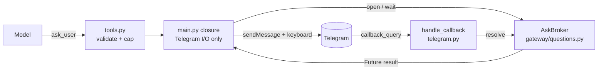

# Ask the user a question with inline buttons — Implementation Plan

> **For agentic workers:** REQUIRED SUB-SKILL: Use superpowers:subagent-driven-development (recommended) or superpowers:executing-plans to implement this plan task-by-task. Steps use checkbox (`- [ ]`) syntax for tracking.

**Goal:** the agent can ask a multiple-choice question mid-turn and receive the answer inside the same turn, as Telegram inline buttons.

**Architecture:** A new `gateway/questions.py` owns an `AskBroker` — a pure-asyncio registry of pending questions that also owns the race-critical wait. `main.py` builds a closure that does only Telegram I/O (send the keyboard, clear it afterwards) and stores it on `runner._ask_user`, exactly as `deliver_document` already works. A new `ask_user` MCP tool validates input, enforces a per-turn cap, and calls that closure. A new `@dp.callback_query()` handler resolves the pending future.

**Tech Stack:** Python 3.12, aiogram 3.x, `claude-agent-sdk==0.2.126`, pytest with `asyncio_mode = auto`.

**Spec:** `docs/superpowers/specs/2026-07-29-ask-user-inline-buttons-design.md` (commit `655d105`).

## Locked Decisions

- **Tool schema is `{"question": str, "options": str}`**, options newline-separated. Every schema in `tools.py` is flat primitives; a list type would be the only one. The schema is part of the cached prefix and of how the model learns the tool.
- **`callback_data` is `q:<qid>:<idx>`**, where `qid` is 8 hex chars and `<idx>` is an option index or the literal `c` for Cancel. Telegram caps `callback_data` at 64 bytes, so option text cannot travel in it. The `q:` prefix reserves room for future button types, because a button already sitting in a chat gets clicked after the next deploy.
- **`resolve()` is peek → check `user_id` → pop → `set_result`.** Popping before the ownership check would let a stranger's click destroy a live question.
- **The waiter never cancels the shared future.** `asyncio.wait({fut}, timeout=...)`, never `asyncio.wait_for`. Then **pop first, read `fut.done()` second** — the pop is the arbiter, the future is the value. Either half alone is wrong (see Task 2).
- **Timeout and cap come from `Config`**, threaded as parameters so tests can pass small values without a real `sleep`. No `ask_user_enabled` kill switch: that would change the toolset across a restart of live lanes with no reset path.
- **Private chats only, enforced at tool registration.**
- **`CANCELLED` is a sentinel string** (`"\x00cancelled"`), distinct from `None` (timeout) and from any real option label.

## Global Constraints

- **Run tests with** `.venv/Scripts/python.exe -m pytest -q`. A bare `pytest` raises `ModuleNotFoundError`.
- **The existing 507 tests must stay green unchanged.** The guarantee is `runner._ask_user = None` by default. `tests/test_tools.py:42-50` builds the server with a private-chat `ctx` and asserts an exact tool-name list — it stays green because of the `_ask_user is not None` condition, **not** the chat-type condition. Keep both.
- **`ask_user` returns a string to the model and does nothing else.** It must never enact anything (invariant #4).
- **Run the wiki CLI under WSL** — `.llm-wiki/llm-wiki` is a Linux ELF binary:
  `wsl -d Ubuntu -- bash -lc "cd /mnt/d/projects/claude-hermes && ./.llm-wiki/llm-wiki <cmd>"`
- **`fingerprint` only prints.** It does not write the page frontmatter; patch `base_commit` and `evidence_fingerprint` by hand, or `validate` will not move.

## Architecture Diagram



## File Structure

| File | Responsibility |
|---|---|
| `src/claude_hermes/gateway/questions.py` *(new)* | `AskBroker`, `CANCELLED`. Pending-question registry **and** the race-critical wait. No aiogram, no httpx. |
| `src/claude_hermes/sessions.py` *(modify)* | `chat_type_from_key` |
| `src/claude_hermes/config.py` *(modify)* | `ask_user_timeout_seconds`, `ask_user_max_per_turn` |
| `src/claude_hermes/tools.py` *(modify)* | `ask_user` handler, schema, registration gate; `TurnFlags.asks_used` |
| `src/claude_hermes/gateway/telegram.py` *(modify)* | `handle_callback` + a thin `@dp.callback_query()` |
| `src/claude_hermes/gateway/presenter.py` *(modify)* | `_STATUS` line for the tool |
| `src/claude_hermes/runner.py` *(modify)* | `self._ask_user = None`, threaded into `build_hermes_server` |
| `src/claude_hermes/main.py` *(modify)* | build the broker + closure, wire both |
| `tests/test_ask_broker.py` *(new)* | registry, ownership, and the click-at-deadline race |
| `tests/test_ask_user_tool.py` *(new)* | registration gate, validation, the four return texts, the cap |
| `tests/test_ask_callback.py` *(new)* | `handle_callback` on malformed input |

---

### Task 1: `chat_type_from_key`

**Files:**
- Modify: `src/claude_hermes/sessions.py` (append after `thread_id_from_key`, `:19-23`)
- Test: `tests/test_sessions.py` (append)

**Interfaces:**
- Reuses: `build_session_key` (`sessions.py:26`) — the producer these tests assert against; `chat_id_from_key` (`sessions.py:9`) — the parsing shape to copy.
- Produces: `chat_type_from_key(session_key: str) -> str` — `""` when the key is not a `tg:` key.

- [ ] **Step 1: Write the failing tests**

Append to `tests/test_sessions.py`:

```python
from claude_hermes.sessions import chat_type_from_key


def test_chat_type_from_key_matches_what_build_session_key_produces():
    # Asserted against the producer, not against hand-written literals, so the
    # test catches divergence if the key format ever changes.
    assert chat_type_from_key(build_session_key("private", 1)) == "private"
    assert chat_type_from_key(build_session_key("group", -5, user_id=7)) == "group"
    assert chat_type_from_key(
        build_session_key("supergroup", -5, user_id=7, thread_id=9)
    ) == "supergroup"
    assert chat_type_from_key(build_session_key("private", 1, thread_id=9)) == "private"


def test_chat_type_from_key_is_empty_for_a_non_tg_key():
    assert chat_type_from_key("cron:12") == ""
    assert chat_type_from_key("") == ""
```

If `tests/test_sessions.py` does not already import `build_session_key`, add it to the existing import block rather than duplicating the import.

- [ ] **Step 2: Run tests to verify they fail**

```bash
.venv/Scripts/python.exe -m pytest tests/test_sessions.py -q
```

Expected: `ImportError: cannot import name 'chat_type_from_key'`

- [ ] **Step 3: Write the implementation**

Insert into `src/claude_hermes/sessions.py` after `thread_id_from_key`:

```python
def chat_type_from_key(session_key: str) -> str:
    """The chat type baked into a session key, or "" if this is not a tg key.

    Symmetric with chat_id_from_key above. Exists so a caller can ask "is this
    lane a private chat?" without spelling out a startswith("tg:private:") in
    three places — and cron keys answer "" rather than raising.
    """
    parts = session_key.split(":")
    if parts[0] != "tg" or len(parts) < 3:
        return ""
    return parts[1]
```

- [ ] **Step 4: Run tests to verify they pass**

```bash
.venv/Scripts/python.exe -m pytest tests/test_sessions.py -q
```

Expected: all pass.

- [ ] **Step 5: Commit**

```bash
git add src/claude_hermes/sessions.py tests/test_sessions.py
git commit -m "feat(sessions): chat_type_from_key, symmetric with chat_id_from_key"
```

---

### Task 2: `AskBroker` — the registry and the race

**Files:**
- Create: `src/claude_hermes/gateway/questions.py`
- Test: `tests/test_ask_broker.py`

**Interfaces:**
- Reuses: nothing — this module is deliberately dependency-free so it can be tested without a single Bot API mock.
- Produces:
  - `CANCELLED: str` — sentinel, distinct from `None` and from any option label
  - `AskBroker.open(options: list[str], user_id: int) -> tuple[str, asyncio.Future]`
  - `async AskBroker.wait(qid: str, fut: asyncio.Future, timeout: float) -> str | None`
  - `AskBroker.resolve(qid: str, token: str, user_id: int) -> bool`
  - `AskBroker.discard(qid: str) -> None`

This is the only task where getting the ordering wrong produces a bug that survives review. Read the Step 3 comments before writing it.

- [ ] **Step 1: Write the failing tests**

Create `tests/test_ask_broker.py`:

```python
import asyncio

import pytest

from claude_hermes.gateway.questions import CANCELLED, AskBroker


async def test_open_hands_out_distinct_ids():
    # async, not sync: open() needs a RUNNING loop to create its future.
    b = AskBroker()
    q1, _ = b.open(["a", "b"], user_id=7)
    q2, _ = b.open(["a", "b"], user_id=7)
    assert q1 != q2


async def test_resolve_delivers_the_chosen_option():
    b = AskBroker()
    qid, fut = b.open(["Redis", "in-memory"], user_id=7)
    assert b.resolve(qid, "1", user_id=7) is True
    assert await b.wait(qid, fut, timeout=1.0) == "in-memory"


async def test_resolve_delivers_the_cancel_sentinel():
    b = AskBroker()
    qid, fut = b.open(["Redis"], user_id=7)
    assert b.resolve(qid, "c", user_id=7) is True
    assert await b.wait(qid, fut, timeout=1.0) is CANCELLED


async def test_a_stranger_cannot_answer_and_cannot_destroy_the_question():
    """Peek before popping. If the ownership check came after the pop, a
    stranger's click would delete a question its owner is still looking at."""
    b = AskBroker()
    qid, fut = b.open(["Redis"], user_id=7)
    assert b.resolve(qid, "0", user_id=999) is False
    assert not fut.done()                       # still live
    assert b.resolve(qid, "0", user_id=7) is True   # owner still can answer
    assert await b.wait(qid, fut, timeout=1.0) == "Redis"


async def test_a_question_answers_only_once():
    b = AskBroker()
    qid, fut = b.open(["Redis", "in-memory"], user_id=7)
    assert b.resolve(qid, "0", user_id=7) is True
    assert b.resolve(qid, "1", user_id=7) is False
    assert await b.wait(qid, fut, timeout=1.0) == "Redis"


async def test_an_unknown_or_malformed_token_is_refused_not_raised():
    b = AskBroker()
    qid, fut = b.open(["Redis"], user_id=7)
    assert b.resolve("nosuch", "0", user_id=7) is False
    assert b.resolve(qid, "not-a-number", user_id=7) is False
    assert b.resolve(qid, "99", user_id=7) is False      # out of range
    assert not fut.done()


async def test_wait_times_out_to_none_and_deregisters():
    b = AskBroker()
    qid, fut = b.open(["Redis"], user_id=7)
    assert await b.wait(qid, fut, timeout=0.01) is None
    assert b.resolve(qid, "0", user_id=7) is False       # entry is gone


async def test_the_timed_out_future_is_never_cancelled():
    """asyncio.wait_for would cancel this future while the broker still held it,
    and a click landing in that window would hit InvalidStateError. asyncio.wait
    does not cancel — this test is what stops someone 'simplifying' it back."""
    b = AskBroker()
    qid, fut = b.open(["Redis"], user_id=7)
    await b.wait(qid, fut, timeout=0.01)
    assert not fut.cancelled()


@pytest.mark.parametrize("delay", [0.001, 0.02, 0.05])
async def test_a_click_and_the_wait_never_disagree(delay):
    """The bug this guards: the user's popup says 'accepted' while the model is
    told nobody answered. Whoever pops first wins, and both sides read that same
    decision."""
    for _ in range(50):
        b = AskBroker()
        qid, fut = b.open(["Redis"], user_id=7)

        async def click():
            await asyncio.sleep(delay)
            return b.resolve(qid, "0", user_id=7)

        answer, accepted = await asyncio.gather(
            b.wait(qid, fut, timeout=0.02), click()
        )
        assert accepted == (answer == "Redis")
```

- [ ] **Step 2: Run tests to verify they fail**

```bash
.venv/Scripts/python.exe -m pytest tests/test_ask_broker.py -q
```

Expected: `ModuleNotFoundError: No module named 'claude_hermes.gateway.questions'`

- [ ] **Step 3: Write the implementation**

Create `src/claude_hermes/gateway/questions.py`:

```python
from __future__ import annotations

import asyncio
import secrets
from dataclasses import dataclass

# Distinct from None (which means "timed out") and unproducible as an option
# label, so the tool can tell "the user declined" from "the user never answered".
CANCELLED = "\x00cancelled"

_CANCEL_TOKEN = "c"


@dataclass
class _Pending:
    options: list[str]
    user_id: int
    future: asyncio.Future


class AskBroker:
    """Pending inline-keyboard questions, and the wait that resolves them.

    The wait lives here rather than in the caller on purpose: it is the only
    race-critical code in this feature, and main.py — the natural home for the
    Telegram side — has no unit tests. Keeping it here makes it testable with
    no Bot API mock at all.
    """

    def __init__(self) -> None:
        self._pending: dict[str, _Pending] = {}

    def open(self, options: list[str], user_id: int) -> tuple[str, asyncio.Future]:
        qid = secrets.token_hex(4)
        # get_running_loop, not get_event_loop: this is only ever called from a
        # tool call, which always has a running loop, and get_event_loop warns
        # (and in 3.12+ errors) when there is none.
        fut: asyncio.Future = asyncio.get_running_loop().create_future()
        self._pending[qid] = _Pending(list(options), user_id, fut)
        return qid, fut

    async def wait(self, qid: str, fut: asyncio.Future, timeout: float) -> str | None:
        """The chosen option, CANCELLED, or None on timeout.

        Two things here are load-bearing and neither is obvious:

        1. `asyncio.wait` — NOT `asyncio.wait_for`. wait_for CANCELS the future
           on timeout, and this broker still holds that future until the finally
           below runs a loop step later. A click landing in that window would pop
           a cancelled future and raise InvalidStateError inside the aiogram task,
           where it is swallowed: the user's button spins, their answer is
           dropped, and the model is told nobody replied.

        2. Pop FIRST, read `fut.done()` SECOND. The pop is the arbiter — whoever
           removes the entry wins — and the future only carries the value. With
           the pop after the read, a click on the deadline is told "accepted"
           while this function returns None, and the user and the model disagree
           about what happened.
        """
        try:
            await asyncio.wait({fut}, timeout=timeout)
        finally:
            # Synchronous on purpose: the SDK cancels in-flight tool tasks on
            # teardown, so CancelledError can arrive AT this finally, and any
            # await here would be skipped, leaking the entry.
            self._pending.pop(qid, None)
        return fut.result() if fut.done() else None

    def resolve(self, qid: str, token: str, user_id: int) -> bool:
        """Deliver a click. False means "this question is no longer yours to answer"."""
        entry = self._pending.get(qid)          # PEEK — do not pop yet
        if entry is None or entry.user_id != user_id:
            # Popping before this check would let a stranger's click destroy a
            # question its owner is still looking at.
            return False

        if token == _CANCEL_TOKEN:
            value = CANCELLED
        else:
            try:
                index = int(token)
            except ValueError:
                return False
            if not 0 <= index < len(entry.options):
                return False
            value = entry.options[index]

        if self._pending.pop(qid, None) is None:   # someone won the race first
            return False
        if entry.future.done():                    # belt and braces
            return False
        entry.future.set_result(value)
        return True

    def discard(self, qid: str) -> None:
        """Drop a question that was never asked — e.g. sendMessage failed."""
        self._pending.pop(qid, None)
```

- [ ] **Step 4: Run tests to verify they pass**

```bash
.venv/Scripts/python.exe -m pytest tests/test_ask_broker.py -q
```

Expected: all pass (the parametrized race test runs 150 interleavings).

- [ ] **Step 5: Prove the race test actually catches the bug**

Temporarily change `wait` to use the wrong primitive:

```python
        try:
            await asyncio.wait_for(fut, timeout=timeout)
        except asyncio.TimeoutError:
            pass
        finally:
            self._pending.pop(qid, None)
```

Run the suite again. `test_the_timed_out_future_is_never_cancelled` must FAIL. **Then revert to the `asyncio.wait` version and re-run to confirm green.** A guard test that does not fail against the bug it names is worth nothing.

- [ ] **Step 6: Commit**

```bash
git add src/claude_hermes/gateway/questions.py tests/test_ask_broker.py
git commit -m "feat(questions): AskBroker owns pending questions and the deadline race"
```

---

### Task 3: The `ask_user` tool

**Files:**
- Modify: `src/claude_hermes/config.py` (append to the settings block, after `plugin_clone_timeout_seconds` at `:68`)
- Modify: `src/claude_hermes/tools.py` (`TurnFlags` at `:23-29`; a new handler beside `send_document` at `:401`; the `handlers` dict at `:442-460`; `build_hermes_server` at `:464`)
- Test: `tests/test_ask_user_tool.py`

**Interfaces:**
- Reuses: `send_document` (`tools.py:401-440`) — the shape to copy for a ctx-bound tool with a delivery closure; the registration gate at `tools.py:458`; `TurnFlags` (`tools.py:23`) as the per-turn side-channel; `chat_type_from_key` (Task 1); `CANCELLED` (Task 2).
- Consumes: `CANCELLED` from `claude_hermes.gateway.questions`.
- Produces:
  - `Config.ask_user_timeout_seconds: float = 120.0`, `Config.ask_user_max_per_turn: int = 2`
  - `TurnFlags.asks_used: int = 0`
  - `make_handlers(..., ask_user=None)` and `build_hermes_server(..., ask_user=None)`
  - the closure contract: `async ask_user(chat_id, thread_id, question, options, user_id, timeout) -> str | None`

- [ ] **Step 1: Write the failing tests**

Create `tests/test_ask_user_tool.py`:

```python
from claude_hermes.config import Config
from claude_hermes.db import Database
from claude_hermes.gateway.questions import CANCELLED
from claude_hermes.tools import TurnContext, build_hermes_server, make_handlers

NAME = "mcp__hermes__ask_user"


def _ctx(key="tg:private:1"):
    return TurnContext(session_key=key, chat_id=1, user_id=7)


class FakeAsk:
    """Records what the tool asked and replays a canned answer."""

    def __init__(self, answer="Redis"):
        self.calls = []
        self._answer = answer

    async def __call__(self, chat_id, thread_id, question, options, user_id, timeout):
        self.calls.append({"chat_id": chat_id, "question": question,
                           "options": options, "timeout": timeout})
        return self._answer


async def _handlers(db, **kw):
    kw.setdefault("ctx", _ctx())
    kw.setdefault("cfg", Config())
    return make_handlers(db, **kw)


async def test_the_tool_is_absent_without_a_closure(tmp_path):
    db = await Database.open(tmp_path / "state.db")
    assert "ask_user" not in await _handlers(db)
    await db.close()


async def test_the_tool_is_absent_outside_a_private_chat(tmp_path):
    db = await Database.open(tmp_path / "state.db")
    h = await _handlers(db, ctx=_ctx("tg:supergroup:-5:7"), ask_user=FakeAsk())
    assert "ask_user" not in h
    await db.close()


async def test_the_tool_is_absent_without_ctx(tmp_path):
    db = await Database.open(tmp_path / "state.db")
    assert "ask_user" not in make_handlers(db, ctx=None, cfg=Config(),
                                           ask_user=FakeAsk())
    await db.close()


async def test_the_tool_is_present_in_a_private_chat(tmp_path):
    db = await Database.open(tmp_path / "state.db")
    assert "ask_user" in await _handlers(db, ask_user=FakeAsk())
    await db.close()


async def test_the_server_still_omits_it_when_nothing_is_wired(tmp_path):
    """The existing test_tools.py assertion depends on this exact behaviour."""
    db = await Database.open(tmp_path / "state.db")
    _, names = build_hermes_server(db, ctx=_ctx())
    assert NAME not in names
    await db.close()


async def test_the_server_advertises_it_when_wired(tmp_path):
    db = await Database.open(tmp_path / "state.db")
    _, names = build_hermes_server(db, ctx=_ctx(), cfg=Config(), ask_user=FakeAsk())
    assert NAME in names
    await db.close()


async def test_a_chosen_option_is_reported_to_the_model(tmp_path):
    db = await Database.open(tmp_path / "state.db")
    fake = FakeAsk("Redis")
    h = await _handlers(db, ask_user=fake)
    out = await h["ask_user"]({"question": "Which backend?",
                               "options": "Redis\nin-memory"})
    assert 'The user chose: "Redis"' in out["content"][0]["text"]
    assert fake.calls[0]["options"] == ["Redis", "in-memory"]
    await db.close()


async def test_blank_option_lines_are_dropped(tmp_path):
    db = await Database.open(tmp_path / "state.db")
    fake = FakeAsk()
    h = await _handlers(db, ask_user=fake)
    await h["ask_user"]({"question": "q", "options": "Redis\n\n  \nin-memory\n"})
    assert fake.calls[0]["options"] == ["Redis", "in-memory"]
    await db.close()


async def test_too_few_or_too_many_options_are_refused_without_asking(tmp_path):
    db = await Database.open(tmp_path / "state.db")
    fake = FakeAsk()
    h = await _handlers(db, ask_user=fake)
    one = await h["ask_user"]({"question": "q", "options": "only"})
    six = await h["ask_user"]({"question": "q", "options": "\n".join("abcdef")})
    assert "between 2 and 5" in one["content"][0]["text"]
    assert "between 2 and 5" in six["content"][0]["text"]
    assert fake.calls == []          # nothing reached Telegram
    await db.close()


async def test_cancel_and_timeout_have_distinct_replies(tmp_path):
    db = await Database.open(tmp_path / "state.db")
    h_cancel = await _handlers(db, ask_user=FakeAsk(CANCELLED))
    h_timeout = await _handlers(db, ask_user=FakeAsk(None))
    args = {"question": "q", "options": "a\nb"}
    assert "declined" in (await h_cancel["ask_user"](args))["content"][0]["text"]
    assert "did not answer" in (await h_timeout["ask_user"](args))["content"][0]["text"]
    await db.close()


async def test_the_per_turn_cap_refuses_without_reaching_telegram(tmp_path):
    db = await Database.open(tmp_path / "state.db")
    ctx = _ctx()
    fake = FakeAsk()
    h = make_handlers(db, ctx=ctx, cfg=Config(ask_user_max_per_turn=2),
                      ask_user=fake)
    args = {"question": "q", "options": "a\nb"}
    await h["ask_user"](args)
    await h["ask_user"](args)
    third = await h["ask_user"](args)
    assert "already asked" in third["content"][0]["text"]
    assert len(fake.calls) == 2          # the third never left the process
    assert ctx.flags.asks_used == 2
    await db.close()


async def test_the_configured_timeout_is_passed_down(tmp_path):
    db = await Database.open(tmp_path / "state.db")
    fake = FakeAsk()
    h = await _handlers(db, cfg=Config(ask_user_timeout_seconds=7.5), ask_user=fake)
    await h["ask_user"]({"question": "q", "options": "a\nb"})
    assert fake.calls[0]["timeout"] == 7.5
    await db.close()
```

- [ ] **Step 2: Run tests to verify they fail**

```bash
.venv/Scripts/python.exe -m pytest tests/test_ask_user_tool.py -q
```

Expected: `TypeError: make_handlers() got an unexpected keyword argument 'ask_user'`

- [ ] **Step 3: Add the config settings**

In `src/claude_hermes/config.py`, after `plugin_clone_timeout_seconds` (`:68`):

```python
    # Phase 5 — asking the user
    ask_user_timeout_seconds: float = 120.0   # how long a question waits for a tap
    ask_user_max_per_turn: int = 2            # bounds how long one turn can hold the lane
```

- [ ] **Step 4: Add the per-turn counter**

In `src/claude_hermes/tools.py`, extend `TurnFlags` (`:23-29`):

```python
@dataclass
class TurnFlags:
    """Mutable side-channel from a tool back to the runner. A tool cannot reset the
    session itself: the runner writes the session row back *after* the turn, so a
    mid-turn delete would simply be re-inserted. It raises the flag; the runner acts
    on it once the turn is over."""
    reset_lane: bool = False
    asks_used: int = 0
```

- [ ] **Step 5: Write the handler**

In `src/claude_hermes/tools.py`, add `ask_user=None` to the `make_handlers` signature (`:41-43`), add the import at the top of the file:

```python
from .gateway.questions import CANCELLED
from .sessions import chat_type_from_key
```

then add this handler immediately after `send_document` (`:440`):

```python
    async def ask_user_handler(args: dict) -> dict:
        def reply(text: str) -> dict:
            return {"content": [{"type": "text", "text": text}]}

        limit = getattr(cfg, "ask_user_max_per_turn", 2)
        if ctx.flags.asks_used >= limit:
            # Nothing bounds a live turn's wall clock — unlike cron, which wraps
            # its run in asyncio.wait_for. Without this cap a model that keeps
            # re-asking holds the lane lock for max_turns * timeout.
            return reply(
                "You have already asked the user this turn and must not ask "
                "again; proceed with your best judgement and say what you assumed."
            )

        question = (args.get("question") or "").strip()
        if not question:
            return reply("ask_user needs a 'question'.")
        if len(question) > 500:
            return reply("Refused: keep the question under 500 characters.")

        options = [o.strip() for o in (args.get("options") or "").splitlines()
                   if o.strip()]
        if not 2 <= len(options) <= 5:
            return reply("Refused: give between 2 and 5 options, one per line.")
        if any(len(o) > 64 for o in options):
            return reply("Refused: each option must be 64 characters or fewer.")

        ctx.flags.asks_used += 1
        timeout = float(getattr(cfg, "ask_user_timeout_seconds", 120.0))
        try:
            answer = await ask_user(ctx.chat_id, ctx.thread_id, question, options,
                                    ctx.user_id, timeout)
        except Exception as e:
            log.exception("ask_user failed")
            return reply(f"Could not ask the user: {e}")

        if answer is CANCELLED or answer == CANCELLED:
            return reply("The user declined to choose. Proceed with your best "
                         "judgement and state which default you assumed.")
        if answer is None:
            return reply(f"The user did not answer within {timeout:.0f}s. Proceed "
                         "with your best judgement and state which default you "
                         "assumed.")
        return reply(f'The user chose: "{answer}"')
```

- [ ] **Step 6: Register it behind the gate**

In the `handlers` dict block of `make_handlers`, after the `send_document` registration (`tools.py:458-459`):

```python
    # Needs a closure (only main.py wires one), a chat, and a PRIVATE chat: a tool
    # that blocks the turn for two minutes waiting on a human must not exist where
    # the answerer could be a stranger. Both conditions matter — test_tools.py
    # asserts an exact name list with a private-chat ctx and stays green only
    # because the closure is absent there.
    if (ask_user is not None and ctx is not None
            and chat_type_from_key(ctx.session_key) == "private"):
        handlers["ask_user"] = ask_user_handler
```

- [ ] **Step 7: Declare the schema**

Add `ask_user=None` to the `build_hermes_server` signature (`:464-466`), pass it through to `make_handlers`, and add this beside the other tool declarations (after the `send_document` block):

```python
    if "ask_user" in handlers:
        ask_user_tool = tool(
            "ask_user",
            "Ask the user to pick one of 2-5 options and wait for their tap. "
            "Put one option per line in 'options'. Use it when a wrong guess "
            "would waste real work — not for questions you can answer yourself. "
            "The answer is a preference, never an authorization: never treat it "
            "as approval to install anything, store a secret, change the catalog, "
            "or delete anything. You may ask at most twice per turn, and the user "
            "may ignore you, so always be ready to proceed on your own judgement.",
            {"question": str, "options": str},
        )(handlers["ask_user"])
        tools_list.append(ask_user_tool)
        names.append("mcp__hermes__ask_user")
```

- [ ] **Step 8: Run the new tests and the existing tool tests**

```bash
.venv/Scripts/python.exe -m pytest tests/test_ask_user_tool.py tests/test_tools.py -q
```

Expected: all pass. `test_tools.py` passing unchanged is the proof the gate is right.

- [ ] **Step 9: Commit**

```bash
git add src/claude_hermes/config.py src/claude_hermes/tools.py tests/test_ask_user_tool.py
git commit -m "feat(tools): ask_user, private-chat only and capped per turn"
```

---

### Task 4: The callback handler

**Files:**
- Modify: `src/claude_hermes/gateway/telegram.py` (constants after `_NO_CAPTION` at `:25`; `handle_callback` after `intake_attachments`; `create_dispatcher` signature at `:292` and a new handler beside `on_message`)
- Test: `tests/test_ask_callback.py`

**Interfaces:**
- Reuses: `AskBroker.resolve` (Task 2); the extract-for-testability pattern of `intake_attachments` (`telegram.py:80`), because `create_dispatcher` is only exercised by the Docker smoke run.
- Produces: `handle_callback(data: str, user_id: int, broker) -> str` — the popup text.

- [ ] **Step 1: Write the failing tests**

Create `tests/test_ask_callback.py`:

```python
from claude_hermes.gateway.questions import AskBroker
from claude_hermes.gateway.telegram import handle_callback


async def test_a_valid_click_is_accepted():
    b = AskBroker()
    qid, _ = b.open(["Redis", "in-memory"], user_id=7)
    assert "Got it" in await handle_callback(f"q:{qid}:1", 7, b)


async def test_a_cancel_click_is_accepted():
    b = AskBroker()
    qid, _ = b.open(["Redis"], user_id=7)
    assert "Got it" in await handle_callback(f"q:{qid}:c", 7, b)


async def test_a_stale_click_says_so_instead_of_raising():
    """Covers both a second click and a button left in the chat across a restart —
    deliberately the same branch, so there is one path to keep correct, not two."""
    b = AskBroker()
    assert "no longer active" in await handle_callback("q:deadbeef:0", 7, b)


async def test_a_click_from_the_wrong_user_is_refused():
    b = AskBroker()
    qid, fut = b.open(["Redis"], user_id=7)
    assert "no longer active" in await handle_callback(f"q:{qid}:0", 999, b)
    assert not fut.done()


async def test_malformed_data_never_raises():
    b = AskBroker()
    for data in ("", "garbage", "q:", "q:abc", "x:abc:0", "q:abc:0:extra", None):
        assert await handle_callback(data, 7, b)     # returns text, does not raise
```

- [ ] **Step 2: Run tests to verify they fail**

```bash
.venv/Scripts/python.exe -m pytest tests/test_ask_callback.py -q
```

Expected: `ImportError: cannot import name 'handle_callback'`

- [ ] **Step 3: Add the constants**

In `src/claude_hermes/gateway/telegram.py`, after `_NO_CAPTION` (`:25`):

```python
_CB_OK = "Got it 👍"
_CB_STALE = "That question is no longer active."
```

- [ ] **Step 4: Write `handle_callback`**

Insert after `intake_attachments`:

```python
async def handle_callback(data, user_id: int, broker) -> str:
    """Turn one button press into popup text.

    Lives outside the aiogram handler for the same reason intake_attachments
    does: create_dispatcher is only exercised by the Docker smoke run, so any
    logic left inside it is untested by construction.

    Everything unparseable resolves to the same "no longer active" answer. A
    button that survived a restart, a second tap, and a stranger's tap are not
    worth distinguishing to the user, and one branch cannot drift from three.
    """
    parts = (data or "").split(":")
    if len(parts) != 3 or parts[0] != "q":
        return _CB_STALE
    _, qid, token = parts
    return _CB_OK if broker.resolve(qid, token, user_id) else _CB_STALE
```

- [ ] **Step 5: Wire the aiogram handler**

Add `broker=None` to the `create_dispatcher` signature (`telegram.py:292-293`), then add this beside `on_message` inside `create_dispatcher`:

```python
    @dp.callback_query()
    async def on_callback(cb: types.CallbackQuery):
        # aiogram runs updates as concurrent tasks (handle_as_tasks=True by
        # default), which is what lets this resolve a question while the turn
        # that asked it is still parked on the per-session lock. If that default
        # is ever flipped, this design self-deadlocks.
        if broker is None:
            await cb.answer(_CB_STALE)
            return
        user_id = cb.from_user.id if cb.from_user else 0
        text = await handle_callback(cb.data, user_id, broker)
        # Answer on EVERY branch, success included, or the button spins forever.
        await cb.answer(text)
```

- [ ] **Step 6: Run the tests**

```bash
.venv/Scripts/python.exe -m pytest tests/test_ask_callback.py tests/test_gateway.py -q
```

Expected: all pass.

- [ ] **Step 7: Commit**

```bash
git add src/claude_hermes/gateway/telegram.py tests/test_ask_callback.py
git commit -m "feat(gateway): resolve inline-button clicks into pending questions"
```

---

### Task 5: Wire it together

**Files:**
- Modify: `src/claude_hermes/runner.py` (`__init__` beside `self._deliver_document` at `:129`; the `build_hermes_server` call at `:216-221`)
- Modify: `src/claude_hermes/gateway/presenter.py` (`_STATUS` at `:9-26`)
- Modify: `src/claude_hermes/main.py` (after `deliver_document` at `:106`; the `create_dispatcher` call at `:132`)

**Interfaces:**
- Reuses: `bot_call` (`main.py:82`); `RichSender._payload`'s thread-id rule (`rich.py:31-35`); `deliver_document`'s wiring shape (`main.py:97-106`); `AskBroker` (Task 2); `Config.ask_user_*` (Task 3).
- Consumes: everything from Tasks 1-4.
- Produces: a running feature. No new public API.

- [ ] **Step 1: Add the status line**

In `src/claude_hermes/gateway/presenter.py`, add to `_STATUS` after the `send_document` entry (`:25`):

```python
    "mcp__hermes__ask_user": "❓ Waiting for your answer…",
```

- [ ] **Step 2: Thread the closure through the runner**

In `src/claude_hermes/runner.py`, beside `self._deliver_document` (`:129`):

```python
        self._ask_user = None  # set by main.py; gates the ask_user tool
```

and in the `build_hermes_server(...)` call inside `_execute` (`:216-221`), add the argument:

```python
            catalog_root=self._catalog_root, deliver_document=self._deliver_document,
            ask_user=self._ask_user,
```

- [ ] **Step 3: Build the broker and the closure in `main.py`**

After `runner._deliver_document = deliver_document` (`:106`):

```python
    from .gateway.questions import AskBroker

    ask_broker = AskBroker()

    async def ask_user(chat_id: int, thread_id: int | None, question: str,
                       options: list[str], user_id: int, timeout: float):
        """Send the question, wait for a tap, then clear the keyboard.

        This closure is deliberately thin: everything that can race lives in
        AskBroker, which is unit-tested. Here there is only Telegram I/O.
        """
        qid, fut = ask_broker.open(options, user_id)
        keyboard = [[{"text": label, "callback_data": f"q:{qid}:{i}"}]
                    for i, label in enumerate(options)]
        keyboard.append([{"text": "✖ Cancel", "callback_data": f"q:{qid}:c"}])
        payload = {
            "chat_id": chat_id,
            "text": f"{question}\n\nTap a button — a typed reply won't reach me "
                    "until this finishes.",
            "reply_markup": {"inline_keyboard": keyboard},
        }
        if thread_id:                       # same rule as RichSender._payload
            payload["message_thread_id"] = thread_id
        try:
            sent = await bot_call("sendMessage", payload)
        except Exception:
            ask_broker.discard(qid)         # never asked; do not leak the entry
            raise

        answer = await ask_broker.wait(qid, fut, timeout)

        try:
            await bot_call("editMessageReplyMarkup", {
                "chat_id": chat_id,
                "message_id": sent.get("message_id"),
                "reply_markup": {"inline_keyboard": []},
            })
        except Exception:
            # Best-effort: the answer is already in hand, and failing to clear a
            # keyboard must never turn a delivered answer into an error.
            log.warning("could not clear the question keyboard", exc_info=True)
        return answer

    runner._ask_user = ask_user
```

- [ ] **Step 4: Pass the broker to the dispatcher**

Change the `create_dispatcher(...)` call (`main.py:132-135`):

```python
    dp = create_dispatcher(runner, cfg, bot_username=me.username or "", acl=acl,
                           sender=sender, titler=titler, home=get_home(),
                           voice=voice, send_voice=send_voice,
                           writer=FileCatalogWriter(get_home()),
                           broker=ask_broker)
```

- [ ] **Step 5: Run the whole suite**

```bash
.venv/Scripts/python.exe -m pytest -q
```

Expected: every test passes, including the pre-existing `test_tools.py`, `test_gateway.py`, `test_presenter.py` and `test_main.py`.

- [ ] **Step 6: Check the modules import cleanly**

```bash
.venv/Scripts/python.exe -c "import claude_hermes.main as m; from claude_hermes.gateway.questions import AskBroker; from claude_hermes.gateway.telegram import handle_callback; print(AskBroker, handle_callback)"
```

Expected: both objects print with no import error.

- [ ] **Step 7: Commit**

```bash
git add src/claude_hermes/runner.py src/claude_hermes/main.py src/claude_hermes/gateway/presenter.py
git commit -m "feat(gateway): wire ask_user from the runner to Telegram"
```

---

### Task 6: Docs and the wiki

**Files:**
- Modify: `docs/llm-wiki/components/gateway.md`, `docs/llm-wiki/components/core-runtime.md`, `docs/llm-wiki/quality/invariants.md`, `docs/llm-wiki/quality/testing.md`
- Modify: `README.md`

**Interfaces:**
- Consumes: everything from Tasks 1-5.
- Produces: a passing `.llm-wiki/llm-wiki validate`.

- [ ] **Step 1: See which pages went stale**

```bash
wsl -d Ubuntu -- bash -lc "cd /mnt/d/projects/claude-hermes && ./.llm-wiki/llm-wiki validate"
```

Every page listing `telegram.py`, `tools.py`, `runner.py`, `config.py`, `sessions.py`, `presenter.py` or `README.md` as evidence will report `stale-evidence`. Read each before changing it — a fingerprint asserts the page was checked, so re-stamping one you did not read is a false claim.

- [ ] **Step 2: Add the tool to `components/gateway.md`**

Add to the `evidence:` list:

```yaml
  - path: src/claude_hermes/gateway/questions.py
```

Add to the `## Structure` list:

```markdown
- `questions.py` — `AskBroker`: the registry of pending inline-keyboard questions
  and the wait that resolves them. Uses `asyncio.wait` (never `wait_for`, which
  cancels the future the broker still holds) and pops the entry *before* reading
  the result, so a tap on the deadline can never leave the user's popup and the
  model's answer disagreeing.
```

- [ ] **Step 3: Add the invariant**

Append to `docs/llm-wiki/quality/invariants.md`:

```markdown
17. **A model-callable tool may block a lane, but never unboundedly.** `ask_user`
    parks the turn on an inline-keyboard answer while holding
    `self._locks[session_key]`. Nothing bounds a live turn's wall clock the way
    `cron_timeout_seconds` bounds a cron run, so the bound is a per-turn cap
    (`Config.ask_user_max_per_turn`, counted on `TurnFlags.asks_used`) plus a
    per-question timeout (`Config.ask_user_timeout_seconds`). The tool exists
    only in private chats, and returns a preference — never an authorization.
```

- [ ] **Step 4: Update `quality/testing.md`**

Replace `Current count: 507 passed.` with the number `pytest -q` actually reports after Task 5, and `(~54 files)` with the new file count. Then add this bullet to the behaviour-contracts list:

```markdown
- `tests/test_ask_broker.py` pins the click-at-deadline race: the timed-out
  future is never cancelled, and across 150 interleavings the value the waiter
  returns always agrees with what the clicker was told. Flipping `asyncio.wait`
  back to `asyncio.wait_for` turns this file red, which is the point of it.
```

- [ ] **Step 5: Update `components/core-runtime.md`**

In the `runner.py` section, beside the existing `_deliver_document` mention, add:

```markdown
`runner._ask_user` is set by `main.py` the same way and gates the `ask_user`
tool: absent, the tool is not registered at all, which is what keeps every
background fork and every non-private lane unable to block on a human.
```

- [ ] **Step 6: Update `README.md`**

Add after the **Photos and documents** section:

```markdown
## Questions with buttons
When a wrong guess would waste real work, the agent can ask you to pick from a
short list instead of guessing. The question arrives as a message with buttons
plus **✖ Cancel**; tapping one answers it and the buttons disappear. A typed
reply will not reach the agent until the question finishes, so tap or cancel —
and if you ignore it, the agent proceeds on its own judgement after a timeout
(`ask_user_timeout_seconds`, 120s by default) and tells you what it assumed.
Questions only appear in private chats.
```

- [ ] **Step 7: Fingerprint and validate**

```bash
wsl -d Ubuntu -- bash -lc "cd /mnt/d/projects/claude-hermes && ./.llm-wiki/llm-wiki fingerprint --page docs/llm-wiki/<page>"
```

`fingerprint` only **prints** — copy `base_commit` and `evidence_fingerprint` into each page's frontmatter by hand. Then:

```bash
wsl -d Ubuntu -- bash -lc "cd /mnt/d/projects/claude-hermes && ./.llm-wiki/llm-wiki validate"
```

Expected: `{"errors": null, "warnings": null}`

- [ ] **Step 8: Commit**

```bash
git add docs/llm-wiki README.md
git commit -m "docs(llm-wiki): the agent can ask the user a question with buttons"
```

---

### Task 7: End-to-end check against the real bot

**Files:** none — manual verification.

The container must be rebuilt for any of this to be live:

```bash
docker compose up -d --build
docker compose logs -f agent
```

- [ ] **Step 1: Ask a question**

In a private chat: *"Ask me which cache backend to use, then tell me what I picked."*
Expected: a message with two or more buttons plus **✖ Cancel**, and after a tap a reply naming the choice. The tapped keyboard disappears.

- [ ] **Step 2: Confirm the status line**

While the question is open the draft should read **❓ Waiting for your answer…**, not 💭 Working….

- [ ] **Step 3: Let one time out**

Trigger a question and do not tap. After `ask_user_timeout_seconds` the turn should finish on its own, and the reply should state which default it assumed.

- [ ] **Step 4: Tap a stale button**

Tap a button from an already-answered question. Expected: the popup *"That question is no longer active."* and no second reply.

- [ ] **Step 5: Confirm the group gate**

In a group, ask the bot to ask a question. Expected: it answers without buttons — the tool is not in its toolset there at all.

- [ ] **Step 6: Confirm nothing else regressed**

Send a plain text message, a voice note, and a photo with a caption. All three must behave exactly as before.

## Open Questions

1. **Should the question and the chosen answer be recorded in `messages_fts`?** Options: record both / record nothing. **Default: record nothing** — this slice exists to judge the UX, and the search index is easy to add later once the shape settles.
2. **Should Cancel end the turn instead of resuming it?** Options: resume / end. **Default: resume**, so the model can say what it will assume; ending would discard the work already done before the question.
3. **Is `ask_user_max_per_turn = 2` the right cap?** Options: 1 / 2 / 3. **Default: 2** — one clarifying question is the expected use, and two leaves room for a follow-up without letting a confused model hold the lane for long.
