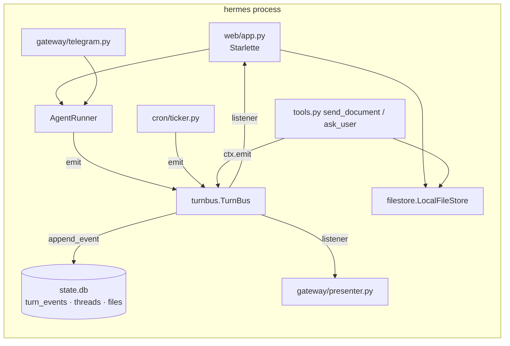

# CladeX Web UI — Backend Implementation Plan (part 1 of 2)

> **For agentic workers:** REQUIRED SUB-SKILL: Use superpowers:subagent-driven-development (recommended) or superpowers:executing-plans to implement this plan task-by-task. Steps use checkbox (`- [ ]`) syntax for tracking.

**Goal:** Give the hermes process a typed turn-event stream, a `threads` table, and an authenticated HTTP API (REST + SSE) so a browser can log in through Telegram, list and continue every lane, run turns with streamed steps, answer `ask_user`, upload and download files, and manage Routines — while Telegram keeps working exactly as today.

**Architecture:** A new `TurnBus` sits between `AgentRunner` and its consumers: the runner emits typed events per turn; the bus persists the durable ones into `turn_events`, keeps a snapshot of the active turn, and fans out to listeners (SSE, the Telegram presenter). A new `web/` package holds a Starlette app served by uvicorn inside the same asyncio loop as aiogram. Files go through a `FileStore` port backed by `inbox/`/`outbox/` under `agent_home`. Nothing in the runner, tools or prompt learns about HTTP.

**Tech Stack:** Python 3.12, Starlette, uvicorn, python-multipart, aiosqlite, claude-agent-sdk 0.2.126 (`include_partial_messages`), pytest + pytest-asyncio (auto mode), no network in tests.

**Spec:** `docs/superpowers/specs/2026-09-08-cladex-web-ui-design.md`. Frontend plan: `docs/superpowers/plans/2026-09-08-cladex-web-frontend.md` (part 2).

## Locked Decisions

- **Thread id on the wire = `session_key`.** Web lanes are `web:<user_id>:<uuid4 hex>`; `chat_type_from_key` returns `"private"` for the `web:` prefix. No mapping table.
- **Turn events are both wire and storage format.** Types and payload keys exactly as in the table under Task 4; `text.delta` is never persisted.
- **`turn_events.id` is the SSE cursor.** Clients pass `after=<id>`; the stream replays the active-turn snapshot then tails.
- **Thread metadata lives in `threads`, never in `sessions`.** `reset_session` cannot touch it.
- **Files are addressed by opaque `file_id` (uuid4 hex) stored in a `files` table**, never by path. `GET /api/files/{id}` resolves the row, checks containment under `agent_home`, and checks lane ownership.
- **Cookie `cladex_session` = `<user_id>.<exp>.<hmac-sha256 hex>`** signed with `CH_WEB_SECRET`; httpOnly, Secure, SameSite=Lax, `web_session_days` lifetime.
- **Login Widget verification key = `sha256(bot_token)`**, computed in `main.py` before the token is popped from the environment; the web app never sees the token.
- **`POST /api/threads/{id}/messages` returns `202 {turn_id}` immediately**; the turn runs as a background task; `409` when the lane is busy.
- **SSE wire:** `event: turn` lines with `data: <TurnEvent JSON>`, `id: <turn_events.id or empty>`, heartbeat `: ping` every 15 s.
- **Cron runs are delivery-lane turns:** `turn.start{channel:"cron", job_id, run_id}` → `text.block` → `turn.end{status}`; the `cron:<id>` SDK session stays isolated.
- **Deletion is archival:** `DELETE /api/threads/{id}` sets `threads.archived_at`.
- **Content types per route:** JSON routes require `application/json`; `/api/uploads` requires `multipart/form-data`; `/api/voice/transcribe` accepts `audio/*`; all mutations require the cookie and a matching `Origin`.

## Global Constraints

- `claude-agent-sdk==0.2.126` stays pinned; add `starlette>=0.40`, `uvicorn>=0.30`, `python-multipart>=0.0.9` to `pyproject.toml` dependencies.
- Every test runs without network and without a live SDK: `query()` is monkeypatched (`tests/test_runner.py::make_fake_query` is the template).
- `web_enabled: false` (the default) must leave runtime behaviour byte-identical to today except for the new DB tables.
- No new tool schema reaches the prompt (PRD P1/P2). No public port on the host (P8 as reworded in the spec).
- All state stays under `CH_HOME` (NFR-5).
- Commit messages follow the repo style: `feat(web): …`, `feat(turnbus): …`, `test(...)`, `docs(...)`.
- Run the suite with `python -m pytest -q` (Windows: `.venv/Scripts/python -m pytest -q`).

## Architecture Diagram



---

### Task 1: Dependencies, config knobs, `web:` lanes

**Files:**
- Modify: `pyproject.toml:6-17`
- Modify: `src/claude_hermes/config.py:16-72`
- Modify: `src/claude_hermes/sessions.py:26-36`
- Test: `tests/test_paths_config.py` (append), `tests/test_gateway.py` (append)

**Interfaces:**
- Reuses: `Config` dataclass + `load_config` (env-only secrets rule), `chat_type_from_key`.
- Produces: `Config.web_enabled: bool`, `web_port: int`, `web_public_origin: str`, `web_upload_max_mb: int`, `web_tool_output_max_chars: int`, `web_session_days: int`, `web_secret: str` (env `CH_WEB_SECRET`, never from yaml); `chat_type_from_key("web:…") == "private"`; `web_session_key(user_id: int) -> str`.

- [ ] **Step 1: Write the failing tests**

Append to `tests/test_paths_config.py`:

```python
import os

from claude_hermes.config import load_config


def test_web_knobs_default_off_and_secret_comes_from_env(tmp_path, monkeypatch):
    monkeypatch.setenv("CH_WEB_SECRET", "s3cr3t")
    (tmp_path / "config.yaml").write_text(
        "web_enabled: true\nweb_port: 9090\nweb_secret: from-yaml\n", encoding="utf-8"
    )
    cfg = load_config(tmp_path)
    assert cfg.web_enabled is True
    assert cfg.web_port == 9090
    assert cfg.web_secret == "s3cr3t"           # yaml value ignored: secrets are env-only
    assert cfg.web_upload_max_mb == 20
    assert cfg.web_tool_output_max_chars == 8000
    assert cfg.web_session_days == 30
    assert cfg.web_public_origin == ""


def test_web_disabled_by_default(tmp_path, monkeypatch):
    monkeypatch.delenv("CH_WEB_SECRET", raising=False)
    cfg = load_config(tmp_path)
    assert cfg.web_enabled is False
    assert cfg.web_secret == ""
```

Append to `tests/test_gateway.py`:

```python
from claude_hermes.sessions import chat_type_from_key, web_session_key


def test_web_lanes_are_private_and_well_formed():
    key = web_session_key(42)
    assert key.startswith("web:42:")
    assert len(key.split(":")) == 3
    assert len(key.split(":")[2]) == 32            # uuid4 hex
    assert chat_type_from_key(key) == "private"
    assert chat_type_from_key("cron:7") == ""
    assert chat_type_from_key("tg:supergroup:-5:7") == "supergroup"
```

- [ ] **Step 2: Run tests to verify they fail**

Run: `python -m pytest tests/test_paths_config.py tests/test_gateway.py -q -k "web"`
Expected: FAIL — `AttributeError: 'Config' object has no attribute 'web_enabled'`, `ImportError: cannot import name 'web_session_key'`.

- [ ] **Step 3: Add the dependencies**

In `pyproject.toml`, extend `dependencies`:

```toml
dependencies = [
    "claude-agent-sdk==0.2.126",
    "aiogram>=3.7",
    "aiosqlite>=0.20",
    "pyyaml>=6.0",
    "croniter>=2",
    "httpx>=0.27",
    # Web channel (spec 2026-09-08-cladex-web-ui-design): one Starlette app served by
    # uvicorn inside the same asyncio loop as aiogram. python-multipart is what
    # Starlette needs to parse `POST /api/uploads`.
    "starlette>=0.40",
    "uvicorn>=0.30",
    "python-multipart>=0.0.9",
]
```

Run: `pip install -e ".[dev]"` (or `.venv/Scripts/pip install -e ".[dev]"`).

- [ ] **Step 4: Add the config knobs**

In `src/claude_hermes/config.py`, after the `ask_user_max_per_turn` line inside `Config`:

```python
    # Phase 6 — web channel (CladeX). Off by default: with web_enabled false the
    # HTTP server is never constructed and the process behaves exactly as before.
    web_enabled: bool = False
    web_port: int = 8080
    web_public_origin: str = ""            # e.g. https://cladex.example.com — Origin check + widget domain
    web_upload_max_mb: int = 20
    web_tool_output_max_chars: int = 8000  # tool.result output is truncated to this
    web_session_days: int = 30
    web_secret: str = ""                   # CH_WEB_SECRET — env only, signs the session cookie
```

In `load_config`, change the secrets tuple and add the env read:

```python
            if hasattr(cfg, key) and key not in ("telegram_token", "openai_api_key",
                                                 "web_secret"):
                setattr(cfg, key, value)
    cfg.telegram_token = os.environ.get("TELEGRAM_BOT_TOKEN", "")
    cfg.openai_api_key = os.environ.get("OPENAI_API_KEY", "")
    cfg.web_secret = os.environ.get("CH_WEB_SECRET", "")
    return cfg
```

- [ ] **Step 5: Teach sessions.py about `web:` lanes**

In `src/claude_hermes/sessions.py`, add `import uuid` at the top and replace `chat_type_from_key` with:

```python
def chat_type_from_key(session_key: str) -> str:
    """The chat type baked into a session key, or "" if this is not a tg key.

    Symmetric with chat_id_from_key above. Exists so a caller can ask "is this
    lane a private chat?" without spelling out a startswith("tg:private:") in
    three places — and cron keys answer "" rather than raising.

    A `web:` lane is one browser user talking to the agent alone, so it answers
    "private": the ask_user gate (tools.py) and every other private-only rule
    apply to it unchanged.
    """
    parts = session_key.split(":")
    if parts[0] == "web":
        return "private"
    if parts[0] != "tg" or len(parts) < 3:
        return ""
    return parts[1]


def web_session_key(user_id: int) -> str:
    """A fresh browser thread: web:<user_id>:<uuid4 hex>."""
    return f"web:{user_id}:{uuid.uuid4().hex}"
```

- [ ] **Step 6: Run the tests**

Run: `python -m pytest tests/test_paths_config.py tests/test_gateway.py -q`
Expected: PASS (all, including the pre-existing ones).

- [ ] **Step 7: Commit**

```bash
git add pyproject.toml src/claude_hermes/config.py src/claude_hermes/sessions.py tests/test_paths_config.py tests/test_gateway.py
git commit -m "feat(web): config knobs, web deps and web: session lanes"
```

---

### Task 2: Database — `turn_events`, `threads`, `files`

**Files:**
- Modify: `src/claude_hermes/db.py:7-57` (schema) and append methods after `cost_by_day`
- Test: `tests/test_db.py` (append)

**Interfaces:**
- Reuses: `Database` (aiosqlite, `_SCHEMA` executescript on open, `_MIGRATIONS`), `reset_session`.
- Produces:
  - `append_event(session_key, turn_id, seq, ts, type, payload: dict) -> int`
  - `events_after(session_key, after_id: int = 0, limit: int = 1000) -> list[dict]` (payload parsed to dict)
  - `upsert_thread(session_key, channel, owner_user_id: int | None, now: str) -> None`
  - `get_thread(session_key) -> dict | None`
  - `list_threads(*, include_archived=False, before: str | None = None, limit=50) -> list[dict]` ordered by `last_event_at DESC`
  - `set_thread_title(session_key, title, manual: bool) -> None` (manual titles are never overwritten by automatic ones)
  - `set_thread_archived(session_key, archived_at: str | None) -> None`
  - `insert_file(file_id, session_key, path, name, media_type, size, now) -> None`, `get_file(file_id) -> dict | None`

- [ ] **Step 1: Write the failing tests**

Append to `tests/test_db.py`:

```python
async def test_turn_events_append_and_cursor(tmp_path):
    db = await Database.open(tmp_path / "state.db")
    a = await db.append_event("web:1:x", "t1", 1, NOW, "turn.start", {"channel": "web"})
    b = await db.append_event("web:1:x", "t1", 2, NOW, "text.block", {"text": "hi"})
    await db.append_event("web:1:y", "t2", 1, NOW, "turn.start", {"channel": "web"})
    assert b == a + 1
    rows = await db.events_after("web:1:x")
    assert [r["type"] for r in rows] == ["turn.start", "text.block"]
    assert rows[1]["payload"] == {"text": "hi"}          # JSON is parsed back
    assert rows[1]["id"] == b and rows[1]["seq"] == 2
    assert await db.events_after("web:1:x", after_id=a) == rows[1:]
    await db.close()


async def test_threads_survive_reset_session_and_keep_manual_titles(tmp_path):
    db = await Database.open(tmp_path / "state.db")
    await db.upsert_session("web:1:x", "sdk-1", "APPEND", NOW)
    await db.upsert_thread("web:1:x", "web", 1, NOW)
    await db.set_thread_title("web:1:x", "Auto title", manual=False)
    await db.set_thread_title("web:1:x", "My title", manual=True)
    await db.set_thread_title("web:1:x", "Auto again", manual=False)   # must NOT win
    await db.reset_session("web:1:x")
    assert await db.get_session("web:1:x") is None
    t = await db.get_thread("web:1:x")
    assert t["title"] == "My title" and t["channel"] == "web" and t["owner_user_id"] == 1
    assert t["archived_at"] is None
    await db.set_thread_archived("web:1:x", "2026-07-13T00:00:00+00:00")
    assert (await db.get_thread("web:1:x"))["archived_at"] == "2026-07-13T00:00:00+00:00"
    await db.close()


async def test_list_threads_orders_by_activity_and_pages(tmp_path):
    db = await Database.open(tmp_path / "state.db")
    await db.upsert_thread("tg:private:1", "telegram", 1, "2026-07-12T10:00:00+00:00")
    await db.upsert_thread("web:1:a", "web", 1, "2026-07-12T11:00:00+00:00")
    await db.upsert_thread("web:1:b", "web", 1, "2026-07-12T12:00:00+00:00")
    await db.upsert_thread("web:1:a", "web", 1, "2026-07-12T13:00:00+00:00")   # bumps last_event_at
    keys = [t["session_key"] for t in await db.list_threads()]
    assert keys == ["web:1:a", "web:1:b", "tg:private:1"]
    page = await db.list_threads(before="2026-07-12T12:00:00+00:00", limit=5)
    assert [t["session_key"] for t in page] == ["tg:private:1"]
    await db.set_thread_archived("web:1:b", NOW)
    assert "web:1:b" not in [t["session_key"] for t in await db.list_threads()]
    assert "web:1:b" in [t["session_key"] for t in await db.list_threads(include_archived=True)]
    await db.close()


async def test_files_table_roundtrip(tmp_path):
    db = await Database.open(tmp_path / "state.db")
    await db.insert_file("abc", "web:1:x", "/data/agent_home/outbox/x/r.md", "r.md",
                         "text/markdown", 42, NOW)
    row = await db.get_file("abc")
    assert row["name"] == "r.md" and row["size"] == 42 and row["session_key"] == "web:1:x"
    assert await db.get_file("nope") is None
    await db.close()
```

- [ ] **Step 2: Run tests to verify they fail**

Run: `python -m pytest tests/test_db.py -q`
Expected: FAIL with `AttributeError: 'Database' object has no attribute 'append_event'`.

- [ ] **Step 3: Extend the schema**

In `src/claude_hermes/db.py`, append to `_SCHEMA` before the closing `"""`:

```sql
CREATE TABLE IF NOT EXISTS turn_events (
    id          INTEGER PRIMARY KEY AUTOINCREMENT,
    session_key TEXT NOT NULL,
    turn_id     TEXT NOT NULL,
    seq         INTEGER NOT NULL,
    ts          TEXT NOT NULL,
    type        TEXT NOT NULL,
    payload     TEXT NOT NULL
);
CREATE INDEX IF NOT EXISTS turn_events_lane ON turn_events (session_key, id);
CREATE TABLE IF NOT EXISTS threads (
    session_key   TEXT PRIMARY KEY,
    title         TEXT,
    title_manual  INTEGER NOT NULL DEFAULT 0,
    channel       TEXT NOT NULL,
    owner_user_id INTEGER,
    archived_at   TEXT,
    last_event_at TEXT NOT NULL,
    created_at    TEXT NOT NULL
);
CREATE TABLE IF NOT EXISTS files (
    id          TEXT PRIMARY KEY,
    session_key TEXT NOT NULL,
    path        TEXT NOT NULL,
    name        TEXT NOT NULL,
    media_type  TEXT NOT NULL,
    size        INTEGER NOT NULL,
    created_at  TEXT NOT NULL
);
```

Also backfill `threads` for lanes that already exist, so the sidebar is not empty on the
first deploy. In `_migrate`, after the column loop and before `commit()`:

```python
    # Data migration: every existing Telegram lane gets a threads row once. Private
    # chats are owned by their user (chat id == user id); groups/topics by nobody.
    await conn.execute(
        """INSERT OR IGNORE INTO threads
               (session_key, channel, owner_user_id, last_event_at, created_at)
           SELECT session_key, 'telegram',
                  CASE WHEN session_key LIKE 'tg:private:%'
                       THEN CAST(substr(session_key, 12) AS INTEGER) ELSE NULL END,
                  updated_at, created_at
           FROM sessions WHERE session_key LIKE 'tg:%'"""
    )
```

and add this test to `tests/test_db.py`:

```python
async def test_existing_telegram_lanes_are_backfilled_into_threads(tmp_path):
    db = await Database.open(tmp_path / "state.db")
    await db.upsert_session("tg:private:7", "sdk", "A", NOW)
    await db.upsert_session("tg:supergroup:-5:7:t9", "sdk", "A", NOW)
    await db.close()
    db = await Database.open(tmp_path / "state.db")        # migration runs on open
    assert (await db.get_thread("tg:private:7"))["owner_user_id"] == 7
    assert (await db.get_thread("tg:supergroup:-5:7:t9"))["owner_user_id"] is None
    await db.close()
```

- [ ] **Step 4: Add the methods**

Add `import json` at the top of `db.py` and append to the `Database` class after `cost_by_day`:

```python
    # --- turn events (spec: "Turn events") ---------------------------------

    async def append_event(self, session_key: str, turn_id: str, seq: int, ts: str,
                           type: str, payload: dict) -> int:
        cur = await self._conn.execute(
            """INSERT INTO turn_events (session_key, turn_id, seq, ts, type, payload)
               VALUES (?, ?, ?, ?, ?, ?)""",
            (session_key, turn_id, seq, ts, type, json.dumps(payload, ensure_ascii=False)),
        )
        await self._conn.commit()
        return cur.lastrowid

    async def events_after(self, session_key: str, after_id: int = 0,
                           limit: int = 1000) -> list[dict]:
        cur = await self._conn.execute(
            """SELECT id, session_key, turn_id, seq, ts, type, payload FROM turn_events
               WHERE session_key = ? AND id > ? ORDER BY id LIMIT ?""",
            (session_key, after_id, limit),
        )
        rows = [dict(r) for r in await cur.fetchall()]
        for r in rows:
            r["payload"] = json.loads(r["payload"])
        return rows

    # --- threads (metadata that must outlive reset_session) ----------------

    async def upsert_thread(self, session_key: str, channel: str,
                            owner_user_id: int | None, now: str) -> None:
        await self._conn.execute(
            """INSERT INTO threads (session_key, channel, owner_user_id, last_event_at, created_at)
               VALUES (?, ?, ?, ?, ?)
               ON CONFLICT(session_key) DO UPDATE SET last_event_at = excluded.last_event_at""",
            (session_key, channel, owner_user_id, now, now),
        )
        await self._conn.commit()

    async def get_thread(self, session_key: str) -> dict | None:
        cur = await self._conn.execute(
            "SELECT * FROM threads WHERE session_key = ?", (session_key,)
        )
        row = await cur.fetchone()
        return dict(row) if row else None

    async def list_threads(self, *, include_archived: bool = False,
                           before: str | None = None, limit: int = 50) -> list[dict]:
        q = "SELECT * FROM threads WHERE 1=1"
        params: list = []
        if not include_archived:
            q += " AND archived_at IS NULL"
        if before is not None:
            q += " AND last_event_at < ?"
            params.append(before)
        q += " ORDER BY last_event_at DESC LIMIT ?"
        params.append(limit)
        cur = await self._conn.execute(q, params)
        return [dict(r) for r in await cur.fetchall()]

    async def set_thread_title(self, session_key: str, title: str, manual: bool) -> None:
        # An automatic title never overwrites one the user typed.
        if manual:
            await self._conn.execute(
                "UPDATE threads SET title = ?, title_manual = 1 WHERE session_key = ?",
                (title, session_key),
            )
        else:
            await self._conn.execute(
                "UPDATE threads SET title = ? WHERE session_key = ? AND title_manual = 0",
                (title, session_key),
            )
        await self._conn.commit()

    async def set_thread_archived(self, session_key: str, archived_at: str | None) -> None:
        await self._conn.execute(
            "UPDATE threads SET archived_at = ? WHERE session_key = ?",
            (archived_at, session_key),
        )
        await self._conn.commit()

    # --- files (opaque ids for the web file endpoint) ----------------------

    async def insert_file(self, file_id: str, session_key: str, path: str, name: str,
                          media_type: str, size: int, now: str) -> None:
        await self._conn.execute(
            """INSERT INTO files (id, session_key, path, name, media_type, size, created_at)
               VALUES (?, ?, ?, ?, ?, ?, ?)""",
            (file_id, session_key, path, name, media_type, size, now),
        )
        await self._conn.commit()

    async def get_file(self, file_id: str) -> dict | None:
        cur = await self._conn.execute("SELECT * FROM files WHERE id = ?", (file_id,))
        row = await cur.fetchone()
        return dict(row) if row else None
```

- [ ] **Step 5: Run the tests**

Run: `python -m pytest tests/test_db.py -q`
Expected: PASS.

- [ ] **Step 6: Commit**

```bash
git add src/claude_hermes/db.py tests/test_db.py
git commit -m "feat(db): turn_events, threads and files tables"
```

---

### Task 3: `TurnBus`

**Files:**
- Create: `src/claude_hermes/turnbus.py`
- Test: `tests/test_turn_bus.py`

**Interfaces:**
- Reuses: `Database.append_event` (Task 2).
- Produces:
  - `TurnEvent` frozen dataclass: `session_key, turn_id, seq, ts, type, payload, id: int | None`; `to_wire() -> dict`.
  - `TurnBus(db)`: `subscribe(session_key, listener) -> Callable[[], None]`, `emit(session_key, turn_id, type, payload) -> TurnEvent`, `is_running(session_key) -> bool`, `snapshot(session_key) -> list[TurnEvent]`, `TRANSIENT = frozenset({"text.delta"})`.
  - Listener signature: `async def listener(ev: TurnEvent) -> None`.

- [ ] **Step 1: Write the failing tests**

Create `tests/test_turn_bus.py`:

```python
from claude_hermes.db import Database
from claude_hermes.turnbus import TurnBus, TurnEvent


async def make(tmp_path):
    db = await Database.open(tmp_path / "state.db")
    return db, TurnBus(db)


async def test_events_are_ordered_persisted_and_fanned_out(tmp_path):
    db, bus = await make(tmp_path)
    seen = []

    async def listener(ev):
        seen.append(ev)

    unsub = bus.subscribe("web:1:x", listener)
    a = await bus.emit("web:1:x", "t1", "turn.start", {"channel": "web", "user_id": 1})
    b = await bus.emit("web:1:x", "t1", "text.delta", {"delta": "Hel"})
    c = await bus.emit("web:1:x", "t1", "text.block", {"text": "Hello"})
    assert [e.seq for e in (a, b, c)] == [1, 2, 3]
    assert a.id is not None and c.id == a.id + 1
    assert b.id is None                                   # deltas are never persisted
    assert [e.type for e in seen] == ["turn.start", "text.delta", "text.block"]
    stored = await db.events_after("web:1:x")
    assert [r["type"] for r in stored] == ["turn.start", "text.block"]
    unsub()
    await bus.emit("web:1:x", "t1", "turn.end", {"status": "ok"})
    assert len(seen) == 3                                 # unsubscribed
    await db.close()


async def test_lanes_are_isolated(tmp_path):
    db, bus = await make(tmp_path)
    seen = []

    async def listener(ev):
        seen.append(ev.session_key)

    bus.subscribe("web:1:x", listener)
    await bus.emit("web:1:y", "t9", "turn.start", {"channel": "web", "user_id": 1})
    assert seen == []
    await db.close()


async def test_snapshot_replays_the_active_turn_with_unflushed_text(tmp_path):
    db, bus = await make(tmp_path)
    assert bus.is_running("web:1:x") is False
    await bus.emit("web:1:x", "t1", "turn.start", {"channel": "web", "user_id": 1})
    await bus.emit("web:1:x", "t1", "tool.call", {"call_id": "c1", "name": "Read", "input": {}})
    await bus.emit("web:1:x", "t1", "text.delta", {"delta": "Hel"})
    await bus.emit("web:1:x", "t1", "text.delta", {"delta": "lo"})
    assert bus.is_running("web:1:x") is True
    snap = bus.snapshot("web:1:x")
    assert [e.type for e in snap] == ["turn.start", "tool.call", "text.delta"]
    assert snap[-1].payload == {"delta": "Hello"}         # the deltas, coalesced
    await bus.emit("web:1:x", "t1", "text.block", {"text": "Hello"})
    snap = bus.snapshot("web:1:x")
    assert [e.type for e in snap] == ["turn.start", "tool.call", "text.block"]  # buffer cleared
    await bus.emit("web:1:x", "t1", "turn.end", {"status": "ok"})
    assert bus.is_running("web:1:x") is False
    assert bus.snapshot("web:1:x") == []
    await db.close()


async def test_listener_failure_does_not_break_emit(tmp_path):
    db, bus = await make(tmp_path)

    async def bad(ev):
        raise RuntimeError("boom")

    bus.subscribe("web:1:x", bad)
    ev = await bus.emit("web:1:x", "t1", "turn.start", {"channel": "web", "user_id": 1})
    assert ev.id is not None
    await db.close()


def test_to_wire_shape():
    ev = TurnEvent("web:1:x", "t1", 3, "2026-07-12T10:00:00+00:00", "text.block",
                   {"text": "x"}, id=7)
    assert ev.to_wire() == {
        "id": 7, "session_key": "web:1:x", "turn_id": "t1", "seq": 3,
        "ts": "2026-07-12T10:00:00+00:00", "type": "text.block", "payload": {"text": "x"},
    }
```

- [ ] **Step 2: Run tests to verify they fail**

Run: `python -m pytest tests/test_turn_bus.py -q`
Expected: FAIL with `ModuleNotFoundError: No module named 'claude_hermes.turnbus'`.

- [ ] **Step 3: Implement the bus**

Create `src/claude_hermes/turnbus.py`:

```python
"""The turn-event bus: one typed stream per session lane.

The runner (and the cron ticker) emit events; the bus persists the durable ones
into turn_events, keeps a snapshot of the turn in flight so a late subscriber
(a browser that reloaded mid-turn) can catch up, and fans every event out to the
lane's listeners: the SSE endpoint and the Telegram presenter.

Text deltas are transient — they reach listeners and the snapshot buffer, never
the database — so turn_events grows per text block, not per token.
"""
from __future__ import annotations

import logging
from collections import defaultdict
from dataclasses import dataclass, field, replace
from datetime import datetime, timezone
from typing import Awaitable, Callable

log = logging.getLogger(__name__)

TRANSIENT = frozenset({"text.delta"})


@dataclass(frozen=True)
class TurnEvent:
    session_key: str
    turn_id: str
    seq: int
    ts: str
    type: str
    payload: dict
    id: int | None = None

    def to_wire(self) -> dict:
        return {
            "id": self.id, "session_key": self.session_key, "turn_id": self.turn_id,
            "seq": self.seq, "ts": self.ts, "type": self.type, "payload": self.payload,
        }


Listener = Callable[[TurnEvent], Awaitable[None]]


@dataclass
class _Active:
    turn_id: str
    seq: int = 0
    events: list[TurnEvent] = field(default_factory=list)   # persisted, in order
    text: str = ""                                          # deltas since the last text.block


class TurnBus:
    def __init__(self, db):
        self._db = db
        self._listeners: dict[str, list[Listener]] = defaultdict(list)
        self._active: dict[str, _Active] = {}

    # --- subscriptions ------------------------------------------------------

    def subscribe(self, session_key: str, listener: Listener) -> Callable[[], None]:
        self._listeners[session_key].append(listener)

        def unsubscribe() -> None:
            try:
                self._listeners[session_key].remove(listener)
            except ValueError:
                pass

        return unsubscribe

    # --- active-turn state --------------------------------------------------

    def is_running(self, session_key: str) -> bool:
        return session_key in self._active

    def snapshot(self, session_key: str) -> list[TurnEvent]:
        """Everything a late subscriber needs: the persisted events of the turn in
        flight, plus one synthetic text.delta carrying the not-yet-flushed text."""
        act = self._active.get(session_key)
        if act is None:
            return []
        out = list(act.events)
        if act.text:
            out.append(TurnEvent(session_key, act.turn_id, act.seq, _now(), "text.delta",
                                 {"delta": act.text}))
        return out

    # --- emission -----------------------------------------------------------

    async def emit(self, session_key: str, turn_id: str, type: str, payload: dict) -> TurnEvent:
        act = self._active.get(session_key)
        if type == "turn.start" or act is None or act.turn_id != turn_id:
            act = _Active(turn_id)
            if type == "turn.start":
                self._active[session_key] = act
        act.seq += 1
        ev = TurnEvent(session_key, turn_id, act.seq, _now(), type, payload)

        if type in TRANSIENT:
            act.text += str(payload.get("delta", ""))
        else:
            try:
                eid = await self._db.append_event(session_key, turn_id, act.seq, ev.ts,
                                                  type, payload)
                ev = replace(ev, id=eid)
            except Exception:
                log.exception("turn event persistence failed (%s on %s)", type, session_key)
            act.events.append(ev)
            if type == "text.block":
                act.text = ""

        if type == "turn.end":
            self._active.pop(session_key, None)

        for listener in list(self._listeners.get(session_key, ())):
            try:
                await listener(ev)
            except Exception:
                log.exception("turn event listener failed on %s", session_key)
        return ev


def _now() -> str:
    return datetime.now(timezone.utc).isoformat()
```

- [ ] **Step 4: Run the tests**

Run: `python -m pytest tests/test_turn_bus.py -q`
Expected: PASS.

- [ ] **Step 5: Commit**

```bash
git add src/claude_hermes/turnbus.py tests/test_turn_bus.py
git commit -m "feat(turnbus): typed per-lane turn events with snapshot and fan-out"
```

---

### Task 4: Runner emits events, owns cancellation, drops `progress`

**Files:**
- Modify: `src/claude_hermes/runner.py` (imports, `AgentRunner.__init__`, `run_turn`, `_run_turn_locked`, `_execute`)
- Modify: `src/claude_hermes/tools.py:41-50` (`TurnContext` gains `turn_id`, `emit`)
- Modify: `src/claude_hermes/sessions.py` (add `thread_owner`)
- Modify: `src/claude_hermes/gateway/telegram.py:134-136,182,430-451` (no `progress`; presenter subscribes — completed in Task 5)
- Test: `tests/test_runner.py` (append), `tests/test_gateway.py` (adjust fake runner signature)

**Interfaces:**
- Reuses: `_execute` loop, `_is_cli_death` retry, `observe_block`, `record_message`, `record_cost`, `TurnBus` (Task 3), `Database.upsert_thread` (Task 2).
- Consumes: `TurnBus.emit`, `web_session_key`, `chat_type_from_key`.
- Produces:
  - `AgentRunner(cfg, home, db, router, wiki, bus: TurnBus | None = None)`; `runner.bus`.
  - `run_turn(session_key, user_text, *, user_id=0, attachments=None, channel="telegram") -> str` — **no `progress`**.
  - `runner.is_busy(session_key) -> bool`, `runner.cancel(session_key) -> bool`.
  - `TurnContext.turn_id: str`, `TurnContext.emit: Callable[[str, dict], Awaitable[TurnEvent]] | None`.
  - `sessions.thread_owner(session_key, channel, user_id) -> int | None`.
  - Event table (payload keys are the contract):

| type | payload |
|---|---|
| `turn.start` | `channel`, `user_id` (+ `job_id`, `run_id` for cron, Task 7) |
| `user.message` | `text`, `attachments: [{file_id, name, media_type, size, url}]` |
| `text.delta` | `delta` |
| `text.block` | `text` |
| `thinking` | `text` |
| `tool.call` | `call_id`, `name`, `input` |
| `tool.result` | `call_id`, `output`, `is_error`, `duration_ms` |
| `ask.open` | `qid`, `question`, `options` |
| `ask.answer` | `qid`, `answer` (str or null), `source` (`user`/`timeout`/`cancelled`) |
| `file` | `file_id`, `name`, `media_type`, `size`, `url`, `telegram_sent` |
| `thread.title` | `title` |
| `turn.end` | `status` (`ok`/`error`/`cancelled`), `cost_usd`, `sdk_session_id`, `error` |

- [ ] **Step 1: Write the failing tests**

Append to `tests/test_runner.py` (the file already imports `AssistantMessage`, `TextBlock`, `FakeResult`, `Config`, `Database`, `SessionRouter`, `WikiStore`, `AgentRunner`, `runner_mod`):

```python
from claude_agent_sdk import StreamEvent, ToolResultBlock, ToolUseBlock, UserMessage

from claude_hermes.turnbus import TurnBus


async def make_runner_with_bus(tmp_path):
    cfg = Config()
    db = await Database.open(tmp_path / "state.db")
    router = SessionRouter(db, cfg)
    wiki = WikiStore(tmp_path)
    wiki.seed()
    bus = TurnBus(db)
    return AgentRunner(cfg, tmp_path, db, router, wiki, bus=bus), db, bus


def streaming_query(captured):
    async def fake_query(*, prompt, options):
        captured.append(options)
        yield StreamEvent(uuid="u1", session_id="s", event={
            "type": "content_block_delta", "index": 0,
            "delta": {"type": "text_delta", "text": "Let me "}})
        yield StreamEvent(uuid="u2", session_id="s", event={
            "type": "content_block_delta", "index": 0,
            "delta": {"type": "text_delta", "text": "look."}})
        yield AssistantMessage(content=[TextBlock(text="Let me look.")], model="m")
        yield AssistantMessage(content=[ToolUseBlock(id="c1", name="Read",
                                                     input={"file_path": "a.md"})], model="m")
        yield UserMessage(content=[ToolResultBlock(tool_use_id="c1", content="file body",
                                                   is_error=False)])
        yield AssistantMessage(content=[TextBlock(text="Done.")], model="m")
        yield FakeResult("sdk-1", "Done.")
    return fake_query


async def test_turn_emits_the_event_sequence(tmp_path, monkeypatch):
    runner, db, bus = await make_runner_with_bus(tmp_path)
    captured = []
    monkeypatch.setattr(runner_mod, "query", streaming_query(captured))
    seen = []

    async def listener(ev):
        seen.append(ev)

    bus.subscribe("web:1:x", listener)
    reply = await runner.run_turn("web:1:x", "hello", user_id=1, channel="web")
    assert reply == "Done."
    assert captured[0].include_partial_messages is True
    assert [e.type for e in seen] == [
        "turn.start", "user.message", "text.delta", "text.delta", "text.block",
        "tool.call", "tool.result", "text.block", "turn.end",
    ]
    assert seen[0].payload == {"channel": "web", "user_id": 1}
    assert seen[1].payload == {"text": "hello", "attachments": []}
    assert seen[5].payload == {"call_id": "c1", "name": "Read", "input": {"file_path": "a.md"}}
    assert seen[6].payload["call_id"] == "c1" and seen[6].payload["output"] == "file body"
    assert seen[6].payload["is_error"] is False and seen[6].payload["duration_ms"] >= 0
    assert seen[-1].payload["status"] == "ok" and seen[-1].payload["sdk_session_id"] == "sdk-1"
    assert all(e.turn_id == seen[0].turn_id for e in seen)
    stored = await db.events_after("web:1:x")
    assert "text.delta" not in [r["type"] for r in stored]
    t = await db.get_thread("web:1:x")
    assert t["channel"] == "web" and t["owner_user_id"] == 1
    await db.close()


async def test_failed_turn_ends_with_error_and_reraises(tmp_path, monkeypatch):
    runner, db, bus = await make_runner_with_bus(tmp_path)

    async def always_fails(*, prompt, options):
        raise RuntimeError("api down")
        yield  # pragma: no cover

    monkeypatch.setattr(runner_mod, "query", always_fails)
    seen = []

    async def listener(ev):
        seen.append(ev)

    bus.subscribe("tg:private:1", listener)
    import pytest
    with pytest.raises(RuntimeError):
        await runner.run_turn("tg:private:1", "hi", user_id=1)
    assert seen[-1].type == "turn.end"
    assert seen[-1].payload["status"] == "error" and "api down" in seen[-1].payload["error"]
    assert bus.is_running("tg:private:1") is False
    await db.close()


async def test_cancel_ends_the_turn_as_cancelled(tmp_path, monkeypatch):
    import asyncio
    runner, db, bus = await make_runner_with_bus(tmp_path)
    started = asyncio.Event()

    async def slow_query(*, prompt, options):
        started.set()
        await asyncio.sleep(10)
        yield FakeResult("sdk-1", "never")

    monkeypatch.setattr(runner_mod, "query", slow_query)
    seen = []

    async def listener(ev):
        seen.append(ev)

    bus.subscribe("web:1:x", listener)
    task = asyncio.create_task(runner.run_turn("web:1:x", "hi", user_id=1, channel="web"))
    await started.wait()
    assert runner.is_busy("web:1:x") is True
    assert runner.cancel("web:1:x") is True
    with pytest.raises(asyncio.CancelledError):
        await task
    assert seen[-1].type == "turn.end" and seen[-1].payload["status"] == "cancelled"
    assert runner.is_busy("web:1:x") is False
    assert runner.cancel("web:1:x") is False
    await db.close()


async def test_tool_output_is_truncated_to_config(tmp_path, monkeypatch):
    runner, db, bus = await make_runner_with_bus(tmp_path)
    runner._cfg.web_tool_output_max_chars = 5

    async def fake_query(*, prompt, options):
        yield AssistantMessage(content=[ToolUseBlock(id="c1", name="Bash", input={})], model="m")
        yield UserMessage(content=[ToolResultBlock(tool_use_id="c1", content="0123456789")])
        yield FakeResult("sdk-1", "ok")

    monkeypatch.setattr(runner_mod, "query", fake_query)
    seen = []

    async def listener(ev):
        seen.append(ev)

    bus.subscribe("web:1:x", listener)
    await runner.run_turn("web:1:x", "hi", user_id=1, channel="web")
    result = next(e for e in seen if e.type == "tool.result")
    assert result.payload["output"] == "01234…"
    await db.close()
```

Also add `import pytest` at the top of `tests/test_runner.py` if it is not already there.

- [ ] **Step 2: Run tests to verify they fail**

Run: `python -m pytest tests/test_runner.py -q -k "emits or cancel or truncated or reraises"`
Expected: FAIL with `TypeError: AgentRunner.__init__() got an unexpected keyword argument 'bus'`.

- [ ] **Step 3: Extend `TurnContext` and add `thread_owner`**

In `src/claude_hermes/tools.py`, change the `TurnContext` dataclass (keep it frozen):

```python
@dataclass(frozen=True)
class TurnContext:
    session_key: str
    chat_id: int
    thread_id: int | None = None
    user_id: int = 0
    flags: TurnFlags = field(default_factory=TurnFlags)
    # Turn identity and the event sink, set by the runner. `emit(type, payload)`
    # publishes into the TurnBus for this turn; None in forks that have no bus.
    turn_id: str = ""
    emit: Any = None
```

(Keep whatever existing fields and defaults are there — only `turn_id` and `emit` are new. Add `from typing import Any` if missing.)

In `src/claude_hermes/sessions.py` append:

```python
def thread_owner(session_key: str, channel: str, user_id: int) -> int | None:
    """Who a thread belongs to for the web thread list. A web lane belongs to the
    user who created it; a private Telegram chat belongs to that user (chat id ==
    user id for private chats); group lanes have no single owner."""
    if channel == "web":
        return user_id
    if chat_type_from_key(session_key) == "private":
        return chat_id_from_key(session_key)
    return None
```

- [ ] **Step 4: Rewrite the runner's turn lifecycle**

In `src/claude_hermes/runner.py`:

Imports — replace the SDK import block and add `uuid`, `time`:

```python
import asyncio
import base64
import logging
import time
import uuid
from collections import defaultdict
from datetime import datetime, timezone
from pathlib import Path

from claude_agent_sdk import (
    AssistantMessage,
    HookMatcher,
    ProcessError,
    StreamEvent,
    TextBlock,
    ThinkingBlock,
    ToolResultBlock,
    ToolUseBlock,
    UserMessage,
    query,
)
```

and add to the local imports:

```python
from .sessions import (
    SessionRouter, chat_id_from_key, thread_id_from_key, thread_owner,
)
from .turnbus import TurnBus
```

`__init__` — add the bus and the task registry:

```python
    def __init__(
        self, cfg: Config, home: Path, db: Database,
        router: SessionRouter, wiki: WikiStore, bus: TurnBus | None = None,
    ):
        self._cfg = cfg
        self._home = home
        self._db = db
        self._router = router
        self._wiki = wiki
        self.bus = bus if bus is not None else TurnBus(db)
        self._index_seen: dict[str, float] = {}
        self._locks: dict[str, asyncio.Lock] = defaultdict(asyncio.Lock)
        self._tasks: dict[str, asyncio.Task] = {}   # the task running each lane's turn
        # ... keep every existing `self._x = None  # set by main.py` line unchanged ...
```

Replace `run_turn` and the head of `_run_turn_locked`:

```python
    def is_busy(self, session_key: str) -> bool:
        return self._locks[session_key].locked()

    def cancel(self, session_key: str) -> bool:
        """Cancel the turn running on this lane. True if there was one."""
        task = self._tasks.get(session_key)
        if task is None or task.done():
            return False
        task.cancel()
        return True

    async def run_turn(self, session_key: str, user_text: str, *, user_id: int = 0,
                       attachments=None, channel: str = "telegram") -> str:
        async with self._locks[session_key]:
            self._tasks[session_key] = asyncio.current_task()
            try:
                return await self._run_turn_locked(
                    session_key, user_text, user_id, attachments, channel
                )
            finally:
                self._tasks.pop(session_key, None)

    async def _emit(self, session_key: str, turn_id: str, type: str, payload: dict) -> None:
        # A bus failure must never kill a turn: the reply still reaches the channel.
        try:
            await self.bus.emit(session_key, turn_id, type, payload)
        except Exception:
            log.exception("turn event emit failed (%s)", type)

    async def _run_turn_locked(
        self, session_key: str, user_text: str, user_id: int, attachments, channel: str,
    ) -> str:
        now = datetime.now(timezone.utc)
        turn_id = uuid.uuid4().hex

        async def emit(type: str, payload: dict):
            await self._emit(session_key, turn_id, type, payload)

        ctx = TurnContext(
            session_key=session_key,
            chat_id=chat_id_from_key(session_key) or 0,
            thread_id=thread_id_from_key(session_key),
            user_id=user_id,
            turn_id=turn_id,
            emit=emit,
        )
        await emit("turn.start", {"channel": channel, "user_id": user_id})
        try:
            await self._db.upsert_thread(
                session_key, channel, thread_owner(session_key, channel, user_id),
                now.isoformat(),
            )
        except Exception:
            log.exception("thread upsert failed")
        await emit("user.message", {
            "text": user_text,
            "attachments": [_attachment_wire(a) for a in (attachments or [])],
        })

        try:
            reply, sdk_session_id, cost = await self._run_turn_body(
                session_key, user_text, user_id, attachments, ctx, now,
            )
        except asyncio.CancelledError:
            await emit("turn.end", {"status": "cancelled", "cost_usd": None,
                                    "sdk_session_id": None, "error": None})
            raise
        except Exception as e:
            await emit("turn.end", {"status": "error", "cost_usd": None,
                                    "sdk_session_id": None, "error": str(e)})
            raise
        await emit("turn.end", {"status": "ok", "cost_usd": cost,
                                "sdk_session_id": sdk_session_id, "error": None})
        return reply
```

Then rename the *existing* body (everything from `row = await self._router.route(...)` down to `return reply`) into a new method with this signature, and adapt three things inside it — the `_execute` calls take `ctx` instead of `progress`, the method returns `(reply, sdk_session_id, cost)`, and `_execute` now returns four values:

```python
    async def _run_turn_body(
        self, session_key: str, user_text: str, user_id: int, attachments,
        ctx: TurnContext, now: datetime,
    ) -> tuple[str, str | None, float | None]:
        row = await self._router.route(session_key, now)
        try:
            user_text = await self._with_cron_context(ctx, row, user_text)
        except Exception:
            log.exception("cron context injection failed; running the turn without it")
        if row is not None:
            resume_id = row["sdk_session_id"]
            append = row["system_append"]
        else:
            resume_id = None
            append = build_system_append(self._wiki.index(), now.date())
            self._index_seen[session_key] = self._wiki.index_mtime()

        try:
            final_text, sdk_session_id, stats, cost = await self._execute(
                user_text, resume_id, append, session_key, ctx, attachments=attachments,
            )
        except Exception as e:
            if not _is_cli_death(e) or resume_id is None:
                raise
            # (existing comment about stale transcripts stays here)
            await self._db.reset_session(session_key)
            row = None
            resume_id = None
            append = build_system_append(self._wiki.index(), now.date())
            self._index_seen[session_key] = self._wiki.index_mtime()
            final_text, sdk_session_id, stats, cost = await self._execute(
                user_text, resume_id, append, session_key, ctx, attachments=attachments,
            )

        # ... the rest of the existing body unchanged (bind/touch, record_message x2,
        # learning.after_turn, reset_lane) ... ending with:
        return reply, sdk_session_id, cost
```

Add the module-level helper next to `_compose_text`:

```python
def _attachment_wire(a) -> dict:
    """The user.message attachment record. Web uploads carry a file_id (set by the
    turns router, Task 11); Telegram attachments have none and are shown by name."""
    return {
        "file_id": a.file_id,
        "name": a.filename,
        "media_type": a.media_type,
        "size": a.path.stat().st_size if a.path.exists() else 0,
        "url": f"/api/files/{a.file_id}" if a.file_id else None,
    }
```

For that, add one optional field to the `Attachment` dataclass in
`src/claude_hermes/gateway/attachments.py` (frozen dataclass; defaults must come last):

```python
    file_id: str | None = None   # set for web uploads; Telegram attachments have none
```

```python


def _clip(text: str, limit: int) -> str:
    return text if len(text) <= limit else text[: max(limit - 1, 0)] + "…"


def _result_text(content) -> str:
    """ToolResultBlock.content is a str, a list of content dicts, or None."""
    if content is None:
        return ""
    if isinstance(content, str):
        return content
    parts = []
    for item in content:
        if isinstance(item, dict) and item.get("type") == "text":
            parts.append(str(item.get("text", "")))
        elif isinstance(item, dict) and item.get("type") == "image":
            parts.append("[image]")
    return "\n".join(parts)
```

Replace the `_execute` signature and its message loop:

```python
    async def _execute(
        self, user_text: str, resume_id: str | None, append: str, session_key: str,
        ctx: TurnContext, attachments=None,
    ) -> tuple[str | None, str | None, TurnStats, float | None]:
        # ... build_hermes_server / compose / hooks exactly as before ...
        options = base_options(
            self._home,
            model=self._cfg.model,
            max_turns=self._cfg.max_turns,
            system_prompt={"type": "preset", "preset": "claude_code", "append": append},
            allowed_tools=_BUILTIN_TOOLS + mcp_tool_names + composed.tool_names,
            mcp_servers={"hermes": server, **composed.mcp_servers},
            plugins=composed.plugins,
            hooks=hooks,
            resume=resume_id,
            include_partial_messages=True,   # text.delta events for the web
        )

        emit = ctx.emit
        limit = getattr(self._cfg, "web_tool_output_max_chars", 8000)
        started: dict[str, float] = {}       # tool call id → monotonic start
        final_text: str | None = None
        sdk_session_id: str | None = resume_id
        cost: float | None = None
        stats = TurnStats()
        async for msg in query(prompt=_build_prompt(user_text, attachments),
                               options=options):
            if isinstance(msg, StreamEvent):
                if msg.parent_tool_use_id is None:      # subagent tokens are not ours
                    ev = msg.event
                    delta = ev.get("delta") or {}
                    if ev.get("type") == "content_block_delta" and delta.get("type") == "text_delta":
                        await emit("text.delta", {"delta": delta.get("text", "")})
            elif isinstance(msg, AssistantMessage):
                if msg.parent_tool_use_id is not None:
                    continue
                parts = []
                for b in msg.content:
                    if isinstance(b, TextBlock):
                        parts.append(b.text)
                        await emit("text.block", {"text": b.text})
                    elif isinstance(b, ThinkingBlock):
                        await emit("thinking", {"text": b.thinking})
                    elif isinstance(b, ToolUseBlock):
                        observe_block(stats, b)
                        started[b.id] = time.monotonic()
                        await emit("tool.call", {"call_id": b.id, "name": b.name,
                                                 "input": b.input})
                if parts:
                    final_text = "\n".join(parts)
            elif isinstance(msg, UserMessage) and isinstance(msg.content, list):
                for b in msg.content:
                    if isinstance(b, ToolResultBlock):
                        t0 = started.pop(b.tool_use_id, None)
                        await emit("tool.result", {
                            "call_id": b.tool_use_id,
                            "output": _clip(_result_text(b.content), limit),
                            "is_error": bool(b.is_error),
                            "duration_ms": int((time.monotonic() - t0) * 1000) if t0 else 0,
                        })
            elif hasattr(msg, "session_id"):  # ResultMessage (duck-typed for tests)
                sdk_session_id = msg.session_id or sdk_session_id
                if getattr(msg, "result", None):
                    final_text = msg.result
                cost = getattr(msg, "total_cost_usd", None)
                if cost:
                    try:
                        await self._db.record_cost(
                            datetime.now(timezone.utc).isoformat(), session_key, cost
                        )
                    except Exception:
                        log.debug("cost recording failed", exc_info=True)
        return final_text, sdk_session_id, stats, cost
```

- [ ] **Step 5: Remove `progress` from the Telegram path**

In `src/claude_hermes/gateway/telegram.py`:
- `handle_event(...)`: delete the `progress=None` parameter and change the runner call to
  `return await runner.run_turn(key, text, user_id=event.user_id, attachments=event.attachments)`
  (keep whatever keyword arguments it already passes besides `progress`).
- In `create_dispatcher`, the call `handle_event(runner, cfg, event, acl=acl, home=home, progress=presenter.on_event, ...)` loses `progress=presenter.on_event` (Task 5 wires the presenter to the bus).
- In `tests/test_gateway.py`, the fake runner's `run_turn(self, session_key, text, progress=None, user_id=0, ...)` becomes `run_turn(self, session_key, text, *, user_id=0, attachments=None, channel="telegram")`. Run `grep -n "progress" tests/*.py src/claude_hermes -r` and remove every remaining reference.

- [ ] **Step 6: Run the whole suite**

Run: `python -m pytest -q`
Expected: PASS. If `tests/test_presenter.py` fails on `on_event`, that is Task 5's scope — it must still pass here because `Presenter.on_event` is untouched in this task.

- [ ] **Step 7: Commit**

```bash
git add src/claude_hermes/runner.py src/claude_hermes/tools.py src/claude_hermes/sessions.py src/claude_hermes/gateway/telegram.py tests/test_runner.py tests/test_gateway.py
git commit -m "feat(runner): emit turn events, stream text deltas, cancel per lane"
```

---

### Task 5: Telegram presenter as a bus subscriber

**Files:**
- Modify: `src/claude_hermes/gateway/presenter.py:54-80`
- Modify: `src/claude_hermes/gateway/telegram.py:430-451`
- Test: `tests/test_presenter.py` (append)

**Interfaces:**
- Reuses: `Presenter.on_event`, `status_for`, `Presenter.finalize`, `TurnBus.subscribe` (Task 3).
- Produces: `Presenter.on_turn_event(ev: TurnEvent) -> None` and `Presenter(..., channel="telegram")`.

- [ ] **Step 1: Write the failing test**

Append to `tests/test_presenter.py`:

```python
from claude_hermes.turnbus import TurnEvent


def _ev(type, payload, turn_id="t1"):
    return TurnEvent("tg:private:42", turn_id, 1, "2026-07-12T10:00:00+00:00", type, payload)


async def test_bus_events_drive_the_same_status_drafts(tmp_path):
    sender = SpySender()
    p = Presenter(sender, 42, 9, chat_action=_noop)
    await p.on_turn_event(_ev("turn.start", {"channel": "telegram", "user_id": 42}))
    await p.on_turn_event(_ev("tool.call", {"call_id": "c1", "name": "WebSearch", "input": {}}))
    await p.on_turn_event(_ev("tool.result", {"call_id": "c1", "output": "", "is_error": False,
                                              "duration_ms": 3}))
    await p.on_turn_event(_ev("text.delta", {"delta": "He"}))
    await p.on_turn_event(_ev("text.delta", {"delta": "llo"}))
    await p.on_turn_event(_ev("tool.call", {"call_id": "c2", "name": "Bash",
                                            "input": {"command": "ls"}}))
    assert [s for _, _, s in sender.drafts] == [
        status_for("WebSearch"), status_for(""), status_for("Bash", {"command": "ls"}),
    ]


async def test_web_turns_on_a_telegram_lane_are_ignored(tmp_path):
    sender = SpySender()
    p = Presenter(sender, 42, 9, chat_action=_noop)
    await p.on_turn_event(_ev("turn.start", {"channel": "web", "user_id": 42}))
    await p.on_turn_event(_ev("tool.call", {"call_id": "c1", "name": "Bash", "input": {}}))
    assert sender.drafts == []
```

- [ ] **Step 2: Run the test to verify it fails**

Run: `python -m pytest tests/test_presenter.py -q`
Expected: FAIL with `AttributeError: 'Presenter' object has no attribute 'on_turn_event'`.

- [ ] **Step 3: Implement the subscriber**

In `src/claude_hermes/gateway/presenter.py`, add to `Presenter.__init__` the attributes and add the method after `on_event`:

```python
    def __init__(self, sender, chat_id: int, thread_id: int | None, chat_action,
                 typing_interval: float = 4.0, channel: str = "telegram"):
        self._sender = sender
        self._chat = chat_id
        self._thread = thread_id
        self._chat_action = chat_action
        self._interval = typing_interval
        self._channel = channel
        self._last: str | None = None
        self._task: asyncio.Task | None = None
        self._turn: str | None = None   # turn_id of the turn we present, else None

    async def on_turn_event(self, ev) -> None:
        """TurnBus listener. Only turns started from our own channel drive the
        status line: a web turn on this lane must not post drafts into Telegram."""
        if ev.type == "turn.start":
            self._turn = ev.turn_id if ev.payload.get("channel") == self._channel else None
            return
        if self._turn is None or ev.turn_id != self._turn:
            return
        if ev.type == "tool.call":
            await self.on_event(ev.payload.get("name", ""), ev.payload.get("input"))
        elif ev.type == "text.delta":
            await self.on_event("")
        elif ev.type == "turn.end":
            self._turn = None
```

- [ ] **Step 4: Wire it in the dispatcher**

In `src/claude_hermes/gateway/telegram.py`, replace the block around the presenter:

```python
        presenter = Presenter(sender, event.chat_id, thread_id, chat_action=send_typing)
        unsubscribe = runner.bus.subscribe(key, presenter.on_turn_event)
        try:
            async with presenter:
                reply = await handle_event(runner, cfg, event, acl=acl, home=home,
                                           delete_message=delete_message,
                                           writer=writer)
            if reply:
                await presenter.finalize(reply)
                # (voice reply block unchanged)
        except Exception:
            log.exception("turn failed for chat %s", message.chat.id)
            await presenter.finalize("Something went wrong on my side — try again.")
        finally:
            unsubscribe()
```

- [ ] **Step 5: Run the tests**

Run: `python -m pytest tests/test_presenter.py tests/test_gateway.py -q`
Expected: PASS.

- [ ] **Step 6: Commit**

```bash
git add src/claude_hermes/gateway/presenter.py src/claude_hermes/gateway/telegram.py tests/test_presenter.py
git commit -m "feat(gateway): presenter subscribes to the turn bus"
```

---

### Task 6: `FileStore`, and `send_document` / `ask_user` on web lanes

**Files:**
- Create: `src/claude_hermes/filestore.py`
- Modify: `src/claude_hermes/tools.py:434-546` (`send_document`, `ask_user_handler`, `make_handlers`/`build_hermes_server` signatures)
- Modify: `src/claude_hermes/main.py:105-150` (`ask_user` closure)
- Test: `tests/test_filestore.py`, `tests/test_send_document.py` (append), `tests/test_ask_user_tool.py` (adjust `FakeAsk`, append)

**Interfaces:**
- Reuses: `attachments.safe_name`, `attachments.lane_dir`, `Database.insert_file/get_file` (Task 2), `AskBroker`, `TurnContext.emit` (Task 4).
- Produces:
  - `LocalFileStore(db, home)`: `publish(session_key, path: Path) -> dict` (copies into `outbox/<lane>/`, registers, returns the file record), `put_upload(session_key, filename, data: bytes, media_type) -> dict` (writes into `inbox/<lane>/`), `get(file_id) -> dict | None`, `resolve(record) -> Path` (raises `PermissionError` when outside `agent_home`), `to_wire(record) -> dict` (`file_id, name, media_type, size, url`).
  - `make_handlers(..., file_store=None)` / `build_hermes_server(..., file_store=None)`.
  - `ask_user` closure signature: `(chat_id, thread_id, question, options, user_id, timeout, emit=None)`.

- [ ] **Step 1: Write the failing tests**

Create `tests/test_filestore.py`:

```python
import pytest

from claude_hermes.db import Database
from claude_hermes.filestore import LocalFileStore


async def make(tmp_path):
    db = await Database.open(tmp_path / "state.db")
    (tmp_path / "agent_home").mkdir()
    return db, LocalFileStore(db, tmp_path)


async def test_publish_copies_into_outbox_and_registers(tmp_path):
    db, fs = await make(tmp_path)
    src = tmp_path / "agent_home" / "reports" / "w36.md"
    src.parent.mkdir()
    src.write_text("# hi", encoding="utf-8")
    rec = await fs.publish("web:1:x", src)
    assert rec["name"] == "w36.md" and rec["media_type"] == "text/markdown"
    assert rec["size"] == 4 and len(rec["id"]) == 32
    stored = fs.resolve(rec)
    assert stored.read_text(encoding="utf-8") == "# hi"
    assert "outbox" in stored.parts and "web-1-x" in stored.parts
    assert await fs.get(rec["id"]) == rec
    wire = fs.to_wire(rec)
    assert wire == {"file_id": rec["id"], "name": "w36.md", "media_type": "text/markdown",
                    "size": 4, "url": f"/api/files/{rec['id']}"}
    await db.close()


async def test_put_upload_lands_in_inbox_with_a_safe_name(tmp_path):
    db, fs = await make(tmp_path)
    rec = await fs.put_upload("web:1:x", "../../evil name.png", b"\x89PNG", "image/png")
    p = fs.resolve(rec)
    assert p.parent == tmp_path / "agent_home" / "inbox" / "web-1-x"
    assert ".." not in p.name and p.name.endswith("evil_name.png")
    assert p.read_bytes() == b"\x89PNG"
    await db.close()


async def test_resolve_refuses_paths_outside_agent_home(tmp_path):
    db, fs = await make(tmp_path)
    outside = tmp_path / "secret.txt"
    outside.write_text("x", encoding="utf-8")
    await db.insert_file("bad", "web:1:x", str(outside), "secret.txt", "text/plain", 1, "now")
    with pytest.raises(PermissionError):
        fs.resolve(await fs.get("bad"))
    await db.close()
```

Append to `tests/test_send_document.py`:

```python
from claude_hermes.filestore import LocalFileStore
from claude_hermes.turnbus import TurnBus


async def test_web_lane_publishes_and_emits_without_telegram(tmp_path):
    db = await Database.open(tmp_path / "state.db")
    (tmp_path / "agent_home").mkdir()
    doc = tmp_path / "agent_home" / "r.md"
    doc.write_text("x", encoding="utf-8")
    bus, events = TurnBus(db), []

    async def listener(ev):
        events.append(ev)

    bus.subscribe("web:1:x", listener)

    async def emit(type, payload):
        await bus.emit("web:1:x", "t1", type, payload)

    ctx = TurnContext(session_key="web:1:x", chat_id=0, thread_id=None, turn_id="t1", emit=emit)
    rec = _Recorder()
    handlers = make_handlers(db, ctx=ctx, home=tmp_path, deliver_document=rec,
                             file_store=LocalFileStore(db, tmp_path))
    out = await handlers["send_document"]({"path": str(doc)})
    assert rec.calls == []                                   # no Telegram on a web lane
    assert events[0].type == "file"
    assert events[0].payload["name"] == "r.md" and events[0].payload["telegram_sent"] is False
    assert events[0].payload["url"].startswith("/api/files/")
    assert "r.md" in out["content"][0]["text"]
    await db.close()


async def test_telegram_lane_still_delivers_and_also_emits(tmp_path):
    db = await Database.open(tmp_path / "state.db")
    (tmp_path / "agent_home").mkdir()
    doc = tmp_path / "agent_home" / "r.md"
    doc.write_text("x", encoding="utf-8")
    events = []

    async def emit(type, payload):
        events.append((type, payload))

    ctx = TurnContext(session_key="tg:private:1", chat_id=1, thread_id=None, turn_id="t1", emit=emit)
    rec = _Recorder()
    handlers = make_handlers(db, ctx=ctx, home=tmp_path, deliver_document=rec,
                             file_store=LocalFileStore(db, tmp_path))
    await handlers["send_document"]({"path": str(doc)})
    assert len(rec.calls) == 1
    assert events == [("file", events[0][1])] and events[0][1]["telegram_sent"] is True
    await db.close()
```

In `tests/test_ask_user_tool.py`, change `FakeAsk.__call__` to accept the new keyword and record it:

```python
    async def __call__(self, chat_id, thread_id, question, options, user_id, timeout,
                       emit=None):
        self.calls.append({"chat_id": chat_id, "question": question,
                           "options": options, "timeout": timeout, "emit": emit})
        return self._answer
```

and append:

```python
async def test_the_tool_exists_on_a_web_lane_and_passes_emit(tmp_path):
    db = await Database.open(tmp_path / "state.db")

    async def emit(type, payload):
        pass

    ctx = TurnContext(session_key="web:1:abc", chat_id=0, thread_id=None, user_id=1,
                      turn_id="t1", emit=emit)
    ask = FakeAsk()
    h = await _handlers(db, ctx=ctx, ask_user=ask)
    assert "ask_user" in h
    await h["ask_user"]({"question": "Which?", "options": "A\nB"})
    assert ask.calls[0]["emit"] is emit and ask.calls[0]["chat_id"] == 0
    await db.close()
```

- [ ] **Step 2: Run tests to verify they fail**

Run: `python -m pytest tests/test_filestore.py tests/test_send_document.py tests/test_ask_user_tool.py -q`
Expected: FAIL — `ModuleNotFoundError: claude_hermes.filestore`, `TypeError: make_handlers() got an unexpected keyword argument 'file_store'`.

- [ ] **Step 3: Implement `LocalFileStore`**

Create `src/claude_hermes/filestore.py`:

```python
"""Files that cross the turn boundary, addressed by opaque ids.

The port the web layer depends on. `LocalFileStore` keeps everything under
agent_home (so the agent's own Read/Glob reach it and `tar ./data` stays a full
backup): uploads land in inbox/<lane>/, files the agent sends land in
outbox/<lane>/. An R2-backed implementation can replace this later without
touching endpoints or UI (spec: Locked Decisions, "Files are local").
"""
from __future__ import annotations

import mimetypes
import shutil
import uuid
from datetime import datetime, timezone
from pathlib import Path

from .gateway.attachments import lane_dir, safe_name

mimetypes.add_type("text/markdown", ".md")


class LocalFileStore:
    def __init__(self, db, home: Path):
        self._db = db
        self._home = home
        self._agent_home = (home / "agent_home").resolve()

    # --- writes -------------------------------------------------------------

    async def publish(self, session_key: str, path: Path) -> dict:
        """Copy a file the agent produced into outbox/<lane>/ and register it."""
        dest_dir = self._outbox(session_key)
        dest_dir.mkdir(parents=True, exist_ok=True)
        file_id = uuid.uuid4().hex
        dest = dest_dir / f"{file_id[:8]}_{path.name}"
        shutil.copyfile(path, dest)
        return await self._register(file_id, session_key, dest, path.name)

    async def put_upload(self, session_key: str, filename: str, data: bytes,
                         media_type: str | None) -> dict:
        """Write a browser upload into inbox/<lane>/ under a name that cannot escape."""
        dest_dir = lane_dir(self._home, session_key)
        dest_dir.mkdir(parents=True, exist_ok=True)
        file_id = uuid.uuid4().hex
        dest = dest_dir / safe_name(int(file_id[:6], 16), filename)
        dest.write_bytes(data)
        return await self._register(file_id, session_key, dest, Path(filename).name or "file",
                                    media_type)

    async def _register(self, file_id: str, session_key: str, dest: Path, name: str,
                        media_type: str | None = None) -> dict:
        media = media_type or mimetypes.guess_type(name)[0] or "application/octet-stream"
        size = dest.stat().st_size
        now = datetime.now(timezone.utc).isoformat()
        await self._db.insert_file(file_id, session_key, str(dest), name, media, size, now)
        return await self._db.get_file(file_id)

    # --- reads --------------------------------------------------------------

    async def get(self, file_id: str) -> dict | None:
        return await self._db.get_file(file_id)

    def resolve(self, record: dict) -> Path:
        """The on-disk path, or PermissionError if it escaped agent_home."""
        p = Path(record["path"]).resolve()
        if self._agent_home not in p.parents:
            raise PermissionError(f"{p} is outside agent_home")
        return p

    @staticmethod
    def to_wire(record: dict) -> dict:
        return {
            "file_id": record["id"], "name": record["name"],
            "media_type": record["media_type"], "size": record["size"],
            "url": f"/api/files/{record['id']}",
        }

    def _outbox(self, session_key: str) -> Path:
        # lane_dir gives inbox/<lane>; the outbox is its sibling with the same lane name.
        return lane_dir(self._home, session_key).parent.parent / "outbox" / lane_dir(
            self._home, session_key).name
```

- [ ] **Step 4: Teach `send_document` and `ask_user` about web lanes**

In `src/claude_hermes/tools.py`:

Add `file_store=None` to both `make_handlers(...)` and `build_hermes_server(...)` signatures, and pass it through (`file_store=file_store`) where `build_hermes_server` calls `make_handlers`.

In `send_document`, replace the delivery tail (from `try: await deliver_document(...)` to the final `return reply(...)`):

```python
        telegram_sent = False
        if ctx.chat_id:                       # a Telegram lane; web lanes have chat_id 0
            try:
                await deliver_document(ctx.chat_id, ctx.thread_id, str(path), caption)
                telegram_sent = True
            except Exception as e:
                log.exception("send_document delivery failed")
                return reply(f"Delivery failed: {e}")
        if file_store is not None and ctx.emit is not None:
            try:
                rec = await file_store.publish(ctx.session_key, path)
                await ctx.emit("file", {**file_store.to_wire(rec),
                                        "telegram_sent": telegram_sent})
            except Exception:
                log.exception("send_document could not publish to the file store")
        where = "the chat" if telegram_sent else "the conversation"
        return reply(f"Sent {path.name} ({size} bytes) to {where}.")
```

Change the registration gate so a web lane (no Telegram) still gets the tool when a file store exists:

```python
    if ctx is not None and (deliver_document is not None or file_store is not None):
        handlers["send_document"] = send_document
```

In `ask_user_handler`, pass the emitter:

```python
            answer = await ask_user(ctx.chat_id, ctx.thread_id, question, options,
                                    ctx.user_id, timeout, emit=ctx.emit)
```

In `src/claude_hermes/main.py`, replace the `ask_user` closure:

```python
    async def ask_user(chat_id: int, thread_id: int | None, question: str,
                       options: list[str], user_id: int, timeout: float, emit=None):
        """Open the question in the broker, show it where the lane lives (Telegram
        keyboard for a chat, the ask.open event for the browser), wait for one
        answer. Everything that can race lives in AskBroker."""
        qid, fut = ask_broker.open(options, user_id)
        if emit is not None:
            await emit("ask.open", {"qid": qid, "question": question,
                                    "options": list(options)})
        sent = None
        try:
            if chat_id:                              # Telegram lane
                keyboard = [[{"text": label, "callback_data": f"q:{qid}:{i}"}]
                            for i, label in enumerate(options)]
                keyboard.append([{"text": "✖ Cancel", "callback_data": f"q:{qid}:c"}])
                payload = {
                    "chat_id": chat_id,
                    "text": f"{question}\n\nTap a button — a typed reply won't reach me "
                            "until this finishes.",
                    "reply_markup": {"inline_keyboard": keyboard},
                }
                if thread_id:
                    payload["message_thread_id"] = thread_id
                sent = await bot_call("sendMessage", payload)
            answer = await ask_broker.wait(qid, fut, timeout)
        finally:
            ask_broker.discard(qid)

        if emit is not None:
            from .gateway.questions import CANCELLED
            source = ("timeout" if answer is None
                      else "cancelled" if answer == CANCELLED else "user")
            await emit("ask.answer", {"qid": qid, "source": source,
                                      "answer": answer if source == "user" else None})
        if sent is not None:
            try:
                await bot_call("editMessageReplyMarkup", {
                    "chat_id": chat_id,
                    "message_id": sent.get("message_id"),
                    "reply_markup": {"inline_keyboard": []},
                })
            except Exception:
                log.warning("could not clear the question keyboard", exc_info=True)
        return answer
```

- [ ] **Step 5: Run the tests**

Run: `python -m pytest tests/test_filestore.py tests/test_send_document.py tests/test_ask_user_tool.py tests/test_tools.py -q`
Expected: PASS.

- [ ] **Step 6: Commit**

```bash
git add src/claude_hermes/filestore.py src/claude_hermes/tools.py src/claude_hermes/main.py tests/test_filestore.py tests/test_send_document.py tests/test_ask_user_tool.py
git commit -m "feat(files): FileStore port; send_document and ask_user work on web lanes"
```

---

### Task 7: Cron runs become delivery-lane turns

**Files:**
- Modify: `src/claude_hermes/cron/ticker.py:19-55`
- Test: `tests/test_cron_ticker.py` (append)

**Interfaces:**
- Reuses: `CronTicker.tick`, `JobStore.record_run`, `TurnBus.emit` (Task 3), `Database.upsert_thread` (Task 2).
- Produces: `CronTicker(cfg, home, db, job_store, deliver, ext_store=None, bus: TurnBus | None = None)`; `delivery_lane(job: dict) -> str`.

- [ ] **Step 1: Write the failing tests**

Append to `tests/test_cron_ticker.py`:

```python
from claude_hermes.cron.ticker import delivery_lane
from claude_hermes.turnbus import TurnBus


def test_delivery_lane_reproduces_the_topic_or_chat_key():
    assert delivery_lane({"origin_session_key": "tg:private:42", "deliver_thread_id": None}) \
        == "tg:private:42"
    assert delivery_lane({"origin_session_key": "tg:private:42", "deliver_thread_id": 9}) \
        == "tg:private:42:t9"
    assert delivery_lane({"origin_session_key": "tg:supergroup:-5:7:t3",
                          "deliver_thread_id": 9}) == "tg:supergroup:-5:7:t9"


async def test_a_run_is_emitted_as_a_cron_turn_on_the_delivery_lane(tmp_path, monkeypatch):
    db, js, ticker, delivered, ran = await make(tmp_path, monkeypatch)
    bus = TurnBus(db)
    ticker._bus = bus
    seen = []

    async def listener(ev):
        seen.append(ev)

    bus.subscribe("tg:private:42:t9", listener)
    await js.create("j", "interval", "3600", "p", 42, "tg:private:42",
                    "2026-07-12T10:00:00+00:00", deliver_thread_id=9)
    await ticker.tick(dt("2026-07-12T10:00:31"))
    assert [e.type for e in seen] == ["turn.start", "text.block", "turn.end"]
    assert seen[0].payload["channel"] == "cron" and seen[0].payload["job_id"] == 1
    assert seen[0].payload["run_id"]
    assert seen[1].payload == {"text": "output"}
    assert seen[2].payload["status"] == "ok"
    assert (await db.get_thread("tg:private:42:t9"))["channel"] == "telegram"
    assert delivered == [(42, "output", 9)]          # Telegram delivery unchanged
    await db.close()


async def test_a_failed_run_is_emitted_with_its_status(tmp_path, monkeypatch):
    db, js, ticker, delivered, ran = await make(tmp_path, monkeypatch,
                                                run_result=("error", "boom"))
    bus = TurnBus(db)
    ticker._bus = bus
    seen = []

    async def listener(ev):
        seen.append(ev)

    bus.subscribe("tg:private:42", listener)
    await js.create("j", "interval", "3600", "p", 42, "tg:private:42",
                    "2026-07-12T10:00:00+00:00")
    await ticker.tick(dt("2026-07-12T10:00:31"))
    assert seen[1].payload == {"text": "⚠️ boom"}
    assert seen[2].payload["status"] == "error"
    await db.close()
```

- [ ] **Step 2: Run tests to verify they fail**

Run: `python -m pytest tests/test_cron_ticker.py -q`
Expected: FAIL with `ImportError: cannot import name 'delivery_lane'`.

- [ ] **Step 3: Implement**

In `src/claude_hermes/cron/ticker.py`, add `import uuid`, and:

```python
def delivery_lane(job: dict) -> str:
    """The session key of the lane a job's reports land in: the creator's chat key
    with the job's topic id, which is exactly how build_session_key names the topic
    when the user replies there."""
    base = job["origin_session_key"].rsplit(":t", 1)[0]
    thread = job.get("deliver_thread_id")
    return f"{base}:t{thread}" if thread else base


class CronTicker:
    def __init__(self, cfg: Config, home: Path, db: Database,
                 job_store: JobStore, deliver, ext_store=None, bus=None):
        self._cfg = cfg
        self._home = home
        self._db = db
        self._jobs = job_store
        self._deliver = deliver
        self._ext_store = ext_store
        self._bus = bus
```

and in `tick`, after `record_run` and the `text = ...` line, before the Telegram delivery:

```python
            await self._emit_delivery(job, status, text, now)
```

plus the method:

```python
    async def _emit_delivery(self, job: dict, status: str, text: str, now: datetime) -> None:
        """The report as a `cron` turn on the delivery lane, so the Routine page and
        any web reload show it. The cron:<id> SDK session stays isolated: these
        events describe the delivery, not the run."""
        if self._bus is None:
            return
        lane = delivery_lane(job)
        turn_id = uuid.uuid4().hex
        try:
            await self._db.upsert_thread(lane, "telegram", None, now.isoformat())
            await self._bus.emit(lane, turn_id, "turn.start", {
                "channel": "cron", "user_id": 0, "job_id": job["id"], "run_id": turn_id,
            })
            await self._bus.emit(lane, turn_id, "text.block", {"text": text})
            await self._bus.emit(lane, turn_id, "turn.end", {
                "status": status if status in ("ok", "error") else "error",
                "cost_usd": None, "sdk_session_id": None,
                "error": None if status == "ok" else text,
            })
        except Exception:
            log.exception("cron delivery events failed for #%s", job["id"])
```

Note: `upsert_thread` with `owner_user_id=None` only inserts when the row is new; a lane that already exists keeps its owner (the `ON CONFLICT` clause updates `last_event_at` only). The thread is `telegram`-channel because the lane is a Telegram topic; the *turn* is `cron`.

- [ ] **Step 4: Run the tests**

Run: `python -m pytest tests/test_cron_ticker.py -q`
Expected: PASS.

- [ ] **Step 5: Commit**

```bash
git add src/claude_hermes/cron/ticker.py tests/test_cron_ticker.py
git commit -m "feat(cron): emit each run as a cron turn on the delivery lane"
```

---

### Task 8: Web auth — Login Widget verification and the session cookie

**Files:**
- Create: `src/claude_hermes/web/__init__.py` (empty), `src/claude_hermes/web/auth.py`
- Test: `tests/test_web_auth.py`

**Interfaces:**
- Reuses: nothing runtime-side; pure functions over `hmac`/`hashlib`.
- Produces:
  - `login_key(bot_token: str) -> bytes` (`sha256(token).digest()`)
  - `verify_login(payload: dict, key: bytes, now: int, max_age: int = 86400) -> int` (returns the Telegram user id; raises `LoginError`)
  - `sign_session(user_id: int, exp: int, secret: str) -> str`, `read_session(token: str, secret: str, now: int) -> int | None`
  - `COOKIE = "cladex_session"`

- [ ] **Step 1: Write the failing tests**

Create `tests/test_web_auth.py`:

```python
import hashlib
import hmac

import pytest

from claude_hermes.web.auth import (
    LoginError, login_key, read_session, sign_session, verify_login,
)

TOKEN = "123456:ABC-DEF"


def widget_payload(user_id=42, auth_date=1_700_000_000, key=None, **extra):
    data = {"id": user_id, "first_name": "Ada", "auth_date": auth_date, **extra}
    check = "\n".join(f"{k}={data[k]}" for k in sorted(data))
    key = key or login_key(TOKEN)
    data["hash"] = hmac.new(key, check.encode(), hashlib.sha256).hexdigest()
    return data


def test_login_key_is_sha256_of_the_token():
    assert login_key(TOKEN) == hashlib.sha256(TOKEN.encode()).digest()


def test_valid_payload_yields_the_user_id():
    p = widget_payload(username="ada", photo_url="https://t.me/i/x.jpg")
    assert verify_login(p, login_key(TOKEN), now=1_700_000_100) == 42


def test_tampered_payload_is_rejected():
    p = widget_payload()
    p["id"] = 43
    with pytest.raises(LoginError):
        verify_login(p, login_key(TOKEN), now=1_700_000_100)


def test_wrong_key_is_rejected():
    p = widget_payload(key=b"other")
    with pytest.raises(LoginError):
        verify_login(p, login_key(TOKEN), now=1_700_000_100)


def test_stale_auth_date_is_rejected():
    p = widget_payload(auth_date=1_700_000_000)
    with pytest.raises(LoginError):
        verify_login(p, login_key(TOKEN), now=1_700_000_000 + 86_401)


def test_missing_fields_are_rejected():
    with pytest.raises(LoginError):
        verify_login({"id": 1}, login_key(TOKEN), now=0)


def test_session_cookie_roundtrip_and_expiry():
    tok = sign_session(42, exp=2_000_000_000, secret="s")
    assert read_session(tok, "s", now=1_900_000_000) == 42
    assert read_session(tok, "s", now=2_000_000_001) is None       # expired
    assert read_session(tok, "other", now=1_900_000_000) is None   # bad signature
    assert read_session("garbage", "s", now=0) is None
    assert read_session(tok.replace("42.", "43.", 1), "s", now=0) is None
```

- [ ] **Step 2: Run tests to verify they fail**

Run: `python -m pytest tests/test_web_auth.py -q`
Expected: FAIL with `ModuleNotFoundError: No module named 'claude_hermes.web'`.

- [ ] **Step 3: Implement**

Create `src/claude_hermes/web/__init__.py` (empty) and `src/claude_hermes/web/auth.py`:

```python
"""Telegram Login Widget verification and the signed session cookie.

The widget's data-check string is `key=value` pairs (all fields but `hash`)
sorted by key and joined with newlines, HMAC-SHA256 under sha256(bot_token).
Only that derived key ever reaches the web layer; the token itself is popped
from the environment at startup (main.py).
"""
from __future__ import annotations

import hashlib
import hmac

COOKIE = "cladex_session"


class LoginError(ValueError):
    pass


def login_key(bot_token: str) -> bytes:
    return hashlib.sha256(bot_token.encode()).digest()


def verify_login(payload: dict, key: bytes, now: int, max_age: int = 86_400) -> int:
    try:
        given = str(payload["hash"])
        user_id = int(payload["id"])
        auth_date = int(payload["auth_date"])
    except (KeyError, TypeError, ValueError) as e:
        raise LoginError("malformed login payload") from e
    fields = {k: v for k, v in payload.items() if k != "hash"}
    check = "\n".join(f"{k}={fields[k]}" for k in sorted(fields))
    expected = hmac.new(key, check.encode(), hashlib.sha256).hexdigest()
    if not hmac.compare_digest(expected, given):
        raise LoginError("bad signature")
    if now - auth_date > max_age or auth_date - now > 300:
        raise LoginError("login is stale")
    return user_id


def sign_session(user_id: int, exp: int, secret: str) -> str:
    body = f"{user_id}.{exp}"
    sig = hmac.new(secret.encode(), body.encode(), hashlib.sha256).hexdigest()
    return f"{body}.{sig}"


def read_session(token: str, secret: str, now: int) -> int | None:
    parts = (token or "").split(".")
    if len(parts) != 3:
        return None
    user, exp, sig = parts
    expected = hmac.new(secret.encode(), f"{user}.{exp}".encode(), hashlib.sha256).hexdigest()
    if not hmac.compare_digest(expected, sig):
        return None
    try:
        if int(exp) < now:
            return None
        return int(user)
    except ValueError:
        return None
```

- [ ] **Step 4: Run the tests**

Run: `python -m pytest tests/test_web_auth.py -q`
Expected: PASS.

- [ ] **Step 5: Commit**

```bash
git add src/claude_hermes/web/__init__.py src/claude_hermes/web/auth.py tests/test_web_auth.py
git commit -m "feat(web): login widget verification and signed session cookie"
```

---

### Task 9: The Starlette app — deps, middleware, `/api/auth/*`, `/api/me`, SPA static

**Files:**
- Create: `src/claude_hermes/web/app.py`, `src/claude_hermes/web/deps.py`, `src/claude_hermes/web/errors.py`
- Test: `tests/test_web_app.py`, `tests/web_helpers.py` (shared fixture factory)

**Interfaces:**
- Reuses: `AccessControl.check/is_owner`, `auth.py` (Task 8), `Config` knobs (Task 1).
- Produces:
  - `WebDeps` dataclass: `cfg, db, runner, acl, bus, job_store, file_store, voice, titler, login_key: bytes, dist_dir: Path | None, now: Callable[[], int]`.
  - `build_web_app(deps: WebDeps) -> Starlette`.
  - `errors.ApiError(status, code, message)` and its JSON shape `{"error": {"code", "message"}}`.
  - Request state: `request.state.user_id: int`, `request.state.is_owner: bool` after auth.
  - Routers register through `deps`-aware functions `routes(deps) -> list[Route]` in later tasks; this task wires `auth_routes`.
  - `tests/web_helpers.py::make_client(tmp_path, **overrides) -> (client, deps)` using `httpx.AsyncClient(transport=ASGITransport(app))` with a logged-in cookie helper `login(client, user_id)`.

- [ ] **Step 1: Write the test helpers and failing tests**

Create `tests/web_helpers.py`:

```python
"""Shared factory for web tests: an in-memory app with a fake runner and a real DB."""
from __future__ import annotations

import time
from pathlib import Path

import httpx

from claude_hermes.acl import _OWNER_KEY
from claude_hermes.config import Config
from claude_hermes.cron.store import JobStore
from claude_hermes.db import Database
from claude_hermes.filestore import LocalFileStore
from claude_hermes.turnbus import TurnBus
from claude_hermes.web.app import build_web_app
from claude_hermes.web.auth import COOKIE, login_key, sign_session
from claude_hermes.web.deps import WebDeps

ORIGIN = "https://cladex.test"
SECRET = "unit-secret"


class FakeRunner:
    """Enough of AgentRunner for the routers: a bus, a lock table, canned replies."""

    def __init__(self, bus):
        self.bus = bus
        self.calls = []
        self.busy: set[str] = set()
        self.cancelled = []

    def is_busy(self, key):
        return key in self.busy

    def cancel(self, key):
        self.cancelled.append(key)
        return key in self.busy

    async def run_turn(self, session_key, text, *, user_id=0, attachments=None,
                       channel="telegram"):
        self.calls.append((session_key, text, user_id, attachments, channel))
        turn = "t-" + str(len(self.calls))
        await self.bus.emit(session_key, turn, "turn.start", {"channel": channel, "user_id": user_id})
        await self.bus.emit(session_key, turn, "user.message", {"text": text, "attachments": []})
        await self.bus.emit(session_key, turn, "text.block", {"text": "reply to " + text})
        await self.bus.emit(session_key, turn, "turn.end", {"status": "ok", "cost_usd": 0.01,
                                                            "sdk_session_id": "sdk", "error": None})
        return "reply to " + text


async def make_client(tmp_path: Path, *, owner: int = 1, allowed=(), voice=None,
                      titler=None, dist=None, cfg: Config | None = None):
    cfg = cfg or Config()
    cfg.web_enabled = True
    cfg.web_secret = SECRET
    cfg.web_public_origin = ORIGIN
    cfg.allowed_users = list(allowed)
    db = await Database.open(tmp_path / "state.db")
    await db.set_meta(_OWNER_KEY, str(owner))
    (tmp_path / "agent_home").mkdir(exist_ok=True)
    from claude_hermes.acl import AccessControl
    bus = TurnBus(db)
    deps = WebDeps(
        cfg=cfg, db=db, runner=FakeRunner(bus), acl=AccessControl(db, cfg), bus=bus,
        job_store=JobStore(db), file_store=LocalFileStore(db, tmp_path), voice=voice,
        titler=titler, login_key=login_key("123:ABC"), dist_dir=dist,
        now=lambda: int(time.time()),
    )
    app = build_web_app(deps)
    client = httpx.AsyncClient(transport=httpx.ASGITransport(app=app), base_url=ORIGIN)
    return client, deps


def login(client: httpx.AsyncClient, user_id: int) -> None:
    client.cookies.set(COOKIE, sign_session(user_id, int(time.time()) + 3600, SECRET))


def json_headers() -> dict:
    return {"Origin": ORIGIN, "Content-Type": "application/json"}
```

Create `tests/test_web_app.py`:

```python
import hashlib
import hmac
import time

from claude_hermes.web.auth import COOKIE, login_key

from .web_helpers import ORIGIN, json_headers, login, make_client


def widget(user_id, key, auth_date=None):
    data = {"id": user_id, "first_name": "A", "auth_date": auth_date or int(time.time())}
    check = "\n".join(f"{k}={data[k]}" for k in sorted(data))
    data["hash"] = hmac.new(key, check.encode(), hashlib.sha256).hexdigest()
    return data


async def test_me_requires_a_cookie(tmp_path):
    client, deps = await make_client(tmp_path)
    r = await client.get("/api/me")
    assert r.status_code == 401
    assert r.json() == {"error": {"code": "unauthorized", "message": "login required"}}
    login(client, 1)
    r = await client.get("/api/me")
    assert r.status_code == 200
    assert r.json() == {"user_id": 1, "role": "owner"}


async def test_login_sets_cookie_for_allowed_users_only(tmp_path):
    client, deps = await make_client(tmp_path, owner=1, allowed=[2])
    key = login_key("123:ABC")
    r = await client.post("/api/auth/telegram", json=widget(2, key), headers=json_headers())
    assert r.status_code == 200 and r.json() == {"user_id": 2, "role": "user"}
    cookie = r.cookies.get(COOKIE)
    assert cookie and "HttpOnly" in r.headers["set-cookie"] and "SameSite=lax" in r.headers["set-cookie"].lower()
    r = await client.post("/api/auth/telegram", json=widget(3, key), headers=json_headers())
    assert r.status_code == 401
    r = await client.post("/api/auth/telegram", json=widget(2, b"wrong"), headers=json_headers())
    assert r.status_code == 401


async def test_logout_clears_the_cookie(tmp_path):
    client, deps = await make_client(tmp_path)
    login(client, 1)
    r = await client.post("/api/auth/logout", headers=json_headers())
    assert r.status_code == 204
    assert "max-age=0" in r.headers["set-cookie"].lower()


async def test_mutations_need_origin_and_json_content_type(tmp_path):
    client, deps = await make_client(tmp_path)
    login(client, 1)
    r = await client.post("/api/auth/logout", headers={"Content-Type": "application/json"})
    assert r.status_code == 403 and r.json()["error"]["code"] == "bad_origin"
    r = await client.post("/api/auth/logout", headers={"Origin": "https://evil.test",
                                                       "Content-Type": "application/json"})
    assert r.status_code == 403
    r = await client.post("/api/auth/logout", headers={"Origin": ORIGIN,
                                                       "Content-Type": "text/plain"})
    assert r.status_code == 415


async def test_spa_fallback_serves_index_for_unknown_paths(tmp_path):
    dist = tmp_path / "dist"
    dist.mkdir()
    (dist / "index.html").write_text("<!doctype html><title>CladeX</title>", encoding="utf-8")
    (dist / "app.js").write_text("console.log(1)", encoding="utf-8")
    client, deps = await make_client(tmp_path, dist=dist)
    assert (await client.get("/app.js")).text == "console.log(1)"
    r = await client.get("/routines/3")
    assert r.status_code == 200 and "CladeX" in r.text
    r = await client.get("/api/nope")
    assert r.status_code == 404 and r.json()["error"]["code"] == "not_found"
```

- [ ] **Step 2: Run tests to verify they fail**

Run: `python -m pytest tests/test_web_app.py -q`
Expected: FAIL with `ModuleNotFoundError: No module named 'claude_hermes.web.app'`.

- [ ] **Step 3: Implement deps and errors**

Create `src/claude_hermes/web/deps.py`:

```python
from __future__ import annotations

from dataclasses import dataclass
from pathlib import Path
from typing import Any, Callable


@dataclass
class WebDeps:
    """Everything the routers need, handed over by main.py. Tests build one with
    fakes; nothing here imports aiogram."""
    cfg: Any
    db: Any
    runner: Any
    acl: Any
    bus: Any
    job_store: Any
    file_store: Any
    voice: Any = None
    titler: Any = None
    login_key: bytes = b""
    dist_dir: Path | None = None
    now: Callable[[], int] = None  # epoch seconds; injectable for tests
```

Create `src/claude_hermes/web/errors.py`:

```python
from __future__ import annotations

from starlette.responses import JSONResponse


class ApiError(Exception):
    def __init__(self, status: int, code: str, message: str):
        super().__init__(message)
        self.status, self.code, self.message = status, code, message


def error_response(status: int, code: str, message: str) -> JSONResponse:
    return JSONResponse({"error": {"code": code, "message": message}}, status_code=status)
```

- [ ] **Step 4: Implement the app**

Create `src/claude_hermes/web/app.py`:

```python
"""The CladeX HTTP app: auth, REST routers, SSE, and the SPA static files.

Runs inside the hermes process (main.py starts uvicorn as a task). Every /api
route except the login endpoint requires the session cookie; every mutation also
requires an Origin matching web_public_origin and a per-route content type.
"""
from __future__ import annotations

import json
import time

from starlette.applications import Starlette
from starlette.middleware.base import BaseHTTPMiddleware
from starlette.requests import Request
from starlette.responses import FileResponse, JSONResponse, Response
from starlette.routing import Mount, Route
from starlette.staticfiles import StaticFiles

from .auth import COOKIE, LoginError, read_session, sign_session, verify_login
from .deps import WebDeps
from .errors import ApiError, error_response

MUTATING = frozenset({"POST", "PUT", "PATCH", "DELETE"})
# Routes whose body is not JSON. Everything else that mutates must send JSON.
CONTENT_TYPES = {
    "/api/uploads": "multipart/form-data",
    "/api/voice/transcribe": "audio/",
}
PUBLIC = frozenset({"/api/auth/telegram"})


class ApiMiddleware(BaseHTTPMiddleware):
    def __init__(self, app, deps: WebDeps):
        super().__init__(app)
        self._deps = deps

    async def dispatch(self, request: Request, call_next):
        path = request.url.path
        if not path.startswith("/api/"):
            return await call_next(request)
        deps = self._deps
        if request.method in MUTATING:
            origin = request.headers.get("origin", "")
            if not deps.cfg.web_public_origin or origin != deps.cfg.web_public_origin:
                return error_response(403, "bad_origin", "origin not allowed")
            ctype = request.headers.get("content-type", "")
            wanted = next((v for k, v in CONTENT_TYPES.items() if path.startswith(k)),
                          "application/json")
            if not ctype.startswith(wanted):
                return error_response(415, "unsupported_media_type",
                                      f"expected {wanted}")
        if path not in PUBLIC:
            uid = read_session(request.cookies.get(COOKIE, ""), deps.cfg.web_secret,
                               deps.now())
            if uid is None:
                return error_response(401, "unauthorized", "login required")
            request.state.user_id = uid
            request.state.is_owner = await deps.acl.is_owner(uid)
        try:
            return await call_next(request)
        except ApiError as e:
            return error_response(e.status, e.code, e.message)


def _cookie(response: Response, value: str, max_age: int) -> None:
    response.set_cookie(COOKIE, value, max_age=max_age, httponly=True, secure=True,
                        samesite="lax", path="/")


def auth_routes(deps: WebDeps) -> list[Route]:
    async def telegram_login(request: Request):
        try:
            payload = await request.json()
            uid = verify_login(payload, deps.login_key, deps.now())
        except (LoginError, ValueError, json.JSONDecodeError):
            return error_response(401, "login_failed", "login failed")
        verdict = await deps.acl.check(uid, "private")
        if verdict == "deny":
            return error_response(401, "login_failed", "login failed")
        role = "owner" if await deps.acl.is_owner(uid) else "user"
        max_age = deps.cfg.web_session_days * 86_400
        resp = JSONResponse({"user_id": uid, "role": role})
        _cookie(resp, sign_session(uid, deps.now() + max_age, deps.cfg.web_secret), max_age)
        return resp

    async def logout(request: Request):
        resp = Response(status_code=204)
        _cookie(resp, "", 0)
        return resp

    async def me(request: Request):
        return JSONResponse({"user_id": request.state.user_id,
                             "role": "owner" if request.state.is_owner else "user"})

    return [
        Route("/api/auth/telegram", telegram_login, methods=["POST"]),
        Route("/api/auth/logout", logout, methods=["POST"]),
        Route("/api/me", me, methods=["GET"]),
    ]


class SpaStaticFiles(StaticFiles):
    """Vite build: real files as-is, every other path gets index.html so the
    client router owns /routines/3 and friends."""

    async def get_response(self, path: str, scope):
        try:
            return await super().get_response(path, scope)
        except Exception:
            return FileResponse(self.directory / "index.html")  # type: ignore[operator]


async def api_not_found(request: Request):
    return error_response(404, "not_found", "no such endpoint")


def build_web_app(deps: WebDeps, extra_routes: list[Route] | None = None) -> Starlette:
    if deps.now is None:
        deps.now = lambda: int(time.time())
    routes: list = [*auth_routes(deps), *(extra_routes or [])]
    routes.append(Route("/api/{rest:path}", api_not_found))
    if deps.dist_dir is not None:
        routes.append(Mount("/", app=SpaStaticFiles(directory=str(deps.dist_dir), html=True)))
    app = Starlette(routes=routes)
    app.add_middleware(ApiMiddleware, deps=deps)
    return app
```

- [ ] **Step 5: Run the tests**

Run: `python -m pytest tests/test_web_app.py -q`
Expected: PASS. (`httpx` is already a project dependency; `ASGITransport` ships with it.)

- [ ] **Step 6: Commit**

```bash
git add src/claude_hermes/web tests/web_helpers.py tests/test_web_app.py
git commit -m "feat(web): Starlette app with auth, origin/content-type guards and SPA static"
```

---

### Task 10: Threads router (+ background titling)

**Files:**
- Create: `src/claude_hermes/web/threads.py`
- Modify: `src/claude_hermes/web/app.py` (`build_web_app` includes `threads.routes(deps)`)
- Modify: `src/claude_hermes/gateway/titles.py:39-95` (public `title_for(text) -> str`)
- Test: `tests/test_web_threads.py`

**Interfaces:**
- Reuses: `Database.list_threads/get_thread/set_thread_title/set_thread_archived/upsert_thread` (Task 2), `web_session_key` (Task 1), `chat_type_from_key`, `chat_id_from_key`, `Titler._title`.
- Produces:
  - `threads.routes(deps) -> list[Route]`
  - `threads.visible(thread: dict, user_id: int, is_owner: bool) -> bool`
  - `threads.to_wire(thread: dict, running: bool) -> dict` = `{id, title, channel, archived, last_event_at, created_at, running}`
  - `threads.auto_title(deps, session_key, text)` — background task spawner used by Task 11
  - `Titler.title_for(text: str) -> str`

- [ ] **Step 1: Write the failing tests**

Create `tests/test_web_threads.py`:

```python
from claude_hermes.web.threads import visible

from .web_helpers import json_headers, login, make_client

NOW = "2026-07-12T10:00:00+00:00"


def test_visibility_rules():
    web_mine = {"session_key": "web:1:a", "channel": "web", "owner_user_id": 1}
    web_other = {"session_key": "web:2:a", "channel": "web", "owner_user_id": 2}
    private_mine = {"session_key": "tg:private:1", "channel": "telegram", "owner_user_id": 1}
    group = {"session_key": "tg:supergroup:-5:1:t9", "channel": "telegram", "owner_user_id": None}
    assert visible(web_mine, 1, False) and not visible(web_other, 1, False)
    assert visible(private_mine, 1, False) and not visible(private_mine, 2, False)
    assert not visible(group, 1, False) and visible(group, 1, True)
    assert not visible(web_other, 1, True)              # even the owner sees only their own web lanes


async def test_list_create_rename_archive(tmp_path):
    client, deps = await make_client(tmp_path)
    login(client, 1)
    await deps.db.upsert_thread("tg:private:1", "telegram", 1, NOW)
    await deps.db.upsert_thread("web:2:zzz", "web", 2, NOW)          # not mine
    r = await client.post("/api/threads", json={}, headers=json_headers())
    assert r.status_code == 201
    tid = r.json()["id"]
    assert tid.startswith("web:1:")
    r = await client.get("/api/threads")
    ids = [t["id"] for t in r.json()["threads"]]
    assert ids == [tid, "tg:private:1"]
    assert r.json()["threads"][0] == {
        "id": tid, "title": None, "channel": "web", "archived": False, "running": False,
        "last_event_at": r.json()["threads"][0]["last_event_at"],
        "created_at": r.json()["threads"][0]["created_at"],
    }
    r = await client.patch(f"/api/threads/{tid}", json={"title": "Plan"}, headers=json_headers())
    assert r.status_code == 200 and r.json()["title"] == "Plan"
    r = await client.delete(f"/api/threads/{tid}", headers=json_headers())
    assert r.status_code == 204
    assert tid not in [t["id"] for t in (await client.get("/api/threads")).json()["threads"]]
    assert tid in [t["id"] for t in (await client.get("/api/threads?archived=1")).json()["threads"]]


async def test_foreign_thread_is_404(tmp_path):
    client, deps = await make_client(tmp_path)
    login(client, 1)
    await deps.db.upsert_thread("web:2:zzz", "web", 2, NOW)
    assert (await client.get("/api/threads/web:2:zzz")).status_code == 404
    r = await client.patch("/api/threads/web:2:zzz", json={"title": "x"}, headers=json_headers())
    assert r.status_code == 404


async def test_paging_uses_last_event_at_cursor(tmp_path):
    client, deps = await make_client(tmp_path)
    login(client, 1)
    for i in range(3):
        await deps.db.upsert_thread(f"web:1:{i}", "web", 1, f"2026-07-12T1{i}:00:00+00:00")
    r = await client.get("/api/threads?limit=2")
    body = r.json()
    assert [t["id"] for t in body["threads"]] == ["web:1:2", "web:1:1"]
    assert body["next"] == "2026-07-12T11:00:00+00:00"
    r = await client.get(f"/api/threads?limit=2&before={body['next']}")
    assert [t["id"] for t in r.json()["threads"]] == ["web:1:0"] and r.json()["next"] is None
```

- [ ] **Step 2: Run tests to verify they fail**

Run: `python -m pytest tests/test_web_threads.py -q`
Expected: FAIL with `ModuleNotFoundError: No module named 'claude_hermes.web.threads'`.

- [ ] **Step 3: Expose `Titler.title_for`**

In `src/claude_hermes/gateway/titles.py`, add to `Titler`:

```python
    async def title_for(self, text: str) -> str:
        """One-shot title for a first message; '' when the model gave nothing.
        The web threads router uses this; topics keep using spawn()."""
        return await self._title(text)
```

- [ ] **Step 4: Implement the router**

Create `src/claude_hermes/web/threads.py`:

```python
from __future__ import annotations

import asyncio
import logging
from datetime import datetime, timezone

from starlette.requests import Request
from starlette.responses import JSONResponse, Response
from starlette.routing import Route

from ..sessions import chat_id_from_key, chat_type_from_key, web_session_key
from .deps import WebDeps
from .errors import ApiError

log = logging.getLogger(__name__)
_bg: set[asyncio.Task] = set()


def visible(thread: dict, user_id: int, is_owner: bool) -> bool:
    key = thread["session_key"]
    if thread["channel"] == "web" or key.startswith("web:"):
        return thread["owner_user_id"] == user_id
    if key.startswith("cron:"):
        return False
    if chat_type_from_key(key) == "private":
        return chat_id_from_key(key) == user_id
    return is_owner


def to_wire(thread: dict, running: bool) -> dict:
    return {
        "id": thread["session_key"], "title": thread["title"], "channel": thread["channel"],
        "archived": thread["archived_at"] is not None, "running": running,
        "last_event_at": thread["last_event_at"], "created_at": thread["created_at"],
    }


async def owned(deps: WebDeps, request: Request, session_key: str) -> dict:
    thread = await deps.db.get_thread(session_key)
    if thread is None or not visible(thread, request.state.user_id, request.state.is_owner):
        raise ApiError(404, "not_found", "no such thread")
    return thread


def auto_title(deps: WebDeps, session_key: str, text: str) -> None:
    """Title an untitled thread from its first message, in the background."""
    if deps.titler is None:
        return

    async def run():
        try:
            thread = await deps.db.get_thread(session_key)
            if thread is None or thread["title"]:
                return
            title = await deps.titler.title_for(text)
            if not title:
                return
            await deps.db.set_thread_title(session_key, title, manual=False)
            await deps.bus.emit(session_key, "", "thread.title", {"title": title})
        except Exception:
            log.warning("auto title failed for %s", session_key, exc_info=True)

    task = asyncio.create_task(run())
    _bg.add(task)
    task.add_done_callback(_bg.discard)


def routes(deps: WebDeps) -> list[Route]:
    async def list_threads(request: Request):
        archived = request.query_params.get("archived") == "1"
        before = request.query_params.get("before")
        limit = min(int(request.query_params.get("limit", "50")), 200)
        rows = await deps.db.list_threads(include_archived=archived, before=before,
                                          limit=limit + 1)
        mine = [t for t in rows if visible(t, request.state.user_id, request.state.is_owner)]
        page, more = mine[:limit], len(rows) > limit
        return JSONResponse({
            "threads": [to_wire(t, deps.bus.is_running(t["session_key"])) for t in page],
            "next": page[-1]["last_event_at"] if more and page else None,
        })

    async def create_thread(request: Request):
        key = web_session_key(request.state.user_id)
        now = datetime.now(timezone.utc).isoformat()
        await deps.db.upsert_thread(key, "web", request.state.user_id, now)
        return JSONResponse(to_wire(await deps.db.get_thread(key), False), status_code=201)

    async def get_thread(request: Request):
        t = await owned(deps, request, request.path_params["id"])
        return JSONResponse(to_wire(t, deps.bus.is_running(t["session_key"])))

    async def patch_thread(request: Request):
        t = await owned(deps, request, request.path_params["id"])
        body = await request.json()
        title = str(body.get("title", "")).strip()[:120]
        if not title:
            raise ApiError(400, "bad_request", "title is required")
        await deps.db.set_thread_title(t["session_key"], title, manual=True)
        t = await deps.db.get_thread(t["session_key"])
        return JSONResponse(to_wire(t, deps.bus.is_running(t["session_key"])))

    async def archive(request: Request):
        t = await owned(deps, request, request.path_params["id"])
        await deps.db.set_thread_archived(t["session_key"],
                                          datetime.now(timezone.utc).isoformat())
        return Response(status_code=204)

    async def unarchive(request: Request):
        t = await owned(deps, request, request.path_params["id"])
        await deps.db.set_thread_archived(t["session_key"], None)
        return Response(status_code=204)

    return [
        Route("/api/threads", list_threads, methods=["GET"]),
        Route("/api/threads", create_thread, methods=["POST"]),
        Route("/api/threads/{id:path}/archive", archive, methods=["POST"]),
        Route("/api/threads/{id:path}/unarchive", unarchive, methods=["POST"]),
        Route("/api/threads/{id:path}", get_thread, methods=["GET"]),
        Route("/api/threads/{id:path}", patch_thread, methods=["PATCH"]),
        Route("/api/threads/{id:path}", archive, methods=["DELETE"]),
    ]
```

In `src/claude_hermes/web/app.py`, import the router and include it:

```python
from . import threads

# inside build_web_app, replace the routes line:
    routes: list = [*auth_routes(deps), *threads.routes(deps), *(extra_routes or [])]
```

Note on route order: Starlette matches in order, so `/archive` and `/unarchive` are registered before the `{id:path}` catch-alls; keep that order when Task 11 adds `/events`, `/stream`, `/messages`, `/cancel` (they must also come before the plain `{id:path}` routes — simplest is to put Task 11's routes *before* `threads.routes(deps)` in the list).

- [ ] **Step 5: Run the tests**

Run: `python -m pytest tests/test_web_threads.py tests/test_web_app.py -q`
Expected: PASS.

- [ ] **Step 6: Commit**

```bash
git add src/claude_hermes/web/threads.py src/claude_hermes/web/app.py src/claude_hermes/gateway/titles.py tests/test_web_threads.py
git commit -m "feat(web): threads router with visibility, paging, rename, archive"
```

---

### Task 11: Turns router — messages, events, SSE stream, cancel, asks

**Files:**
- Create: `src/claude_hermes/web/turns.py`
- Modify: `src/claude_hermes/web/app.py` (include `turns.routes(deps)` before `threads.routes`)
- Test: `tests/test_web_turns.py`

**Interfaces:**
- Reuses: `TurnBus.subscribe/snapshot/is_running` (Task 3), `Database.events_after` (Task 2), `runner.run_turn/is_busy/cancel` (Task 4), `AskBroker.resolve`, `threads.owned/auto_title` (Task 10), `LocalFileStore.get/resolve` (Task 6), `Attachment` dataclass.
- Consumes: `WebDeps.broker` — **add** `broker: Any = None` to `WebDeps` (the `AskBroker`).
- Produces: `turns.routes(deps)`; SSE format: `id: <event id or empty>\nevent: turn\ndata: <json>\n\n`, heartbeat `: ping\n\n` every 15 s (`HEARTBEAT_SECONDS`), `GET …/stream?after=<id>`.
- `POST /api/threads/{id}/messages` body `{text, attachment_ids: []}` → `202 {"turn_id": "<pending>"}`; the runner assigns the real turn id, so the response carries `{"accepted": true}` plus the lane id; the browser learns the turn id from `turn.start` on the stream.

- [ ] **Step 1: Write the failing tests**

Create `tests/test_web_turns.py`:

```python
import asyncio
import json

from claude_hermes.gateway.questions import AskBroker

from .web_helpers import json_headers, login, make_client

NOW = "2026-07-12T10:00:00+00:00"


async def read_sse(deps, session_key, after: int, want: int, timeout=3.0):
    """Collect `want` turn events from the SSE generator, then stop. The generator
    is iterated directly: httpx's ASGITransport buffers whole responses, so an
    endless stream cannot be read over it."""
    from claude_hermes.web.turns import event_stream
    events = []

    async def pump():
        async for frame in event_stream(deps, session_key, after):
            if frame.startswith(":"):
                continue                                   # heartbeat
            data = [l[5:].strip() for l in frame.splitlines() if l.startswith("data:")]
            events.append(json.loads(data[0]))
            if len(events) >= want:
                return

    await asyncio.wait_for(pump(), timeout)
    return events


async def test_post_message_runs_a_turn_and_events_are_readable(tmp_path):
    client, deps = await make_client(tmp_path)
    login(client, 1)
    tid = (await client.post("/api/threads", json={}, headers=json_headers())).json()["id"]
    r = await client.post(f"/api/threads/{tid}/messages", json={"text": "hi"},
                          headers=json_headers())
    assert r.status_code == 202 and r.json() == {"accepted": True, "thread_id": tid}
    await asyncio.sleep(0.05)                       # the fake runner finishes instantly
    assert deps.runner.calls[0][:3] == (tid, "hi", 1) and deps.runner.calls[0][4] == "web"
    r = await client.get(f"/api/threads/{tid}/events")
    types = [e["type"] for e in r.json()["events"]]
    assert types == ["turn.start", "user.message", "text.block", "turn.end"]
    last = r.json()["events"][-1]["id"]
    r = await client.get(f"/api/threads/{tid}/events?after={last}")
    assert r.json()["events"] == []


async def test_busy_lane_is_409_and_cancel_hits_the_runner(tmp_path):
    client, deps = await make_client(tmp_path)
    login(client, 1)
    tid = (await client.post("/api/threads", json={}, headers=json_headers())).json()["id"]
    deps.runner.busy.add(tid)
    r = await client.post(f"/api/threads/{tid}/messages", json={"text": "hi"},
                          headers=json_headers())
    assert r.status_code == 409 and r.json()["error"]["code"] == "busy"
    r = await client.post(f"/api/threads/{tid}/cancel", headers=json_headers())
    assert r.status_code == 204 and deps.runner.cancelled == [tid]
    deps.runner.busy.clear()
    r = await client.post(f"/api/threads/{tid}/cancel", headers=json_headers())
    assert r.status_code == 409


async def test_stream_replays_snapshot_then_tails(tmp_path):
    client, deps = await make_client(tmp_path)
    login(client, 1)
    tid = (await client.post("/api/threads", json={}, headers=json_headers())).json()["id"]
    await deps.bus.emit(tid, "t1", "turn.start", {"channel": "web", "user_id": 1})
    await deps.bus.emit(tid, "t1", "text.delta", {"delta": "Hel"})

    async def later():
        await asyncio.sleep(0.05)
        await deps.bus.emit(tid, "t1", "text.block", {"text": "Hello"})
        await deps.bus.emit(tid, "t1", "turn.end", {"status": "ok", "cost_usd": None,
                                                   "sdk_session_id": None, "error": None})

    asyncio.create_task(later())
    events = await read_sse(deps, tid, after=0, want=4)
    assert [e["type"] for e in events] == ["turn.start", "text.delta", "text.block", "turn.end"]
    assert events[1]["payload"] == {"delta": "Hel"}


async def test_stream_endpoint_is_guarded(tmp_path):
    client, deps = await make_client(tmp_path)
    assert (await client.get("/api/threads/web:1:x/stream")).status_code == 401
    login(client, 1)
    assert (await client.get("/api/threads/web:2:zzz/stream")).status_code == 404


async def test_stream_after_cursor_skips_old_persisted_events(tmp_path):
    client, deps = await make_client(tmp_path)
    login(client, 1)
    tid = (await client.post("/api/threads", json={}, headers=json_headers())).json()["id"]
    a = await deps.bus.emit(tid, "t0", "turn.start", {"channel": "web", "user_id": 1})
    await deps.bus.emit(tid, "t0", "turn.end", {"status": "ok", "cost_usd": None,
                                               "sdk_session_id": None, "error": None})

    async def later():
        await asyncio.sleep(0.05)
        await deps.bus.emit(tid, "t1", "turn.start", {"channel": "web", "user_id": 1})

    asyncio.create_task(later())
    events = await read_sse(deps, tid, after=a.id, want=2)
    assert [e["turn_id"] for e in events] == ["t0", "t1"]   # the t0 turn.end, then live


async def test_answering_an_ask_resolves_the_broker(tmp_path):
    client, deps = await make_client(tmp_path)
    deps.broker = AskBroker()
    login(client, 1)
    qid, fut = deps.broker.open(["A", "B"], user_id=1)
    r = await client.post(f"/api/asks/{qid}", json={"answer": "B"}, headers=json_headers())
    assert r.status_code == 204
    assert fut.result() == "B"
    r = await client.post(f"/api/asks/{qid}", json={"answer": "B"}, headers=json_headers())
    assert r.status_code == 410                                     # already answered
    qid2, _ = deps.broker.open(["A", "B"], user_id=2)                 # someone else's question
    r = await client.post(f"/api/asks/{qid2}", json={"answer": "A"}, headers=json_headers())
    assert r.status_code == 410


async def test_foreign_thread_events_are_404(tmp_path):
    client, deps = await make_client(tmp_path)
    login(client, 1)
    await deps.db.upsert_thread("web:2:zzz", "web", 2, NOW)
    assert (await client.get("/api/threads/web:2:zzz/events")).status_code == 404
```

- [ ] **Step 2: Run tests to verify they fail**

Run: `python -m pytest tests/test_web_turns.py -q`
Expected: FAIL with 404s / `ModuleNotFoundError: claude_hermes.web.turns`.

- [ ] **Step 3: Add `broker` to `WebDeps`**

In `src/claude_hermes/web/deps.py` add the field `broker: Any = None` after `titler`.

- [ ] **Step 4: Implement the router**

Create `src/claude_hermes/web/turns.py`:

```python
"""Turns over HTTP: start one, read its history, tail it over SSE, cancel it,
answer an ask_user question."""
from __future__ import annotations

import asyncio
import json
import logging
from pathlib import Path

from starlette.requests import Request
from starlette.responses import JSONResponse, Response, StreamingResponse
from starlette.routing import Route

from ..gateway.attachments import IMAGE_TYPES, Attachment
from .deps import WebDeps
from .errors import ApiError
from .threads import auto_title, owned

log = logging.getLogger(__name__)
HEARTBEAT_SECONDS = 15
_bg: set[asyncio.Task] = set()


def _frame(ev_wire: dict) -> str:
    eid = ev_wire.get("id")
    return f"id: {eid if eid is not None else ''}\nevent: turn\ndata: {json.dumps(ev_wire, ensure_ascii=False)}\n\n"


async def _attachments_for(deps: WebDeps, session_key: str, ids: list) -> list[Attachment]:
    out = []
    for fid in ids:
        rec = await deps.file_store.get(str(fid))
        if rec is None or rec["session_key"] != session_key:
            raise ApiError(400, "bad_request", f"unknown attachment {fid}")
        path = deps.file_store.resolve(rec)
        out.append(Attachment(path=path, filename=rec["name"], media_type=rec["media_type"],
                              is_image=rec["media_type"] in IMAGE_TYPES, file_id=rec["id"]))
    return out


async def event_stream(deps: WebDeps, session_key: str, after: int):
    """The SSE body for one lane: persisted events after the cursor, the active-turn
    snapshot, then the live tail with heartbeats. A plain async generator so tests
    can iterate it without HTTP (httpx's ASGITransport buffers whole responses and
    cannot consume an endless stream)."""
    queue: asyncio.Queue = asyncio.Queue()

    async def listener(ev):
        await queue.put(ev.to_wire())

    unsubscribe = deps.bus.subscribe(session_key, listener)
    try:
        for row in await deps.db.events_after(session_key, after_id=after, limit=2000):
            yield _frame(row)
        for ev in deps.bus.snapshot(session_key):
            if ev.id is None or ev.id > after:
                yield _frame(ev.to_wire())
        while True:
            try:
                item = await asyncio.wait_for(queue.get(), HEARTBEAT_SECONDS)
                yield _frame(item)
            except asyncio.TimeoutError:
                yield ": ping\n\n"
    finally:
        unsubscribe()


def routes(deps: WebDeps) -> list[Route]:
    async def post_message(request: Request):
        t = await owned(deps, request, request.path_params["id"])
        key = t["session_key"]
        body = await request.json()
        text = str(body.get("text", "")).strip()
        ids = body.get("attachment_ids") or []
        if not text and not ids:
            raise ApiError(400, "bad_request", "text or attachments required")
        if deps.runner.is_busy(key) or deps.bus.is_running(key):
            raise ApiError(409, "busy", "the agent is busy in this thread")
        attachments = await _attachments_for(deps, key, ids)
        if not t["title"]:
            auto_title(deps, key, text or attachments[0].filename)

        async def run():
            try:
                await deps.runner.run_turn(key, text, user_id=request.state.user_id,
                                           attachments=attachments, channel="web")
            except asyncio.CancelledError:
                pass
            except Exception:
                log.exception("web turn failed on %s", key)

        task = asyncio.create_task(run())
        _bg.add(task)
        task.add_done_callback(_bg.discard)
        return JSONResponse({"accepted": True, "thread_id": key}, status_code=202)

    async def cancel(request: Request):
        t = await owned(deps, request, request.path_params["id"])
        if not deps.runner.cancel(t["session_key"]):
            raise ApiError(409, "not_running", "no turn is running")
        return Response(status_code=204)

    async def events(request: Request):
        t = await owned(deps, request, request.path_params["id"])
        after = int(request.query_params.get("after", "0"))
        rows = await deps.db.events_after(t["session_key"], after_id=after, limit=2000)
        return JSONResponse({"events": rows})

    async def stream(request: Request):
        t = await owned(deps, request, request.path_params["id"])
        after = int(request.query_params.get("after", "0"))
        return StreamingResponse(event_stream(deps, t["session_key"], after),
                                 media_type="text/event-stream",
                                 headers={"Cache-Control": "no-cache",
                                          "X-Accel-Buffering": "no"})

    async def answer_ask(request: Request):
        if deps.broker is None:
            raise ApiError(503, "unavailable", "questions are not wired")
        body = await request.json()
        qid = request.path_params["qid"]
        answer = str(body.get("answer", ""))
        options = deps.broker.options_for(qid)
        if options is None:
            raise ApiError(410, "gone", "this question is no longer active")
        if answer not in options:
            raise ApiError(400, "bad_request", "answer is not one of the options")
        if not deps.broker.resolve(qid, str(options.index(answer)), request.state.user_id):
            raise ApiError(410, "gone", "this question is no longer active")
        return Response(status_code=204)

    return [
        Route("/api/threads/{id:path}/messages", post_message, methods=["POST"]),
        Route("/api/threads/{id:path}/cancel", cancel, methods=["POST"]),
        Route("/api/threads/{id:path}/events", events, methods=["GET"]),
        Route("/api/threads/{id:path}/stream", stream, methods=["GET"]),
        Route("/api/asks/{qid}", answer_ask, methods=["POST"]),
    ]
```

Add the accessor the router uses to `AskBroker` in `src/claude_hermes/gateway/questions.py` (`_Pending` stores the option list as its first field — check `questions.py:33-40` for its name and use it):

```python
    def options_for(self, qid: str) -> list[str] | None:
        """The option labels of an open question, or None once it is gone."""
        p = self._pending.get(qid)
        return list(p.options) if p is not None else None
```

Streaming note: `ApiMiddleware` extends `BaseHTTPMiddleware`. Starlette streams `StreamingResponse` bodies through it, but if a manual check with `curl -N` shows the SSE frames arriving only in bulk, rewrite `ApiMiddleware` as a pure ASGI middleware (same checks, operating on `scope`/`send`) — the tests above do not exercise HTTP streaming for exactly this reason.

Wire in `src/claude_hermes/web/app.py`:

```python
from . import threads, turns
    routes: list = [*auth_routes(deps), *turns.routes(deps), *threads.routes(deps),
                    *(extra_routes or [])]
```

- [ ] **Step 5: Run the tests**

Run: `python -m pytest tests/test_web_turns.py tests/test_web_threads.py -q`
Expected: PASS.

- [ ] **Step 6: Commit**

```bash
git add src/claude_hermes/web/turns.py src/claude_hermes/web/deps.py src/claude_hermes/web/app.py src/claude_hermes/gateway/questions.py tests/test_web_turns.py
git commit -m "feat(web): turns router — messages, events, SSE stream, cancel, asks"
```

---

### Task 12: Uploads and files router

**Files:**
- Create: `src/claude_hermes/web/files.py`
- Modify: `src/claude_hermes/web/app.py` (include)
- Test: `tests/test_web_files.py`

**Interfaces:**
- Reuses: `LocalFileStore.put_upload/get/resolve/to_wire` (Task 6), `threads.visible` (Task 10), `Config.web_upload_max_mb`.
- Produces: `files.routes(deps)`: `POST /api/uploads` (multipart field `file`, optional `thread_id`; returns `201 {file_id, name, media_type, size, url}`), `GET /api/files/{id}` (`Content-Disposition: inline` for images/text/pdf/markdown, `attachment` otherwise).

- [ ] **Step 1: Write the failing tests**

Create `tests/test_web_files.py`:

```python
from .web_helpers import ORIGIN, json_headers, login, make_client

NOW = "2026-07-12T10:00:00+00:00"


async def test_upload_then_download(tmp_path):
    client, deps = await make_client(tmp_path)
    login(client, 1)
    tid = (await client.post("/api/threads", json={}, headers=json_headers())).json()["id"]
    r = await client.post("/api/uploads", data={"thread_id": tid},
                          files={"file": ("notes.md", b"# n", "text/markdown")},
                          headers={"Origin": ORIGIN})
    assert r.status_code == 201
    body = r.json()
    assert body["name"] == "notes.md" and body["size"] == 3 and body["media_type"] == "text/markdown"
    r = await client.get(body["url"])
    assert r.status_code == 200 and r.content == b"# n"
    assert r.headers["content-disposition"].startswith("inline")


async def test_upload_size_limit(tmp_path):
    from claude_hermes.config import Config
    cfg = Config()
    cfg.web_upload_max_mb = 1
    client, deps = await make_client(tmp_path, cfg=cfg)
    login(client, 1)
    tid = (await client.post("/api/threads", json={}, headers=json_headers())).json()["id"]
    r = await client.post("/api/uploads", data={"thread_id": tid},
                          files={"file": ("big.bin", b"x" * (1024 * 1024 + 1))},
                          headers={"Origin": ORIGIN})
    assert r.status_code == 413


async def test_files_of_foreign_lanes_are_404(tmp_path):
    client, deps = await make_client(tmp_path)
    login(client, 1)
    await deps.db.upsert_thread("web:2:zzz", "web", 2, NOW)
    rec = await deps.file_store.put_upload("web:2:zzz", "x.txt", b"x", "text/plain")
    assert (await client.get(f"/api/files/{rec['id']}")).status_code == 404
    r = await client.post("/api/uploads", data={"thread_id": "web:2:zzz"},
                          files={"file": ("a.txt", b"a")}, headers={"Origin": ORIGIN})
    assert r.status_code == 404


async def test_binary_files_are_attachments(tmp_path):
    client, deps = await make_client(tmp_path)
    login(client, 1)
    tid = (await client.post("/api/threads", json={}, headers=json_headers())).json()["id"]
    rec = await deps.file_store.put_upload(tid, "a.zip", b"PK", "application/zip")
    r = await client.get(f"/api/files/{rec['id']}")
    assert r.headers["content-disposition"].startswith("attachment")
```

- [ ] **Step 2: Run tests to verify they fail**

Run: `python -m pytest tests/test_web_files.py -q`
Expected: FAIL (404 on `/api/uploads`).

- [ ] **Step 3: Implement**

Create `src/claude_hermes/web/files.py`:

```python
from __future__ import annotations

from starlette.requests import Request
from starlette.responses import FileResponse, JSONResponse
from starlette.routing import Route

from .deps import WebDeps
from .errors import ApiError
from .threads import owned

INLINE_PREFIXES = ("image/", "text/", "application/pdf", "application/json")


def routes(deps: WebDeps) -> list[Route]:
    async def upload(request: Request):
        form = await request.form()
        thread_id = str(form.get("thread_id", ""))
        t = await owned(deps, request, thread_id)
        up = form.get("file")
        if up is None or not getattr(up, "filename", ""):
            raise ApiError(400, "bad_request", "file is required")
        data = await up.read()
        limit = deps.cfg.web_upload_max_mb * 1024 * 1024
        if len(data) > limit:
            raise ApiError(413, "too_large", f"file exceeds {deps.cfg.web_upload_max_mb} MB")
        rec = await deps.file_store.put_upload(t["session_key"], up.filename, data,
                                               up.content_type or None)
        return JSONResponse(deps.file_store.to_wire(rec), status_code=201)

    async def get_file(request: Request):
        rec = await deps.file_store.get(request.path_params["id"])
        if rec is None:
            raise ApiError(404, "not_found", "no such file")
        await owned(deps, request, rec["session_key"])       # 404 unless the lane is visible
        try:
            path = deps.file_store.resolve(rec)
        except PermissionError:
            raise ApiError(404, "not_found", "no such file")
        if not path.is_file():
            raise ApiError(404, "not_found", "file is gone")
        disposition = "inline" if rec["media_type"].startswith(INLINE_PREFIXES) else "attachment"
        return FileResponse(str(path), media_type=rec["media_type"], filename=rec["name"],
                            content_disposition_type=disposition)

    return [
        Route("/api/uploads", upload, methods=["POST"]),
        Route("/api/files/{id}", get_file, methods=["GET"]),
    ]
```

Wire in `app.py`: `from . import files, threads, turns` and add `*files.routes(deps)` to the list.

- [ ] **Step 4: Run the tests**

Run: `python -m pytest tests/test_web_files.py -q`
Expected: PASS.

- [ ] **Step 5: Commit**

```bash
git add src/claude_hermes/web/files.py src/claude_hermes/web/app.py tests/test_web_files.py
git commit -m "feat(web): uploads into the lane inbox and file downloads by opaque id"
```

---

### Task 13: Routines router

**Files:**
- Create: `src/claude_hermes/web/routines.py`
- Modify: `src/claude_hermes/tools.py` (extract `create_job(...)` from the `cron_manage` `create` branch so the tool and the router share it)
- Modify: `src/claude_hermes/web/app.py` (include)
- Test: `tests/test_web_routines.py`, `tests/test_cron_tool.py` (must still pass)

**Interfaces:**
- Reuses: `JobStore` (`list_jobs/get/set_state/reschedule/delete/record_run`), `scan_prompt`, `parse_schedule`, `next_fire`, `_job_timeout`, `delivery_lane` (Task 7), `TopicManager.create/close` via `deps.runner._topics`.
- Produces:
  - `tools.create_job(job_store, topics, *, name, schedule, prompt, deliver_chat_id, origin_session_key, timeout_seconds=None, now=None) -> tuple[int | None, str | None]` (job id or an error message identical to what `cron_manage` says today).
  - `routines.routes(deps)`; wire shape `{id, name, schedule, kind, value, prompt, state, next_run_at, last_run_at, last_status, timeout_seconds, thread_id, created_at}` where `thread_id = delivery_lane(job)`.
  - Owner-only for every mutation; read for any logged-in user.

- [ ] **Step 1: Write the failing tests**

Create `tests/test_web_routines.py`:

```python
from .web_helpers import json_headers, login, make_client


async def test_create_list_pause_resume_delete(tmp_path):
    client, deps = await make_client(tmp_path)
    login(client, 1)
    r = await client.post("/api/routines", headers=json_headers(), json={
        "name": "Daily brief", "schedule": "every 1h", "prompt": "summarize my day",
    })
    assert r.status_code == 201, r.text
    job = r.json()
    assert job["name"] == "Daily brief" and job["kind"] == "interval" and job["state"] == "active"
    assert job["thread_id"] == "tg:private:1"           # no topics in tests → flat delivery lane
    rid = job["id"]
    r = await client.get("/api/routines")
    assert [j["id"] for j in r.json()["routines"]] == [rid]
    assert (await client.post(f"/api/routines/{rid}/pause", headers=json_headers())).status_code == 204
    assert (await client.get(f"/api/routines/{rid}")).json()["state"] == "paused"
    assert (await client.post(f"/api/routines/{rid}/resume", headers=json_headers())).status_code == 204
    assert (await client.get(f"/api/routines/{rid}")).json()["state"] == "active"
    r = await client.patch(f"/api/routines/{rid}", headers=json_headers(),
                           json={"name": "Brief", "timeout_seconds": 300})
    assert r.status_code == 200 and r.json()["name"] == "Brief" and r.json()["timeout_seconds"] == 300
    assert (await client.delete(f"/api/routines/{rid}", headers=json_headers())).status_code == 204
    assert (await client.get(f"/api/routines/{rid}")).status_code == 404


async def test_validation_matches_the_tool(tmp_path):
    client, deps = await make_client(tmp_path)
    login(client, 1)
    r = await client.post("/api/routines", headers=json_headers(), json={
        "name": "x", "schedule": "whenever", "prompt": "p"})
    assert r.status_code == 400 and "schedule" in r.json()["error"]["message"].lower()
    r = await client.post("/api/routines", headers=json_headers(), json={
        "name": "x", "schedule": "every 1h", "prompt": "rm -rf / please"})
    assert r.status_code == 400
    r = await client.post("/api/routines", headers=json_headers(), json={
        "name": "x", "schedule": "every 1h", "prompt": "p", "timeout_seconds": 5})
    assert r.status_code == 400 and "timeout" in r.json()["error"]["message"].lower()


async def test_run_now_schedules_the_next_tick(tmp_path):
    client, deps = await make_client(tmp_path)
    login(client, 1)
    rid = (await client.post("/api/routines", headers=json_headers(), json={
        "name": "x", "schedule": "every 1h", "prompt": "p"})).json()["id"]
    r = await client.post(f"/api/routines/{rid}/run", headers=json_headers())
    assert r.status_code == 204
    job = await deps.job_store.get(rid)
    from datetime import datetime, timezone
    assert datetime.fromisoformat(job["next_run_at"]) <= datetime.now(timezone.utc)


async def test_non_owner_can_read_but_not_mutate(tmp_path):
    client, deps = await make_client(tmp_path, owner=1, allowed=[2])
    login(client, 2)
    assert (await client.get("/api/routines")).status_code == 200
    r = await client.post("/api/routines", headers=json_headers(), json={
        "name": "x", "schedule": "every 1h", "prompt": "p"})
    assert r.status_code == 403


async def test_runs_history(tmp_path):
    client, deps = await make_client(tmp_path)
    login(client, 1)
    rid = (await client.post("/api/routines", headers=json_headers(), json={
        "name": "x", "schedule": "every 1h", "prompt": "p"})).json()["id"]
    await deps.job_store.record_run(rid, "2026-07-12T10:00:00+00:00", "ok")
    r = await client.get(f"/api/routines/{rid}/runs")
    assert r.json()["runs"] == [{"ts": "2026-07-12T10:00:00+00:00", "status": "ok"}]
```

- [ ] **Step 2: Run tests to verify they fail**

Run: `python -m pytest tests/test_web_routines.py -q`
Expected: FAIL (404s).

- [ ] **Step 3: Extract `create_job` from the tool**

In `src/claude_hermes/tools.py`, add a module-level coroutine (above `make_handlers`) that contains the exact logic of the `create` branch of `cron_manage` — `scan_prompt`, `parse_schedule`, past one-shot rejection, `_job_timeout`, topic creation, `job_store.create` — and returns `(job_id, None)` or `(None, "<the same error text the tool returns today>")`:

```python
async def create_job(job_store, topics, *, name: str, schedule: str, prompt: str,
                     deliver_chat_id: int, origin_session_key: str,
                     timeout_seconds=None, now=None) -> tuple[int | None, str | None]:
    """The one create path for scheduled jobs, shared by the cron_manage tool and
    the web Routines router so the two can never validate differently."""
    now = now or datetime.now(timezone.utc)
    reason = scan_prompt(prompt)
    if reason:
        return None, f"Refused: {reason}"
    try:
        sched = parse_schedule(schedule, now)
    except ValueError as e:
        return None, f"Bad schedule: {e}"
    first = next_fire(sched, now)
    if first is None:
        return None, "That one-shot time is already in the past."
    try:
        timeout = _job_timeout(timeout_seconds)
    except ValueError as e:
        return None, f"Bad timeout: {e}"
    thread_id = await topics.create(deliver_chat_id, name) if topics is not None else None
    jid = await job_store.create(
        name, sched.kind, sched.value, prompt, deliver_chat_id, origin_session_key,
        first.isoformat(), deliver_thread_id=thread_id, timeout_seconds=timeout,
    )
    return jid, None
```

Then make the tool's `create` branch call it and reply with the message unchanged. Read the existing branch (`tools.py:87-115`) first: the return strings above must match what the branch says today — copy them verbatim from there (the strings shown here are the shape, the branch is the source of truth). Run `python -m pytest tests/test_cron_tool.py -q` after the extraction: it must still pass.

- [ ] **Step 4: Implement the router**

Create `src/claude_hermes/web/routines.py`:

```python
from __future__ import annotations

from datetime import datetime, timezone

from starlette.requests import Request
from starlette.responses import JSONResponse, Response
from starlette.routing import Route

from ..cron.ticker import delivery_lane
from ..tools import _job_timeout, create_job
from .deps import WebDeps
from .errors import ApiError


def to_wire(job: dict) -> dict:
    return {
        "id": job["id"], "name": job["name"], "kind": job["kind"], "value": job["value"],
        "schedule": job["value"] if job["kind"] == "cron" else
                    f"every {job['value']}s" if job["kind"] == "interval" else job["value"],
        "prompt": job["prompt"], "state": job["state"], "next_run_at": job["next_run_at"],
        "last_run_at": job["last_run_at"], "last_status": job["last_status"],
        "timeout_seconds": job["timeout_seconds"], "thread_id": delivery_lane(job),
        "created_at": job["created_at"],
    }


def routes(deps: WebDeps) -> list[Route]:
    def owner_only(request: Request) -> None:
        if not request.state.is_owner:
            raise ApiError(403, "forbidden", "owner only")

    async def get_or_404(request: Request) -> dict:
        job = await deps.job_store.get(int(request.path_params["id"]))
        if job is None:
            raise ApiError(404, "not_found", "no such routine")
        return job

    async def list_routines(request: Request):
        jobs = await deps.job_store.list_jobs()
        return JSONResponse({"routines": [to_wire(j) for j in jobs]})

    async def create(request: Request):
        owner_only(request)
        body = await request.json()
        name = str(body.get("name", "")).strip()[:80]
        if not name:
            raise ApiError(400, "bad_request", "name is required")
        uid = request.state.user_id
        jid, err = await create_job(
            deps.job_store, getattr(deps.runner, "_topics", None),
            name=name, schedule=str(body.get("schedule", "")), prompt=str(body.get("prompt", "")),
            deliver_chat_id=uid, origin_session_key=f"tg:private:{uid}",
            timeout_seconds=body.get("timeout_seconds"),
        )
        if err:
            raise ApiError(400, "bad_request", err)
        return JSONResponse(to_wire(await deps.job_store.get(jid)), status_code=201)

    async def get_one(request: Request):
        return JSONResponse(to_wire(await get_or_404(request)))

    async def patch(request: Request):
        owner_only(request)
        job = await get_or_404(request)
        body = await request.json()
        fields: dict = {}
        if "name" in body:
            fields["name"] = str(body["name"]).strip()[:80] or job["name"]
        if "prompt" in body:
            from ..cron.scan import scan_prompt
            reason = scan_prompt(str(body["prompt"]))
            if reason:
                raise ApiError(400, "bad_request", f"Refused: {reason}")
            fields["prompt"] = str(body["prompt"])
        if "timeout_seconds" in body:
            try:
                fields["timeout_seconds"] = _job_timeout(body["timeout_seconds"])
            except ValueError as e:
                raise ApiError(400, "bad_request", f"Bad timeout: {e}")
        if "schedule" in body:
            from ..cron.schedule import next_fire, parse_schedule
            now = datetime.now(timezone.utc)
            try:
                sched = parse_schedule(str(body["schedule"]), now)
            except ValueError as e:
                raise ApiError(400, "bad_request", f"Bad schedule: {e}")
            first = next_fire(sched, now)
            fields.update(kind=sched.kind, value=sched.value,
                          next_run_at=first.isoformat() if first else None)
        if fields:
            await deps.job_store.update(job["id"], **fields)
        return JSONResponse(to_wire(await deps.job_store.get(job["id"])))

    async def pause(request: Request):
        owner_only(request)
        job = await get_or_404(request)
        await deps.job_store.set_state(job["id"], "paused")
        return Response(status_code=204)

    async def resume(request: Request):
        owner_only(request)
        job = await get_or_404(request)
        await deps.job_store.set_state(job["id"], "active")
        return Response(status_code=204)

    async def run_now(request: Request):
        owner_only(request)
        job = await get_or_404(request)
        # The ticker fires anything whose next_run_at is in the past on its next tick.
        await deps.job_store.reschedule(job["id"], datetime.now(timezone.utc).isoformat())
        return Response(status_code=204)

    async def delete(request: Request):
        owner_only(request)
        job = await get_or_404(request)
        topics = getattr(deps.runner, "_topics", None)
        if topics is not None and job["deliver_thread_id"]:
            try:
                await topics.close(job["deliver_chat_id"], job["deliver_thread_id"])
            except Exception:
                pass
        await deps.job_store.delete(job["id"])
        return Response(status_code=204)

    async def runs(request: Request):
        job = await get_or_404(request)
        rows = await deps.job_store.runs(job["id"], limit=30)
        return JSONResponse({"runs": rows})

    return [
        Route("/api/routines", list_routines, methods=["GET"]),
        Route("/api/routines", create, methods=["POST"]),
        Route("/api/routines/{id:int}/pause", pause, methods=["POST"]),
        Route("/api/routines/{id:int}/resume", resume, methods=["POST"]),
        Route("/api/routines/{id:int}/run", run_now, methods=["POST"]),
        Route("/api/routines/{id:int}/runs", runs, methods=["GET"]),
        Route("/api/routines/{id:int}", get_one, methods=["GET"]),
        Route("/api/routines/{id:int}", patch, methods=["PATCH"]),
        Route("/api/routines/{id:int}", delete, methods=["DELETE"]),
    ]
```

`JobStore` needs two small additions in `src/claude_hermes/cron/store.py` (add tests for them in `tests/test_cron_store.py`):

```python
    async def update(self, job_id: int, **fields) -> None:
        allowed = {"name", "prompt", "timeout_seconds", "kind", "value", "next_run_at"}
        cols = [k for k in fields if k in allowed]
        if not cols:
            return
        await self._conn.execute(
            f"UPDATE jobs SET {', '.join(f'{c} = ?' for c in cols)} WHERE id = ?",
            [fields[c] for c in cols] + [job_id],
        )
        await self._conn.commit()

    async def runs(self, job_id: int, limit: int = 30) -> list[dict]:
        cur = await self._conn.execute(
            "SELECT ts, status FROM job_runs WHERE job_id = ? ORDER BY ts DESC LIMIT ?",
            (job_id, limit),
        )
        return [dict(r) for r in await cur.fetchall()]
```

and `record_run` must also insert into a new `job_runs(job_id INTEGER, ts TEXT, status TEXT)` table (add it to `_SCHEMA` in `db.py` with an index on `job_id, ts`), keeping its existing `UPDATE jobs SET last_run_at, last_status` behaviour. Test in `tests/test_cron_store.py`:

```python
async def test_record_run_keeps_history_and_update_is_whitelisted(tmp_path):
    db = await Database.open(tmp_path / "state.db")
    js = JobStore(db)
    jid = await js.create("j", "interval", "3600", "p", 42, "tg:private:42", "2026-07-12T10:00:00+00:00")
    await js.record_run(jid, "2026-07-12T10:00:00+00:00", "ok")
    await js.record_run(jid, "2026-07-12T11:00:00+00:00", "error")
    assert await js.runs(jid) == [{"ts": "2026-07-12T11:00:00+00:00", "status": "error"},
                                  {"ts": "2026-07-12T10:00:00+00:00", "status": "ok"}]
    await js.update(jid, name="k", id=99, state="hacked")
    job = await js.get(jid)
    assert job["name"] == "k" and job["state"] == "active"
    await db.close()
```

Wire in `app.py`: `from . import files, routines, threads, turns` and add `*routines.routes(deps)`.

- [ ] **Step 5: Run the tests**

Run: `python -m pytest tests/test_web_routines.py tests/test_cron_store.py tests/test_cron_tool.py -q`
Expected: PASS.

- [ ] **Step 6: Commit**

```bash
git add src/claude_hermes/web/routines.py src/claude_hermes/web/app.py src/claude_hermes/tools.py src/claude_hermes/cron/store.py src/claude_hermes/db.py tests/test_web_routines.py tests/test_cron_store.py
git commit -m "feat(web): routines router sharing the cron_manage create path"
```

---

### Task 14: Voice router

**Files:**
- Create: `src/claude_hermes/web/voice.py`
- Modify: `src/claude_hermes/web/app.py` (include)
- Test: `tests/test_web_voice.py`

**Interfaces:**
- Reuses: `OpenAIVoice.transcribe(audio, filename)`, `OpenAIVoice.synthesize(text)`, `VoiceError`.
- Produces: `POST /api/voice/transcribe` (raw body `audio/*`, returns `{text}`), `POST /api/voice/speak` (`{text}` → `audio/ogg` bytes), `503 voice_disabled` when `deps.voice is None`.

- [ ] **Step 1: Write the failing tests**

Create `tests/test_web_voice.py`:

```python
from .web_helpers import ORIGIN, json_headers, login, make_client


class FakeVoice:
    async def transcribe(self, audio, filename="audio.ogg"):
        return f"heard {len(audio)} bytes from {filename}"

    async def synthesize(self, text):
        return b"OGG" + text.encode()


async def test_transcribe_and_speak(tmp_path):
    client, deps = await make_client(tmp_path, voice=FakeVoice())
    login(client, 1)
    r = await client.post("/api/voice/transcribe", content=b"abc",
                          headers={"Origin": ORIGIN, "Content-Type": "audio/webm"})
    assert r.status_code == 200 and r.json() == {"text": "heard 3 bytes from audio.webm"}
    r = await client.post("/api/voice/speak", json={"text": "hi"}, headers=json_headers())
    assert r.status_code == 200 and r.content == b"OGGhi"
    assert r.headers["content-type"].startswith("audio/ogg")


async def test_voice_disabled_is_503(tmp_path):
    client, deps = await make_client(tmp_path, voice=None)
    login(client, 1)
    r = await client.post("/api/voice/speak", json={"text": "hi"}, headers=json_headers())
    assert r.status_code == 503 and r.json()["error"]["code"] == "voice_disabled"
```

- [ ] **Step 2: Run tests to verify they fail**

Run: `python -m pytest tests/test_web_voice.py -q`
Expected: FAIL (404).

- [ ] **Step 3: Implement**

Create `src/claude_hermes/web/voice.py`:

```python
from __future__ import annotations

from starlette.requests import Request
from starlette.responses import JSONResponse, Response
from starlette.routing import Route

from ..gateway.voice import VoiceError
from .deps import WebDeps
from .errors import ApiError

_EXT = {"audio/webm": "webm", "audio/ogg": "ogg", "audio/mp4": "m4a", "audio/mpeg": "mp3",
        "audio/wav": "wav", "audio/x-wav": "wav"}


def routes(deps: WebDeps) -> list[Route]:
    def voice():
        if deps.voice is None:
            raise ApiError(503, "voice_disabled", "voice is not configured")
        return deps.voice

    async def transcribe(request: Request):
        v = voice()
        audio = await request.body()
        ctype = request.headers.get("content-type", "").split(";")[0].strip()
        ext = _EXT.get(ctype, "ogg")
        try:
            text = await v.transcribe(audio, filename=f"audio.{ext}")
        except VoiceError as e:
            raise ApiError(400, "bad_audio", str(e))
        return JSONResponse({"text": text})

    async def speak(request: Request):
        v = voice()
        body = await request.json()
        try:
            audio = await v.synthesize(str(body.get("text", "")))
        except VoiceError as e:
            raise ApiError(400, "bad_request", str(e))
        return Response(audio, media_type="audio/ogg")

    return [
        Route("/api/voice/transcribe", transcribe, methods=["POST"]),
        Route("/api/voice/speak", speak, methods=["POST"]),
    ]
```

Wire in `app.py`: import `voice` and add `*voice.routes(deps)`.

- [ ] **Step 4: Run the tests**

Run: `python -m pytest tests/test_web_voice.py -q`
Expected: PASS.

- [ ] **Step 5: Commit**

```bash
git add src/claude_hermes/web/voice.py src/claude_hermes/web/app.py tests/test_web_voice.py
git commit -m "feat(web): voice transcribe and speak endpoints"
```

---

### Task 15: Wiring in `main.py`, Docker, compose, docs

**Files:**
- Modify: `src/claude_hermes/main.py` (bus, file store, login key, uvicorn task, ticker bus)
- Modify: `Dockerfile` (Node build stage; copy `web/dist`), `docker-compose.yml` (cloudflared), `config.yaml.example`, `.env` documentation in `README.md`, `docs/PRD.md` (P8, non-goals), `docs/deploy.md`
- Modify: wiki pages listed in the spec ("Wiki maintenance this triggers")
- Test: `tests/test_main.py` (append)

**Interfaces:**
- Reuses: `build_app()`, `run()`, `login_key` (Task 8), `build_web_app`/`WebDeps` (Task 9), `LocalFileStore` (Task 6), `CronTicker(bus=)` (Task 7).
- Produces: `main.serve_web(deps, port) -> asyncio.Task` and a `web/dist` lookup `main.dist_dir() -> Path | None` (`CH_WEB_DIST` env → default `<package>/web_dist`).

- [ ] **Step 1: Write the failing test**

Append to `tests/test_main.py`:

```python
from claude_hermes.main import dist_dir


def test_dist_dir_prefers_env_then_package_dir(tmp_path, monkeypatch):
    monkeypatch.setenv("CH_WEB_DIST", str(tmp_path))
    assert dist_dir() == tmp_path
    monkeypatch.delenv("CH_WEB_DIST")
    monkeypatch.setattr("claude_hermes.main._PACKAGE_DIST", tmp_path / "missing")
    assert dist_dir() is None
```

- [ ] **Step 2: Run the test to verify it fails**

Run: `python -m pytest tests/test_main.py -q -k dist_dir`
Expected: FAIL with `ImportError: cannot import name 'dist_dir'`.

- [ ] **Step 3: Wire the web app**

In `src/claude_hermes/main.py`:

```python
from pathlib import Path

from .filestore import LocalFileStore
from .turnbus import TurnBus
from .web.auth import login_key

_PACKAGE_DIST = Path(__file__).parent / "web_dist"


def dist_dir() -> Path | None:
    env = os.environ.get("CH_WEB_DIST")
    if env:
        return Path(env)
    return _PACKAGE_DIST if _PACKAGE_DIST.is_dir() else None
```

In `build_app()`, construct the bus before the runner and hand it over; construct the file store and give it to the runner for the tools:

```python
    bus = TurnBus(db)
    runner = AgentRunner(cfg, home, db, router, wiki, bus=bus)
    file_store = LocalFileStore(db, home)
    runner._file_store = file_store
```

and in `AgentRunner._execute` pass `file_store=self._file_store` to `build_hermes_server` (add `self._file_store = None  # set by main.py` in `__init__`). Return `file_store` from `build_app` (append to the tuple) and unpack it in `run()`.

In `run()`, **before** `os.environ.pop("TELEGRAM_BOT_TOKEN", None)`:

```python
    web_login_key = login_key(cfg.telegram_token)   # the only token-derived value the web sees
```

After the ticker is built, give it the bus and start the web server:

```python
    ticker = CronTicker(cfg, get_home(), db, job_store, deliver, ext_store=ext_store,
                        bus=runner.bus)
    cron_task = asyncio.create_task(ticker.run_forever(), name="cron-ticker")

    web_task: asyncio.Task | None = None
    if cfg.web_enabled:
        if not cfg.web_secret:
            raise SystemExit("web_enabled is true but CH_WEB_SECRET is not set")
        from .web.app import build_web_app
        from .web.deps import WebDeps
        import uvicorn
        deps = WebDeps(cfg=cfg, db=db, runner=runner, acl=acl, bus=runner.bus,
                       job_store=job_store, file_store=file_store, voice=voice,
                       titler=titler, broker=ask_broker, login_key=web_login_key,
                       dist_dir=dist_dir())
        server = uvicorn.Server(uvicorn.Config(build_web_app(deps), host="0.0.0.0",
                                               port=cfg.web_port, log_level="info",
                                               lifespan="off"))
        web_task = asyncio.create_task(server.serve(), name="web")
        logging.info("web channel listening on :%s", cfg.web_port)
```

and in the `finally`: `if web_task is not None: web_task.cancel()`.

- [ ] **Step 4: Dockerfile and compose**

`Dockerfile` — add a build stage at the top and a copy near the end:

```dockerfile
# --- web build: the CladeX SPA (web/) → static files served by the Python process
FROM node:20-alpine AS webbuild
WORKDIR /web
COPY web/package.json web/package-lock.json ./
RUN npm ci
COPY web ./
RUN npm run build

FROM python:3.12-slim
# ... existing stages unchanged ...
COPY --from=webbuild /web/dist /app/web_dist
ENV CH_WEB_DIST=/app/web_dist
```

(Until part 2 lands, `web/` is absent; guard the stage by committing a placeholder `web/package.json` with `"scripts": {"build": "mkdir -p dist && echo '<!doctype html><title>CladeX</title>' > dist/index.html"}` and an empty `package-lock.json` generated by `npm install --package-lock-only`, so the image builds now and the frontend plan replaces it.)

`docker-compose.yml` — add the sidecar:

```yaml
  cloudflared:
    image: cloudflare/cloudflared:latest
    restart: unless-stopped
    command: tunnel --no-autoupdate run
    environment:
      - TUNNEL_TOKEN=${TUNNEL_TOKEN}
    depends_on:
      - agent
```

The tunnel's public hostname must route to `http://agent:8080` (configured in the Cloudflare dashboard; document in `docs/deploy.md`). No `ports:` anywhere.

`config.yaml.example` — add the six `web_*` keys with their defaults and one comment each. `README.md` — a "Web UI (CladeX)" section: enable flag, `CH_WEB_SECRET` and `TUNNEL_TOKEN` in `.env`, the BotFather `/setdomain` step for the Login Widget, first-login = the owner.

`docs/PRD.md` — reword P8 exactly as in the spec's Locked Decisions and delete the "Telegram is the UI" non-goal; add CladeX to goals as G-next.

- [ ] **Step 5: Wiki and receipt**

Update the wiki pages named in the spec section "Wiki maintenance this triggers": create `docs/llm-wiki/components/web.md`, update `core-runtime.md` (events instead of `progress`), `gateway.md` (presenter subscribes), `cron.md` (delivery turns), `contracts/state-db.md` (`turn_events`, `threads`, `files`, `job_runs`), `flows/message-turn.md` (web path), a new `decisions/web-as-a-channel.md`, link all from `index.md`. Then:

```bash
.llm-wiki/llm-wiki fingerprint --page components/web.md   # and each touched page
.llm-wiki/llm-wiki validate
```

- [ ] **Step 6: Run the whole suite**

Run: `python -m pytest -q`
Expected: PASS, every test.

- [ ] **Step 7: Commit**

```bash
git add src/claude_hermes/main.py src/claude_hermes/runner.py Dockerfile docker-compose.yml config.yaml.example README.md docs/PRD.md docs/deploy.md docs/llm-wiki web/package.json web/package-lock.json tests/test_main.py
git commit -m "feat(web): wire the CladeX API into main, tunnel sidecar, docs and wiki"
.llm-wiki/llm-wiki receipt write --kind synced
```

---

## Open Questions

1. **Should `POST /messages` wait for `turn.start` before answering 202 so the response can carry the real `turn_id`?** Options: A return immediately with `{accepted, thread_id}` / B await the first event. **Default: A** — the browser subscribes to the stream before posting and gets `turn_id` from `turn.start`; blocking on the lock would reintroduce the Cloudflare timeout risk.
2. **`ask.answer.source` values.** Spec says `web`/`telegram`/`timeout`; the broker cannot tell which channel tapped. Options: A `user`/`timeout`/`cancelled` / B extend `AskBroker.resolve` to record a source. **Default: A** — update the spec's event table in the same commit as Task 6; the UI does not need the channel.
3. **Routine delivery lane for web-created jobs.** With `TopicManager` wired, `create_job` opens a Telegram topic even for a web-created job; without it (tests) delivery is flat to the private chat. Options: A keep (the private chat is a Telegram surface the user has anyway) / B add a `job:<id>` web-only lane. **Default: A**, as in the spec's Open Questions.
4. **Backfilling `threads` for lanes that exist only in `sessions`.** After deploy, old Telegram lanes have no `threads` row until their next turn. Options: A lazy (appear on next message) / B a one-time migration that inserts a `threads` row per `sessions` row with `channel=telegram`. **Default: B**, added to `_MIGRATIONS` in Task 2 as a data step, so the sidebar is not empty on day one.
