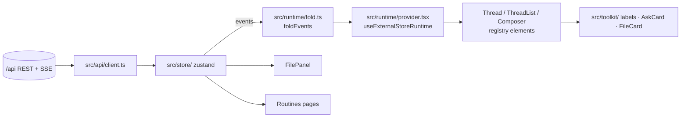

# CladeX Web UI — Frontend Implementation Plan (part 2 of 2)

> **For agentic workers:** REQUIRED SUB-SKILL: Use superpowers:subagent-driven-development (recommended) or superpowers:executing-plans to implement this plan task-by-task. Steps use checkbox (`- [ ]`) syntax for tracking.

**Goal:** Build the CladeX single-page app in `web/`: login through Telegram, a sidebar of threads, a chat that streams text and folds tool steps into a collapsible group, `ask_user` cards, attachments, dictation and read-aloud, a right-hand file panel, Routines pages, light and dark themes — on top of the backend API from part 1.

**Architecture:** Vite + React + TypeScript SPA. A zustand store holds threads, per-thread turn events and UI state; a pure `foldEvents` turns events into assistant-ui `ThreadMessageLike[]`; `useExternalStoreRuntime` renders them through registry elements (`thread`, `thread-list`, `tool-group`, `composer`, …) copied into the repo and restyled with the monochrome tokens from `docs/design/globals.css`. All server I/O goes through `src/api/`; events arrive over SSE and are replayed from a cursor after reconnect.

**Tech Stack:** Node 20, Vite 6, React 19, TypeScript 5, Tailwind CSS v4, shadcn/ui (Radix flavour), `@assistant-ui/react` ≥ 0.14, `@assistant-ui/react-markdown`, zustand, react-router 7, lucide-react, `@fontsource-variable/inter`, `@fontsource/jetbrains-mono`, Vitest + Testing Library, Playwright (one smoke).

**Spec:** `docs/superpowers/specs/2026-09-08-cladex-web-ui-design.md`. Backend plan and API contract: `docs/superpowers/plans/2026-09-08-cladex-web-backend.md` (part 1). Design system: `docs/design/DESIGN.md`.

## Locked Decisions

- **`foldEvents` is the only place turn events become messages.** Replay and live tail go through the same function; nothing else mutates messages.
- **Message ids:** user message id = `<turn_id>:u`, assistant message id = `<turn_id>:a`, tool-call id = the backend `call_id`, `ask_user` card id = `ask:<qid>`.
- **A `text.block` replaces the delta buffer.** Deltas append to a provisional text part; the block that follows is authoritative and swaps it in place (never duplicated).
- **`ask.open` renders as a tool-call part named `ask_user`** (a `human` toolkit entry, therefore standalone), `ask.answer` sets its result; the backend's own `mcp__hermes__ask_user` step stays inside the tool group as a plain row.
- **`file` events render as a standalone tool-call part named `send_document`** with the file record as `args`; clicking opens the file panel.
- **Routes:** `/` (last thread or new), `/t/:id` (thread; `id` is the URL-encoded `session_key`), `/routines`, `/routines/:id`, `/login`.
- **Theme:** `.dark` on `<html>`, persisted under `localStorage["cladex.theme"]` (`"light" | "dark" | "system"`).
- **No branching, no editing:** the runtime receives neither `setMessages` nor `onEdit`.
- **All copy in Russian** for UI chrome (labels, empty states, errors); tool names stay as the backend sends them.

## Global Constraints

- `web/` is the frontend root; `npm run build` outputs `web/dist` (consumed by the Dockerfile from part 1, Task 15).
- Design tokens come from `docs/design/globals.css` copied to `web/src/styles/globals.css`; no new colours outside it (see `DESIGN.md` do-not list). Fonts are self-hosted, never fetched from Google Fonts.
- `npm run typecheck` (`tsc --noEmit`), `npm run test` (Vitest) and `npm run lint` must pass before every commit.
- Dev server proxies `/api` to `http://localhost:8080`; no CORS anywhere.
- No `any` in `src/` except where a registry file already has it.

## Architecture Diagram



---

### Task 1: Scaffold, tokens, fonts, tooling

**Files:**
- Create: `web/package.json`, `web/vite.config.ts`, `web/tsconfig.json`, `web/tsconfig.app.json`, `web/index.html`, `web/components.json`, `web/eslint.config.js`, `web/src/main.tsx`, `web/src/app/App.tsx`, `web/src/styles/globals.css`, `web/src/styles/fonts.css`, `web/src/lib/utils.ts`, `web/src/test/setup.ts`
- Replace: the placeholder `web/package.json` from part 1 Task 15
- Test: `web/src/app/App.test.tsx`

**Interfaces:**
- Reuses: `docs/design/globals.css` (tokens), the Dockerfile `webbuild` stage (part 1).
- Produces: `npm run dev|build|test|typecheck|lint`, path alias `@/` → `web/src`, shadcn registry config with the assistant-ui registry.

- [ ] **Step 1: Create the project**

```bash
cd web
npm create vite@latest . -- --template react-ts
npm install
npm install react-router zustand lucide-react @assistant-ui/react @assistant-ui/react-markdown remark-gfm class-variance-authority clsx tailwind-merge tw-shimmer @fontsource-variable/inter @fontsource/jetbrains-mono
npm install -D tailwindcss @tailwindcss/vite vitest @testing-library/react @testing-library/jest-dom @testing-library/user-event jsdom @types/node eslint-plugin-react-hooks
```

- [ ] **Step 2: Vite, TypeScript and test config**

`web/vite.config.ts`:

```ts
import path from "node:path";
import react from "@vitejs/plugin-react";
import tailwindcss from "@tailwindcss/vite";
import { defineConfig } from "vitest/config";

export default defineConfig({
  plugins: [react(), tailwindcss()],
  resolve: { alias: { "@": path.resolve(__dirname, "src") } },
  server: {
    port: 5173,
    proxy: { "/api": { target: "http://localhost:8080", changeOrigin: false } },
  },
  build: { outDir: "dist", sourcemap: false },
  test: {
    environment: "jsdom",
    globals: true,
    setupFiles: ["./src/test/setup.ts"],
    css: false,
  },
});
```

`web/tsconfig.app.json` — add to `compilerOptions`: `"baseUrl": ".", "paths": { "@/*": ["./src/*"] }, "types": ["vitest/globals", "@testing-library/jest-dom"]`.

`web/src/test/setup.ts`:

```ts
import "@testing-library/jest-dom/vitest";
```

`web/package.json` scripts:

```json
"scripts": {
  "dev": "vite",
  "build": "tsc -b && vite build",
  "preview": "vite preview",
  "test": "vitest run",
  "test:watch": "vitest",
  "typecheck": "tsc -b --noEmit",
  "lint": "eslint ."
}
```

- [ ] **Step 3: Tokens and fonts**

Copy `docs/design/globals.css` to `web/src/styles/globals.css` and **delete its first line** (the Google Fonts `@import`). Create `web/src/styles/fonts.css`:

```css
/* Self-hosted: no request leaves the tunnel for a font (spec: Locked Decisions). */
@import "@fontsource-variable/inter";
@import "@fontsource/jetbrains-mono/400.css";
@import "@fontsource/jetbrains-mono/500.css";
```

In `globals.css` `@theme inline`, make sure the families read:

```css
  --font-sans: "Inter Variable", "Inter", ui-sans-serif, system-ui, sans-serif;
  --font-mono: "JetBrains Mono", ui-monospace, monospace;
```

`web/src/main.tsx`:

```tsx
import { StrictMode } from "react";
import { createRoot } from "react-dom/client";
import "./styles/fonts.css";
import "./styles/globals.css";
import { App } from "./app/App";

createRoot(document.getElementById("root")!).render(
  <StrictMode>
    <App />
  </StrictMode>,
);
```

`web/index.html` — set `<html lang="ru">`, `<title>CladeX</title>`, favicon `/favicon.svg` (copy `docs/design/logo/cladex-open-channel.svg` to `web/public/favicon.svg`).

- [ ] **Step 4: shadcn and the assistant-ui registry**

```bash
npx shadcn@latest init --template vite --base-color neutral
```

Then set `web/components.json`:

```json
{
  "$schema": "https://ui.shadcn.com/schema.json",
  "style": "new-york",
  "rsc": false,
  "tsx": true,
  "tailwind": { "config": "", "css": "src/styles/globals.css", "baseColor": "neutral", "cssVariables": true },
  "aliases": { "components": "@/components", "utils": "@/lib/utils", "ui": "@/components/ui", "lib": "@/lib", "hooks": "@/hooks" },
  "registries": { "@assistant-ui": "https://r.assistant-ui.com/{name}.json" }
}
```

`shadcn init` writes its own CSS variables into `globals.css`; keep **ours** (the `:root`/`.dark` blocks from `DESIGN.md`) and delete the generated duplicates, leaving only the `@import "tailwindcss"`, `@custom-variant dark`, our tokens, `@theme inline`, `@layer base`.

Install the shadcn primitives the elements need and the elements themselves:

```bash
npx shadcn@latest add button skeleton dialog tooltip avatar collapsible textarea input sidebar dropdown-menu separator badge scroll-area form label select sonner
npx shadcn@latest add @assistant-ui/thread @assistant-ui/thread-list @assistant-ui/threadlist-sidebar @assistant-ui/attachment @assistant-ui/markdown-text @assistant-ui/tool-fallback @assistant-ui/tool-group @assistant-ui/reasoning @assistant-ui/tooltip-icon-button
```

If a registry name differs, look it up with `npx shadcn@latest view @assistant-ui/<name>`; the file list expected afterwards is `src/components/assistant-ui/elements/{thread,thread-list,threadlist-sidebar,attachment,markdown-text,tool-fallback,tool-group,reasoning}.aui.tsx` plus `tooltip-icon-button.tsx`, `file.tsx`, `image.tsx`, `hooks/use-attachment-src.ts`, `hooks/use-copy-to-clipboard.ts`.

- [ ] **Step 5: Write the failing smoke test and the App shell**

`web/src/app/App.test.tsx`:

```tsx
import { render, screen } from "@testing-library/react";
import { App } from "./App";

test("renders the product name", () => {
  render(<App />);
  expect(screen.getByText("CladeX")).toBeInTheDocument();
});
```

`web/src/app/App.tsx` (temporary, replaced in Task 7):

```tsx
export function App() {
  return <div className="p-6 text-xl font-semibold">CladeX</div>;
}
```

- [ ] **Step 6: Run everything**

Run: `npm run test && npm run typecheck && npm run lint && npm run build`
Expected: test PASS, no type errors, `dist/index.html` exists.

- [ ] **Step 7: Commit**

```bash
git add web
git commit -m "feat(web-ui): Vite/React scaffold with CladeX tokens, fonts and assistant-ui registry"
```

---

### Task 2: API client and event types

**Files:**
- Create: `web/src/api/types.ts`, `web/src/api/client.ts`, `web/src/api/sse.ts`
- Test: `web/src/api/client.test.ts`, `web/src/api/sse.test.ts`

**Interfaces:**
- Reuses: the backend contract (part 1 tasks 9–14).
- Produces:
  - `types.ts`: `TurnEvent`, `EventType`, payload types, `ThreadWire`, `RoutineWire`, `FileWire`, `Me`.
  - `client.ts`: `api.me()`, `api.login(payload)`, `api.logout()`, `api.threads.list({before?, archived?})`, `.create()`, `.rename(id,title)`, `.archive(id)`, `.unarchive(id)`, `.get(id)`, `.events(id, after)`, `.send(id, {text, attachment_ids})`, `.cancel(id)`; `api.asks.answer(qid, answer)`; `api.uploads.put(threadId, file)`; `api.routines.*`; `api.voice.transcribe(blob)`, `.speak(text)`; `ApiError` with `status`, `code`, `message`.
  - `sse.ts`: `subscribeEvents(threadId, after, onEvent, onState) -> () => void` — reconnects with the last seen id; `onState("open" | "reconnecting")`.

- [ ] **Step 1: Write the failing tests**

`web/src/api/client.test.ts`:

```ts
import { afterEach, describe, expect, it, vi } from "vitest";
import { api, ApiError } from "./client";

const ok = (body: unknown, status = 200) =>
  new Response(JSON.stringify(body), { status, headers: { "Content-Type": "application/json" } });

afterEach(() => vi.restoreAllMocks());

describe("api", () => {
  it("sends JSON mutations with the JSON content type and same-origin credentials", async () => {
    const fetchMock = vi.spyOn(globalThis, "fetch").mockResolvedValue(ok({ id: "web:1:x" }, 201));
    await api.threads.create();
    const [url, init] = fetchMock.mock.calls[0]!;
    expect(url).toBe("/api/threads");
    expect(init?.method).toBe("POST");
    expect((init?.headers as Record<string, string>)["Content-Type"]).toBe("application/json");
    expect(init?.credentials).toBe("same-origin");
  });

  it("url-encodes thread ids in paths", async () => {
    const fetchMock = vi.spyOn(globalThis, "fetch").mockResolvedValue(ok({ events: [] }));
    await api.threads.events("tg:private:1:t9", 7);
    expect(fetchMock.mock.calls[0]![0]).toBe("/api/threads/tg%3Aprivate%3A1%3At9/events?after=7");
  });

  it("throws ApiError with the server code", async () => {
    vi.spyOn(globalThis, "fetch").mockResolvedValue(
      ok({ error: { code: "busy", message: "the agent is busy in this thread" } }, 409),
    );
    await expect(api.threads.send("web:1:x", { text: "hi", attachment_ids: [] }))
      .rejects.toMatchObject<Partial<ApiError>>({ status: 409, code: "busy" });
  });

  it("uploads as multipart without a manual content type", async () => {
    const fetchMock = vi.spyOn(globalThis, "fetch").mockResolvedValue(ok({ file_id: "f1" }, 201));
    await api.uploads.put("web:1:x", new File(["x"], "a.txt", { type: "text/plain" }));
    const init = fetchMock.mock.calls[0]![1]!;
    expect(init.body).toBeInstanceOf(FormData);
    expect((init.headers as Record<string, string>)["Content-Type"]).toBeUndefined();
  });
});
```

`web/src/api/sse.test.ts`:

```ts
import { afterEach, beforeEach, expect, it, vi } from "vitest";
import { subscribeEvents } from "./sse";

class FakeSource {
  static instances: FakeSource[] = [];
  url: string;
  listeners: Record<string, ((e: MessageEvent) => void)[]> = {};
  onopen: (() => void) | null = null;
  onerror: (() => void) | null = null;
  closed = false;
  constructor(url: string) { this.url = url; FakeSource.instances.push(this); }
  addEventListener(type: string, cb: (e: MessageEvent) => void) {
    (this.listeners[type] ??= []).push(cb);
  }
  emit(type: string, data: unknown, lastEventId = "") {
    for (const cb of this.listeners[type] ?? []) {
      cb({ data: JSON.stringify(data), lastEventId } as MessageEvent);
    }
  }
  close() { this.closed = true; }
}

beforeEach(() => {
  FakeSource.instances = [];
  vi.stubGlobal("EventSource", FakeSource);
  vi.useFakeTimers();
});
afterEach(() => { vi.unstubAllGlobals(); vi.useRealTimers(); });

it("connects with the cursor, forwards events, and reconnects from the last id", () => {
  const seen: number[] = [];
  const states: string[] = [];
  const stop = subscribeEvents("web:1:x", 5, (ev) => seen.push(ev.id ?? -1), (s) => states.push(s));
  const first = FakeSource.instances[0]!;
  expect(first.url).toBe("/api/threads/web%3A1%3Ax/stream?after=5");
  first.onopen?.();
  first.emit("turn", { id: 6, type: "turn.start", payload: {} }, "6");
  first.emit("turn", { id: null, type: "text.delta", payload: { delta: "x" } }, "");
  first.onerror?.();
  vi.advanceTimersByTime(1500);
  const second = FakeSource.instances[1]!;
  expect(second.url).toBe("/api/threads/web%3A1%3Ax/stream?after=6");
  expect(seen).toEqual([6, -1]);
  expect(states).toEqual(["open", "reconnecting"]);
  stop();
  expect(second.closed).toBe(true);
});
```

- [ ] **Step 2: Run tests to verify they fail**

Run: `npm run test -- src/api`
Expected: FAIL — modules not found.

- [ ] **Step 3: Implement the types**

`web/src/api/types.ts`:

```ts
export type Channel = "web" | "telegram" | "cron";
export type TurnStatus = "ok" | "error" | "cancelled";

export type AttachmentWire = {
  file_id: string | null; name: string; media_type: string; size: number; url: string | null;
};
export type FileWire = {
  file_id: string; name: string; media_type: string; size: number; url: string;
  telegram_sent?: boolean;
};

export type Payloads = {
  "turn.start": { channel: Channel; user_id: number; job_id?: number; run_id?: string };
  "user.message": { text: string; attachments: AttachmentWire[] };
  "text.delta": { delta: string };
  "text.block": { text: string };
  thinking: { text: string };
  "tool.call": { call_id: string; name: string; input: Record<string, unknown> };
  "tool.result": { call_id: string; output: string; is_error: boolean; duration_ms: number };
  "ask.open": { qid: string; question: string; options: string[] };
  "ask.answer": { qid: string; answer: string | null; source: "user" | "timeout" | "cancelled" };
  file: FileWire;
  "thread.title": { title: string };
  "turn.end": { status: TurnStatus; cost_usd: number | null; sdk_session_id: string | null; error: string | null };
};
export type EventType = keyof Payloads;

export type TurnEvent<T extends EventType = EventType> = {
  id: number | null; session_key: string; turn_id: string; seq: number; ts: string;
  type: T; payload: Payloads[T];
};

export type ThreadWire = {
  id: string; title: string | null; channel: Channel; archived: boolean; running: boolean;
  last_event_at: string; created_at: string;
};
export type ThreadPage = { threads: ThreadWire[]; next: string | null };

export type RoutineWire = {
  id: number; name: string; kind: "interval" | "cron" | "once"; value: string; schedule: string;
  prompt: string; state: "active" | "paused" | "done"; next_run_at: string | null;
  last_run_at: string | null; last_status: string | null; timeout_seconds: number | null;
  thread_id: string; created_at: string;
};
export type RunWire = { ts: string; status: string };
export type Me = { user_id: number; role: "owner" | "user" };
```

- [ ] **Step 4: Implement the client**

`web/src/api/client.ts`:

```ts
import type { FileWire, Me, RoutineWire, RunWire, ThreadPage, ThreadWire, TurnEvent } from "./types";

export class ApiError extends Error {
  constructor(public status: number, public code: string, message: string) {
    super(message);
  }
}

const enc = encodeURIComponent;

async function request<T>(path: string, init: RequestInit = {}): Promise<T> {
  const res = await fetch(path, { credentials: "same-origin", ...init });
  if (res.status === 204) return undefined as T;
  const ctype = res.headers.get("content-type") ?? "";
  const body = ctype.includes("application/json") ? await res.json() : await res.blob();
  if (!res.ok) {
    const err = (body as { error?: { code: string; message: string } })?.error;
    throw new ApiError(res.status, err?.code ?? "http_error", err?.message ?? res.statusText);
  }
  return body as T;
}

function json<T>(path: string, method: string, body?: unknown): Promise<T> {
  return request<T>(path, {
    method,
    headers: { "Content-Type": "application/json" },
    body: body === undefined ? undefined : JSON.stringify(body),
  });
}

export const api = {
  me: () => request<Me>("/api/me"),
  login: (payload: Record<string, unknown>) => json<Me>("/api/auth/telegram", "POST", payload),
  logout: () => json<void>("/api/auth/logout", "POST"),

  threads: {
    list: (opts: { before?: string; archived?: boolean; limit?: number } = {}) => {
      const q = new URLSearchParams();
      if (opts.before) q.set("before", opts.before);
      if (opts.archived) q.set("archived", "1");
      if (opts.limit) q.set("limit", String(opts.limit));
      const qs = q.toString();
      return request<ThreadPage>(`/api/threads${qs ? `?${qs}` : ""}`);
    },
    create: () => json<ThreadWire>("/api/threads", "POST", {}),
    get: (id: string) => request<ThreadWire>(`/api/threads/${enc(id)}`),
    rename: (id: string, title: string) => json<ThreadWire>(`/api/threads/${enc(id)}`, "PATCH", { title }),
    archive: (id: string) => json<void>(`/api/threads/${enc(id)}/archive`, "POST"),
    unarchive: (id: string) => json<void>(`/api/threads/${enc(id)}/unarchive`, "POST"),
    events: (id: string, after = 0) =>
      request<{ events: TurnEvent[] }>(`/api/threads/${enc(id)}/events?after=${after}`),
    send: (id: string, body: { text: string; attachment_ids: string[] }) =>
      json<{ accepted: true; thread_id: string }>(`/api/threads/${enc(id)}/messages`, "POST", body),
    cancel: (id: string) => json<void>(`/api/threads/${enc(id)}/cancel`, "POST"),
  },

  asks: {
    answer: (qid: string, answer: string) => json<void>(`/api/asks/${enc(qid)}`, "POST", { answer }),
  },

  uploads: {
    put: (threadId: string, file: File) => {
      const form = new FormData();
      form.append("thread_id", threadId);
      form.append("file", file, file.name);
      return request<FileWire>("/api/uploads", { method: "POST", body: form, headers: {} });
    },
  },

  routines: {
    list: () => request<{ routines: RoutineWire[] }>("/api/routines"),
    get: (id: number) => request<RoutineWire>(`/api/routines/${id}`),
    create: (body: { name: string; schedule: string; prompt: string; timeout_seconds?: number | null }) =>
      json<RoutineWire>("/api/routines", "POST", body),
    update: (id: number, body: Partial<{ name: string; schedule: string; prompt: string; timeout_seconds: number | null }>) =>
      json<RoutineWire>(`/api/routines/${id}`, "PATCH", body),
    pause: (id: number) => json<void>(`/api/routines/${id}/pause`, "POST"),
    resume: (id: number) => json<void>(`/api/routines/${id}/resume`, "POST"),
    run: (id: number) => json<void>(`/api/routines/${id}/run`, "POST"),
    remove: (id: number) => json<void>(`/api/routines/${id}`, "DELETE"),
    runs: (id: number) => request<{ runs: RunWire[] }>(`/api/routines/${id}/runs`),
  },

  voice: {
    transcribe: (blob: Blob) =>
      request<{ text: string }>("/api/voice/transcribe", {
        method: "POST", body: blob, headers: { "Content-Type": blob.type || "audio/webm" },
      }),
    speak: (text: string) =>
      request<Blob>("/api/voice/speak", {
        method: "POST", headers: { "Content-Type": "application/json" }, body: JSON.stringify({ text }),
      }),
  },
};
```

Note: the `Origin` header is set by the browser on every cross-origin *and* same-origin `fetch` mutation, which is what the backend checks; nothing to add here.

- [ ] **Step 5: Implement the SSE subscription**

`web/src/api/sse.ts`:

```ts
import type { TurnEvent } from "./types";

export type StreamState = "open" | "reconnecting";
const RETRY_MS = 1500;

/** Tail a thread's events from `after`. Reconnects from the last persisted id it saw. */
export function subscribeEvents(
  threadId: string,
  after: number,
  onEvent: (ev: TurnEvent) => void,
  onState: (s: StreamState) => void = () => {},
): () => void {
  let cursor = after;
  let source: EventSource | null = null;
  let timer: ReturnType<typeof setTimeout> | null = null;
  let stopped = false;

  const connect = () => {
    source = new EventSource(`/api/threads/${encodeURIComponent(threadId)}/stream?after=${cursor}`);
    source.onopen = () => onState("open");
    source.addEventListener("turn", (e: MessageEvent) => {
      const ev = JSON.parse(e.data) as TurnEvent;
      if (ev.id !== null && ev.id > cursor) cursor = ev.id;
      onEvent(ev);
    });
    source.onerror = () => {
      source?.close();
      if (stopped) return;
      onState("reconnecting");
      timer = setTimeout(connect, RETRY_MS);
    };
  };
  connect();

  return () => {
    stopped = true;
    if (timer) clearTimeout(timer);
    source?.close();
  };
}
```

- [ ] **Step 6: Run the tests**

Run: `npm run test -- src/api && npm run typecheck`
Expected: PASS.

- [ ] **Step 7: Commit**

```bash
git add web/src/api
git commit -m "feat(web-ui): typed API client and SSE subscription with cursor reconnect"
```

---

### Task 3: `foldEvents`

**Files:**
- Create: `web/src/runtime/fold.ts`, `web/src/runtime/fixtures.ts`
- Test: `web/src/runtime/fold.test.ts`

**Interfaces:**
- Reuses: `TurnEvent` types (Task 2), assistant-ui `ThreadMessageLike`, `TextMessagePart`, `ReasoningMessagePart`, `ToolCallMessagePart`, `CompleteAttachment`.
- Produces: `foldEvents(events: TurnEvent[]): Folded` with
  ```ts
  type Folded = {
    messages: ThreadMessageLike[];
    isRunning: boolean;
    pendingAsk: { qid: string; question: string; options: string[] } | null;
    files: FileWire[];
    title: string | null;
    lastError: string | null;
  };
  ```
  and `ASK_TOOL = "ask_user"`, `FILE_TOOL = "send_document"`.

- [ ] **Step 1: Write the fixtures and failing tests**

`web/src/runtime/fixtures.ts`:

```ts
import type { EventType, Payloads, TurnEvent } from "@/api/types";

let nextId = 1;
export function ev<T extends EventType>(turn: string, type: T, payload: Payloads[T], persisted = true): TurnEvent<T> {
  return {
    id: persisted ? nextId++ : null, session_key: "web:1:x", turn_id: turn, seq: nextId, ts: "2026-07-12T10:00:00+00:00",
    type, payload,
  };
}
export const END_OK: Payloads["turn.end"] = { status: "ok", cost_usd: 0.01, sdk_session_id: "s", error: null };

export const plainTurn = () => [
  ev("t1", "turn.start", { channel: "web", user_id: 1 }),
  ev("t1", "user.message", { text: "hi", attachments: [] }),
  ev("t1", "text.delta", { delta: "Hel" }, false),
  ev("t1", "text.delta", { delta: "lo" }, false),
  ev("t1", "text.block", { text: "Hello" }),
  ev("t1", "tool.call", { call_id: "c1", name: "Read", input: { file_path: "a.md" } }),
  ev("t1", "tool.result", { call_id: "c1", output: "body", is_error: false, duration_ms: 12 }),
  ev("t1", "text.block", { text: "Done." }),
  ev("t1", "turn.end", END_OK),
];
```

`web/src/runtime/fold.test.ts`:

```ts
import { describe, expect, it } from "vitest";
import { ASK_TOOL, FILE_TOOL, foldEvents } from "./fold";
import { END_OK, ev, plainTurn } from "./fixtures";

describe("foldEvents", () => {
  it("builds one user and one assistant message per turn with parts in order", () => {
    const { messages, isRunning } = foldEvents(plainTurn());
    expect(isRunning).toBe(false);
    expect(messages.map((m) => m.role)).toEqual(["user", "assistant"]);
    expect(messages[0]!.id).toBe("t1:u");
    expect(messages[0]!.content).toEqual([{ type: "text", text: "hi" }]);
    const parts = messages[1]!.content as { type: string }[];
    expect(parts.map((p) => p.type)).toEqual(["text", "tool-call", "text"]);
    expect(parts[0]).toEqual({ type: "text", text: "Hello" });   // the block replaced the deltas
    expect(parts[1]).toMatchObject({ type: "tool-call", toolCallId: "c1", toolName: "Read",
      args: { file_path: "a.md" }, result: "body", isError: false });
    expect(messages[1]!.status).toEqual({ type: "complete", reason: "stop" });
  });

  it("streams deltas into a provisional text part while running", () => {
    const events = plainTurn().slice(0, 4);           // up to the second delta
    const { messages, isRunning } = foldEvents(events);
    expect(isRunning).toBe(true);
    expect(messages[1]!.content).toEqual([{ type: "text", text: "Hello" }]);
    expect(messages[1]!.status).toEqual({ type: "running" });
  });

  it("keeps a running tool call result-less", () => {
    const events = plainTurn().slice(0, 6);           // through tool.call
    const parts = foldEvents(events).messages[1]!.content as { type: string; result?: unknown }[];
    expect(parts[1]).toMatchObject({ type: "tool-call", toolName: "Read" });
    expect(parts[1]!.result).toBeUndefined();
  });

  it("renders ask.open as a standalone human tool and closes it on ask.answer", () => {
    const open = [
      ev("t2", "turn.start", { channel: "web", user_id: 1 }),
      ev("t2", "user.message", { text: "q", attachments: [] }),
      ev("t2", "ask.open", { qid: "q1", question: "Which?", options: ["A", "B"] }),
    ];
    let out = foldEvents(open);
    expect(out.pendingAsk).toEqual({ qid: "q1", question: "Which?", options: ["A", "B"] });
    const part = (out.messages[1]!.content as { toolCallId: string; toolName: string; args: unknown }[])[0]!;
    expect(part).toMatchObject({ toolCallId: "ask:q1", toolName: ASK_TOOL, args: { question: "Which?", options: ["A", "B"] } });
    out = foldEvents([...open, ev("t2", "ask.answer", { qid: "q1", answer: "B", source: "user" })]);
    expect(out.pendingAsk).toBeNull();
    expect((out.messages[1]!.content as { result?: unknown }[])[0]!.result).toEqual({ answer: "B", source: "user" });
  });

  it("renders file events as standalone send_document parts and collects files", () => {
    const file = { file_id: "f1", name: "r.md", media_type: "text/markdown", size: 4, url: "/api/files/f1", telegram_sent: false };
    const out = foldEvents([
      ev("t3", "turn.start", { channel: "web", user_id: 1 }),
      ev("t3", "user.message", { text: "make", attachments: [] }),
      ev("t3", "file", file),
      ev("t3", "turn.end", END_OK),
    ]);
    expect(out.files).toEqual([file]);
    expect((out.messages[1]!.content as { toolName: string; args: unknown }[])[0]).toMatchObject({ toolName: FILE_TOOL, args: file });
  });

  it("marks error and cancelled turns as incomplete", () => {
    const base = [ev("t4", "turn.start", { channel: "web", user_id: 1 }), ev("t4", "user.message", { text: "x", attachments: [] })];
    const err = foldEvents([...base, ev("t4", "turn.end", { ...END_OK, status: "error", error: "api down" })]);
    expect(err.messages[1]!.status).toEqual({ type: "incomplete", reason: "error", error: "api down" });
    expect(err.lastError).toBe("api down");
    const cancelled = foldEvents([...base, ev("t4", "text.delta", { delta: "par" }, false),
      ev("t4", "turn.end", { ...END_OK, status: "cancelled" })]);
    expect(cancelled.messages[1]!.status).toEqual({ type: "incomplete", reason: "cancelled" });
    expect(cancelled.messages[1]!.content).toEqual([{ type: "text", text: "par" }]);   // partial text stays
  });

  it("is a pure function of the event list: replay equals live", () => {
    const events = plainTurn();
    const live = events.reduce((acc, e) => { foldEvents([...acc, e]); return [...acc, e]; }, [] as typeof events);
    expect(foldEvents(live)).toEqual(foldEvents(events));
  });

  it("carries user attachments, thread titles and cron turns", () => {
    const out = foldEvents([
      ev("t5", "turn.start", { channel: "cron", user_id: 0, job_id: 3, run_id: "r1" }),
      ev("t5", "text.block", { text: "report" }),
      ev("t5", "turn.end", END_OK),
      ev("", "thread.title", { title: "Daily brief" }),
      ev("t6", "turn.start", { channel: "web", user_id: 1 }),
      ev("t6", "user.message", { text: "2", attachments: [{ file_id: "f9", name: "a.png", media_type: "image/png", size: 3, url: "/api/files/f9" }] }),
    ]);
    expect(out.title).toBe("Daily brief");
    expect(out.messages[0]!.role).toBe("assistant");                           // a cron report has no user message
    expect(out.messages[0]!.metadata).toMatchObject({ custom: { channel: "cron", job_id: 3, run_id: "r1" } });
    expect(out.messages[1]!.attachments).toEqual([{ id: "f9", type: "image", name: "a.png", contentType: "image/png",
      status: { type: "complete" }, content: [] }]);
  });
});
```

- [ ] **Step 2: Run tests to verify they fail**

Run: `npm run test -- src/runtime`
Expected: FAIL — `./fold` not found.

- [ ] **Step 3: Implement the fold**

`web/src/runtime/fold.ts`:

```ts
import type { ThreadMessageLike } from "@assistant-ui/react";
import type { AttachmentWire, FileWire, TurnEvent } from "@/api/types";

export const ASK_TOOL = "ask_user";
export const FILE_TOOL = "send_document";

type Part = ThreadMessageLike["content"] extends string | readonly (infer P)[] ? P : never;
type ToolPart = Extract<Part, { type: "tool-call" }>;

export type Folded = {
  messages: ThreadMessageLike[];
  isRunning: boolean;
  pendingAsk: { qid: string; question: string; options: string[] } | null;
  files: FileWire[];
  title: string | null;
  lastError: string | null;
};

type Draft = {
  turnId: string;
  channel: string;
  meta: Record<string, unknown>;
  parts: Part[];
  buffer: string;            // deltas since the last text.block
  status: ThreadMessageLike["status"];
  createdAt: Date;
};

function attachment(a: AttachmentWire) {
  return {
    id: a.file_id ?? a.name,
    type: a.media_type.startsWith("image/") ? ("image" as const) : ("document" as const),
    name: a.name,
    contentType: a.media_type,
    status: { type: "complete" as const },
    content: [],
  };
}

function assistantMessage(d: Draft): ThreadMessageLike {
  const parts = [...d.parts];
  if (d.buffer) parts.push({ type: "text", text: d.buffer } as Part);
  return {
    id: `${d.turnId}:a`,
    role: "assistant",
    content: parts,
    createdAt: d.createdAt,
    status: d.status,
    metadata: { custom: d.meta },
  };
}

export function foldEvents(events: TurnEvent[]): Folded {
  const messages: ThreadMessageLike[] = [];
  const files: FileWire[] = [];
  let title: string | null = null;
  let lastError: string | null = null;
  let pendingAsk: Folded["pendingAsk"] = null;
  let draft: Draft | null = null;
  let draftIndex = -1;                         // where the draft's assistant message sits

  const commit = () => {
    if (draft) messages[draftIndex] = assistantMessage(draft);
  };

  for (const e of events) {
    switch (e.type) {
      case "turn.start": {
        const p = e.payload as TurnEvent<"turn.start">["payload"];
        draft = {
          turnId: e.turn_id, channel: p.channel,
          meta: { channel: p.channel, ...(p.job_id !== undefined ? { job_id: p.job_id, run_id: p.run_id } : {}) },
          parts: [], buffer: "", status: { type: "running" }, createdAt: new Date(e.ts),
        };
        draftIndex = messages.length;
        messages.push(assistantMessage(draft));
        break;
      }
      case "user.message": {
        if (!draft) break;
        const p = e.payload as TurnEvent<"user.message">["payload"];
        // The user message goes *before* the assistant draft of the same turn.
        messages.splice(draftIndex, 0, {
          id: `${draft.turnId}:u`, role: "user", createdAt: new Date(e.ts),
          content: p.text ? [{ type: "text", text: p.text }] : [],
          attachments: p.attachments.map(attachment),
        });
        draftIndex += 1;
        break;
      }
      case "text.delta": {
        if (!draft) break;
        draft.buffer += (e.payload as TurnEvent<"text.delta">["payload"]).delta;
        commit();
        break;
      }
      case "text.block": {
        if (!draft) break;
        draft.buffer = "";
        draft.parts.push({ type: "text", text: (e.payload as TurnEvent<"text.block">["payload"]).text } as Part);
        commit();
        break;
      }
      case "thinking": {
        if (!draft) break;
        draft.parts.push({ type: "reasoning", text: (e.payload as TurnEvent<"thinking">["payload"]).text } as Part);
        commit();
        break;
      }
      case "tool.call": {
        if (!draft) break;
        const p = e.payload as TurnEvent<"tool.call">["payload"];
        draft.parts.push({ type: "tool-call", toolCallId: p.call_id, toolName: p.name, args: p.input,
          argsText: JSON.stringify(p.input) } as ToolPart);
        commit();
        break;
      }
      case "tool.result": {
        if (!draft) break;
        const p = e.payload as TurnEvent<"tool.result">["payload"];
        const idx = draft.parts.findIndex((x) => x.type === "tool-call" && (x as ToolPart).toolCallId === p.call_id);
        if (idx >= 0) {
          draft.parts[idx] = { ...(draft.parts[idx] as ToolPart), result: p.output, isError: p.is_error,
            artifact: { duration_ms: p.duration_ms } } as ToolPart;
        }
        commit();
        break;
      }
      case "ask.open": {
        if (!draft) break;
        const p = e.payload as TurnEvent<"ask.open">["payload"];
        pendingAsk = { qid: p.qid, question: p.question, options: p.options };
        draft.parts.push({ type: "tool-call", toolCallId: `ask:${p.qid}`, toolName: ASK_TOOL,
          args: { question: p.question, options: p.options }, argsText: "" } as ToolPart);
        commit();
        break;
      }
      case "ask.answer": {
        if (!draft) break;
        const p = e.payload as TurnEvent<"ask.answer">["payload"];
        if (pendingAsk?.qid === p.qid) pendingAsk = null;
        const idx = draft.parts.findIndex((x) => x.type === "tool-call" && (x as ToolPart).toolCallId === `ask:${p.qid}`);
        if (idx >= 0) draft.parts[idx] = { ...(draft.parts[idx] as ToolPart), result: { answer: p.answer, source: p.source } } as ToolPart;
        commit();
        break;
      }
      case "file": {
        const p = e.payload as TurnEvent<"file">["payload"];
        files.push(p);
        if (!draft) break;
        draft.parts.push({ type: "tool-call", toolCallId: `file:${p.file_id}`, toolName: FILE_TOOL, args: p,
          argsText: "", result: "sent" } as ToolPart);
        commit();
        break;
      }
      case "thread.title":
        title = (e.payload as TurnEvent<"thread.title">["payload"]).title;
        break;
      case "turn.end": {
        if (!draft) break;
        const p = e.payload as TurnEvent<"turn.end">["payload"];
        if (p.status === "ok") draft.status = { type: "complete", reason: "stop" };
        else if (p.status === "cancelled") draft.status = { type: "incomplete", reason: "cancelled" };
        else { draft.status = { type: "incomplete", reason: "error", error: p.error ?? "error" }; lastError = p.error ?? "error"; }
        if (pendingAsk) pendingAsk = null;
        commit();
        draft = null;
        break;
      }
    }
  }
  return { messages, isRunning: draft !== null, pendingAsk, files, title, lastError };
}
```

The "block replaces buffer" rule is implemented by clearing `buffer` on `text.block` and only materialising the buffer as a trailing provisional part inside `assistantMessage`.

- [ ] **Step 4: Run the tests**

Run: `npm run test -- src/runtime && npm run typecheck`
Expected: PASS. If `ThreadMessageLike` typing rejects `artifact` or `argsText`, check the exported `ToolCallMessagePart` type in `node_modules/@assistant-ui/react` and keep only the documented fields (`toolCallId, toolName, args, argsText, result, isError, artifact`).

- [ ] **Step 5: Commit**

```bash
git add web/src/runtime
git commit -m "feat(web-ui): pure foldEvents from turn events to assistant-ui messages"
```

---

### Task 4: Store

**Files:**
- Create: `web/src/store/index.ts`, `web/src/store/threads.ts`, `web/src/store/events.ts`, `web/src/store/ui.ts`
- Test: `web/src/store/events.test.ts`, `web/src/store/threads.test.ts`

**Interfaces:**
- Reuses: `api`, `subscribeEvents` (Task 2), `foldEvents` (Task 3).
- Produces (zustand, one store composed of three slices):
  - `threads`: `list: ThreadWire[]`, `next: string | null`, `loaded: boolean`, `currentId: string | null`, `load()`, `loadMore()`, `create() -> id`, `select(id)`, `rename(id, title)`, `archive(id)`, `unarchive(id)`, `patchLocal(id, patch)`.
  - `events`: `byThread: Record<string, TurnEvent[]>`, `cursor: Record<string, number>`, `stream: Record<string, StreamState>`, `open(id)` (loads history then subscribes; idempotent), `close(id)`, `push(id, ev)`, `folded(id) -> Folded` (memoised per thread by array identity).
  - `ui`: `theme`, `setTheme`, `openFile: FileWire | null`, `setOpenFile`, `me: Me | null`, `setMe`.

- [ ] **Step 1: Write the failing tests**

`web/src/store/events.test.ts`:

```ts
import { afterEach, beforeEach, expect, it, vi } from "vitest";

vi.mock("@/api/client", () => ({
  api: { threads: { events: vi.fn(async () => ({ events: [] })) } },
}));
vi.mock("@/api/sse", () => ({ subscribeEvents: vi.fn(() => vi.fn()) }));

import { api } from "@/api/client";
import { subscribeEvents } from "@/api/sse";
import { useStore } from "./index";
import { ev, END_OK } from "@/runtime/fixtures";

beforeEach(() => useStore.setState(useStore.getInitialState()));
afterEach(() => vi.clearAllMocks());

it("open() loads history once, subscribes from the cursor, and folds", async () => {
  vi.mocked(api.threads.events).mockResolvedValueOnce({ events: [
    ev("t1", "turn.start", { channel: "web", user_id: 1 }),
    ev("t1", "user.message", { text: "hi", attachments: [] }),
    ev("t1", "text.block", { text: "yo" }),
    ev("t1", "turn.end", END_OK),
  ] });
  await useStore.getState().open("web:1:x");
  await useStore.getState().open("web:1:x");                        // idempotent
  expect(api.threads.events).toHaveBeenCalledTimes(1);
  expect(subscribeEvents).toHaveBeenCalledTimes(1);
  const [, after] = vi.mocked(subscribeEvents).mock.calls[0]!;
  expect(after).toBe(useStore.getState().cursor["web:1:x"]);
  const f = useStore.getState().folded("web:1:x");
  expect(f.messages).toHaveLength(2);
  expect(useStore.getState().folded("web:1:x")).toBe(f);           // memoised
});

it("push() appends, dedupes by id, and advances the cursor", () => {
  const s = useStore.getState();
  const a = ev("t2", "turn.start", { channel: "web", user_id: 1 });
  s.push("web:1:y", a);
  s.push("web:1:y", a);                                           // duplicate after reconnect
  s.push("web:1:y", ev("t2", "text.delta", { delta: "x" }, false));
  expect(useStore.getState().byThread["web:1:y"]).toHaveLength(2);
  expect(useStore.getState().cursor["web:1:y"]).toBe(a.id);
});
```

`web/src/store/threads.test.ts`:

```ts
import { beforeEach, expect, it, vi } from "vitest";

vi.mock("@/api/client", () => ({
  api: { threads: {
    list: vi.fn(async () => ({ threads: [{ id: "web:1:a", title: null, channel: "web", archived: false, running: false, last_event_at: "1", created_at: "1" }], next: null })),
    create: vi.fn(async () => ({ id: "web:1:new", title: null, channel: "web", archived: false, running: false, last_event_at: "2", created_at: "2" })),
    rename: vi.fn(async (id: string, title: string) => ({ id, title, channel: "web", archived: false, running: false, last_event_at: "1", created_at: "1" })),
    archive: vi.fn(async () => undefined),
  } },
}));
vi.mock("@/api/sse", () => ({ subscribeEvents: vi.fn(() => vi.fn()) }));

import { useStore } from "./index";

beforeEach(() => useStore.setState(useStore.getInitialState()));

it("loads, creates at the top, renames locally, archives out of the list", async () => {
  await useStore.getState().load();
  expect(useStore.getState().list.map((t) => t.id)).toEqual(["web:1:a"]);
  const id = await useStore.getState().create();
  expect(id).toBe("web:1:new");
  expect(useStore.getState().list[0]!.id).toBe("web:1:new");
  expect(useStore.getState().currentId).toBe("web:1:new");
  await useStore.getState().rename("web:1:a", "Plan");
  expect(useStore.getState().list.find((t) => t.id === "web:1:a")!.title).toBe("Plan");
  await useStore.getState().archive("web:1:a");
  expect(useStore.getState().list.map((t) => t.id)).toEqual(["web:1:new"]);
});
```

- [ ] **Step 2: Run tests to verify they fail**

Run: `npm run test -- src/store`
Expected: FAIL — `./index` not found.

- [ ] **Step 3: Implement the slices**

`web/src/store/threads.ts`:

```ts
import type { StateCreator } from "zustand";
import { api } from "@/api/client";
import type { ThreadWire } from "@/api/types";

export type ThreadsSlice = {
  list: ThreadWire[]; next: string | null; loaded: boolean; currentId: string | null;
  load: () => Promise<void>; loadMore: () => Promise<void>; create: () => Promise<string>;
  select: (id: string | null) => void; rename: (id: string, title: string) => Promise<void>;
  archive: (id: string) => Promise<void>; unarchive: (id: string) => Promise<void>;
  patchLocal: (id: string, patch: Partial<ThreadWire>) => void;
};

export const createThreadsSlice: StateCreator<ThreadsSlice, [], [], ThreadsSlice> = (set, get) => ({
  list: [], next: null, loaded: false, currentId: null,
  async load() {
    const page = await api.threads.list();
    set({ list: page.threads, next: page.next, loaded: true });
  },
  async loadMore() {
    const { next, list } = get();
    if (!next) return;
    const page = await api.threads.list({ before: next });
    set({ list: [...list, ...page.threads], next: page.next });
  },
  async create() {
    const t = await api.threads.create();
    set((s) => ({ list: [t, ...s.list], currentId: t.id }));
    return t.id;
  },
  select(id) { set({ currentId: id }); },
  async rename(id, title) {
    get().patchLocal(id, { title });
    const t = await api.threads.rename(id, title);
    get().patchLocal(id, t);
  },
  async archive(id) {
    await api.threads.archive(id);
    set((s) => ({ list: s.list.filter((t) => t.id !== id), currentId: s.currentId === id ? null : s.currentId }));
  },
  async unarchive(id) {
    await api.threads.unarchive(id);
    await get().load();
  },
  patchLocal(id, patch) {
    set((s) => ({ list: s.list.map((t) => (t.id === id ? { ...t, ...patch } : t)) }));
  },
});
```

`web/src/store/events.ts`:

```ts
import type { StateCreator } from "zustand";
import { api } from "@/api/client";
import { subscribeEvents, type StreamState } from "@/api/sse";
import type { TurnEvent } from "@/api/types";
import { foldEvents, type Folded } from "@/runtime/fold";

export type EventsSlice = {
  byThread: Record<string, TurnEvent[]>;
  cursor: Record<string, number>;
  stream: Record<string, StreamState>;
  open: (id: string) => Promise<void>;
  close: (id: string) => void;
  push: (id: string, ev: TurnEvent) => void;
  folded: (id: string) => Folded;
};

const unsubscribers = new Map<string, () => void>();
const foldCache = new Map<string, { events: TurnEvent[]; folded: Folded }>();
const EMPTY = foldEvents([]);

export const createEventsSlice: StateCreator<EventsSlice & { patchLocal?: (id: string, p: object) => void }, [], [], EventsSlice> = (set, get) => ({
  byThread: {}, cursor: {}, stream: {},
  async open(id) {
    if (unsubscribers.has(id)) return;
    unsubscribers.set(id, () => {});                                 // reserve while loading
    const { events } = await api.threads.events(id, get().cursor[id] ?? 0);
    for (const e of events) get().push(id, e);
    const stop = subscribeEvents(id, get().cursor[id] ?? 0,
      (e) => get().push(id, e),
      (s) => set((st) => ({ stream: { ...st.stream, [id]: s } })));
    unsubscribers.set(id, stop);
  },
  close(id) {
    unsubscribers.get(id)?.();
    unsubscribers.delete(id);
  },
  push(id, e) {
    set((s) => {
      const list = s.byThread[id] ?? [];
      if (e.id !== null && list.some((x) => x.id === e.id)) return s;   // replayed after reconnect
      const cursor = e.id !== null ? Math.max(s.cursor[id] ?? 0, e.id) : (s.cursor[id] ?? 0);
      return { byThread: { ...s.byThread, [id]: [...list, e] }, cursor: { ...s.cursor, [id]: cursor } };
    });
    if (e.type === "thread.title") get().patchLocal?.(id, { title: (e.payload as { title: string }).title });
    if (e.type === "turn.start") get().patchLocal?.(id, { running: true, last_event_at: e.ts });
    if (e.type === "turn.end") get().patchLocal?.(id, { running: false });
  },
  folded(id) {
    const events = get().byThread[id];
    if (!events) return EMPTY;
    const hit = foldCache.get(id);
    if (hit && hit.events === events) return hit.folded;
    const folded = foldEvents(events);
    foldCache.set(id, { events, folded });
    return folded;
  },
});
```

`web/src/store/ui.ts`:

```ts
import type { StateCreator } from "zustand";
import type { FileWire, Me } from "@/api/types";

export type Theme = "light" | "dark" | "system";
const KEY = "cladex.theme";

export type UiSlice = {
  theme: Theme; setTheme: (t: Theme) => void;
  openFile: FileWire | null; setOpenFile: (f: FileWire | null) => void;
  me: Me | null; setMe: (m: Me | null) => void;
};

function readTheme(): Theme {
  try { const v = localStorage.getItem(KEY); if (v === "light" || v === "dark" || v === "system") return v; } catch { /* private mode */ }
  return "system";
}

export function applyTheme(t: Theme) {
  const dark = t === "dark" || (t === "system" && window.matchMedia?.("(prefers-color-scheme: dark)").matches);
  document.documentElement.classList.toggle("dark", dark);
}

export const createUiSlice: StateCreator<UiSlice, [], [], UiSlice> = (set) => ({
  theme: readTheme(),
  setTheme(t) { try { localStorage.setItem(KEY, t); } catch { /* ignore */ } applyTheme(t); set({ theme: t }); },
  openFile: null, setOpenFile: (f) => set({ openFile: f }),
  me: null, setMe: (m) => set({ me: m }),
});
```

`web/src/store/index.ts`:

```ts
import { create } from "zustand";
import { createEventsSlice, type EventsSlice } from "./events";
import { createThreadsSlice, type ThreadsSlice } from "./threads";
import { createUiSlice, type UiSlice } from "./ui";

export type Store = ThreadsSlice & EventsSlice & UiSlice;

export const useStore = create<Store>()((...a) => ({
  ...createThreadsSlice(...a),
  ...createEventsSlice(...a),
  ...createUiSlice(...a),
}));
```

- [ ] **Step 4: Run the tests**

Run: `npm run test -- src/store && npm run typecheck`
Expected: PASS.

- [ ] **Step 5: Commit**

```bash
git add web/src/store
git commit -m "feat(web-ui): zustand store for threads, events with SSE, and UI state"
```

---

### Task 5: Runtime provider and adapters

**Files:**
- Create: `web/src/runtime/provider.tsx`, `web/src/runtime/adapters/attachments.ts`, `web/src/runtime/adapters/dictation.ts`, `web/src/runtime/adapters/speech.ts`
- Test: `web/src/runtime/provider.test.tsx`, `web/src/runtime/adapters/attachments.test.ts`

**Interfaces:**
- Reuses: `useExternalStoreRuntime`, `AssistantRuntimeProvider`, `AuiConfig`, `Tools` from `@assistant-ui/react`; store (Task 4); `api` (Task 2); toolkit (Task 6, imported lazily — the provider compiles with an empty toolkit until then).
- Produces: `<CladeXRuntime threadId={id}>{children}</CladeXRuntime>`; `attachmentAdapter(threadId)`; `ServerDictationAdapter`; `ServerSpeechAdapter`.

- [ ] **Step 1: Write the failing tests**

`web/src/runtime/adapters/attachments.test.ts`:

```ts
import { expect, it, vi } from "vitest";

vi.mock("@/api/client", () => ({ api: { uploads: { put: vi.fn(async () => ({
  file_id: "f1", name: "a.png", media_type: "image/png", size: 3, url: "/api/files/f1" })) } } }));

import { attachmentAdapter } from "./attachments";

it("uploads on add and completes on send with the file id", async () => {
  const ad = attachmentAdapter("web:1:x");
  const file = new File(["abc"], "a.png", { type: "image/png" });
  const pending = await ad.add({ file });
  expect(pending).toMatchObject({ id: "f1", type: "image", name: "a.png", status: { type: "requires-action", reason: "composer-send" } });
  const done = await ad.send(pending);
  expect(done.status).toEqual({ type: "complete" });
  expect(done.content).toEqual([]);
});
```

`web/src/runtime/provider.test.tsx`:

```tsx
import { render, screen } from "@testing-library/react";
import { beforeEach, expect, it, vi } from "vitest";

vi.mock("@/api/client", () => ({ api: {
  threads: { events: vi.fn(async () => ({ events: [] })), send: vi.fn(async () => ({ accepted: true, thread_id: "web:1:x" })), cancel: vi.fn() },
  asks: { answer: vi.fn() }, uploads: { put: vi.fn() }, voice: { transcribe: vi.fn(), speak: vi.fn() },
} }));
vi.mock("@/api/sse", () => ({ subscribeEvents: vi.fn(() => vi.fn()) }));

import { useAuiState } from "@assistant-ui/react";
import { useStore } from "@/store";
import { ev, END_OK } from "./fixtures";
import { CladeXRuntime } from "./provider";

function Probe() {
  const n = useAuiState((s) => s.thread.messages.length);
  const running = useAuiState((s) => s.thread.isRunning);
  return <div>messages:{n} running:{String(running)}</div>;
}

beforeEach(() => useStore.setState(useStore.getInitialState()));

it("exposes folded messages and running state to assistant-ui", () => {
  const s = useStore.getState();
  s.push("web:1:x", ev("t1", "turn.start", { channel: "web", user_id: 1 }));
  s.push("web:1:x", ev("t1", "user.message", { text: "hi", attachments: [] }));
  s.push("web:1:x", ev("t1", "text.block", { text: "yo" }));
  render(<CladeXRuntime threadId="web:1:x"><Probe /></CladeXRuntime>);
  expect(screen.getByText("messages:2 running:true")).toBeInTheDocument();
  s.push("web:1:x", ev("t1", "turn.end", END_OK));
  expect(screen.getByText("messages:2 running:false")).toBeInTheDocument();
});
```

- [ ] **Step 2: Run tests to verify they fail**

Run: `npm run test -- src/runtime`
Expected: FAIL — modules not found.

- [ ] **Step 3: Implement the adapters**

`web/src/runtime/adapters/attachments.ts`:

```ts
import type { AttachmentAdapter } from "@assistant-ui/react";
import { api } from "@/api/client";

export function attachmentAdapter(threadId: string): AttachmentAdapter {
  return {
    accept: "image/*,application/pdf,text/*,.md,.csv,.json,.docx,.xlsx,.pptx,.zip",
    async add({ file }) {
      const rec = await api.uploads.put(threadId, file);
      return {
        id: rec.file_id,
        type: rec.media_type.startsWith("image/") ? "image" : "document",
        name: rec.name,
        contentType: rec.media_type,
        file,
        status: { type: "requires-action", reason: "composer-send" },
      };
    },
    async send(attachment) {
      return { ...attachment, status: { type: "complete" }, content: [] };
    },
    async remove() { /* the inbox file is harmless; nothing to undo */ },
  };
}
```

`web/src/runtime/adapters/dictation.ts` (the documented server pattern, posting the blob to our endpoint):

```ts
import type { DictationAdapter } from "@assistant-ui/react";
import { api } from "@/api/client";

export class ServerDictationAdapter implements DictationAdapter {
  disableInputDuringDictation = true;

  listen(): DictationAdapter.Session {
    const start = new Set<() => void>();
    const end = new Set<(r: DictationAdapter.Result) => void>();
    const speech = new Set<(r: DictationAdapter.Result) => void>();
    let rec: MediaRecorder | null = null;
    let stream: MediaStream | null = null;
    let cancelled = false;
    const chunks: BlobPart[] = [];

    const session: DictationAdapter.Session = {
      status: { type: "starting" },
      stop: async () => { rec?.stop(); },
      cancel: () => { cancelled = true; rec?.stop(); stream?.getTracks().forEach((t) => t.stop()); session.status = { type: "ended", reason: "cancelled" }; },
      onSpeechStart: (cb) => { start.add(cb); return () => start.delete(cb); },
      onSpeechEnd: (cb) => { end.add(cb); return () => end.delete(cb); },
      onSpeech: (cb) => { speech.add(cb); return () => speech.delete(cb); },
    };

    void (async () => {
      try {
        stream = await navigator.mediaDevices.getUserMedia({ audio: true });
        if (cancelled) { stream.getTracks().forEach((t) => t.stop()); return; }
        rec = new MediaRecorder(stream);
        rec.ondataavailable = (e) => { if (e.data.size > 0) chunks.push(e.data); };
        rec.onstart = () => { session.status = { type: "running" }; start.forEach((cb) => cb()); };
        rec.onstop = async () => {
          stream?.getTracks().forEach((t) => t.stop());
          if (cancelled) return;
          try {
            const { text } = await api.voice.transcribe(new Blob(chunks, { type: rec?.mimeType || "audio/webm" }));
            const result = { transcript: text, isFinal: true };
            speech.forEach((cb) => cb(result));
            end.forEach((cb) => cb(result));
            session.status = { type: "ended", reason: "stopped" };
          } catch {
            session.status = { type: "ended", reason: "error" };
          }
        };
        rec.start();
      } catch {
        session.status = { type: "ended", reason: "error" };
      }
    })();
    return session;
  }
}
```

`web/src/runtime/adapters/speech.ts`:

```ts
import type { SpeechSynthesisAdapter } from "@assistant-ui/react";
import { api } from "@/api/client";

export class ServerSpeechAdapter implements SpeechSynthesisAdapter {
  speak(text: string): SpeechSynthesisAdapter.Utterance {
    const subs = new Set<() => void>();
    let status: SpeechSynthesisAdapter.Status = { type: "starting" };
    let audio: HTMLAudioElement | null = null;
    const notify = () => subs.forEach((cb) => cb());
    const finish = (reason: "finished" | "cancelled" | "error", error?: unknown) => {
      if (status.type === "ended") return;
      status = { type: "ended", reason, error };
      notify();
    };
    api.voice.speak(text).then((blob) => {
      if (status.type === "ended") return;
      audio = new Audio(URL.createObjectURL(blob));
      status = { type: "running" }; notify();
      audio.onended = () => finish("finished");
      audio.onerror = (e) => finish("error", e);
      audio.play().catch((e) => finish("error", e));
    }).catch((e) => finish("error", e));
    return {
      get status() { return status; },
      cancel: () => { audio?.pause(); finish("cancelled"); },
      subscribe: (cb) => { subs.add(cb); return () => subs.delete(cb); },
    };
  }
}
```

- [ ] **Step 4: Implement the provider**

`web/src/runtime/provider.tsx`:

```tsx
import { useCallback, useEffect, useMemo } from "react";
import {
  AssistantRuntimeProvider, AuiConfig, Tools, useExternalStoreRuntime,
  type AppendMessage, type ThreadMessageLike,
} from "@assistant-ui/react";
import { api } from "@/api/client";
import { useStore } from "@/store";
import { toolkit } from "@/toolkit";
import { attachmentAdapter } from "./adapters/attachments";
import { ServerDictationAdapter } from "./adapters/dictation";
import { ServerSpeechAdapter } from "./adapters/speech";

const dictation = new ServerDictationAdapter();
const speech = new ServerSpeechAdapter();

function textOf(m: AppendMessage): string {
  return m.content.filter((p) => p.type === "text").map((p) => (p as { text: string }).text).join("\n").trim();
}

export function CladeXRuntime({ threadId, children }: { threadId: string; children: React.ReactNode }) {
  const open = useStore((s) => s.open);
  const close = useStore((s) => s.close);
  useEffect(() => { void open(threadId); return () => close(threadId); }, [threadId, open, close]);

  const events = useStore((s) => s.byThread[threadId]);
  const folded = useStore((s) => s.folded)(threadId);
  void events; // subscribing to the array is what re-renders us; folded() memoises on it

  const onNew = useCallback(async (m: AppendMessage) => {
    await api.threads.send(threadId, {
      text: textOf(m),
      attachment_ids: (m.attachments ?? []).map((a) => a.id),
    });
  }, [threadId]);

  const onCancel = useCallback(async () => { await api.threads.cancel(threadId); }, [threadId]);

  const onReload = useCallback(async () => {
    const lastUser = [...folded.messages].reverse().find((x) => x.role === "user");
    const text = lastUser ? (lastUser.content as { type: string; text?: string }[]).find((p) => p.type === "text")?.text ?? "" : "";
    if (text) await api.threads.send(threadId, { text, attachment_ids: [] });
  }, [threadId, folded.messages]);

  const onAddToolResult = useCallback(async ({ toolCallId, result }: { toolCallId: string; result: unknown }) => {
    if (toolCallId.startsWith("ask:")) {
      await api.asks.answer(toolCallId.slice(4), String((result as { answer: string }).answer));
    }
  }, []);

  const adapters = useMemo(() => ({
    attachments: attachmentAdapter(threadId), dictation, speech,
  }), [threadId]);

  const runtime = useExternalStoreRuntime<ThreadMessageLike>({
    messages: folded.messages,
    isRunning: folded.isRunning,
    convertMessage: (m) => m,
    onNew, onCancel, onReload, onAddToolResult,
    adapters,
  });
  const config = useMemo(() => AuiConfig({ tools: Tools({ toolkit }) }), []);

  return (
    <AssistantRuntimeProvider runtime={runtime} config={config}>
      {children}
    </AssistantRuntimeProvider>
  );
}
```

Until Task 6 exists, create `web/src/toolkit/index.ts` with `export const toolkit = defineToolkit({});` (`import { defineToolkit } from "@assistant-ui/react"`).

- [ ] **Step 5: Run the tests**

Run: `npm run test -- src/runtime && npm run typecheck`
Expected: PASS. If `useExternalStoreRuntime` needs `threadId` sync for `adapters.threadList`, that is Task 7's concern — this task runs a single thread.

- [ ] **Step 6: Commit**

```bash
git add web/src/runtime web/src/toolkit
git commit -m "feat(web-ui): external-store runtime with attachments, dictation and speech adapters"
```

---

### Task 6: Toolkit — labels, icons, AskCard, FileCard

**Files:**
- Create: `web/src/toolkit/index.ts`, `web/src/toolkit/labels.ts`, `web/src/components/cladex/AskCard.tsx`, `web/src/components/cladex/FileCard.tsx`, `web/src/components/cladex/ToolRow.tsx`
- Test: `web/src/toolkit/labels.test.ts`, `web/src/components/cladex/AskCard.test.tsx`

**Interfaces:**
- Reuses: `defineToolkit`, `humanTool` semantics (`type: "human"` in a plain toolkit), `display: "standalone"`, lucide icons per `DESIGN.md` §6, `ASK_TOOL`/`FILE_TOOL` (Task 3), store `setOpenFile` (Task 4).
- Produces:
  - `labelFor(name, input, done: boolean) -> { icon: LucideIcon; text: string; target?: string }` — the web counterpart of `status_for`.
  - `toolkit` with entries for every built-in tool (backend, `render: ToolRow`), `ask_user` (human, `render: AskCard`), `send_document` (backend, standalone, `render: FileCard`).

- [ ] **Step 1: Write the failing tests**

`web/src/toolkit/labels.test.ts`:

```ts
import { expect, it } from "vitest";
import { labelFor } from "./labels";

it("names the step in Russian with a target where it helps", () => {
  expect(labelFor("Read", { file_path: "/data/agent_home/wiki/index.md" }, true)).toMatchObject({ text: "Прочитал файл", target: "wiki/index.md" });
  expect(labelFor("Read", { file_path: "a.md" }, false).text).toBe("Читаю файл");
  expect(labelFor("Bash", { command: "ls -la" }, true)).toMatchObject({ text: "Выполнил команду", target: "ls -la" });
  expect(labelFor("WebSearch", { query: "x" }, false)).toMatchObject({ text: "Ищу в интернете", target: "x" });
  expect(labelFor("mcp__hermes__session_search", { query: "y" }, true).text).toBe("Искал в памяти");
  expect(labelFor("mcp__fatsecret__foods", {}, true)).toMatchObject({ text: "Вызвал fatsecret · foods" });
  expect(labelFor("Skill", { skill: "deploy" }, false)).toMatchObject({ text: "Использую навык", target: "deploy" });
  expect(labelFor("Whatever", {}, true).text).toBe("Вызвал Whatever");
});
```

`web/src/components/cladex/AskCard.test.tsx`:

```tsx
import { render, screen } from "@testing-library/react";
import userEvent from "@testing-library/user-event";
import { expect, it, vi } from "vitest";
import { AskCard } from "./AskCard";

it("shows the question with one button per option and reports the pick once", async () => {
  const addResult = vi.fn();
  render(<AskCard args={{ question: "Which?", options: ["A", "B"] }} result={undefined} addResult={addResult} />);
  expect(screen.getByText("Which?")).toBeInTheDocument();
  await userEvent.click(screen.getByRole("button", { name: "B" }));
  expect(addResult).toHaveBeenCalledWith({ answer: "B" });
  expect(screen.getByRole("button", { name: "B" })).toBeDisabled();
});

it("renders the settled answer", () => {
  render(<AskCard args={{ question: "Which?", options: ["A", "B"] }} result={{ answer: "A", source: "user" }} addResult={vi.fn()} />);
  expect(screen.getByText(/Выбрано: A/)).toBeInTheDocument();
});

it("renders a timeout", () => {
  render(<AskCard args={{ question: "Which?", options: ["A"] }} result={{ answer: null, source: "timeout" }} addResult={vi.fn()} />);
  expect(screen.getByText(/Время ответа истекло/)).toBeInTheDocument();
});
```

- [ ] **Step 2: Run tests to verify they fail**

Run: `npm run test -- src/toolkit src/components/cladex`
Expected: FAIL — modules not found.

- [ ] **Step 3: Implement labels**

`web/src/toolkit/labels.ts`:

```ts
import {
  BookOpen, FileText, FilePenLine, FolderSearch, Globe, ListChecks, Network, Pencil, Plug, Search, Terminal,
  MessageCircleQuestion, FileOutput, Brain, Clock, Wallet, Wrench, type LucideIcon,
} from "lucide-react";

type Label = { icon: LucideIcon; text: string; target?: string };
type Verb = [running: string, done: string];

const AGENT_HOME = /^.*\/agent_home\//;
const short = (p: unknown) => (typeof p === "string" ? p.replace(AGENT_HOME, "") : undefined);
const str = (v: unknown, max = 80) => (typeof v === "string" ? (v.length > max ? v.slice(0, max - 1) + "…" : v) : undefined);

const TABLE: Record<string, { icon: LucideIcon; verb: Verb; target?: (i: Record<string, unknown>) => string | undefined }> = {
  Read:      { icon: FileText,    verb: ["Читаю файл", "Прочитал файл"],        target: (i) => short(i.file_path) },
  Glob:      { icon: FolderSearch, verb: ["Ищу файлы", "Нашёл файлы"],          target: (i) => str(i.pattern) },
  Grep:      { icon: Search,      verb: ["Ищу в файлах", "Искал в файлах"],     target: (i) => str(i.pattern) },
  Write:     { icon: FilePenLine, verb: ["Записываю файл", "Записал файл"],     target: (i) => short(i.file_path) },
  Edit:      { icon: Pencil,      verb: ["Правлю файл", "Поправил файл"],       target: (i) => short(i.file_path) },
  Bash:      { icon: Terminal,    verb: ["Выполняю команду", "Выполнил команду"], target: (i) => str(i.command) },
  WebSearch: { icon: Search,      verb: ["Ищу в интернете", "Искал в интернете"], target: (i) => str(i.query) },
  WebFetch:  { icon: Globe,       verb: ["Открываю страницу", "Открыл страницу"], target: (i) => str(i.url) },
  Agent:     { icon: Network,     verb: ["Делегирую субагенту", "Делегировал субагенту"], target: (i) => str(i.description) },
  Task:      { icon: Network,     verb: ["Делегирую субагенту", "Делегировал субагенту"], target: (i) => str(i.description) },
  TodoWrite: { icon: ListChecks,  verb: ["Планирую", "Обновил план"] },
  Skill:     { icon: BookOpen,    verb: ["Использую навык", "Использовал навык"], target: (i) => str(i.skill ?? i.name) },
  mcp__hermes__session_search: { icon: Brain,  verb: ["Ищу в памяти", "Искал в памяти"], target: (i) => str(i.query) },
  mcp__hermes__cron_manage:    { icon: Clock,  verb: ["Работаю с расписанием", "Изменил расписание"] },
  mcp__hermes__cost_report:    { icon: Wallet, verb: ["Считаю расходы", "Посчитал расходы"] },
  mcp__hermes__skill_admin:    { icon: Wrench, verb: ["Правлю навыки", "Изменил навыки"] },
  mcp__hermes__ext_manage:     { icon: Plug,   verb: ["Управляю расширениями", "Изменил расширения"] },
  mcp__hermes__send_document:  { icon: FileOutput, verb: ["Отправляю файл", "Отправил файл"], target: (i) => short(i.path) },
  mcp__hermes__ask_user:       { icon: MessageCircleQuestion, verb: ["Спрашиваю вас", "Спросил вас"] },
};

export function labelFor(name: string, input: Record<string, unknown> | undefined, done: boolean): Label {
  const row = TABLE[name];
  const i = input ?? {};
  if (row) return { icon: row.icon, text: row.verb[done ? 1 : 0], target: row.target?.(i) };
  const mcp = /^mcp__([^_]+(?:_[^_]+)*)__(.+)$/.exec(name);
  if (mcp) return { icon: Plug, text: `${done ? "Вызвал" : "Вызываю"} ${mcp[1]} · ${mcp[2]}` };
  return { icon: Wrench, text: `${done ? "Вызвал" : "Вызываю"} ${name}` };
}
```

- [ ] **Step 4: Implement the components**

`web/src/components/cladex/ToolRow.tsx` (one row inside the tool group; input and result expand on click):

```tsx
import { useState } from "react";
import { ChevronRight } from "lucide-react";
import type { ToolCallMessagePartProps } from "@assistant-ui/react";
import { labelFor } from "@/toolkit/labels";
import { cn } from "@/lib/utils";

export function ToolRow({ toolName, args, result, status, isError, artifact }: ToolCallMessagePartProps) {
  const [open, setOpen] = useState(false);
  const done = status.type !== "running";
  const { icon: Icon, text, target } = labelFor(toolName, args as Record<string, unknown>, done);
  const ms = (artifact as { duration_ms?: number } | undefined)?.duration_ms;
  return (
    <div className="text-sm">
      <button type="button" onClick={() => setOpen((v) => !v)}
        className="flex w-full items-center gap-2 rounded-md px-2 py-1.5 text-left hover:bg-accent"
        aria-expanded={open}>
        <Icon className="size-4 shrink-0 text-muted-foreground" strokeWidth={1.75} />
        <span className={cn(isError && "text-error-foreground")}>{text}</span>
        {target && <span className="truncate font-mono text-xs text-muted-foreground">{target}</span>}
        <span className="ml-auto flex items-center gap-2 text-xs tabular-nums text-muted-foreground">
          {status.type === "running" ? <span className="size-1.5 animate-thinking rounded-full bg-signal" /> : null}
          {ms !== undefined && done ? `${(ms / 1000).toFixed(1)} с` : null}
          <ChevronRight className={cn("size-3.5 transition-transform", open && "rotate-90")} />
        </span>
      </button>
      {open && (
        <div className="mb-2 ml-8 space-y-2">
          <pre className="max-h-64 overflow-auto rounded-md bg-muted p-3 font-mono text-code">{JSON.stringify(args, null, 2)}</pre>
          {result !== undefined && (
            <pre className={cn("max-h-64 overflow-auto rounded-md bg-muted p-3 font-mono text-code whitespace-pre-wrap",
              isError && "text-error-foreground")}>{typeof result === "string" ? result : JSON.stringify(result, null, 2)}</pre>
          )}
        </div>
      )}
    </div>
  );
}
```

`web/src/components/cladex/AskCard.tsx`:

```tsx
import { useState } from "react";
import { Button } from "@/components/ui/button";

type Args = { question: string; options: string[] };
type Result = { answer: string | null; source: "user" | "timeout" | "cancelled" } | undefined;

export function AskCard({ args, result, addResult }: { args: Args; result: Result; addResult: (r: { answer: string }) => void }) {
  const [picked, setPicked] = useState<string | null>(null);
  const settled = result !== undefined;
  return (
    <div className="my-2 rounded-lg border bg-card p-4">
      <p className="mb-3 text-base">{args.question}</p>
      {settled ? (
        <p className="text-sm text-muted-foreground">
          {result.source === "user" ? `Выбрано: ${result.answer}` :
           result.source === "timeout" ? "Время ответа истекло" : "Вопрос отменён"}
        </p>
      ) : (
        <div className="flex flex-wrap gap-2">
          {args.options.map((o) => (
            <Button key={o} variant={picked === o ? "default" : "secondary"} size="sm" disabled={picked !== null}
              onClick={() => { setPicked(o); addResult({ answer: o }); }}>
              {o}
            </Button>
          ))}
        </div>
      )}
    </div>
  );
}
```

`web/src/components/cladex/FileCard.tsx`:

```tsx
import { FileText, ChevronRight } from "lucide-react";
import type { FileWire } from "@/api/types";
import { useStore } from "@/store";

const fmt = (n: number) => (n < 1024 ? `${n} Б` : n < 1048576 ? `${(n / 1024).toFixed(1)} КБ` : `${(n / 1048576).toFixed(1)} МБ`);

export function FileCard({ args }: { args: FileWire }) {
  const setOpenFile = useStore((s) => s.setOpenFile);
  const openId = useStore((s) => s.openFile?.file_id);
  return (
    <button type="button" onClick={() => setOpenFile(args)}
      className="my-2 flex w-full max-w-[360px] items-center gap-3 rounded-lg border bg-card px-3 py-2 text-left hover:bg-accent"
      data-active={openId === args.file_id}>
      <FileText className="size-5 text-muted-foreground" strokeWidth={1.75} />
      <span className="min-w-0 flex-1">
        <span className="block truncate text-sm font-medium">{args.name}</span>
        <span className="block text-xs text-muted-foreground">{args.media_type} · {fmt(args.size)}</span>
      </span>
      <ChevronRight className="size-4 text-muted-foreground" />
    </button>
  );
}
```

`web/src/toolkit/index.ts`:

```ts
import { defineToolkit } from "@assistant-ui/react";
import { AskCard } from "@/components/cladex/AskCard";
import { FileCard } from "@/components/cladex/FileCard";
import { ToolRow } from "@/components/cladex/ToolRow";
import { ASK_TOOL, FILE_TOOL } from "@/runtime/fold";

const BUILTIN = ["Read", "Glob", "Grep", "Write", "Edit", "Bash", "WebSearch", "WebFetch", "Agent", "Task",
  "TodoWrite", "Skill", "mcp__hermes__session_search", "mcp__hermes__cron_manage", "mcp__hermes__cost_report",
  "mcp__hermes__skill_admin", "mcp__hermes__ext_manage", "mcp__hermes__send_document", "mcp__hermes__ask_user"] as const;

export const toolkit = defineToolkit({
  ...Object.fromEntries(BUILTIN.map((name) => [name, { type: "backend" as const, render: ToolRow }])),
  [ASK_TOOL]: { type: "human" as const, render: AskCard },                       // standalone by rule
  [FILE_TOOL]: { type: "backend" as const, display: "standalone" as const, render: FileCard },
});
```

Unknown tool names (extension MCP tools) fall through to `ToolFallback`, which Task 8 also points at `ToolRow`.

- [ ] **Step 5: Run the tests**

Run: `npm run test -- src/toolkit src/components/cladex src/runtime && npm run typecheck`
Expected: PASS. If `defineToolkit` rejects `render` prop types for `AskCard`, type the component as `ToolCallMessagePartComponent<Args, Result>` and read `addResult` from its props.

- [ ] **Step 6: Commit**

```bash
git add web/src/toolkit web/src/components/cladex
git commit -m "feat(web-ui): toolkit with Russian step labels, ask card and file card"
```

---

### Task 7: App shell — router, auth, sidebar, theme, login

**Files:**
- Create: `web/src/app/App.tsx` (replace), `web/src/app/routes.tsx`, `web/src/app/AuthGate.tsx`, `web/src/app/Layout.tsx`, `web/src/app/ThemeToggle.tsx`, `web/src/pages/Login.tsx`, `web/src/components/cladex/Sidebar.tsx`, `web/src/components/cladex/ThreadRow.tsx`, `web/src/lib/dates.ts`
- Modify: `web/src/components/assistant-ui/elements/threadlist-sidebar.aui.tsx` (branding), `web/src/runtime/provider.tsx` (threadList adapter)
- Test: `web/src/components/cladex/Sidebar.test.tsx`, `web/src/lib/dates.test.ts`

**Interfaces:**
- Reuses: shadcn `sidebar`, `dropdown-menu`; registry `thread-list.aui.tsx` (only as reference — our sidebar lists threads from the store with channel badges and day groups); `ExternalStoreThreadListAdapter` (part of `useExternalStoreRuntime.adapters.threadList`); store (Task 4).
- Produces: routes `/`, `/t/:id`, `/routines`, `/routines/:id`, `/login`; `AuthGate` (calls `api.me()`, redirects to `/login` on 401); `Sidebar` with "Новый чат", search filter, "Чаты" grouped by day, "Routines" link, footer with user and theme toggle; `groupByDay(threads) -> {label, threads}[]`.

- [ ] **Step 1: Write the failing tests**

`web/src/lib/dates.test.ts`:

```ts
import { expect, it } from "vitest";
import { groupByDay } from "./dates";

it("groups threads into Сегодня / Вчера / date labels, newest first", () => {
  const now = new Date("2026-07-12T15:00:00Z");
  const t = (id: string, iso: string) => ({ id, last_event_at: iso });
  const groups = groupByDay([t("a", "2026-07-12T10:00:00Z"), t("b", "2026-07-11T23:00:00Z"), t("c", "2026-07-01T09:00:00Z")], now);
  expect(groups.map((g) => g.label)).toEqual(["Сегодня", "Вчера", "1 июля"]);
  expect(groups[0]!.items.map((x) => x.id)).toEqual(["a"]);
});
```

`web/src/components/cladex/Sidebar.test.tsx`:

```tsx
import { render, screen } from "@testing-library/react";
import { MemoryRouter } from "react-router";
import { beforeEach, expect, it, vi } from "vitest";

vi.mock("@/api/client", () => ({ api: { threads: { list: vi.fn(), create: vi.fn() } } }));
vi.mock("@/api/sse", () => ({ subscribeEvents: vi.fn(() => vi.fn()) }));

import { useStore } from "@/store";
import { Sidebar } from "./Sidebar";

beforeEach(() => {
  useStore.setState(useStore.getInitialState());
  useStore.setState({ loaded: true, list: [
    { id: "web:1:a", title: "План на неделю", channel: "web", archived: false, running: false, last_event_at: new Date().toISOString(), created_at: "" },
    { id: "tg:private:1", title: null, channel: "telegram", archived: false, running: true, last_event_at: new Date().toISOString(), created_at: "" },
  ] });
});

it("lists threads with channel badges, a running marker and a fallback title", () => {
  render(<MemoryRouter><Sidebar /></MemoryRouter>);
  expect(screen.getByText("План на неделю")).toBeInTheDocument();
  expect(screen.getByText("Без названия")).toBeInTheDocument();
  expect(screen.getByText("TG")).toBeInTheDocument();
  expect(screen.getByLabelText("Агент работает")).toBeInTheDocument();
  expect(screen.getByRole("link", { name: /Routines/ })).toHaveAttribute("href", "/routines");
  expect(screen.getByRole("button", { name: /Новый чат/ })).toBeInTheDocument();
});
```

- [ ] **Step 2: Run tests to verify they fail**

Run: `npm run test -- src/lib src/components/cladex/Sidebar`
Expected: FAIL — modules not found.

- [ ] **Step 3: Implement dates and the sidebar**

`web/src/lib/dates.ts`:

```ts
const MONTHS = ["января", "февраля", "марта", "апреля", "мая", "июня", "июля", "августа", "сентября", "октября", "ноября", "декабря"];

function dayKey(d: Date) { return `${d.getFullYear()}-${d.getMonth()}-${d.getDate()}`; }

export function dayLabel(iso: string, now = new Date()): string {
  const d = new Date(iso);
  const today = dayKey(now);
  const y = new Date(now); y.setDate(y.getDate() - 1);
  if (dayKey(d) === today) return "Сегодня";
  if (dayKey(d) === dayKey(y)) return "Вчера";
  const year = d.getFullYear() === now.getFullYear() ? "" : ` ${d.getFullYear()}`;
  return `${d.getDate()} ${MONTHS[d.getMonth()]}${year}`;
}

export function groupByDay<T extends { last_event_at: string }>(items: T[], now = new Date()): { label: string; items: T[] }[] {
  const sorted = [...items].sort((a, b) => b.last_event_at.localeCompare(a.last_event_at));
  const out: { label: string; items: T[] }[] = [];
  for (const it of sorted) {
    const label = dayLabel(it.last_event_at, now);
    const last = out[out.length - 1];
    if (last && last.label === label) last.items.push(it); else out.push({ label, items: [it] });
  }
  return out;
}

export function fmtTime(iso: string) { return new Date(iso).toLocaleTimeString("ru-RU", { hour: "2-digit", minute: "2-digit" }); }
export function fmtDateTime(iso: string) { return `${dayLabel(iso)}, ${fmtTime(iso)}`; }
```

`web/src/components/cladex/ThreadRow.tsx`:

```tsx
import { Link, useParams } from "react-router";
import { MoreHorizontal } from "lucide-react";
import type { ThreadWire } from "@/api/types";
import { cn } from "@/lib/utils";
import { useStore } from "@/store";
import { DropdownMenu, DropdownMenuContent, DropdownMenuItem, DropdownMenuTrigger } from "@/components/ui/dropdown-menu";

export function ThreadRow({ t }: { t: ThreadWire }) {
  const { id } = useParams();
  const rename = useStore((s) => s.rename);
  const archive = useStore((s) => s.archive);
  const active = id !== undefined && decodeURIComponent(id) === t.id;
  return (
    <div className={cn("group flex items-center gap-2 rounded-md px-2 py-1.5 text-sm hover:bg-sidebar-accent",
      active && "bg-sidebar-accent font-semibold")}>
      <Link to={`/t/${encodeURIComponent(t.id)}`} className="flex min-w-0 flex-1 items-center gap-2">
        {t.channel === "telegram" && <span className="rounded bg-muted px-1 text-[10px] text-muted-foreground">TG</span>}
        <span className="truncate">{t.title ?? "Без названия"}</span>
        {t.running && <span aria-label="Агент работает" className="size-1.5 shrink-0 animate-thinking rounded-full bg-signal" />}
      </Link>
      <DropdownMenu>
        <DropdownMenuTrigger className="invisible rounded p-1 group-hover:visible data-[state=open]:visible" aria-label="Действия">
          <MoreHorizontal className="size-4" />
        </DropdownMenuTrigger>
        <DropdownMenuContent align="end">
          <DropdownMenuItem onSelect={() => { const v = window.prompt("Название", t.title ?? ""); if (v?.trim()) void rename(t.id, v.trim()); }}>Переименовать</DropdownMenuItem>
          <DropdownMenuItem onSelect={() => void archive(t.id)}>В архив</DropdownMenuItem>
        </DropdownMenuContent>
      </DropdownMenu>
    </div>
  );
}
```

`web/src/components/cladex/Sidebar.tsx`:

```tsx
import { useMemo, useState } from "react";
import { Link, useNavigate } from "react-router";
import { Clock, Plus, Search } from "lucide-react";
import { Button } from "@/components/ui/button";
import { Input } from "@/components/ui/input";
import { groupByDay } from "@/lib/dates";
import { useStore } from "@/store";
import { ThemeToggle } from "@/app/ThemeToggle";
import { ThreadRow } from "./ThreadRow";

export function Sidebar() {
  const list = useStore((s) => s.list);
  const create = useStore((s) => s.create);
  const loadMore = useStore((s) => s.loadMore);
  const next = useStore((s) => s.next);
  const me = useStore((s) => s.me);
  const navigate = useNavigate();
  const [q, setQ] = useState("");
  const groups = useMemo(() => groupByDay(list.filter((t) => !q || (t.title ?? "").toLowerCase().includes(q.toLowerCase()))), [list, q]);

  return (
    <aside className="flex h-full w-sidebar flex-col border-r bg-sidebar text-sidebar-foreground">
      <div className="flex items-center gap-2 px-4 py-4">
        
        <span className="text-xl font-semibold tracking-tight">CladeX</span>
      </div>
      <div className="px-3">
        <Button className="w-full justify-start" onClick={async () => navigate(`/t/${encodeURIComponent(await create())}`)}>
          <Plus className="size-4" /> Новый чат
        </Button>
        <div className="relative mt-2">
          <Search className="pointer-events-none absolute left-2 top-2.5 size-4 text-muted-foreground" />
          <Input value={q} onChange={(e) => setQ(e.target.value)} placeholder="Поиск" className="pl-8" aria-label="Поиск по чатам" />
        </div>
        <Link to="/routines" className="mt-2 flex items-center gap-2 rounded-md px-2 py-1.5 text-sm hover:bg-sidebar-accent">
          <Clock className="size-4" /> Routines
        </Link>
      </div>
      <nav className="mt-3 flex-1 overflow-y-auto px-3">
        {groups.map((g) => (
          <div key={g.label} className="mb-3">
            <div className="px-2 pb-1 text-xs text-muted-foreground">{g.label}</div>
            {g.items.map((t) => <ThreadRow key={t.id} t={t} />)}
          </div>
        ))}
        {next && <Button variant="ghost" size="sm" className="w-full" onClick={() => void loadMore()}>Показать ещё</Button>}
      </nav>
      <div className="flex items-center justify-between border-t px-4 py-3 text-sm">
        <span className="text-muted-foreground">{me ? (me.role === "owner" ? "Владелец" : `Пользователь ${me.user_id}`) : ""}</span>
        <ThemeToggle />
      </div>
    </aside>
  );
}
```

`web/src/app/ThemeToggle.tsx`:

```tsx
import { Moon, Sun, Monitor } from "lucide-react";
import { useStore } from "@/store";

const NEXT = { light: "dark", dark: "system", system: "light" } as const;
export function ThemeToggle() {
  const theme = useStore((s) => s.theme);
  const setTheme = useStore((s) => s.setTheme);
  const Icon = theme === "dark" ? Moon : theme === "light" ? Sun : Monitor;
  return (
    <button type="button" aria-label="Переключить тему" onClick={() => setTheme(NEXT[theme])} className="rounded-md p-1.5 hover:bg-accent">
      <Icon className="size-4" />
    </button>
  );
}
```

- [ ] **Step 4: Login, auth gate, layout, routes**

`web/src/pages/Login.tsx` — the official Telegram Login Widget script with a callback; the bot username comes from `import.meta.env.VITE_TG_BOT` (set in `web/.env.production` / `.env.development`):

```tsx
import { useEffect, useRef, useState } from "react";
import { useNavigate } from "react-router";
import { api } from "@/api/client";
import { useStore } from "@/store";

declare global { interface Window { onTelegramAuth?: (u: Record<string, unknown>) => void } }

export function Login() {
  const ref = useRef<HTMLDivElement>(null);
  const [error, setError] = useState<string | null>(null);
  const navigate = useNavigate();
  const setMe = useStore((s) => s.setMe);
  useEffect(() => {
    window.onTelegramAuth = async (user) => {
      try { setMe(await api.login(user)); navigate("/", { replace: true }); }
      catch { setError("Вход не удался. Проверьте, что ваш Telegram-аккаунт добавлен в allowed_users."); }
    };
    const s = document.createElement("script");
    s.src = "https://telegram.org/js/telegram-widget.js?22";
    s.async = true;
    s.dataset.telegramLogin = import.meta.env.VITE_TG_BOT as string;
    s.dataset.size = "large";
    s.dataset.onauth = "onTelegramAuth(user)";
    s.dataset.requestAccess = "write";
    ref.current?.replaceChildren(s);
    return () => { delete window.onTelegramAuth; };
  }, [navigate, setMe]);
  return (
    <main className="flex min-h-screen flex-col items-center justify-center gap-6 bg-background px-6">
      
      <h1 className="text-2xl font-semibold">CladeX</h1>
      <p className="max-w-sm text-center text-sm text-muted-foreground">Войдите через Telegram. Доступ есть у владельца бота и у пользователей из списка allowed_users.</p>
      <div ref={ref} />
      {error && <p role="alert" className="text-sm text-error-foreground">{error}</p>}
    </main>
  );
}
```

`web/src/app/AuthGate.tsx`:

```tsx
import { useEffect, useState } from "react";
import { Navigate, Outlet } from "react-router";
import { api, ApiError } from "@/api/client";
import { useStore } from "@/store";

export function AuthGate() {
  const me = useStore((s) => s.me);
  const setMe = useStore((s) => s.setMe);
  const [state, setState] = useState<"loading" | "ok" | "anon">(me ? "ok" : "loading");
  useEffect(() => {
    if (me) return;
    api.me().then((m) => { setMe(m); setState("ok"); })
      .catch((e) => setState(e instanceof ApiError && e.status === 401 ? "anon" : "anon"));
  }, [me, setMe]);
  if (state === "loading") return null;
  if (state === "anon") return <Navigate to="/login" replace />;
  return <Outlet />;
}
```

`web/src/app/Layout.tsx`:

```tsx
import { useEffect } from "react";
import { Outlet } from "react-router";
import { Sidebar } from "@/components/cladex/Sidebar";
import { FilePanel } from "@/components/cladex/FilePanel";
import { useStore } from "@/store";
import { applyTheme } from "@/store/ui";

export function Layout() {
  const load = useStore((s) => s.load);
  const theme = useStore((s) => s.theme);
  useEffect(() => { applyTheme(theme); }, [theme]);
  useEffect(() => { void load(); }, [load]);
  return (
    <div className="flex h-screen bg-background text-foreground">
      <Sidebar />
      <main className="flex min-w-0 flex-1 flex-col"><Outlet /></main>
      <FilePanel />
    </div>
  );
}
```

(`FilePanel` arrives in Task 9; until then export a `FilePanel` that returns `null` from `web/src/components/cladex/FilePanel.tsx`.)

`web/src/app/routes.tsx` and `App.tsx`:

```tsx
// routes.tsx
import { createBrowserRouter } from "react-router";
import { AuthGate } from "./AuthGate";
import { Layout } from "./Layout";
import { Login } from "@/pages/Login";
import { Chat } from "@/pages/Chat";
import { Routines } from "@/pages/Routines";
import { Routine } from "@/pages/Routine";

export const router = createBrowserRouter([
  { path: "/login", element: <Login /> },
  { element: <AuthGate />, children: [
    { element: <Layout />, children: [
      { path: "/", element: <Chat /> },
      { path: "/t/:id", element: <Chat /> },
      { path: "/routines", element: <Routines /> },
      { path: "/routines/:id", element: <Routine /> },
    ] },
  ] },
]);
```

```tsx
// App.tsx
import { RouterProvider } from "react-router";
import { Toaster } from "@/components/ui/sonner";
import { router } from "./routes";

export function App() {
  return (<><RouterProvider router={router} /><Toaster /></>);
}
```

Create placeholder pages `Chat`, `Routines`, `Routine` in `web/src/pages/` that render their name (Tasks 8 and 10 replace them). Update `App.test.tsx` to mock `api.me` (`vi.mock("@/api/client", …)` returning `{ user_id: 1, role: "owner" }`) and `api.threads.list` (`{ threads: [], next: null }`), then assert the sidebar wordmark appears with `await screen.findByText("CladeX")`.

- [ ] **Step 5: Thread-list adapter in the provider**

In `web/src/runtime/provider.tsx`, add `import { useNavigate } from "react-router";` and add to `adapters`:

```tsx
  const list = useStore((s) => s.list);
  const create = useStore((s) => s.create);
  const rename = useStore((s) => s.rename);
  const archive = useStore((s) => s.archive);
  const unarchive = useStore((s) => s.unarchive);
  const navigate = useNavigate();
  const threadList = useMemo(() => ({
    threadId,
    threads: list.filter((t) => !t.archived).map((t) => ({ status: "regular" as const, id: t.id, title: t.title ?? undefined })),
    archivedThreads: list.filter((t) => t.archived).map((t) => ({ status: "archived" as const, id: t.id, title: t.title ?? undefined })),
    onSwitchToNewThread: async () => navigate(`/t/${encodeURIComponent(await create())}`),
    onSwitchToThread: (id: string) => navigate(`/t/${encodeURIComponent(id)}`),
    onRename: rename, onArchive: archive, onUnarchive: unarchive, onDelete: archive,
  }), [threadId, list, create, rename, archive, unarchive, navigate]);
  // adapters: { attachments, dictation, speech, threadList }
```

If `ExternalStoreThreadData` expects `threadId` rather than `id` on each item, follow the type in `node_modules/@assistant-ui/react` — the compiler will say.

- [ ] **Step 6: Run everything**

Run: `npm run test && npm run typecheck && npm run lint`
Expected: PASS.

- [ ] **Step 7: Commit**

```bash
git add web/src
git commit -m "feat(web-ui): app shell with Telegram login, auth gate, sidebar and theme"
```

---

### Task 8: Chat page — thread, grouping, composer, header, states

**Files:**
- Create: `web/src/pages/Chat.tsx`, `web/src/components/cladex/ChatHeader.tsx`, `web/src/components/cladex/StepGroup.tsx`, `web/src/components/cladex/EmptyState.tsx`
- Modify: `web/src/components/assistant-ui/elements/thread.aui.tsx` (grouping, composer buttons, widths, welcome), `tool-group.aui.tsx` (ghost variant with our label)
- Test: `web/src/components/cladex/StepGroup.test.tsx`

**Interfaces:**
- Reuses: registry `Thread`, `ThreadComponents` slots (`ToolFallback`, `ToolGroup`, `Welcome`), `MessagePrimitive.GroupedParts` + `groupPartByType` (already inside `thread.aui.tsx`), `ToolGroupRoot/Trigger/Content`, `ComposerPrimitive.Dictate/StopDictation`, `ActionBarPrimitive.Speak/StopSpeaking`, `labelFor` (Task 6), store (Task 4), `CladeXRuntime` (Task 5).
- Produces: `/t/:id` renders the thread; `/` creates a thread on first send; `StepGroup` = the collapsible "Работал N шагов" header that is open while running and shows the current step label.

- [ ] **Step 1: Write the failing test**

`web/src/components/cladex/StepGroup.test.tsx`:

```tsx
import { expect, it } from "vitest";
import { groupLabel } from "./StepGroup";

it("labels a running group with the current step and a finished group with the count", () => {
  const running = [{ toolName: "WebSearch", args: { query: "x" }, status: { type: "running" } }];
  expect(groupLabel(running as never, true)).toBe("Ищу в интернете");
  const done = [{ toolName: "Read", args: {}, status: { type: "complete" } }, { toolName: "Bash", args: {}, status: { type: "complete" } }];
  expect(groupLabel(done as never, false)).toBe("Работал 2 шага");
  expect(groupLabel([done[0]!] as never, false)).toBe("Работал 1 шаг");
  expect(groupLabel(new Array(5).fill(done[0]) as never, false)).toBe("Работал 5 шагов");
});
```

- [ ] **Step 2: Run the test to verify it fails**

Run: `npm run test -- StepGroup`
Expected: FAIL — module not found.

- [ ] **Step 3: Implement `StepGroup`**

`web/src/components/cladex/StepGroup.tsx`:

```tsx
import { useEffect, useState, type PropsWithChildren } from "react";
import { useAuiState, type ToolCallMessagePart } from "@assistant-ui/react";
import { ToolGroupContent, ToolGroupRoot, ToolGroupTrigger } from "@/components/assistant-ui/elements/tool-group.aui";
import { labelFor } from "@/toolkit/labels";

function plural(n: number) { const m10 = n % 10, m100 = n % 100; return m10 === 1 && m100 !== 11 ? "шаг" : m10 >= 2 && m10 <= 4 && (m100 < 12 || m100 > 14) ? "шага" : "шагов"; }

export function groupLabel(parts: ToolCallMessagePart[], running: boolean): string {
  if (running) {
    const current = [...parts].reverse().find((p) => p.status.type === "running") ?? parts[parts.length - 1];
    if (current) return labelFor(current.toolName, current.args as Record<string, unknown>, false).text;
  }
  return `Работал ${parts.length} ${plural(parts.length)}`;
}

type Group = { status: { type: string }; indices: readonly number[] };

export function StepGroup({ group, children }: PropsWithChildren<{ group: Group }>) {
  const running = group.status.type === "running";
  const parts = useAuiState((s) => group.indices.map((i) => s.message.parts[i]).filter((p): p is ToolCallMessagePart => p?.type === "tool-call"));
  const [open, setOpen] = useState(running);
  useEffect(() => { if (!running) setOpen(false); }, [running]);   // collapses when the text after it starts
  return (
    <ToolGroupRoot variant="outline" open={open || running} onOpenChange={setOpen}>
      <ToolGroupTrigger count={parts.length} active={running} label={groupLabel(parts, running)} />
      <ToolGroupContent>{children}</ToolGroupContent>
    </ToolGroupRoot>
  );
}
```

In your copy of `tool-group.aui.tsx`, give `ToolGroupTrigger` an optional `label?: string` prop and render it instead of the built-in "N tool calls" string when present; keep the spinner/shimmer on `active`.

- [ ] **Step 4: The Chat page and header**

`web/src/components/cladex/ChatHeader.tsx`:

```tsx
import { useStore } from "@/store";
import type { ThreadWire } from "@/api/types";

export function ChatHeader({ thread }: { thread: ThreadWire | undefined }) {
  const files = useStore((s) => (thread ? s.folded(thread.id).files : []));
  const setOpenFile = useStore((s) => s.setOpenFile);
  return (
    <header className="flex h-16 items-center gap-3 border-b px-6">
      <h1 className="truncate text-sm font-medium">{thread?.title ?? "Новый чат"}</h1>
      {thread?.channel === "telegram" && <span className="rounded bg-muted px-1.5 text-[10px] text-muted-foreground">Telegram</span>}
      {files.length > 0 && (
        <button type="button" className="ml-auto text-xs text-muted-foreground hover:text-foreground" onClick={() => setOpenFile(files[files.length - 1]!)}>
          Файлы: {files.length}
        </button>
      )}
    </header>
  );
}
```

`web/src/pages/Chat.tsx`:

```tsx
import { useParams } from "react-router";
import { CladeXRuntime } from "@/runtime/provider";
import { Thread, type ThreadComponents } from "@/components/assistant-ui/elements/thread.aui";
import { ChatHeader } from "@/components/cladex/ChatHeader";
import { EmptyState } from "@/components/cladex/EmptyState";
import { StepGroup } from "@/components/cladex/StepGroup";
import { ToolRow } from "@/components/cladex/ToolRow";
import { useStore } from "@/store";

const COMPONENTS: ThreadComponents = { ToolFallback: ToolRow, ToolGroup: StepGroup, Welcome: EmptyState };

export function Chat() {
  const { id } = useParams();
  const threadId = id ? decodeURIComponent(id) : null;
  const thread = useStore((s) => s.list.find((t) => t.id === threadId));
  if (!threadId) return <EmptyState standalone />;          // "/" — the composer there creates a thread on send (see EmptyState)
  return (
    <CladeXRuntime threadId={threadId}>
      <ChatHeader thread={thread} />
      <div className="min-h-0 flex-1"><Thread components={COMPONENTS} /></div>
    </CladeXRuntime>
  );
}
```

`web/src/components/cladex/EmptyState.tsx` — the welcome for a fresh thread; in `standalone` mode (route `/`) it shows the same greeting plus a "Новый чат" button that calls `create()` and navigates:

```tsx
import { useNavigate } from "react-router";
import { Button } from "@/components/ui/button";
import { useStore } from "@/store";

export function EmptyState({ standalone = false }: { standalone?: boolean }) {
  const create = useStore((s) => s.create);
  const navigate = useNavigate();
  return (
    <div className="flex flex-1 flex-col items-center justify-center gap-4 py-12 text-center">
      
      <h2 className="text-2xl font-semibold">Чем помочь?</h2>
      <p className="max-w-md text-sm text-muted-foreground">Спросите что угодно, приложите файл или продиктуйте голосом. История общая с Telegram.</p>
      {standalone && <Button onClick={async () => navigate(`/t/${encodeURIComponent(await create())}`)}>Новый чат</Button>}
    </div>
  );
}
```

- [ ] **Step 5: Edit `thread.aui.tsx`**

In your copy of `src/components/assistant-ui/elements/thread.aui.tsx`:

1. Root style: `--thread-max-width: 48rem`, `--composer-radius: 0.75rem`, no shadow on the composer (`DESIGN.md` do-not list).
2. Grouping: keep `reasoning` and `tool-call` in `group-chainOfThought` and `"standalone-tool-call": []` (the registry default does this; verify).
3. Composer: add the dictate button and the attachment button if missing:

```tsx
<AuiIf condition={(s) => s.thread.capabilities.dictation && s.composer.dictation == null}>
  <ComposerPrimitive.Dictate asChild><TooltipIconButton tooltip="Диктовать"><MicIcon /></TooltipIconButton></ComposerPrimitive.Dictate>
</AuiIf>
<AuiIf condition={(s) => s.composer.dictation != null}>
  <ComposerPrimitive.StopDictation asChild><TooltipIconButton tooltip="Стоп"><SquareIcon className="animate-pulse" /></TooltipIconButton></ComposerPrimitive.StopDictation>
</AuiIf>
```

4. Assistant action bar: add `ActionBarPrimitive.Speak` / `StopSpeaking` (from the speech guide) next to Copy and Reload; remove the edit button from the user message action bar (no `onEdit`, so it would be disabled anyway).
5. Placeholder text `Напишите CladeX…`; helper line under the composer `Enter — отправить · Shift + Enter — новая строка`.
6. Error slot: render `MessagePrimitive.Error` as a quiet banner with a "Повторить" button that calls `ActionBarPrimitive.Reload`.
7. Cron turns: in the assistant message component, read `useAuiState((s) => s.message.metadata.custom?.channel)`; when `"cron"`, add a left rule (`border-l-2 border-signal pl-3`) and a small caption `Отчёт · <fmtDateTime(createdAt)>`.

- [ ] **Step 6: Run everything and look at it**

Run: `npm run test && npm run typecheck && npm run lint`, then `npm run dev` with the backend running (`web_enabled: true`, `web_public_origin: http://localhost:5173`, a cookie obtained via the login page or set manually). Send a message, watch the group open with a live label and collapse on the first text block.

- [ ] **Step 7: Commit**

```bash
git add web/src
git commit -m "feat(web-ui): chat page with streamed text, collapsible step group, dictation and read-aloud"
```

---

### Task 9: File panel

**Files:**
- Create: `web/src/components/cladex/FilePanel.tsx` (replace the stub), `web/src/components/cladex/FilePreview.tsx`
- Test: `web/src/components/cladex/FilePreview.test.tsx`

**Interfaces:**
- Reuses: `canvas-split` element (install with `npx shadcn@latest add @assistant-ui/canvas-split`; use `CanvasSplitDocument/Header/Body` for chrome), `markdown-text.aui.tsx` renderer for markdown, `image.tsx` for images, store `openFile` (Task 4), `api` (Task 2).
- Produces: `FilePanel` docked at ≥ 1280 px (`xl:` breakpoint), overlay below; `FilePreview({file})` chooses a renderer by `media_type`.

- [ ] **Step 1: Write the failing test**

`web/src/components/cladex/FilePreview.test.tsx`:

```tsx
import { render, screen } from "@testing-library/react";
import { afterEach, expect, it, vi } from "vitest";
import { FilePreview } from "./FilePreview";

afterEach(() => vi.restoreAllMocks());
const file = (media_type: string, name = "f") => ({ file_id: "f1", name, media_type, size: 3, url: "/api/files/f1" });

it("renders markdown text fetched from the file url", async () => {
  vi.spyOn(globalThis, "fetch").mockResolvedValue(new Response("# Заголовок", { status: 200 }));
  render(<FilePreview file={file("text/markdown", "r.md")} />);
  expect(await screen.findByRole("heading", { name: "Заголовок" })).toBeInTheDocument();
});

it("renders images with an img tag and pdfs in an iframe", () => {
  const { rerender } = render(<FilePreview file={file("image/png", "a.png")} />);
  expect(screen.getByRole("img")).toHaveAttribute("src", "/api/files/f1");
  rerender(<FilePreview file={file("application/pdf", "a.pdf")} />);
  expect(screen.getByTitle("a.pdf")).toHaveAttribute("src", "/api/files/f1");
});

it("offers a download for other types", () => {
  render(<FilePreview file={file("application/zip", "a.zip")} />);
  expect(screen.getByRole("link", { name: /Скачать/ })).toHaveAttribute("href", "/api/files/f1");
});
```

- [ ] **Step 2: Run the test to verify it fails**

Run: `npm run test -- FilePreview`
Expected: FAIL — module not found.

- [ ] **Step 3: Implement**

`web/src/components/cladex/FilePreview.tsx`:

```tsx
import { useEffect, useState } from "react";
import ReactMarkdown from "react-markdown";
import remarkGfm from "remark-gfm";
import type { FileWire } from "@/api/types";
import { Button } from "@/components/ui/button";

export function FilePreview({ file }: { file: FileWire }) {
  const [text, setText] = useState<string | null>(null);
  const isText = file.media_type.startsWith("text/") || file.media_type === "application/json";
  useEffect(() => {
    if (!isText) return;
    setText(null);
    fetch(file.url, { credentials: "same-origin" }).then((r) => r.text()).then(setText).catch(() => setText("Не удалось загрузить файл."));
  }, [file.url, isText]);

  if (file.media_type.startsWith("image/")) return ;
  if (file.media_type === "application/pdf") return <iframe title={file.name} src={file.url} className="h-full w-full rounded-md border" />;
  if (isText) {
    if (text === null) return <p className="text-sm text-muted-foreground">Загрузка…</p>;
    if (file.media_type === "text/markdown") return <div className="prose prose-neutral max-w-none dark:prose-invert"><ReactMarkdown remarkPlugins={[remarkGfm]}>{text}</ReactMarkdown></div>;
    return <pre className="whitespace-pre-wrap font-mono text-code">{text}</pre>;
  }
  return (
    <div className="flex flex-col items-start gap-3 text-sm text-muted-foreground">
      <p>Для этого типа файла нет предпросмотра.</p>
      <Button asChild variant="secondary"><a href={file.url} download={file.name}>Скачать {file.name}</a></Button>
    </div>
  );
}
```

(`react-markdown` and `remark-gfm` are already dependencies of `@assistant-ui/react-markdown`; add `react-markdown` explicitly with `npm install react-markdown`. If `@tailwindcss/typography` is wanted for `prose`, install it and add `@plugin "@tailwindcss/typography";` to `globals.css`; otherwise style headings/lists with the markdown rules from `DESIGN.md` §3 in a small `.md-body` class.)

`web/src/components/cladex/FilePanel.tsx`:

```tsx
import { Copy, Download, Send, X } from "lucide-react";
import { toast } from "sonner";
import { Button } from "@/components/ui/button";
import { useStore } from "@/store";
import { FilePreview } from "./FilePreview";

export function FilePanel() {
  const file = useStore((s) => s.openFile);
  const close = () => useStore.getState().setOpenFile(null);
  if (!file) return null;
  const copy = async () => {
    try { const t = await (await fetch(file.url, { credentials: "same-origin" })).text(); await navigator.clipboard.writeText(t); toast("Скопировано"); }
    catch { toast("Не удалось скопировать"); }
  };
  return (
    <aside className="fixed inset-y-0 right-0 z-panel flex w-full max-w-panel flex-col border-l bg-card xl:static xl:w-panel"
      role="complementary" aria-label={file.name}>
      <header className="flex h-16 items-center gap-2 border-b px-4">
        <span className="truncate font-mono text-sm">{file.name}</span>
        <button type="button" onClick={close} aria-label="Закрыть" className="ml-auto rounded-md p-1.5 hover:bg-accent"><X className="size-4" /></button>
      </header>
      <div className="min-h-0 flex-1 overflow-auto p-6"><FilePreview file={file} /></div>
      <footer className="flex gap-2 border-t px-4 py-3">
        <Button asChild variant="secondary" size="sm"><a href={file.url} download={file.name}><Download className="size-4" /> Скачать</a></Button>
        <Button variant="secondary" size="sm" onClick={copy}><Copy className="size-4" /> Копировать</Button>
        {file.telegram_sent && <span className="ml-auto inline-flex items-center gap-1 text-xs text-muted-foreground"><Send className="size-3.5" /> Отправлен в Telegram</span>}
      </footer>
    </aside>
  );
}
```

Add to `globals.css` `@theme inline`: `--z-index-panel: var(--cl-z-panel);` so `z-panel` works, and confirm `w-panel`/`max-w-panel` resolve from `--spacing-panel` (they do in Tailwind v4 via the `spacing-*` namespace).

Also open the panel from `Write`/`Edit` steps: in `ToolRow` (Task 6), when `toolName` is `Write` or `Edit` and `done`, render a small "Открыть" link that calls `setOpenFile({ file_id: "", name, media_type: guess(name), size: 0, url: "" })` — **only** when a `file` event for that path exists in `folded(threadId).files` (match by `name`); otherwise no link (the file endpoint needs a registered id). Keep it that simple in part 1; Open Question 2 covers registering arbitrary `agent_home` files.

- [ ] **Step 4: Run the tests**

Run: `npm run test -- src/components/cladex && npm run typecheck`
Expected: PASS.

- [ ] **Step 5: Commit**

```bash
git add web/src package.json package-lock.json
git commit -m "feat(web-ui): file panel with markdown, image and pdf previews"
```

---

### Task 10: Routines pages

**Files:**
- Create: `web/src/pages/Routines.tsx`, `web/src/pages/Routine.tsx`, `web/src/components/cladex/RoutineHeader.tsx`, `web/src/components/cladex/RoutineForm.tsx`, `web/src/components/cladex/RunStrip.tsx`, `web/src/store/routines.ts`
- Modify: `web/src/store/index.ts` (add the slice), `web/src/components/cladex/Sidebar.tsx` (list routines under the link when on `/routines*`)
- Test: `web/src/components/cladex/RoutineForm.test.tsx`, `web/src/store/routines.test.ts`

**Interfaces:**
- Reuses: `api.routines.*` (Task 2), `CladeXRuntime` + `Thread` (Tasks 5, 8) on `routine.thread_id`, shadcn `dialog`, `form`, `input`, `textarea`, `select`.
- Produces: `RoutinesSlice` (`routines`, `runs: Record<number, RunWire[]>`, `load()`, `create()`, `update()`, `pause()`, `resume()`, `run()`, `remove()`, `loadRuns(id)`); `RoutineForm({ initial?, onSubmit })` with schedule hints; `/routines` list; `/routines/:id` page = header + thread.

- [ ] **Step 1: Write the failing tests**

`web/src/store/routines.test.ts`:

```ts
import { beforeEach, expect, it, vi } from "vitest";

const routine = { id: 1, name: "Daily", kind: "interval", value: "3600", schedule: "every 3600s", prompt: "p", state: "active",
  next_run_at: null, last_run_at: null, last_status: null, timeout_seconds: null, thread_id: "tg:private:1", created_at: "" };
vi.mock("@/api/client", () => ({ api: { routines: {
  list: vi.fn(async () => ({ routines: [routine] })), pause: vi.fn(async () => undefined), resume: vi.fn(async () => undefined),
  create: vi.fn(async (b: { name: string }) => ({ ...routine, id: 2, name: b.name })), remove: vi.fn(async () => undefined),
  runs: vi.fn(async () => ({ runs: [{ ts: "1", status: "ok" }] })),
} } }));
vi.mock("@/api/sse", () => ({ subscribeEvents: vi.fn(() => vi.fn()) }));

import { useStore } from "./index";

beforeEach(() => useStore.setState(useStore.getInitialState()));

it("loads, pauses optimistically, creates and removes", async () => {
  await useStore.getState().loadRoutines();
  expect(useStore.getState().routines).toHaveLength(1);
  await useStore.getState().pauseRoutine(1);
  expect(useStore.getState().routines[0]!.state).toBe("paused");
  await useStore.getState().createRoutine({ name: "New", schedule: "every 1h", prompt: "x" });
  expect(useStore.getState().routines.map((r) => r.name)).toEqual(["Daily", "New"]);
  await useStore.getState().removeRoutine(1);
  expect(useStore.getState().routines.map((r) => r.id)).toEqual([2]);
  await useStore.getState().loadRuns(2);
  expect(useStore.getState().runs[2]).toEqual([{ ts: "1", status: "ok" }]);
});
```

`web/src/components/cladex/RoutineForm.test.tsx`:

```tsx
import { render, screen } from "@testing-library/react";
import userEvent from "@testing-library/user-event";
import { expect, it, vi } from "vitest";
import { RoutineForm } from "./RoutineForm";

it("submits name, schedule, prompt and timeout, and shows a server error", async () => {
  const onSubmit = vi.fn(async () => { throw Object.assign(new Error("Bad schedule: unknown format"), { code: "bad_request" }); });
  render(<RoutineForm onSubmit={onSubmit} />);
  await userEvent.type(screen.getByLabelText("Название"), "Daily brief");
  await userEvent.type(screen.getByLabelText("Расписание"), "0 8 * * *");
  await userEvent.type(screen.getByLabelText("Промпт"), "Собери сводку");
  await userEvent.clear(screen.getByLabelText("Таймаут, секунд"));
  await userEvent.type(screen.getByLabelText("Таймаут, секунд"), "300");
  await userEvent.click(screen.getByRole("button", { name: "Сохранить" }));
  expect(onSubmit).toHaveBeenCalledWith({ name: "Daily brief", schedule: "0 8 * * *", prompt: "Собери сводку", timeout_seconds: 300 });
  expect(await screen.findByRole("alert")).toHaveTextContent("Bad schedule");
});
```

- [ ] **Step 2: Run tests to verify they fail**

Run: `npm run test -- routines RoutineForm`
Expected: FAIL — modules not found.

- [ ] **Step 3: Implement the slice**

`web/src/store/routines.ts`:

```ts
import type { StateCreator } from "zustand";
import { api } from "@/api/client";
import type { RoutineWire, RunWire } from "@/api/types";

type Create = { name: string; schedule: string; prompt: string; timeout_seconds?: number | null };

export type RoutinesSlice = {
  routines: RoutineWire[]; routinesLoaded: boolean; runs: Record<number, RunWire[]>;
  loadRoutines: () => Promise<void>; createRoutine: (b: Create) => Promise<RoutineWire>;
  updateRoutine: (id: number, b: Partial<Create>) => Promise<void>;
  pauseRoutine: (id: number) => Promise<void>; resumeRoutine: (id: number) => Promise<void>;
  runRoutine: (id: number) => Promise<void>; removeRoutine: (id: number) => Promise<void>;
  loadRuns: (id: number) => Promise<void>;
};

export const createRoutinesSlice: StateCreator<RoutinesSlice, [], [], RoutinesSlice> = (set, get) => {
  const patch = (id: number, p: Partial<RoutineWire>) =>
    set((s) => ({ routines: s.routines.map((r) => (r.id === id ? { ...r, ...p } : r)) }));
  return {
    routines: [], routinesLoaded: false, runs: {},
    async loadRoutines() { set({ routines: (await api.routines.list()).routines, routinesLoaded: true }); },
    async createRoutine(b) { const r = await api.routines.create(b); set((s) => ({ routines: [...s.routines, r] })); return r; },
    async updateRoutine(id, b) { patch(id, await api.routines.update(id, b)); },
    async pauseRoutine(id) { patch(id, { state: "paused" }); await api.routines.pause(id); },
    async resumeRoutine(id) { patch(id, { state: "active" }); await api.routines.resume(id); },
    async runRoutine(id) { await api.routines.run(id); },
    async removeRoutine(id) { await api.routines.remove(id); set((s) => ({ routines: s.routines.filter((r) => r.id !== id) })); },
    async loadRuns(id) { const { runs } = await api.routines.runs(id); set((s) => ({ runs: { ...s.runs, [id]: runs } })); },
    // unused getter to keep `get` referenced for future optimistic rollbacks
    ...(get ? {} : {}),
  };
};
```

Add `RoutinesSlice` to `Store` in `store/index.ts` and spread `createRoutinesSlice(...a)`.

- [ ] **Step 4: Implement the form, header, strip and pages**

`web/src/components/cladex/RoutineForm.tsx`:

```tsx
import { useState } from "react";
import { Button } from "@/components/ui/button";
import { Input } from "@/components/ui/input";
import { Label } from "@/components/ui/label";
import { Textarea } from "@/components/ui/textarea";

export type RoutineInput = { name: string; schedule: string; prompt: string; timeout_seconds: number | null };
const HINT = "Форматы: «every 2h» или «30m» (интервал), «0 8 * * *» (cron), «2026-09-10T09:00» (один раз)";

export function RoutineForm({ initial, onSubmit, onCancel }: { initial?: Partial<RoutineInput>; onSubmit: (v: RoutineInput) => Promise<void>; onCancel?: () => void }) {
  const [v, setV] = useState<RoutineInput>({ name: initial?.name ?? "", schedule: initial?.schedule ?? "", prompt: initial?.prompt ?? "", timeout_seconds: initial?.timeout_seconds ?? 180 });
  const [error, setError] = useState<string | null>(null);
  const [busy, setBusy] = useState(false);
  const submit = async (e: React.FormEvent) => {
    e.preventDefault(); setBusy(true); setError(null);
    try { await onSubmit(v); } catch (err) { setError(err instanceof Error ? err.message : "Ошибка"); } finally { setBusy(false); }
  };
  const field = (id: keyof RoutineInput, label: string, el: React.ReactNode) => (
    <div className="space-y-1"><Label htmlFor={id}>{label}</Label>{el}</div>
  );
  return (
    <form onSubmit={submit} className="space-y-4">
      {field("name", "Название", <Input id="name" value={v.name} onChange={(e) => setV({ ...v, name: e.target.value })} required maxLength={80} />)}
      {field("schedule", "Расписание", <><Input id="schedule" value={v.schedule} onChange={(e) => setV({ ...v, schedule: e.target.value })} required /><p className="text-xs text-muted-foreground">{HINT}</p></>)}
      {field("prompt", "Промпт", <Textarea id="prompt" rows={5} value={v.prompt} onChange={(e) => setV({ ...v, prompt: e.target.value })} required />)}
      {field("timeout_seconds", "Таймаут, секунд", <Input id="timeout_seconds" type="number" min={30} max={1800} value={v.timeout_seconds ?? ""} onChange={(e) => setV({ ...v, timeout_seconds: e.target.value ? Number(e.target.value) : null })} />)}
      {error && <p role="alert" className="text-sm text-error-foreground">{error}</p>}
      <div className="flex justify-end gap-2">
        {onCancel && <Button type="button" variant="secondary" onClick={onCancel}>Отмена</Button>}
        <Button type="submit" disabled={busy}>Сохранить</Button>
      </div>
    </form>
  );
}
```

`web/src/components/cladex/RunStrip.tsx`:

```tsx
import type { RunWire } from "@/api/types";
import { fmtDateTime } from "@/lib/dates";

const COLOR: Record<string, string> = { ok: "bg-success-foreground", error: "bg-error-foreground", timeout: "bg-warning-foreground", missed: "bg-border" };

export function RunStrip({ runs }: { runs: RunWire[] }) {
  const counts = runs.reduce<Record<string, number>>((a, r) => ({ ...a, [r.status]: (a[r.status] ?? 0) + 1 }), {});
  return (
    <div className="flex items-center gap-2 text-xs text-muted-foreground">
      <span>Последние запуски:</span>
      <span className="flex gap-1">{[...runs].reverse().map((r, i) => <i key={i} title={`${fmtDateTime(r.ts)} · ${r.status}`} className={`inline-block size-2.5 rounded-sm ${COLOR[r.status] ?? "bg-border"}`} />)}</span>
      <span>{Object.entries(counts).map(([k, n]) => `${n} ${k}`).join(" · ")}</span>
    </div>
  );
}
```

`web/src/components/cladex/RoutineHeader.tsx`:

```tsx
import { useEffect, useState } from "react";
import { useNavigate } from "react-router";
import { Pause, Pencil, Play, Trash2 } from "lucide-react";
import { toast } from "sonner";
import type { RoutineWire } from "@/api/types";
import { Button } from "@/components/ui/button";
import { Dialog, DialogContent, DialogHeader, DialogTitle } from "@/components/ui/dialog";
import { fmtDateTime } from "@/lib/dates";
import { useStore } from "@/store";
import { RoutineForm } from "./RoutineForm";
import { RunStrip } from "./RunStrip";

export function RoutineHeader({ r }: { r: RoutineWire }) {
  const s = useStore();
  const navigate = useNavigate();
  const [edit, setEdit] = useState(false);
  useEffect(() => { void s.loadRuns(r.id); }, [r.id]); // eslint-disable-line react-hooks/exhaustive-deps
  return (
    <header className="space-y-3 border-b px-6 py-4">
      <div className="flex items-center gap-3">
        <h1 className="text-2xl font-semibold">{r.name}</h1>
        <span className={`rounded px-2 py-0.5 text-xs ${r.state === "active" ? "bg-success text-success-foreground" : "bg-muted text-muted-foreground"}`}>
          {r.state === "active" ? "активна" : r.state === "paused" ? "на паузе" : "завершена"}
        </span>
      </div>
      <div className="flex flex-wrap gap-4 text-sm text-muted-foreground">
        <span>⏰ {r.schedule}</span>
        {r.next_run_at && <span>следующий запуск: {fmtDateTime(r.next_run_at)}</span>}
        <span>таймаут {r.timeout_seconds ?? 180} с</span>
      </div>
      <p className="rounded-md border bg-card px-3 py-2 text-sm">{r.prompt}</p>
      <div className="flex gap-2">
        <Button size="sm" onClick={async () => { await s.runRoutine(r.id); toast("Запуск поставлен в очередь"); }}><Play className="size-4" /> Запустить сейчас</Button>
        {r.state === "active"
          ? <Button size="sm" variant="secondary" onClick={() => void s.pauseRoutine(r.id)}><Pause className="size-4" /> Пауза</Button>
          : <Button size="sm" variant="secondary" onClick={() => void s.resumeRoutine(r.id)}><Play className="size-4" /> Возобновить</Button>}
        <Button size="sm" variant="secondary" onClick={() => setEdit(true)}><Pencil className="size-4" /> Изменить</Button>
        <Button size="sm" variant="ghost" className="ml-auto text-error-foreground"
          onClick={async () => { if (window.confirm(`Удалить routine «${r.name}»?`)) { await s.removeRoutine(r.id); navigate("/routines"); } }}>
          <Trash2 className="size-4" /> Удалить
        </Button>
      </div>
      <RunStrip runs={s.runs[r.id] ?? []} />
      <Dialog open={edit} onOpenChange={setEdit}>
        <DialogContent>
          <DialogHeader><DialogTitle>Изменить routine</DialogTitle></DialogHeader>
          <RoutineForm initial={r} onCancel={() => setEdit(false)} onSubmit={async (v) => { await s.updateRoutine(r.id, v); setEdit(false); }} />
        </DialogContent>
      </Dialog>
    </header>
  );
}
```

`web/src/pages/Routines.tsx`:

```tsx
import { useEffect, useState } from "react";
import { Link, useNavigate } from "react-router";
import { Plus } from "lucide-react";
import { Button } from "@/components/ui/button";
import { Dialog, DialogContent, DialogHeader, DialogTitle } from "@/components/ui/dialog";
import { RoutineForm } from "@/components/cladex/RoutineForm";
import { useStore } from "@/store";

export function Routines() {
  const s = useStore();
  const navigate = useNavigate();
  const [open, setOpen] = useState(false);
  useEffect(() => { void s.loadRoutines(); }, []); // eslint-disable-line react-hooks/exhaustive-deps
  const owner = s.me?.role === "owner";
  return (
    <div className="mx-auto w-full max-w-thread px-6 py-8">
      <div className="mb-6 flex items-center"><h1 className="text-2xl font-semibold">Routines</h1>
        {owner && <Button className="ml-auto" onClick={() => setOpen(true)}><Plus className="size-4" /> Новая routine</Button>}</div>
      {s.routinesLoaded && s.routines.length === 0 && <p className="text-sm text-muted-foreground">Пока ни одной. Создайте первую или попросите агента в чате.</p>}
      <ul className="divide-y rounded-lg border bg-card">
        {s.routines.map((r) => (
          <li key={r.id}><Link to={`/routines/${r.id}`} className="flex items-center gap-3 px-4 py-3 hover:bg-accent">
            <span className={`size-2 rounded-full ${r.state === "active" ? "bg-success-foreground" : "bg-border"}`} />
            <span className="font-medium">{r.name}</span>
            <span className="text-sm text-muted-foreground">{r.schedule}</span>
            <span className="ml-auto text-xs text-muted-foreground">{r.last_status ?? "ещё не запускалась"}</span>
          </Link></li>
        ))}
      </ul>
      <Dialog open={open} onOpenChange={setOpen}>
        <DialogContent><DialogHeader><DialogTitle>Новая routine</DialogTitle></DialogHeader>
          <RoutineForm onCancel={() => setOpen(false)} onSubmit={async (v) => { const r = await s.createRoutine(v); setOpen(false); navigate(`/routines/${r.id}`); }} />
        </DialogContent>
      </Dialog>
    </div>
  );
}
```

`web/src/pages/Routine.tsx`:

```tsx
import { useEffect } from "react";
import { useParams } from "react-router";
import { Thread } from "@/components/assistant-ui/elements/thread.aui";
import { RoutineHeader } from "@/components/cladex/RoutineHeader";
import { StepGroup } from "@/components/cladex/StepGroup";
import { ToolRow } from "@/components/cladex/ToolRow";
import { CladeXRuntime } from "@/runtime/provider";
import { useStore } from "@/store";

const COMPONENTS = { ToolFallback: ToolRow, ToolGroup: StepGroup };

export function Routine() {
  const id = Number(useParams().id);
  const s = useStore();
  useEffect(() => { if (!s.routinesLoaded) void s.loadRoutines(); }, []); // eslint-disable-line react-hooks/exhaustive-deps
  const r = s.routines.find((x) => x.id === id);
  if (!r) return <p className="p-6 text-sm text-muted-foreground">{s.routinesLoaded ? "Такой routine нет." : "Загрузка…"}</p>;
  return (
    <CladeXRuntime threadId={r.thread_id}>
      <RoutineHeader r={r} />
      <div className="min-h-0 flex-1"><Thread components={COMPONENTS} /></div>
    </CladeXRuntime>
  );
}
```

The composer placeholder on this page should read `Ответить в <name>…`; pass it through a `placeholder` prop you add to your `thread.aui.tsx` copy (default `Напишите CladeX…`).

- [ ] **Step 5: Run everything**

Run: `npm run test && npm run typecheck && npm run lint`
Expected: PASS.

- [ ] **Step 6: Commit**

```bash
git add web/src
git commit -m "feat(web-ui): routines list and page with form, run strip and delivery thread"
```

---

### Task 11: Connection state, error banner, keyboard palette, polish

**Files:**
- Create: `web/src/components/cladex/ConnectionBar.tsx`, `web/src/components/cladex/CommandPalette.tsx`
- Modify: `web/src/app/Layout.tsx`, `web/src/pages/Chat.tsx`
- Test: `web/src/components/cladex/ConnectionBar.test.tsx`

**Interfaces:**
- Reuses: store `stream[threadId]` (Task 4), `folded(threadId).lastError`, shadcn `command` (`npx shadcn@latest add command`).
- Produces: a slim bar under the header while `stream === "reconnecting"` ("Соединение прервано, переподключаюсь…"), an error banner with "Повторить" when the last turn ended in error, and ⌘K / Ctrl+K palette listing threads, "Новый чат" and "Routines".

- [ ] **Step 1: Write the failing test**

`web/src/components/cladex/ConnectionBar.test.tsx`:

```tsx
import { render, screen } from "@testing-library/react";
import { beforeEach, expect, it, vi } from "vitest";
vi.mock("@/api/sse", () => ({ subscribeEvents: vi.fn(() => vi.fn()) }));
vi.mock("@/api/client", () => ({ api: {} }));
import { useStore } from "@/store";
import { ConnectionBar } from "./ConnectionBar";

beforeEach(() => useStore.setState(useStore.getInitialState()));

it("shows only while reconnecting", () => {
  const { rerender } = render(<ConnectionBar threadId="web:1:x" />);
  expect(screen.queryByRole("status")).toBeNull();
  useStore.setState({ stream: { "web:1:x": "reconnecting" } });
  rerender(<ConnectionBar threadId="web:1:x" />);
  expect(screen.getByRole("status")).toHaveTextContent("Соединение прервано");
});
```

- [ ] **Step 2: Run the test to verify it fails**

Run: `npm run test -- ConnectionBar`
Expected: FAIL.

- [ ] **Step 3: Implement**

`web/src/components/cladex/ConnectionBar.tsx`:

```tsx
import { useStore } from "@/store";

export function ConnectionBar({ threadId }: { threadId: string }) {
  const state = useStore((s) => s.stream[threadId]);
  if (state !== "reconnecting") return null;
  return <div role="status" className="border-b bg-warning px-6 py-1 text-xs text-warning-foreground">Соединение прервано, переподключаюсь…</div>;
}
```

`web/src/components/cladex/CommandPalette.tsx` (shadcn `Command` in a `Dialog`, toggled by ⌘K / Ctrl+K, listing "Новый чат", "Routines", then threads by title; selecting navigates). Mount it once in `Layout`.

In `Chat.tsx`, render `<ConnectionBar threadId={threadId} />` under `ChatHeader`. The error banner is the `MessagePrimitive.Error` slot edited in Task 8; nothing more here.

- [ ] **Step 4: Run everything**

Run: `npm run test && npm run typecheck && npm run lint`
Expected: PASS.

- [ ] **Step 5: Commit**

```bash
git add web/src
git commit -m "feat(web-ui): connection state bar and command palette"
```

---

### Task 12: Playwright smoke, CI, Docker build, docs

**Files:**
- Create: `web/playwright.config.ts`, `web/e2e/smoke.spec.ts`, `web/e2e/fake-server.ts`, `.github/workflows/web.yml`
- Modify: `Dockerfile` (already has the stage from part 1; verify), `README.md` (web section: dev workflow, `VITE_TG_BOT`), `docs/llm-wiki/components/web.md` (frontend section), `web/.env.example`

**Interfaces:**
- Reuses: the Dockerfile `webbuild` stage, backend contract.
- Produces: `npm run e2e` against a fake API (Playwright `page.route` for `/api/*`, an SSE response streamed from a fixture); CI job running `npm ci && npm run lint && npm run typecheck && npm run test && npm run build && npx playwright test`.

- [ ] **Step 1: Write the smoke test**

`web/e2e/smoke.spec.ts`:

```ts
import { expect, test } from "@playwright/test";

const thread = { id: "web:1:x", title: null, channel: "web", archived: false, running: false, last_event_at: new Date().toISOString(), created_at: "" };
const ev = (id: number, turn: string, type: string, payload: unknown) => `id: ${id}\nevent: turn\ndata: ${JSON.stringify({ id, session_key: "web:1:x", turn_id: turn, seq: id, ts: new Date().toISOString(), type, payload })}\n\n`;

test("login → send → streamed reply with a step group", async ({ page }) => {
  await page.route("**/api/me", (r) => r.fulfill({ json: { user_id: 1, role: "owner" } }));
  await page.route("**/api/threads?*", (r) => r.fulfill({ json: { threads: [thread], next: null } }));
  await page.route("**/api/threads", (r) => r.fulfill({ json: { threads: [thread], next: null } }));
  await page.route("**/api/threads/web%3A1%3Ax/events*", (r) => r.fulfill({ json: { events: [] } }));
  await page.route("**/api/threads/web%3A1%3Ax/messages", (r) => r.fulfill({ status: 202, json: { accepted: true, thread_id: "web:1:x" } }));
  await page.route("**/api/threads/web%3A1%3Ax/stream*", (r) => r.fulfill({
    status: 200, headers: { "content-type": "text/event-stream" },
    body: ev(1, "t1", "turn.start", { channel: "web", user_id: 1 }) + ev(2, "t1", "user.message", { text: "привет", attachments: [] })
      + ev(3, "t1", "tool.call", { call_id: "c1", name: "Read", input: { file_path: "a.md" } })
      + ev(4, "t1", "tool.result", { call_id: "c1", output: "x", is_error: false, duration_ms: 5 })
      + ev(5, "t1", "text.block", { text: "Ответ готов." })
      + ev(6, "t1", "turn.end", { status: "ok", cost_usd: 0, sdk_session_id: "s", error: null }),
  }));
  await page.goto("/t/web%3A1%3Ax");
  await page.getByPlaceholder("Напишите CladeX…").fill("привет");
  await page.keyboard.press("Enter");
  await expect(page.getByText("Ответ готов.")).toBeVisible();
  await expect(page.getByText("Работал 1 шаг")).toBeVisible();
});
```

`web/playwright.config.ts`:

```ts
import { defineConfig } from "@playwright/test";
export default defineConfig({
  testDir: "e2e",
  use: { baseURL: "http://localhost:4173" },
  webServer: { command: "npm run build && npm run preview -- --port 4173", port: 4173, reuseExistingServer: !process.env.CI },
});
```

Add `"e2e": "playwright test"` to scripts and `npm i -D @playwright/test && npx playwright install chromium`.

- [ ] **Step 2: Run it**

Run: `npm run e2e`
Expected: PASS (1 test).

- [ ] **Step 3: CI and Docker**

`.github/workflows/web.yml`:

```yaml
name: web
on: { push: { paths: ["web/**"] }, pull_request: { paths: ["web/**"] } }
jobs:
  web:
    runs-on: ubuntu-latest
    defaults: { run: { working-directory: web } }
    steps:
      - uses: actions/checkout@v4
      - uses: actions/setup-node@v4
        with: { node-version: 20, cache: npm, cache-dependency-path: web/package-lock.json }
      - run: npm ci
      - run: npm run lint && npm run typecheck && npm run test && npm run build
      - run: npx playwright install --with-deps chromium && npm run e2e
```

Verify the image builds end to end: `docker compose build agent` must succeed and `docker run --rm <image> ls /app/web_dist/index.html` must list the file.

- [ ] **Step 4: Docs and wiki**

- `README.md`: a "CladeX web UI" subsection under development: `cd web && npm ci && npm run dev`, `VITE_TG_BOT=<bot username>` in `web/.env.development`, backend `web_public_origin: http://localhost:5173` for local use.
- `web/.env.example`: `VITE_TG_BOT=cladex_bot`.
- `docs/llm-wiki/components/web.md`: add a "Frontend" section (structure from this plan's diagram, the fold contract, where the registry files live and that they are owned code). Fingerprint and validate:

```bash
.llm-wiki/llm-wiki fingerprint --page components/web.md
.llm-wiki/llm-wiki validate
```

- [ ] **Step 5: Commit**

```bash
git add web .github/workflows/web.yml README.md docs/llm-wiki
git commit -m "test(web-ui): playwright smoke, CI workflow, docs"
.llm-wiki/llm-wiki receipt write --kind synced
```

---

## Open Questions

1. **`/` route behaviour.** Options: A show the empty state with a "Новый чат" button (as planned) / B auto-create a thread on visit. **Default: A** — B would litter the sidebar with empty threads on every reload.
2. **Opening `Write`/`Edit` targets that were never sent.** The file endpoint only serves registered ids. Options: A register on demand via a new `POST /api/files/register {thread_id, path}` (owner only, containment-checked) / B leave the link out. **Default: B** in part 1; A is a small backend addition when the panel proves useful.
3. **Registry element drift.** Copied `*.aui.tsx` files are ours, but upstream fixes stop flowing. Options: A re-copy on demand and re-apply edits / B keep edits minimal and upstream-shaped. **Default: B**; note every edit at the top of the file in a `// cladex:` comment.
4. **Markdown renderer in the file panel.** Options: A `react-markdown` + `@tailwindcss/typography` / B reuse `markdown-text.aui.tsx` outside a message context. **Default: A** — the registry renderer reads message state and does not mount standalone.
5. **Telegram Login Widget in dev.** The widget requires the bot's domain to match; localhost does not. Options: A a dev-only `POST /api/auth/dev` behind `web_dev_login: true` that issues a cookie for a configured user id / B always test through the tunnel. **Default: A**, added to the backend when the first developer hits it; document in README.
