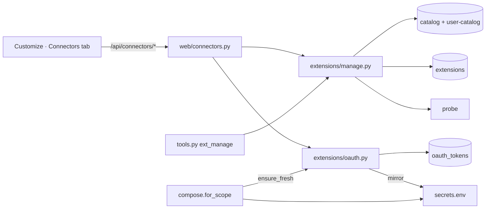

# CladeX Customize and Connectors — implementation plan

> **For agentic workers:** REQUIRED SUB-SKILL: Use superpowers:subagent-driven-development (recommended) or superpowers:executing-plans to implement this plan task-by-task. Steps use checkbox (`- [ ]`) syntax for tracking.

**Goal:** a `/customize` page whose Connectors tab lets the owner connect remote MCP servers from a curated list or a pasted URL, signing in with OAuth in the browser, while the catalog stays the only source of what runs.

**Architecture:** the manifest gains `auth[].kind ∈ {secret, oauth}`; an `oauth_tokens` table holds tokens whose access token is mirrored into `secrets.env`, so `compose.server_spec` needs no new path. `extensions/oauth.py` is a small OAuth 2.1 client (discovery, dynamic registration, PKCE, exchange, refresh, revoke) over `httpx`; `extensions/manage.py` is the one implementation of connect/test/enable/disable/remove that both `ext_manage` and the new `web/connectors.py` router call. The SPA adds a `customize` store slice, a tabbed page and a Connectors tab built from the routines page's row layout.

**Tech Stack:** Python 3.12, Starlette, httpx (`MockTransport` in tests), aiosqlite, PyYAML; React 19, react-router 7, zustand, shadcn (`Dialog`, `Select`, `DropdownMenu`, `Collapsible`, `Badge`), sonner, vitest, Playwright.

Spec: `docs/superpowers/specs/2026-09-09-cladex-connectors-design.md`. Interface strings go through the dictionary from `docs/superpowers/specs/2026-09-09-cladex-i18n-user-menu-design.md` (already shipped: `web/src/i18n/`).

## Locked Decisions

- **A connector is a catalog MCP entry + a registry row + credentials.** No new entity; `name` is the manifest name (`^[a-z0-9][a-z0-9_-]*$`), the registry key, the token row key and the secret prefix.
- **Manifest `auth[].kind`** defaults to `secret`; `oauth` forbids `prompt`, requires `header: Authorization` and `format: "Bearer ${NAME}"`, and is refused on `stdio`. One validator (`catalog.parse`) for repo catalog, user catalog and the web form.
- **Table `oauth_tokens`** (`name` PK, `issuer`, `client_id`, `client_secret`, `access_token`, `refresh_token`, `expires_at`, `scope`, `updated_at`) is the token source of truth; the access token is mirrored into `secrets.env` under `${NAME}`. Refresh tokens never leave the table. `extensions.tool_count` is a new nullable column.
- **`TokenStore` hangs off `ExtensionStore` as `store.tokens`**, so `for_scope`, the tool and the router reach tokens through the one object they already hold — no new wiring through runner, ticker or executor.
- **Custom connectors are user-catalog manifests** written through `CatalogWriter.promote` by a request that carries the owner cookie and a matching `Origin`; a name that exists in the repo catalog or the merged catalog is refused with 409 `name_taken`. Custom manifests get `version: "1"`, `scopes: [turn, cron]`, and a token variable named `<NAME_UPPER>_TOKEN` (non-alphanumerics → `_`).
- **OAuth `redirect_uri` is exactly `<web_public_origin>/api/connectors/oauth/callback`**; pending states live in process memory for ten minutes, single use, bound to the owner who started them.
- **Wire shape** of `GET /api/connectors` items: `{name, label, description, source: "catalog"|"custom", transport, auth: "none"|"secret"|"oauth", secrets: [{name, prompt, set}], state: "available"|"connected"|"disabled"|"needs_reauth"|"error", tools: number|null, last_error: string|null, scopes: string[]}`. `state` is derived from the registry row: none → `available`; `enabled` and no error → `connected`; `disabled` → `disabled`; `last_error == "needs_reauth"` → `needs_reauth`; other error → `error`.
- **Error codes** the UI translates: `bad_manifest`, `name_taken`, `secrets_missing`, `oauth_required`, `discovery_failed`, `registration_unsupported`, `state_mismatch`, `exchange_failed`, `probe_failed`, `needs_reauth`, `forbidden`. Secret and token values are never logged and never returned by any route.
- **Owner-only mutations; every allowed user may read** the list.
- **Routes**: `/customize` redirects to `/customize/connectors`; tabs are URL segments `connectors`, `plugins`, `skills`.

## Global Constraints

- Every interface string is read through `t()`/`useT()` from `web/src/i18n/en.ts` + `ru.ts`; the no-stray-Cyrillic test in `web/src/i18n/i18n.test.ts` must stay green. Not translated: connector labels and descriptions from manifests, tool names, server error messages.
- Backend checks: `.venv/Scripts/python.exe -m pytest -q -p no:cacheprovider` (run with `timeout 600`), `ruff check src tests`. Frontend checks from `web/`: `npx vitest run --dir src`, `npx tsc --noEmit -p tsconfig.app.json`, `npx eslint src`, `npx playwright test`.
- Existing `ext_manage` tests (`tests/test_ext_manage.py`, `tests/test_ext_manage_guidance.py`, `tests/test_runner_extensions.py`) keep passing; their replies are unchanged text.
- The runtime image moves to Node 24 (`setup_24.x`) for Hostinger's stdio server.

## Architecture Diagram



## Files

```
src/claude_hermes/extensions/catalog.py      Auth.kind, oauth rules                    (Task 1)
src/claude_hermes/db.py                      oauth_tokens table, extensions.tool_count (Task 2)
src/claude_hermes/extensions/tokens.py       TokenStore                                (Task 2)
src/claude_hermes/extensions/store.py        tokens attribute, tool_count               (Task 2)
src/claude_hermes/extensions/oauth.py        discovery, registration, PKCE, exchange,
                                             refresh, revoke, PendingStates, ensure_fresh (Task 3)
src/claude_hermes/extensions/manage.py       connect/test/enable/disable/remove, to_wire (Task 4)
src/claude_hermes/tools.py                   ext_manage delegates to manage             (Task 4)
src/claude_hermes/extensions/compose.py      ensure_fresh before server_spec            (Task 5)
src/claude_hermes/web/connectors.py          the router                                 (Task 6)
src/claude_hermes/web/deps.py, app.py, main.py, tests/web_helpers.py                  (Task 6)
catalog/mcp/{notion,github,github-pat,figma,hostinger}.yaml, Dockerfile              (Task 7)
web/src/api/types.ts, client.ts, store/connectors.ts, store/index.ts, i18n/en.ts, ru.ts (Task 8)
web/src/pages/Customize.tsx, app/routes.tsx, Sidebar.tsx, CommandPalette.tsx           (Task 9)
web/src/components/cladex/ConnectorRow.tsx, ConnectorsTab.tsx, SecretsDialog.tsx,
  AddConnectorDialog.tsx                                                               (Task 10)
web/e2e/fake-server.ts, e2e/customize.spec.ts, docs/llm-wiki/*, README.md              (Task 11)
```

---

### Task 1: Manifest `auth[].kind`

**Files:**
- Modify: `src/claude_hermes/extensions/catalog.py` (`_AUTH_KEYS`, `Auth`, `Manifest`, `_parse_auth`, `parse`)
- Test: `tests/test_catalog.py`

**Interfaces:**
- Reuses: `catalog.parse`, `ManifestError`, `Auth`, `Manifest.secret_names()`.
- Produces: `Auth.kind: str` (`"secret"` default), `VALID_AUTH_KINDS`, `Manifest.oauth_entries() -> tuple[Auth, ...]`, `Manifest.plain_secret_names() -> list[str]`. `secret_names()` keeps returning every `auth` name (oauth tokens are mirrored into `secrets.env`, so `server_spec` treats them alike).

- [ ] **Step 1: Write the failing tests**

Append to `tests/test_catalog.py`:

```python
OAUTH = {
    "manifest_version": 1, "name": "notion", "label": "Notion", "description": "d",
    "version": "1", "transport": "http", "url": "https://mcp.notion.com/mcp",
    "scopes": ["turn"],
    "auth": [{"name": "NOTION_MCP_TOKEN", "kind": "oauth", "header": "Authorization",
              "format": "Bearer ${NOTION_MCP_TOKEN}"}],
}


def test_an_oauth_auth_entry_names_the_token_and_needs_no_prompt():
    m = catalog.parse(OAUTH, "mcp")
    assert m.auth[0].kind == "oauth" and m.auth[0].prompt == ""
    assert [a.name for a in m.oauth_entries()] == ["NOTION_MCP_TOKEN"]
    assert m.secret_names() == ["NOTION_MCP_TOKEN"]      # mirrored into secrets.env like any secret
    assert m.plain_secret_names() == []


def test_a_secret_entry_is_the_default_kind():
    m = catalog.parse(HTTP, "mcp")
    assert m.auth[0].kind == "secret" and m.plain_secret_names() == ["EXAMPLE_API_KEY"]


@pytest.mark.parametrize("bad, needle", [
    ({**OAUTH["auth"][0], "prompt": "x"}, "prompt"),
    ({**OAUTH["auth"][0], "format": "Token ${NOTION_MCP_TOKEN}"}, "Bearer"),
    ({**OAUTH["auth"][0], "header": "X-Api-Key"}, "Authorization"),
    ({**OAUTH["auth"][0], "kind": "magic"}, "kind"),
])
def test_oauth_rules_are_enforced(bad, needle):
    with pytest.raises(catalog.ManifestError, match=needle):
        catalog.parse({**OAUTH, "auth": [bad]}, "mcp")


def test_oauth_needs_a_remote_transport():
    data = {"manifest_version": 1, "name": "x", "label": "X", "description": "d", "version": "1",
            "transport": "stdio", "command": "npx", "args": ["-y", "thing"], "scopes": ["turn"],
            "auth": OAUTH["auth"]}
    with pytest.raises(catalog.ManifestError, match="http or sse"):
        catalog.parse(data, "mcp")
```

(`tests/test_catalog.py` already imports `pytest`, `catalog` and defines `HTTP`; check the top of the file and add the import if it does not.)

- [ ] **Step 2: Run them to see them fail**

Run: `timeout 300 .venv/Scripts/python.exe -m pytest -q -p no:cacheprovider tests/test_catalog.py -k "oauth or default_kind"`
Expected: FAIL — `unknown key(s) in auth: ['kind']` and `AttributeError: oauth_entries`.

- [ ] **Step 3: Implement**

In `catalog.py`:

```python
_AUTH_KEYS = {"name", "prompt", "url", "header", "format", "kind"}
VALID_AUTH_KINDS = frozenset({"secret", "oauth"})


@dataclass(frozen=True)
class Auth:
    name: str
    prompt: str = ""
    url: str = ""
    header: str = ""
    format: str = ""
    kind: str = "secret"        # 'secret': typed by a person; 'oauth': obtained by signing in
```

Add to `Manifest`:

```python
    def oauth_entries(self) -> tuple[Auth, ...]:
        return tuple(a for a in self.auth if a.kind == "oauth")

    def plain_secret_names(self) -> list[str]:
        """The secrets a person types; oauth tokens are obtained by signing in."""
        return [a.name for a in self.auth if a.kind == "secret"]
```

Replace the body of the `for item in raw:` loop in `_parse_auth`:

```python
        if not isinstance(item, dict):
            raise ManifestError(f"{where}: each 'auth' entry must be a mapping")
        unknown = set(item) - _AUTH_KEYS
        if unknown:
            raise ManifestError(f"{where}: unknown key(s) in auth: {sorted(unknown)}")
        kind = item.get("kind", "secret")
        if kind not in VALID_AUTH_KINDS:
            raise ManifestError(
                f"{where}: auth kind must be one of {sorted(VALID_AUTH_KINDS)}, got {kind!r}")
        name = _require(item, "name", where)
        if kind == "oauth":
            # The token is minted by an authorization server and mirrored into
            # secrets.env by the OAuth module — nobody types it, so there is nothing
            # to prompt for, and it always travels as a bearer token.
            if "prompt" in item:
                raise ManifestError(f"{where}: an oauth auth entry takes no 'prompt'")
            if item.get("header") != "Authorization" or item.get("format") != f"Bearer ${{{name}}}":
                raise ManifestError(
                    f"{where}: an oauth auth entry must use header 'Authorization' and "
                    f"format 'Bearer ${{{name}}}'")
            prompt = ""
        else:
            prompt = _require(item, "prompt", where)
        out.append(Auth(name=name, prompt=prompt, url=item.get("url", ""),
                        header=item.get("header", ""), format=item.get("format", ""),
                        kind=kind))
```

In `parse`, inside the `if transport == "stdio":` branch before building `m`:

```python
        if any(a.kind == "oauth" for a in common["auth"]):
            raise ManifestError(f"{where}: oauth auth needs an http or sse transport")
```

- [ ] **Step 4: Run the catalog, compose, drafts and approvals tests**

Run: `timeout 300 .venv/Scripts/python.exe -m pytest -q -p no:cacheprovider tests/test_catalog.py tests/test_compose.py tests/test_drafts.py tests/test_approvals.py tests/test_ext_manage.py`
Expected: all pass.

- [ ] **Step 5: Commit**

```bash
git add src/claude_hermes/extensions/catalog.py tests/test_catalog.py
git commit -m "feat(extensions): manifests declare oauth auth entries"
```

---

### Task 2: `oauth_tokens` table, `tool_count`, `TokenStore`

**Files:**
- Modify: `src/claude_hermes/db.py` (schema + `_MIGRATIONS`), `src/claude_hermes/extensions/store.py`
- Create: `src/claude_hermes/extensions/tokens.py`
- Test: `tests/test_ext_store.py`, `tests/test_tokens.py`

**Interfaces:**
- Reuses: `Database` (`db.conn`, `_migrate`), `ExtensionStore.add/get/list/enabled/set_state/set_error/remove`.
- Produces: `TokenStore(db)` with `get(name) -> dict | None`, `put(name, *, now: str, **fields) -> None` (upsert, merging only the given fields among `issuer, client_id, client_secret, access_token, refresh_token, expires_at, scope`), `delete(name)`; `ExtensionStore.tokens: TokenStore`; `ExtensionStore.add(..., tool_count: int | None = None)`; `ExtensionStore.set_tool_count(name, n)`.

- [ ] **Step 1: Write the failing tests**

`tests/test_tokens.py`:

```python
from claude_hermes.db import Database
from claude_hermes.extensions.tokens import TokenStore

NOW = "2026-09-09T10:00:00+00:00"


async def test_put_merges_fields_and_get_returns_the_row(tmp_path):
    db = await Database.open(tmp_path / "state.db")
    tokens = TokenStore(db)
    assert await tokens.get("notion") is None
    await tokens.put("notion", now=NOW, issuer="https://as.example", client_id="c1")
    await tokens.put("notion", now=NOW, access_token="at", refresh_token="rt", expires_at="2026-09-09T11:00:00+00:00")
    row = await tokens.get("notion")
    assert row["client_id"] == "c1" and row["access_token"] == "at" and row["refresh_token"] == "rt"
    assert row["client_secret"] == "" and row["scope"] == "" and row["updated_at"] == NOW
    await tokens.delete("notion")
    assert await tokens.get("notion") is None
    await db.close()


async def test_unknown_fields_are_refused(tmp_path):
    import pytest
    db = await Database.open(tmp_path / "state.db")
    with pytest.raises(ValueError):
        await TokenStore(db).put("x", now=NOW, password="no")
    await db.close()
```

Append to `tests/test_ext_store.py`:

```python
async def test_tool_count_is_kept_on_the_row(tmp_path):
    db = await Database.open(tmp_path / "state.db")
    store = ExtensionStore(db)
    await store.add("example", "mcp", "1.0.0", installed_by=1, now="2026-09-09T10:00:00+00:00", tool_count=12)
    assert (await store.get("example"))["tool_count"] == 12
    await store.set_tool_count("example", 3)
    assert (await store.get("example"))["tool_count"] == 3
    assert store.tokens is not None and await store.tokens.get("example") is None
    await db.close()


async def test_an_old_database_gains_the_column(tmp_path):
    import aiosqlite
    path = tmp_path / "old.db"
    async with aiosqlite.connect(path) as conn:
        await conn.execute("CREATE TABLE extensions (name TEXT PRIMARY KEY, kind TEXT NOT NULL, "
                           "catalog_version TEXT NOT NULL, state TEXT NOT NULL DEFAULT 'enabled', "
                           "installed_at TEXT NOT NULL, installed_by INTEGER, last_error TEXT)")
        await conn.commit()
    db = await Database.open(path)
    cur = await db.conn.execute("PRAGMA table_info(extensions)")
    assert "tool_count" in {r[1] for r in await cur.fetchall()}
    await db.close()
```

- [ ] **Step 2: Run them to see them fail**

Run: `timeout 300 .venv/Scripts/python.exe -m pytest -q -p no:cacheprovider tests/test_tokens.py tests/test_ext_store.py`
Expected: FAIL — no module `tokens`, no column `tool_count`.

- [ ] **Step 3: Implement**

`db.py` — add after the `extensions` table in `_SCHEMA`:

```sql
CREATE TABLE IF NOT EXISTS oauth_tokens (
    name          TEXT PRIMARY KEY,
    issuer        TEXT NOT NULL DEFAULT '',
    client_id     TEXT NOT NULL DEFAULT '',
    client_secret TEXT NOT NULL DEFAULT '',
    access_token  TEXT NOT NULL DEFAULT '',
    refresh_token TEXT NOT NULL DEFAULT '',
    expires_at    TEXT NOT NULL DEFAULT '',
    scope         TEXT NOT NULL DEFAULT '',
    updated_at    TEXT NOT NULL
);
```

and in `_MIGRATIONS`:

```python
    "extensions": {
        # NULL = never probed; the connectors tab shows "Connected · N tools" only
        # when a probe has counted them.
        "tool_count": "ALTER TABLE extensions ADD COLUMN tool_count INTEGER",
    },
```

`src/claude_hermes/extensions/tokens.py`:

```python
"""OAuth tokens for remote MCP servers — the source of truth.

The access token is mirrored into secrets.env so `compose.server_spec` can put it in
a header like any other secret; the refresh token, the client credentials and the
issuer live only here. Values are never logged.
"""
from __future__ import annotations

from ..db import Database

FIELDS = ("issuer", "client_id", "client_secret", "access_token", "refresh_token",
          "expires_at", "scope")


class TokenStore:
    def __init__(self, db: Database):
        self._db = db

    async def get(self, name: str) -> dict | None:
        cur = await self._db.conn.execute("SELECT * FROM oauth_tokens WHERE name = ?", (name,))
        row = await cur.fetchone()
        return dict(row) if row else None

    async def put(self, name: str, *, now: str, **fields: str) -> None:
        """Upsert: only the fields given change; the rest keep their value."""
        unknown = set(fields) - set(FIELDS)
        if unknown:
            raise ValueError(f"not token fields: {sorted(unknown)}")
        current = await self.get(name) or {f: "" for f in FIELDS}
        merged = {f: fields.get(f, current[f]) for f in FIELDS}
        await self._db.conn.execute(
            f"INSERT OR REPLACE INTO oauth_tokens (name, {', '.join(FIELDS)}, updated_at) "
            f"VALUES (?, {', '.join('?' for _ in FIELDS)}, ?)",
            (name, *(merged[f] for f in FIELDS), now),
        )
        await self._db.conn.commit()

    async def delete(self, name: str) -> None:
        await self._db.conn.execute("DELETE FROM oauth_tokens WHERE name = ?", (name,))
        await self._db.conn.commit()
```

`store.py` — constructor, `add` and a new method:

```python
from .tokens import TokenStore


class ExtensionStore:
    """What is installed — never what it does. The spec lives in the catalog."""

    def __init__(self, db: Database):
        self._db = db
        self.tokens = TokenStore(db)     # one object to hold for both tables

    async def add(self, name: str, kind: str, catalog_version: str,
                  installed_by: int, now: str, tool_count: int | None = None) -> None:
        await self._db.conn.execute(
            """INSERT INTO extensions
                   (name, kind, catalog_version, state, installed_at, installed_by,
                    last_error, tool_count)
               VALUES (?, ?, ?, 'enabled', ?, ?, NULL, ?)
               ON CONFLICT(name) DO UPDATE SET
                 kind            = excluded.kind,
                 catalog_version = excluded.catalog_version,
                 state           = 'enabled',
                 installed_at    = excluded.installed_at,
                 installed_by    = excluded.installed_by,
                 last_error      = NULL,
                 tool_count      = excluded.tool_count""",
            (name, kind, catalog_version, now, installed_by, tool_count),
        )
        await self._db.conn.commit()

    async def set_tool_count(self, name: str, n: int | None) -> None:
        await self._db.conn.execute(
            "UPDATE extensions SET tool_count = ? WHERE name = ?", (n, name))
        await self._db.conn.commit()
```

- [ ] **Step 4: Run the tests**

Run: `timeout 300 .venv/Scripts/python.exe -m pytest -q -p no:cacheprovider tests/test_tokens.py tests/test_ext_store.py tests/test_db.py`
Expected: pass.

- [ ] **Step 5: Commit**

```bash
git add src/claude_hermes/db.py src/claude_hermes/extensions/tokens.py src/claude_hermes/extensions/store.py tests/test_tokens.py tests/test_ext_store.py
git commit -m "feat(extensions): oauth_tokens table, TokenStore, tool_count on the registry row"
```

---

### Task 3: The OAuth client (`extensions/oauth.py`)

**Files:**
- Create: `src/claude_hermes/extensions/oauth.py`
- Test: `tests/test_oauth.py`

**Interfaces:**
- Reuses: `httpx` (already a dependency), `secrets.put`, `TokenStore` (Task 2), `Manifest.oauth_entries()` (Task 1).
- Produces:
  - `class OAuthError(Exception)` with `.code` (`discovery_failed`, `registration_unsupported`, `exchange_failed`, `needs_reauth`) and `.message`.
  - `class NeedsReauth(Exception)`.
  - `@dataclass Discovery(issuer, authorization_endpoint, token_endpoint, registration_endpoint="", revocation_endpoint="", resource="", scopes=())`.
  - `@dataclass TokenSet(access_token, refresh_token="", expires_at="", scope="")`.
  - `make_client() -> httpx.AsyncClient` (module-level so tests swap it).
  - `async discover(client, url) -> Discovery`, `async discover_issuer(client, issuer, resource="", scopes=()) -> Discovery`.
  - `async register(client, disc, redirect_uri) -> tuple[str, str]`.
  - `pkce_pair() -> tuple[verifier, challenge]`, `authorize_url(disc, *, client_id, redirect_uri, state, challenge, scope="") -> str`.
  - `async exchange(client, disc, *, code, verifier, client_id, client_secret, redirect_uri, now: float) -> TokenSet`.
  - `async refresh(client, disc, *, refresh_token, client_id, client_secret, now: float) -> TokenSet`.
  - `async revoke(client, disc, token, client_id, client_secret) -> None` (best effort).
  - `class PendingStates` with `issue(name, owner_id, verifier, now) -> state` and `take(state, owner_id, now) -> Pending | None`; `PENDING_TTL = 600`.
  - `async ensure_fresh(home, tokens, m, now: float | None = None) -> None` — raises `NeedsReauth`.
  - `iso(ts: float) -> str`, `REFRESH_MARGIN = 60`.

- [ ] **Step 1: Write the failing tests**

`tests/test_oauth.py`:

```python
"""The OAuth client against a fake authorization server on httpx.MockTransport."""
import json
import time
from urllib.parse import parse_qs, urlsplit

import httpx
import pytest
import yaml

from claude_hermes.extensions import catalog, oauth, secrets
from claude_hermes.db import Database
from claude_hermes.extensions.store import ExtensionStore

MCP = "https://mcp.example.com/mcp"
AS = "https://auth.example.com"
REDIRECT = "https://cladex.test/api/connectors/oauth/callback"


class FakeProvider:
    """A resource server that 401s with resource_metadata, and an authorization
    server with metadata, registration, token and revocation endpoints."""

    def __init__(self, *, registration=True, well_known_only=False, refresh_ok=True):
        self.registration, self.well_known_only, self.refresh_ok = registration, well_known_only, refresh_ok
        self.token_requests: list[dict] = []
        self.revoked: list[str] = []

    def handle(self, req: httpx.Request) -> httpx.Response:
        url, path = str(req.url), req.url.path
        if url == MCP:
            hdr = "" if self.well_known_only else f'Bearer resource_metadata="{MCP.rsplit("/", 1)[0]}/.well-known/oauth-protected-resource/mcp"'
            return httpx.Response(401, headers={"WWW-Authenticate": hdr})
        if path.startswith("/.well-known/oauth-protected-resource") and req.url.host == "mcp.example.com":
            if self.well_known_only and path != "/.well-known/oauth-protected-resource":
                return httpx.Response(404)
            return httpx.Response(200, json={"resource": MCP, "authorization_servers": [AS], "scopes_supported": ["mcp:read"]})
        if path == "/.well-known/oauth-authorization-server" and req.url.host == "auth.example.com":
            meta = {"issuer": AS, "authorization_endpoint": f"{AS}/authorize", "token_endpoint": f"{AS}/token",
                    "revocation_endpoint": f"{AS}/revoke"}
            if self.registration:
                meta["registration_endpoint"] = f"{AS}/register"
            return httpx.Response(200, json=meta)
        if path == "/register":
            body = json.loads(req.content)
            assert body["redirect_uris"] == [REDIRECT] and body["token_endpoint_auth_method"] == "none"
            return httpx.Response(201, json={"client_id": "cid-1"})
        if path == "/token":
            form = {k: v[0] for k, v in parse_qs(req.content.decode()).items()}
            self.token_requests.append(form)
            if form["grant_type"] == "refresh_token" and not self.refresh_ok:
                return httpx.Response(400, json={"error": "invalid_grant"})
            if form["grant_type"] == "authorization_code" and form.get("code") != "good":
                return httpx.Response(400, json={"error": "invalid_grant"})
            return httpx.Response(200, json={"access_token": "at-" + form["grant_type"][:4], "refresh_token": "rt-1",
                                             "expires_in": 3600, "scope": "mcp:read", "token_type": "Bearer"})
        if path == "/revoke":
            self.revoked.append(parse_qs(req.content.decode())["token"][0])
            return httpx.Response(200)
        return httpx.Response(404)


def client_for(p: FakeProvider) -> httpx.AsyncClient:
    return httpx.AsyncClient(transport=httpx.MockTransport(p.handle))


async def test_discovery_from_the_401_and_registration():
    p = FakeProvider()
    async with client_for(p) as c:
        d = await oauth.discover(c, MCP)
        assert d.issuer == AS and d.token_endpoint == f"{AS}/token" and d.resource == MCP and d.scopes == ("mcp:read",)
        assert await oauth.register(c, d, REDIRECT) == ("cid-1", "")


async def test_discovery_falls_back_to_the_well_known_resource_document():
    async with client_for(FakeProvider(well_known_only=True)) as c:
        d = await oauth.discover(c, MCP)
        assert d.authorization_endpoint == f"{AS}/authorize"


async def test_registration_unsupported_is_its_own_code():
    async with client_for(FakeProvider(registration=False)) as c:
        d = await oauth.discover(c, MCP)
        with pytest.raises(oauth.OAuthError) as e:
            await oauth.register(c, d, REDIRECT)
        assert e.value.code == "registration_unsupported"


async def test_discovery_failure_when_nothing_answers():
    async with httpx.AsyncClient(transport=httpx.MockTransport(lambda r: httpx.Response(404))) as c:
        with pytest.raises(oauth.OAuthError) as e:
            await oauth.discover(c, MCP)
        assert e.value.code == "discovery_failed"


def test_authorize_url_carries_pkce_state_and_resource():
    d = oauth.Discovery(issuer=AS, authorization_endpoint=f"{AS}/authorize?tenant=1", token_endpoint=f"{AS}/token", resource=MCP)
    verifier, challenge = oauth.pkce_pair()
    url = oauth.authorize_url(d, client_id="cid-1", redirect_uri=REDIRECT, state="st", challenge=challenge, scope="mcp:read")
    q = {k: v[0] for k, v in parse_qs(urlsplit(url).query).items()}
    assert q["tenant"] == "1" and q["response_type"] == "code" and q["code_challenge_method"] == "S256"
    assert q["code_challenge"] == challenge and q["state"] == "st" and q["resource"] == MCP and q["scope"] == "mcp:read"
    assert len(verifier) >= 43


async def test_exchange_refresh_and_revoke():
    p = FakeProvider()
    now = 1_800_000_000.0
    async with client_for(p) as c:
        d = await oauth.discover(c, MCP)
        ts = await oauth.exchange(c, d, code="good", verifier="v" * 43, client_id="cid-1", client_secret="", redirect_uri=REDIRECT, now=now)
        assert ts.access_token == "at-auth" and ts.refresh_token == "rt-1" and ts.expires_at == oauth.iso(now + 3600)
        assert p.token_requests[-1]["code_verifier"] == "v" * 43 and p.token_requests[-1]["resource"] == MCP
        ts2 = await oauth.refresh(c, d, refresh_token="rt-1", client_id="cid-1", client_secret="", now=now)
        assert ts2.access_token == "at-refr"
        with pytest.raises(oauth.OAuthError) as e:
            await oauth.exchange(c, d, code="bad", verifier="v" * 43, client_id="cid-1", client_secret="", redirect_uri=REDIRECT, now=now)
        assert e.value.code == "exchange_failed"
        await oauth.revoke(c, d, "rt-1", "cid-1", "")
        assert p.revoked == ["rt-1"]


def test_pending_states_are_single_use_owner_bound_and_expire():
    ps = oauth.PendingStates()
    st = ps.issue("notion", owner_id=1, verifier="v", now=100.0)
    assert ps.take(st, owner_id=2, now=101.0) is None          # someone else's state
    got = ps.take(st, owner_id=1, now=101.0)
    assert got.name == "notion" and got.verifier == "v"
    assert ps.take(st, owner_id=1, now=102.0) is None          # used up
    st2 = ps.issue("notion", owner_id=1, verifier="v", now=100.0)
    assert ps.take(st2, owner_id=1, now=100.0 + oauth.PENDING_TTL + 1) is None


OAUTH_MANIFEST = {
    "manifest_version": 1, "name": "notion", "label": "Notion", "description": "d", "version": "1",
    "transport": "http", "url": MCP, "scopes": ["turn"],
    "auth": [{"name": "NOTION_MCP_TOKEN", "kind": "oauth", "header": "Authorization", "format": "Bearer ${NOTION_MCP_TOKEN}"}],
}


async def test_ensure_fresh_refreshes_an_expiring_token_and_mirrors_it(tmp_path, monkeypatch):
    p = FakeProvider()
    monkeypatch.setattr(oauth, "make_client", lambda: client_for(p))
    db = await Database.open(tmp_path / "state.db")
    tokens = ExtensionStore(db).tokens
    now = 1_800_000_000.0
    await tokens.put("notion", now=oauth.iso(now), issuer=AS, client_id="cid-1", access_token="old", refresh_token="rt-1",
                     expires_at=oauth.iso(now + 30))
    m = catalog.parse(OAUTH_MANIFEST, "mcp")
    await oauth.ensure_fresh(tmp_path, tokens, m, now=now)
    assert (await tokens.get("notion"))["access_token"] == "at-refr"
    assert secrets.load(tmp_path)["NOTION_MCP_TOKEN"] == "at-refr"
    p.token_requests.clear()
    await oauth.ensure_fresh(tmp_path, tokens, m, now=now)     # fresh now: no request
    assert p.token_requests == []
    await db.close()


async def test_ensure_fresh_raises_needs_reauth_when_refresh_is_refused_or_impossible(tmp_path, monkeypatch):
    p = FakeProvider(refresh_ok=False)
    monkeypatch.setattr(oauth, "make_client", lambda: client_for(p))
    db = await Database.open(tmp_path / "state.db")
    tokens = ExtensionStore(db).tokens
    m = catalog.parse(OAUTH_MANIFEST, "mcp")
    now = 1_800_000_000.0
    with pytest.raises(oauth.NeedsReauth):
        await oauth.ensure_fresh(tmp_path, tokens, m, now=now)                     # never signed in
    await tokens.put("notion", now=oauth.iso(now), issuer=AS, client_id="cid-1", access_token="old", refresh_token="rt-1",
                     expires_at=oauth.iso(now - 1))
    with pytest.raises(oauth.NeedsReauth):
        await oauth.ensure_fresh(tmp_path, tokens, m, now=now)                     # refresh refused
    await db.close()
```

- [ ] **Step 2: Run them to see them fail**

Run: `timeout 300 .venv/Scripts/python.exe -m pytest -q -p no:cacheprovider tests/test_oauth.py`
Expected: FAIL — no module `oauth`.

- [ ] **Step 3: Implement**

`src/claude_hermes/extensions/oauth.py`:

```python
"""OAuth 2.1 for remote MCP servers, run by the hermes process.

The bundled CLI has an OAuth client of its own, but it is interactive and listens
on localhost inside the container; a flow that starts in the owner's browser has to
be completed here. This module does discovery (RFC 9728 → RFC 8414), dynamic client
registration (RFC 7591), PKCE, the code exchange, refresh and revocation, and keeps
the pending states between `start` and the callback. Token values never reach a log.
"""
from __future__ import annotations

import base64
import hashlib
import logging
import re
import secrets as pysecrets
import time
from dataclasses import dataclass, field
from datetime import datetime, timezone
from pathlib import Path
from urllib.parse import urlencode, urlsplit

import httpx

from . import secrets
from .catalog import Manifest
from .tokens import TokenStore

log = logging.getLogger(__name__)

PENDING_TTL = 600           # seconds a started flow waits for the callback
REFRESH_MARGIN = 60         # refresh when the token expires within this many seconds
CLIENT_NAME = "CladeX"


class OAuthError(Exception):
    def __init__(self, code: str, message: str = ""):
        super().__init__(message or code)
        self.code, self.message = code, message or code


class NeedsReauth(Exception):
    """The stored token cannot be made valid without the owner signing in again."""


@dataclass(frozen=True)
class Discovery:
    issuer: str
    authorization_endpoint: str
    token_endpoint: str
    registration_endpoint: str = ""
    revocation_endpoint: str = ""
    resource: str = ""
    scopes: tuple[str, ...] = ()


@dataclass(frozen=True)
class TokenSet:
    access_token: str
    refresh_token: str = ""
    expires_at: str = ""
    scope: str = ""


def make_client() -> httpx.AsyncClient:
    """One place to build the HTTP client, so tests can hand in a MockTransport."""
    return httpx.AsyncClient(timeout=15.0, follow_redirects=False)


def iso(ts: float) -> str:
    return datetime.fromtimestamp(ts, tz=timezone.utc).isoformat()


def _origin(url: str) -> str:
    p = urlsplit(url)
    return f"{p.scheme}://{p.netloc}"


_PARAM_RE = re.compile(r'(\w+)="([^"]*)"')


def _www_authenticate(header: str) -> dict[str, str]:
    return dict(_PARAM_RE.findall(header))


async def _json(client: httpx.AsyncClient, url: str) -> dict | None:
    try:
        r = await client.get(url, headers={"Accept": "application/json"})
    except httpx.HTTPError:
        return None
    if r.status_code != 200:
        return None
    try:
        body = r.json()
    except ValueError:
        return None
    return body if isinstance(body, dict) else None


async def discover_issuer(client: httpx.AsyncClient, issuer: str, resource: str = "",
                          scopes: tuple[str, ...] = ()) -> Discovery:
    """RFC 8414 metadata for an authorization server, path-aware then plain."""
    p = urlsplit(issuer)
    origin, path = f"{p.scheme}://{p.netloc}", p.path.rstrip("/")
    candidates = [f"{origin}/.well-known/oauth-authorization-server{path}",
                  f"{origin}/.well-known/openid-configuration{path}"]
    if path:
        candidates.append(f"{issuer.rstrip('/')}/.well-known/oauth-authorization-server")
    for url in candidates:
        meta = await _json(client, url)
        if meta and "authorization_endpoint" in meta and "token_endpoint" in meta:
            return Discovery(
                issuer=str(meta.get("issuer") or issuer),
                authorization_endpoint=meta["authorization_endpoint"],
                token_endpoint=meta["token_endpoint"],
                registration_endpoint=str(meta.get("registration_endpoint") or ""),
                revocation_endpoint=str(meta.get("revocation_endpoint") or ""),
                resource=resource, scopes=scopes,
            )
    raise OAuthError("discovery_failed", f"no authorization server metadata at {issuer}")


async def discover(client: httpx.AsyncClient, url: str) -> Discovery:
    """From the MCP URL to the authorization server: the 401's resource_metadata,
    else the well-known protected-resource document, else the URL's own origin."""
    try:
        r = await client.get(url, headers={"Accept": "application/json, text/event-stream"})
    except httpx.HTTPError as e:
        raise OAuthError("discovery_failed", f"{url}: {e}") from e
    if r.status_code != 401:
        raise OAuthError("discovery_failed",
                         f"{url} answered {r.status_code} without asking for authorization")
    metadata_url = _www_authenticate(r.headers.get("www-authenticate", "")).get("resource_metadata")
    p = urlsplit(url)
    origin = _origin(url)
    candidates = [metadata_url] if metadata_url else []
    candidates += [f"{origin}/.well-known/oauth-protected-resource{p.path.rstrip('/')}",
                   f"{origin}/.well-known/oauth-protected-resource"]
    resource, issuer, scopes = url, origin, ()
    for cand in candidates:
        doc = await _json(client, cand)
        if doc and doc.get("authorization_servers"):
            resource = str(doc.get("resource") or url)
            issuer = str(doc["authorization_servers"][0])
            scopes = tuple(doc.get("scopes_supported") or ())
            break
    return await discover_issuer(client, issuer, resource, scopes)


async def register(client: httpx.AsyncClient, disc: Discovery, redirect_uri: str) -> tuple[str, str]:
    """Dynamic client registration as a public client. Returns (client_id, client_secret)."""
    if not disc.registration_endpoint:
        raise OAuthError("registration_unsupported",
                         f"{disc.issuer} does not register clients dynamically")
    try:
        r = await client.post(disc.registration_endpoint, json={
            "client_name": CLIENT_NAME, "redirect_uris": [redirect_uri],
            "grant_types": ["authorization_code", "refresh_token"], "response_types": ["code"],
            "token_endpoint_auth_method": "none",
        })
    except httpx.HTTPError as e:
        raise OAuthError("registration_unsupported", str(e)) from e
    if r.status_code not in (200, 201):
        raise OAuthError("registration_unsupported", f"{r.status_code}: {r.text[:200]}")
    body = r.json()
    if "client_id" not in body:
        raise OAuthError("registration_unsupported", "no client_id in the registration reply")
    return str(body["client_id"]), str(body.get("client_secret") or "")


def pkce_pair() -> tuple[str, str]:
    verifier = pysecrets.token_urlsafe(48)
    digest = hashlib.sha256(verifier.encode("ascii")).digest()
    return verifier, base64.urlsafe_b64encode(digest).rstrip(b"=").decode("ascii")


def authorize_url(disc: Discovery, *, client_id: str, redirect_uri: str, state: str,
                  challenge: str, scope: str = "") -> str:
    q = {"response_type": "code", "client_id": client_id, "redirect_uri": redirect_uri,
         "state": state, "code_challenge": challenge, "code_challenge_method": "S256"}
    if disc.resource:
        q["resource"] = disc.resource
    if scope:
        q["scope"] = scope
    sep = "&" if "?" in disc.authorization_endpoint else "?"
    return disc.authorization_endpoint + sep + urlencode(q)


async def _token_request(client: httpx.AsyncClient, disc: Discovery, data: dict, *,
                         client_id: str, client_secret: str, now: float, code: str) -> TokenSet:
    data = {**data, "client_id": client_id}
    if disc.resource:
        data["resource"] = disc.resource
    auth = (client_id, client_secret) if client_secret else None
    try:
        r = await client.post(disc.token_endpoint, data=data, auth=auth,
                              headers={"Accept": "application/json"})
    except httpx.HTTPError as e:
        raise OAuthError(code, str(e)) from e
    if r.status_code != 200:
        raise OAuthError(code, f"{r.status_code}: {r.text[:200]}")
    body = r.json()
    if "access_token" not in body:
        raise OAuthError(code, "no access_token in the token reply")
    expires_in = body.get("expires_in")
    return TokenSet(
        access_token=str(body["access_token"]),
        refresh_token=str(body.get("refresh_token") or ""),
        expires_at=iso(now + float(expires_in)) if expires_in else "",
        scope=str(body.get("scope") or ""),
    )


async def exchange(client: httpx.AsyncClient, disc: Discovery, *, code: str, verifier: str,
                   client_id: str, client_secret: str, redirect_uri: str, now: float) -> TokenSet:
    return await _token_request(client, disc, {
        "grant_type": "authorization_code", "code": code, "redirect_uri": redirect_uri,
        "code_verifier": verifier,
    }, client_id=client_id, client_secret=client_secret, now=now, code="exchange_failed")


async def refresh(client: httpx.AsyncClient, disc: Discovery, *, refresh_token: str,
                  client_id: str, client_secret: str, now: float) -> TokenSet:
    return await _token_request(client, disc, {
        "grant_type": "refresh_token", "refresh_token": refresh_token,
    }, client_id=client_id, client_secret=client_secret, now=now, code="needs_reauth")


async def revoke(client: httpx.AsyncClient, disc: Discovery, token: str,
                 client_id: str, client_secret: str) -> None:
    """Best effort: a provider that refuses still loses the token on our side."""
    if not disc.revocation_endpoint or not token:
        return
    try:
        await client.post(disc.revocation_endpoint, data={"token": token, "client_id": client_id},
                          auth=(client_id, client_secret) if client_secret else None)
    except httpx.HTTPError:
        log.info("revocation at %s failed; the token is dropped locally", disc.issuer)


@dataclass
class Pending:
    name: str
    owner_id: int
    verifier: str
    expires: float


class PendingStates:
    """Started flows waiting for their callback: ten minutes, single use, bound to
    the owner who pressed Connect. Process memory — a restart means pressing again."""

    def __init__(self):
        self._states: dict[str, Pending] = {}

    def issue(self, name: str, owner_id: int, verifier: str, now: float) -> str:
        self._states = {s: p for s, p in self._states.items() if p.expires > now}
        state = pysecrets.token_urlsafe(32)
        self._states[state] = Pending(name, owner_id, verifier, now + PENDING_TTL)
        return state

    def take(self, state: str, owner_id: int, now: float) -> Pending | None:
        p = self._states.pop(state, None)
        if p is None or p.owner_id != owner_id or p.expires <= now:
            return None
        return p


async def ensure_fresh(home: Path, tokens: TokenStore, m: Manifest, now: float | None = None) -> None:
    """Before a server is composed: make sure its mirrored access token is valid,
    refreshing it when it expires within REFRESH_MARGIN. Raises NeedsReauth when
    the owner has to sign in again; never returns a half-updated state."""
    entry = next(iter(m.oauth_entries()), None)
    if entry is None:
        return
    now = time.time() if now is None else now
    row = await tokens.get(m.name)
    if row is None or not row["access_token"]:
        raise NeedsReauth("not signed in")
    if not row["expires_at"]:
        return                                   # the server did not say; assume valid
    if datetime.fromisoformat(row["expires_at"]).timestamp() - now > REFRESH_MARGIN:
        return
    if not row["refresh_token"]:
        raise NeedsReauth("the token expired and the server issued no refresh token")
    async with make_client() as client:
        try:
            disc = await discover_issuer(client, row["issuer"])
            ts = await refresh(client, disc, refresh_token=row["refresh_token"],
                               client_id=row["client_id"], client_secret=row["client_secret"], now=now)
        except OAuthError as e:
            raise NeedsReauth(e.message) from e
    await tokens.put(m.name, now=iso(now), access_token=ts.access_token,
                     refresh_token=ts.refresh_token or row["refresh_token"],
                     expires_at=ts.expires_at, scope=ts.scope or row["scope"])
    secrets.put(home, entry.name, ts.access_token)
```

(Remove the unused `field` import if ruff flags it.)

- [ ] **Step 4: Run the tests and ruff**

Run: `timeout 300 .venv/Scripts/python.exe -m pytest -q -p no:cacheprovider tests/test_oauth.py && .venv/Scripts/ruff.exe check src/claude_hermes/extensions/oauth.py tests/test_oauth.py`
Expected: 10 tests pass; ruff clean.

- [ ] **Step 5: Commit**

```bash
git add src/claude_hermes/extensions/oauth.py tests/test_oauth.py
git commit -m "feat(extensions): OAuth 2.1 client for remote MCP servers — discovery, registration, PKCE, refresh"
```

---

### Task 4: `extensions/manage.py`, and `ext_manage` calls it

**Files:**
- Create: `src/claude_hermes/extensions/manage.py`
- Modify: `src/claude_hermes/tools.py:395-460` (the secrets check, `test`/`add`, `enable`/`disable`, `remove` branches)
- Test: `tests/test_manage.py`; `tests/test_ext_manage.py` keeps passing unchanged

**Interfaces:**
- Reuses: `compose.server_spec`, `probe`, `secrets.load/missing`, `ExtensionStore`, `install.remove_plugin`, `catalog.is_repo_entry`.
- Consumes: `Manifest.plain_secret_names()`, `oauth_entries()` (Task 1); `ExtensionStore.add(..., tool_count)`, `store.tokens` (Task 2).
- Produces:
  - `@dataclass Outcome(ok: bool, code: str = "", message: str = "", tools: tuple[str, ...] = (), missing: tuple[str, ...] = ())` — codes `secrets_missing`, `oauth_required`, `probe_failed`, `compose_failed`.
  - `async connect(home, store, m, *, user_id, now: str, timeout: float, probe_fn=probe, install=True) -> Outcome`.
  - `async enable(store, name) -> bool`, `async disable(store, name) -> bool`, `async remove(home, store, name) -> bool` (also deletes the token row and the mirrored oauth secret).
  - `state_of(row) -> str`, `to_wire(m, row, secret_values, *, source) -> dict`, `source_of(m) -> "catalog" | "custom"`.

- [ ] **Step 1: Write the failing tests**

`tests/test_manage.py`:

```python
import yaml

from claude_hermes.db import Database
from claude_hermes.extensions import catalog, manage, secrets
from claude_hermes.extensions.probe import ProbeResult
from claude_hermes.extensions.store import ExtensionStore

NOW = "2026-09-09T10:00:00+00:00"
HTTP = {
    "manifest_version": 1, "name": "example", "label": "Example", "description": "d",
    "version": "1.0.0", "transport": "http", "url": "https://mcp.example.com/mcp", "scopes": ["turn"],
    "auth": [{"name": "EXAMPLE_API_KEY", "prompt": "Example API key", "header": "Authorization",
              "format": "Bearer ${EXAMPLE_API_KEY}"}],
}
OAUTH = {**HTTP, "name": "notion", "label": "Notion",
         "auth": [{"name": "NOTION_MCP_TOKEN", "kind": "oauth", "header": "Authorization", "format": "Bearer ${NOTION_MCP_TOKEN}"}]}


async def ok_probe(home, name, spec, timeout=60.0):
    return ProbeResult(status="connected", tools=["search", "create"])


async def bad_probe(home, name, spec, timeout=60.0):
    return ProbeResult(status="failed", error="connection refused")


async def make(tmp_path):
    db = await Database.open(tmp_path / "state.db")
    return db, ExtensionStore(db)


async def test_connect_reports_missing_secrets_and_registers_nothing(tmp_path):
    db, store = await make(tmp_path)
    out = await manage.connect(tmp_path, store, catalog.parse(HTTP, "mcp"), user_id=1, now=NOW, timeout=1, probe_fn=ok_probe)
    assert not out.ok and out.code == "secrets_missing" and out.missing == ("EXAMPLE_API_KEY",)
    assert await store.get("example") is None
    await db.close()


async def test_connect_needs_a_sign_in_for_an_oauth_server(tmp_path):
    db, store = await make(tmp_path)
    out = await manage.connect(tmp_path, store, catalog.parse(OAUTH, "mcp"), user_id=1, now=NOW, timeout=1, probe_fn=ok_probe)
    assert not out.ok and out.code == "oauth_required"
    await db.close()


async def test_connect_probes_registers_and_counts_tools(tmp_path):
    db, store = await make(tmp_path)
    secrets.put(tmp_path, "EXAMPLE_API_KEY", "abc")
    m = catalog.parse(HTTP, "mcp")
    out = await manage.connect(tmp_path, store, m, user_id=1, now=NOW, timeout=1, probe_fn=ok_probe, install=False)
    assert out.ok and out.tools == ("search", "create") and await store.get("example") is None      # test only
    out = await manage.connect(tmp_path, store, m, user_id=1, now=NOW, timeout=1, probe_fn=ok_probe)
    row = await store.get("example")
    assert out.ok and row["state"] == "enabled" and row["tool_count"] == 2 and row["installed_by"] == 1
    out = await manage.connect(tmp_path, store, m, user_id=1, now=NOW, timeout=1, probe_fn=bad_probe)
    assert not out.ok and out.code == "probe_failed" and "connection refused" in out.message
    await db.close()


async def test_enable_disable_remove(tmp_path):
    db, store = await make(tmp_path)
    assert await manage.disable(store, "example") is False           # not installed
    secrets.put(tmp_path, "NOTION_MCP_TOKEN", "at")
    await store.add("notion", "mcp", "1", installed_by=1, now=NOW, tool_count=1)
    await store.tokens.put("notion", now=NOW, access_token="at", refresh_token="rt")
    assert await manage.disable(store, "notion") and (await store.get("notion"))["state"] == "disabled"
    assert await manage.enable(store, "notion") and (await store.get("notion"))["state"] == "enabled"
    assert await manage.remove(tmp_path, store, "notion", catalog.parse(OAUTH, "mcp"))
    assert await store.get("notion") is None and await store.tokens.get("notion") is None
    assert "NOTION_MCP_TOKEN" not in secrets.load(tmp_path)
    await db.close()


def test_state_and_wire_shape():
    m = catalog.parse(HTTP, "mcp")
    assert manage.state_of(None) == "available"
    assert manage.state_of({"state": "enabled", "last_error": None}) == "connected"
    assert manage.state_of({"state": "disabled", "last_error": None}) == "disabled"
    assert manage.state_of({"state": "enabled", "last_error": "needs_reauth"}) == "needs_reauth"
    assert manage.state_of({"state": "enabled", "last_error": "boom"}) == "error"
    w = manage.to_wire(m, {"state": "enabled", "last_error": None, "tool_count": 2}, {"EXAMPLE_API_KEY": "x"}, source="catalog")
    assert w == {"name": "example", "label": "Example", "description": "d", "source": "catalog", "transport": "http",
                 "auth": "secret", "secrets": [{"name": "EXAMPLE_API_KEY", "prompt": "Example API key", "set": True}],
                 "state": "connected", "tools": 2, "last_error": None, "scopes": ["turn"]}
    w = manage.to_wire(catalog.parse(OAUTH, "mcp"), None, {}, source="custom")
    assert w["auth"] == "oauth" and w["secrets"] == [] and w["state"] == "available" and w["tools"] is None
```

- [ ] **Step 2: Run to see them fail**

Run: `timeout 300 .venv/Scripts/python.exe -m pytest -q -p no:cacheprovider tests/test_manage.py`
Expected: FAIL — no module `manage`.

- [ ] **Step 3: Write `manage.py`**

```python
"""One implementation of connect / test / enable / disable / remove for MCP
extensions. `ext_manage` (chat) and `web/connectors.py` (browser) both call this,
so the two channels cannot drift on what "connected" means."""
from __future__ import annotations

import os
from collections.abc import Mapping
from dataclasses import dataclass
from pathlib import Path

from . import catalog, compose, install, secrets
from .catalog import Manifest
from .probe import probe
from .store import ExtensionStore

STATES = ("available", "connected", "disabled", "needs_reauth", "error")


@dataclass(frozen=True)
class Outcome:
    ok: bool
    code: str = ""              # '' | secrets_missing | oauth_required | compose_failed | probe_failed
    message: str = ""
    tools: tuple[str, ...] = ()
    missing: tuple[str, ...] = ()


async def connect(home: Path, store: ExtensionStore, m: Manifest, *, user_id: int, now: str,
                  timeout: float, probe_fn=probe, install: bool = True) -> Outcome:
    """Secrets → spec → probe → (register). Registers only on a `connected` probe."""
    values = secrets.load(home)
    plain = secrets.missing(m.plain_secret_names(), values)
    if plain:
        return Outcome(False, "secrets_missing", f"missing secret(s): {', '.join(plain)}", missing=tuple(plain))
    if secrets.missing([a.name for a in m.oauth_entries()], values):
        return Outcome(False, "oauth_required", f"'{m.label}' needs a sign-in first")
    try:
        spec = compose.server_spec(m, values)
    except compose.ComposeError as e:
        return Outcome(False, "compose_failed", str(e))
    result = await probe_fn(home, m.name, spec, timeout=timeout)
    if result.status != "connected":
        return Outcome(False, "probe_failed", result.error or result.status)
    if install:
        await store.add(m.name, m.kind, m.version, installed_by=user_id, now=now,
                        tool_count=len(result.tools))
    return Outcome(True, tools=tuple(result.tools))


async def enable(store: ExtensionStore, name: str) -> bool:
    if await store.get(name) is None:
        return False
    await store.set_state(name, "enabled")
    return True


async def disable(store: ExtensionStore, name: str) -> bool:
    if await store.get(name) is None:
        return False
    await store.set_state(name, "disabled")
    return True


async def remove(home: Path, store: ExtensionStore, name: str, m: Manifest | None = None) -> bool:
    """Forget an extension: the registry row, a plugin's clone, and — for an oauth
    server — its token row and the mirrored access token. The manifest stays."""
    row = await store.get(name)
    if row is None:
        return False
    if row["kind"] == "plugin":
        install.remove_plugin(home, name)
    if m is not None:
        for a in m.oauth_entries():
            secrets.forget(home, a.name)
    await store.tokens.delete(name)
    await store.remove(name)
    return True


def state_of(row: Mapping | None) -> str:
    if row is None:
        return "available"
    if row["state"] == "disabled":
        return "disabled"
    if row["last_error"] == "needs_reauth":
        return "needs_reauth"
    return "error" if row["last_error"] else "connected"


def source_of(m: Manifest) -> str:
    return "catalog" if catalog.is_repo_entry(m.name) else "custom"


def auth_kind(m: Manifest) -> str:
    if m.oauth_entries():
        return "oauth"
    return "secret" if m.auth else "none"


def to_wire(m: Manifest, row: Mapping | None, secret_values: Mapping[str, str], *, source: str) -> dict:
    """The connector as the SPA reads it. Never a secret value — only whether it is set."""
    return {
        "name": m.name, "label": m.label, "description": m.description.strip(),
        "source": source, "transport": m.transport, "auth": auth_kind(m),
        "secrets": [{"name": a.name, "prompt": a.prompt, "set": a.name in secret_values}
                    for a in m.auth if a.kind == "secret"],
        "state": state_of(row),
        "tools": row.get("tool_count") if row else None,
        "last_error": row["last_error"] if row else None,
        "scopes": list(m.scopes),
    }
```

`remove` needs `secrets.forget` — add to `src/claude_hermes/extensions/secrets.py` after `put`:

```python
def forget(home: Path, name: str) -> None:
    """Remove one secret; absent is fine. Same atomic rewrite as `put`."""
    current = load(home)
    if name not in current:
        return
    del current[name]
    body = "".join(f"{k}={v}\n" for k, v in sorted(current.items()))
    path = secrets_path(home)
    fd, tmp = tempfile.mkstemp(dir=str(path.parent), prefix=".secrets-")
    try:
        os.write(fd, body.encode("utf-8"))
        os.fsync(fd)
    finally:
        os.close(fd)
    os.chmod(tmp, stat.S_IRUSR | stat.S_IWUSR)
    os.replace(tmp, path)
```

(Extract the write into a private `_write(home, current)` used by both `put` and `forget` so the atomic-0600 dance exists once. Remove the stray `os` import from `manage.py` if unused.)

- [ ] **Step 4: Make `ext_manage` call it**

In `tools.py`, replace the `enable`/`disable` branch body, the `remove` branch body, the secrets check and the MCP half of the `test`/`add` branch. The plugin half stays as it is. Add `manage` to the import line: `from .extensions import catalog, compose, drafts, install, manage, secrets`.

```python
        if action in ("enable", "disable"):
            changed = await (manage.enable if action == "enable" else manage.disable)(ext_store, name)
            if not changed:
                return reply(f"'{name}' is not installed.")
            _flag_reset()
            return reply(
                f"{'Enabled' if action == 'enable' else 'Disabled'} '{name}'. "
                "This thread's context starts fresh on your next message."
            )

        if action == "remove":
            if not await manage.remove(home, ext_store, name, entries.get(name)):
                return reply(f"'{name}' is not installed.")
            _flag_reset()
            return reply(
                f"Removed '{name}'. This thread's context starts fresh on your next message."
            )
```

The secrets check lists only typed secrets (an oauth token is obtained in the browser):

```python
        secret_values = secrets.load(home)
        absent = secrets.missing(m.plain_secret_names(), secret_values)
        if absent:
            ...  # unchanged body
```

The MCP part of `test`/`add` (after the plugin branch):

```python
            timeout = cfg.ext_probe_timeout_seconds if cfg else 60.0
            out = await manage.connect(home, ext_store, m, user_id=ctx.user_id if ctx else 0,
                                       now=datetime.now(timezone.utc).isoformat(),
                                       timeout=timeout, probe_fn=probe, install=action == "add")
            if out.code == "oauth_required":
                return reply(
                    f"'{m.label}' signs in with OAuth. Open the web app → Customize → "
                    "Connectors and press Connect there; a token cannot be typed in chat."
                )
            if not out.ok:
                return reply(
                    f"'{m.label}' did not come up: {out.message}. Nothing was installed."
                )
            if action == "test":
                return reply(
                    f"'{m.label}' connects and offers {len(out.tools)} tools: "
                    f"{', '.join(out.tools)}. It is not installed — use action='add'."
                )
            _flag_reset()
            return reply(
                f"Connected '{m.label}' — {len(out.tools)} tools "
                f"({', '.join(out.tools)}). This thread's context starts fresh on "
                "your next message; the tools are available from then on."
            )
```

`probe_fn=probe` is looked up in `tools.py`'s globals at call time, so `monkeypatch.setattr(tools_mod, "probe", …)` in the existing tests keeps working. The `compose.ComposeError` branch that used to precede the probe becomes `out.code == "compose_failed"`, handled by the generic `not out.ok` reply; no test asserts the old `Cannot build` wording.

- [ ] **Step 5: Run the extension tests and ruff**

Run: `timeout 400 .venv/Scripts/python.exe -m pytest -q -p no:cacheprovider tests/test_manage.py tests/test_ext_manage.py tests/test_ext_manage_guidance.py tests/test_runner_extensions.py tests/test_secrets.py && .venv/Scripts/ruff.exe check src tests`
Expected: pass; ruff clean.

- [ ] **Step 6: Commit**

```bash
git add src/claude_hermes/extensions/manage.py src/claude_hermes/extensions/secrets.py src/claude_hermes/tools.py tests/test_manage.py
git commit -m "feat(extensions): manage.py is the one connect/enable/disable/remove; ext_manage calls it"
```

---

### Task 5: `for_scope` refreshes OAuth tokens

**Files:**
- Modify: `src/claude_hermes/extensions/compose.py:83-139`
- Test: `tests/test_compose.py`

**Interfaces:**
- Reuses: `for_scope`'s loop and `judged` bookkeeping.
- Consumes: `oauth.ensure_fresh`, `oauth.NeedsReauth` (Task 3), `store.tokens` (Task 2).
- Produces: unchanged signature `for_scope(home, store, scope, root=None)`; a server whose refresh fails is dropped with `last_error = "needs_reauth"`.

- [ ] **Step 1: Write the failing tests**

Append to `tests/test_compose.py`:

```python
OAUTH = {
    "manifest_version": 1, "name": "notion", "label": "Notion", "description": "d", "version": "1",
    "transport": "http", "url": "https://mcp.notion.com/mcp", "scopes": ["turn"],
    "auth": [{"name": "NOTION_MCP_TOKEN", "kind": "oauth", "header": "Authorization", "format": "Bearer ${NOTION_MCP_TOKEN}"}],
}


async def test_an_expiring_oauth_token_is_refreshed_before_the_spec_is_built(tmp_path, monkeypatch):
    from claude_hermes.extensions import oauth
    root = tmp_path / "catalog"
    write_catalog(root)
    (root / "mcp" / "notion.yaml").write_text(yaml.safe_dump(OAUTH), encoding="utf-8")
    db, store = await make(tmp_path)
    await store.add("notion", "mcp", "1", installed_by=1, now=NOW)
    secrets.put(tmp_path, "NOTION_MCP_TOKEN", "stale")
    calls = []

    async def fresh(home, tokens, m, now=None):
        calls.append(m.name)
        secrets.put(home, "NOTION_MCP_TOKEN", "new")

    monkeypatch.setattr(oauth, "ensure_fresh", fresh)
    c = await compose.for_scope(tmp_path, store, "turn", root=root)
    assert calls == ["notion"]
    assert c.mcp_servers["notion"]["headers"] == {"Authorization": "Bearer new"}
    await db.close()


async def test_a_refused_refresh_drops_the_server_with_needs_reauth(tmp_path, monkeypatch):
    from claude_hermes.extensions import oauth
    root = tmp_path / "catalog"
    write_catalog(root)
    (root / "mcp" / "notion.yaml").write_text(yaml.safe_dump(OAUTH), encoding="utf-8")
    db, store = await make(tmp_path)
    await store.add("notion", "mcp", "1", installed_by=1, now=NOW)

    async def refused(home, tokens, m, now=None):
        raise oauth.NeedsReauth("invalid_grant")

    monkeypatch.setattr(oauth, "ensure_fresh", refused)
    c = await compose.for_scope(tmp_path, store, "turn", root=root)
    assert "notion" not in c.mcp_servers and c.errors["notion"] == "needs_reauth"
    assert (await store.get("notion"))["last_error"] == "needs_reauth"
    await db.close()
```

- [ ] **Step 2: Run to see them fail**

Run: `timeout 300 .venv/Scripts/python.exe -m pytest -q -p no:cacheprovider tests/test_compose.py -k oauth`
Expected: FAIL — `ensure_fresh` never called / `last_error` is `missing secret(s)`.

- [ ] **Step 3: Implement**

In `compose.py`, import the module (not the function, so tests can monkeypatch it): `from . import catalog, oauth, secrets`. Inside the `try:` of the loop, in the `else:` (MCP) branch, before `servers[name] = server_spec(...)`:

```python
            else:
                if m.oauth_entries():
                    # Refresh writes the new access token into secrets.env; re-read
                    # so this spec carries it and not the one loaded at the top.
                    await oauth.ensure_fresh(home, store.tokens, m)
                    secret_values = secrets.load(home)
                servers[name] = server_spec(m, secret_values)
```

and a dedicated except before the generic one:

```python
        except oauth.NeedsReauth as e:
            # Exactly this string: the connectors tab derives `needs_reauth` from it.
            errors[name] = "needs_reauth"
            judged[name] = errors[name]
            log.warning("extension %s needs the owner to sign in again: %s", name, e)
        except Exception as e:                               # noqa: BLE001
```

- [ ] **Step 4: Run the compose and runner tests**

Run: `timeout 300 .venv/Scripts/python.exe -m pytest -q -p no:cacheprovider tests/test_compose.py tests/test_runner_extensions.py tests/test_runner_cron_context.py`
Expected: pass.

- [ ] **Step 5: Commit**

```bash
git add src/claude_hermes/extensions/compose.py tests/test_compose.py
git commit -m "feat(extensions): for_scope refreshes an expiring OAuth token; a refused refresh means needs_reauth"
```

---

### Task 6: The connectors router

**Files:**
- Create: `src/claude_hermes/web/connectors.py`
- Modify: `src/claude_hermes/web/deps.py` (fields), `src/claude_hermes/web/app.py:157-170` (register the router), `src/claude_hermes/main.py:256-259` (wire deps), `tests/web_helpers.py` (`make_client` fields)
- Test: `tests/test_web_connectors.py`

**Interfaces:**
- Reuses: `ApiMiddleware` (cookie + Origin + content type), `ApiError`/`error_response`, `catalog.load_all/get/is_repo_entry/parse`, `CatalogWriter.promote`, `secrets.put/load`, `Route` pattern from `web/routines.py`.
- Consumes: `manage.connect/enable/disable/remove/to_wire/source_of`, `oauth.*`, `PendingStates`, `store.tokens`.
- Produces: `WebDeps` gains `ext_store: Any = None`, `writer: Any = None` (a `CatalogWriter`), `home: Path | None = None`, `catalog_root: Path | None = None`, `pending: Any = None` (a `PendingStates`), `probe: Any = None` (test seam; `None` → `extensions.probe.probe`). Routes exactly as in the spec's API table; `GET /api/connectors/oauth/callback` redirects to `/customize/connectors?connected=<name>` or `?error=<code>`.

- [ ] **Step 1: Write the failing tests**

`tests/test_web_connectors.py`:

```python
"""The connectors router: derived states, custom manifests, secrets → connect, OAuth
start/callback, owner vs user. The OAuth provider is faked on httpx.MockTransport."""
from urllib.parse import parse_qs, urlsplit

import httpx
import yaml

from claude_hermes.extensions import catalog, oauth, secrets
from claude_hermes.extensions.probe import ProbeResult
from tests.test_oauth import AS, MCP, FakeProvider, client_for
from tests.web_helpers import json_headers, login, make_client

HTTP = {
    "manifest_version": 1, "name": "example", "label": "Example", "description": "d",
    "version": "1.0.0", "transport": "http", "url": "https://mcp.example.com/mcp", "scopes": ["turn"],
    "auth": [{"name": "EXAMPLE_API_KEY", "prompt": "Example API key", "header": "Authorization",
              "format": "Bearer ${EXAMPLE_API_KEY}"}],
}
NOTION = {
    "manifest_version": 1, "name": "notion", "label": "Notion", "description": "d", "version": "1",
    "transport": "http", "url": MCP, "scopes": ["turn", "cron"],
    "auth": [{"name": "NOTION_MCP_TOKEN", "kind": "oauth", "header": "Authorization", "format": "Bearer ${NOTION_MCP_TOKEN}"}],
}


async def ok_probe(home, name, spec, timeout=60.0):
    return ProbeResult(status="connected", tools=["search", "create"])


async def setup(tmp_path, monkeypatch, *, owner=1, probe=ok_probe):
    """A repo catalog with two entries and an empty user-catalog under CH_HOME."""
    root = tmp_path / "catalog"
    (root / "mcp").mkdir(parents=True)
    (root / "mcp" / "example.yaml").write_text(yaml.safe_dump(HTTP), encoding="utf-8")
    (root / "mcp" / "notion.yaml").write_text(yaml.safe_dump(NOTION), encoding="utf-8")
    monkeypatch.setattr(catalog, "_CATALOG_DIR", root)
    monkeypatch.setenv("CH_HOME", str(tmp_path))
    client, deps = await make_client(tmp_path, owner=owner, allowed=[2], probe=probe)
    return client, deps


async def test_the_list_derives_states_and_hides_values(tmp_path, monkeypatch):
    client, deps = await setup(tmp_path, monkeypatch)
    login(client, 2)                                           # a plain user may read
    r = await client.get("/api/connectors")
    assert r.status_code == 200
    by = {c["name"]: c for c in r.json()["connectors"]}
    assert by["example"]["state"] == "available" and by["example"]["secrets"] == [{"name": "EXAMPLE_API_KEY", "prompt": "Example API key", "set": False}]
    assert by["notion"]["auth"] == "oauth" and by["notion"]["source"] == "catalog"
    secrets.put(tmp_path, "EXAMPLE_API_KEY", "shh")
    await deps.ext_store.add("example", "mcp", "1.0.0", installed_by=1, now="2026-09-09T10:00:00+00:00", tool_count=4)
    await deps.ext_store.set_error("example", "needs_reauth")
    r = await client.get("/api/connectors")
    ex = next(c for c in r.json()["connectors"] if c["name"] == "example")
    assert ex["state"] == "needs_reauth" and ex["tools"] == 4 and ex["secrets"][0]["set"] is True
    assert "shh" not in r.text


async def test_secrets_then_connect_registers(tmp_path, monkeypatch):
    client, deps = await setup(tmp_path, monkeypatch)
    login(client, 1)
    r = await client.post("/api/connectors/example/connect", headers=json_headers())
    assert r.status_code == 400 and r.json()["error"]["code"] == "secrets_missing" and r.json()["error"]["missing"] == ["EXAMPLE_API_KEY"]
    r = await client.post("/api/connectors/example/secrets", headers=json_headers(), json={"EXAMPLE_API_KEY": "abc", "OTHER": "x"})
    assert r.status_code == 400                                # only declared names
    r = await client.post("/api/connectors/example/secrets", headers=json_headers(), json={"EXAMPLE_API_KEY": "abc"})
    assert r.status_code == 204 and secrets.load(tmp_path)["EXAMPLE_API_KEY"] == "abc"
    r = await client.post("/api/connectors/example/connect", headers=json_headers())
    assert r.status_code == 200 and r.json()["state"] == "connected" and r.json()["tools"] == 2
    r = await client.post("/api/connectors/example/test", headers=json_headers())
    assert r.json() == {"ok": True, "tools": ["search", "create"], "error": ""}
    assert (await client.post("/api/connectors/example/disable", headers=json_headers())).json()["state"] == "disabled"
    assert (await client.post("/api/connectors/example/enable", headers=json_headers())).json()["state"] == "connected"
    assert (await client.delete("/api/connectors/example", headers=json_headers())).status_code == 204
    assert await deps.ext_store.get("example") is None


async def test_mutations_are_owner_only(tmp_path, monkeypatch):
    client, deps = await setup(tmp_path, monkeypatch)
    login(client, 2)
    for path in ("/api/connectors/example/connect", "/api/connectors/example/secrets", "/api/connectors/notion/oauth/start"):
        r = await client.post(path, headers=json_headers(), json={})
        assert r.status_code == 403 and r.json()["error"]["code"] == "forbidden", path
    r = await client.post("/api/connectors", headers=json_headers(), json={"name": "x", "label": "X", "url": "https://x.example/mcp", "auth": "none"})
    assert r.status_code == 403


async def test_a_custom_connector_is_a_user_catalog_manifest(tmp_path, monkeypatch):
    client, deps = await setup(tmp_path, monkeypatch)
    login(client, 1)
    body = {"name": "my-api", "label": "My API", "url": "https://api.example.com/mcp", "auth": "header", "header": "X-Api-Key", "token": "k-1"}
    r = await client.post("/api/connectors", headers=json_headers(), json=body)
    assert r.status_code == 201, r.text
    c = r.json()
    assert c["source"] == "custom" and c["auth"] == "secret" and c["secrets"] == [{"name": "MY_API_TOKEN", "prompt": c["secrets"][0]["prompt"], "set": True}]
    m = catalog.get("my-api")
    assert m is not None and m.auth[0].header == "X-Api-Key" and m.auth[0].format == "${MY_API_TOKEN}"
    assert (tmp_path / "user-catalog" / "mcp" / "my-api.yaml").is_file()
    r = await client.post("/api/connectors", headers=json_headers(), json={**body, "name": "example"})
    assert r.status_code == 409 and r.json()["error"]["code"] == "name_taken"
    r = await client.post("/api/connectors", headers=json_headers(), json={**body, "name": "Bad Name"})
    assert r.status_code == 400 and r.json()["error"]["code"] == "bad_manifest"
    r = await client.post("/api/connectors", headers=json_headers(), json={**body, "name": "plain", "url": "http://insecure"})
    assert r.status_code == 400 and r.json()["error"]["code"] == "bad_manifest"
    r = await client.post("/api/connectors", headers=json_headers(), json={"name": "oa", "label": "OA", "url": "https://oa.example/mcp", "auth": "oauth", "client_id": "cid-9", "client_secret": "s"})
    assert r.status_code == 201 and r.json()["auth"] == "oauth"
    assert (await deps.ext_store.tokens.get("oa"))["client_id"] == "cid-9"
    assert (await client.delete("/api/connectors/oa", headers=json_headers())).status_code == 204
    assert catalog.get("oa") is None                         # a custom entry's manifest goes too


async def test_oauth_start_and_callback(tmp_path, monkeypatch):
    p = FakeProvider()
    monkeypatch.setattr(oauth, "make_client", lambda: client_for(p))
    client, deps = await setup(tmp_path, monkeypatch)
    login(client, 1)
    r = await client.post("/api/connectors/notion/connect", headers=json_headers())
    assert r.status_code == 409 and r.json()["error"]["code"] == "oauth_required"
    r = await client.post("/api/connectors/notion/oauth/start", headers=json_headers())
    assert r.status_code == 200, r.text
    q = {k: v[0] for k, v in parse_qs(urlsplit(r.json()["url"]).query).items()}
    assert q["client_id"] == "cid-1" and q["redirect_uri"] == "https://cladex.test/api/connectors/oauth/callback"
    assert (await deps.ext_store.tokens.get("notion"))["client_id"] == "cid-1"
    r = await client.get("/api/connectors/oauth/callback", params={"code": "good", "state": q["state"]})
    assert r.status_code == 302 and r.headers["location"] == "/customize/connectors?connected=notion"
    row = await deps.ext_store.tokens.get("notion")
    assert row["access_token"] == "at-auth" and row["refresh_token"] == "rt-1" and row["issuer"] == AS
    assert secrets.load(tmp_path)["NOTION_MCP_TOKEN"] == "at-auth"
    assert (await deps.ext_store.get("notion"))["state"] == "enabled"
    r = await client.get("/api/connectors/oauth/callback", params={"code": "good", "state": q["state"]})
    assert r.headers["location"] == "/customize/connectors?error=state_mismatch"    # single use
    r = await client.get("/api/connectors/oauth/callback", params={"error": "access_denied", "state": "x"})
    assert r.headers["location"] == "/customize/connectors?error=access_denied"
    r = await client.delete("/api/connectors/notion", headers=json_headers())
    assert r.status_code == 204 and p.revoked == ["rt-1"] and await deps.ext_store.tokens.get("notion") is None


async def test_oauth_start_reports_registration_unsupported(tmp_path, monkeypatch):
    monkeypatch.setattr(oauth, "make_client", lambda: client_for(FakeProvider(registration=False)))
    client, deps = await setup(tmp_path, monkeypatch)
    login(client, 1)
    r = await client.post("/api/connectors/notion/oauth/start", headers=json_headers())
    assert r.status_code == 502 and r.json()["error"]["code"] == "registration_unsupported"
    await deps.ext_store.tokens.put("notion", now="2026-09-09T10:00:00+00:00", client_id="manual")
    r = await client.post("/api/connectors/notion/oauth/start", headers=json_headers())
    assert r.status_code == 200 and "client_id=manual" in r.json()["url"]  # Advanced fields skip registration
```

Update `tests/web_helpers.py::make_client`: add parameters `probe=None` and build the store: after `bus = TurnBus(db)`:

```python
    from claude_hermes.extensions.oauth import PendingStates
    from claude_hermes.extensions.store import ExtensionStore
    from claude_hermes.extensions.usercatalog import FileCatalogWriter
    ...
    deps = WebDeps(
        cfg=cfg, db=db, runner=FakeRunner(bus), acl=AccessControl(db, cfg), bus=bus,
        job_store=JobStore(db), file_store=LocalFileStore(db, tmp_path), voice=voice,
        titler=titler, login_key=login_key("123:ABC"), dist_dir=dist,
        bot_username=bot_username, now=lambda: int(time.time()),
        ext_store=ExtensionStore(db), writer=FileCatalogWriter(tmp_path), home=tmp_path,
        catalog_root=None, pending=PendingStates(), probe=probe,
    )
```

- [ ] **Step 2: Run to see them fail**

Run: `timeout 300 .venv/Scripts/python.exe -m pytest -q -p no:cacheprovider tests/test_web_connectors.py`
Expected: FAIL — `WebDeps` has no `probe`, then 404s.

- [ ] **Step 3: `deps.py`, `app.py`, `main.py`**

`deps.py` — append fields to `WebDeps`:

```python
    ext_store: Any = None       # ExtensionStore (with .tokens); None → the connectors router is absent
    writer: Any = None          # CatalogWriter for custom connectors
    home: Path | None = None
    catalog_root: Path | None = None   # tests point this at a fixture; None → repo + user catalog
    pending: Any = None         # oauth.PendingStates
    probe: Any = None           # test seam; None → extensions.probe.probe
```

`app.py` — in `build_web_app`: `from . import connectors, files, routines, threads, turns, voice` and add `*connectors.routes(deps),` after `routines.routes(deps)`. `connectors.routes` returns `[]` when `deps.ext_store is None`.

`main.py` — in the `WebDeps(...)` call add `ext_store=ext_store, writer=FileCatalogWriter(get_home()), home=get_home(), pending=PendingStates()` (import `PendingStates` from `.extensions.oauth`; `FileCatalogWriter` is already imported at line 222 — move that import to the top of the block if it is local).

- [ ] **Step 4: Write the router**

`src/claude_hermes/web/connectors.py`:

```python
"""Connectors router: the browser face of the extensions machinery.

Reads are open to every logged-in user; every mutation is owner-only. Connect, test,
enable, disable and remove go through `extensions.manage`, the same code `ext_manage`
runs from chat. OAuth is the one thing only this channel can do: the flow starts here,
the owner signs in at the provider, and the callback lands here with the cookie.
Secret and token values never appear in a response or a log line.
"""
from __future__ import annotations

import re
import time
from datetime import datetime, timezone

import yaml
from starlette.requests import Request
from starlette.responses import JSONResponse, RedirectResponse, Response
from starlette.routing import Route

from ..extensions import catalog, manage, oauth, secrets
from ..extensions.catalog import Manifest, ManifestError
from ..extensions.probe import probe as real_probe
from .deps import WebDeps
from .errors import ApiError, error_response

CALLBACK_PATH = "/api/connectors/oauth/callback"
RETURN_PATH = "/customize/connectors"
AUTH_MODES = ("none", "oauth", "header")
_SLUG_RE = re.compile(r"[^A-Z0-9]")


def token_var(name: str) -> str:
    """The secret/token variable a custom connector uses: MY-API → MY_API_TOKEN."""
    return _SLUG_RE.sub("_", name.upper()) + "_TOKEN"


def custom_manifest(body: dict) -> dict:
    """The web form as a manifest mapping. `catalog.parse` is the validator; this only
    shapes the dictionary, so a bad name or an http:// URL fails there, not here."""
    name = str(body.get("name", "")).strip()
    label = str(body.get("label", "")).strip() or name
    auth = str(body.get("auth", "none"))
    if auth not in AUTH_MODES:
        raise ApiError(400, "bad_manifest", f"auth must be one of {AUTH_MODES}")
    transport = str(body.get("transport", "http"))
    data: dict = {
        "manifest_version": catalog.MANIFEST_VERSION, "name": name, "label": label,
        "description": str(body.get("description", "")).strip() or label, "version": "1",
        "transport": transport, "url": str(body.get("url", "")).strip(), "scopes": ["turn", "cron"],
    }
    var = token_var(name) if name else "TOKEN"
    if auth == "oauth":
        data["auth"] = [{"name": var, "kind": "oauth", "header": "Authorization", "format": f"Bearer ${{{var}}}"}]
    elif auth == "header":
        header = str(body.get("header", "")).strip() or "Authorization"
        fmt = f"Bearer ${{{var}}}" if header == "Authorization" else f"${{{var}}}"
        data["auth"] = [{"name": var, "prompt": f"API token sent in the {header} header",
                         "header": header, "format": fmt}]
    return data


def routes(deps: WebDeps) -> list[Route]:
    if deps.ext_store is None:
        return []
    store, home = deps.ext_store, deps.home
    probe_fn = deps.probe or real_probe

    def owner_only(request: Request) -> None:
        if not request.state.is_owner:
            raise ApiError(403, "forbidden", "owner only")

    def now_iso() -> str:
        return datetime.now(timezone.utc).isoformat()

    def redirect_uri() -> str:
        return deps.cfg.web_public_origin.rstrip("/") + CALLBACK_PATH

    def manifest_or_404(request: Request) -> Manifest:
        m = catalog.get(request.path_params["name"], deps.catalog_root)
        if m is None or m.kind != "mcp":
            raise ApiError(404, "not_found", "no such connector")
        return m

    async def wire(m: Manifest) -> dict:
        return manage.to_wire(m, await store.get(m.name), secrets.load(home), source=manage.source_of(m))

    async def list_connectors(request: Request):
        rows = {r["name"]: r for r in await store.list("mcp")}
        values = secrets.load(home)
        items = [manage.to_wire(m, rows.get(m.name), values, source=manage.source_of(m))
                 for m in catalog.load_all(deps.catalog_root).values() if m.kind == "mcp"]
        items.sort(key=lambda c: (c["source"] != "catalog", c["label"].lower()))
        return JSONResponse({"connectors": items})

    async def create(request: Request):
        owner_only(request)
        body = await request.json()
        data = custom_manifest(body)
        try:
            m = catalog.parse(data, "mcp")
        except ManifestError as e:
            raise ApiError(400, "bad_manifest", str(e)) from e
        if catalog.is_repo_entry(m.name) or catalog.get(m.name, deps.catalog_root) is not None:
            raise ApiError(409, "name_taken", f"'{m.name}' already exists")
        deps.writer.promote(m, yaml.safe_dump(data, sort_keys=False, allow_unicode=True).encode("utf-8"))
        if catalog.get(m.name, deps.catalog_root) is None:
            raise ApiError(500, "write_failed", "the manifest was written but the catalog cannot see it")
        token = str(body.get("token") or "")
        if data.get("auth") and body.get("auth") == "header" and token:
            secrets.put(home, data["auth"][0]["name"], token)
        client_id = str(body.get("client_id") or "")
        if client_id:
            await store.tokens.put(m.name, now=now_iso(), client_id=client_id,
                                   client_secret=str(body.get("client_secret") or ""))
        return JSONResponse(await wire(m), status_code=201)

    async def put_secrets(request: Request):
        owner_only(request)
        m = manifest_or_404(request)
        body = await request.json()
        declared = set(m.plain_secret_names())
        unknown = set(body) - declared
        if unknown or not isinstance(body, dict):
            raise ApiError(400, "bad_request", f"not declared by '{m.name}': {sorted(unknown)}")
        for name, value in body.items():
            try:
                secrets.put(home, name, str(value))
            except secrets.SecretNameError as e:
                raise ApiError(400, "bad_request", str(e)) from e
        return Response(status_code=204)

    async def connect(request: Request):
        owner_only(request)
        m = manifest_or_404(request)
        out = await manage.connect(home, store, m, user_id=request.state.user_id, now=now_iso(),
                                   timeout=deps.cfg.ext_probe_timeout_seconds, probe_fn=probe_fn)
        if out.code == "secrets_missing":
            return JSONResponse({"error": {"code": "secrets_missing", "message": out.message,
                                           "missing": list(out.missing)}}, status_code=400)
        if out.code == "oauth_required":
            raise ApiError(409, "oauth_required", out.message)
        if not out.ok:
            raise ApiError(502, "probe_failed", out.message)
        return JSONResponse(await wire(m))

    async def test(request: Request):
        owner_only(request)
        m = manifest_or_404(request)
        out = await manage.connect(home, store, m, user_id=request.state.user_id, now=now_iso(),
                                   timeout=deps.cfg.ext_probe_timeout_seconds, probe_fn=probe_fn, install=False)
        if out.ok:
            await store.set_tool_count(m.name, len(out.tools))
        return JSONResponse({"ok": out.ok, "tools": list(out.tools), "error": out.message if not out.ok else ""})

    async def oauth_start(request: Request):
        owner_only(request)
        m = manifest_or_404(request)
        if not m.oauth_entries():
            raise ApiError(400, "bad_request", f"'{m.name}' does not use OAuth")
        row = await store.tokens.get(m.name) or {}
        async with oauth.make_client() as client:
            try:
                disc = await oauth.discover(client, m.url)
                client_id, client_secret = row.get("client_id") or "", row.get("client_secret") or ""
                if not client_id:
                    client_id, client_secret = await oauth.register(client, disc, redirect_uri())
            except oauth.OAuthError as e:
                raise ApiError(502, e.code, e.message) from e
        await store.tokens.put(m.name, now=now_iso(), issuer=disc.issuer, client_id=client_id,
                               client_secret=client_secret)
        verifier, challenge = oauth.pkce_pair()
        state = deps.pending.issue(m.name, request.state.user_id, verifier, time.time())
        url = oauth.authorize_url(disc, client_id=client_id, redirect_uri=redirect_uri(), state=state,
                                  challenge=challenge, scope=" ".join(disc.scopes))
        return JSONResponse({"url": url})

    async def oauth_callback(request: Request):
        """A top-level navigation back from the provider: the Lax cookie identifies
        the owner, the state must be the one we issued to them. On any failure
        nothing is stored and the page says why."""
        def back(**q: str) -> Response:
            from urllib.parse import urlencode
            return RedirectResponse(f"{RETURN_PATH}?{urlencode(q)}", status_code=302)

        if not request.state.is_owner:
            return back(error="forbidden")
        if request.query_params.get("error"):
            return back(error=request.query_params["error"])
        pending = deps.pending.take(request.query_params.get("state", ""), request.state.user_id, time.time())
        if pending is None:
            return back(error="state_mismatch")
        m = catalog.get(pending.name, deps.catalog_root)
        row = await store.tokens.get(pending.name)
        if m is None or row is None:
            return back(error="state_mismatch")
        now = time.time()
        async with oauth.make_client() as client:
            try:
                disc = await oauth.discover_issuer(client, row["issuer"], resource=m.url)
                ts = await oauth.exchange(client, disc, code=request.query_params.get("code", ""),
                                          verifier=pending.verifier, client_id=row["client_id"],
                                          client_secret=row["client_secret"], redirect_uri=redirect_uri(), now=now)
            except oauth.OAuthError as e:
                return back(error=e.code)
        await store.tokens.put(m.name, now=oauth.iso(now), access_token=ts.access_token,
                               refresh_token=ts.refresh_token, expires_at=ts.expires_at, scope=ts.scope)
        secrets.put(home, m.oauth_entries()[0].name, ts.access_token)
        out = await manage.connect(home, store, m, user_id=request.state.user_id, now=now_iso(),
                                   timeout=deps.cfg.ext_probe_timeout_seconds, probe_fn=probe_fn)
        if not out.ok:
            return back(error="probe_failed")
        return back(connected=m.name)

    async def enable(request: Request):
        owner_only(request)
        m = manifest_or_404(request)
        if not await manage.enable(store, m.name):
            raise ApiError(404, "not_found", "not installed")
        return JSONResponse(await wire(m))

    async def disable(request: Request):
        owner_only(request)
        m = manifest_or_404(request)
        if not await manage.disable(store, m.name):
            raise ApiError(404, "not_found", "not installed")
        return JSONResponse(await wire(m))

    async def delete(request: Request):
        owner_only(request)
        m = manifest_or_404(request)
        row = await store.tokens.get(m.name)
        if row and row["refresh_token"]:
            async with oauth.make_client() as client:
                try:
                    disc = await oauth.discover_issuer(client, row["issuer"])
                    await oauth.revoke(client, disc, row["refresh_token"], row["client_id"], row["client_secret"])
                except oauth.OAuthError:
                    pass                                     # best effort; dropped locally anyway
        await manage.remove(home, store, m.name, m)
        await store.tokens.delete(m.name)                    # also a never-connected custom entry's client_id
        if manage.source_of(m) == "custom":
            from ..extensions.usercatalog import user_catalog_dir
            (user_catalog_dir(home) / "mcp" / f"{m.name}.yaml").unlink(missing_ok=True)
            for a in m.auth:
                secrets.forget(home, a.name)
        return Response(status_code=204)

    return [
        Route("/api/connectors", list_connectors, methods=["GET"]),
        Route("/api/connectors", create, methods=["POST"]),
        Route(CALLBACK_PATH, oauth_callback, methods=["GET"]),
        Route("/api/connectors/{name}/secrets", put_secrets, methods=["POST"]),
        Route("/api/connectors/{name}/connect", connect, methods=["POST"]),
        Route("/api/connectors/{name}/oauth/start", oauth_start, methods=["POST"]),
        Route("/api/connectors/{name}/test", test, methods=["POST"]),
        Route("/api/connectors/{name}/enable", enable, methods=["POST"]),
        Route("/api/connectors/{name}/disable", disable, methods=["POST"]),
        Route("/api/connectors/{name}", delete, methods=["DELETE"]),
    ]
```

Notes for the implementer: `error_response` is unused if every error goes through `ApiError` — drop the import. The callback route is registered before `/{name}/…` routes so `oauth` is never taken as a name. In `custom_manifest` an empty `name` reaches `catalog.parse`, which reports it; that is the intended single validator.

- [ ] **Step 5: Run the web tests and ruff**

Run: `timeout 400 .venv/Scripts/python.exe -m pytest -q -p no:cacheprovider tests/test_web_connectors.py tests/test_web_app.py tests/test_web_routines.py && .venv/Scripts/ruff.exe check src tests`
Expected: pass; ruff clean.

- [ ] **Step 6: Commit**

```bash
git add src/claude_hermes/web/connectors.py src/claude_hermes/web/deps.py src/claude_hermes/web/app.py src/claude_hermes/main.py tests/web_helpers.py tests/test_web_connectors.py
git commit -m "feat(web): /api/connectors — list, custom manifests, secrets, connect, OAuth start/callback, test, enable, disable, remove"
```

---

### Task 7: Curated catalog entries and Node 24

**Files:**
- Create: `catalog/mcp/notion.yaml`, `catalog/mcp/github.yaml`, `catalog/mcp/github-pat.yaml`, `catalog/mcp/figma.yaml`, `catalog/mcp/hostinger.yaml`
- Modify: `Dockerfile:15`
- Test: `tests/test_catalog.py`

**Interfaces:**
- Reuses: `catalog.load_all(root)` over the real `catalog/` directory.

- [ ] **Step 1: Write the failing test**

Append to `tests/test_catalog.py`:

```python
def test_the_shipped_catalog_has_the_curated_connectors():
    from pathlib import Path
    entries = catalog.load_all(Path(__file__).resolve().parents[1] / "catalog")
    assert {"notion", "github", "github-pat", "figma", "hostinger"} <= set(entries)
    assert entries["notion"].auth[0].kind == "oauth" and entries["github-pat"].auth[0].kind == "secret"
    assert entries["hostinger"].transport == "stdio" and entries["hostinger"].command == "npx"
```

- [ ] **Step 2: Run to see it fail**

Run: `timeout 300 .venv/Scripts/python.exe -m pytest -q -p no:cacheprovider tests/test_catalog.py -k shipped`
Expected: FAIL — names missing.

- [ ] **Step 3: Write the manifests**

`catalog/mcp/notion.yaml`:

```yaml
manifest_version: 1
name: notion
label: Notion
description: >
  Pages, databases and search in your Notion workspace, through Notion's hosted
  MCP server. Sign in with your Notion account; the workspace decides what the
  agent may see.
version: "1"
transport: http
url: https://mcp.notion.com/mcp
scopes: [turn, cron]
auth:
  - name: NOTION_MCP_TOKEN
    kind: oauth
    header: Authorization
    format: "Bearer ${NOTION_MCP_TOKEN}"
```

`catalog/mcp/github.yaml`:

```yaml
manifest_version: 1
name: github
label: GitHub
description: >
  Repositories, issues, pull requests and code search on GitHub, through GitHub's
  hosted MCP server. Sign in with your GitHub account. For a token instead of a
  sign-in, use "GitHub (token)".
version: "1"
transport: http
url: https://api.githubcopilot.com/mcp/
scopes: [turn, cron]
auth:
  - name: GITHUB_MCP_TOKEN
    kind: oauth
    header: Authorization
    format: "Bearer ${GITHUB_MCP_TOKEN}"
```

`catalog/mcp/github-pat.yaml`:

```yaml
manifest_version: 1
name: github-pat
label: GitHub (token)
description: >
  The same GitHub MCP server, authenticated with a personal access token instead
  of a browser sign-in — for a fine-grained token scoped to a few repositories.
version: "1"
transport: http
url: https://api.githubcopilot.com/mcp/
scopes: [turn, cron]
auth:
  - name: GITHUB_PAT
    prompt: A GitHub personal access token (fine-grained, with the repositories it may touch)
    url: https://github.com/settings/personal-access-tokens
    header: Authorization
    format: "Bearer ${GITHUB_PAT}"
```

`catalog/mcp/figma.yaml`:

```yaml
manifest_version: 1
name: figma
label: Figma
description: >
  Design context, screenshots and variables from Figma files, through Figma's
  hosted MCP server. Sign in with your Figma account. Figma grants the mcp:connect
  scope only to approved clients: if the sign-in is refused, paste a client id and
  secret from your own Figma OAuth app under Advanced and try again.
version: "1"
transport: http
url: https://mcp.figma.com/mcp
scopes: [turn]
auth:
  - name: FIGMA_MCP_TOKEN
    kind: oauth
    header: Authorization
    format: "Bearer ${FIGMA_MCP_TOKEN}"
```

`catalog/mcp/hostinger.yaml`:

```yaml
manifest_version: 1
name: hostinger
label: Hostinger
description: >
  Hostinger hosting, domains, DNS and VPS management through the official
  hostinger-api-mcp server (runs locally with npx; needs Node 24).
version: "1"
transport: stdio
command: npx
args: ["-y", "hostinger-api-mcp@latest"]
scopes: [turn, cron]
env:
  API_TOKEN: "${HOSTINGER_API_TOKEN}"
auth:
  - name: HOSTINGER_API_TOKEN
    prompt: A Hostinger API token from hPanel → Account → API
    url: https://hpanel.hostinger.com/profile/api
```

`Dockerfile` line 15: `curl -fsSL https://deb.nodesource.com/setup_24.x | bash -`. Update the comment near line 37 if it names Node 20.

- [ ] **Step 4: Run the catalog tests and build the image**

Run: `timeout 300 .venv/Scripts/python.exe -m pytest -q -p no:cacheprovider tests/test_catalog.py` then `docker compose build agent` (from the repo root; several minutes) and `docker compose run --rm agent node --version`.
Expected: tests pass; `v24.x`.

- [ ] **Step 5: Commit**

```bash
git add catalog/mcp Dockerfile tests/test_catalog.py
git commit -m "feat(catalog): Notion, GitHub (OAuth and token), Figma and Hostinger connectors; Node 24 in the image"
```

---

### Task 8: Frontend contract — types, API client, store slice, dictionary

**Files:**
- Modify: `web/src/api/types.ts`, `web/src/api/client.ts`, `web/src/store/index.ts`, `web/src/i18n/en.ts`, `web/src/i18n/ru.ts`
- Create: `web/src/store/connectors.ts`
- Test: `web/src/store/connectors.test.ts`

**Interfaces:**
- Reuses: `request`/`json` in `client.ts`, the routines slice pattern, `Shape<typeof en>` typing.
- Produces: `ConnectorWire`, `ConnectorState`, `api.connectors.{list, create, secrets, connect, oauthStart, test, enable, disable, remove}`, `ConnectorsSlice` (`connectors`, `connectorsLoaded`, `loadConnectors`, `connectConnector`, `enableConnector`, `disableConnector`, `removeConnector`, `replaceConnector`), dictionary sections `customize` and `connectors`.

- [ ] **Step 1: Write the failing test**

`web/src/store/connectors.test.ts`:

```ts
import { beforeEach, expect, it, vi } from "vitest";

vi.mock("@/api/client", () => ({ api: { connectors: { list: vi.fn(), connect: vi.fn(), disable: vi.fn(), remove: vi.fn() } } }));

import { api } from "@/api/client";
import type { ConnectorWire } from "@/api/types";
import { useStore } from "@/store";

const notion: ConnectorWire = {
  name: "notion", label: "Notion", description: "d", source: "catalog", transport: "http", auth: "oauth",
  secrets: [], state: "available", tools: null, last_error: null, scopes: ["turn"],
};

beforeEach(() => { useStore.setState(useStore.getInitialState()); });

it("loads the list and replaces a row from a mutation's reply", async () => {
  vi.mocked(api.connectors.list).mockResolvedValue({ connectors: [notion] });
  vi.mocked(api.connectors.connect).mockResolvedValue({ ...notion, state: "connected", tools: 12 });
  await useStore.getState().loadConnectors();
  expect(useStore.getState().connectorsLoaded).toBe(true);
  await useStore.getState().connectConnector("notion");
  expect(useStore.getState().connectors[0]).toMatchObject({ state: "connected", tools: 12 });
  vi.mocked(api.connectors.remove).mockResolvedValue(undefined);
  await useStore.getState().removeConnector("notion");
  expect(useStore.getState().connectors[0]!.state).toBe("available");   // the catalog entry stays, unconnected
});
```

- [ ] **Step 2: Run to see it fail**

Run (from `web/`): `npx vitest run --dir src src/store/connectors.test.ts`
Expected: FAIL — `loadConnectors` is not a function.

- [ ] **Step 3: Implement**

`types.ts` — append:

```ts
export type ConnectorState = "available" | "connected" | "disabled" | "needs_reauth" | "error";
export type ConnectorWire = {
  name: string; label: string; description: string; source: "catalog" | "custom";
  transport: "http" | "sse" | "stdio"; auth: "none" | "secret" | "oauth";
  secrets: { name: string; prompt: string; set: boolean }[];
  state: ConnectorState; tools: number | null; last_error: string | null; scopes: string[];
};
export type ConnectorCreate = {
  name: string; label: string; url: string; auth: "none" | "oauth" | "header";
  header?: string; token?: string; client_id?: string; client_secret?: string;
};
```

`client.ts` — import the two types and add to `api`:

```ts
  connectors: {
    list: () => request<{ connectors: ConnectorWire[] }>("/api/connectors"),
    create: (body: ConnectorCreate) => json<ConnectorWire>("/api/connectors", "POST", body),
    secrets: (name: string, values: Record<string, string>) => json<void>(`/api/connectors/${enc(name)}/secrets`, "POST", values),
    connect: (name: string) => json<ConnectorWire>(`/api/connectors/${enc(name)}/connect`, "POST"),
    oauthStart: (name: string) => json<{ url: string }>(`/api/connectors/${enc(name)}/oauth/start`, "POST"),
    test: (name: string) => json<{ ok: boolean; tools: string[]; error: string }>(`/api/connectors/${enc(name)}/test`, "POST"),
    enable: (name: string) => json<ConnectorWire>(`/api/connectors/${enc(name)}/enable`, "POST"),
    disable: (name: string) => json<ConnectorWire>(`/api/connectors/${enc(name)}/disable`, "POST"),
    remove: (name: string) => json<void>(`/api/connectors/${enc(name)}`, "DELETE"),
  },
```

`store/connectors.ts`:

```ts
/** Store slice: connectors (MCP servers the agent may use) and the actions on them. */

import type { StateCreator } from "zustand";
import { api } from "@/api/client";
import type { ConnectorWire } from "@/api/types";

export type ConnectorsSlice = {
  connectors: ConnectorWire[]; connectorsLoaded: boolean;
  loadConnectors: () => Promise<void>;
  replaceConnector: (c: ConnectorWire) => void;
  connectConnector: (name: string) => Promise<void>;
  enableConnector: (name: string) => Promise<void>;
  disableConnector: (name: string) => Promise<void>;
  /** Forgets the registry row and credentials; a catalog entry stays listed as available. */
  removeConnector: (name: string) => Promise<void>;
};

export const createConnectorsSlice: StateCreator<ConnectorsSlice, [], [], ConnectorsSlice> = (set) => {
  const replace = (c: ConnectorWire) => set((s) => ({ connectors: s.connectors.map((x) => (x.name === c.name ? c : x)) }));
  return {
    connectors: [], connectorsLoaded: false,
    async loadConnectors() { set({ connectors: (await api.connectors.list()).connectors, connectorsLoaded: true }); },
    replaceConnector: replace,
    async connectConnector(name) { replace(await api.connectors.connect(name)); },
    async enableConnector(name) { replace(await api.connectors.enable(name)); },
    async disableConnector(name) { replace(await api.connectors.disable(name)); },
    async removeConnector(name) {
      await api.connectors.remove(name);
      set((s) => ({ connectors: s.connectors.flatMap((c) => c.name !== name ? [c]
        : c.source === "custom" ? [] : [{ ...c, state: "available", tools: null, last_error: null, secrets: c.secrets.map((x) => ({ ...x, set: false })) }]) }));
    },
  };
};
```

`store/index.ts`: add `createConnectorsSlice`/`ConnectorsSlice` to the type and the spread.

`i18n/en.ts` — add before `routines`:

```ts
  customize: {
    title: "Customize", subtitle: "Connectors, plugins and skills the agent can use.",
    connectors: "Connectors", plugins: "Plugins", skills: "Skills",
    comingSoon: "Coming soon.", comingSoonLead: "This section is on the way; connectors already work.",
  },
  connectors: {
    subtitle: "Remote MCP servers and the tools they give the agent.", addCustom: "Add custom connector",
    empty: "The catalog is empty.", connected: "Connected", toolsCount: { one: "{n} tool", few: "{n} tools", many: "{n} tools" },
    notConnected: "Not connected", needsReconnect: "Needs reconnect", disabled: "Disabled", error: "Error: {message}",
    connect: "Connect", reconnect: "Reconnect", enable: "Enable", disable: "Disable", test: "Test", disconnect: "Disconnect",
    custom: "Custom", scopeTurn: "chat", scopeCron: "scheduled",
    connectedToast: "{label} connected", disconnected: "{label} disconnected", testOk: "{label}: {n} tools", testFailed: "{label} did not connect: {error}",
    disconnectConfirm: "Disconnect “{label}”? Its credentials are forgotten.",
    secretsTitle: "Sign in to {label}", secretsLead: "Stored on the server, never shown again.", saveAndConnect: "Save and connect",
    addTitle: "Add custom connector", addLead: "A remote MCP server by URL. It appears in the list; connect it when ready.",
    name: "Name", nameHint: "lowercase letters, digits, - and _", label: "Label", url: "URL", auth: "Authentication",
    authOauth: "OAuth (sign in)", authHeader: "API token in a header", authNone: "None", headerName: "Header name", token: "Token",
    advanced: "Advanced", clientId: "Client ID", clientSecret: "Client secret", add: "Add", connectNow: "Connect now",
    errors: {
      bad_manifest: "The server refused this manifest: {message}", name_taken: "That name is already in the catalog.",
      secrets_missing: "Enter the credentials first.", oauth_required: "Sign in first.",
      discovery_failed: "Could not find the sign-in service for this server.", registration_unsupported: "This server does not register clients by itself — add a client ID and secret under Advanced.",
      state_mismatch: "The sign-in expired or was already used. Try again.", exchange_failed: "The provider refused the sign-in.",
      probe_failed: "The server did not answer the connection test.", needs_reauth: "The sign-in expired. Reconnect.",
      forbidden: "Only the owner can change connectors.", access_denied: "You cancelled the sign-in.",
    },
  },
```

`i18n/ru.ts` — the same shape:

```ts
  customize: {
    title: "Настройка", subtitle: "Коннекторы, плагины и навыки, которыми пользуется агент.",
    connectors: "Коннекторы", plugins: "Плагины", skills: "Навыки",
    comingSoon: "Скоро.", comingSoonLead: "Раздел в работе; коннекторы уже работают.",
  },
  connectors: {
    subtitle: "Удалённые MCP-серверы и инструменты, которые они дают агенту.", addCustom: "Добавить свой коннектор",
    empty: "Каталог пуст.", connected: "Подключён", toolsCount: { one: "{n} инструмент", few: "{n} инструмента", many: "{n} инструментов" },
    notConnected: "Не подключён", needsReconnect: "Нужно переподключить", disabled: "Отключён", error: "Ошибка: {message}",
    connect: "Подключить", reconnect: "Переподключить", enable: "Включить", disable: "Отключить", test: "Проверить", disconnect: "Отсоединить",
    custom: "Свой", scopeTurn: "чат", scopeCron: "по расписанию",
    connectedToast: "{label} подключён", disconnected: "{label} отсоединён", testOk: "{label}: {n} инструментов", testFailed: "{label} не подключился: {error}",
    disconnectConfirm: "Отсоединить «{label}»? Его учётные данные будут забыты.",
    secretsTitle: "Вход в {label}", secretsLead: "Хранится на сервере и больше не показывается.", saveAndConnect: "Сохранить и подключить",
    addTitle: "Свой коннектор", addLead: "Удалённый MCP-сервер по URL. Он появится в списке; подключите, когда будете готовы.",
    name: "Имя", nameHint: "строчные латинские буквы, цифры, - и _", label: "Название", url: "URL", auth: "Аутентификация",
    authOauth: "OAuth (вход)", authHeader: "API-токен в заголовке", authNone: "Нет", headerName: "Имя заголовка", token: "Токен",
    advanced: "Дополнительно", clientId: "Client ID", clientSecret: "Client secret", add: "Добавить", connectNow: "Подключить сейчас",
    errors: {
      bad_manifest: "Сервер отклонил манифест: {message}", name_taken: "Такое имя уже есть в каталоге.",
      secrets_missing: "Сначала введите учётные данные.", oauth_required: "Сначала войдите.",
      discovery_failed: "Не удалось найти сервис входа для этого сервера.", registration_unsupported: "Сервер не регистрирует клиентов сам — укажите Client ID и secret в разделе «Дополнительно».",
      state_mismatch: "Вход истёк или уже был использован. Попробуйте ещё раз.", exchange_failed: "Провайдер отклонил вход.",
      probe_failed: "Сервер не ответил на проверку соединения.", needs_reauth: "Вход истёк. Переподключите.",
      forbidden: "Менять коннекторы может только владелец.", access_denied: "Вы отменили вход.",
    },
  },
```

- [ ] **Step 4: Run the tests and the typecheck**

Run: `npx vitest run --dir src src/store src/i18n && npx tsc --noEmit -p tsconfig.app.json`
Expected: pass (key parity included).

- [ ] **Step 5: Commit**

```bash
git add web/src/api web/src/store web/src/i18n
git commit -m "feat(web): connectors wire types, API client, store slice and dictionary"
```

---

### Task 9: The Customize page, its route, the sidebar row and the palette item

**Files:**
- Create: `web/src/pages/Customize.tsx`
- Modify: `web/src/app/routes.tsx`, `web/src/components/cladex/Sidebar.tsx`, `web/src/components/cladex/CommandPalette.tsx`
- Test: `web/src/pages/Customize.test.tsx`, `web/src/components/cladex/Sidebar.test.tsx`

**Interfaces:**
- Reuses: the sidebar nav row style (`ITEM`, `NavIcon`), `searchable()` in the palette, the routines page header layout, react-router `NavLink`/`Outlet`/`Navigate`.
- Consumes: dictionary `customize.*` (Task 8).
- Produces: `<Customize />` rendering the header, the tab strip and an `<Outlet />`; `<ComingSoon />` for the two placeholder tabs; routes `/customize` (→ `connectors`), `/customize/connectors` (Task 10's `ConnectorsTab`; until then a `ComingSoon`), `/customize/plugins`, `/customize/skills`.

- [ ] **Step 1: Write the failing tests**

`web/src/pages/Customize.test.tsx`:

```tsx
import { render, screen } from "@testing-library/react";
import { MemoryRouter, Route, Routes } from "react-router";
import { expect, it } from "vitest";
import { ComingSoon, Customize } from "./Customize";

it("shows three tabs and marks the current one", () => {
  render(
    <MemoryRouter initialEntries={["/customize/plugins"]}>
      <Routes><Route path="/customize" element={<Customize />}><Route path="plugins" element={<ComingSoon />} /></Route></Routes>
    </MemoryRouter>,
  );
  expect(screen.getByRole("heading", { name: "Customize" })).toBeInTheDocument();
  expect(screen.getByRole("link", { name: "Connectors" })).toHaveAttribute("href", "/customize/connectors");
  expect(screen.getByRole("link", { name: "Plugins" })).toHaveAttribute("aria-current", "page");
  expect(screen.getByText("Coming soon.")).toBeInTheDocument();
});
```

Add to `Sidebar.test.tsx`'s second test: `expect(screen.getByRole("link", { name: "Customize" })).toHaveAttribute("href", "/customize");`.

- [ ] **Step 2: Run to see them fail**

Run: `npx vitest run --dir src src/pages/Customize.test.tsx src/components/cladex/Sidebar.test.tsx`
Expected: FAIL — module not found; no Customize link.

- [ ] **Step 3: Implement**

`web/src/pages/Customize.tsx`:

```tsx
/** `/customize` — what the agent may use: a tab strip over Connectors, Plugins
 * and Skills. Tabs are URL segments so a tab is linkable and the OAuth return
 * can land on it. */

import { NavLink, Outlet } from "react-router";
import { useT, type Key } from "@/i18n";
import { cn } from "@/lib/utils";

const TABS: { to: string; label: Key }[] = [
  { to: "connectors", label: "customize.connectors" },
  { to: "plugins", label: "customize.plugins" },
  { to: "skills", label: "customize.skills" },
];

export function Customize() {
  const t = useT();
  return (
    <div className="mx-auto w-full max-w-thread overflow-y-auto px-6 py-8">
      <h1 className="text-2xl font-semibold tracking-tight">{t("customize.title")}</h1>
      <p className="mt-1 text-sm text-muted-foreground">{t("customize.subtitle")}</p>
      <nav className="mt-6 flex gap-1 border-b border-border">
        {TABS.map((tab) => (
          <NavLink key={tab.to} to={tab.to}
            className={({ isActive }) => cn("-mb-px border-b-2 px-3 py-2 text-sm", isActive ? "border-foreground font-medium" : "border-transparent text-muted-foreground hover:text-foreground")}>
            {t(tab.label)}
          </NavLink>
        ))}
      </nav>
      <div className="pt-6"><Outlet /></div>
    </div>
  );
}

export function ComingSoon() {
  const t = useT();
  return (
    <div className="py-14 text-center">
      <p className="font-medium">{t("customize.comingSoon")}</p>
      <p className="mt-1 text-sm text-muted-foreground">{t("customize.comingSoonLead")}</p>
    </div>
  );
}
```

`routes.tsx` — import `Navigate` from react-router and `ComingSoon, Customize`; add under the `Layout` children:

```tsx
      { path: "/customize", element: <Customize />, children: [
        { index: true, element: <Navigate to="connectors" replace /> },
        { path: "connectors", element: <ComingSoon /> },     // Task 10 swaps in <ConnectorsTab />
        { path: "plugins", element: <ComingSoon /> },
        { path: "skills", element: <ComingSoon /> },
      ] },
```

`Sidebar.tsx` — import `SlidersHorizontal` from lucide; after the `/routines` link and its sublist:

```tsx
        <Link to="/customize" className={cn(ITEM, pathname.startsWith("/customize") && "bg-sidebar-accent")}>
          <NavIcon icon={SlidersHorizontal} /> {t("customize.title")}
        </Link>
```

`CommandPalette.tsx` — after the scheduled item:

```tsx
          <CommandItem value={`${searchable("customize.title")} connectors mcp`} onSelect={() => go(() => navigate("/customize"))}>
            <SlidersHorizontal className="size-4" /> {t("customize.title")}
          </CommandItem>
```

- [ ] **Step 4: Run tests, typecheck, lint**

Run: `npx vitest run --dir src && npx tsc --noEmit -p tsconfig.app.json && npx eslint src`
Expected: green.

- [ ] **Step 5: Commit**

```bash
git add web/src/pages/Customize.tsx web/src/pages/Customize.test.tsx web/src/app/routes.tsx web/src/components/cladex/Sidebar.tsx web/src/components/cladex/Sidebar.test.tsx web/src/components/cladex/CommandPalette.tsx
git commit -m "feat(web): /customize page with Connectors, Plugins and Skills tabs; sidebar and palette entries"
```

---

### Task 10: The Connectors tab — rows, secrets dialog, add dialog

**Files:**
- Create: `web/src/components/cladex/ConnectorRow.tsx`, `ConnectorsTab.tsx`, `SecretsDialog.tsx`, `AddConnectorDialog.tsx`, `web/src/lib/navigate.ts`
- Modify: `web/src/app/routes.tsx` (`connectors` child → `<ConnectorsTab />`)
- Test: `web/src/components/cladex/ConnectorRow.test.tsx`, `ConnectorsTab.test.tsx`, `AddConnectorDialog.test.tsx`

**Interfaces:**
- Reuses: the routines row layout (`Routines.tsx`), `Dialog*`, `DropdownMenu*`, `Select*`, `Input`, `Label`, `Button`, `Badge`, `Collapsible*`, `toast` from sonner, `ApiError`.
- Consumes: `ConnectorWire`, `api.connectors`, the connectors slice, `plural` via `t("connectors.toolsCount", { n })`, dictionary keys (Task 8).
- Produces: `<ConnectorRow c owner onAction />` where `onAction(kind: "connect" | "enable" | "disable" | "test" | "disconnect", c)`; `<SecretsDialog c open onOpenChange onDone />`; `<AddConnectorDialog open onOpenChange onCreated />`; `<ConnectorsTab />`; `errorText(t, e: unknown): string`.

- [ ] **Step 1: Write the failing tests**

`ConnectorRow.test.tsx`:

```tsx
import { render, screen } from "@testing-library/react";
import userEvent from "@testing-library/user-event";
import { expect, it, vi } from "vitest";
import type { ConnectorWire } from "@/api/types";
import { ConnectorRow } from "./ConnectorRow";

const base: ConnectorWire = {
  name: "notion", label: "Notion", description: "Pages and databases.", source: "catalog", transport: "http", auth: "oauth",
  secrets: [], state: "available", tools: null, last_error: null, scopes: ["turn", "cron"],
};

it("names the state and offers the action for it", async () => {
  const onAction = vi.fn();
  const { rerender } = render(<ConnectorRow c={base} owner onAction={onAction} />);
  expect(screen.getByText("Not connected")).toBeInTheDocument();
  expect(screen.getByText("scheduled")).toBeInTheDocument();          // a scope badge per manifest scope
  await userEvent.click(screen.getByRole("button", { name: "Connect" }));
  expect(onAction).toHaveBeenCalledWith("connect", base);
  rerender(<ConnectorRow c={{ ...base, state: "connected", tools: 12 }} owner onAction={onAction} />);
  expect(screen.getByText("Connected · 12 tools")).toBeInTheDocument();
  expect(screen.queryByRole("button", { name: "Connect" })).toBeNull();
  await userEvent.click(screen.getByRole("button", { name: "Actions" }));
  expect(await screen.findByRole("menuitem", { name: "Disable" })).toBeInTheDocument();
  expect(screen.getByRole("menuitem", { name: "Disconnect" })).toBeInTheDocument();
  rerender(<ConnectorRow c={{ ...base, state: "needs_reauth" }} owner onAction={onAction} />);
  expect(screen.getByText("Needs reconnect")).toBeInTheDocument();
  expect(screen.getByRole("button", { name: "Reconnect" })).toBeInTheDocument();
  rerender(<ConnectorRow c={{ ...base, state: "error", last_error: "boom" }} owner onAction={onAction} />);
  expect(screen.getByText("Error: boom")).toBeInTheDocument();
});

it("shows a plain user the row without actions", () => {
  render(<ConnectorRow c={{ ...base, state: "disabled", source: "custom" }} owner={false} onAction={vi.fn()} />);
  expect(screen.getByText("Disabled")).toBeInTheDocument();
  expect(screen.getByText("Custom")).toBeInTheDocument();
  expect(screen.queryByRole("button")).toBeNull();
});
```

`ConnectorsTab.test.tsx`:

```tsx
import { render, screen, waitFor } from "@testing-library/react";
import userEvent from "@testing-library/user-event";
import { MemoryRouter, Route, Routes } from "react-router";
import { beforeEach, expect, it, vi } from "vitest";

vi.mock("@/api/client", () => ({
  ApiError: class extends Error { constructor(public status: number, public code: string, message: string) { super(message); } },
  api: { connectors: { list: vi.fn(), connect: vi.fn(), oauthStart: vi.fn(), secrets: vi.fn(), test: vi.fn(), enable: vi.fn(), disable: vi.fn(), remove: vi.fn() } },
}));
vi.mock("sonner", () => ({ toast: Object.assign(vi.fn(), { error: vi.fn() }) }));
vi.mock("@/lib/navigate", () => ({ goTo: vi.fn() }));

import { api } from "@/api/client";
import type { ConnectorWire } from "@/api/types";
import { goTo } from "@/lib/navigate";
import { useStore } from "@/store";
import { toast } from "sonner";
import { ConnectorsTab } from "./ConnectorsTab";

const notion: ConnectorWire = { name: "notion", label: "Notion", description: "d", source: "catalog", transport: "http", auth: "oauth", secrets: [], state: "available", tools: null, last_error: null, scopes: ["turn"] };
const github: ConnectorWire = { ...notion, name: "github-pat", label: "GitHub (token)", auth: "secret", secrets: [{ name: "GITHUB_PAT", prompt: "A token", set: false }] };

beforeEach(() => {
  useStore.setState(useStore.getInitialState());
  useStore.setState({ me: { user_id: 1, role: "owner" } });
  vi.mocked(api.connectors.list).mockResolvedValue({ connectors: [notion, github] });
  vi.mocked(toast).mockClear();
});

const mount = (path = "/customize/connectors") => render(
  <MemoryRouter initialEntries={[path]}><Routes><Route path="/customize/connectors" element={<ConnectorsTab />} /></Routes></MemoryRouter>,
);

it("starts the OAuth flow for an oauth connector and opens the secrets dialog for a token one", async () => {
  vi.mocked(api.connectors.oauthStart).mockResolvedValue({ url: "https://auth.example/authorize?x=1" });
  mount();
  await userEvent.click((await screen.findAllByRole("button", { name: "Connect" }))[0]!);   // Notion sorts first
  await waitFor(() => expect(goTo).toHaveBeenCalledWith("https://auth.example/authorize?x=1"));
  await userEvent.click(screen.getAllByRole("button", { name: "Connect" })[1]!);
  expect(await screen.findByRole("dialog", { name: "Sign in to GitHub (token)" })).toBeInTheDocument();
  vi.mocked(api.connectors.secrets).mockResolvedValue(undefined);
  vi.mocked(api.connectors.connect).mockResolvedValue({ ...github, state: "connected", tools: 3, secrets: [{ name: "GITHUB_PAT", prompt: "A token", set: true }] });
  await userEvent.type(screen.getByLabelText("A token"), "ghp_x");
  await userEvent.click(screen.getByRole("button", { name: "Save and connect" }));
  await waitFor(() => expect(api.connectors.secrets).toHaveBeenCalledWith("github-pat", { GITHUB_PAT: "ghp_x" }));
  expect(await screen.findByText("Connected · 3 tools")).toBeInTheDocument();
});

it("reads the OAuth return from the query and toasts it", async () => {
  mount("/customize/connectors?connected=notion");
  await waitFor(() => expect(toast).toHaveBeenCalledWith("Notion connected"));
  mount("/customize/connectors?error=state_mismatch");
  await waitFor(() => expect(toast.error).toHaveBeenCalledWith("The sign-in expired or was already used. Try again."));
});
```

`AddConnectorDialog.test.tsx`:

```tsx
import { render, screen } from "@testing-library/react";
import userEvent from "@testing-library/user-event";
import { expect, it, vi } from "vitest";

vi.mock("@/api/client", () => ({ ApiError: class extends Error {}, api: { connectors: { create: vi.fn() } } }));

import { api } from "@/api/client";
import { AddConnectorDialog } from "./AddConnectorDialog";

it("validates the name live and posts the form", async () => {
  const onCreated = vi.fn();
  render(<AddConnectorDialog open onOpenChange={() => {}} onCreated={onCreated} />);
  await userEvent.type(screen.getByLabelText("Name"), "My API");
  expect(screen.getByRole("button", { name: "Add" })).toBeDisabled();
  await userEvent.clear(screen.getByLabelText("Name"));
  await userEvent.type(screen.getByLabelText("Name"), "my-api");
  await userEvent.type(screen.getByLabelText("Label"), "My API");
  await userEvent.type(screen.getByLabelText("URL"), "https://api.example.com/mcp");
  await userEvent.click(screen.getByRole("combobox", { name: "Authentication" }));
  await userEvent.click(await screen.findByRole("option", { name: "API token in a header" }));
  await userEvent.type(screen.getByLabelText("Token"), "k-1");
  vi.mocked(api.connectors.create).mockResolvedValue({ name: "my-api", label: "My API", description: "", source: "custom", transport: "http", auth: "secret", secrets: [], state: "available", tools: null, last_error: null, scopes: [] });
  await userEvent.click(screen.getByRole("button", { name: "Add" }));
  expect(api.connectors.create).toHaveBeenCalledWith({ name: "my-api", label: "My API", url: "https://api.example.com/mcp", auth: "header", header: "Authorization", token: "k-1" });
  expect(onCreated).toHaveBeenCalled();
});
```

- [ ] **Step 2: Run to see them fail**

Run: `npx vitest run --dir src src/components/cladex/ConnectorRow.test.tsx src/components/cladex/ConnectorsTab.test.tsx src/components/cladex/AddConnectorDialog.test.tsx`
Expected: FAIL — modules not found.

- [ ] **Step 3: Write the components**

`ConnectorRow.tsx`:

```tsx
/** One connector in the list: a letter tile, the label, a status line and — for the
 * owner — the action for its state plus a menu with the rest. */

import { MoreHorizontal } from "lucide-react";
import type { ConnectorWire } from "@/api/types";
import { Badge } from "@/components/ui/badge";
import { Button } from "@/components/ui/button";
import { DropdownMenu, DropdownMenuContent, DropdownMenuItem, DropdownMenuTrigger } from "@/components/ui/dropdown-menu";
import { useT } from "@/i18n";
import { cn } from "@/lib/utils";

export type ConnectorAction = "connect" | "enable" | "disable" | "test" | "disconnect";

export function ConnectorRow({ c, owner, onAction }: { c: ConnectorWire; owner: boolean; onAction: (a: ConnectorAction, c: ConnectorWire) => void }) {
  const t = useT();
  const status =
    c.state === "connected" ? (c.tools === null ? t("connectors.connected") : `${t("connectors.connected")} · ${t("connectors.toolsCount", { n: c.tools })}`)
    : c.state === "needs_reauth" ? t("connectors.needsReconnect")
    : c.state === "disabled" ? t("connectors.disabled")
    : c.state === "error" ? t("connectors.error", { message: c.last_error ?? "" })
    : t("connectors.notConnected");
  const primary: { label: string; action: ConnectorAction } | null =
    c.state === "available" ? { label: t("connectors.connect"), action: "connect" }
    : c.state === "needs_reauth" || c.state === "error" ? { label: t("connectors.reconnect"), action: "connect" }
    : c.state === "disabled" ? { label: t("connectors.enable"), action: "enable" }
    : null;
  const installed = c.state !== "available";
  return (
    <li className="flex items-start gap-4 py-3">
      <span aria-hidden className={cn("flex size-9 shrink-0 items-center justify-center rounded-lg bg-muted font-medium", c.state === "disabled" && "opacity-50")}>{c.label.charAt(0)}</span>
      <span className="min-w-0 flex-1">
        <span className="flex items-center gap-2">
          <span className="truncate font-medium">{c.label}</span>
          {c.source === "custom" && <Badge variant="secondary">{t("connectors.custom")}</Badge>}
          {c.scopes.map((sc) => <Badge key={sc} variant="outline">{sc === "cron" ? t("connectors.scopeCron") : t("connectors.scopeTurn")}</Badge>)}
        </span>
        <span className="mt-0.5 line-clamp-2 block text-sm text-muted-foreground">{c.description}</span>
        <span className={cn("mt-1.5 block text-xs", c.state === "connected" ? "text-success-foreground" : c.state === "error" || c.state === "needs_reauth" ? "text-error-foreground" : "text-muted-foreground")}>{status}</span>
      </span>
      {owner && (
        <span className="flex shrink-0 items-center gap-1">
          {primary && <Button size="sm" variant={c.state === "available" ? "default" : "outline"} onClick={() => onAction(primary.action, c)}>{primary.label}</Button>}
          <DropdownMenu>
            <DropdownMenuTrigger asChild><Button size="icon" variant="ghost" aria-label={t("common.actions")}><MoreHorizontal className="size-4" /></Button></DropdownMenuTrigger>
            <DropdownMenuContent align="end">
              <DropdownMenuItem onSelect={() => onAction("test", c)}>{t("connectors.test")}</DropdownMenuItem>
              {c.state === "connected" && <DropdownMenuItem onSelect={() => onAction("disable", c)}>{t("connectors.disable")}</DropdownMenuItem>}
              {installed && <DropdownMenuItem onSelect={() => onAction("disconnect", c)}>{t("connectors.disconnect")}</DropdownMenuItem>}
            </DropdownMenuContent>
          </DropdownMenu>
        </span>
      )}
    </li>
  );
}
```

`SecretsDialog.tsx`:

```tsx
/** One password field per declared secret; Save stores them and connects. */

import { useState } from "react";
import type { ConnectorWire } from "@/api/types";
import { Button } from "@/components/ui/button";
import { Dialog, DialogContent, DialogDescription, DialogHeader, DialogTitle } from "@/components/ui/dialog";
import { Input } from "@/components/ui/input";
import { Label } from "@/components/ui/label";
import { useT } from "@/i18n";

export function SecretsDialog({ c, open, onOpenChange, onSave }: {
  c: ConnectorWire; open: boolean; onOpenChange: (o: boolean) => void; onSave: (values: Record<string, string>) => Promise<void>;
}) {
  const t = useT();
  const [values, setValues] = useState<Record<string, string>>({});
  const [busy, setBusy] = useState(false);
  const [error, setError] = useState<string | null>(null);
  const filled = c.secrets.every((s) => s.set || values[s.name]?.trim());
  const submit = async () => {
    setBusy(true); setError(null);
    try { await onSave(Object.fromEntries(Object.entries(values).filter(([, v]) => v.trim()))); onOpenChange(false); }
    catch (e) { setError(e instanceof Error ? e.message : t("common.error")); }
    finally { setBusy(false); }
  };
  return (
    <Dialog open={open} onOpenChange={onOpenChange}>
      <DialogContent>
        <DialogHeader>
          <DialogTitle>{t("connectors.secretsTitle", { label: c.label })}</DialogTitle>
          <DialogDescription>{t("connectors.secretsLead")}</DialogDescription>
        </DialogHeader>
        <form className="grid gap-4" onSubmit={(e) => { e.preventDefault(); void submit(); }}>
          {c.secrets.map((s) => (
            <div key={s.name} className="grid gap-1.5">
              <Label htmlFor={`secret-${s.name}`}>{s.prompt}</Label>
              <Input id={`secret-${s.name}`} type="password" autoComplete="off" value={values[s.name] ?? ""} placeholder={s.set ? "••••••••" : ""}
                onChange={(e) => setValues({ ...values, [s.name]: e.target.value })} />
            </div>
          ))}
          {error && <p role="alert" className="text-sm text-error-foreground">{error}</p>}
          <div className="flex justify-end gap-2">
            <Button type="button" variant="ghost" onClick={() => onOpenChange(false)}>{t("common.cancel")}</Button>
            <Button type="submit" disabled={!filled || busy}>{t("connectors.saveAndConnect")}</Button>
          </div>
        </form>
      </DialogContent>
    </Dialog>
  );
}
```

`AddConnectorDialog.tsx`:

```tsx
/** A remote MCP server by URL: name, label, URL, how it authenticates, and the
 * client credentials for a provider that will not register clients itself. */

import { useState } from "react";
import { ChevronDown } from "lucide-react";
import { api } from "@/api/client";
import type { ConnectorCreate, ConnectorWire } from "@/api/types";
import { Button } from "@/components/ui/button";
import { Collapsible, CollapsibleContent, CollapsibleTrigger } from "@/components/ui/collapsible";
import { Dialog, DialogContent, DialogDescription, DialogHeader, DialogTitle } from "@/components/ui/dialog";
import { Input } from "@/components/ui/input";
import { Label } from "@/components/ui/label";
import { Select, SelectContent, SelectItem, SelectTrigger, SelectValue } from "@/components/ui/select";
import { useT } from "@/i18n";
import { errorText } from "./ConnectorsTab";

const NAME_RE = /^[a-z0-9][a-z0-9_-]*$/;
type Auth = ConnectorCreate["auth"];

export function AddConnectorDialog({ open, onOpenChange, onCreated }: { open: boolean; onOpenChange: (o: boolean) => void; onCreated: (c: ConnectorWire) => void }) {
  const t = useT();
  const [f, setF] = useState({ name: "", label: "", url: "", auth: "oauth" as Auth, header: "Authorization", token: "", client_id: "", client_secret: "" });
  const [busy, setBusy] = useState(false);
  const [error, setError] = useState<string | null>(null);
  const set = (k: keyof typeof f) => (e: React.ChangeEvent<HTMLInputElement>) => setF({ ...f, [k]: e.target.value });
  const nameOk = NAME_RE.test(f.name);
  const ready = nameOk && f.url.startsWith("https://") && (f.auth !== "header" || f.token.trim());
  const submit = async () => {
    setBusy(true); setError(null);
    const body: ConnectorCreate = { name: f.name, label: f.label || f.name, url: f.url, auth: f.auth };
    if (f.auth === "header") { body.header = f.header || "Authorization"; body.token = f.token; }
    if (f.client_id) { body.client_id = f.client_id; body.client_secret = f.client_secret; }
    try { onCreated(await api.connectors.create(body)); onOpenChange(false); }
    catch (e) { setError(errorText(t, e)); }
    finally { setBusy(false); }
  };
  const field = (id: keyof typeof f, label: string, extra: Partial<React.ComponentProps<typeof Input>> = {}) => (
    <div className="grid gap-1.5"><Label htmlFor={`add-${id}`}>{label}</Label><Input id={`add-${id}`} value={f[id]} onChange={set(id)} {...extra} /></div>
  );
  return (
    <Dialog open={open} onOpenChange={onOpenChange}>
      <DialogContent className="sm:max-w-lg">
        <DialogHeader><DialogTitle>{t("connectors.addTitle")}</DialogTitle><DialogDescription>{t("connectors.addLead")}</DialogDescription></DialogHeader>
        <form className="grid gap-4" onSubmit={(e) => { e.preventDefault(); void submit(); }}>
          {field("name", t("connectors.name"), { placeholder: "my-api", "aria-invalid": f.name !== "" && !nameOk })}
          {f.name !== "" && !nameOk && <p className="-mt-3 text-xs text-error-foreground">{t("connectors.nameHint")}</p>}
          {field("label", t("connectors.label"))}
          {field("url", t("connectors.url"), { placeholder: "https://…/mcp", type: "url" })}
          <div className="grid gap-1.5">
            <Label htmlFor="add-auth">{t("connectors.auth")}</Label>
            <Select value={f.auth} onValueChange={(v) => setF({ ...f, auth: v as Auth })}>
              <SelectTrigger id="add-auth" aria-label={t("connectors.auth")}><SelectValue /></SelectTrigger>
              <SelectContent>
                <SelectItem value="oauth">{t("connectors.authOauth")}</SelectItem>
                <SelectItem value="header">{t("connectors.authHeader")}</SelectItem>
                <SelectItem value="none">{t("connectors.authNone")}</SelectItem>
              </SelectContent>
            </Select>
          </div>
          {f.auth === "header" && field("header", t("connectors.headerName"))}
          {f.auth === "header" && field("token", t("connectors.token"), { type: "password", autoComplete: "off" })}
          {f.auth === "oauth" && (
            <Collapsible>
              <CollapsibleTrigger className="flex items-center gap-1 text-sm text-muted-foreground">{t("connectors.advanced")} <ChevronDown className="size-3.5" /></CollapsibleTrigger>
              <CollapsibleContent className="mt-3 grid gap-4">
                {field("client_id", t("connectors.clientId"))}
                {field("client_secret", t("connectors.clientSecret"), { type: "password", autoComplete: "off" })}
              </CollapsibleContent>
            </Collapsible>
          )}
          {error && <p role="alert" className="text-sm text-error-foreground">{error}</p>}
          <div className="flex justify-end gap-2">
            <Button type="button" variant="ghost" onClick={() => onOpenChange(false)}>{t("common.cancel")}</Button>
            <Button type="submit" disabled={!ready || busy}>{t("connectors.add")}</Button>
          </div>
        </form>
      </DialogContent>
    </Dialog>
  );
}
```

(`Label` ids: `aria-invalid` needs `import type React from "react"` for the event types — or type the handlers with `ChangeEvent<HTMLInputElement>` imported from react.)

`web/src/lib/navigate.ts` — a seam so tests never touch `window.location`:

```ts
/** A top-level navigation (the OAuth consent page). One function so tests can mock it. */
export const goTo = (url: string) => window.location.assign(url);
```

`ConnectorsTab.tsx`:

```tsx
/** The Connectors tab: the list with per-state actions, the OAuth return
 * (`?connected=` / `?error=`), the secrets dialog and the custom-connector dialog. */

import { useEffect, useState } from "react";
import { useSearchParams } from "react-router";
import { toast } from "sonner";
import { ApiError, api } from "@/api/client";
import type { ConnectorWire } from "@/api/types";
import { Button } from "@/components/ui/button";
import { useT, type Key } from "@/i18n";
import { goTo } from "@/lib/navigate";
import { useStore } from "@/store";
import { AddConnectorDialog } from "./AddConnectorDialog";
import { ConnectorRow, type ConnectorAction } from "./ConnectorRow";
import { SecretsDialog } from "./SecretsDialog";

const KNOWN = ["bad_manifest", "name_taken", "secrets_missing", "oauth_required", "discovery_failed", "registration_unsupported",
  "state_mismatch", "exchange_failed", "probe_failed", "needs_reauth", "forbidden", "access_denied"] as const;
type Known = (typeof KNOWN)[number];
const isKnown = (c: string): c is Known => (KNOWN as readonly string[]).includes(c);

/** A server error as the person should read it: a code the UI knows is translated,
 * anything else is the server's own message. */
export function errorText(t: (k: Key, p?: Record<string, string | number>) => string, e: unknown): string {
  if (e instanceof ApiError && isKnown(e.code)) return t(`connectors.errors.${e.code}`, { message: e.message });
  return e instanceof Error ? e.message : t("common.error");
}

export function ConnectorsTab() {
  const t = useT();
  const s = useStore();
  const owner = s.me?.role === "owner";
  const [params, setParams] = useSearchParams();
  const [secretsFor, setSecretsFor] = useState<ConnectorWire | null>(null);
  const [adding, setAdding] = useState(false);
  useEffect(() => { void s.loadConnectors(); }, []); // eslint-disable-line react-hooks/exhaustive-deps
  useEffect(() => {
    const connected = params.get("connected"), error = params.get("error");
    if (!connected && !error) return;
    if (connected) toast(t("connectors.connectedToast", { label: s.connectors.find((c) => c.name === connected)?.label ?? connected }));
    if (error) toast.error(isKnown(error) ? t(`connectors.errors.${error}`, { message: error }) : error);
    setParams({}, { replace: true });
  }, [params, s.connectors]); // eslint-disable-line react-hooks/exhaustive-deps

  const run = async (fn: () => Promise<void>) => { try { await fn(); } catch (e) { toast.error(errorText(t, e)); } };
  const connect = (c: ConnectorWire) => run(async () => {
    if (c.auth === "oauth") { goTo((await api.connectors.oauthStart(c.name)).url); return; }
    if (c.secrets.some((x) => !x.set)) { setSecretsFor(c); return; }
    await s.connectConnector(c.name);
  });
  const onAction = (a: ConnectorAction, c: ConnectorWire) => {
    if (a === "connect") void connect(c);
    else if (a === "enable") void run(() => s.enableConnector(c.name));
    else if (a === "disable") void run(() => s.disableConnector(c.name));
    else if (a === "test") void run(async () => {
      const r = await api.connectors.test(c.name);
      if (r.ok) toast(t("connectors.testOk", { label: c.label, n: r.tools.length })); else toast.error(t("connectors.testFailed", { label: c.label, error: r.error }));
    });
    else if (a === "disconnect" && window.confirm(t("connectors.disconnectConfirm", { label: c.label })))
      void run(async () => { await s.removeConnector(c.name); toast(t("connectors.disconnected", { label: c.label })); });
  };

  return (
    <div>
      <div className="mb-4 flex items-center gap-3">
        <p className="flex-1 text-sm text-muted-foreground">{t("connectors.subtitle")}</p>
        {owner && <Button variant="outline" onClick={() => setAdding(true)}>{t("connectors.addCustom")}</Button>}
      </div>
      <ul className="divide-y divide-border">
        {s.connectors.map((c) => <ConnectorRow key={c.name} c={c} owner={!!owner} onAction={onAction} />)}
        {s.connectorsLoaded && s.connectors.length === 0 && <li className="py-6 text-sm text-muted-foreground">{t("connectors.empty")}</li>}
      </ul>
      {secretsFor && (
        <SecretsDialog c={secretsFor} open onOpenChange={(o) => { if (!o) setSecretsFor(null); }}
          onSave={async (values) => { await api.connectors.secrets(secretsFor.name, values); await s.connectConnector(secretsFor.name); }} />
      )}
      <AddConnectorDialog open={adding} onOpenChange={setAdding}
        onCreated={(c) => { useStore.setState((st) => ({ connectors: [...st.connectors, c] })); if (c.auth === "oauth") void connect(c); }} />
    </div>
  );
}
```

`routes.tsx`: the `connectors` child becomes `<ConnectorsTab />` (import from `@/components/cladex/ConnectorsTab`).

Design notes for the implementer: the `SecretsDialog`'s `onSave` error surfaces inside the dialog (its `role="alert"`), so a wrong token does not close it. `AddConnectorDialog` imports `errorText` from `ConnectorsTab` — if that creates an import cycle warning, move `errorText` and `KNOWN` into `web/src/lib/connectorErrors.ts` and import from there in both. The `connectedToast` label lookup runs after the list loads because the effect depends on `s.connectors`.

- [ ] **Step 4: Run tests, typecheck, lint**

Run: `npx vitest run --dir src && npx tsc --noEmit -p tsconfig.app.json && npx eslint src`
Expected: green, including the no-stray-Cyrillic guard.

- [ ] **Step 5: Commit**

```bash
git add web/src/components/cladex/ConnectorRow.tsx web/src/components/cladex/ConnectorsTab.tsx web/src/components/cladex/SecretsDialog.tsx web/src/components/cladex/AddConnectorDialog.tsx web/src/components/cladex/*.test.tsx web/src/lib/navigate.ts web/src/app/routes.tsx
git commit -m "feat(web): Connectors tab — rows by state, OAuth start, secrets dialog, custom connector dialog"
```

---

### Task 11: Smoke test, wiki and README

**Files:**
- Modify: `web/e2e/fake-server.ts`; Create: `web/e2e/customize.spec.ts`
- Modify: `docs/llm-wiki/components/extensions.md`, `docs/llm-wiki/components/web.md`, `docs/llm-wiki/flows/extension-install.md`, `README.md`

- [ ] **Step 1: Extend the fake API and write the smoke**

In `fake-server.ts`, append to `installFakeApi`:

```ts
  await page.route("**/api/connectors", (r) => r.fulfill({ json: { connectors: [
    { name: "notion", label: "Notion", description: "Pages and databases.", source: "catalog", transport: "http", auth: "oauth",
      secrets: [], state: "available", tools: null, last_error: null, scopes: ["turn", "cron"] },
    { name: "github-pat", label: "GitHub (token)", description: "Repos with a token.", source: "catalog", transport: "http", auth: "secret",
      secrets: [{ name: "GITHUB_PAT", prompt: "A GitHub token", set: true }], state: "connected", tools: 30, last_error: null, scopes: ["turn"] },
  ] } }));
```

`web/e2e/customize.spec.ts`:

```ts
import { expect, test } from "@playwright/test";
import { installFakeApi } from "./fake-server";

test("the Connectors tab lists the catalog with states and actions", async ({ page }) => {
  await installFakeApi(page);
  await page.goto("/customize");
  await expect(page).toHaveURL(/\/customize\/connectors$/);
  await expect(page.getByRole("heading", { name: "Customize" })).toBeVisible();
  await expect(page.getByText("Connected · 30 tools")).toBeVisible();
  await expect(page.getByRole("button", { name: "Connect" })).toBeVisible();
  await page.getByRole("button", { name: "Add custom connector" }).click();
  await expect(page.getByRole("dialog", { name: "Add custom connector" })).toBeVisible();
});
```

Run: `npx playwright test`
Expected: 2 passed.

- [ ] **Step 2: Documentation**

- `docs/llm-wiki/components/extensions.md`: a "Connectors and OAuth" section — `auth[].kind`, the `oauth_tokens` table with the mirrored access token, `manage.py` as the shared implementation, `ensure_fresh` in `for_scope` and the `needs_reauth` sentinel, pending states in memory. Add `src/claude_hermes/extensions/oauth.py`, `manage.py`, `tokens.py` to its evidence list.
- `docs/llm-wiki/components/web.md`: the connectors router in the Routers section (routes, owner-only mutations, the callback as a cookie-bearing GET), and the `/customize` page in the Frontend section. Add `src/claude_hermes/web/connectors.py` to evidence.
- `docs/llm-wiki/flows/extension-install.md`: a third path, "From the browser", after the two existing ones: Customize → Connect → (secrets dialog | OAuth) → probe → registry; custom connector = user-catalog manifest written by the owner's request.
- `README.md` Web UI section: one sentence on Customize → Connectors and the curated list; the Node 24 note in the install section if it names Node.

Then, from the repo root: `wsl.exe -d Ubuntu -- bash -lc 'cd /mnt/d/projects/claude-hermes && for p in components/extensions.md components/web.md flows/extension-install.md; do ./.llm-wiki/llm-wiki fingerprint -json -page docs/llm-wiki/$p; done'` and copy each `base_commit`/`evidence_fingerprint` into the page frontmatter; `./.llm-wiki/llm-wiki validate` must report `"errors": null` (refresh any other page it lists as stale the same way).

- [ ] **Step 3: Full gate and commit**

Run: `timeout 600 .venv/Scripts/python.exe -m pytest -q -p no:cacheprovider && .venv/Scripts/ruff.exe check src tests` and, from `web/`: `npx vitest run --dir src && npx tsc --noEmit -p tsconfig.app.json && npx eslint src && npx playwright test`.
Expected: all green.

```bash
git add web/e2e docs/llm-wiki README.md
git commit -m "test(web): smoke for the Connectors tab; docs(wiki): connectors, OAuth and the browser install path"
```

---

### Task 12: Live verification

**Files:** none (a checklist; fixes go into the task that owns the file).

- [ ] **Step 1: Local run** — `docker compose up -d --build agent` (with `web_public_origin: http://localhost:8080` in the local config), open `http://localhost:8080/customize/connectors`. Expected: the five curated entries plus `filesystem`, `fetch`, `fatsecret`; Notion and GitHub show `Connect`.
- [ ] **Step 2: Notion end to end** — Connect → Notion's consent page → back on `/customize/connectors?connected=notion` with the toast; the row says `Connected · N tools`; in a chat, ask the agent to search Notion. Expected: a `mcp__notion__*` tool call in the step group.
- [ ] **Step 3: GitHub with a PAT** — `GitHub (token)` → the secrets dialog → `Connected`. Test from the `…` menu → toast with the tool count.
- [ ] **Step 4: Hostinger** — enter the token; expected `Connected` (Node 24). Should the probe time out, raise `ext_probe_timeout_seconds` in the local config and note it in the wiki page.
- [ ] **Step 5: Figma** — Connect; if the flow ends in `registration_unsupported`, confirm the toast text, add a Figma OAuth app's client id/secret via a custom connector (`figma-own`, URL `https://mcp.figma.com/mcp`, Advanced) and connect again. Record the outcome in `docs/llm-wiki/components/extensions.md`.
- [ ] **Step 6: Disconnect** Notion; expected: the row returns to `Not connected`, `oauth_tokens` has no row, `secrets.env` has no `NOTION_MCP_TOKEN`.

## Open Questions

1. **Should a web mutation reset every chat lane?** From chat, `ext_manage` resets the current lane because tool schemas sit in the cached prompt prefix; the browser has no current lane. Options: reset every session / reset none. **Default: reset none** — the SDK is handed the new server list on the next turn of every lane anyway; the cost is one cold prefix per lane, and a `Database.reset_all_sessions()` can be added later if a stale-tool report ever appears.
2. **Node 24 for the runtime image?** **Default: bump to 24** (Task 7) — an LTS line; only Hostinger needs it today.
3. **Pending OAuth states in memory?** **Default: memory** — ten-minute, single-process; a restart mid-flow means pressing Connect again.
4. **Per-scope toggles on the tab?** **Default: no** — the manifest's `scopes` are shown as badges (Task 10); editing them is a later cut.
5. **Should `test` on a connected server update `tool_count`?** **Default: yes** (Task 6) — the row's count then reflects the last probe, which is what the spec says it is.
6. **An `oauth` connector whose server answers 200 without asking for authorization?** Options: silently connect as `none` / refuse with `discovery_failed` and a message saying so. **Default: refuse** (Task 3's `discover`) — the manifest claims OAuth, the server disagrees, and a person should decide which one is wrong; the message names the status code.
