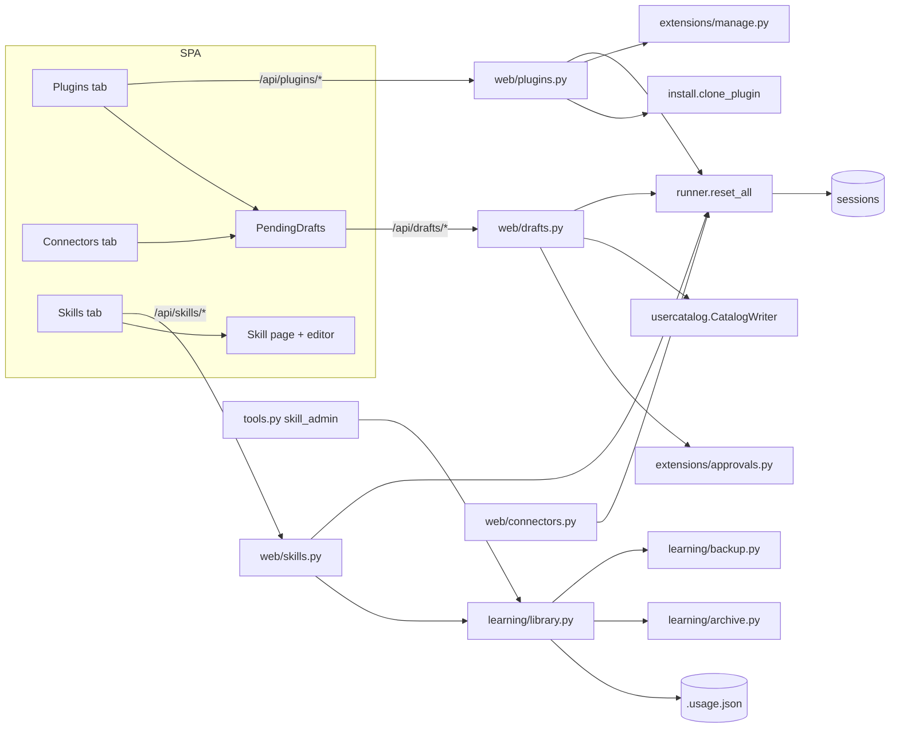

# CladeX Customize: Plugins and Skills — implementation plan

> **For agentic workers:** REQUIRED SUB-SKILL: Use superpowers:subagent-driven-development (recommended) or superpowers:executing-plans to implement this plan task-by-task. Steps use checkbox (`- [ ]`) syntax for tracking.

**Goal:** the last two `/customize` tabs. Plugins lists the reviewed plugin
catalog and installs, enables, disables and removes from it; a shared Pending
review section turns a drafted catalog entry's executable surface into a screen a
human can actually read before approving. Skills makes the agent's library
visible — provenance, usage, state — and lets the owner read, write, create, pin
and archive a skill's `SKILL.md`.

**Architecture:** three new routers (`web/plugins.py`, `web/drafts.py`,
`web/skills.py`) over machinery that already exists — `install.clone_plugin`,
`extensions/manage.py`, `drafts.py` + `approvals.py`, `UsageSidecar`,
`learning/archive.py`. One new domain module, `learning/library.py`, is the single
implementation of the skills reads and writes that both `skill_admin` and the
router use, mirroring `extensions/manage.py`. One new runtime primitive,
`AgentRunner.reset_all()` → `db.reset_all_sessions()`, is called by every mutation
that changes the cached prompt prefix — including the connectors mutations, which
reset nothing today.

**Tech Stack:** Python 3.12, Starlette, aiosqlite, PyYAML; React 19, react-router
7, zustand, shadcn (`Dialog`, `Badge`, `DropdownMenu`, `Tabs`/segmented control,
`Textarea`), `react-markdown` + `remark-gfm` (already a dependency), sonner,
vitest, Playwright.

Spec: `docs/superpowers/specs/2026-09-10-cladex-plugins-skills-design.md`.
Interface strings go through `web/src/i18n/`.

## Locked Decisions

- **A plugin is only ever installed from a catalog manifest.** The browser gets no
  form that writes a plugin manifest; the path for a new one stays draft → approve
  → install. (A custom *connector* form is safe because it cannot produce a stdio
  entry; a plugin is local code by definition.)
- **Draft approval is two calls with a content-bound token**: `review` returns
  `approvals.begin`'s `{surface, token}`; `approve` posts the token back and the
  server calls `approvals.confirm`, which promotes the *snapshot*. Owner-only,
  browser-only — never a model-callable tool.
- **A plugin's components are read live from the clone** (`commands/*.md`,
  `skills/*/SKILL.md`, `agents/*.md`, `hooks/hooks.json`, `.mcp.json`,
  `.claude-plugin/plugin.json`), never stored in the registry.
- **Web install is synchronous**, `timeout = min(cfg.plugin_clone_timeout_seconds,
  85.0)` — Cloudflare cuts at 100 s.
- **Skills: no delete route** (PRD P4). Only `SKILL.md` is writable; other files
  are listed with sizes.
- **`PUT /api/skills/{name}` requires an etag** (`sha256` of the current
  `SKILL.md`) and answers 409 `stale_edit` with the current content — the
  background review pass writes the same files.
- **A skill edit snapshots first under a new backup kind `skill_edits`**, so
  browser saves cannot evict the curator's `pre-curator-run` snapshot.
- **`reset_all()` after every prefix-changing mutation**: plugin
  install/enable/disable/remove, draft approve, skill create/edit/archive/restore,
  and connector connect/enable/disable/remove. **Not** after pin/unpin.
- **Wire shapes** are fixed by the spec (`PluginWire`, `DraftWire`, `SkillWire`,
  `SkillDetail`); `state` for a plugin is `manage.state_of` with `connected`
  spelled `installed`.
- **Error codes** the UI translates: `not_found`, `forbidden`, `install_failed`,
  `no_draft`, `stale_draft`, `shadowed`, `unverified`, `name_taken`, `bad_name`,
  `bad_frontmatter`, `too_large`, `stale_edit`, `pinned`, `restore_failed`.
- **Three plugin entries ship** in `catalog/plugins/`, pinned to a sha:
  `marketing`, `finance`, `design` from
  `https://github.com/anthropics/knowledge-work-plugins`. **Amended during
  implementation** (spec §Locked decisions 12): "skills-only" held for the
  executable surface — no hooks, no commands, no agents — but not for `.mcp.json`,
  which every knowledge-work plugin in that repo bundles at the pinned ref. The
  entries ship with the deviation verified (every bundled server is remote `http`,
  none receives a credential from this system) and disclosed in each manifest's
  description.

## Global Constraints

- Every interface string goes through `t()`/`useT()`; `web/src/i18n/i18n.test.ts`
  (no stray Cyrillic in `en`, same shape in both dictionaries) must stay green.
- Backend checks: `.venv/Scripts/python.exe -m pytest -q -p no:cacheprovider` (run
  with `timeout 600`), `ruff check src tests`. Frontend, from `web/`: `npx vitest
  run --dir src`, `npx tsc --noEmit -p tsconfig.app.json`, `npx eslint src`, `npx
  playwright test`.
- Existing tests keep passing unchanged: `tests/test_ext_manage.py`,
  `tests/test_ext_manage_guidance.py`, `tests/test_web_connectors.py`,
  `tests/test_learning*.py`, `tests/test_curator.py`, `tests/test_tools.py`
  (which asserts an exact handler-name list).
- No new Python dependency. No new npm dependency.
- Nothing in `web/` may import from `src/`; every call goes through `api/`.
- Secrets never appear in a response or a log line — unchanged, and the drafts
  surface is already control-character-stripped by `drafts.safe`.

## Architecture Diagram



## Files

```
src/claude_hermes/db.py                        reset_all_sessions                       (Task 1)
src/claude_hermes/runner.py                    reset_all                                (Task 1)
src/claude_hermes/web/connectors.py            reset_all on every mutation              (Task 1)
src/claude_hermes/paths.py                     bundled_skill_names                      (Task 2)
src/claude_hermes/learning/library.py          list/read/write/create/to_wire           (Task 2)
src/claude_hermes/tools.py                     skill_admin list -> library              (Task 2)
src/claude_hermes/learning/backup.py           _KINDS gains skill_edits                 (Task 3)
src/claude_hermes/extensions/plugins.py        components(root)                         (Task 4)
src/claude_hermes/web/plugins.py               the plugins router                       (Task 5)
src/claude_hermes/web/drafts.py                the drafts router                        (Task 6)
src/claude_hermes/web/skills.py                the skills router                        (Task 7)
src/claude_hermes/web/deps.py, app.py, main.py, tests/web_helpers.py                     (Tasks 5-7)
catalog/plugins/{marketing,finance,design}.yaml                                          (Task 8)
web/src/api/types.ts, client.ts                                                          (Task 9)
web/src/store/{plugins,skills,drafts}.ts, store/index.ts                                 (Task 9)
web/src/app/routes.tsx, pages/Customize.tsx, components/cladex/CommandPalette.tsx        (Task 10)
web/src/components/cladex/{PluginCard,PluginsTab}.tsx, pages/PluginPage.tsx              (Task 11)
web/src/components/cladex/{PendingDrafts,DraftDialog}.tsx, ConnectorsTab.tsx             (Task 12)
web/src/components/cladex/{SkillsTab,SkillRow,NewSkillDialog}.tsx, pages/SkillPage.tsx   (Task 13)
web/src/i18n/en.ts, ru.ts                                                                (Task 14)
web/e2e/fake-server.ts, web/e2e/customize.spec.ts                                        (Task 15)
docs/llm-wiki/components/{web,extensions,learning}.md, README.md                         (Task 16)
```

---

### Task 1: `reset_all` — one bulk session reset, wired into connectors first

**Files:**
- Modify: `src/claude_hermes/db.py`, `src/claude_hermes/runner.py`,
  `src/claude_hermes/web/connectors.py`
- Test: `tests/test_reset_all.py` (new), `tests/test_web_connectors.py`

**Interfaces:**
- Produces: `Database.reset_all_sessions() -> None` (`DELETE FROM sessions`),
  `AgentRunner.reset_all() -> None`.
- Reuses: `Database.reset_session` (db.py:191), the `FakeRunner` in
  `tests/web_helpers.py` (gains a `reset_all` that records the call).

Do this first and on its own: it is the smallest change, it fixes a live bug in
the shipped Connectors tab, and every later task calls it.

- [ ] **Step 1: Failing tests.** `tests/test_reset_all.py`: two sessions bound,
  `reset_all_sessions()`, both gone. In `tests/test_web_connectors.py`: after
  `POST /api/connectors/{name}/connect` (and `/enable`, `/disable`, `DELETE`) the
  fake runner recorded a `reset_all` call; after `GET /api/connectors` it did not.
- [ ] **Step 2: Implement.** `reset_all_sessions` mirrors `reset_session` with no
  `WHERE`. `AgentRunner.reset_all` takes no lane lock — document why on the method:
  a turn in flight writes its session row back when it ends and so keeps its
  session; the reset is for idle lanes, which is every lane in practice when
  someone is clicking in Customize.
- [ ] **Step 3: Call it** at the end of `connect`, `enable`, `disable` and
  `delete` in `web/connectors.py`, after the row write, never before — the
  `ext_manage` ordering rule (runner.py:345).
- [ ] **Step 4: Verify.** `pytest -q`, `ruff check src tests`.

---

### Task 2: `learning/library.py` — one implementation of the skills reads

**Files:**
- Create: `src/claude_hermes/learning/library.py`
- Modify: `src/claude_hermes/paths.py`, `src/claude_hermes/tools.py`
- Test: `tests/test_skill_library.py` (new)

**Interfaces:**
- Produces:
  - `paths.bundled_skill_names() -> frozenset[str]` — directory names under
    `_BUNDLED_SKILLS_DIR`, empty when the source is absent (the `CH_ASSETS` case
    `_copy_missing` already warns about).
  - `library.SkillInfo` dataclass and `library.list_skills(skills_dir, sidecar) ->
    list[dict]` — the `SkillWire` shape, sorted active-first then by name.
  - `library.read_skill(skills_dir, name) -> dict | None` — wire + `content` +
    `etag` + `tree`; reads `.archive/<name>` when the live directory is absent.
  - `library.write_skill(skills_dir, name, content, etag) -> str` (new etag);
    raises `library.StaleEdit(current_content, current_etag)` on a mismatch and
    `library.SkillError` on a validation failure.
  - `library.create_skill(skills_dir, sidecar, name, content, now_iso) -> dict`.
  - `library.parse_front_matter(text) -> tuple[dict, bool]` — the mapping and
    whether it parsed.
  - `library.etag_of(raw: bytes) -> str` — `sha256` hex.
- Reuses: `UsageSidecar` (`all`, `list_skill_dirs`, `mark_created`, `bump_patch`,
  `set_pinned`), `usage.last_activity`, `archive.list_archived`.

- [ ] **Step 1: Failing tests** in `tests/test_skill_library.py`:
  - a directory with no sidecar entry lists as `source: "user"`, `state: "active"`,
    counts zero;
  - a name present in a fake bundled dir (pass `source=` into
    `paths.bundled_skill_names`'s test seam, or monkeypatch `_BUNDLED_SKILLS_DIR`)
    lists as `"bundled"` even when the sidecar says `created_by: "agent"` — the
    source tree is the authority;
  - a sidecar entry whose directory is gone and which sits in `.archive/` lists as
    `state: "archived"`;
  - `SKILL.md` with unparseable frontmatter lists with `broken: true` and an empty
    description rather than raising;
  - `read_skill` on an archived skill returns its content;
  - `write_skill` with a stale etag raises `StaleEdit` carrying the current text;
  - `create_skill` refuses `../evil`, `Evil`, an existing name, content over 64
    KiB and frontmatter with no `description`;
  - `create_skill` writes `SKILL.md` and marks the sidecar `created_by: "user"`.
- [ ] **Step 2: Implement** `library.py`. Every path is built as
  `(skills_dir / name)` and then checked with
  `resolved.is_relative_to(skills_dir.resolve())` — the `FileStore.resolve` rule —
  so a name that survived the regex by accident still cannot escape.
- [ ] **Step 3: Refactor `skill_admin`'s `list` action** onto
  `library.list_skills`, keeping its reply text byte-identical (the existing
  assertions in `tests/test_tools.py` must not change). This is the
  `extensions/manage.py` precedent: two channels, one implementation.
- [ ] **Step 4: Verify.** `pytest -q`, `ruff check src tests`.

---

### Task 3: A third backup kind for owner edits

**Files:**
- Modify: `src/claude_hermes/learning/backup.py`
- Test: `tests/test_backup.py`

**Interfaces:** `_KINDS` gains `"skill_edits": ("skill_edit_backups",
"skills.tar.gz")`. Nothing else changes; `snapshot`, `list_snapshots` and
`rollback` already take `kind`.

- [ ] **Step 1: Failing test.** `snapshot(skills_dir, logs_dir, reason="x",
  kind="skill_edits")` writes under `logs/skill_edit_backups/` and does not touch
  `logs/skills_backups/`; `backup_keep` prunes the two stores independently.
- [ ] **Step 2: Implement, verify.**

---

### Task 4: `extensions/plugins.py` — what a plugin adds, read from the clone

**Files:**
- Create: `src/claude_hermes/extensions/plugins.py`
- Test: `tests/test_plugin_components.py` (new)

**Interfaces:**
- Produces: `plugins.components(root: Path) -> dict | None` —
  `{commands, skills, agents, hooks, mcp, author, plugin_version}`; `None` when
  `root/.claude-plugin/plugin.json` is absent. Names are stems, sorted, capped at
  100 each. Reads `plugin.json` for `author.name` (or a plain string author) and
  `version`, tolerating any shape without raising.
- Produces: `plugins.is_present(home, m) -> bool` — `plugin_root` resolves and
  `.claude-plugin/plugin.json` is a file; `False` on any `ComposeError`.
- Reuses: `compose.plugin_root`, `compose.plugin_dir`.

- [ ] **Step 1: Failing tests.** A fixture tree with `commands/a.md`,
  `skills/b/SKILL.md`, `agents/c.md`, `hooks/hooks.json` and `.mcp.json` reports
  all five; a tree with only `plugin.json` reports empty lists and `False` flags; a
  malformed `plugin.json` yields empty `author`/`plugin_version` rather than
  raising; a missing directory yields `None`.
- [ ] **Step 2: Implement, verify.**

---

### Task 5: `web/plugins.py`

**Files:**
- Create: `src/claude_hermes/web/plugins.py`
- Modify: `src/claude_hermes/web/app.py` (mount after connectors),
  `src/claude_hermes/web/deps.py` (nothing new needed — `ext_store`, `home`,
  `catalog_root`, `cfg` and `runner` are already there)
- Test: `tests/test_web_plugins.py` (new)

**Interfaces:**
- Produces: `routes(deps) -> list[Route]` returning `[]` when `deps.ext_store is
  None`, exactly as `connectors.routes` does; `to_wire(m, row, home)` for the
  `PluginWire` shape.
- Reuses: `catalog.load_all` / `catalog.get`, `manage.state_of`,
  `manage.source_of`, `manage.enable/disable/remove`, `install.clone_plugin`,
  `plugins.components`, `runner.reset_all`.

Routes, in this order so `{name}` never swallows a fixed segment:
`GET /api/plugins`, `POST /api/plugins/{name}/install`, `/enable`, `/disable`,
`DELETE /api/plugins/{name}`.

- [ ] **Step 1: Failing tests** in `tests/test_web_plugins.py`, built on
  `tests/web_helpers.py`'s `make_client` with a fixture catalog containing one
  plugin manifest and a `clone_plugin` seam:
  - `GET` returns one item, `state: "available"`, `components: null`,
    `present: false`;
  - install with a fake clone that materialises `.claude-plugin/plugin.json` →
    `state: "installed"`, `present: true`, components populated, `reset_all`
    recorded;
  - install whose fake raises `InstallError("boom")` → 502 `install_failed`, no
    registry row, no reset;
  - disable → `state: "disabled"`; enable → `installed`;
  - `DELETE` → 204, the clone directory is gone, the row is gone, `reset_all`
    recorded;
  - a non-owner gets 403 on every mutation and 200 on the list;
  - a registry row of `kind: "plugin"` whose manifest is not in the catalog still
    appears, `state: "error"`, `present: false`, carrying `last_error`;
  - an installed plugin whose clone was deleted behind the app's back reports
    `present: false` while `state` stays `installed`.
- [ ] **Step 2: Implement the router.** `install` uses
  `timeout=min(deps.cfg.plugin_clone_timeout_seconds, 85.0)` and comments the
  Cloudflare reason. Mutations are `owner_only(request)` first, exactly as
  connectors does, and end with `await deps.runner.reset_all()`.
- [ ] **Step 3: Mount** in `web/app.py` between connectors and voice; extend the
  `tests/web_helpers.py` fake runner if needed.
- [ ] **Step 4: Verify.** `pytest -q`, `ruff check src tests`.

---

### Task 6: `web/drafts.py`

**Files:**
- Create: `src/claude_hermes/web/drafts.py`
- Modify: `src/claude_hermes/web/app.py`
- Test: `tests/test_web_drafts.py` (new)

**Interfaces:**
- Produces: `GET /api/drafts` → `{drafts: DraftWire[], rejected: [{file, reason}]}`;
  `POST /api/drafts/{name}/review` → `{name, kind, label, surface, token,
  local_command: bool}`; `POST /api/drafts/{name}/approve` (`{token}`) →
  `{name, kind}`; `DELETE /api/drafts/{name}` → 204.
- Reuses: `drafts.pending`, `drafts.rejected`, `drafts.draft_path`,
  `approvals.begin/confirm/clear/describe_with_banner`, `deps.writer.promote`,
  `catalog.is_repo_entry`, `catalog.get`, `runner.reset_all`.

`local_command` is `True` when `describe_with_banner` prepended the
`⚠️ LOCAL COMMAND` banner, so the dialog can render a warning strip instead of
parsing the string.

- [ ] **Step 1: Failing tests:**
  - a queued mcp draft and a queued plugin draft both list, with their kind;
  - a draft that no longer parses appears under `rejected` with its reason and not
    under `drafts`;
  - `review` returns a token equal to `approvals.token_of(draft bytes)`;
  - rewriting the draft between `review` and `approve` makes `approve` answer 409
    `stale_draft`, and nothing is promoted;
  - a happy-path `approve` promotes the manifest into the user catalog, makes
    `catalog.get(name)` non-None, unlinks the draft and the snapshot, and records a
    `reset_all`;
  - `approve` for a name that `catalog.is_repo_entry` reports is refused 409
    `shadowed`;
  - a second `approve` with the same token is 409 `stale_draft` (the snapshot is
    gone);
  - `DELETE` unlinks both the draft and any snapshot and answers 204;
  - non-owner: 403 on `review`, `approve` and `DELETE`, 200 on the list.
- [ ] **Step 2: Implement.** The `unverified` path mirrors `_handle_approve`
  exactly, including leaving the draft queued so a retry is free (P5).
- [ ] **Step 3: Mount, verify.**

---

### Task 7: `web/skills.py`

**Files:**
- Create: `src/claude_hermes/web/skills.py`
- Modify: `src/claude_hermes/web/app.py`, `src/claude_hermes/web/deps.py`
  (`skills_dir: Path | None`, `sidecar: Any` — `main.py` already builds both at
  main.py:57-58), `src/claude_hermes/main.py`, `tests/web_helpers.py`
- Test: `tests/test_web_skills.py` (new)

**Interfaces:** the routes from the spec, all delegating to `learning/library.py`,
`learning/archive.py` and `learning/backup.py`. `routes(deps)` returns `[]` when
`deps.skills_dir is None`.

- [ ] **Step 1: Failing tests:**
  - `GET /api/skills` lists a seeded skill; any allowed user may read;
  - `GET /api/skills/{name}` returns `content`, `etag` and a `tree` listing
    `references/x.md` with its size;
  - `PUT` with the right etag rewrites `SKILL.md`, bumps `patch_count`, leaves a
    snapshot under `logs/skill_edit_backups/`, and records a `reset_all`;
  - `PUT` with a stale etag is 409 `stale_edit` and the body carries the current
    `content` and `etag`; the file is untouched;
  - `POST /api/skills` creates the directory and marks the sidecar
    `created_by: "user"`; a duplicate name is 409 `name_taken`; `../x` is 400
    `bad_name`; 70 KiB of content is 413 `too_large`; frontmatter without a
    `description` is 400 `bad_frontmatter`;
  - `pin` then `archive` is 409 `pinned`; `unpin` then `archive` moves the
    directory into `.archive/` and records a `reset_all`; `restore` brings it back;
    `pin` records **no** `reset_all`;
  - there is no route that deletes a skill: assert the app answers 405 for
    `DELETE /api/skills/{name}`;
  - non-owner: 403 on every mutation.
- [ ] **Step 2: Implement.** Snapshot before write, write after — a failed write
  must not leave a snapshot claiming a state that never existed is fine; the
  reverse (writing first) loses the recovery point.
- [ ] **Step 3: Wire `skills_dir` and `sidecar` into `WebDeps`** in `main.py` and
  in `tests/web_helpers.py`'s `make_client`.
- [ ] **Step 4: Verify.**

---

### Task 8: The first three catalog plugin entries

**Files:**
- Create: `catalog/plugins/marketing.yaml`, `finance.yaml`, `design.yaml`
- Test: `tests/test_catalog.py` (the existing "every shipped manifest parses" test
  covers them; add one if it does not exist)

All three are subdirectories of `https://github.com/anthropics/knowledge-work-plugins`
and contain **nothing that executes** — no `hooks/`, no `commands/`, no `agents/` —
which is why they are the right first entries: installing one adds markdown to the
prompt and nothing that runs.

They do each bundle a `.mcp.json`, which this task originally forbade; see the
amendment in Locked Decisions and spec §12. Check it when re-resolving the pin:
every server must be `"type": "http"` (no `stdio`, which would spawn a local
process) and carry no header or env, and the manifest description must name the
servers it bundles.

- [ ] **Step 1: Re-resolve the pin.** `git ls-remote
  https://github.com/anthropics/knowledge-work-plugins HEAD` — at the time of
  writing that is `11ac5eeaca27c764913a06f1e61a7cb712790b1a`. Use the sha you
  resolve, not this one, and confirm `<subdir>/.claude-plugin/plugin.json` exists
  at it.
- [ ] **Step 2: Write the manifests**, e.g.

```yaml
manifest_version: 1
name: marketing
label: Marketing
description: >-
  Content, campaigns and performance analysis across marketing channels —
  brand voice, competitor tracking and reporting. Skills only; adds no tools.
version: "1.2.0"
repo: https://github.com/anthropics/knowledge-work-plugins
ref: <40-hex sha>
subdir: marketing
scopes: [turn, cron]
```

- [ ] **Step 3: Validate** each with `python scripts/validate_manifest.py
  catalog/plugins/<f>.yaml` and verify one really installs:
  `install.clone_plugin` against a tmp home in a test or a scratch script.
- [ ] **Step 4: Verify.** `pytest -q`.

---

### Task 9: The API client and three store slices

**Files:**
- Modify: `web/src/api/types.ts`, `web/src/api/client.ts`,
  `web/src/store/index.ts`
- Create: `web/src/store/plugins.ts`, `web/src/store/skills.ts`,
  `web/src/store/drafts.ts`
- Test: `web/src/store/{plugins,skills,drafts}.test.ts`

**Interfaces:**
- Types `PluginWire`, `PluginComponents`, `DraftWire`, `DraftReview`, `SkillWire`,
  `SkillDetail` exactly as the spec spells them.
- `api.plugins.{list,install,enable,disable,remove}`,
  `api.drafts.{list,review,approve,discard}`,
  `api.skills.{list,get,create,save,pin,unpin,archive,restore}` — all through the
  existing `request()`.
- Slices in the shape `connectors.ts` uses: `plugins/pluginsLoaded/loadPlugins/…`,
  `drafts/draftsLoaded/loadDrafts/…`, `skills/skillsLoaded/loadSkills/…` plus
  `skillDetail: Record<string, SkillDetail>`.

- [ ] **Step 1: Failing store tests** with a mocked `api`: load populates and sets
  the loaded flag; `installPlugin` replaces the row in place; `removePlugin` drops
  a custom entry and resets a catalog entry to `available` (the
  `removeConnector` idiom); `approveDraft` removes the draft from the list and
  triggers a plugins reload; `saveSkill` on a `stale_edit` `ApiError` leaves the
  buffer alone and surfaces the error.
- [ ] **Step 2: Implement, verify.** `npx vitest run --dir src`, `npx tsc
  --noEmit -p tsconfig.app.json`, `npx eslint src`.

---

### Task 10: Routes and the tab strip

**Files:**
- Modify: `web/src/app/routes.tsx`, `web/src/pages/Customize.tsx`,
  `web/src/components/cladex/CommandPalette.tsx`
- Test: `web/src/pages/Customize.test.tsx`

- [ ] **Step 1:** Delete `ComingSoon` and its two `customize.comingSoon*` keys;
  point `plugins` at `PluginsTab`, `plugins/:name` at `PluginPage`, `skills` at
  `SkillsTab`, `skills/:name` at `SkillPage`.
- [ ] **Step 2:** Add two `CommandItem`s to the palette (`Plugins`, `Skills`)
  beside the existing Customize entry, with the same `searchable()` idiom.
- [ ] **Step 3:** Update `Customize.test.tsx` — the tab strip renders three tabs
  and no "coming soon" copy. Verify.

---

### Task 11: The Plugins tab and plugin page

**Files:**
- Create: `web/src/components/cladex/PluginsTab.tsx`, `PluginCard.tsx`,
  `usePluginActions.tsx`, `web/src/pages/PluginPage.tsx`
- Create: `web/src/lib/pluginMenu.ts` (mirrors `lib/connectorMenu.ts`:
  `pluginMenu(p, t)`, `pluginStatus(p, t)`, `installsDirectly(p)`)
- Test: `web/src/components/cladex/PluginCard.test.tsx`,
  `web/src/pages/PluginPage.test.tsx`

- [ ] **Step 1: Failing component tests.** An `available` plugin shows a plus
  control whose click calls `install`; an `installed` one shows a check and a menu
  with Disable / Remove / Reinstall; a `present: false` row shows the reinstall
  hint; a plain user sees a static control and no menu.
- [ ] **Step 2: Implement.** Reuse the connectors card layout wholesale — the
  `SQUARE` control, `LOOK` map, `firstSentence`, the `From the catalog` check — and
  a `Puzzle` tile in place of `BrandTile`. The page adds *What it adds* (chips for
  commands / skills / agents, a sentence each for hooks and a bundled MCP server),
  `repo@ref` linking to `<repo>/tree/<ref>/<subdir>`, scopes, installed-at and a
  trust note worded for code.
- [ ] **Step 3: Verify.** vitest, tsc, eslint.

---

### Task 12: Pending review — the shared draft surface

**Files:**
- Create: `web/src/components/cladex/PendingDrafts.tsx`, `DraftDialog.tsx`
- Modify: `web/src/components/cladex/ConnectorsTab.tsx` (render
  `<PendingDrafts kind="mcp" />`), `PluginsTab.tsx` (`kind="plugin"`)
- Test: `web/src/components/cladex/DraftDialog.test.tsx`

- [ ] **Step 1: Failing tests.** Opening the dialog calls `review` once and
  renders the returned `surface` verbatim inside a `<pre>` (assert the exact text,
  including a line that looks like markdown, is not transformed); `local_command:
  true` renders the warning strip; Approve posts the token from the review call;
  a 409 `stale_draft` shows the "changed since you read it" message and re-runs
  `review`; Discard calls `discard` and closes.
- [ ] **Step 2: Implement.** The section renders nothing when there are no drafts
  of that kind, so both tabs are unchanged in the normal case. Rejected drafts show
  as a muted line with their reason and a Discard action.
- [ ] **Step 3: Verify.**

---

### Task 13: The Skills tab, skill page and editor

**Files:**
- Create: `web/src/components/cladex/SkillsTab.tsx`, `SkillRow.tsx`,
  `NewSkillDialog.tsx`, `web/src/pages/SkillPage.tsx`
- Test: `web/src/components/cladex/SkillRow.test.tsx`,
  `web/src/pages/SkillPage.test.tsx`

- [ ] **Step 1: Failing tests.**
  - a row shows the badges its wire earns (`Bundled`, `Pinned`, `Stale`) and
    `used {n} times`;
  - the filter control switches the list between active, archived and all; the
    search box filters on name and description;
  - `New skill` is absent for a plain user;
  - the page renders `SKILL.md` as markdown (a `##` heading becomes an `<h2>`);
  - Edit swaps in a textarea seeded with `content`; Save calls `save` with the
    etag; a `stale_edit` error shows the conflict message and its Reload button
    replaces the buffer with the server's content;
  - Archive is absent for a pinned skill and present after Unpin.
- [ ] **Step 2: Implement.** `react-markdown` + `remark-gfm` directly (not the
  assistant-ui `MarkdownText`, which wants a message context). The editor is a
  plain monospace `<textarea>` — no new dependency; `Ctrl/Cmd+S` saves.
- [ ] **Step 3: Verify.**

---

### Task 14: The dictionary

**Files:** `web/src/i18n/en.ts`, `web/src/i18n/ru.ts`
**Test:** `web/src/i18n/i18n.test.ts`

- [ ] **Step 1:** Add `plugins.*`, `skills.*`, `drafts.*` (including
  `drafts.errors.*` for the codes in Locked Decisions) and delete
  `customize.comingSoon*`; update `customize.subtitle` if it still promises
  connectors only.
- [ ] **Step 2:** Mirror every key in `ru.ts`. Keep the plural leaves
  (`one/few/many`) for `used {n} times` and `{n} skills`.
- [ ] **Step 3: Verify** the shape test and the no-stray-Cyrillic test.

---

### Task 15: E2E

**Files:** `web/e2e/fake-server.ts`, `web/e2e/customize.spec.ts`

- [ ] **Step 1:** Extend `installFakeApi` with `/api/plugins*`, `/api/drafts*` and
  `/api/skills*` routes, following the existing `/api/connectors` fulfilment
  style.
- [ ] **Step 2:** Three walks — install a plugin and see the card turn installed;
  open a skill, edit it, save, see the rendered markdown update; open a plugin
  draft, read the surface, approve it and see the plugin appear as available.
- [ ] **Step 3: Verify.** `npx playwright test`.

---

### Task 16: Documentation

**Files:** `docs/llm-wiki/components/web.md`, `components/extensions.md`,
`components/learning.md`, `docs/llm-wiki/index.md` if a page is added,
`README.md`

- [ ] **Step 1:** `web.md` — the three new routers, their wire shapes, the
  `reset_all` rule (including that connectors now call it) and the new SPA
  components; add the new files to `evidence`.
- [ ] **Step 2:** `extensions.md` — the browser approval path beside the chat one,
  `extensions/plugins.py`, and replace "No plugins ship yet" with the three
  entries.
- [ ] **Step 3:** `learning.md` — `library.py` as the shared implementation, the
  `skill_edits` backup kind, and the etag rule against the review pass.
- [ ] **Step 4:** `README.md` — the Customize section gains Plugins and Skills;
  "Adding a catalog entry" gains the browser approval route.
- [ ] **Step 5:** `.llm-wiki/llm-wiki fingerprint --page <page>` for each page
  touched, then `.llm-wiki/llm-wiki validate`, then
  `.llm-wiki/llm-wiki receipt write --kind synced`.
- [ ] **Step 6: Full verification.** `pytest -q -p no:cacheprovider` (timeout
  600), `ruff check src tests`, and from `web/`: `npx vitest run --dir src`, `npx
  tsc --noEmit -p tsconfig.app.json`, `npx eslint src`, `npx playwright test`.
