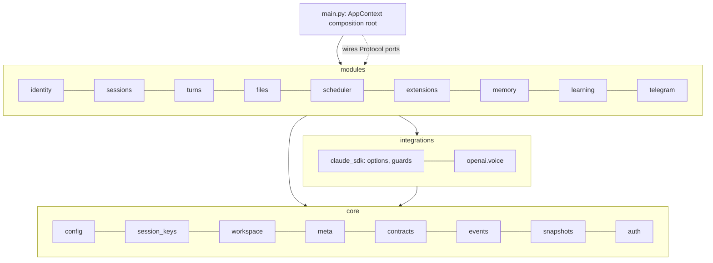

# Wave 2 — vertical-slice modules with shims — implementation plan

> **For agentic workers:** REQUIRED SUB-SKILL: Use superpowers:subagent-driven-development (recommended) or superpowers:executing-plans to implement this plan task-by-task. Steps use checkbox (`- [ ]`) syntax for tracking.

**Goal:** every piece of `src/claude_hermes/` lives in `core/`, `integrations/`, `workers/` or one of the nine modules (`identity`, `sessions`, `turns`, `files`, `scheduler`, `extensions`, `memory`, `learning`, `telegram`) with `domain / application / infrastructure / presentation` layers, cross-module needs expressed as consumer-side Protocol ports wired in one composition root, old import paths kept alive by shims, and the whole test suite green.

**Architecture:** Step 2 of `docs/superpowers/specs/2026-09-14-modular-fastapi-architecture-design.md`. Four phases. **A — Foundation** (serial): the shared primitives every module needs move to `core/` and `integrations/` first, the ORM name collision is fixed, `threads.has_turns` removes the one cross-module SQL join, nine module skeletons and their import-linter layer contracts are created. **B — Modules** (nine parallel streams, disjoint files): each stream builds its module from the migration brief it is given, leaves shims at the old paths, and keeps its own tests green; legacy files become *adapter shims* that satisfy the module's ports with the old code until composition. **C — Compose** (serial): `main.py` becomes an `AppContext` composition root, the runner gets constructor injection, `tools.py`/`db.py`/`web/app.py` collapse onto the module implementations, duplicated legacy bodies are deleted. **D/E** — advisor review, fixes, docs, full gate.

**Tech Stack:** unchanged from Wave 1 (Python 3.12/3.13, SQLAlchemy async, Alembic, FastAPI serving Starlette `Route` lists, structlog, import-linter 2.x, PostgreSQL 16).

Spec: `docs/superpowers/specs/2026-09-14-modular-fastapi-architecture-design.md`.
Briefs (one per stream, read yours in full): `<scratchpad>/briefs/{identity-sessions,turns,files-scheduler,extensions,memory-learning,telegram}.md` — the path is given in each agent's prompt.

## Locked Decisions

- **Consumer-side ports.** A module that needs something from another module declares a `typing.Protocol` in its own `application/ports.py` and receives an object satisfying it at composition. Modules never import each other; structural typing does the matching. Ports are named for the *capability* (`SessionLane`, `ThreadRegistry`, `FilePublisher`), not for the provider.
- **What lives in `core/`** (importable by every module, imports no module): `core/config.py` (moved `config.py`), `core/session_keys.py` (the six session-key functions), `core/workspace.py` (moved `paths.py` + a `Workspace` dataclass), `core/meta.py` (`MetaStore` over the `meta` table), `core/contracts.py` (`Attachment`, `IMAGE_TYPES`), `core/events.py` (`TurnStats`), `core/snapshots.py` (moved `learning/backup.py`), `core/auth.py` (current-user middleware taking two callables), plus Wave 1's `core/db`, `core/exceptions.py`, `core/logging.py`.
- **What lives in `integrations/`** (imports `core/` and third-party only): `integrations/claude_sdk/options.py` (`base_options`, `_MAX_BUFFER_SIZE`), `integrations/claude_sdk/guards.py` (`bash_guard`, `write_guard_factory`, `_DENY`, `_PROTECTED`), `integrations/openai/voice.py` (`OpenAIVoice`, `VoiceError`).
- **ORM rename:** `modules/turns/domain/models.TurnEvent` → `TurnEventRow`. The wire dataclass keeps the name `TurnEvent` (moving to `modules/turns/domain/events.py`).
- **`threads.has_turns`** (Alembic `0002`, boolean, not null, default false, backfilled from `turn_events`). `Database.upsert_thread(session_key, channel, owner_user_id, now, *, talked: bool = False)` sets it when `talked=True` (never clears it). `list_threads` lists `channel = 'web' OR title IS NOT NULL OR has_turns`. The runner's turn-start touch and the cron delivery touch pass `talked=True`; thread creation from the web and job-topic creation do not.
- **Shim kinds.** (1) *Alias shim* for a module moved whole: the old file is `import sys; from claude_hermes.<new> import <mod> as _t; sys.modules[__name__] = _t` — tests that monkeypatch attributes on the old module keep working because both names resolve to the same module object. (2) *Re-export shim* for split modules: `from claude_hermes.modules... import X, Y, _private_used_by_tests`. (3) *Adapter shim* for a legacy class whose constructor changed (`SessionRouter(db, cfg)`, `LocalFileStore(db, home)`, `JobStore(db)`, `AgentRunner(cfg, home, db, router, wiki, bus=)`, `make_handlers(...)`): a compat class/function at the old path that builds the module objects and forwards. A test that monkeypatches a *split* module is updated in the same commit — the shim cannot preserve that.
- **Inside `modules/<m>/` only these imports are allowed:** stdlib, third-party, `claude_hermes.core.*`, `claude_hermes.integrations.*`, and the module's own packages. Never a legacy path (`claude_hermes.db`, `.sessions`, `.runner`, `.tools`, `.web.*`, `.gateway.*`, `.cron.*`, `.extensions.*`, `.learning.*`, `.wiki`, `.acl`, `.filestore`) — import-linter follows chains, so a legacy shim is a back door to another module.
- **Layer contracts** (import-linter, active from Phase A): `presentation | infrastructure` > `application` > `domain` per module; `modules.*.application` may not import `fastapi`, `starlette`, `aiogram`, `httpx`, `sqlalchemy`, `claude_agent_sdk`; `modules.*.presentation` may not import `sqlalchemy`, `aiogram`; `domain` stays pure (Wave 1 contract). Repositories take an `AsyncEngine` (`core.db.engine`), never the `Database` facade.
- **Routers keep the `routes(deps) -> list[Route]` shape** in `presentation/router.py`; `deps` is any object carrying the attribute names the router reads today (documented in the module README). `APIRouter` + `Depends` conversion is Wave 2b, after the composition root exists. Route paths, wire shapes and error `code` strings are frozen (spec req. 36).
- **Errors:** services raise `core.exceptions.*` (`NotFound`, `Forbidden`, `Conflict`, `InvalidInput`, `Unauthorized`) or module-specific subclasses; `web/errors.ApiError` remains legal in presentation for HTTP-specific codes. Both render centrally.
- **`AppContext`** (`core/app_context.py`, Phase C): a dataclass holding every built object; `main.build_app() -> AppContext`; `AgentRunner`/`TurnService` takes its collaborators as constructor arguments — the `runner._x = y` pattern is deleted.
- **Prompt-cache invariants are untouchable:** `build_system_append` output, tool descriptions, `_build_prompt` returning a bare `str` without attachments, `allowed_tools` ordering, `reset_all()` after every prefix-changing mutation, `ctx.flags.reset_lane` applied after `router.bind`.
- **Security invariants that move verbatim** (each brief lists its own): `/approve` and `/secret` intercepted before `run_turn`; `_admit` uses `chat_type="web"`; token derivation then `os.environ.pop` in `main.run`; `web/wiki.resolve` and `library._resolve` containment checks; `filestore.resolve` agent_home check; catalog reader never reads drafts; promotion only via `CatalogWriter.promote`; `is_repo_entry` anti-downgrade in all five places.
- **Meta keys, session-key formats, `mcp__hermes__*` tool names, `cron:<id>` lanes are not renamed.**

## Global Constraints

- Checks: `.venv/Scripts/python.exe -m pytest <files> -q -p no:cacheprovider` (test PostgreSQL at 127.0.0.1:55432 via `make test-db`), `.venv/Scripts/python.exe -m ruff check <paths>`, `.venv/Scripts/lint-imports` (whole repo, must stay green after every stream).
- No `print()`, no `logging.getLogger`, no `HTTPException` outside presentation, no secrets in `config.yaml`.
- Every module ships `README.md` (Purpose · Layout · Public surface: ports consumed / ports provided / routes / tools / events · Invariants · Known debts with the wave that pays them).
- `docs/llm-wiki/` pages whose evidence changes are updated and re-fingerprinted; `validate` runs through the Linux container (see Wave 1 log).

## Architecture Diagram



---

## Phase A — Foundation (one agent, serial)

### Task A1: `core/` primitives and `integrations/`

**Files:**
- Create: `src/claude_hermes/core/config.py` (moved from `config.py`), `core/session_keys.py`, `core/workspace.py` (moved from `paths.py` + `Workspace`), `core/meta.py`, `core/contracts.py`, `core/events.py`, `core/snapshots.py` (moved from `learning/backup.py`)
- Create: `src/claude_hermes/integrations/__init__.py`, `integrations/claude_sdk/__init__.py`, `integrations/claude_sdk/options.py`, `integrations/claude_sdk/guards.py`, `integrations/openai/__init__.py`, `integrations/openai/voice.py`
- Modify (become shims): `config.py`, `paths.py`, `learning/backup.py`, `options.py`, `gateway/voice.py` (alias shims); `sessions.py` (re-export the six key functions from `core.session_keys`, keep `SessionRouter`), `gateway/attachments.py` (import `Attachment`, `IMAGE_TYPES` from `core.contracts` and re-export), `learning/observe.py` (import `TurnStats` from `core.events`, re-export; keep `observe_block`), `guard.py` (keep `check_command`, `_RULES`; re-export `bash_guard` from `integrations.claude_sdk.guards`), `learning/review.py` (import `write_guard_factory` from integrations; keep everything else), `learning/curator.py:293` (rollback string → `claude_hermes.core.snapshots.rollback`)
- Modify: `src/claude_hermes/db.py` (`get_meta`/`set_meta` delegate to `MetaStore`)
- Test: existing `tests/test_paths_config.py`, `test_usercatalog.py`, `test_backup.py`, `test_options.py`, `test_guard.py`, `test_voice.py`, `test_sessions.py`, `test_learning_usage.py`, `test_review.py` must pass unchanged (alias shims make monkeypatches keep working); new `tests/test_core_session_keys.py` (one test per function, moved from `test_sessions.py` cases) and `tests/test_core_workspace.py` (`Workspace.resolve()` layout).

**Interfaces:**
- Reuses: the bodies of `paths.py`, `config.py`, `learning/backup.py`, `options.py`, `gateway/voice.py`, `sessions.py:10-78`, `guard.bash_guard`, `learning/review.write_guard_factory` — moved verbatim.
- Produces:
  - `core.session_keys`: `chat_id_from_key`, `thread_id_from_key`, `chat_type_from_key`, `web_session_key`, `build_session_key`, `thread_owner` (same signatures).
  - `core.workspace.Workspace(home: Path)` frozen dataclass with properties `agent_home`, `claude_dir`, `skills_dir`, `agents_dir`, `logs_dir`, `wiki_root`, `user_catalog`, `drafts_dir` (`home/"catalog-drafts"`), `pending_approvals_dir`, `secrets_path` (`home/"secrets.env"`), `inbox_dir`, `outbox_dir` (`agent_home/"inbox"`, `agent_home/"outbox"`); classmethod `resolve() -> Workspace` (= `Workspace(get_home())`); `home_dir()`, `get_home()`, `user_catalog_dir()` and every seeding function keep their names.
  - `core.meta.MetaStore(engine: AsyncEngine)` with `async get(key) -> str | None`, `async set(key, value) -> None`.
  - `core.contracts.Attachment`, `IMAGE_TYPES` (verbatim).
  - `core.events.TurnStats` (verbatim), alias `TurnObservation = TurnStats`.
  - `core.snapshots`: `snapshot`, `list_snapshots`, `rollback`, `prune`, `_KINDS` … (verbatim).
  - `integrations.claude_sdk.options.base_options` (verbatim; imports `NO_ADVISOR_ENV` from `core.config`); `integrations.claude_sdk.guards.bash_guard`, `write_guard_factory`.
  - `integrations.openai.voice.OpenAIVoice`, `VoiceError`.

- [ ] Move each file with `git mv` semantics (create the new file with the full content, replace the old with the alias shim). Alias shim text:
  ```python
  """Moved to claude_hermes.core.workspace in Wave 2. This alias is deleted in Step 5."""
  import sys
  from claude_hermes.core import workspace as _target
  sys.modules[__name__] = _target
  ```
- [ ] Fix every relative import the moved code carried (`from .config import` → `from claude_hermes.core.config import`, etc.). `core/` and `integrations/` files import nothing from legacy paths or modules.
- [ ] Verify: the full suite, `ruff check src tests`, `lint-imports`.

### Task A2: ORM rename, `threads.has_turns`, module skeletons, contracts

**Files:**
- Modify: `src/claude_hermes/modules/turns/domain/models.py` (`TurnEvent` → `TurnEventRow`), `src/claude_hermes/db.py` (import + uses; `upsert_thread(..., *, talked=False)`; `list_threads` predicate on `Thread.has_turns`), `src/claude_hermes/modules/sessions/domain/models.py` (`has_turns: Mapped[bool] = mapped_column(Boolean, nullable=False, server_default=sa.false())`)
- Create: `src/claude_hermes/core/db/migrations/versions/0002_threads_has_turns.py` (add column; `UPDATE threads SET has_turns = true WHERE EXISTS (SELECT 1 FROM turn_events e WHERE e.session_key = threads.session_key)`; downgrade drops the column)
- Modify: `src/claude_hermes/runner.py:273` and `src/claude_hermes/cron/ticker.py:79` (`talked=True`), `scripts/import_sqlite.py` (after the copies: the same `UPDATE … has_turns` statement), `tests/test_db.py` (the two `list_threads` tests: a lane becomes visible by `upsert_thread(..., talked=True)`, not by `append_event`; keep the "backfilled, silent" case), `tests/test_import_sqlite.py` (assert an imported lane with events has `has_turns`)
- Create: for each of `identity`, `sessions`, `turns`, `files`, `scheduler`, `extensions`, `memory`, `learning`, `telegram`: `modules/<m>/__init__.py` and `modules/<m>/{domain,application,infrastructure,presentation}/__init__.py` (empty; Wave 1's `domain/models.py` files stay), plus `src/claude_hermes/workers/__init__.py`
- Modify: `pyproject.toml` `[tool.importlinter]`: add the `core does not depend on integrations` edge to the existing core contract's forbidden list (`claude_hermes.integrations`); add a contract `integrations depend only on core` (forbidden: `claude_hermes.modules`, every legacy root module); for each module a `layers` contract:
  ```toml
  [[tool.importlinter.contracts]]
  name = "sessions layers"
  type = "layers"
  layers = [
      "claude_hermes.modules.sessions.presentation | claude_hermes.modules.sessions.infrastructure",
      "claude_hermes.modules.sessions.application",
      "claude_hermes.modules.sessions.domain",
  ]
  ```
  and two `forbidden` contracts: `claude_hermes.modules.*.application` → `fastapi, starlette, aiogram, httpx, sqlalchemy, claude_agent_sdk`; `claude_hermes.modules.*.presentation` → `sqlalchemy, aiogram`. Extend the existing "modules are independent" and "domain layers are pure" contracts' forbidden lists with every legacy root path (`claude_hermes.db`, `.sessions`, `.runner`, `.tools`, `.web`, `.gateway`, `.cron`, `.extensions`, `.learning`, `.wiki`, `.acl`, `.filestore`, `.turnbus`, `.hooks`, `.prompt`, `.main`) so no module can reach a sibling through a shim.
- Test: `tests/test_migrations.py` (metadata == migrations must still hold), `tests/test_db.py`, `tests/test_import_sqlite.py`.

- [ ] Verify: full suite, ruff, `lint-imports` (all contracts kept; the layers contracts are trivially kept on skeletons).

---

## Phase B — nine module streams (parallel, disjoint files)

Each stream: read its brief, the plan header, and this card. Build the module's four layers, declare the ports its brief lists in `application/ports.py`, move code (copy bodies verbatim where the brief says verbatim), leave shims at the old paths, update only the tests it owns, write the README, keep `lint-imports` green. **Do not edit files owned by another stream or by Phase C.** Legacy files a stream owns become *adapter shims*: they keep the old public names and constructor signatures and satisfy the new module's ports with the old collaborators — even if that means the old handler body stays in the shim until Phase C deletes it.

Files reserved for Phase C (no stream edits them): `main.py`, `db.py`, `web/app.py`, `web/deps.py`, `tests/web_helpers.py`, `tests/test_main.py`, `pyproject.toml`, `core/**` (except the two config keys telegram adds), `integrations/**`.

### Stream B1 — identity
Owns: `acl.py`, `web/auth.py`; creates `modules/identity/**`, `core/auth.py` (exception: this one `core/` file); tests `tests/test_acl.py`, `tests/test_web_auth.py`, new `tests/modules/identity/*`.
Builds: `domain/{constants,models,session_token,telegram_proof,exceptions}.py`, `application/{ports,services}.py` (`AccessControl(owner_store, allowed_users)`), `infrastructure/repositories.py` (`MetaOwnerRepository(MetaStore)`), `presentation/router.py` (`auth_routes(deps)` copied from `web/app.py` — the original stays there until Phase C; `PUBLIC_PATHS`), `core/auth.py` (`CurrentUserMiddleware(app, *, read_session, is_owner, public_paths, redirect_on_401)` — the auth half of `ApiMiddleware`, not wired yet).
Shims: `acl.py` → compat `AccessControl(db, cfg)` building the module service; `web/auth.py` → re-exports.
Verify: own tests + `tests/test_web_app.py` (unchanged, via shims) + lint-imports.

### Stream B2 — sessions
Owns: `sessions.py`, `web/threads.py`, `gateway/titles.py`; creates `modules/sessions/**`; tests `tests/test_sessions.py`, `tests/test_web_threads.py`, `tests/test_titles.py`, `tests/test_options.py` (update the `inspect.getsource` tuple), new `tests/modules/sessions/*`.
Builds: `domain/{keys (re-export core.session_keys),policies (visible),constants (TITLE_MAX_CHARS=128, TITLE_PROMPT, TITLE_MAX_WORDS),dto}.py`, `application/ports.py` (`SessionStore`, `ThreadStore`, `MessageStore`, `TitleGenerator`, `EventPublisher`, `LaneActivity`), `application/services.py` (`SessionRouter(store, cfg)` + `is_unbound`; `ThreadService` with `get_visible` raising `NotFound`, `touch(session_key, channel, owner_user_id, now, *, talked)`, `list_visible`, `set_title`, `set_archived`; `ThreadTitleService(threads, generator, events)` with instance-held task set, `autotitle`, `apply`), `infrastructure/repositories.py` (`SessionRepository(engine)`, `MessageRepository(engine)`, `ThreadRepository(engine)` — SQL copied from `db.py`, `has_turns` predicate), `infrastructure/title_generator.py` (`SdkTitleGenerator`; keeps a module-level `query` name), `presentation/{router,schemas,dependencies}.py`.
Shims: `sessions.py` (keys re-export + compat `SessionRouter(db, cfg)`), `web/threads.py` (`visible`, `to_wire`, `owned`, `auto_title`, `routes` forwarding to the module; `owned`/`auto_title` keep their signatures for `web/files.py`/`web/turns.py` until Phase C), `gateway/titles.py` (a real `Titler(cfg, db, topics, bus=)` delegating to `ThreadTitleService` + `SdkTitleGenerator`; keep `query` importable and used where the test patches it — or retarget `tests/test_titles.py` in the same commit).
Verify: own tests + `tests/test_db.py` unchanged + lint-imports.

### Stream B3 — turns
Owns: `runner.py`, `turnbus.py`, `tools.py`, `guard.py`, `prompt.py`, `web/turns.py`, `web/commands.py`, `web/voice.py`, `gateway/questions.py`, `learning/observe.py` (only `observe_block` moves out; `TurnStats` re-export stays); creates `modules/turns/**`; tests `tests/test_runner*.py`, `test_turn_bus.py`, `test_tools.py`, `test_costs.py`, `test_ask_user_tool.py`, `test_send_document.py`, `test_guard.py`, `test_prompt.py`, `test_web_turns.py`, `test_web_commands.py`, `test_web_voice.py`, `test_ask_broker.py`, `test_learning_usage.py` (the `observe_block` half moves to `tests/modules/turns/test_observation.py`), `test_ext_manage_guidance.py` (path constant), new `tests/modules/turns/*`.
Builds: the tree in the brief §0. `application/ports.py` declares: `SessionLane`, `ThreadRegistry`, `MessageLog`, `MessageSearch`, `WikiPort`, `TurnHooksProvider` (`hooks(state) -> list[HookMatcher]`-shaped callable is infrastructure; the port returns opaque matchers), `FilePublisher`, `TurnObserver`, `SkillLibraryPort`, `SkillAdminPort` (`handle(action, **kwargs) -> str`), `AclPort`, `SchedulerPort`, `JobLookup`, `ExtensionAdminPort`, `ExtensionComposePort`, `TopicsPort`, `DocumentDeliveryPort`, `AskPresenterPort`, `VoicePort`, `SlashSourcePort`, `TurnEventRepository`, `TurnCostRepository`, `EventPublisher`. `TurnService` takes them as constructor arguments (keyword-only, `None` where optional — the gate expressions in `hermes_server.py` are driven by `is not None`). `infrastructure/hermes_server.py` keeps registration order and gates and the byte-identical descriptions; handler bodies for `cron_manage`, `skill_admin`, `ext_manage` call their ports only.
Shims: `runner.py` → compat `AgentRunner(cfg, home, db, router, wiki, bus=None)` that builds the module service with adapters over the legacy collaborators AND still accepts the nine `runner._x = y` attribute assignments (properties that re-wire the corresponding port) — `main.py` and `tests/test_main.py` are unchanged in this phase. `tools.py` → compat `build_hermes_server(...)`/`make_handlers(...)` with the old keyword signature; the legacy `cron_manage`/`skill_admin`/`ext_manage` bodies live here as adapter classes satisfying `SchedulerPort`/`SkillAdminPort`/`ExtensionAdminPort` (imports of `cron.*`, `learning.*`, `extensions.*` are legal in the shim, illegal in the module). `turnbus.py` → compat `TurnBus(db)`. `web/turns.py`, `web/commands.py`, `web/voice.py`, `gateway/questions.py`, `guard.py`, `prompt.py` → re-exports (incl. `event_stream`, `_attachment_wire`, `_build_prompt`, `_compose_text`, `_BUILTIN_TOOLS`, `_job_timeout`, `create_job` — the last two still resolve to the legacy bodies in the `tools.py` shim until Phase C).
Verify: own tests + `test_cron_tool.py`, `test_ext_manage.py` (unchanged, through the adapter shim) + lint-imports.

### Stream B4 — files
Owns: `filestore.py`, `web/files.py`, `gateway/attachments.py` (extract `safe_name`, `lane_dir`; leave `Spec`, `specs`, `_spec`, `download_all`, `MAX_ATTACHMENT_BYTES` in place); creates `modules/files/**`; tests `tests/test_filestore.py`, `tests/test_web_files.py`, `tests/test_attachments.py` (pure-helper cases move to `tests/modules/files/test_naming.py`; telegram cases stay), new `tests/modules/files/*`.
Builds: `domain/naming.py` (`safe_name`, `lane_token`), `application/ports.py` (`BlobStore`, `FileRepository`, `ThreadVisibility`), `application/{service,dto}.py` (`FileService(repo, blobs, max_upload_bytes)` with `publish`, `put_upload`, `get`, `resolve`, `to_wire`, `attachments_for(session_key, ids)`), `infrastructure/{repository,local_blob_store,layout}.py`, `presentation/{router,dependencies}.py` (router reads `deps.file_store`, `deps.cfg`, and an owned-thread callable `deps.owned` — until Phase C the shim passes `web.threads.owned`).
Shims: `filestore.py` → compat `LocalFileStore(db, home)`; `web/files.py` → `routes(deps)`; `gateway/attachments.py` → re-exports `safe_name`, `lane_dir` from the module.
Verify: own tests + `tests/test_send_document.py`, `test_runner_attachments.py`, `test_web_turns.py` unchanged + lint-imports.

### Stream B5 — scheduler
Owns: `cron/*.py`, `web/routines.py`; creates `modules/scheduler/**`; tests `tests/test_cron_*.py` (five), `tests/test_web_routines.py`, new `tests/modules/scheduler/*`.
Builds: `domain/{schedule,policy (scan_prompt, _job_timeout, MIN/MAX_JOB_TIMEOUT_SECONDS),lane (delivery_lane)}.py`, `application/ports.py` (`JobRepository`, `JobExecutor`, `ReportDeliverer`, `TopicProvisioner`, `TurnEventPublisher`, `ThreadRegistry`, `MessageRecorder`, `ExtensionComposer`), `application/service.py` (`SchedulerService` with `create_job` (copied from `tools.py`, exact messages), `tick`, `run_now`, `by_thread`, `list/get/set_state/delete/runs`, late-bound `deliverer`/`topics` setters), `infrastructure/{repository (JobRepository(engine) + claim_due),executor (SdkJobExecutor),ticker (CronTicker(service, tick_seconds))}.py`, `presentation/{router,schemas,dependencies,tool (build_cron_tool(service) -> handler + tool definition dict)}.py`.
Shims: `cron/store.py` → compat `JobStore(db)`; `cron/schedule.py`, `cron/scan.py` → re-exports; `cron/ticker.py` → compat `CronTicker(cfg, home, db, job_store, deliver, ext_store=None, bus=None)` + `delivery_lane`; `cron/executor.py` → compat `run_job(cfg, home, db, job, ext_store=None)` (keep the name; `tests/test_cron_ticker.py`/`test_cron_executor.py` are converted to injected fakes in the same commit); `web/routines.py` → `routes(deps)` (no `deps.runner._topics` reach-through: the router reads `deps.topics`; until Phase C the shim resolves `getattr(deps.runner, "_topics", None)` once and passes it on).
Verify: own tests + `tests/test_paths_config.py`, `test_runner_cron_context.py` unchanged + lint-imports.

### Stream B6 — extensions
Owns: `extensions/*.py`, `web/connectors.py`, `web/plugins.py`, `web/drafts.py`, `scripts/approve_draft.py`, `scripts/validate_manifest.py`; creates `modules/extensions/**`; tests `tests/test_catalog.py`, `test_drafts.py`, `test_approvals.py`, `test_secrets.py`, `test_compose.py`, `test_manage.py`, `test_install.py`, `test_probe.py`, `test_oauth.py`, `test_tokens.py`, `test_ext_store.py`, `test_usercatalog.py`, `test_plugin_components.py`, `test_web_connectors.py`, `test_web_plugins.py`, `test_web_drafts.py`, `test_validate_manifest.py`, new `tests/modules/extensions/*` (incl. a `_classify` test and a dev-host `_CATALOG_DIR` resolution test).
Builds: per the brief's table (domain: manifest/exceptions/drafts/approvals/secrets/compose/paths/plugin_surface/oauth/probe; application: ports (`CatalogReader`, `CatalogWriter`, `DraftStore`, `SnapshotStore`, `SecretStore`, `PluginInstaller`, `ServerProber`, `PendingStateStore`, `ExtensionRepository`, `TokenRepository`, `PromptCacheInvalidator`), services (`ApprovalService`, `ComposeService.for_scope(scope)`, `OAuthService.ensure_fresh`, `ExtensionService` connect/enable/disable/remove, `PluginService` fetch_for_review/confirm_install, `ExtensionAdminService.handle(action, ...)` = the `ext_manage` body over ports, `ExtensionsQuery.enabled_plugin_roots()`), dto; infrastructure: catalog_repository (recompute the `parents[...]` depth), draft_store, snapshot_store, file_catalog_writer, env_file_secrets, repositories/{extension,oauth_token}, git_installer, mcp_prober (imports `integrations.claude_sdk.options`), oauth_client, pending_states, plugin_reader; presentation: routers/{connectors,plugins,drafts}.py, schemas.py (the three `to_wire`s byte-for-byte), telegram_commands.py (`handle_secret`, `handle_approve` bodies over ports, taking the same inputs as today's `_handle_secret`/`_handle_approve`), agent_tool.py (the `ext_manage` tool description + handler adapter over `ExtensionAdminService`).
Shims: every `extensions/<x>.py` re-exports its old public names (and the privates the tests patch: `install_mod`, `probe_mod` internals — or retarget those tests in the same commit); `web/{connectors,plugins,drafts}.py` → `routes(deps)`; `deps.runner.reset_all()` calls become `deps.invalidate()` if present else `deps.runner.reset_all()` (shim-compatible until Phase C).
Verify: own tests + `tests/test_approve_command.py`, `test_secret_command.py`, `test_ext_manage.py`, `test_runner_extensions.py`, `test_cron_executor.py`, `test_web_commands.py` unchanged + lint-imports.

### Stream B7 — memory
Owns: `wiki.py`, `web/wiki.py`, `hooks.py`; creates `modules/memory/**`; tests `tests/test_wiki.py`, `tests/test_web_wiki.py`, `tests/test_wiki_hooks.py`, new `tests/modules/memory/*`.
Builds: `domain/{constants,page,prompts (build_wiki_lint_prompt copied from learning/prompts.py — the original stays until Phase C)}.py`, `application/ports.py` (`WikiIndexPort`, `WikiLintPort`, `ForkRunner` (`run(prompt, options) -> str | None`)), `application/services/{graph,lint}.py` (`WikiGraphService(root)`; `WikiLintService(cfg, workspace, ...)` = `run_wiki_lint` over `integrations.claude_sdk`), `infrastructure/{wiki_store,turn_hooks}.py` (`WikiStore`; the six hook factories + `wiki_hooks(wiki_root, state, ...)` provider), `presentation/{router,schemas}.py`.
Shims: `wiki.py` → re-export `WikiStore`; `web/wiki.py` → `routes(deps)` + re-exports of `read_page`, `graph`, `resolve`… as tests need; `hooks.py` → re-exports of all six factories + `WikiTurnState`.
Verify: own tests + `tests/test_runner.py`, `test_review.py`, `test_curator_pass.py` unchanged + lint-imports.

### Stream B8 — learning
Owns: `learning/{nudges,loop,review,usage,archive,library,curator,prompts}.py`, `web/skills.py`; creates `modules/learning/**`, `workers/curator.py`; tests `tests/test_nudges.py`, `test_learning_loop.py`, `test_review.py`, `test_learning_prompts.py`, `test_curator.py`, `test_curator_pass.py`, `test_skill_library.py`, `test_archive.py`, `test_web_skills.py`, `tests/test_learning_usage.py` (sidecar half only — coordinate: B3 moves the `observe_block` tests out; edit only the sidecar tests), new `tests/modules/learning/*`.
Builds: per the brief (domain: constants incl. the six meta keys, usage, models/exceptions (`SkillError`, `StaleEdit` as `ApplicationException` subclasses carrying `content`/`etag`), prompts; application: ports (`SkillUsagePort`, `SkillLibraryPort`, `MetaStore`, `SessionSnapshotPort`, `ActivityPort`, `SnapshotStorePort`, `WikiLintPort`, `ForkRunner`, `PromptCacheInvalidator`), services/{nudges,loop,review,library,aging,consolidation,curator,skill_admin (`SkillAdminService.handle(action, ...)` = the `skill_admin` body)}.py; infrastructure: usage_sidecar, skill_archive, skill_repository, guards (skills_write_guard_factory), report; presentation: router, schemas), `workers/curator.py` (`curator_loop`).
Shims: each `learning/<x>.py` re-exports (keep `query` importable where tests patch it, or convert those tests to a fake `ForkRunner` in the same commit — preferred); `learning/curator.py` keeps a legacy `run_wiki_lint` adapter satisfying `WikiLintPort` until Phase C; `web/skills.py` → `routes(deps)` with the `STATUS` map replaced by exceptions rendered centrally (assert the 409 body shape in `test_web_skills.py`).
Verify: own tests + `tests/test_tools.py`, `test_runner.py` unchanged + lint-imports.

### Stream B9 — telegram
Owns: `gateway/{telegram,rich,topics,presenter,events}.py`; creates `modules/telegram/**`; may add exactly two `Config` fields to `core/config.py` (`telegram_mode: str = "polling"`, `telegram_webhook_secret: str = ""` read from env `CH_TELEGRAM_WEBHOOK_SECRET`) and the `telegram_mode` line to `config.yaml.example`; tests `tests/test_gateway.py`, `test_secret_command.py`, `test_approve_command.py`, `test_ask_callback.py`, `test_attachments_intake.py`, `test_presenter.py`, `test_rich.py`, `test_topics.py`, new `tests/modules/telegram/*` (ports contract, shim identity, `TelegramGateway.handle_update` transport test).
Builds: per the brief §1 (domain models/messages; application services gating/routing/commands/intake/callbacks + ports; infrastructure aiogram_mapping, media, dispatcher, rich_sender, topics, bot_api (`BotApiClient(token, http)`), documents (`TelegramDocuments(bot)`: `send_document`, `send_voice`), questions (`TelegramQuestions(bot_api)`: `present`, `dismiss`), menu (`ensure_menu_button`), gateway (`TelegramGateway(bot, dispatcher)`: `run_polling`, `handle_update`); presentation formatting/presenter/webhook (stub, not mounted)). `commands.py` calls `SecretStorePort`/`ApprovalPort`/`CatalogPort`/`CatalogWriterPort`; the telegram shim satisfies them with the legacy `extensions.*` functions until Phase C.
Shims: `gateway/telegram.py` → compat `create_dispatcher(runner, cfg, *, bot_username, acl, sender, titler, home, voice, send_voice, writer, broker)` + `handle_event`, `handle_callback`, `intake_attachments`, `should_title`, `thread_lane`, `chunk_text` re-exports; `gateway/rich.py`, `gateway/topics.py`, `gateway/presenter.py`, `gateway/events.py` → re-exports.
Verify: own tests + lint-imports.

---

## Phase C — Compose (serial)

### Task C1: composition root, runner injection, collapse `tools.py` / `db.py` / curator shim
**Files:** `src/claude_hermes/core/app_context.py` (new), `main.py`, `runner.py`, `tools.py`, `db.py`, `learning/curator.py`, `tests/test_main.py`, `tests/test_reset_all.py` (only if the runner constructor changes its public form).
- `AppContext` dataclass fields (all built in `build_app()`): `cfg, db, workspace, engine, meta, bus, sessions (SessionRouter), threads (ThreadService), titles (ThreadTitleService), acl, files, scheduler, extensions (the service bundle), learning (loop + skill services), memory (WikiStore + graph + lint + hooks provider), runner (TurnService), ask_broker, voice, web_login_key, web_webapp_key`; plus `telegram` filled by `build_telegram_gateway(ctx)` in `run()`.
- `main.run()` keeps: `configure(logging.INFO)`, token/key derivation and both `os.environ.pop` calls with their comments, then `build_telegram_gateway`, cron ticker start, web app start, polling. The `bot_call`, `deliver_document`, `send_voice`, `ask_user` closures and the menu-button call are replaced by the telegram module's infrastructure classes; the ask orchestration by turns' `ask_service`.
- `runner.py` becomes a re-export shim of `TurnService` under the name `AgentRunner` only if every remaining caller passes ports; otherwise keep the compat class but delete the attribute-setter path.
- `tools.py`: delete the legacy adapter bodies; `make_handlers` shim forwards to the module with the real `SchedulerService`, `SkillAdminService`, `ExtensionAdminService` (exact `mcp__hermes__*` list unchanged — `tests/test_tools.py` proves it).
- `db.py`: every method delegates to the module repositories (`SessionRepository`, `MessageRepository`, `ThreadRepository`, `TurnEventRepository`, `TurnCostRepository`, `FileRepository`, `MetaStore`); no SQL remains in `db.py`.
- `learning/curator.py`: the wiki-lint adapter is replaced by memory's `WikiLintService` (wired in `AppContext`).
- `tests/test_main.py`: asserts on `AppContext` fields and keeps the token-pop source assertion (retargeted to `build_telegram_gateway(`).
Verify: full suite, ruff, lint-imports.

### Task C2: web assembly
**Files:** `web/app.py`, `web/deps.py`, `web/errors.py`, `tests/web_helpers.py`, `tests/test_web_app.py`.
- `build_web_app(ctx_or_deps)` assembles `identity.presentation.auth_routes` + every module's `routes(...)` in the documented order (turns before threads), `core.auth.CurrentUserMiddleware` (with `read_session`, `acl.is_owner`, the union of `PUBLIC_PATHS`, `REDIRECT_ON_401`) and the transport-policy middleware (origin/content-type); the old `auth_routes` and the auth half of `ApiMiddleware` are deleted from `web/app.py`.
- `WebDeps` shrinks to what routers still read; `tests/web_helpers.make_client` builds it from module objects (`FileService`, `JobStore`/`SchedulerService`, `ExtensionStore`, …) — field NAMES unchanged.
Verify: every `tests/test_web_*.py`, `tests/test_web_app.py`, full suite, ruff, lint-imports.

---

## Phase D — Advisor (Fable) and Fix
Review the combined tree against this plan, the briefs' invariants and the spec; fix high/medium findings.

## Phase E — Docs & Gate
- Each module README exists and matches the code (routes, tools, ports, debts).
- `docs/llm-wiki/`: `components/*.md` re-anchored to `modules/<m>/**` (evidence lists), `system.md` layout section, new `decisions/modules-and-ports.md` (consumer-side ports, shims until Step 5, AppContext, the `has_turns` denormalization, what stays in-process until Wave 3), `quality/invariants.md` (the untouchable prompt-cache and security lists), `index.md`; fingerprint + validate via the container.
- `README.md` Develop section: module layout, `make gate`.
- Full gate: pytest, ruff, lint-imports (all contracts kept, list the `ignore_imports` still present and why).

## Open Questions

1. **`observe_block` in turns or learning?** Options: turns (parses SDK blocks in the runner loop) / learning domain. **Default: turns** (`modules/turns/application/observation.py`), `TurnStats` in `core/events.py`.
2. **Router `deps` typing in Wave 2.** Options: keep duck-typed `deps` / per-module dataclasses now. **Default: duck-typed** until the `APIRouter` conversion in Wave 2b; each README lists the attribute names the router reads.
3. **`titles` monkeypatch test.** Options: keep `query` in the shim module / retarget the test. **Default: retarget `tests/test_titles.py`** to patch `modules.sessions.infrastructure.title_generator.query` and keep the shim thin — the alias trick does not apply to a split module.
