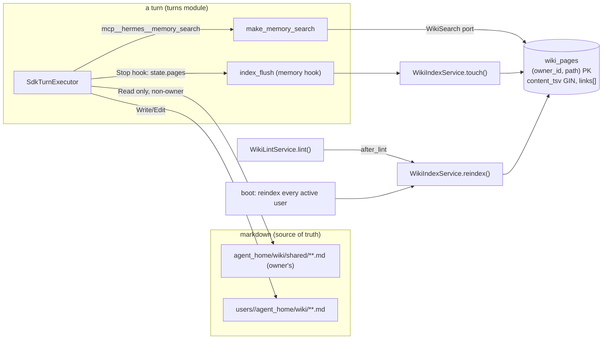

# Graph Memory Index Implementation Plan

> **For agentic workers:** REQUIRED SUB-SKILL: Use superpowers:subagent-driven-development (recommended) or superpowers:executing-plans to implement this plan task-by-task. Steps use checkbox (`- [ ]`) syntax for tracking.

**Goal:** give every user's markdown wiki a derived PostgreSQL index with
full-text search and one-hop link traversal, expose it to the model as one
narrow `memory_search` tool, and add a `shared/` wiki namespace every admitted
user can read and only the owner can write.

**Architecture:** the markdown tree under each `Workspace.wiki_root` stays the
one source of truth — the model keeps writing it with native `Write`/`Edit`,
the frozen system-prompt index is unchanged, and `wiki/raw/` stays immutable.
A new `wiki_pages` table is a *derived* index: memory's `WikiIndexService`
re-reads a page from disk (`read_page`, `split_frontmatter`) and upserts one row
per `(owner_id, path)`; a Stop hook flushes the pages a turn touched, a lint
pass reindexes its tree, and boot reindexes every active user. `memory_search`
is an in-process `hermes` MCP tool in `turns` that calls a consumer-side
`WikiSearch` port — FTS hits ranked by `ts_rank`, then the pages they link to
and the pages that link to them, up to `depth` hops. The `shared/` namespace is
`Workspace.shared_wiki_root` (inside the owner's wiki): a non-owner turn gets it
as a read root plus `readonly_guard_factory` over it, its rows carry
`shared = true`, and a non-owner's search sees `owner_id = me OR shared`.

**Tech Stack:** Python 3.12, SQLAlchemy 2 async (Core statements over
`AsyncEngine`) + Alembic, PostgreSQL 16 (`tsvector`, GIN, `TEXT[]`), the Claude
Agent SDK hook/`tool` API, pytest against a real PostgreSQL (`make test-db`).

**Groundwork already on this branch (commit `442ed70`):**
`Workspace.is_owner`, `Workspace.shared_wiki_root` (seeded with
`shared/index.md` by the owner's `ensure()`), and
`integrations/claude_sdk/guards.py::readonly_guard_factory(roots, *, cwd=None)`
+ `WRITE_TOOLS = "Write|Edit|MultiEdit|NotebookEdit"`. Both streams use these;
neither stream edits them.

## Locked Decisions

- **Markdown is the source of truth; `wiki_pages` is a cache.** A missing,
  stale or failed index row is never an error for a turn, a lint, or boot: every
  indexing call swallows and logs. Deleting the table and rebooting rebuilds it.
- **Table `wiki_pages`, primary key `(owner_id, path)`.** `owner_id BIGINT NOT
  NULL REFERENCES users(id) ON DELETE CASCADE` (a wiki belongs to exactly one
  person; the `SET NULL` of `0005` would leave orphan rows searchable by nobody).
  `path` is the wiki-root-relative posix path **without** `.md` — the same string
  `read_page()["path"]` and `WikiGraphService.graph()` already use, so the graph
  route and the index name a page identically.
- **Columns:** `ns TEXT`, `title TEXT`, `summary TEXT`, `tags TEXT[]`, `links
  TEXT[]` (the de-duplicated `link_target()` strings), `content TEXT` (body,
  frontmatter stripped), `shared BOOLEAN NOT NULL DEFAULT false`, `indexed_at
  TIMESTAMPTZ NOT NULL`, `content_tsv` = generated `to_tsvector('simple',
  regexp_replace(title || ' ' || summary || ' ' || content, '[^[:alnum:]]+', ' ', 'g'))`,
  persisted, GIN-indexed. `'simple'` because that is what `messages.content_tsv`
  uses and Russian text stems badly under any other built-in config.
- **No embedding column.** Production runs `postgres:16-alpine`, which has no
  `pgvector`; a vector column arrives with its own migration when the image does.
- **Shared namespace = the owner's `wiki/shared/`.** Rows for pages whose `path`
  starts with `shared/` are written with `shared = true` and `owner_id` = the
  deploy owner's id, and only when the tree being indexed is the owner's
  (`workspace.is_owner`). A non-owner's `shared/` folder, if they invent one, is
  private to them. Non-owner search predicate: `owner_id = :me OR shared`.
- **Tool name `mcp__hermes__memory_search`, registered LAST.** Registration
  order is the `allowed_tools` order and therefore part of the cached prefix;
  appending is the only order-preserving change. Schema `{"query": str,
  "depth": int}`; `depth` defaults to 1, is clamped to `0..2`. Absent on group
  lanes (same rule as `session_search`) and when `memory_search_enabled` is
  false. Turning the flag costs the same session reset any toolset change costs.
- **A toolset change resets every lane, at boot.** `allowed_tools` and the
  `hermes` MCP server are rebuilt every turn while `system_append` is frozen on
  the session row, so a new tool would otherwise appear mid-session on every
  live lane — the literal P1 failure. `main.build_app()` fingerprints the hermes
  tool-name list (`",".join(names)`) against the `meta` key `hermes_tools`
  (the `slash_commands` pattern in `turn_service.py`), and when it moved calls
  `runner.reset_all()` (the invalidator extension installs already use) and
  writes the new value. That one mechanism covers this deploy **and** every
  later flip of `memory_search_enabled`.
- **A hit's identity is `(owner_id, path)`, never `path` alone.** A non-owner may
  invent their own `shared/home` next to the owner's shared `shared/home`; both
  are legitimately in their scope. The `seen` set, the neighbour exclusion and
  the returned dicts all carry `owner_id`, and the handler prints `[shared]` on
  a row whose `owner_id` differs from the lane owner's.
- **`TurnHooksProvider.build(session_key, index_seen, workspace=None, *,
  owner_id: int = 0)`.** The hook that flushes touched pages needs the row's
  owner; `owner_id == 0` (a bare fork context) means "do not index". A flush
  skipped for `owner_id == 0` on a lane that HAS a workspace is logged once per
  process, so a call site that forgot the kwarg cannot index nothing forever
  in silence.
- **Reindex triggers in v1:** Stop-hook flush of `WikiTurnState.pages` per
  turn **and per review fork** (the fork is the wiki's main rewriter; without
  its flush `memory_search` would quote a stale snippet as memory); full
  reindex after a non-dry-run lint; full reindex of every user whose wiki
  exists on disk, once per boot, in the main process only, without
  `ensure()`-ing anyone's tree. No periodic job.
- **The flush is bounded:** `asyncio.wait_for(indexer.touch(...), timeout=5)`
  inside the Stop hook. A swallowed exception is not the failure mode to fear;
  a hung connection blocking the SDK's return is.
- **The write fence for a non-owner covers BOTH `shared/` paths:**
  `readonly_guard_factory([ws.shared_wiki_root, ws.wiki_root / "shared"], cwd=ws.agent_home)`.
  A model told a read-only shared wiki exists will try `Write("wiki/shared/x.md")`,
  which resolves into its OWN tree and would silently succeed as a private
  page; the deny message teaches it the truth. For the owner the two paths are
  one and no fence is installed.
- **Migration file `0006_wiki_pages.py`, `revision = "0006_wiki_pages"`,
  `down_revision = "0005"`.** The main checkout carries an uncommitted
  `revision = "0006"` (`0006_per_user_extensions`); a duplicate *identifier*
  makes every Alembic command fail at script load, whereas a second *head* is
  a loud, detectable `upgrade head` failure fixed by one `down_revision` edit
  at merge. Revision ids are opaque strings; nothing parses them.
- **The non-owner prompt budget is split, not doubled:** the own index keeps
  `index_max_chars`; the shared section is truncated at `index_max_chars // 4`
  (2000 by default) with the same `TRUNCATION_NOTE`.
- **Both `GET /api/wiki/*` routes stay owner-only and unchanged.** The index adds
  no HTTP surface.

## Global Constraints

- Prompt caching is sacred (PRD P1): no change to `TURN_RULES`, `WIKI_RULES`,
  `build_system_append`'s output for the owner, or the order of existing tools.
- Every always-on tool schema is paid for on every call (P2): `memory_search`
  has two fields and one sentence of description.
- Application layers import no `sqlalchemy`, `claude_agent_sdk`, `fastapi`,
  `httpx`; domain layers no `structlog` — the fourteen import-linter contracts
  in `pyproject.toml` hold. Modules never import each other: `turns` declares
  its own `WikiSearch` Protocol; `memory` provides the adapter;
  `main.build_app()` wires them.
- Every hook fails closed on an unparseable path and never raises into the SDK.
- Run tests with `PYTHONPATH=<worktree>/src D:/projects/claude-hermes/.venv/Scripts/python.exe -m pytest -q -p no:cacheprovider <files>`; `make test-db` is up on `127.0.0.1:55432`. Lint with `... -m ruff check <files>`.
- Commit style `feat(memory): …` / `feat(turns): …`, trailer
  `Co-Authored-By: Claude Fable 5.1 <noreply@anthropic.com>`. Stream agents do
  **not** commit; the orchestrator commits per stream after the gate.

## Architecture Diagram



## File map

```
Stream A — memory (+ the two core files only memory's rows need)
  src/claude_hermes/modules/memory/domain/tables.py                    (create)  WikiPageRow
  src/claude_hermes/core/db/migrations/versions/0006_wiki_pages.py     (create)
  src/claude_hermes/core/db/registry.py                                (modify)  import memory tables
  src/claude_hermes/modules/memory/application/ports.py               (modify)  WikiPageStore, WikiIndexerPort
  src/claude_hermes/modules/memory/application/services/index.py      (create)  WikiIndexService
  src/claude_hermes/modules/memory/application/services/lint.py       (modify)  after_lint
  src/claude_hermes/modules/memory/infrastructure/page_index.py       (create)  PgWikiIndex
  src/claude_hermes/modules/memory/infrastructure/turn_hooks.py       (modify)  index_flush_factory, wiki_hooks kwargs
  src/claude_hermes/modules/memory/infrastructure/wiki_store.py       (modify)  shared_root
  src/claude_hermes/modules/memory/infrastructure/lint_fork.py        (modify)  non-owner shared read root + fence
  src/claude_hermes/modules/memory/domain/prompts.py                  (modify)  build_wiki_lint_prompt(dry_run, *, shared_readonly=False)
  src/claude_hermes/core/app_context.py                                (modify)  WikiHooksProvider(indexer=), build(owner_id=), WikiForkGuards.index_flush
  src/claude_hermes/modules/memory/README.md                           (modify)
  tests/modules/memory/test_memory_index.py                            (create)
  tests/modules/memory/test_memory_index_hooks.py                      (create)
  tests/modules/memory/test_memory_store_shared.py                     (create)
  tests/modules/memory/test_memory_lint.py                             (modify)
  tests/modules/memory/test_memory_hooks_provider.py                   (modify)
  tests/test_migrations.py                                             (modify)

Stream B — turns, learning's fork runner, the config knob
  src/claude_hermes/core/config.py                                     (modify)  memory_search_enabled
  src/claude_hermes/modules/turns/application/ports.py                (modify)  WikiSearch, TurnSettings, TurnHooksProvider
  src/claude_hermes/modules/turns/infrastructure/tool_handlers/memory.py (create) make_memory_search
  src/claude_hermes/modules/turns/infrastructure/hermes_server.py     (modify)  wiki_search gate + tool
  src/claude_hermes/modules/turns/infrastructure/sdk_runner.py        (modify)  roots, fence, owner_id, wiki_search
  src/claude_hermes/modules/learning/infrastructure/fork_runner.py    (modify)  non-owner shared read root + fence, index flush, owner_id
  src/claude_hermes/modules/learning/application/ports.py             (modify)  ForkRunner.run_review(..., owner_id=)
  src/claude_hermes/modules/learning/application/services/*.py        (modify)  the run_review caller passes the scope's user_id
  src/claude_hermes/modules/turns/README.md                            (modify)
  src/claude_hermes/modules/learning/README.md                         (modify)
  tests/modules/turns/test_turns_memory_search.py                      (create)
  tests/modules/turns/test_turns_tool_gates.py                         (modify)
  tests/modules/turns/test_turns_workspace.py                          (modify)
  tests/modules/learning/test_learning_fork_roots.py                   (create)

Barrier — orchestrator only, after both streams
  src/claude_hermes/main.py                                            (modify)  composition
  src/claude_hermes/modules/learning/wiring.py                        (modify)  wiki_lint_for(workspace, user_id)
  README.md, docs/llm-wiki/**                                          (modify)
```

---

## Stream A — the index (memory module)

### Task A1: `wiki_pages` table, model, migration

**Files:**
- Create: `src/claude_hermes/modules/memory/domain/tables.py`
- Create: `src/claude_hermes/core/db/migrations/versions/0006_wiki_pages.py`
- Modify: `src/claude_hermes/core/db/registry.py`
- Test: `tests/test_migrations.py`

**Interfaces:**
- Reuses: `core/db/base.py::Base` (naming convention), the generated-tsvector
  pattern of `modules/sessions/domain/models.py::Message.content_tsv`, the
  `tables.py`-not-`models.py` placement of `modules/identity/domain/tables.py`
  (application imports `domain.models`; an ORM row that lives in `tables.py` is
  imported only by infrastructure and the registry, so the "application layers
  are framework-free" contract holds transitively).
- Produces: `WikiPageRow` (`__tablename__ = "wiki_pages"`), the table below.

| column | type | notes |
|---|---|---|
| `owner_id` | `BIGINT NOT NULL`, FK `users(id) ON DELETE CASCADE` | PK part 1 |
| `path` | `TEXT NOT NULL` | PK part 2, `ns/page`, no `.md` |
| `ns` | `TEXT NOT NULL DEFAULT ''` | first path segment |
| `title` | `TEXT NOT NULL DEFAULT ''` | |
| `summary` | `TEXT NOT NULL DEFAULT ''` | |
| `tags` | `TEXT[] NOT NULL DEFAULT '{}'` | |
| `links` | `TEXT[] NOT NULL DEFAULT '{}'` | outgoing wikilinks |
| `content` | `TEXT NOT NULL DEFAULT ''` | body without frontmatter |
| `shared` | `BOOLEAN NOT NULL DEFAULT false` | |
| `indexed_at` | `TIMESTAMPTZ NOT NULL` | |
| `content_tsv` | `TSVECTOR`, generated, persisted | GIN `ix_wiki_pages_content_tsv` |

Indexes: `ix_wiki_pages_shared` partial `WHERE shared`, GIN `ix_wiki_pages_links` on `links` (for the backlink query `links && ARRAY[...]`).

- [ ] **Step 1: Write the failing test** — append to `tests/test_migrations.py`:

```python
async def test_0006_wiki_pages_table(test_database):
    engine = create_async_engine(test_database)
    try:
        async with engine.connect() as conn:
            columns = await conn.run_sync(
                lambda c: {col["name"] for col in inspect(c).get_columns("wiki_pages")})
            pk = await conn.run_sync(
                lambda c: inspect(c).get_pk_constraint("wiki_pages")["constrained_columns"])
            indexes = await conn.run_sync(
                lambda c: {i["name"] for i in inspect(c).get_indexes("wiki_pages")})
    finally:
        await engine.dispose()
    assert {"owner_id", "path", "ns", "title", "summary", "tags", "links", "content",
            "shared", "indexed_at", "content_tsv"} <= columns
    assert pk == ["owner_id", "path"]
    assert {"ix_wiki_pages_content_tsv", "ix_wiki_pages_links", "ix_wiki_pages_shared"} <= indexes
```

- [ ] **Step 2: Run it** — `pytest tests/test_migrations.py -q` → FAIL (`NoSuchTableError`).
- [ ] **Step 3: Model** — `modules/memory/domain/tables.py`:

```python
"""The ORM row of the wiki INDEX — a cache over the markdown tree, never the wiki
itself (see the module README). In `tables.py`, not `models.py`, for the same
reason identity's row is: application imports `domain.models`, and the
"application layers are framework-free" contract forbids sqlalchemy there even
transitively. Only `infrastructure/page_index.py` and `core.db.registry` import this."""
from __future__ import annotations

from datetime import datetime

from sqlalchemy import BigInteger, Boolean, Computed, DateTime, ForeignKey, Index, Text, text
from sqlalchemy.dialects.postgresql import ARRAY, TSVECTOR
from sqlalchemy.orm import Mapped, mapped_column

from claude_hermes.core.db.base import Base

_TSV = ("to_tsvector('simple', regexp_replace("
        "title || ' ' || summary || ' ' || content, '[^[:alnum:]]+', ' ', 'g'))")


class WikiPageRow(Base):
    __tablename__ = "wiki_pages"

    owner_id: Mapped[int] = mapped_column(
        BigInteger, ForeignKey("users.id", ondelete="CASCADE"), primary_key=True)
    path: Mapped[str] = mapped_column(Text, primary_key=True)
    ns: Mapped[str] = mapped_column(Text, nullable=False, server_default="")
    title: Mapped[str] = mapped_column(Text, nullable=False, server_default="")
    summary: Mapped[str] = mapped_column(Text, nullable=False, server_default="")
    tags: Mapped[list[str]] = mapped_column(ARRAY(Text), nullable=False, server_default=text("'{}'"))
    links: Mapped[list[str]] = mapped_column(ARRAY(Text), nullable=False, server_default=text("'{}'"))
    content: Mapped[str] = mapped_column(Text, nullable=False, server_default="")
    shared: Mapped[bool] = mapped_column(Boolean, nullable=False, server_default=text("false"))
    indexed_at: Mapped[datetime] = mapped_column(DateTime(timezone=True), nullable=False)
    content_tsv = mapped_column(TSVECTOR, Computed(_TSV, persisted=True))

    __table_args__ = (
        Index("ix_wiki_pages_content_tsv", "content_tsv", postgresql_using="gin"),
        Index("ix_wiki_pages_links", "links", postgresql_using="gin"),
        Index("ix_wiki_pages_shared", "shared", postgresql_where=text("shared")),
    )
```

- [ ] **Step 4: Migration** — `0006_wiki_pages.py` with `revision = "0006_wiki_pages"`,
  `down_revision = "0005"` (see Locked Decisions for why the id is not `"0006"`),
  mirrors the model with `op.create_table` (constraint names via `op.f("pk_wiki_pages")`,
  `op.f("fk_wiki_pages_owner_id_users")`), `sa.Computed(_TSV, persisted=True)`
  for `content_tsv`, the three `op.create_index` calls (`postgresql_using="gin"`
  ×2, `postgresql_where=sa.text("shared")`). `downgrade()` drops the table.
- [ ] **Step 5: Register** — add
  `from claude_hermes.modules.memory.domain import tables as _memory  # noqa: F401`
  to `core/db/registry.py` in alphabetical position.
- [ ] **Step 6: Run** — `pytest tests/test_migrations.py -q` → PASS, including
  `test_upgrade_head_matches_orm_metadata` (the drift gate: model and migration
  must agree byte-for-byte on server defaults — use `server_default=text("'{}'")`,
  `text("false")`, and `server_default=""` exactly as above on both sides).

### Task A2: `PgWikiIndex` — the store and the search

**Files:**
- Modify: `src/claude_hermes/modules/memory/application/ports.py`
- Create: `src/claude_hermes/modules/memory/infrastructure/page_index.py`
- Test: `tests/modules/memory/test_memory_index.py`

**Interfaces:**
- Reuses: `modules/sessions/infrastructure/repositories.py` — the
  `AsyncEngine`-per-repository rule, `_TS_CONFIG = literal_column("'simple'::regconfig")`,
  `plainto_tsquery` + `regexp_replace` + `ts_headline` + `ts_rank` shape of
  `MessageRepository.search`; `pg_insert(...).on_conflict_do_update`.
- Produces (in `application/ports.py`):

```python
class WikiPageStore(Protocol):
    """Where index rows live. Satisfied by `PgWikiIndex`."""
    async def upsert(self, owner_id: int, page: Mapping[str, Any], *, content: str,
                     shared: bool, now: datetime) -> None: ...
    async def delete(self, owner_id: int, path: str) -> None: ...
    async def paths(self, owner_id: int) -> set[str]: ...


class WikiIndexerPort(Protocol):
    """What turns' hooks and the lint pass call. Satisfied by `WikiIndexService`."""
    async def touch(self, owner_id: int, workspace: Any, rel_paths: Iterable[str]) -> None: ...
    async def reindex(self, owner_id: int, workspace: Any) -> None: ...
```

  and (in `infrastructure/page_index.py`) `PgWikiIndex(engine)` satisfying
  `WikiPageStore` plus the search turns consumes:

```python
async def search(self, query: str, *, owner_id: int, limit: int = 8,
                 depth: int = 1) -> list[dict]:
```

  Each hit dict: `{"owner_id", "path", "ns", "title", "summary", "tags", "links",
  "shared", "snippet", "via", "hop"}` — `via` is `"search"` for an FTS hit,
  `"link"` for a page a hit links to, `"backlink"` for a page linking to a hit;
  `hop` is 0, 1 or 2; `snippet` is `ts_headline(...)` for `via == "search"` and
  `""` otherwise. **Identity is `(owner_id, path)`** throughout: the `seen`
  set, the neighbour exclusion, and the dicts.

- [ ] **Step 1: Failing tests** — `tests/modules/memory/test_memory_index.py`
  (real PG: fixtures `engine`, `ensure_users` from `tests/conftest.py`):

```python
from datetime import datetime, timezone
import pytest
from claude_hermes.modules.memory.infrastructure.page_index import PgWikiIndex
from tests.conftest import ensure_users

NOW = datetime(2026, 9, 22, tzinfo=timezone.utc)

def page(path, title="", summary="", links=(), tags=()):
    ns = path.split("/")[0] if "/" in path else ""
    return {"path": path, "ns": ns, "title": title or path, "summary": summary,
            "tags": list(tags), "links": list(links), "updated": "", "in_index": True}

@pytest.fixture
async def store(engine):
    await ensure_users(engine, 1, 7, owner=1)
    return PgWikiIndex(engine)

async def test_upsert_is_idempotent_and_replaces(store):
    await store.upsert(1, page("user/prefs", "Prefs"), content="likes tea", shared=False, now=NOW)
    await store.upsert(1, page("user/prefs", "Prefs"), content="likes coffee", shared=False, now=NOW)
    hits = await store.search("coffee", owner_id=1)
    assert [h["path"] for h in hits] == ["user/prefs"]
    assert await store.search("tea", owner_id=1) == []

async def test_search_is_scoped_to_the_owner_plus_shared(store):
    await store.upsert(1, page("user/me", "Owner"), content="secret owner fact", shared=False, now=NOW)
    await store.upsert(1, page("shared/home", "Home"), content="the flat in Batumi", shared=True, now=NOW)
    await store.upsert(7, page("user/me", "Wife"), content="her own fact Batumi", shared=False, now=NOW)
    mine = await store.search("Batumi", owner_id=7)
    assert {h["path"] for h in mine} == {"user/me", "shared/home"}
    assert next(h for h in mine if h["path"] == "shared/home")["shared"] is True
    assert await store.search("secret", owner_id=7) == []

async def test_depth_one_adds_links_and_backlinks_marked_via(store):
    await store.upsert(1, page("topics/tea", "Tea", links=["topics/kettle"]), content="green tea", shared=False, now=NOW)
    await store.upsert(1, page("topics/kettle", "Kettle"), content="a kettle", shared=False, now=NOW)
    await store.upsert(1, page("projects/cafe", "Cafe", links=["topics/tea"]), content="a cafe plan", shared=False, now=NOW)
    await store.upsert(1, page("topics/far", "Far"), content="unrelated", shared=False, now=NOW)
    hits = await store.search("green", owner_id=1, depth=1)
    by = {h["path"]: h for h in hits}
    assert by["topics/tea"]["via"] == "search" and by["topics/tea"]["hop"] == 0
    assert by["topics/kettle"]["via"] == "link" and by["topics/kettle"]["hop"] == 1
    assert by["projects/cafe"]["via"] == "backlink" and by["projects/cafe"]["hop"] == 1
    assert "topics/far" not in by
    assert [h["path"] for h in await store.search("green", owner_id=1, depth=0)] == ["topics/tea"]

async def test_a_hit_carries_a_snippet_and_a_neighbour_does_not(store):
    await store.upsert(1, page("a", "A", links=["b"]), content="word " * 30 + "needle " + "word " * 30, shared=False, now=NOW)
    await store.upsert(1, page("b", "B"), content="plain", shared=False, now=NOW)
    hits = await store.search("needle", owner_id=1)
    assert "[needle]" in next(h for h in hits if h["path"] == "a")["snippet"]
    assert next(h for h in hits if h["path"] == "b")["snippet"] == ""

async def test_paths_and_delete(store):
    await store.upsert(1, page("x/one"), content="", shared=False, now=NOW)
    await store.upsert(1, page("x/two"), content="", shared=False, now=NOW)
    assert await store.paths(1) == {"x/one", "x/two"}
    await store.delete(1, "x/one")
    assert await store.paths(1) == {"x/two"}
    assert await store.paths(7) == set()

async def test_an_empty_or_punctuation_only_query_returns_nothing(store):
    await store.upsert(1, page("x/one"), content="anything", shared=False, now=NOW)
    assert await store.search("", owner_id=1) == []
    assert await store.search("!!! ???", owner_id=1) == []

async def test_limit_bounds_hits_and_neighbours_separately(store):
    for i in range(12):
        await store.upsert(1, page(f"t/p{i}", f"P{i}", links=[f"t/n{i}"]), content="needle", shared=False, now=NOW)
        await store.upsert(1, page(f"t/n{i}"), content="neighbour", shared=False, now=NOW)
    hits = await store.search("needle", owner_id=1, limit=5, depth=1)
    assert sum(h["via"] == "search" for h in hits) == 5
    assert sum(h["via"] != "search" for h in hits) <= 5

async def test_a_same_path_collision_between_shared_and_private_keeps_both(store):
    # the owner's shared page and user 7's own page with the SAME path
    await store.upsert(1, page("shared/home", "Our home", links=["shared/kids"]), content="family flat", shared=True, now=NOW)
    await store.upsert(1, page("shared/kids", "Kids"), content="school", shared=True, now=NOW)
    await store.upsert(7, page("shared/home", "My draft"), content="my private flat notes", shared=False, now=NOW)
    hits = await store.search("flat", owner_id=7, depth=1)
    keys = {(h["owner_id"], h["path"]) for h in hits}
    assert {(1, "shared/home"), (7, "shared/home"), (1, "shared/kids")} <= keys
    assert next(h for h in hits if h["owner_id"] == 7)["shared"] is False
```

- [ ] **Step 2: Run** → FAIL (`ModuleNotFoundError`).
- [ ] **Step 3: Implement `PgWikiIndex`.** Search algorithm, one connection:
  1. Normalise the query as sessions does; if the normalised string has no
     alphanumeric character, return `[]` without touching the database.
  2. `scope = or_(WikiPageRow.owner_id == owner_id, WikiPageRow.shared.is_(True))`.
  3. Hits: `select(cols, ts_headline(...).label("snippet")).where(scope,
     content_tsv.op("@@")(q)).order_by(ts_rank(...).desc(), path).limit(limit)`.
  4. For `hop in 1..depth`: frontier = paths of the previous hop; `links_out` =
     union of their `links`; neighbours = `select(cols).where(scope,
     tuple_(WikiPageRow.owner_id, WikiPageRow.path).notin_(seen),
     or_(WikiPageRow.path.in_(links_out), WikiPageRow.links.op("&&")(array(frontier))))
     .order_by(owner_id, path).limit(limit)` where `seen` is a set of
     `(owner_id, path)` tuples (`sqlalchemy.tuple_`). `via` = `"link"` if
     `row.path in links_out` else `"backlink"`. Add to `seen`. Stop early when
     the frontier is empty.
  5. Return hits then neighbours, hop-ordered. `depth` clamped to `0..2`,
     `limit` to `1..25`.
  `upsert` is one `pg_insert(...).on_conflict_do_update(index_elements=["owner_id","path"], set_={...})`.
  `content` is stored as passed (the service strips frontmatter); cap it at
  `200_000` characters so a pasted log cannot bloat the row.
- [ ] **Step 4: Run** → PASS. `ruff check` the two files.

### Task A3: `WikiIndexService` — from disk to rows

**Files:**
- Create: `src/claude_hermes/modules/memory/application/services/index.py`
- Test: `tests/modules/memory/test_memory_index.py` (append)

**Interfaces:**
- Reuses: `domain/page.py::read_page`, `split_frontmatter`, `BOOKKEEPING`;
  `application/services/graph.py::page_paths(root)`; `WikiPageStore`.
- Consumes: `WikiPageStore` (A2).
- Produces: `WikiIndexService(store, *, clock=None)` satisfying
  `WikiIndexerPort`: `touch(owner_id, workspace, rel_paths)` and
  `reindex(owner_id, workspace)`. `workspace` is duck-typed on `.wiki_root`
  and `.is_owner` (never imports `core.workspace` — the domain/application
  layers stay core-free; document this like `TurnContext.workspace`).

Rules:
- `rel_paths` are what `page_touch` records: root-relative posix **with**
  `.md` (`topics/foo.md`). Strip `.md`; skip `BOOKKEEPING`, anything under
  `raw/`, and any segment starting with `.`.
- A path whose file no longer exists → `store.delete`.
- `shared = workspace.is_owner and path.startswith("shared/")`.
- `content` = `split_frontmatter(text)[1]`; `page` = `read_page(path, file, "")`
  (`in_index` is not a column, so the index file is not read per touch).
- `reindex`: `paths = page_paths(wiki_root)`; upsert each; delete every row in
  `store.paths(owner_id) - {p for p, _ in paths}`.
- Both methods catch `Exception`, `log.exception(...)`, and return: an index
  failure never propagates into a hook or a lint.
- `owner_id <= 0` → return immediately (a bare fork context).
- **`owner_id` and `workspace` must agree.** For `not workspace.is_owner`,
  require `workspace.root.name == str(owner_id)` (the `users/<id>` convention
  `identity`'s `user_workspace_dir` writes); otherwise `log.error(...)` and
  return without writing. Today both come from `lane_owner` resolved once per
  turn and cannot diverge; this is the cheap tripwire against a future caller
  that pairs user A's tree with owner B's id and makes A's pages searchable by B.

- [ ] **Step 1: Failing tests** (append to `test_memory_index.py`):

```python
from claude_hermes.modules.memory.application.services.index import WikiIndexService

class WS:
    """The three attributes the service reads, in the real layout."""
    def __init__(self, root, is_owner):
        self.root = root; self.wiki_root = root / "agent_home" / "wiki"; self.is_owner = is_owner

def owner_ws(tmp_path): return WS(tmp_path, True)
def user_ws(tmp_path, uid): return WS(tmp_path / "users" / str(uid), False)

def write(root, rel, text):
    f = root / rel; f.parent.mkdir(parents=True, exist_ok=True); f.write_text(text, encoding="utf-8"); return f

async def test_a_mismatched_owner_id_and_workspace_writes_nothing(store, tmp_path):
    ws = user_ws(tmp_path, 7); write(ws.wiki_root, "a/one.md", "one")
    await WikiIndexService(store).touch(1, ws, {"a/one.md"})     # owner id 1, tree users/7
    assert await store.paths(1) == set() and await store.paths(7) == set()

async def test_touch_indexes_a_page_from_disk(store, tmp_path):
    ws = owner_ws(tmp_path)
    write(ws.wiki_root, "index.md", "- [[user/prefs]]")
    write(ws.wiki_root, "user/prefs.md", "---\ntitle: Prefs\nsummary: what I like\ntags: [me]\n---\nI drink [[topics/tea]].")
    svc = WikiIndexService(store)
    await svc.touch(1, ws, {"user/prefs.md", "index.md", "raw/src.md"})
    hits = await store.search("drink", owner_id=1)
    assert len(hits) == 1 and hits[0]["title"] == "Prefs" and hits[0]["links"] == ["topics/tea"]
    assert await store.paths(1) == {"user/prefs"}

async def test_touching_a_deleted_page_removes_its_row(store, tmp_path):
    ws = owner_ws(tmp_path)
    write(ws.wiki_root, "user/gone.md", "bye")
    svc = WikiIndexService(store)
    await svc.touch(1, ws, {"user/gone.md"})
    (ws.wiki_root / "user/gone.md").unlink()
    await svc.touch(1, ws, {"user/gone.md"})
    assert await store.paths(1) == set()

async def test_shared_is_only_the_owners_shared_folder(store, tmp_path):
    owner = owner_ws(tmp_path); user = user_ws(tmp_path, 7)
    write(owner.wiki_root, "shared/home.md", "our flat"); write(user.wiki_root, "shared/mine.md", "my thing")
    svc = WikiIndexService(store)
    await svc.touch(1, owner, {"shared/home.md"}); await svc.touch(7, user, {"shared/mine.md"})
    assert [h["path"] for h in await store.search("flat", owner_id=7)] == ["shared/home"]
    assert await store.search("thing", owner_id=1) == []

async def test_reindex_converges_the_table_to_the_tree(store, tmp_path):
    ws = owner_ws(tmp_path)
    write(ws.wiki_root, "a/one.md", "one"); write(ws.wiki_root, "a/two.md", "two")
    await store.upsert(1, page("a/stale"), content="stale", shared=False, now=NOW)
    await WikiIndexService(store).reindex(1, ws)
    assert await store.paths(1) == {"a/one", "a/two"}

async def test_an_index_failure_never_raises(tmp_path):
    class Broken:
        async def upsert(self, *a, **k): raise RuntimeError("db down")
        async def delete(self, *a, **k): raise RuntimeError("db down")
        async def paths(self, *a, **k): raise RuntimeError("db down")
    ws = owner_ws(tmp_path); write(ws.wiki_root, "a/one.md", "one")
    svc = WikiIndexService(Broken())
    await svc.touch(1, ws, {"a/one.md"}); await svc.reindex(1, ws)   # no raise

async def test_owner_zero_indexes_nothing(store, tmp_path):
    ws = owner_ws(tmp_path); write(ws.wiki_root, "a/one.md", "one")
    await WikiIndexService(store).touch(0, ws, {"a/one.md"})
    assert await store.paths(1) == set()
```

- [ ] **Step 2: Run** → FAIL. **Step 3: Implement.** **Step 4: Run** → PASS; ruff.

### Task A4: the Stop-hook flush and the hooks provider

**Files:**
- Modify: `src/claude_hermes/modules/memory/infrastructure/turn_hooks.py`
- Modify: `src/claude_hermes/core/app_context.py` (`WikiHooksProvider` only)
- Test: `tests/modules/memory/test_memory_index_hooks.py` (create),
  `tests/modules/memory/test_memory_hooks_provider.py` (modify)

**Interfaces:**
- Reuses: `WikiTurnState.pages`, `stop_gate_factory` (the flush is a second
  Stop hook appended after the gate in the same matcher's list; flushing twice
  is idempotent, so whether or not the SDK runs later hooks after a `block`
  does not matter and the code must not claim either way).
- Consumes: `WikiIndexerPort` (A3).
- Produces:

```python
FLUSH_TIMEOUT_SECONDS = 5.0

def index_flush_factory(state: WikiTurnState, indexer: WikiIndexerPort,
                        owner_id: int, workspace: Any):
    async def hook(input_data: dict, tool_use_id, context) -> dict:
        if not state.pages:
            return {}
        if owner_id <= 0:
            _say_unindexed_once(workspace)          # log once per process
            return {}
        try:
            await asyncio.wait_for(
                indexer.touch(owner_id, workspace, set(state.pages)), FLUSH_TIMEOUT_SECONDS)
        except (asyncio.TimeoutError, Exception):   # a hung DB must not hold the reply
            log.exception("wiki index flush failed", owner_id=owner_id)
        return {}
    return hook

def wiki_hooks(wiki_root, state, *, index=None, seen=None, session_key="",
               webfetch_hint=False, indexer=None, owner_id: int = 0,
               workspace: Any = None) -> dict[str, list[HookMatcher]]:
    # installs the flush on "Stop" only when indexer is not None
```

  and in `core/app_context.py`:

```python
class WikiHooksProvider:
    def __init__(self, wiki, *, wiki_hooks, new_state, wiki_for=None, indexer=None): ...
    def build(self, session_key, index_seen, workspace=None, *, owner_id: int = 0) -> dict:
        # passes indexer=self._indexer, owner_id=owner_id, workspace=workspace through

class WikiForkGuards:
    def __init__(self, *, new_state, raw_guard, page_touch, stop_gate, index_flush=None, indexer=None): ...
    def index_flush(self, state, owner_id: int, workspace: Any):
        """The Stop hook for a review fork, or None when no indexer is wired."""
        if self._index_flush is None or self._indexer is None:
            return None
        return self._index_flush(state, self._indexer, owner_id, workspace)
```

- [ ] **Step 1: Failing tests** — `test_memory_index_hooks.py`: a `FakeIndexer`
  recording `touch(owner_id, workspace, rel_paths)` calls; (a) after
  `page_touch` saw `topics/x.md` the Stop hook calls `touch(7, ws, {"topics/x.md"})`
  once and returns `{}`; (b) with `owner_id=0` the Stop hook never calls;
  (c) with an empty `state.pages` no call; (d) `wiki_hooks(...)` without
  `indexer` yields exactly the pre-existing `Stop` list length (one matcher,
  one hook), and with `indexer` + `owner_id=7` the gate matcher's hook list is
  `[stop_gate, flush]` in that order; (e) an indexer that raises does not
  propagate out of the hook; (f) an indexer that never returns (an
  `asyncio.Event().wait()`) is abandoned after the timeout — monkeypatch
  `FLUSH_TIMEOUT_SECONDS` to `0.05` — and the hook still returns `{}`.
  `test_memory_hooks_provider.py`: `WikiHooksProvider(..., indexer=fake).build("tg:private:7", {}, ws, owner_id=7)`
  passes all three through (assert on the captured kwargs of a stub `wiki_hooks`);
  `WikiForkGuards(..., index_flush=index_flush_factory, indexer=fake).index_flush(state, 7, ws)`
  returns a hook, and without `indexer` returns `None`.
- [ ] **Step 2: Run** → FAIL. **Step 3: Implement.** **Step 4: Run** → PASS; ruff.

### Task A5: the shared index in the non-owner's prompt

**Files:**
- Modify: `src/claude_hermes/modules/memory/infrastructure/wiki_store.py`
- Test: `tests/modules/memory/test_memory_store_shared.py` (create)

**Interfaces:**
- Reuses: `WikiStore.index()`, `index_mtime()`, `TRUNCATION_NOTE`.
- Produces: `WikiStore(root, index_max_chars=8000, *, shared_root: Path | None = None)`;
  `WikiStore.for_workspace(ws, index_max_chars=8000)` sets
  `shared_root = None if ws.is_owner else ws.shared_wiki_root` (duck-typed with
  `getattr(ws, "is_owner", True)` so existing fakes with only `.root` keep working).

Rules:
- `index()` = own index (truncated as today) and, when `shared_root` is set and
  `shared_root/index.md` is readable and non-empty:
  `"\n\n## Shared wiki (read-only; on disk at <shared_root>)\n\n" + shared index text`,
  the shared part truncated at `index_max_chars // 4` with `TRUNCATION_NOTE`
  (a non-owner's frozen prefix grows by at most a quarter, not double).
- `index_mtime()` = `max(own, shared)` so `index_refresh_factory` re-injects
  when the owner edits `shared/index.md`.
- The owner's store (`shared_root=None`) produces byte-identical output to
  today — pin it.

- [ ] **Step 1: Failing tests** — owner output unchanged; non-owner gets the
  section with the absolute path; missing shared index → no section; mtime is
  the max; `for_workspace` picks `None` for `Workspace.owner(tmp)` and the
  shared root for `Workspace.for_user(tmp, "users/7")`.
- [ ] **Step 2–4:** FAIL → implement → PASS; ruff.

### Task A6: lint pass — shared read root, fence, and the reindex after

**Files:**
- Modify: `src/claude_hermes/modules/memory/infrastructure/lint_fork.py`
- Modify: `src/claude_hermes/modules/memory/application/services/lint.py`
- Modify: `src/claude_hermes/modules/memory/domain/prompts.py`
- Test: `tests/modules/memory/test_memory_lint.py` (modify)

**Interfaces:**
- Reuses: `readonly_guard_factory`, `WRITE_TOOLS` from `integrations/claude_sdk/guards.py`;
  `Workspace.is_owner`, `Workspace.shared_wiki_root`.
- Produces: `WikiLintService(wiki_root, runner, options, *, workspace=None,
  after_lint: Callable[[], Awaitable[None]] | None = None)`; `lint()` awaits
  `after_lint()` after a **non-dry-run** run that returned a result (inside the
  same try, so a failing callback is logged, not raised).
  `build_wiki_lint_service(cfg, home, wiki_root, runner=None, workspace=None, *, after_lint=None)`.
  `WikiLintOptions.build`: when `not ws.is_owner`, the path guard's roots gain
  `ws.shared_wiki_root` and the `Write|Edit` matcher gains
  `readonly_guard_factory([ws.shared_wiki_root, ws.wiki_root / "shared"], cwd=ws.agent_home)`
  (both spellings: the owner's shared tree AND the user's own `shared/`, so a
  relative `wiki/shared/x.md` cannot land as a private page by accident).
  `build_wiki_lint_prompt(dry_run, *, shared_readonly: bool = False)` appends,
  when true, one sentence: *"Pages under `shared/` belong to the deploy owner
  and are read-only for you; do not try to edit them or fix their links."* —
  `WikiLintService` passes `shared_readonly=not workspace.is_owner` when it
  has a workspace (duck-typed, default `False`), so a non-owner's lint does not
  burn `curator_max_turns` on denied writes.

- [ ] **Step 1: Failing tests** — (a) `after_lint` awaited once after a wet run,
  never after `dry_run=True`, never when the runner returned `None`; (b) a
  raising `after_lint` is swallowed and `lint()` still returns the fork's text;
  (c) options for a non-owner workspace: the `PreToolUse` path-guard hook admits
  a `Read` of `shared_wiki_root / "home.md"`, the `Write|Edit` matcher denies
  a `Write` there AND a `Write` to `ws.wiki_root / "shared" / "x.md"`, while the
  owner's options carry neither (compare hook counts) and the owner's `Write`
  to their own `shared/` is allowed; (d) the prompt handed to the runner
  contains the read-only sentence for a non-owner workspace and not for the
  owner's / for `workspace=None`.
- [ ] **Step 2–4:** FAIL → implement → PASS; ruff.

### Task A7: README

- [ ] Update `src/claude_hermes/modules/memory/README.md`: the module now owns
  one table (`wiki_pages`, a cache — say so in the first paragraph and flip "It
  owns no database table"), the new files in **Layout**, `WikiPageStore` /
  `WikiIndexerPort` under **Ports provided**, the three reindex triggers, the
  shared namespace rules (owner writes, everyone reads, `shared = true` rows),
  and two invariants: *"a failed index write never reaches a turn"* and *"the
  index is rebuilt from disk; disk wins"*.

**Stream A verification:** `pytest tests/modules/memory tests/test_migrations.py tests/test_web_wiki.py -q` and `ruff check src/claude_hermes/modules/memory src/claude_hermes/core/app_context.py src/claude_hermes/core/db tests/modules/memory tests/test_migrations.py`.

---

## Stream B — the tool and the fence (turns, learning fork, config)

### Task B1: the knob and the ports

**Files:**
- Modify: `src/claude_hermes/core/config.py` (one field, next to `users_learning_enabled`)
- Modify: `src/claude_hermes/modules/turns/application/ports.py`

**Produces:**

```python
# core/config.py
memory_search_enabled: bool = True   # the wiki index tool on private/web lanes

# turns/application/ports.py
class WikiSearch(Protocol):
    """Full-text + link-hop search over the lane owner's wiki index (and the
    shared namespace). Satisfied by memory's `PgWikiIndex`."""
    async def search(self, query: str, *, owner_id: int, limit: int = 8,
                     depth: int = 1) -> Sequence[Mapping[str, Any]]: ...

class TurnSettings:
    ...
    memory_search_enabled: bool = True      # + add to the from_config tuple

class TurnHooksProvider(Protocol):
    def build(self, session_key: str, index_seen: MutableMapping[str, float],
              workspace: Any = None, *, owner_id: int = 0) -> Mapping[str, Sequence[Any]]: ...
```

- [ ] Add them; `pytest tests/modules/turns/test_turns_service.py -q` still green.

### Task B2: `make_memory_search` handler

**Files:**
- Create: `src/claude_hermes/modules/turns/infrastructure/tool_handlers/memory.py`
- Test: `tests/modules/turns/test_turns_memory_search.py`

**Interfaces:**
- Reuses: `tool_handlers/search.py::make_session_search` (owner from
  `getattr(ctx, "owner_id", 0)`, the `{"content": [{"type": "text", "text": ...}]}`
  return shape).
- Consumes: `WikiSearch` (B1).
- Produces: `make_memory_search(search: WikiSearch, ctx=None)` → async
  `memory_search(args: dict) -> dict`.

Output text, one block per hit, hits first then neighbours:

```
user/prefs — Prefs · what I like · tags: me
  …drink [tea] every…
  links: topics/tea
topics/kettle — Kettle · (linked from user/prefs)
shared/home — Home · the flat · [shared]
```

Rules: `query` stripped; empty → `"memory_search: give me a query."`; no hits →
`"No wiki page matches «<query>». Read wiki/index.md before concluding it is not there."`;
`depth` = `int(args.get("depth", 1))` clamped `0..2` (non-int → 1); limit 8;
`owner_id == 0` → search with `owner_id=0` (the store returns only shared rows,
which is the right answer for a bare context). Never raises: an exception from
the port becomes `"memory_search is unavailable right now (<type>)."`.
**A foreign row's links are filtered:** for a hit whose `owner_id != lane
owner_id` (a shared page), print only the links that name a page in the
visible result set — a shared page linking `[[user/health]]` must not tell
every admitted user that the owner has a page at `user/health`. The lane
owner's own rows print their links verbatim. **Output is clipped in
characters**, not rows: `MEMORY_SEARCH_MAX_CHARS = 6000`, cut on a block
boundary with a trailing `"… (N more)"` line — 8 hits + 2 hops × 8 neighbours
with summaries would otherwise be the biggest tool result a turn sees.

- [ ] **Step 1: Failing tests** with a `FakeWikiSearch` recording kwargs and
  returning canned dicts: (a) owner_id comes from `ctx`; (b) formatting of a
  search hit with snippet/tags/links, a `link` neighbour, a `backlink`
  neighbour, and a shared row; (c) empty query; (d) no hits; (e) depth clamp
  and non-int depth; (f) a raising port yields the unavailable text; (g) a
  shared row (`owner_id=1`, lane owner 7) with `links=["user/health",
  "shared/kids"]` where only `shared/kids` is in the result set prints
  `links: shared/kids` and never the string `user/health`; (h) forty rows are
  clipped under `MEMORY_SEARCH_MAX_CHARS` on a block boundary with the
  "more" line.
- [ ] **Step 2–4:** FAIL → implement → PASS; ruff.

### Task B3: register the tool, last

**Files:**
- Modify: `src/claude_hermes/modules/turns/infrastructure/hermes_server.py`
- Test: `tests/modules/turns/test_turns_tool_gates.py`

- [ ] `make_handlers(..., wiki_search: WikiSearch | None = None)` adds
  `handlers["memory_search"] = make_memory_search(wiki_search, ctx)` when the
  port is not `None`. In `build_hermes_server` append — **after `ask_user`** —
  `tool("memory_search", "Search the wiki memory by topic: full-text hits plus the pages they link to. Use before reading wiki pages one by one.", {"query": str, "depth": int})`
  and `names.append("mcp__hermes__memory_search")`.
- [ ] Tests: `test_the_two_always_on_tools_need_no_ports` still holds (the new
  tool is gated); `test_registration_order_is_the_allowed_tools_order` gains
  `mcp__hermes__memory_search` as the LAST name; a new test that
  `wiki_search=FakeWikiSearch()` yields the handler and the name.

### Task B4: the runner — roots, fence, owner_id, gate

**Files:**
- Modify: `src/claude_hermes/modules/turns/infrastructure/sdk_runner.py`
- Test: `tests/modules/turns/test_turns_workspace.py`

**Interfaces:**
- Reuses: `_allowed_roots`, `_build_hooks`, the `group`/`is_owner_lane` gating
  of `search`/`costs`/`skills`; `readonly_guard_factory`, `WRITE_TOOLS`.
- Produces: `SdkTurnExecutor(..., wiki_search: WikiSearch | None = None)`.

- [ ] `_allowed_roots(ws)`: append `ws.shared_wiki_root` when `not ws.is_owner`
  (duck-typed `getattr(ws, "is_owner", True)`).
- [ ] `_build_hooks(session_key, index_seen, ws, *, owner_id=0)`: for a
  non-owner add `HookMatcher(matcher=WRITE_TOOLS, hooks=[readonly_guard_factory([ws.shared_wiki_root, ws.wiki_root / "shared"], cwd=ws.agent_home)])`
  to `PreToolUse` (both spellings — see Locked Decisions); call
  `self._hooks.build(session_key, index_seen, ws, owner_id=owner_id)`.
  In `execute`, pass `owner_id=getattr(ctx, "owner_id", 0)`.
- [ ] `make_handlers(..., wiki_search=None if (group or not getattr(self._settings, "memory_search_enabled", True)) else self._wiki_search)`.
- [ ] Tests in `test_turns_workspace.py`: (a) a non-owner lane's allowed roots
  contain `shared_wiki_root` and the owner's do not (it is already inside their
  `agent_home`); (b) a non-owner lane's `PreToolUse` has a `WRITE_TOOLS` matcher
  whose hook denies a `Write` to `shared_wiki_root / "x.md"` AND to
  `ws.wiki_root / "shared" / "x.md"`, and the owner's `PreToolUse` has no such
  matcher; (c) `mcp__hermes__memory_search` is in
  `allowed_tools` on a private lane, absent on a group lane, absent when
  `TurnSettings(memory_search_enabled=False)`; (d) the hooks provider fake
  receives `owner_id == ctx.owner_id`. Existing tests that stub the hooks
  provider's `build(session_key, index_seen, ws)` must accept the new kwarg —
  update the fakes, not the contract.

### Task B5: the review fork — same read root, same fence, and its own flush

**Files:**
- Modify: `src/claude_hermes/modules/learning/infrastructure/fork_runner.py`
- Modify: `src/claude_hermes/modules/learning/application/ports.py` (`ForkRunner` Protocol, `WikiGuardsPort`)
- Modify: the learning application service that calls `run_review` (find it
  with `grep -rn "run_review(" src/claude_hermes/modules/learning`) so it passes
  the scope's `user_id` as `owner_id`
- Test: `tests/modules/learning/test_learning_fork_roots.py` (create), plus the
  existing fork-runner / review-service tests whose fakes need the new kwarg

**Interfaces:**
- Reuses: `fork_roots`, `fork_path_guard`, `WikiGuardsPort` (the four hook
  factories memory hands learning through `core.app_context.WikiForkGuards`).
- Consumes: `WikiForkGuards.index_flush(state, owner_id, workspace) -> hook | None`
  (Stream A, Task A4 — a structural addition to learning's `WikiGuardsPort`;
  learning declares it as `def index_flush(self, state, owner_id: int, workspace) -> Any | None: ...`).
- Produces: `ForkRunner.run_review(..., workspace=None, owner_id: int = 0)`.

- [ ] `fork_roots(ws)`: append `ws.shared_wiki_root` when `not ws.is_owner`.
  Add `fork_readonly_fence(ws) -> HookMatcher | None` returning the
  `WRITE_TOOLS` matcher with `readonly_guard_factory([ws.shared_wiki_root, ws.wiki_root / "shared"], cwd=ws.agent_home)`
  for a non-owner, `None` for the owner; install it in both `run_review` and
  `run_consolidation` `PreToolUse` lists when not `None`. The review fork's
  existing `write_guard_factory([skills_dir, wiki_root], ...)` already excludes
  the owner's shared root for a non-owner (it is not under their `wiki_root`),
  but NOT their own `wiki/shared/`; the fence is what closes that.
- [ ] **The review fork flushes what it wrote.** The fork is the wiki's main
  rewriter (P3: curation runs out of band), so without this `memory_search`
  quotes a stale snippet as memory until the next lint or boot. In
  `run_review`, after `stop_gate`, append `self._guards.index_flush(state, owner_id, workspace_or_owner)`
  to the `"Stop"` list when it is not `None`. `run_consolidation` writes only
  skills and gets no flush.
- [ ] Tests: roots for `Workspace.for_user(tmp, "users/7")` include the shared
  root; for `Workspace.owner(tmp)` they do not; the fence denies a `Write`
  under both shared paths for the user and is `None` for the owner; with a
  fake `WikiGuardsPort` whose `index_flush` returns a marker hook, `run_review`'s
  options carry it in `Stop` after the gate when `owner_id=7`, and the fake's
  `index_flush` was called with `(state, 7, workspace)`; with `index_flush`
  returning `None` the `Stop` list is unchanged.

### Task B6: READMEs

- [ ] `modules/turns/README.md`: `memory_search` in the tools table (name,
  gate `wiki_search`, absent on group lanes and under `memory_search_enabled:
  false`, registered last — say why), `WikiSearch` under ports consumed,
  `TurnHooksProvider.build(..., owner_id=)`, the non-owner shared read root and
  the `WRITE_TOOLS` fence.
- [ ] `modules/learning/README.md`: the same two lines for the forks.

**Stream B verification:** `pytest tests/modules/turns tests/modules/learning tests/test_runner.py tests/test_costs.py tests/test_ask_user_tool.py -q` and `ruff check src/claude_hermes/modules/turns src/claude_hermes/modules/learning src/claude_hermes/core/config.py tests/modules/turns tests/modules/learning`.

---

## Barrier — composition (orchestrator)

### Task C1: `main.build_app()` and learning's wiring

- [ ] Memory section: `page_index = PgWikiIndex(engine)`; `indexer =
  WikiIndexService(page_index)`; `WikiHooksProvider(..., indexer=indexer)`.
- [ ] `wiki_lint_for(ws, user_id)`: `build_wiki_lint_service(cfg, home,
  ws.wiki_root, workspace=ws, after_lint=lambda: indexer.reindex(user_id, ws))`;
  `learning/wiring.py::build_scope` calls `wiki_lint_for(workspace, user_id)`;
  update its docstring/type and `tests/modules/learning/test_learning_scopes.py` fakes.
- [ ] `SdkTurnExecutor(..., wiki_search=page_index)`; `WikiForkGuards(..., index_flush=index_flush_factory, indexer=indexer)`.
- [ ] **Toolset fingerprint → reset.** In `run()` (not `build_app()`, which the
  tests construct), compute the hermes tool-name list once with
  `build_hermes_server(make_handlers(<every port the executor holds>))[1]` —
  or expose `SdkTurnExecutor.tool_names()` for exactly this — join with `","`,
  compare with `await meta.get("hermes_tools")`; when different, `await runner.reset_all()`,
  `await meta.set("hermes_tools", joined)`, and log at info level ("hermes
  toolset changed: every lane starts a fresh session"). Test: a fake meta
  starting empty triggers one reset and one write; a second boot with the
  same list triggers neither.
- [ ] Boot reindex: `asyncio.create_task(reindex_all(), name="wiki-reindex")`
  next to the curator task, **main process only** (not in the taskiq worker's
  startup). `reindex_all` takes `{owner, *acl.active_user_ids()}` (deduped —
  `active_user_ids()` includes the owner), builds each workspace WITHOUT
  `ensure()` (`Workspace.for_user(home, workspace_dir)` from the users row —
  `WorkspaceResolver.for_user` seeds eagerly, which the resolver's own
  docstring rejects), skips any whose `wiki_root` does not exist, and awaits
  `indexer.reindex(uid, ws)` sequentially. Exceptions are logged per user and
  the loop continues.
- [ ] `tests/test_main*.py` smoke: build_app still constructs.

### Task C2: docs

- [ ] README.md: a paragraph under **Multi-user** on `shared/` and one under the
  memory/wiki paragraph on `memory_search`; `memory_search_enabled` in the
  config table if one exists. Record the known gap: the owner is never
  *told* `shared/` exists (the seeded `shared/index.md` is the only carrier and
  `WIKI_RULES` is frozen prompt text) — the delivery channel that reaches
  existing volumes is `persona.md` (`write_persona` self-heals every boot),
  and adding one sentence there is a follow-up, not part of this cut.
- [ ] `docs/llm-wiki`: `contracts/state-db.md` (the table), `components/core-runtime.md`
  (memory paragraph), `decisions/multi-user-isolation.md` (shared namespace),
  `decisions/prompt-cache-discipline.md` (tool appended last; flag flip = reset),
  a new `decisions/wiki-index-not-store.md` recording *why not a DB memory*.
  Fingerprint each with `.llm-wiki/llm-wiki fingerprint --page <page>`, `validate`.

### Task C3: gate and commits

- [ ] `ruff check src tests scripts`, `lint-imports`, full `pytest`.
- [ ] Commits: `feat(memory): …` (Stream A), `feat(turns): …` (Stream B),
  `feat(main): …` (C1), `docs: …` (C2).

## Open Questions

1. **Should `memory_search_enabled` default to true?** Options: true / false.
   **Default: true** — the tool is two fields; the whole point of the index is
   that the model uses it. Flipping it resets sessions like any toolset change.
2. **Periodic full reindex?** Options: none / hourly task / with the curator.
   **Default: none in v1** — Stop-flush (turn and review fork) + post-lint +
   boot converge the table; a page edited outside a turn (by hand over SSH) is
   picked up at next boot.
