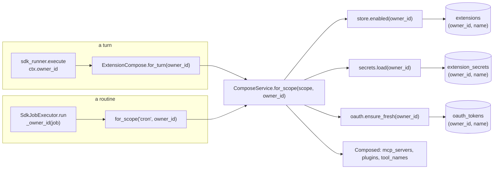

# Per-user connectors Implementation Plan

> **For agentic workers:** REQUIRED SUB-SKILL: Use superpowers:subagent-driven-development (recommended) or superpowers:executing-plans to implement this plan task-by-task. Steps use checkbox (`- [ ]`) syntax for tracking.

**Goal:** give every admitted user their own enabled connectors, their own API
keys and their own OAuth accounts, while the catalog, the draft queue and the
plugin clones stay shared and human-approved.

**Architecture:** `extensions`, `extension_secrets` and `oauth_tokens` move from a
`name` primary key to `(owner_id, name)`. Every extensions port takes a required
keyword-only `owner_id`, so a call site that forgets one is a `TypeError` rather
than a silent read of the deploy owner's credentials. `ComposeService.for_scope`
gains that argument and is fed from the two places that already know the owner:
`ctx.owner_id` on a turn and `job["owner_id"]` on a routine.

**Tech Stack:** Python 3.12, SQLAlchemy 2 async + Alembic, FastAPI, pytest
(real PostgreSQL per process), React + TypeScript for the SPA.

**Spec:** `docs/superpowers/specs/2026-09-22-per-user-connectors-design.md`

## Locked Decisions

- **Key shape:** `PRIMARY KEY (owner_id, name)` on all three tables — one row per
  owner, so `state`, `last_error` and `tool_count` stop being contested.
- **`owner_id BIGINT NOT NULL REFERENCES users(id) ON DELETE CASCADE`** — not the
  nullable `SET NULL` of migration `0005`. An ownerless row is a decryptable
  credential belonging to nobody, therefore to everybody.
- **Every extensions port takes `*, owner_id: int`, required, no default.**
- **The catalog is untouched.** `catalog/` stays `:ro`; `POST /api/connectors`
  (writing a manifest into the shared `user_catalog/`) stays owner-only.
- **A plugin's clone is shared; its enablement is personal.** `git clone` and
  deleting a clone stay owner-only. A second user *adopts* an already-cloned
  plugin: enabling with no row of their own writes one.
- **No shared connector.** There is no `owner_id IS NULL` meaning "everyone's".
- **`ext_manage` mutations stay owner-gated and fail closed.** Only its reads
  become per-lane-owner.
- **The OAuth refresh lock name becomes `f"{owner_id}:{name}"`**, passed by the
  caller. The `RefreshLocks` port and its two adapters do not change.

## Global Constraints

- Every turn runs under `permission_mode="bypassPermissions"`; tool presence must
  depend only on facts fixed for the lane, never on the sender.
- `ComposeService.for_scope` never raises: a broken extension is dropped from
  that turn with its reason recorded, and the conversation continues.
- Secrets are plaintext only inside `PgSecrets.load` and `server_spec`. Nothing
  logs a secret value, a token, or the contents of `secret_values`.
- The import-linter contracts hold: `application/` may not import httpx or
  SQLAlchemy; `presentation/` and `infrastructure/` may not import each other.
- Run the suite with `.venv/Scripts/python.exe -m pytest`; `make test-db` must be
  up. `make lint` runs ruff plus the fourteen import contracts.
- Commit messages follow the repo's existing style (`fix(web):`, `feat(ext):`)
  and end with the `Co-Authored-By: Claude Opus 5 (1M context)` trailer.

## Architecture Diagram



## File Structure

```
src/claude_hermes/
  core/db/migrations/versions/0006_per_user_extensions.py   CREATE
  core/app_context.py                                       ExtensionCompose.for_turn(owner_id)
  main.py                                                   _invalidate(owner_id); deps.workspaces
  http/deps.py                                              HttpDeps.workspaces; PluginSlashSources
  modules/extensions/
    domain/models.py                                        owner_id on three ORM classes
    application/ports.py                                    owner_id on five protocols
    application/services/compose_service.py                 for_scope(scope, *, owner_id)
    application/services/oauth_service.py                   ensure_fresh(..., *, owner_id)
    application/services/extension_service.py               connect/enable/disable/remove/adopt
    application/services/plugin_service.py                  fetch_for_review/confirm_install
    application/services/queries.py                         enabled_plugin_roots(*, owner_id)
    application/services/admin_service.py                   per-lane-owner reads
    infrastructure/repositories/extension_repository.py     owner-scoped statements + owners_of
    infrastructure/repositories/pg_secrets.py               owner-scoped statements
    infrastructure/repositories/oauth_token_repository.py   owner-scoped statements
    presentation/routers/connectors.py                      gates + per-caller state
    presentation/routers/plugins.py                         adopt, cascade delete, gates
  modules/turns/application/ports.py                        ExtensionComposePort.for_turn(owner_id)
  modules/turns/infrastructure/sdk_runner.py                pass ctx.owner_id
  modules/turns/presentation/commands_router.py             per-caller command list
  modules/scheduler/application/ports.py                    for_scope(scope, owner_id)
  modules/scheduler/infrastructure/executor.py              _owner_id(job)
web/src/components/cladex/{ConnectorsTab,PluginsTab}.tsx    button gates
web/src/pages/{ConnectorPage,PluginPage}.tsx                button gates
tests/modules/extensions/test_extensions_schema.py          CREATE
tests/modules/extensions/test_extensions_per_user.py        CREATE
tests/modules/turns/test_turns_two_users.py                 one case added
```

---

### Task 1: Migration `0006` and the ORM shape

**Files:**
- Create: `src/claude_hermes/core/db/migrations/versions/0006_per_user_extensions.py`
- Modify: `src/claude_hermes/modules/extensions/domain/models.py`
- Test: `tests/modules/extensions/test_extensions_schema.py`

**Interfaces:**
- Reuses: the migration style of `0005_users.py` (module docstring carrying the
  reasoning, `op.get_bind()` for data steps); `tests/conftest.py::ensure_users`,
  which gives ids a `users` row so the foreign keys hold; the session-scoped
  `test_database` fixture, which builds the schema with `upgrade_head_sync`, so
  writing this migration is what makes the new shape real for every other test.
- Produces: `Extension`, `ExtensionSecret`, `OauthToken` each with
  `owner_id: Mapped[int]` as part of a composite primary key.

- [ ] **Step 1: Write the failing test**

Create `tests/modules/extensions/test_extensions_schema.py`:

```python
"""The shape migration 0006 gives the three credential tables."""
import pytest
import sqlalchemy as sa
from sqlalchemy.exc import DBAPIError, IntegrityError

from claude_hermes.modules.extensions.domain.models import Extension, ExtensionSecret
from conftest import ensure_users

NOW = "2026-09-22T10:00:00+00:00"


def _row(uid: int, name: str = "fetch") -> dict:
    return dict(owner_id=uid, name=name, kind="mcp", catalog_version="1.0.0",
                state="enabled", installed_at=NOW, installed_by=uid)


async def test_two_owners_may_hold_the_same_extension_name(engine):
    """The whole point: the owner's `fetch` and a second user's `fetch` coexist."""
    await ensure_users(engine, 7, owner=1)
    async with engine.begin() as conn:
        await conn.execute(sa.insert(Extension).values(_row(1)))
        await conn.execute(sa.insert(Extension).values(_row(7)))
        count = await conn.scalar(sa.select(sa.func.count()).select_from(Extension))
    assert count == 2


async def test_one_owner_cannot_hold_the_same_name_twice(engine):
    await ensure_users(engine, owner=1)
    async with engine.begin() as conn:
        await conn.execute(sa.insert(Extension).values(_row(1)))
    with pytest.raises(IntegrityError):
        async with engine.begin() as conn:
            await conn.execute(sa.insert(Extension).values(_row(1)))


async def test_a_row_must_name_an_owner(engine):
    """An ownerless credential belongs to nobody and therefore to everybody."""
    values = _row(1)
    values.pop("owner_id")
    with pytest.raises((IntegrityError, DBAPIError)):
        async with engine.begin() as conn:
            await conn.execute(sa.insert(Extension).values(values))


async def test_deleting_a_user_takes_their_secrets_with_them(engine):
    """ON DELETE CASCADE, not SET NULL: a secret with no owner must not survive."""
    await ensure_users(engine, 7, owner=1)
    async with engine.begin() as conn:
        await conn.execute(sa.insert(ExtensionSecret).values(
            owner_id=7, name="NOTION_TOKEN", ciphertext=b"sealed", updated_at=NOW))
        await conn.execute(sa.text("DELETE FROM users WHERE id = 7"))
        left = await conn.scalar(
            sa.select(sa.func.count()).select_from(ExtensionSecret))
    assert left == 0
```

- [ ] **Step 2: Run the test to verify it fails**

Run: `.venv/Scripts/python.exe -m pytest tests/modules/extensions/test_extensions_schema.py -q -p no:cacheprovider`

Expected: FAIL — `sqlalchemy.exc.CompileError` / `TypeError` on the unknown
`owner_id` column, because neither the ORM nor the table has it yet.

- [ ] **Step 3: Add `owner_id` to the three ORM classes**

In `src/claude_hermes/modules/extensions/domain/models.py`, change the three class
headers (leave `CatalogDraft` and `ApprovalSnapshot` alone):

```python
class Extension(Base):
    __tablename__ = "extensions"
    # Wave 5: an install is per user. The owner's row and a second user's row for
    # one catalog name are different installs with different credentials, and
    # `state`, `last_error` and `tool_count` are that user's verdict on it.
    owner_id: Mapped[int] = mapped_column(
        BigInteger, ForeignKey("users.id", ondelete="CASCADE"), primary_key=True)
    name: Mapped[str] = mapped_column(Text, primary_key=True)
    # ... the remaining columns are unchanged ...


class OauthToken(Base):
    __tablename__ = "oauth_tokens"
    owner_id: Mapped[int] = mapped_column(
        BigInteger, ForeignKey("users.id", ondelete="CASCADE"), primary_key=True)
    name: Mapped[str] = mapped_column(Text, primary_key=True)
    # ... unchanged ...


class ExtensionSecret(Base):
    __tablename__ = "extension_secrets"
    # CASCADE and not SET NULL, unlike the Wave 4a columns: there a row could
    # outlive its owner harmlessly, here it would be a decryptable credential
    # that belongs to nobody.
    owner_id: Mapped[int] = mapped_column(
        BigInteger, ForeignKey("users.id", ondelete="CASCADE"), primary_key=True)
    name: Mapped[str] = mapped_column(Text, primary_key=True)
    # ... unchanged ...
```

- [ ] **Step 4: Write the migration**

Create `src/claude_hermes/core/db/migrations/versions/0006_per_user_extensions.py`:

```python
"""per-user extensions: owner_id on extensions, extension_secrets, oauth_tokens

Revision ID: 0006
Revises: 0005
Create Date: 2026-09-22

Until now an install was deploy-wide: one row per catalog name, one set of
secrets, one OAuth token per connector — so a second user's agent ran with the
owner's credentials and could not have its own.

Three things here are the design:

* **`PRIMARY KEY (owner_id, name)`**, not an overlay table beside a shared
  install row. `state`, `last_error`, `tool_count` and `tool_names` are already
  one user's verdict on one server — a probe with their token can fail while
  another's succeeds — and a single row makes those two verdicts fight.
* **`owner_id` is NOT NULL with ON DELETE CASCADE**, unlike every `owner_id`
  migration 0005 added. There a row could outlive its owner harmlessly. Here an
  ownerless row is a decryptable credential belonging to nobody, and therefore
  to everybody.
* **The backfill assigns the deploy owner, and refuses to guess.** Only an owner
  could install, so rows imply an owner row; if that is somehow untrue the
  upgrade stops rather than handing the credentials to an invented id.

`downgrade` keeps the deploy owner's rows and DELETES everybody else's — a
primary key on `name` alone cannot hold two people. Their OAuth tokens do not
come back: `CH_SECRETS_KEY` protects a dump, not a deleted row. Dump the three
tables first (`docs/superpowers/specs/2026-09-22-per-user-connectors-design.md`).
"""
from typing import Sequence, Union

import sqlalchemy as sa
from alembic import op

# revision identifiers, used by Alembic.
revision: str = "0006"
down_revision: Union[str, Sequence[str], None] = "0005"
branch_labels: Union[str, Sequence[str], None] = None
depends_on: Union[str, Sequence[str], None] = None

_TABLES = ("extensions", "extension_secrets", "oauth_tokens")


def _deploy_owner(conn) -> int | None:
    """The owner as a `users` row. Since Step 5 that table is the only record."""
    return conn.execute(
        sa.text("SELECT id FROM users WHERE role = 'owner'")).scalar()


def upgrade() -> None:
    """Upgrade schema."""
    conn = op.get_bind()
    owner = _deploy_owner(conn)
    for table in _TABLES:
        op.add_column(table, sa.Column("owner_id", sa.BigInteger(), nullable=True))
        rows = conn.execute(sa.text(f"SELECT count(*) FROM {table}")).scalar() or 0
        if rows and owner is None:
            raise RuntimeError(
                f"{table} holds {rows} row(s) but this deploy has no owner in "
                "`users`. Only an owner can install an extension, so this state "
                "should be unreachable. Assigning these credentials to nobody, or "
                "guessing an id, would hand them to everybody — restore the owner "
                "row and run the upgrade again.")
        if owner is not None:
            conn.execute(sa.text(f"UPDATE {table} SET owner_id = :owner"),
                         {"owner": owner})
        op.alter_column(table, "owner_id", nullable=False)
        op.drop_constraint(f"{table}_pkey", table, type_="primary")
        op.create_primary_key(f"{table}_pkey", table, ["owner_id", "name"])
        op.create_foreign_key(f"{table}_owner_id_fkey", table, "users",
                              ["owner_id"], ["id"], ondelete="CASCADE")


def downgrade() -> None:
    """Downgrade schema. Destructive for every non-owner: see the module docstring."""
    conn = op.get_bind()
    owner = _deploy_owner(conn)
    for table in _TABLES:
        if owner is None:
            # No owner means no row here is anybody's; a name key cannot hold them
            # either way.
            conn.execute(sa.text(f"DELETE FROM {table}"))
        else:
            conn.execute(sa.text(f"DELETE FROM {table} WHERE owner_id <> :owner"),
                         {"owner": owner})
        op.drop_constraint(f"{table}_owner_id_fkey", table, type_="foreignkey")
        op.drop_constraint(f"{table}_pkey", table, type_="primary")
        op.create_primary_key(f"{table}_pkey", table, ["name"])
        op.drop_column(table, "owner_id")
```

- [ ] **Step 5: Run the test to verify it passes**

Run: `.venv/Scripts/python.exe -m pytest tests/modules/extensions/test_extensions_schema.py -q -p no:cacheprovider`

Expected: 4 passed. (The schema is rebuilt from `upgrade head` for the test
database, so a failure here is usually a migration error, not a test error.)

- [ ] **Step 6: Keep the ORM and the migration describing one schema**

`tests/test_migrations.py::test_upgrade_head_matches_orm_metadata` already
compares `upgrade head` against the ORM metadata and fails on any drift — it is
the check that the new column, key and foreign key were written the same way
twice. The same file's `EXPECTED` map names `extension_secrets`' columns; add
`owner_id` to that set.

Run: `.venv/Scripts/python.exe -m pytest tests/test_migrations.py -q -p no:cacheprovider`

Expected: PASS. A non-empty `diff` names exactly what the migration and the ORM
disagree about.

- [ ] **Step 7: Round-trip the downgrade by hand**

There is no `alembic.ini` — the URL is a secret, so `core/db/migrate.py` builds
the `Config` in Python. Use it against a throwaway database:

```bash
.venv/Scripts/python.exe -c "
import os, uuid, asyncio, asyncpg
from alembic import command
from claude_hermes.core.db.migrate import alembic_config
url = os.environ['CH_TEST_DATABASE_URL']
cfg = alembic_config(url)
command.upgrade(cfg, 'head')
command.downgrade(cfg, '0005')
command.upgrade(cfg, 'head')
print('round trip ok')
"
```

Expected: `round trip ok`. Set `CH_TEST_DATABASE_URL` to the `make test-db`
instance first; the downgrade is destructive by design, so never point this at a
database with real rows.

- [ ] **Step 8: Commit**

```bash
git add src/claude_hermes/core/db/migrations/versions/0006_per_user_extensions.py tests/test_migrations.py \
        src/claude_hermes/modules/extensions/domain/models.py \
        tests/modules/extensions/test_extensions_schema.py
git commit -m "feat(ext): an owner on extensions, secrets and oauth tokens (0006)"
```

---

### Task 2: `SqlExtensionRepository` scoped by owner

**Files:**
- Modify: `src/claude_hermes/modules/extensions/infrastructure/repositories/extension_repository.py`
- Test: `tests/test_ext_store.py`

**Interfaces:**
- Reuses: the existing statements and the `on_conflict_do_update` upsert that
  makes re-installing a repair; `conftest.ensure_users`.
- Consumes: Task 1's composite key.
- Produces:
  - `add(name, kind, catalog_version, installed_by, now, tool_count=None, tool_names=None, *, owner_id: int) -> None`
  - `get(name, *, owner_id: int) -> dict | None`
  - `list(kind=None, *, owner_id: int) -> list[dict]`
  - `enabled(*, owner_id: int) -> list[dict]`
  - `set_state(name, state, *, owner_id: int) -> None`
  - `set_error(name, error, *, owner_id: int) -> None`
  - `set_tools(name, names, *, owner_id: int) -> None`
  - `set_tool_count(name, n, *, owner_id: int) -> None`
  - `remove(name, *, owner_id: int) -> None`
  - `owners_of(name: str) -> list[int]` — every owner holding a row for this
    name, ascending. The cascade in Task 10 needs it; nothing else may use it to
    read another user's state.

- [ ] **Step 1: Write the failing tests**

Append to `tests/test_ext_store.py`:

```python
from conftest import ensure_users


async def test_two_owners_keep_separate_rows(engine):
    await ensure_users(engine, 7, owner=1)
    store = SqlExtensionRepository(engine)
    await store.add("fetch", "mcp", "1.0.0", installed_by=1, now=NOW, owner_id=1)
    await store.add("fetch", "mcp", "2.0.0", installed_by=7, now=NOW, owner_id=7)
    assert (await store.get("fetch", owner_id=1))["catalog_version"] == "1.0.0"
    assert (await store.get("fetch", owner_id=7))["catalog_version"] == "2.0.0"


async def test_one_owners_error_does_not_reach_the_other(engine):
    """A probe with one person's token failing is not a verdict on anybody else."""
    await ensure_users(engine, 7, owner=1)
    store = SqlExtensionRepository(engine)
    await store.add("fetch", "mcp", "1.0.0", installed_by=1, now=NOW, owner_id=1)
    await store.add("fetch", "mcp", "1.0.0", installed_by=7, now=NOW, owner_id=7)
    await store.set_error("fetch", "needs_reauth", owner_id=7)
    assert (await store.get("fetch", owner_id=1))["last_error"] is None
    assert (await store.get("fetch", owner_id=7))["last_error"] == "needs_reauth"


async def test_enabled_and_list_see_only_their_owner(engine):
    await ensure_users(engine, 7, owner=1)
    store = SqlExtensionRepository(engine)
    await store.add("fetch", "mcp", "1.0.0", installed_by=1, now=NOW, owner_id=1)
    await store.add("thing", "plugin", "1.0.0", installed_by=7, now=NOW, owner_id=7)
    assert [r["name"] for r in await store.enabled(owner_id=1)] == ["fetch"]
    assert [r["name"] for r in await store.list(owner_id=7)] == ["thing"]


async def test_remove_takes_one_owners_row_only(engine):
    await ensure_users(engine, 7, owner=1)
    store = SqlExtensionRepository(engine)
    await store.add("fetch", "mcp", "1.0.0", installed_by=1, now=NOW, owner_id=1)
    await store.add("fetch", "mcp", "1.0.0", installed_by=7, now=NOW, owner_id=7)
    await store.remove("fetch", owner_id=7)
    assert await store.get("fetch", owner_id=1) is not None
    assert await store.get("fetch", owner_id=7) is None


async def test_owners_of_lists_everyone_holding_the_name(engine):
    await ensure_users(engine, 7, owner=1)
    store = SqlExtensionRepository(engine)
    await store.add("thing", "plugin", "1.0.0", installed_by=1, now=NOW, owner_id=1)
    await store.add("thing", "plugin", "1.0.0", installed_by=7, now=NOW, owner_id=7)
    assert await store.owners_of("thing") == [1, 7]
```

Every existing test in this file must also gain `owner_id=1` on its calls and a
matching `await ensure_users(engine, owner=1)` first line — the foreign key is
real now. Do that in this step; it is mechanical and it is the point of the
keyword-only argument.

- [ ] **Step 2: Run the tests to verify they fail**

Run: `.venv/Scripts/python.exe -m pytest tests/test_ext_store.py -q -p no:cacheprovider`

Expected: FAIL with `TypeError: add() got an unexpected keyword argument 'owner_id'`.

- [ ] **Step 3: Rewrite the repository's statements**

Replace the body of `SqlExtensionRepository` with:

```python
class SqlExtensionRepository:
    """What is installed, for ONE owner — never what it does.

    Every method takes a keyword-only `owner_id` with no default. A caller that
    does not say whose install it means gets a `TypeError`, never the deploy
    owner's row: the same posture as an empty allowed-roots list denying
    everything rather than allowing everything.
    """

    def __init__(self, engine: AsyncEngine):
        self._engine = engine

    async def add(self, name: str, kind: str, catalog_version: str,
                  installed_by: int, now: str, tool_count: int | None = None,
                  tool_names: list[str] | None = None, *, owner_id: int) -> None:
        stmt = pg_insert(Extension).values(
            owner_id=owner_id, name=name, kind=kind,
            catalog_version=catalog_version, state="enabled",
            installed_at=now, installed_by=installed_by, last_error=None,
            tool_count=tool_count,
            tool_names=json.dumps(tool_names) if tool_names is not None else None)
        # Re-installing is a repair: the row goes back to enabled and the last
        # error is forgotten, whatever state the previous install left behind.
        stmt = stmt.on_conflict_do_update(
            index_elements=[Extension.owner_id, Extension.name], set_={
                "kind": stmt.excluded.kind,
                "catalog_version": stmt.excluded.catalog_version,
                "state": "enabled",
                "installed_at": stmt.excluded.installed_at,
                "installed_by": stmt.excluded.installed_by,
                "last_error": None,
                "tool_count": stmt.excluded.tool_count,
                "tool_names": stmt.excluded.tool_names})
        async with self._engine.begin() as conn:
            await conn.execute(stmt)

    def _one(self, name: str, owner_id: int):
        return (Extension.owner_id == owner_id) & (Extension.name == name)

    async def set_tool_count(self, name: str, n: int | None, *, owner_id: int) -> None:
        async with self._engine.begin() as conn:
            await conn.execute(update(Extension)
                               .where(self._one(name, owner_id))
                               .values(tool_count=n))

    async def set_tools(self, name: str, names: list[str], *, owner_id: int) -> None:
        """What the last probe saw: the count the list shows, the names the page lists."""
        async with self._engine.begin() as conn:
            await conn.execute(update(Extension)
                               .where(self._one(name, owner_id))
                               .values(tool_count=len(names),
                                       tool_names=json.dumps(names)))

    async def get(self, name: str, *, owner_id: int) -> dict | None:
        async with self._engine.connect() as conn:
            row = (await conn.execute(
                select(Extension).where(self._one(name, owner_id)))).mappings().first()
        return dict(row) if row else None

    async def list(self, kind: str | None = None, *, owner_id: int) -> list[dict]:
        stmt = select(Extension).where(Extension.owner_id == owner_id)
        if kind is not None:
            stmt = stmt.where(Extension.kind == kind)
        async with self._engine.connect() as conn:
            rows = (await conn.execute(stmt.order_by(Extension.name))).mappings().all()
        return [dict(r) for r in rows]

    async def enabled(self, *, owner_id: int) -> list[dict]:
        async with self._engine.connect() as conn:
            rows = (await conn.execute(
                select(Extension)
                .where(Extension.owner_id == owner_id)
                .where(Extension.state == "enabled")
                .order_by(Extension.name))).mappings().all()
        return [dict(r) for r in rows]

    async def set_state(self, name: str, state: str, *, owner_id: int) -> None:
        async with self._engine.begin() as conn:
            await conn.execute(update(Extension)
                               .where(self._one(name, owner_id))
                               .values(state=state))

    async def set_error(self, name: str, error: str | None, *,
                        owner_id: int) -> None:
        async with self._engine.begin() as conn:
            await conn.execute(update(Extension)
                               .where(self._one(name, owner_id))
                               .values(last_error=error))

    async def remove(self, name: str, *, owner_id: int) -> None:
        async with self._engine.begin() as conn:
            await conn.execute(delete(Extension).where(self._one(name, owner_id)))

    async def owners_of(self, name: str) -> list[int]:
        """Every owner holding a row for this name, ascending.

        The one deliberately unscoped read in this class, and it answers ids and
        nothing else. It exists for the shared-clone cascade: deleting a plugin's
        clone has to clear every row that points at it and reset every affected
        lane. It must never be used to show one user another's state.
        """
        async with self._engine.connect() as conn:
            rows = (await conn.execute(
                select(Extension.owner_id)
                .where(Extension.name == name)
                .order_by(Extension.owner_id))).all()
        return [int(r[0]) for r in rows]
```

- [ ] **Step 4: Run the tests to verify they pass**

Run: `.venv/Scripts/python.exe -m pytest tests/test_ext_store.py -q -p no:cacheprovider`

Expected: all pass.

- [ ] **Step 5: Commit**

```bash
git add src/claude_hermes/modules/extensions/infrastructure/repositories/extension_repository.py tests/test_ext_store.py
git commit -m "feat(ext): the registry answers per owner"
```

---

### Task 3: `PgSecrets` and `SqlOauthTokenRepository` scoped by owner

**Files:**
- Modify: `src/claude_hermes/modules/extensions/infrastructure/repositories/pg_secrets.py`
- Modify: `src/claude_hermes/modules/extensions/infrastructure/repositories/oauth_token_repository.py`
- Test: `tests/test_secrets.py`, `tests/test_ext_store.py`

**Interfaces:**
- Reuses: `SecretBox` sealing, `check_name` / `check_value`, the skip-a-row-that-
  does-not-open rule in `load`, and the `FIELDS` merge in `put`.
- Consumes: Task 1's composite key.
- Produces:
  - `PgSecrets.load(*, owner_id: int) -> dict[str, str]`
  - `PgSecrets.names(*, owner_id: int) -> dict[str, str]`
  - `PgSecrets.put(name, value, *, owner_id: int) -> None`
  - `PgSecrets.forget(name, *, owner_id: int) -> None`
  - `SqlOauthTokenRepository.get(name, *, owner_id: int) -> dict | None`
  - `SqlOauthTokenRepository.put(name, *, owner_id: int, now: str, **fields) -> None`
  - `SqlOauthTokenRepository.delete(name, *, owner_id: int) -> None`

- [ ] **Step 1: Write the failing tests**

Add to `tests/test_secrets.py` (import `SecretBox` and `PgSecrets` the way the
file's existing tests do; if the file does not exist, create it with these two
tests plus those imports):

```python
async def test_the_same_variable_name_is_two_secrets(engine):
    """`extension_secrets.name` is an env var name — a namespace two people share
    until the key says otherwise."""
    await ensure_users(engine, 7, owner=1)
    store = PgSecrets(engine, SecretBox(Fernet.generate_key()))
    await store.put("NOTION_TOKEN", "owners", owner_id=1)
    await store.put("NOTION_TOKEN", "hers", owner_id=7)
    assert (await store.load(owner_id=1))["NOTION_TOKEN"] == "owners"
    assert (await store.load(owner_id=7))["NOTION_TOKEN"] == "hers"


async def test_forget_takes_one_owners_secret_only(engine):
    await ensure_users(engine, 7, owner=1)
    store = PgSecrets(engine, SecretBox(Fernet.generate_key()))
    await store.put("NOTION_TOKEN", "owners", owner_id=1)
    await store.put("NOTION_TOKEN", "hers", owner_id=7)
    await store.forget("NOTION_TOKEN", owner_id=7)
    assert await store.load(owner_id=1) == {"NOTION_TOKEN": "owners"}
    assert await store.load(owner_id=7) == {}
```

Add to `tests/test_ext_store.py`:

```python
async def test_oauth_tokens_are_per_owner(engine):
    await ensure_users(engine, 7, owner=1)
    tokens = SqlOauthTokenRepository(engine)
    await tokens.put("notion", now=NOW, access_token="a", owner_id=1)
    await tokens.put("notion", now=NOW, access_token="b", owner_id=7)
    assert (await tokens.get("notion", owner_id=1))["access_token"] == "a"
    assert (await tokens.get("notion", owner_id=7))["access_token"] == "b"
    await tokens.delete("notion", owner_id=7)
    assert await tokens.get("notion", owner_id=1) is not None
    assert await tokens.get("notion", owner_id=7) is None
```

Update every existing call in both files to pass `owner_id=1` after an
`await ensure_users(engine, owner=1)`.

- [ ] **Step 2: Run the tests to verify they fail**

Run: `.venv/Scripts/python.exe -m pytest tests/test_secrets.py tests/test_ext_store.py -q -p no:cacheprovider`

Expected: FAIL with `TypeError: put() got an unexpected keyword argument 'owner_id'`.

- [ ] **Step 3: Scope `PgSecrets`**

Replace the four methods (the class docstring and `__init__` stay):

```python
    async def load(self, *, owner_id: int) -> dict[str, str]:
        """This owner's secrets, decrypted, as the plain mapping `server_spec` wants.

        A row that does not open is skipped rather than fatal: one secret sealed
        under a rotated key must cost that one extension, not every extension.
        """
        async with self._engine.connect() as conn:
            rows = (await conn.execute(
                select(ExtensionSecret)
                .where(ExtensionSecret.owner_id == owner_id)
                .order_by(ExtensionSecret.name))).mappings().all()
        out: dict[str, str] = {}
        for row in rows:
            try:
                out[row["name"]] = self._box.open(row["ciphertext"])
            except SecretDecryptError:
                # Deliberately the name only: this is the one place the key and
                # the ciphertext are both in scope.
                log.warning("stored secret %s does not open under the current key",
                            row["name"])
        return out

    async def names(self, *, owner_id: int) -> dict[str, str]:
        """This owner's stored names with the ISO timestamp each was last written at.

        The box is never opened here: listing what is set is not a reason to have
        plaintext in scope, and it is the one read that still answers under a
        rotated key.
        """
        async with self._engine.connect() as conn:
            rows = (await conn.execute(
                select(ExtensionSecret.name, ExtensionSecret.updated_at)
                .where(ExtensionSecret.owner_id == owner_id)
                .order_by(ExtensionSecret.name))).all()
        return {name: updated_at for name, updated_at in rows}

    async def put(self, name: str, value: str, *, owner_id: int) -> None:
        """Upsert one secret for one owner. The name and value rules are unchanged —
        an env-var name, no newline — because `server_spec` still hands these to a
        process environment."""
        check_name(name)
        check_value(value)
        now = datetime.now(timezone.utc).isoformat()
        stmt = pg_insert(ExtensionSecret).values(
            owner_id=owner_id, name=name, ciphertext=self._box.seal(value),
            updated_at=now)
        stmt = stmt.on_conflict_do_update(
            index_elements=[ExtensionSecret.owner_id, ExtensionSecret.name],
            set_={"ciphertext": stmt.excluded.ciphertext, "updated_at": now})
        async with self._engine.begin() as conn:
            await conn.execute(stmt)

    async def forget(self, name: str, *, owner_id: int) -> None:
        """Remove one owner's secret; absent is fine."""
        async with self._engine.begin() as conn:
            await conn.execute(
                delete(ExtensionSecret)
                .where(ExtensionSecret.owner_id == owner_id)
                .where(ExtensionSecret.name == name))
```

- [ ] **Step 4: Scope `SqlOauthTokenRepository`**

```python
    async def get(self, name: str, *, owner_id: int) -> dict | None:
        async with self._engine.connect() as conn:
            row = (await conn.execute(
                select(OauthToken)
                .where(OauthToken.owner_id == owner_id)
                .where(OauthToken.name == name))).mappings().first()
        return dict(row) if row else None

    async def put(self, name: str, *, owner_id: int, now: str, **fields: str) -> None:
        """Upsert: only the fields given change; the rest keep their value."""
        unknown = set(fields) - set(FIELDS)
        if unknown:
            raise ValueError(f"not token fields: {sorted(unknown)}")
        current = await self.get(name, owner_id=owner_id) or {f: "" for f in FIELDS}
        merged = {f: fields.get(f, current[f]) for f in FIELDS}
        stmt = pg_insert(OauthToken).values(
            owner_id=owner_id, name=name, **merged, updated_at=now)
        stmt = stmt.on_conflict_do_update(
            index_elements=[OauthToken.owner_id, OauthToken.name],
            set_={**merged, "updated_at": now})
        async with self._engine.begin() as conn:
            await conn.execute(stmt)

    async def delete(self, name: str, *, owner_id: int) -> None:
        async with self._engine.begin() as conn:
            await conn.execute(
                delete(OauthToken)
                .where(OauthToken.owner_id == owner_id)
                .where(OauthToken.name == name))
```

- [ ] **Step 5: Run the tests to verify they pass**

Run: `.venv/Scripts/python.exe -m pytest tests/test_secrets.py tests/test_ext_store.py -q -p no:cacheprovider`

Expected: all pass.

- [ ] **Step 6: Commit**

```bash
git add src/claude_hermes/modules/extensions/infrastructure/repositories/pg_secrets.py \
        src/claude_hermes/modules/extensions/infrastructure/repositories/oauth_token_repository.py \
        tests/test_secrets.py tests/test_ext_store.py
git commit -m "feat(ext): secrets and oauth tokens answer per owner"
```

---

### Task 4: `ComposeService` and `OAuthService` per owner

**Files:**
- Modify: `src/claude_hermes/modules/extensions/application/ports.py`
- Modify: `src/claude_hermes/modules/extensions/application/services/compose_service.py`
- Modify: `src/claude_hermes/modules/extensions/application/services/oauth_service.py`
- Test: `tests/test_compose.py`

**Interfaces:**
- Reuses: `for_scope`'s total, never-raising loop; the per-scope `judged` map that
  keeps a cron pass from clearing a turn-only server's error; `Composed`;
  `server_spec`; the `RefreshLocks` port and both adapters, unchanged.
- Consumes: Tasks 2 and 3's owner-scoped repositories.
- Produces:
  - `ComposeService.for_scope(scope: str, *, owner_id: int) -> Composed`
  - `OAuthService.ensure_fresh(home, tokens, m, *, owner_id: int, now=None) -> None`

- [ ] **Step 1: Write the failing test**

Add to `tests/test_compose.py` (follow the file's existing fixture style for the
catalog root and the secret box):

```python
async def test_each_owner_composes_their_own_servers(engine, catalog_root):
    """B's turn must not be handed A's server, and A's must not lose theirs."""
    await ensure_users(engine, 7, owner=1)
    store = SqlExtensionRepository(engine)
    secrets = PgSecrets(engine, SecretBox(Fernet.generate_key()))
    await store.add("fetch", "mcp", "1.0.0", installed_by=1, now=NOW, owner_id=1)
    await secrets.put("FETCH_TOKEN", "owners", owner_id=1)

    compose = ComposeService(HOME, catalog=CatalogRepository(), secrets=secrets,
                             store=store, tokens=SqlOauthTokenRepository(engine),
                             root=catalog_root)
    assert "fetch" in (await compose.for_scope("turn", owner_id=1)).mcp_servers
    assert (await compose.for_scope("turn", owner_id=7)).mcp_servers == {}


async def test_a_missing_secret_is_that_owners_problem_alone(engine, catalog_root):
    await ensure_users(engine, 7, owner=1)
    store = SqlExtensionRepository(engine)
    secrets = PgSecrets(engine, SecretBox(Fernet.generate_key()))
    for uid in (1, 7):
        await store.add("fetch", "mcp", "1.0.0", installed_by=uid, now=NOW,
                        owner_id=uid)
    await secrets.put("FETCH_TOKEN", "owners", owner_id=1)

    compose = ComposeService(HOME, catalog=CatalogRepository(), secrets=secrets,
                             store=store, tokens=SqlOauthTokenRepository(engine),
                             root=catalog_root)
    assert (await compose.for_scope("turn", owner_id=1)).errors == {}
    assert "fetch" in (await compose.for_scope("turn", owner_id=7)).errors
    # and the verdict landed on the right row
    assert (await store.get("fetch", owner_id=1))["last_error"] is None
```

- [ ] **Step 2: Run the test to verify it fails**

Run: `.venv/Scripts/python.exe -m pytest tests/test_compose.py -q -p no:cacheprovider`

Expected: FAIL with `TypeError: for_scope() got an unexpected keyword argument 'owner_id'`.

- [ ] **Step 3: Update the five port protocols**

In `application/ports.py`, change the signatures (keep every docstring, and add
the sentence noted):

```python
class SecretStore(Protocol):
    """Extension credentials, Fernet-sealed in `extension_secrets`.

    Per owner since Wave 5: `name` is the env-var name a manifest declares, so
    two users' `NOTION_TOKEN` are two secrets. `owner_id` is required and
    keyword-only everywhere — a call that does not say whose secret it means must
    fail, never fall back to the deploy owner's.
    """

    async def load(self, *, owner_id: int) -> dict[str, str]: ...
    async def names(self, *, owner_id: int) -> dict[str, str]: ...
    async def put(self, name: str, value: str, *, owner_id: int) -> None: ...
    async def forget(self, name: str, *, owner_id: int) -> None: ...


class ExtensionRepository(Protocol):
    """What is installed for ONE owner — never what it does."""

    async def add(self, name: str, kind: str, catalog_version: str, installed_by: int,
                  now: str, tool_count: int | None = None,
                  tool_names: list[str] | None = None, *, owner_id: int) -> None: ...
    async def get(self, name: str, *, owner_id: int) -> dict | None: ...
    async def list(self, kind: str | None = None, *, owner_id: int) -> list[dict]: ...
    async def enabled(self, *, owner_id: int) -> list[dict]: ...
    async def set_state(self, name: str, state: str, *, owner_id: int) -> None: ...
    async def set_error(self, name: str, error: str | None, *, owner_id: int) -> None: ...
    async def set_tools(self, name: str, names: list[str], *, owner_id: int) -> None: ...
    async def remove(self, name: str, *, owner_id: int) -> None: ...
    async def owners_of(self, name: str) -> list[int]: ...


class TokenRepository(Protocol):
    """OAuth tokens for remote MCP servers — the source of truth. Never logged."""

    async def get(self, name: str, *, owner_id: int) -> dict | None: ...
    async def put(self, name: str, *, owner_id: int, now: str, **fields: str) -> None: ...
    async def delete(self, name: str, *, owner_id: int) -> None: ...


class OAuthRefresher(Protocol):
    """"Make this owner's mirrored access token valid, or say they must sign in
    again." Consumed by `ComposeService`; provided by `OAuthService`."""

    async def ensure_fresh(self, home: Path, tokens: TokenRepository, m: Manifest,
                           *, owner_id: int, now: float | None = None) -> None: ...


class PromptCacheInvalidator(Protocol):
    """Reset ONE owner's lanes' cached prompt prefix.

    Per owner since Wave 5: a connector one user enables changes only that user's
    prefix, and resetting the deployment would cost everybody else their cache
    for somebody else's decision.

    Ordering rule, not a detail: this fires AFTER the registry row or the catalog
    entry is written, never before — a lane that rebinds in between would
    resurrect the stale session.
    """

    async def __call__(self, owner_id: int) -> None: ...


class ExtensionsQuery(Protocol):
    """What another module may ask about installed extensions without reaching into
    this one."""

    async def enabled_plugin_roots(self, *, owner_id: int) -> list[tuple[str, Path]]: ...
```

- [ ] **Step 4: Thread `owner_id` through `ComposeService.for_scope`**

Change the signature and the four calls inside it; everything else in the method
stays as it is:

```python
    async def for_scope(self, scope: str, *, owner_id: int) -> Composed:
        """Everything THIS OWNER has enabled and in scope, as the SDK wants it.

        Never raises. A broken extension is dropped from this turn, its reason
        recorded in `last_error` on that owner's row, and the conversation
        continues — one dead server must not take the chat down with it.
        """
        home, store = self._home, self._store
        entries = self._catalog.load_all(self._root)
        secret_values = await self._secrets.load(owner_id=owner_id)
        ...
        rows = await store.enabled(owner_id=owner_id)
        ...
                    if m.oauth_entries() and self._oauth is not None:
                        # Refresh writes the new access token into this owner's
                        # secrets; re-read so the spec carries it.
                        await self._oauth.ensure_fresh(home, self._tokens, m,
                                                       owner_id=owner_id)
                        secret_values = await self._secrets.load(owner_id=owner_id)
        ...
        for row in rows:
            name = row["name"]
            if name in judged and row["last_error"] != judged[name]:
                await store.set_error(name, judged[name], owner_id=owner_id)
```

Also change the `NeedsReauth` log line from "needs the owner to sign in again" to
name the owner:

```python
                log.warning("extension %s needs user %s to sign in again: %s",
                            name, owner_id, e)
```

- [ ] **Step 5: Thread `owner_id` through `OAuthService.ensure_fresh`**

Change the signature, every `tokens.get` / `tokens.put` / `self._secrets.put`
call inside it to pass `owner_id=owner_id`, and the lock name:

```python
    async def ensure_fresh(self, home: Path, tokens: TokenRepository, m: Manifest,
                           *, owner_id: int, now: float | None = None) -> None:
        """Before a server is composed: make sure THIS OWNER's mirrored access token
        is valid, refreshing it when it expires within REFRESH_MARGIN. Raises
        NeedsReauth when they have to sign in again; never returns a half-updated
        state.

        The lock name carries the owner: two people refreshing one connector are
        refreshing two different grants, and making them queue behind each other
        would be a self-inflicted serialization. The `RefreshLocks` port is
        unchanged — the name is the caller's to compose.
        """
        entry = next(iter(m.oauth_entries()), None)
        ...
        async with self._locks(f"{owner_id}:{m.name}"):
            ...
```

- [ ] **Step 6: Run the tests to verify they pass**

Run: `.venv/Scripts/python.exe -m pytest tests/test_compose.py tests/test_oauth.py -q -p no:cacheprovider`

Expected: all pass. (`tests/test_oauth.py` will need `owner_id=1` on its calls;
add it here.)

- [ ] **Step 7: Commit**

```bash
git add src/claude_hermes/modules/extensions/application/
git add tests/test_compose.py tests/test_oauth.py
git commit -m "feat(ext): compose the lane owner's servers, refresh their token"
```

---

### Task 5: `ExtensionService`, `PluginService` and the plugin-roots query

**Files:**
- Modify: `src/claude_hermes/modules/extensions/application/services/extension_service.py`
- Modify: `src/claude_hermes/modules/extensions/application/services/plugin_service.py`
- Modify: `src/claude_hermes/modules/extensions/application/services/queries.py`
- Test: `tests/modules/extensions/test_extensions_per_user.py` (create)

**Interfaces:**
- Reuses: `connect`'s secrets → spec → probe → register sequence and its
  `Outcome` codes; `fetch_for_review`'s two-phase token; `plugin_root`'s
  containment check; `ExtensionsQueryService`'s leave-one-out-with-a-warning rule.
- Consumes: Tasks 2–4.
- Produces:
  - `ExtensionService.connect(m, *, user_id, now, timeout, probe_fn, install=True, owner_id) -> Outcome`
  - `ExtensionService.enable(name, *, owner_id) -> bool`
  - `ExtensionService.disable(name, *, owner_id) -> bool`
  - `ExtensionService.remove(name, m=None, *, owner_id, remove_clone: bool = False) -> bool`
  - `ExtensionService.adopt(m, *, user_id, now, owner_id) -> bool` — write this
    owner's row for an already-cloned plugin; `False` when the clone is absent.
  - `PluginService.fetch_for_review(m, *, timeout) -> tuple[Review, list[int]]` —
    the second element is every owner already holding a row, so the caller knows
    whose lanes to reset.
  - `PluginService.confirm_install(m, token, *, user_id, now, owner_id) -> None`
  - `ExtensionsQueryService.enabled_plugin_roots(*, owner_id) -> list[tuple[str, Path]]`

- [ ] **Step 1: Write the failing tests**

Create `tests/modules/extensions/test_extensions_per_user.py`:

```python
"""One user's install is not another's — the service layer."""
from pathlib import Path

from claude_hermes.modules.extensions.application.services.extension_service import (
    ExtensionService,
)
from claude_hermes.modules.extensions.infrastructure.repositories.extension_repository import (
    SqlExtensionRepository,
)
from conftest import ensure_users

NOW = "2026-09-22T10:00:00+00:00"


class _Installer:
    """Records what it was asked to remove; never touches the disk."""

    def __init__(self):
        self.removed: list[str] = []

    def remove(self, name: str) -> None:
        self.removed.append(name)

    async def clone(self, m, timeout: float = 120.0) -> Path:
        raise AssertionError("not used in these tests")


def _service(engine, installer=None, catalog=None):
    store = SqlExtensionRepository(engine)
    return store, ExtensionService(
        Path("/data"), store=store, tokens=_Tokens(), secrets=_Secrets(),
        catalog=catalog or _Catalog(), installer=installer)


async def test_enable_is_about_your_own_row(engine):
    await ensure_users(engine, 7, owner=1)
    store, svc = _service(engine)
    await store.add("fetch", "mcp", "1.0.0", installed_by=1, now=NOW, owner_id=1)
    assert await svc.enable("fetch", owner_id=7) is False
    assert await svc.disable("fetch", owner_id=1) is True
    assert (await store.get("fetch", owner_id=1))["state"] == "disabled"


async def test_a_non_owner_removing_a_plugin_keeps_the_shared_clone(engine):
    """The clone is code every tree loads; only the owner's delete may take it."""
    await ensure_users(engine, 7, owner=1)
    installer = _Installer()
    store, svc = _service(engine, installer=installer)
    await store.add("thing", "plugin", "1.0.0", installed_by=7, now=NOW, owner_id=7)
    assert await svc.remove("thing", owner_id=7) is True
    assert installer.removed == []
    assert await store.get("thing", owner_id=7) is None


async def test_the_owner_may_take_the_clone_with_the_row(engine):
    await ensure_users(engine, owner=1)
    installer = _Installer()
    store, svc = _service(engine, installer=installer)
    await store.add("thing", "plugin", "1.0.0", installed_by=1, now=NOW, owner_id=1)
    assert await svc.remove("thing", owner_id=1, remove_clone=True) is True
    assert installer.removed == ["thing"]


async def test_adopt_writes_a_row_over_an_existing_clone(engine, tmp_path):
    """"Enable it for me" on a plugin somebody else cloned."""
    await ensure_users(engine, 7, owner=1)
    store, svc = _service(engine)
    ok = await svc.adopt(_manifest("thing"), user_id=7, now=NOW, owner_id=7)
    assert ok is True
    assert (await store.get("thing", owner_id=7))["state"] == "enabled"
```

The helpers these tests need, at the top of the same file — `secrets_for(engine)`
from `tests/ext_helpers.py` is the real `PgSecrets` over a test box, so use it
rather than a fake:

```python
from tests.ext_helpers import secrets_for
from claude_hermes.modules.extensions.domain.manifest import MANIFEST_VERSION, parse
from claude_hermes.modules.extensions.infrastructure.repositories.oauth_token_repository import (
    SqlOauthTokenRepository,
)


def _manifest(name: str, kind: str = "plugin"):
    body = {"manifest_version": MANIFEST_VERSION, "name": name, "label": name,
            "description": "A test plugin.", "version": "1", "scopes": ["turn"],
            "repo": "https://example.test/x.git", "ref": "a" * 40}
    return parse(body, kind)


class _Catalog:
    """The `CatalogReader` port, over one manifest held in memory."""

    def __init__(self, *manifests):
        self._by_name = {m.name: m for m in manifests}

    def load_all(self, root=None):
        return dict(self._by_name)

    def get(self, name, root=None):
        return self._by_name.get(name)

    def is_repo_entry(self, name):
        return False


def _service(engine, home, installer=None, catalog=None):
    store = SqlExtensionRepository(engine)
    return store, ExtensionService(
        home, store=store, tokens=SqlOauthTokenRepository(engine),
        secrets=secrets_for(engine), catalog=catalog or _Catalog(),
        installer=installer)
```

Every test passes `tmp_path` as `home`. For `adopt`, create the clone first:

```python
    root = tmp_path / "plugins" / "thing" / ".claude-plugin"
    root.mkdir(parents=True)
    (root / "plugin.json").write_text("{}", encoding="utf-8")
```

- [ ] **Step 2: Run the tests to verify they fail**

Run: `.venv/Scripts/python.exe -m pytest tests/modules/extensions/test_extensions_per_user.py -q -p no:cacheprovider`

Expected: FAIL with `TypeError: enable() got an unexpected keyword argument 'owner_id'`.

- [ ] **Step 3: Scope `ExtensionService` and add `adopt`**

```python
    async def connect(self, m: Manifest, *, user_id: int, now: str, timeout: float,
                      probe_fn: ServerProber, install: bool = True,
                      owner_id: int) -> Outcome:
        """Secrets → spec → probe → (register), all in ONE owner's name.

        `user_id` stays the sender for the audit column; `owner_id` is whose
        credentials are read and whose row is written. On every lane that can
        reach this they are the same person, and saying both is what keeps it
        true when one day they are not.
        """
        values = await self._secrets.load(owner_id=owner_id)
        plain = missing(m.plain_secret_names(), values)
        if plain:
            return Outcome(False, "secrets_missing",
                           f"missing secret(s): {', '.join(plain)}",
                           missing=tuple(plain))
        if missing([a.name for a in m.oauth_entries()], values):
            return Outcome(False, "oauth_required", f"'{m.label}' needs a sign-in first")
        try:
            spec = server_spec(m, values)
        except ComposeError as e:
            return Outcome(False, "compose_failed", str(e))
        result = await probe_fn(self._home, m.name, spec, timeout=timeout)
        if result.status != "connected":
            return Outcome(False, "probe_failed", result.error or result.status)
        if install:
            await self._store.add(m.name, m.kind, m.version, installed_by=user_id,
                                  now=now, tool_count=len(result.tools),
                                  tool_names=list(result.tools), owner_id=owner_id)
        return Outcome(True, tools=tuple(result.tools))

    async def enable(self, name: str, *, owner_id: int) -> bool:
        if await self._store.get(name, owner_id=owner_id) is None:
            return False
        await self._store.set_state(name, "enabled", owner_id=owner_id)
        return True

    async def disable(self, name: str, *, owner_id: int) -> bool:
        if await self._store.get(name, owner_id=owner_id) is None:
            return False
        await self._store.set_state(name, "disabled", owner_id=owner_id)
        return True

    async def adopt(self, m: Manifest, *, user_id: int, now: str,
                    owner_id: int) -> bool:
        """Write this owner's row for a plugin whose clone is already on disk.

        A plugin's clone is deploy-wide and only the owner may fetch or delete it,
        so "enable it for me" cannot be a state flip on a row a second user does
        not have. It is this: adopt the shared tree. `False` when there is nothing
        to adopt, which the route answers 404 — never a row pointing at a
        directory that is not there.
        """
        try:
            root = plugin_root(self._home, m)
        except ComposeError:
            return False
        if not (root / ".claude-plugin" / "plugin.json").is_file():
            return False
        await self._store.add(m.name, m.kind, m.version, installed_by=user_id,
                              now=now, owner_id=owner_id)
        return True

    async def remove(self, name: str, m: Manifest | None = None, *, owner_id: int,
                     remove_clone: bool = False) -> bool:
        """Forget an extension for ONE owner: their registry row, their token row
        and their mirrored access token. The manifest stays.

        `remove_clone` is off by default and is the owner-only half: a plugin's
        clone is shared code, so a second user dropping their row must leave the
        tree where it is.
        """
        row = await self._store.get(name, owner_id=owner_id)
        if row is None:
            return False
        if remove_clone and row["kind"] == "plugin" and self._installer is not None:
            self._installer.remove(name)
        if m is not None:
            for a in m.oauth_entries():
                await self._secrets.forget(a.name, owner_id=owner_id)
        await self._tokens.delete(name, owner_id=owner_id)
        await self._store.remove(name, owner_id=owner_id)
        return True
```

Add `from ...domain.paths import plugin_root` to the imports.

- [ ] **Step 4: Scope `PluginService` and the query service**

`plugin_service.py` — `fetch_for_review` returns the affected owners instead of a
bool, and `confirm_install` writes one owner's row:

```python
    async def fetch_for_review(self, m: Manifest, *,
                               timeout: float) -> tuple[Review, list[int]]:
        """Phase one: fetch, and show what was fetched. Installs nothing.

        Returns the review and every owner who already holds a row for this name.
        A re-fetch replaces the tree the SDK loads for ALL of them while their
        cached prefixes still describe the old one, so the caller resets each —
        confirm may never come.
        """
        root = await self._installer.clone(m, timeout=timeout)

        local = self._reader.local_servers(root)
        if local:
            self._installer.remove(m.name)
            raise LocalServerRefused(local)

        affected = await self._store.owners_of(m.name)
        text = self._reader.surface(m, root)
        return Review(name=m.name, label=m.label, surface=text,
                      token=surface_token(text),
                      servers=self._reader.bundled_servers(root),
                      components=self._reader.components(root)), affected

    async def confirm_install(self, m: Manifest, token: str, *, user_id: int,
                              now: str, owner_id: int) -> None:
        ...
        await self._store.add(m.name, m.kind, m.version, installed_by=user_id,
                              now=now, owner_id=owner_id)
```

`queries.py`:

```python
    async def enabled_plugin_roots(self, *, owner_id: int) -> list[tuple[str, Path]]:
        """(catalog name, plugin root) for every plugin THIS OWNER has enabled whose
        manifest still exists and whose subdir stays inside its clone.

        The clone is shared; which of them a user loads is not.
        """
        out: list[tuple[str, Path]] = []
        for row in await self._store.list("plugin", owner_id=owner_id):
            ...
```

- [ ] **Step 5: Run the tests to verify they pass**

Run: `.venv/Scripts/python.exe -m pytest tests/modules/extensions/ -q -p no:cacheprovider`

Expected: the new file passes; other files in the directory may fail on
`ExtensionAdminService`, which Task 6 fixes.

- [ ] **Step 6: Commit**

```bash
git add src/claude_hermes/modules/extensions/application/services/ tests/modules/extensions/test_extensions_per_user.py
git commit -m "feat(ext): connect, enable, adopt and remove act on one owner"
```

---

### Task 6: `ExtensionAdminService` — per-lane-owner reads, owner-only writes

**Files:**
- Modify: `src/claude_hermes/modules/extensions/application/services/admin_service.py`
- Modify: `src/claude_hermes/core/app_context.py` (`ExtensionAdminTool`)
- Test: `tests/test_ext_manage.py`, `tests/modules/extensions/test_extensions_admin_service.py`

**Interfaces:**
- Reuses: the existing `_DENIED` gate and its position — every action that needs a
  `name` is below it; the `_flag_reset` hook; the catalog and drafts reads, which
  stay deploy-wide.
- Consumes: Tasks 2–5.
- Produces: `ExtensionAdminService.handle(action, *, name="", kind=None, manifest="", user_id=0, is_owner=False, owner_id: int) -> str`,
  where `owner_id` is the **lane** owner and `user_id` stays the sender.

- [ ] **Step 1: Write the failing tests**

Add to `tests/test_ext_manage.py`:

```python
async def test_list_shows_the_lane_owners_installs(engine, admin):
    """A non-owner lane asking `list` sees its own set, not the deploy owner's."""
    await ensure_users(engine, 7, owner=1)
    await admin.store.add("fetch", "mcp", "1.0.0", installed_by=1, now=NOW, owner_id=1)
    out = await admin.service.handle("list", user_id=7, is_owner=False, owner_id=7)
    assert "fetch" not in out
    assert "Nothing installed" in out


async def test_a_non_owner_is_refused_and_pointed_at_the_page(engine, admin):
    out = await admin.service.handle("enable", name="fetch", user_id=7,
                                     is_owner=False, owner_id=7)
    assert "Only the owner" in out and "Connectors page" in out
```

- [ ] **Step 2: Run the tests to verify they fail**

Run: `.venv/Scripts/python.exe -m pytest tests/test_ext_manage.py -q -p no:cacheprovider`

Expected: FAIL with `TypeError: handle() got an unexpected keyword argument 'owner_id'`.

- [ ] **Step 3: Thread the lane owner through `handle`**

```python
_DENIED = ("Only the owner may install or change extensions. Your own connectors "
           "are enabled and signed in on the Connectors page in the web app.")


    async def handle(self, action: str = "list", *, name: str = "",
                     kind: str | None = None, manifest: str = "",
                     user_id: int = 0, is_owner: bool = False,
                     owner_id: int) -> str:
        """`owner_id` is the LANE's owner — whose installs `list` reports and whose
        row a mutation would touch. `user_id` stays the sender, for the audit
        column on a draft. They differ only on a group lane, where every mutation
        is refused below anyway."""
```

Then inside, pass `owner_id=owner_id` to: `self._store.list(...)` in the `list`
branch, `self._secrets.load(...)`, `self._extensions.enable/disable/remove`,
`self._store.add(...)` in the plugin branch, and `self._extensions.connect(...)`.
The `catalog` and `drafts` branches are unchanged — both are deploy-wide.

The `remove` branch keeps the clone-deleting behaviour, because it is reachable
only by the owner:

```python
        if action == "remove":
            if not await self._extensions.remove(name, entries.get(name),
                                                 owner_id=owner_id,
                                                 remove_clone=True):
```

- [ ] **Step 4: Pass the lane owner from the tool port**

`core/app_context.py:216`, in `ExtensionAdminTool.handle` — the sender and the
lane owner both come off `ctx`, and the per-call reset sink now takes the owner
the service reports:

```python
    async def handle(self, args: dict, *, ctx) -> tuple[str, bool]:
        resets = False

        async def flag(owner_id: int) -> None:
            # The invalidator's argument is ignored here on purpose: this sink
            # resets THIS lane, and this lane is that owner's by construction.
            # The web channel's sink is the one that has to act on the id.
            nonlocal resets
            resets = True

        user_id = ctx.user_id if ctx is not None else 0
        # The LANE's owner, not the sender: `list` reports the set the turn will
        # actually compose with, which on a group lane is the deploy owner's.
        owner_id = getattr(ctx, "owner_id", 0) if ctx is not None else 0
        is_owner = bool(
            self._acl is not None and ctx is not None
            and await self._acl.is_owner(user_id)
        )
        text = await self._service.with_on_change(flag).handle(
            args.get("action", "list"),
            name=args.get("name") or "",
            kind=args.get("kind") or None,
            manifest=args.get("manifest") or "",
            user_id=user_id,
            is_owner=is_owner,
            owner_id=owner_id,
        )
        return text, resets
```

- [ ] **Step 5: Run the tests to verify they pass**

Run: `.venv/Scripts/python.exe -m pytest tests/test_ext_manage.py tests/modules/extensions/test_extensions_admin_service.py tests/test_ext_manage_guidance.py -q -p no:cacheprovider`

Expected: all pass. `test_ext_manage_guidance.py` asserts the tool *description*
byte-for-byte — it must still pass untouched, because the description is part of
the cached prompt prefix and this task does not change it.

- [ ] **Step 6: Commit**

```bash
git add src/claude_hermes/modules/extensions/application/services/admin_service.py \
        src/claude_hermes/core/app_context.py tests/test_ext_manage.py
git commit -m "feat(ext): ext_manage reads the lane owner's set, writes stay owner-only"
```

---

### Task 7: The two seams — a turn and a routine

**Files:**
- Modify: `src/claude_hermes/core/app_context.py` (`ExtensionCompose`)
- Modify: `src/claude_hermes/modules/turns/application/ports.py`
- Modify: `src/claude_hermes/modules/turns/infrastructure/sdk_runner.py:299`
- Modify: `src/claude_hermes/modules/scheduler/application/ports.py:144`
- Modify: `src/claude_hermes/modules/scheduler/infrastructure/executor.py`
- Test: `tests/test_cron_executor.py`, `tests/modules/turns/test_turns_two_users.py`

**Interfaces:**
- Reuses: `ctx.owner_id`, already on `TurnContext` and already what
  `SkillAdminTool` scopes by; `SdkJobExecutor._workspace`'s
  NULL-owner-means-deploy-owner rule, which becomes `_owner_id(job)` so the
  workspace and the connectors cannot disagree.
- Consumes: Task 4's `for_scope(scope, *, owner_id)`.
- Produces:
  - `ExtensionComposePort.for_turn(*, owner_id: int) -> Any`
  - `ComposedExtensionsPort.for_scope(scope: str, *, owner_id: int)`
  - `SdkJobExecutor._owner_id(job) -> int`

- [ ] **Step 1: Write the failing test**

Add to `tests/test_cron_executor.py`:

```python
async def test_a_routine_composes_its_own_owners_connectors(engine):
    """A job's workspace and its connectors must come from the same id."""
    seen: list[int] = []

    class _Composer:
        async def for_scope(self, scope, *, owner_id):
            seen.append(owner_id)
            return _NoExtensions()

    executor = SdkJobExecutor(cfg, home, composer=_Composer(), workspaces=workspaces)
    await executor.run({**JOB, "owner_id": 7})
    assert seen == [7]


async def test_a_routine_with_no_owner_uses_the_deploy_owner_for_both(engine):
    seen: list[int] = []

    class _Composer:
        async def for_scope(self, scope, *, owner_id):
            seen.append(owner_id)
            return _NoExtensions()

    executor = SdkJobExecutor(cfg, home, composer=_Composer(), workspaces=workspaces)
    await executor.run({**JOB, "owner_id": None})
    assert seen == [await workspaces.owner_id()]
```

Follow the file's existing construction of `cfg`, `home`, `workspaces` and `JOB`.

- [ ] **Step 2: Run the test to verify it fails**

Run: `.venv/Scripts/python.exe -m pytest tests/test_cron_executor.py -q -p no:cacheprovider`

Expected: FAIL — `for_scope()` is called positionally with one argument, so the
stub raises `TypeError`.

- [ ] **Step 3: Update the compose adapter and the two ports**

`core/app_context.py`:

```python
class ExtensionCompose:
    """turns' `ExtensionComposePort` — `for_turn(owner_id)` is `for_scope("turn",
    owner_id)` on extensions' `ComposeService`. The scope literal lives here rather
    than in the runner so a second scope cannot be invented by a caller; the owner
    does NOT live here, because it is a property of the lane the runner is running."""

    def __init__(self, compose: Any):
        self._compose = compose

    async def for_turn(self, *, owner_id: int):
        return await self._compose.for_scope("turn", owner_id=owner_id)
```

`modules/turns/application/ports.py:331`:

```python
    async def for_turn(self, *, owner_id: int) -> Any:
```

`modules/scheduler/application/ports.py:144`:

```python
    async def for_scope(self, scope: str, *, owner_id: int) -> ComposedExtensions: ...
```

- [ ] **Step 4: Pass the owner at both call sites**

`modules/turns/infrastructure/sdk_runner.py`, in `execute`:

```python
        composed = ComposedTools()
        if self._compose is not None:
            # The LANE owner's connectors, for the same reason `cwd` is their
            # tree: a turn runs as whoever owns the lane, never as its sender.
            composed = await self._compose.for_turn(owner_id=ctx.owner_id)
```

`modules/scheduler/infrastructure/executor.py` — extract the id, then use it
twice:

```python
    async def _owner_id(self, job: dict) -> int:
        """Whose routine this is.

        `jobs.owner_id` is NULL on every row created before Wave 4b, and the
        honest answer for those is the deploy owner: that is whose tree the job
        has been running in and whose files its prompt names. One function, because
        the workspace and the connectors disagreeing about it would put a routine
        in one person's tree with another person's credentials.
        """
        if self._workspaces is None:
            return 0
        return int(job.get("owner_id") or 0) or await self._workspaces.owner_id()

    async def _workspace(self, job: dict) -> Workspace:
        """The job owner's tree."""
        if self._workspaces is None:
            return Workspace.owner(self._home)
        return await self._workspaces.for_user(await self._owner_id(job))

    async def run(self, job: dict) -> tuple[str, str]:
        cfg = self._cfg
        owner_id = await self._owner_id(job)
        workspace = await self._workspace(job)
        ...
        composed = _NoExtensions()
        if self._composer is not None:
            composed = await self._composer.for_scope("cron", owner_id=owner_id)
```

(`_workspace` now calls `_owner_id`, so the resolution happens once per call each;
both are cheap reads against a cached owner.)

- [ ] **Step 5: Run the tests to verify they pass**

Run: `.venv/Scripts/python.exe -m pytest tests/test_cron_executor.py tests/modules/turns/ -q -p no:cacheprovider`

Expected: all pass.

- [ ] **Step 6: Commit**

```bash
git add src/claude_hermes/core/app_context.py \
        src/claude_hermes/modules/turns/ src/claude_hermes/modules/scheduler/ \
        tests/test_cron_executor.py
git commit -m "feat(ext): a turn and a routine compose their own owner's connectors"
```

---

### Task 8: `_invalidate(owner_id)` — reset one owner's lanes

**Files:**
- Modify: `src/claude_hermes/main.py:359`
- Modify: `src/claude_hermes/modules/extensions/application/services/admin_service.py`
- Test: `tests/test_ext_manage.py`

**Interfaces:**
- Reuses: **`TurnService.reset_owned(owner_id, *, include_unowned=False)`, which
  already exists** (`modules/turns/application/turn_service.py:143`) — Wave 4b
  added it so a skill edit costs one person's cache instead of the deployment's,
  and it delegates to `SessionService.reset_owned` → `SessionRepository.reset_owned`.
  The runner also already holds `deploy_owner` (`main.py:524`,
  `turn_service.py:101`), so nothing new has to be wired to compute
  `include_unowned`. This task adds no method: it changes one call.
- Consumes: Task 4's `PromptCacheInvalidator.__call__(owner_id)`.
- Produces: `_invalidate(owner_id: int) -> None`.

- [ ] **Step 1: Write the failing test**

Add to `tests/test_ext_manage.py`:

```python
async def test_enabling_resets_only_that_owners_lanes(engine, admin):
    """Her connector must not cost the owner their cached prefix."""
    reset: list[int] = []

    async def _invalidate(owner_id: int) -> None:
        reset.append(owner_id)

    service = admin.service.with_on_change(_invalidate)
    await ensure_users(engine, 7, owner=1)
    await admin.store.add("fetch", "mcp", "1.0.0", installed_by=1, now=NOW, owner_id=1)
    await service.handle("disable", name="fetch", user_id=1, is_owner=True, owner_id=1)
    assert reset == [1]
```

- [ ] **Step 2: Run the test to verify it fails**

Run: `.venv/Scripts/python.exe -m pytest tests/test_ext_manage.py::test_enabling_resets_only_that_owners_lanes -q -p no:cacheprovider`

Expected: FAIL with `TypeError: _invalidate() missing 1 required positional argument`.

- [ ] **Step 3: Make `_flag_reset` carry the owner**

In `admin_service.py`:

```python
    async def _flag_reset(self, owner_id: int) -> None:
        if self._on_change is not None:
            await self._on_change(owner_id)
```

and every call becomes `await self._flag_reset(owner_id)`.

- [ ] **Step 4: Narrow `_invalidate` onto the method the runner already has**

In `main.py`, replacing the body at line 359 (`workspaces` is in scope from line
288, and `owner_id()` is cached after the first call):

```python
    async def _invalidate(owner_id: int) -> None:
        """extensions' `PromptCacheInvalidator`. Late-bound: enabling a connector
        changes that user's cached prompt prefix, so THEIR lanes must go — but the
        runner needs the composer this same bundle provides, and one of the two
        edges has to be deferred.

        One owner and not the deployment: a connector one person enables reaches
        no other person's prefix, and evicting every warm lane for it is the
        cache-hit regression NFR-1 counts. `include_unowned` is the deploy
        owner's belt — group lanes, and lanes bound while the deploy was still
        unclaimed, carry a NULL owner and are theirs.
        """
        if not runner_box:
            return
        deploy_owner = await workspaces.owner_id()
        await runner_box[0].reset_owned(
            owner_id, include_unowned=owner_id == deploy_owner)
```

No change to `TurnService`: `reset_owned(owner_id, *, include_unowned=False)` is
already there (`turn_service.py:143`), with the same no-lock rule as `reset_all`.
Leave `reset_all` in place — an approved draft changes the shared catalog, which
is legitimately everybody's business (Open Question 5).

- [ ] **Step 5: Run the tests to verify they pass**

Run: `.venv/Scripts/python.exe -m pytest tests/test_ext_manage.py tests/modules/sessions/ -q -p no:cacheprovider`

Expected: all pass.

- [ ] **Step 6: Commit**

```bash
git add src/claude_hermes/main.py src/claude_hermes/modules/extensions/application/services/admin_service.py tests/
git commit -m "feat(ext): an install resets its own owner's lanes, not the deployment's"
```

---

### Task 9: The connectors router

**Files:**
- Modify: `src/claude_hermes/modules/extensions/presentation/routers/connectors.py`
- Test: `tests/modules/extensions/test_extensions_router.py`

**Interfaces:**
- Reuses: `connector_to_wire`, the `get_connector` dependency, `ApiError`, and
  `PendingStateStore.issue/take`, which already bind a flow to its caller.
- Consumes: Tasks 2–5.
- Produces: no new symbols; the route gates and the `owner_id` each handler
  passes.

- [ ] **Step 1: Write the failing tests**

This file drives the routes over `SimpleNamespace` fakes swapped in through
`app.dependency_overrides[get_extensions]`, so the assertions here are about the
**gate** and **which `owner_id` the route passes**. The row-level guarantees live
in `test_extensions_per_user.py` (Task 5), over a real database.

Add to `tests/modules/extensions/test_extensions_router.py`:

```python
def recording_view(**over):
    """A `view()` whose collaborators record the `owner_id` they were asked for."""
    seen: dict[str, list] = {"list": [], "load": [], "invalidate": [], "remove": []}

    async def _list(kind=None, *, owner_id):
        seen["list"].append(owner_id)
        return []

    async def _load(*, owner_id):
        seen["load"].append(owner_id)
        return {}

    async def _get(name, *, owner_id):
        return None

    async def _invalidate(owner_id):
        seen["invalidate"].append(owner_id)

    async def _enable(name, *, owner_id):
        return True

    async def _remove(name, m=None, *, owner_id, remove_clone=False):
        seen["remove"].append((owner_id, remove_clone))
        return True

    base = dict(
        store=SimpleNamespace(list=_list, get=_get),
        secrets=SimpleNamespace(load=_load),
        extensions=SimpleNamespace(source_of=lambda m: "custom", enable=_enable,
                                   remove=_remove),
        invalidate=_invalidate,
    )
    return SimpleNamespace(**{**view().__dict__, **base, **over}), seen


async def test_the_connector_list_is_scoped_to_the_caller(tmp_path):
    fake, seen = recording_view()
    client = await app_with(tmp_path, fake, owner=9, allowed=[2])
    login(client, 2)
    assert (await client.get("/api/connectors")).status_code == 200
    assert seen["list"] == [2] and seen["load"] == [2]


async def test_a_non_owner_may_enable_their_own_connector(tmp_path):
    """The gate that moved: enabling acts on the caller's row, so it is theirs."""
    fake, seen = recording_view()
    client = await app_with(tmp_path, fake, owner=9, allowed=[2])
    login(client, 2)
    r = await client.post("/api/connectors/fake-api/enable", headers=json_headers())
    assert r.status_code == 200
    assert seen["invalidate"] == [2]


async def test_deleting_a_connector_removes_the_callers_row(tmp_path):
    fake, seen = recording_view()
    client = await app_with(tmp_path, fake, owner=9, allowed=[2])
    login(client, 2)
    r = await client.delete("/api/connectors/fake-api", headers=json_headers())
    assert r.status_code == 204
    assert seen["remove"] == [(2, False)]


async def test_signing_in_is_not_owner_gated_any_more(tmp_path):
    """A second user must be able to start their OWN OAuth flow — the pending
    state has always been bound to the caller. Whatever this fake makes of the
    request, 403 is the one answer it must not be."""
    fake, _ = recording_view()
    client = await app_with(tmp_path, fake, owner=9, allowed=[2])
    login(client, 2)
    r = await client.post("/api/connectors/fake-api/oauth/start",
                          headers=json_headers())
    assert r.status_code != 403


async def test_a_non_owner_may_not_create_a_catalog_entry(tmp_path):
    """The one connectors route that is still the owner's: it writes a manifest
    into the shared `user_catalog/`."""
    fake, _ = recording_view()
    client = await app_with(tmp_path, fake, owner=9, allowed=[2])
    login(client, 2)
    r = await client.post("/api/connectors", headers=json_headers(), json={
        "name": "mine", "label": "Mine", "description": "x", "transport": "http",
        "url": "https://example.test/mcp"})
    assert r.status_code == 403 and r.json()["error"]["code"] == "forbidden"
```

**Also change the existing test in this file.**
`test_overriding_the_view_does_not_open_the_owner_gate` asserts 403 on
`/api/connectors/fake-api/enable`. That gate is deliberately moving, so drop that
path from its loop and leave `/api/plugins/fake-api/install` and
`/api/drafts/fake-api/review` — plus the `DELETE /api/plugins/fake-api` assertion
below it — which stay owner-only. Add `/api/connectors` (the POST) to the loop in
its place, so the test still covers a connectors route that must refuse.

- [ ] **Step 2: Run the tests to verify they fail**

Run: `.venv/Scripts/python.exe -m pytest tests/modules/extensions/test_extensions_router.py -q -p no:cacheprovider`

Expected: FAIL — 403 on the secrets and delete calls, and a `TypeError` inside
the list route.

- [ ] **Step 3: Change the gates and pass the caller**

In `connectors.py`:

- `wire(ext, m)` gains `owner_id` and passes it to `ext.store.get` and
  `ext.secrets.load`:

```python
async def wire(ext: ExtensionsDeps, m: Manifest, *, owner_id: int) -> dict:
    return connector_to_wire(m, await ext.store.get(m.name, owner_id=owner_id),
                             await ext.secrets.load(owner_id=owner_id),
                             source=ext.extensions.source_of(m))
```

- `list_connectors` takes `user: CurrentUser = Depends(current_user)` and reads
  `rows = {r["name"]: r for r in await ext.store.list("mcp", owner_id=user.user_id)}`
  and `values = await ext.secrets.load(owner_id=user.user_id)`.
- `create` keeps `dependencies=[Depends(require_owner)]`; its `secrets.put` and
  `tokens.put` pass `owner_id=user.user_id` (add `user: CurrentUser = Depends(require_owner)`
  to its signature so the id is in scope).
- `put_secrets`, `connect`, `oauth_start`, `test`, `enable`, `disable` and
  `delete` swap `require_owner` for `current_user` and pass
  `owner_id=user.user_id` to every service call. Routes that used
  `dependencies=[Depends(require_owner)]` and no `user` parameter gain
  `user: CurrentUser = Depends(current_user)` instead.
- Every `await ext.invalidate()` becomes `await ext.invalidate(user.user_id)`.
- The docstring on `create` stays accurate and gains one sentence:

```python
    """A connector the owner typed into the form, written to the user catalog.

    Owner-only, and the one connectors route that still is: this writes a manifest
    into the shared `user_catalog/`, which is what the deployment may install at
    all. Enabling one and signing into it is every user's own business.
    """
```

- [ ] **Step 4: Run the tests to verify they pass**

Run: `.venv/Scripts/python.exe -m pytest tests/modules/extensions/test_extensions_router.py -q -p no:cacheprovider`

Expected: all pass.

- [ ] **Step 5: Commit**

```bash
git add src/claude_hermes/modules/extensions/presentation/routers/connectors.py tests/modules/extensions/test_extensions_router.py
git commit -m "feat(web): the connectors page is the caller's own"
```

---

### Task 10: The plugins router — adopt, and the shared-clone cascade

**Files:**
- Modify: `src/claude_hermes/modules/extensions/presentation/routers/plugins.py`
- Test: `tests/modules/extensions/test_extensions_router.py`

**Interfaces:**
- Reuses: the two-phase install and its surface token; `valid_name`; the
  deliberate non-use of `get_plugin` on DELETE, so a row whose manifest vanished
  stays removable.
- Consumes: `ExtensionService.adopt` and `ExtensionRepository.owners_of` (Tasks 2
  and 5).
- Produces: no new symbols.

- [ ] **Step 1: Write the failing tests**

The catalog fake in `view()` offers one `mcp` manifest, so add a plugin manifest
to it for these tests (a `parse({... "kind": "plugin", "repo": ..., "ref": ...})`
beside the existing `CONNECTOR` constant, following `tests/ext_helpers.py` for a
valid plugin body). Then:

```python
async def test_a_non_owner_may_not_install_or_delete_a_clone(tmp_path):
    """`git clone` puts code in the shared container; deleting takes it from
    everybody. Both stay the owner's."""
    fake, _ = recording_view(plugins=Boom(), installer=Boom())
    client = await app_with(tmp_path, fake, owner=9, allowed=[2])
    login(client, 2)
    assert (await client.post("/api/plugins/fake-plugin/install",
                              headers=json_headers())).status_code == 403
    assert (await client.delete("/api/plugins/fake-plugin",
                                headers=json_headers())).status_code == 403


async def test_enabling_a_plugin_adopts_the_shared_clone(tmp_path):
    """A second user has no row, so "enable" cannot be a state flip. It adopts."""
    adopted: list[int] = []

    async def _enable(name, *, owner_id):
        return False                      # no row of their own yet

    async def _adopt(m, *, user_id, now, owner_id):
        adopted.append(owner_id)
        return True

    fake, seen = recording_view()
    fake.extensions = SimpleNamespace(source_of=lambda m: "custom",
                                      enable=_enable, adopt=_adopt)
    client = await app_with(tmp_path, fake, owner=9, allowed=[2])
    login(client, 2)
    r = await client.post("/api/plugins/fake-plugin/enable", headers=json_headers())
    assert r.status_code == 200
    assert adopted == [2] and seen["invalidate"] == [2]


async def test_enabling_a_plugin_with_no_clone_is_404(tmp_path):
    async def _false(*_a, **_kw):
        return False

    fake, _ = recording_view()
    fake.extensions = SimpleNamespace(source_of=lambda m: "custom",
                                      enable=_false, adopt=_false)
    client = await app_with(tmp_path, fake, owner=9, allowed=[2])
    login(client, 2)
    r = await client.post("/api/plugins/fake-plugin/enable", headers=json_headers())
    assert r.status_code == 404 and r.json()["error"]["code"] == "not_found"


async def test_deleting_a_clone_clears_every_owners_row(tmp_path):
    """Leaving one behind would leave that user an enabled plugin pointing at a
    directory that is gone — an error on every one of their turns."""
    removed: list[tuple] = []
    cleared: list[int] = []

    async def _owners_of(name):
        return [9, 2]

    async def _remove(name, m=None, *, owner_id, remove_clone=False):
        removed.append((owner_id, remove_clone))
        return True

    async def _invalidate(owner_id):
        cleared.append(owner_id)

    fake, _ = recording_view()
    fake.store = SimpleNamespace(list=fake.store.list, get=fake.store.get,
                                 owners_of=_owners_of)
    fake.extensions = SimpleNamespace(source_of=lambda m: "custom", remove=_remove)
    fake.installer = SimpleNamespace(remove=lambda name: removed.append(("clone", name)))
    fake.invalidate = _invalidate
    client = await app_with(tmp_path, fake, owner=9, allowed=[2])
    login(client, 9)                       # the owner
    r = await client.delete("/api/plugins/fake-plugin", headers=json_headers())
    assert r.status_code == 204
    assert removed == [(9, False), (2, False), ("clone", "fake-plugin")]
    assert cleared == [9, 2]
```

- [ ] **Step 2: Run the tests to verify they fail**

Run: `.venv/Scripts/python.exe -m pytest tests/modules/extensions/test_extensions_router.py -q -p no:cacheprovider`

Expected: FAIL — enable is 403 for a non-owner, and the cascade leaves user 7's row.

- [ ] **Step 3: Enable-as-adopt**

```python
@router.post("/api/plugins/{name}/enable", operation_id="extensions_enable_plugin")
async def enable(user: CurrentUser = Depends(current_user),
                 m: Manifest = Depends(get_plugin),
                 ext: ExtensionsDeps = Depends(get_extensions)) -> JSONResponse:
    """Enable this plugin for the caller — adopting the shared clone if they have
    no row yet.

    A clone is deploy-wide code only the owner may fetch, so a second user's
    "enable" cannot be a state flip on a row they do not have. `adopt` writes one,
    and answers False when there is no tree to adopt — which is a 404, never a row
    pointing at a directory that is not there.
    """
    if not await ext.extensions.enable(m.name, owner_id=user.user_id):
        if not await ext.extensions.adopt(m, user_id=user.user_id, now=now_iso(),
                                          owner_id=user.user_id):
            raise ApiError(404, "not_found", "not installed")
    await ext.invalidate(user.user_id)
    return JSONResponse(await wire(ext, m, owner_id=user.user_id))


@router.post("/api/plugins/{name}/disable", operation_id="extensions_disable_plugin")
async def disable(user: CurrentUser = Depends(current_user),
                  m: Manifest = Depends(get_plugin),
                  ext: ExtensionsDeps = Depends(get_extensions)) -> JSONResponse:
    if not await ext.extensions.disable(m.name, owner_id=user.user_id):
        raise ApiError(404, "not_found", "not installed")
    await ext.invalidate(user.user_id)
    return JSONResponse(await wire(ext, m, owner_id=user.user_id))
```

- [ ] **Step 4: Cascade the clone's removal, and reset every affected owner**

`install_plugin` (still `require_owner`) resets each affected owner:

```python
    review, affected = await ext.plugins.fetch_for_review(...)
    # A re-fetch over an installed plugin has already replaced the tree the SDK
    # loads, while every row — and every affected lane's cached prefix — still
    # describes the old one. Confirm may never come, so the reset belongs here.
    for owner_id in affected:
        await ext.invalidate(owner_id)
```

`confirm_install` writes the owner's own row and resets the owner:

```python
    await ext.plugins.confirm_install(m, token, user_id=user.user_id,
                                      now=now_iso(), owner_id=user.user_id)
    await ext.invalidate(user.user_id)
    return JSONResponse(await wire(ext, m, owner_id=user.user_id))
```

`delete` (still `require_owner`) clears every row and resets each owner:

```python
    """Drops the clone and EVERY owner's row for it.

    The clone is shared, so leaving another user's row behind would leave them an
    enabled plugin pointing at a directory that is gone — an error `for_scope`
    would report on every one of their turns. Deliberately does NOT go through
    `get_plugin`: the row whose manifest vanished is exactly the one that has to be
    removable.
    """
    owners = await ext.store.owners_of(name)
    for owner_id in owners:
        await ext.extensions.remove(name, m, owner_id=owner_id,
                                    remove_clone=False)
    ext.installer.remove(name)          # the clone, once, after the rows
    for owner_id in owners:
        await ext.invalidate(owner_id)
    return Response(status_code=204)
```

Keep the existing `valid_name(name)` guard ahead of all of this — the name reaches
an `rmtree`. Keep the existing behaviour for the no-row case (the phase-one clone
the owner read and declined must still be removable).

`list_plugins` takes `user: CurrentUser = Depends(current_user)` and scopes its
`ext.store.list("plugin", owner_id=user.user_id)`; `to_wire`/`orphan_plugin_wire`
keep their shapes.

- [ ] **Step 5: Run the tests to verify they pass**

Run: `.venv/Scripts/python.exe -m pytest tests/modules/extensions/ -q -p no:cacheprovider`

Expected: all pass.

- [ ] **Step 6: Commit**

```bash
git add src/claude_hermes/modules/extensions/presentation/routers/plugins.py tests/modules/extensions/test_extensions_router.py
git commit -m "feat(web): a plugin's clone is shared, its enablement is yours"
```

---

### Task 11: `/api/commands` answers the caller

**Files:**
- Modify: `src/claude_hermes/http/deps.py` (`HttpDeps.workspaces`, `PluginSlashSources`)
- Modify: `src/claude_hermes/modules/turns/presentation/commands_router.py`
- Modify: `src/claude_hermes/modules/turns/presentation/dependencies.py`
- Modify: `src/claude_hermes/main.py` (pass `workspaces` into `HttpDeps`)
- Test: `tests/modules/turns/test_turns_commands.py` (or the file that covers
  `/api/commands`; create a case there)

**Interfaces:**
- Reuses: `WorkspaceResolver` (`main.py:288`), already built and already the thing
  that answers "whose tree"; `SlashCommandsService.collect`, unchanged.
- Consumes: Task 5's `enabled_plugin_roots(*, owner_id)`.
- Produces: `SlashSourcePort.plugin_roots(*, owner_id: int)` and a commands route
  that lists the caller's own skills and plugins.

**Why this task exists:** `enabled_plugin_roots` now needs an owner, and its only
consumer is this route. The route reads `deps.home` — the deploy owner's tree —
for the skills half, so it already answers every caller with the owner's skill
list. Fixing one half and leaving the other would ship a list that is half one
person's and half another's.

- [ ] **Step 1: Write the failing test**

```python
async def test_the_command_list_is_the_callers_own(client, engine, tmp_home):
    """Two trees, two skills; each caller sees theirs."""
    await ensure_users(engine, 7, owner=1)
    _write_skill(tmp_home / "agent_home" / ".claude" / "skills" / "owners")
    _write_skill(tmp_home / "users" / "7" / "agent_home" / ".claude" / "skills" / "hers")

    names = {c["name"] for c in (await client.get("/api/commands", user=7)).json()["commands"]}
    assert "hers" in names and "owners" not in names
```

- [ ] **Step 2: Run the test to verify it fails**

Run: `.venv/Scripts/python.exe -m pytest tests/modules/turns/test_turns_commands.py -q -p no:cacheprovider`

Expected: FAIL — `owners` is in the list and `hers` is not.

- [ ] **Step 3: Give the deps the resolver**

`http/deps.py`:

```python
@dataclass
class HttpDeps:
    ...
    # The `WorkspaceResolver`. `/api/commands` answers with the CALLER's skills
    # and plugins, so the route needs the same "whose tree" rule every turn uses.
    # None -> fall back to `home`, which is the deploy owner's tree.
    workspaces: Any = None
```

```python
class PluginSlashSources:
    """turns' `SlashSourcePort` over extensions' `ExtensionsQueryService`.

    Only the pair order differs: the query names the plugin first, the command
    collector reads the root first. An adapter, not a behaviour.
    """

    def __init__(self, query: Any):
        self._query = query

    async def plugin_roots(self, *, owner_id: int) -> list[tuple[Path, str]]:
        return [(root, name)
                for name, root in await self._query.enabled_plugin_roots(
                    owner_id=owner_id)]
```

In `main.build_app`, add `workspaces=workspaces` to the `HttpDeps(...)` call.

- [ ] **Step 4: Resolve the caller's tree in the route**

`modules/turns/presentation/dependencies.py` — add a provider beside `get_home`:

```python
async def get_caller_home(request: Request) -> Path | None:
    """The requesting user's tree root, or `deps.home` when no resolver is bound.

    `deps.home` is the deployment's, which for the deploy owner is the same path
    and for everybody else is somebody else's skills.
    """
    workspaces = _workspaces(request)
    if workspaces is None:
        return _home(request)
    ws = await workspaces.for_user(request.state.user_id)
    return ws.root
```

`commands_router.py`:

```python
@router.get("/api/commands", operation_id="turns_list_commands")
async def list_commands(request: Request,
                        home: Path | None = Depends(get_caller_home),
                        sources: SlashSourcePort | None = Depends(get_slash_sources),
                        sdk_commands: SlashCommandsPort | None = Depends(get_sdk_commands),
                        ) -> JSONResponse:
    """The caller's skills, then their plugins, then the CLI's own names; first to
    claim a name keeps it."""
    service = SlashCommandsService(home=home, sources=sources,
                                   owner_id=request.state.user_id)
    sdk = await sdk_commands.sdk_commands() if sdk_commands is not None else []
    return JSONResponse({"commands": await service.collect(sdk)})
```

`SlashCommandsService.__init__` takes `owner_id: int = 0` and passes it on:

```python
                for root, fallback_ns in await self._sources.plugin_roots(
                        owner_id=self._owner_id):
```

- [ ] **Step 5: Run the tests to verify they pass**

Run: `.venv/Scripts/python.exe -m pytest tests/modules/turns/ -q -p no:cacheprovider`

Expected: all pass.

- [ ] **Step 6: Commit**

```bash
git add src/claude_hermes/http/deps.py src/claude_hermes/modules/turns/ src/claude_hermes/main.py tests/modules/turns/
git commit -m "fix(web): the command list is the caller's skills and plugins, not the owner's"
```

---

### Task 12: The SPA follows the API

**Files:**
- Modify: `web/src/components/cladex/ConnectorsTab.tsx:25`
- Modify: `web/src/pages/ConnectorPage.tsx:27`
- Modify: `web/src/components/cladex/PluginsTab.tsx:23`
- Modify: `web/src/pages/PluginPage.tsx:31`
- Test: `web` Playwright suite if the repo has a case for these pages; otherwise
  the manual check in Step 3.

**Interfaces:**
- Reuses: the existing `owner` flag and every control already on these pages. The
  Skills page took this exact path in Wave 4b — the buttons follow the API rather
  than the role.
- Consumes: Tasks 9 and 10's gates.
- Produces: nothing new.

- [ ] **Step 1: Narrow the connectors gate to one button**

In `ConnectorsTab.tsx`, keep `const owner = s.me?.role === "owner";` and use it
**only** on the New-connector control. Remove it from the Connect / Secrets /
Enable / Disable / Delete controls. Same in `ConnectorPage.tsx`: every control
there acts on the caller's own row, so none of them is owner-gated any more.

- [ ] **Step 2: Keep the plugins gate on Install and Delete**

In `PluginsTab.tsx` and `PluginPage.tsx`, keep `owner` on Install and Delete —
those clone and delete shared code — and remove it from Enable and Disable.

- [ ] **Step 3: Verify in the browser**

Run: `npm --prefix web run build`
Expected: builds with no TypeScript error (an unused `owner` binding is a lint
error, so remove the binding in any file where nothing uses it any more).

Then, against a dev stack, sign in as a non-owner and confirm: the Connectors tab
offers Connect and Secrets and hides New connector; the Plugins tab offers Enable
and hides Install and Delete.

- [ ] **Step 4: Commit**

```bash
git add web/src
git commit -m "feat(web): connector and plugin buttons follow the API, not the role"
```

---

### Task 13: The two-user turn, the docs, and the wiki

**Files:**
- Modify: `tests/modules/turns/test_turns_two_users.py`
- Modify: `config.yaml.example`
- Modify: `docs/llm-wiki/decisions/multi-user-isolation.md`
- Modify: `docs/llm-wiki/components/extensions.md`
- Modify: `docs/llm-wiki/contracts/state-db.md`
- Modify: `docs/llm-wiki/operations.md`

**Interfaces:**
- Reuses: `tests/modules/turns/test_turns_two_users.py`, which exists for exactly
  this class of assertion; the `.llm-wiki` fingerprint and validate commands the
  repo's AGENTS.md requires after a change like this.
- Consumes: every task above.
- Produces: the end-to-end guarantee, and a wiki that no longer says extensions
  are deploy-wide.

- [ ] **Step 1: Write the failing test**

Add to `tests/modules/turns/test_turns_two_users.py`:

```python
async def test_b_does_not_get_as_mcp_servers(engine, two_user_app):
    """The acceptance line: two users' turns do not share a connector."""
    await ensure_users(engine, 7, owner=1)
    await store.add("fetch", "mcp", "1.0.0", installed_by=1, now=NOW, owner_id=1)
    await secrets.put("FETCH_TOKEN", "owners", owner_id=1)

    a = await run_turn(session_key="tg:private:1", user_id=1)
    b = await run_turn(session_key="tg:private:7", user_id=7)
    assert "fetch" in a.options.mcp_servers
    assert "fetch" not in b.options.mcp_servers
    assert "mcp__fetch" not in b.options.allowed_tools
```

Follow the file's existing way of capturing the `ClaudeAgentOptions` a turn built.

- [ ] **Step 2: Run the test to verify it fails, then passes**

Run: `.venv/Scripts/python.exe -m pytest tests/modules/turns/test_turns_two_users.py -q -p no:cacheprovider`

Expected: PASS if Tasks 1–11 are complete. If it fails, the failure names the
seam that still reaches for a deploy-wide row — fix that, not the test.

- [ ] **Step 3: Run the whole gate**

Run: `make gate`
Expected: ruff clean, all fourteen import contracts kept, full suite green.

- [ ] **Step 4: Update `config.yaml.example`**

Under `users_shell_enabled`, add a sentence to the existing comment block:

```yaml
# Connectors are per user: each person enables their own from the shared catalog
# and signs in with their own account. Installing a PLUGIN (a git clone that runs
# in the shared container) and adding a new catalog entry stay the owner's.
```

- [ ] **Step 5: Update the wiki**

- `decisions/multi-user-isolation.md` — the "Extensions stay deploy-wide — final
  (4b, D9)" section is superseded. Replace it with what now holds: the catalog,
  the draft queue, the approval snapshots and the plugin clones are deploy-wide;
  the rows that carry *credentials and enablement* are per user; the reasoning
  that made D9 right for 4b (per-user secrets need a key scheme, per-user compose
  is a second module, N install states multiply prefix churn) is answered by
  `(owner_id, name)` on three tables and a prefix that was already per user.
  Update the "What a non-owner user gets" list and the deploy-wide table.
- `components/extensions.md` — the port table, the `ExtensionsQuery` signature,
  the new `adopt` use case and the cascade rule.
- `contracts/state-db.md` — the three tables' keys and the writer/reader table;
  add `0006` beside `0005` in the migrations section, including the destructive
  downgrade.
- `operations.md` — the drain-before-upgrade step for the `lock:oauth:` key
  change, and the `config.yaml` prerequisite.

Then:

```bash
.llm-wiki/llm-wiki fingerprint --page decision.multi-user-isolation
.llm-wiki/llm-wiki fingerprint --page component.extensions
.llm-wiki/llm-wiki fingerprint --page contract.state-db
.llm-wiki/llm-wiki fingerprint --page system.operations
.llm-wiki/llm-wiki validate
```

- [ ] **Step 6: Commit**

```bash
git add tests/ config.yaml.example docs/llm-wiki/
git commit -m "feat(ext): per-user connectors — the two-user guarantee, docs and wiki"
```

---

### Task 14: Roll it out

**Files:** none in the repository — this task runs against the production host
(`ssh deploy@<server-ip>`, checkout `/home/deploy/claude-hermes`).

**Interfaces:**
- Reuses: `scripts/deploy.sh`, which already backs up the database, the bucket and
  the volume before it builds; the drain procedure the 4a → 4b rollout used.
- Consumes: Tasks 1–13, merged to `main`.
- Produces: a deployment where a second user has their own connectors.

- [ ] **Step 1: Confirm the one credential with no second copy**

`CH_SECRETS_KEY` is the Fernet key for `extension_secrets`; the ciphertext is in
PostgreSQL and the key is not. Confirm it is backed up wherever `.env` is before
touching the schema — a database restore will not bring the secrets back without it.

- [ ] **Step 2: Take the extra dump the downgrade would need**

```bash
docker compose exec -T db pg_dump -U hermes -t extensions -t extension_secrets \
  -t oauth_tokens hermes > ~/ext-backup-$(date +%F).sql
```

- [ ] **Step 3: Drain the queue**

```bash
docker compose stop agent worker
```

The OAuth refresh lock key changes from `lock:oauth:<name>` to
`lock:oauth:<owner>:<name>`. An old agent and a new worker both live would take
different keys for one connector, so two refreshes could run at once — and a
provider that rotates refresh tokens (Notion) refuses the loser, recording
`needs_reauth` for a connector that had just refreshed.

- [ ] **Step 4: Deploy**

```bash
./scripts/deploy.sh
```

The agent owns `alembic upgrade head`; `worker` waits on it via `depends_on`.
Expected in the logs: `0006_per_user_extensions` applied, and every existing
extension, secret and token now owned by the deploy owner.

- [ ] **Step 5: Create `config.yaml` on the host**

There is none today, so every knob sits at its `config.py` default and
`allowed_users` is empty — nobody but the owner can talk to the agent at all.

```yaml
allowed_users: [<the second user's Telegram id>]
# With Bash, one admitted user reads every other user's tree and can dump the
# credentials this work just separated. Leave it off unless everyone on the
# allowlist trusts everyone else with everything.
users_shell_enabled: false
# Their wiki and skills growing from their own conversations, at the owner's
# expense and with no per-user meter. The owner's call; default off.
users_learning_enabled: false
```

```bash
docker compose restart agent worker
```

- [ ] **Step 6: First contact**

The second user messages the bot — their `users` row and `/data/users/<id>` are
created lazily on that first message. They then sign in at `https://agent.example.com`,
open Connectors, and connect their own accounts. Verify: the owner's connectors
appear to them as available and **not** connected, and the owner's own turns still
compose everything they had.

## Open Questions

1. **Should `/api/commands` be fixed in this plan (Task 11)?** Options: fix both
   halves / scope only the plugin half / leave the route reading the deploy
   owner's tree. **Default: fix both halves** — `enabled_plugin_roots` requires an
   owner after Task 5, so the route must pass one, and shipping a list that is
   half the caller's skills and half the owner's is worse than either end state.
2. **Does a re-fetch of a plugin clone need the owner's confirmation when other
   users hold rows?** Options: reset their lanes silently (as the plan does) /
   warn the owner that N other users load this plugin. **Default: reset
   silently** — the owner already sees the surface diff before confirming, and a
   user count is a disclosure about who uses what.
3. **Should a second user be able to see that a connector is enabled by somebody
   else?** Options: no / show an "installed by the owner" hint. **Default: no** —
   the list is the catalog plus the caller's own state.
4. **`users_learning_enabled` for the second user.** Options: off / on.
   **Default: off**, the config default, until there is a per-user meter.
5. **Does the owner keep a way to reset every lane at once?** Options: keep
   `reset_all` for catalog-level events (an approved draft changes what *exists*)
   / drop it. **Default: keep it** — `/approve` changes the shared catalog, which
   is legitimately everybody's business.

   **Decided, as built:** kept, and implemented as one dual-arity callable —
   `http/deps.py::prefix_invalidator` answers `invalidate(owner_id)` with
   `reset_owned` and `invalidate()` with `reset_all`. The only no-arg caller is
   the draft-approve route (`routers/drafts.py`), which is the catalog-level
   event this question is about.

   The cost, recorded rather than hidden: one callable carrying two meanings means
   a future handler that *forgets* to pass the caller still runs, and silently
   evicts the deployment's warm prefixes instead of raising. That is the one
   surviving silent fallback in a change whose Locked Decision 3 exists to forbid
   them. It is tolerated because its failure mode is a cold cache, not a crossed
   user — no credential, row or tool set is decided by it. Splitting it into
   `invalidate_owner(owner_id)` and `invalidate_all()` is the fix if a second
   no-arg caller ever appears; the trigger is that second caller, not a schedule.
