# Telegram Threads as Session Lanes + Rich Messages — Design

**Status:** approved, ready for planning
**Date:** 2026-07-13
**Scope:** transport & session layer only. The memory rewrite (`MEMORY.md`/`USER.md` → LLM-wiki)
is a separate spec and is explicitly out of scope here.

## Goal

Give the user visible, hands-on control over the agent's context boundaries, and make the agent's
replies readable and live.

Today a Telegram chat is a single session lane whose boundary is guessed by a timer
(`idle_reset_hours`, `daily_reset_hour`). The user cannot start a fresh conversation on demand,
and every topic — a debugging thread, a travel plan, a scheduled report — shares one transcript
until the clock resets it.

After this change, **a Telegram thread is a session lane.** The user opens a topic and gets an
isolated agent context; the thread lives as long as they keep it. Replies stream as a live status
draft and land as a formatted rich message. Scheduled jobs get a thread of their own, so a nightly
report no longer interrupts a conversation.

## Background: what Telegram now provides

| Capability | Bot API | Notes |
|---|---|---|
| Topics in private chats ("Threaded Mode") | 10.0 (2026-05-08) | Enabled per bot in the @BotFather Mini App. `Message.message_thread_id` and `Message.is_topic_message` are populated; every `send*` and `sendChatAction` accepts `message_thread_id`. |
| **Bots may create topics in private chats** | 10.0 | *"Allowed bots to create topics in private chats using the method `createForumTopic`."* No admin rights needed. Bots may also forbid users from creating/deleting topics (@BotFather setting); `User.allows_users_to_create_topics` reports this. |
| Rich messages | 10.1 (2026-06-11) | `sendRichMessage` (final), `sendRichMessageDraft` (streaming preview). |
| Message drafts | 9.5 (2026-03-01) | `sendMessageDraft` for all bots. A draft is an **ephemeral ~30s preview**; it is never persisted. The final `sendRichMessage`/`sendMessage` is what commits to the chat. |

Threaded Mode carries a Telegram Stars fee per the Bot Developers ToS. Accepted.

## Locked Decisions

These are expensive to undo once sessions, jobs, and chat history depend on them.

- **Session key stays a `TEXT` string, extended with the thread id.** Format:
  `tg:private:<chat_id>:t<thread_id>` when a thread is present; `tg:private:<chat_id>` when it is
  not (thread id absent → normalized to `0` → the *existing* format, byte-for-byte). Group keys
  (`tg:group:<chat_id>:<user_id>`) and cron keys (`cron:<job_id>`) are unchanged. Consequence:
  **no migration of `sessions`, `messages_fts`, or `turn_costs`** — every existing row keeps working.
- **Sessions are eternal within a thread.** `idle_reset_hours` and `daily_reset_hour` default to
  `None` (disabled); `SessionRouter._expired` returns `False` when both are unset. The only
  automatic reset is the existing failure path: a `ProcessError` on `resume` (dead transcript)
  drops the row and replays the turn once from scratch.
- **`/new` is the manual reset.** It clears the session row for the current thread. The next turn
  starts a fresh SDK session with a fresh memory snapshot.
- **Rich-message wire format:** `rich_message` is an *object*, not a block list —
  `{"markdown": "<the model's text, unescaped>"}`, falling back to `{"html": "<escaped html>"}`.
  Degradation chain: `sendRichMessage(markdown)` → `sendRichMessage(html)` → `sendMessage` +
  existing `chunk_text`. The last rung is today's behaviour, so the feature cannot regress delivery.
- **All Bot API 10.x surface is confined to two modules:** `gateway/rich.py` (rich messages and
  drafts) and `gateway/topics.py` (`createForumTopic`, `editForumTopic`, `closeForumTopic`).
  Nothing else in the codebase may call these methods. Rationale: they are weeks old, the field
  shape is expected to churn, and a churn must cost one file.
- **Drafts carry a status line, never the reply body.** A draft is a compact progress indicator
  (one line: "🔎 Searching the web…") pushed **only when the status changes** — not per text chunk.
  Streaming the accumulating answer would make the user watch a wall of text grow, and would
  multiply Telegram calls per turn.
- **The progress UI is best-effort.** A failed draft, a failed `sendChatAction`, a failed topic
  rename must never abort a turn. Only the final send matters.
- **One topic per cron job.** `jobs.deliver_thread_id` (nullable) holds it. Created with the job,
  closed when the job is deleted. Any failure to create → `NULL` → flat delivery to the chat.
- **`AgentRunner` stays Telegram-unaware.** It gains one optional callback
  (`progress: Callable[[str], Awaitable[None]] | None`) and keeps returning the final text. Drafts,
  typing, rich formatting, and topics live in `gateway/`.

## Architecture

```mermaid
flowchart TD
    TG[Telegram update] --> H[gateway/telegram.py<br/>handle_event]
    H -->|chat_id, thread_id| K[sessions.build_session_key<br/>tg:private:&lt;chat&gt;:t&lt;thread&gt;]
    H -->|new thread? no session row| T[gateway/titles.py<br/>haiku one-shot]
    T --> TP[gateway/topics.py<br/>editForumTopic]
    K --> R[AgentRunner.run_turn<br/>lock per key, resume=sdk_session_id]
    R -->|progress&#40;status&#41;| P[gateway/presenter.py<br/>status dedupe + typing loop]
    P --> RM[gateway/rich.py<br/>sendRichMessageDraft]
    R -->|final text| P
    P --> RF[gateway/rich.py<br/>sendRichMessage → html → plain]
    CT[cron/ticker.py] -->|deliver_thread_id| RF
    CM[tools.cron_manage create] --> CF[gateway/topics.py<br/>createForumTopic]
    CF --> JS[(jobs.deliver_thread_id)]
```



### Reuse before addition

| Unit | Reuses | Adds |
|---|---|---|
| `sessions.py` | `build_session_key`, `SessionRouter`, expiry logic | `thread_id` parameter; `_expired` honours "disabled" |
| `runner.py` | `_locks` per key, `resume=`, `ProcessError` recovery, `observe_block` loop | optional `progress` callback fed from the same block loop |
| `db.py` | `sessions`, `messages_fts`, `turn_costs` (untouched) | `jobs.deliver_thread_id` via `PRAGMA table_info` + `ALTER` |
| `gateway/telegram.py` | `handle_event`, ACL gate, `chunk_text` (now the last fallback) | `thread_id` on `MessageEvent`; `/new` command |
| `cron/ticker.py` | `deliver` callback injection | threads the job's `deliver_thread_id` through |
| **new** `gateway/rich.py` | — | rich messages and drafts — the only caller of `sendRichMessage*` |
| **new** `gateway/topics.py` | — | topic create/rename/close, fail-safe to `None` |
| **new** `gateway/presenter.py` | — | status dedupe, typing loop, final send |
| **new** `gateway/titles.py` | — | auto-naming a fresh thread |

## Data flow: one turn in a thread

1. A message arrives. `handle_event` reads `message.message_thread_id` (`None` in a non-threaded
   chat) and builds the session key.
2. If the thread has **no session row**, it is brand new: a fire-and-forget task generates a title
   and renames the topic. This must be spawned **before** the turn runs — the turn creates the
   session row, after which the thread is no longer detectable as new. The task is held in a set so
   the GC cannot collect it mid-flight.
3. `AgentRunner.run_turn` takes the per-key lock and resumes the stored `sdk_session_id`
   (or starts fresh if there is no row).
4. As tool-use blocks stream past, the runner maps each to a status string and calls `progress`.
   The presenter pushes a draft **only when the string changes**, and keeps a `sendChatAction`
   loop alive every 4s (a Telegram chat action lasts ~5s).
5. The final text is sent as a rich message (markdown → html → plain). Both user and assistant
   messages are recorded in `messages_fts` as they are today.

### Status map

| Tool block | Draft status |
|---|---|
| `WebSearch`, `WebFetch` | 🔎 Searching the web… |
| `Read`, `Glob`, `Grep` | 🗂 Reading files… |
| `Write`, `Edit` | ✏️ Writing files… |
| `Bash` | ⚙️ Running a command… |
| `Agent`, `Task` | 🤖 Delegating to a subagent… |
| `mcp__hermes__memory_save`, `mcp__hermes__session_search` | 🧠 Working with memory… |
| `mcp__hermes__cron_manage` | ⏰ Scheduling… |
| thinking / text | 💭 Thinking… / ✍️ Writing… |

## Cron jobs get a topic

```
cron_manage(action="create")
    └─ createForumTopic(name=<job name>)  ──ok──▶ jobs.deliver_thread_id = <thread_id>
                                          ──fail─▶ jobs.deliver_thread_id = NULL   (flat delivery)

CronTicker.deliver(chat_id, text, thread_id=job.deliver_thread_id)

cron_manage(action="delete")
    └─ closeForumTopic(thread_id)   (best-effort; the job row is deleted regardless)
```

`deliver_thread_id INTEGER` is added by an idempotent migration (`PRAGMA table_info` → `ALTER TABLE`
for missing columns). Pre-existing jobs carry `NULL` and keep delivering flat — no backfill.

Closing a job's topic on delete is deliberate: topics that are only ever created accumulate against
Telegram's per-chat topic limits.

## Error handling

| Failure | Behaviour |
|---|---|
| `resume` points at a transcript the CLI no longer has | Existing path: drop the session row, replay the turn once from scratch |
| `createForumTopic` fails (rights, rate limit, unsupported chat) | Log; `deliver_thread_id = NULL`; deliver flat. The job is still created. |
| `editForumTopic` (auto-title) fails | Swallow. The thread simply keeps its user-given name. |
| `sendRichMessage(markdown)` fails | Retry as `html`; then plain `sendMessage` + `chunk_text` |
| Draft or `sendChatAction` fails | Swallow entirely. The turn continues. |
| Telegram 429 | Not handled. Accepted: drafts fire only on status change, so a turn issues a handful of calls. |

## Configuration

| Key | Default | Meaning |
|---|---|---|
| `idle_reset_hours` | `None` | Disabled — sessions are eternal within a thread |
| `daily_reset_hour` | `None` | Disabled |
| `rich_enabled` | `true` | Kill switch: `false` → plain `sendMessage` + `chunk_text` everywhere, no drafts |
| `title_model` | `claude-haiku-4-5-20251001` | Model for the thread-title one-shot |

Dependencies: `aiogram>=3.29` (typed Rich Messages). If the live API disagrees with aiogram's
types, `gateway/rich.py` falls back to raw HTTP (`httpx`) internally — the choice does not leak.

### Thread auto-naming

A fresh thread is titled by a cheap one-shot: `model=<title_model>`, `max_turns=1`,
`allowed_tools=[]`, and — critically — **`setting_sources=[]`**. Without the empty setting sources,
`agent_home/CLAUDE.md` is loaded from `cwd`, the agent's persona leaks into the call, and the model
*answers* the message instead of titling it.

## Testing

Unit tests, in the project's existing style (pure functions first, aiogram wiring by Docker smoke):

- `build_session_key` with and without a thread; a zero/absent thread produces the **legacy** key
  verbatim (backward-compatibility guard).
- `SessionRouter` never expires a session when both reset settings are `None`; the `ProcessError`
  path still resets.
- `/new` clears exactly the current thread's row and nothing else.
- `gateway/rich.py`: markdown passes through unescaped; the html path escapes; `message_thread_id`
  is **omitted** when the thread is zero/absent; the markdown → html → plain chain fires on
  successive exceptions.
- `gateway/presenter.py`: identical consecutive statuses push exactly one draft.
- `cron`: `createForumTopic` raising ⇒ `deliver_thread_id is None` and delivery is flat; the `jobs`
  migration is idempotent (running it twice is a no-op).

Manual smoke (Docker, live Telegram): enable Threaded Mode in @BotFather; open a topic; confirm the
title is rewritten, the draft ticks through statuses, the final message renders tables/bold, a cron
job creates its own topic and delivers there, and deleting the job closes it.

## Out of scope

- **Memory → LLM-wiki** (`MEMORY.md`/`USER.md` become a linked wiki the agent reads from disk;
  `LearningLoop` becomes *ingest*, the curator becomes *lint*). Separate spec, next.
- Transcript compaction for long-lived threads.
- Guest Mode as a replacement for the group branch.
- Inline mode as a memory/history lookup surface.

## Known gap, accepted

`system_append` — which carries the `MEMORY.md`/`USER.md` snapshot — is frozen for the life of a
session. With eternal sessions, a long-lived thread therefore never sees memory the agent wrote
after the thread began. Mitigations available today: a **new thread** gets a fresh snapshot, and
`/new` forces one in place. The structural fix is the memory spec, which moves memory off the
system prompt and onto disk, where the agent reads it per turn.

## Open Questions

| # | Question | Recommended default |
|---|---|---|
| 1 | Does `sendRichMessage` with `message_thread_id` work in a private Threaded-Mode chat? (Bot API 10.0 had a `400: message thread not found` bug for private-chat topics — tdlib/telegram-bot-api#847.) | Verify against the live API in step 1 of implementation. If broken: keep threads, ship plain sends, flip `rich_enabled` on later. |
| 2 | Does aiogram 3.29 type Rich Messages completely enough to use directly? | Try typed first; fall back to raw `httpx` inside `gateway/rich.py`. Decided at implementation time, invisible outside the module. |
| 3 | Should the group branch move to Guest Mode (`guest_message` + `answerGuestQuery`), dropping the need to add the bot to groups? | Not now. Blocked on measuring the `answerGuestQuery` reply window — hermes turns run 30–60s and may not fit it. |
| 4 | Inline mode as a fast lookup over `messages_fts` / memory (`@hermes <query>` → snippets, usable in any chat)? | Attractive but separate. Inline queries carry no `chat_id` and no session, so they cannot host a conversation — only a lookup. |
| 5 | What happens when the user *deletes* a topic that has a live session row? | Leave the row. It becomes unreachable and harmless; a future janitor pass can prune orphans. |
| 6 | Per-thread cost reporting (we already record `turn_costs` per session key, which is now per thread)? | Free by construction — surface it in `cost_report` only if asked. |
