# Memory as an LLM Wiki — Design

**Status:** approved, ready for planning
**Date:** 2026-07-14
**Scope:** the memory layer only. The transport/session layer (threads, eternal sessions, rich
messages) shipped under `2026-07-13-telegram-threads-sessions-design.md` and is not revisited here.

## Goal

Replace the two flat, char-capped memory files with a wiki the agent reads from disk with the tools
it already has — the [LLM Wiki pattern](https://gist.github.com/karpathy/442a6bf555914893e9891c11519de94f).

Today memory is two bullet lists (`MEMORY.md`, `USER.md`, hard caps 2200/1375 chars) that reach the
model exactly once: `prompt.build_system_append()` snapshots them **at session creation**, and the
snapshot is then stored in `sessions.system_append` and replayed on every `resume`. Three
consequences, all now biting:

1. **The snapshot is frozen for the life of the session.** Eternal sessions turned "stale by
   morning" into "stale forever": a long-lived thread never sees anything the agent learned after
   the thread began. This is the accepted regression recorded in the threads spec; this design is
   its structural fix.
2. **Memory cannot grow.** At the cap, `memory_save` answers `Error: store is full`. Knowledge is
   traded against knowledge instead of accumulating.
3. **There is no structure.** A flat bullet list cannot express that a fact belongs to a project, is
   contradicted by a newer one, or came from a source that can be re-read.

After this change memory is `agent_home/wiki/` — pages with frontmatter, `[[wiki-links]]`, an
`index.md` catalogue and an append-only `log.md`. **The model owns every byte of it**; code only
seeds it, injects the catalogue, and enforces that the catalogue does not drift from the pages.

## Background: the pattern

Three layers: **raw sources** (immutable), **the wiki** (LLM-written pages + index + log), **the
schema** (the rules, in `CLAUDE.md`). Three operations: **ingest** (read a source → write a page →
update the index and every related page), **query** (find pages → answer with citations), **lint**
(periodically hunt contradictions, stale claims, orphan pages, broken cross-references).

It maps onto machinery hermes already has: `LearningLoop` → *ingest*, `curator_loop` → *lint*,
`CLAUDE.md` + `.claude/skills/` → *schema*. The mechanism exists; only its subject changes.

## Locked Decisions

Expensive to undo once pages, links, and the seeded schema exist.

- **The model owns the wiki; code never writes content.** `index.md` and `log.md` are pages the
  model maintains by hand, not artefacts generated from frontmatter. Code's entire contract is:
  seed the directory, read `index.md` into the prompt, and gate writes.
- **The wiki lives at `agent_home/wiki/`** — inside `cwd`, so every fork reaches it with relative
  paths and the tools it already has (`Read`, `Glob`, `Grep`, `Write`, `Edit`). **No new MCP tool.**
- **`memory_save`, `memory.py`, `memory_max_chars` and `user_max_chars` are deleted.** Exactly one
  way to write memory: files under `wiki/`. Two competing write paths would drift.
- **The only memory the system prompt carries is `wiki/index.md`.** `build_system_append` swaps
  `store.snapshot()` for `wiki.index()`; the date line it already appends stays. What freezes for
  the life of a session is the *catalogue*, not the knowledge: pages are read from disk, fresh, on
  the turn that needs them.
- **`wiki/raw/` is immutable.** A `PreToolUse` guard denies `Edit` on `raw/` and denies overwriting
  an existing `raw/` file. A source that can be quietly amended is not a source, and lint's ability
  to check a claim against its origin depends on this.
- **Directory layout is the only structure code imposes.** `user/`, `projects/`, `topics/`, `env/`,
  `raw/` — naming and linking *inside* them are the model's, per the rules in `CLAUDE.md`.
- **Consistency is enforced by a `Stop` hook, not by code writing the index.** Pages touched without
  `index.md`/`log.md` being touched ⇒ the turn is blocked with a reason. Wording stays the model's;
  forgetting becomes impossible.
- **In-conversation writes happen only on an explicit ask.** "Remember X" ⇒ write now, confirm in
  the reply. Everything else is left to the background ingest pass, so an ordinary turn is not taxed
  with a full wiki round-trip.

## Layout

```
agent_home/wiki/
  index.md      catalogue — one line per page, grouped; model-maintained
  log.md        append-only journal of ingest / query / lint passes; model-maintained
  user/         who the user is: profile, preferences, people around them
  projects/     projects and the decisions taken in them
  topics/       concepts and knowledge; summaries of ingested sources land here
  env/          machines, paths, access, conventions
  raw/          immutable sources: extracted text of articles and files
```

A page:

```markdown
---
title: User profile
summary: who they are, language, style, what they dislike
tags: [user]
updated: 2026-07-14
source: raw/karpathy-llm-wiki.md   # only on pages distilled from a source
---
Writes in Russian, ...
See also [[user/preferences]], [[projects/claude-hermes]].
```

`summary` is the one-liner the model carries into `index.md`. Links are `[[wiki-links]]`: greppable
by lint, readable by a human.

## Architecture

```mermaid
flowchart TD
    subgraph disk["agent_home/wiki/ — the model owns every byte"]
        IDX[index.md]
        LOG[log.md]
        PG[user/ projects/ topics/ env/]
        RAW[raw/ — immutable]
    end

    IDX -->|wiki.index&#40;&#41;| SA[prompt.build_system_append<br/>session creation only]
    SA --> RUN[AgentRunner turn]
    RUN -->|Read / Grep / Glob| PG
    RUN -->|explicit &quot;remember X&quot;| PG

    UPS[hook: UserPromptSubmit<br/>index.md mtime changed?] -->|fresh index| RUN
    WF[hook: PostToolUse WebFetch<br/>once per turn] -->|load wiki-ingest skill| RUN
    ST[hook: Stop<br/>pages touched, index not?] -->|block + reason| RUN

    RUN --> LL[LearningLoop<br/>every wiki_nudge_interval turns]
    LL --> ING[ingest fork<br/>resume + fork_session]
    ING --> PG
    ING --> IDX
    ING --> LOG

    CUR[curator_loop] --> LINT[wiki-lint phase<br/>snapshot first]
    LINT --> PG
    LINT --> RAW
```



### Reuse before addition

| Unit | Reuses | Adds |
|---|---|---|
| `prompt.py` | `build_system_append` shape | reads `wiki.index()` instead of `store.snapshot()` |
| `paths.py` | `_copy_missing` seeding, "absence is the only signal" | `seed_wiki()`; seeds the `wiki-ingest` skill like any bundled skill |
| `learning/review.py` | the whole fork (`resume`, `fork_session`, restricted toolset, write guard) | guard takes **roots**, not one root; `memory_save` drops out of the toolset |
| `learning/prompts.py` | `build_review_prompt(kinds)` | `_WIKI_SECTION` replaces `_MEMORY_SECTION` |
| `learning/nudges.py` | counters, never injected text (cache-safe) | key renamed; interval `wiki_nudge_interval` |
| `learning/observe.py` | `observe_block` | `used_memory` (an MCP call) → `wrote_wiki` (a path) |
| `learning/curator.py` | interval + idle gates, `backup.py` snapshots, `.archive/`, report to `logs/` | a second phase: wiki-lint |
| `guard.py` / `HookMatcher` wiring | `bash_guard`, `skills_write_guard_factory` | `wiki_guard` (raw immutability), `PostToolUse`, `Stop`, `UserPromptSubmit` hooks |
| **new** `wiki.py` | — | `index()`, `seed()` — no content logic |
| **new** `hooks.py` | — | the three wiki hooks and their per-turn state |
| **deleted** `memory.py` | — | — |

`wiki.py` is deliberately anaemic:

- `index() -> str` — read `wiki/index.md`. If it exceeds `wiki_index_max_chars`, truncate **and say
  so** in the injected text ("truncated — read `wiki/index.md` in full"). Silent truncation would
  leave the agent believing it has seen the whole catalogue.
- `seed(home)` — create the directory, `index.md`, `log.md`. If legacy `MEMORY.md`/`USER.md` are
  present, migrate them to `wiki/user/profile.md` and `wiki/env/notes.md` (code adds the
  frontmatter, keeps the bullets verbatim), list them in `index.md`, and record the migration in
  `log.md`. Idempotent; runs at startup like the rest of the seeding.

The first lint pass is what turns those two migrated pages into a properly structured wiki. Code
never restructures content.

## Data flow

### An ordinary turn

1. `build_system_append` injects `wiki/index.md` (at session creation only — the prompt prefix stays
   byte-stable, and the provider cache stays warm).
2. `UserPromptSubmit` compares `index.md`'s mtime against the session's start. If a background pass
   changed it, the fresh index is appended as `additionalContext` — only when it actually changed.
   This is what keeps the catalogue honest inside an eternal thread.
3. The agent answers. It reads pages from `wiki/` when it needs them. It does **not** write, unless
   the user explicitly asked it to remember something — then it writes now and says so.

### Ingest — from the conversation (background)

Unchanged machinery: `NudgeTracker` counts turns since the last wiki write; at
`wiki_nudge_interval` it fires `LearningLoop`, which forks the session (`resume=<sdk_session_id>`,
`fork_session=True`) and runs with `Read/Glob/Grep/Write/Edit`. The fork therefore sees the entire
conversation — a fact mentioned twenty turns ago is not lost, only delayed. Its prompt (`_WIKI_SECTION`)
tells it to find the durable facts, locate the pages that should hold them, update or create those
pages, then fix `index.md` and append to `log.md`.

### Ingest — from a source (foreground)

A bundled skill, `wiki-ingest`, carries the procedure: fetch the source → store it verbatim under
`raw/` → write the summary page under `topics/` → link it into the related pages → update the index
→ append to the log. The `PostToolUse(WebFetch)` hook reminds the agent the skill exists, once per
turn. `CLAUDE.md` says when to ingest silently and when to ask first.

### Lint (background)

A second phase inside `curator_loop`, behind its existing gates (`curator_interval_hours`,
`curator_min_idle_hours` — never mid-conversation) and its existing `backup.py` snapshot →
`.archive/` safety net. It hunts: contradictions between pages, stale claims (checked against
`raw/` — this is what the raw layer buys), orphan pages, broken `[[links]]`, and an `index.md` that
has outgrown `wiki_index_max_chars` (the signal to group and fold). Report to `logs/`, like the
skills curator's.

## Hooks

| Hook | Fires on | Does |
|---|---|---|
| `PostToolUse` | `Write`/`Edit` under `wiki/`, other than `index.md`/`log.md` | Records "a page was touched" in per-turn state. Returns nothing to the model. |
| `Stop` | end of turn | Pages touched but `index.md` or `log.md` not ⇒ `{"decision": "block", "reason": "you changed X, Y — update wiki/index.md and wiki/log.md"}`. If `stop_hook_active` is already `True`, do **not** block again: log the drift and let lint catch it. That flag is the loop breaker. |
| `PostToolUse` | `WebFetch` | Once per turn: `additionalContext` — "external source; if it is worth keeping, load the `wiki-ingest` skill." Once, not per fetch, or a link-heavy conversation becomes spam. |
| `UserPromptSubmit` | every user message | `index.md` mtime > session start ⇒ inject the fresh index. Otherwise nothing. |
| `PreToolUse` | `Write`/`Edit` | Deny `Edit` on `wiki/raw/` and deny overwriting an existing `raw/` file. Background forks are additionally confined to two roots: `.claude/skills/` and `wiki/`. |

The `Stop` gate is the load-bearing one: it is what lets code *guarantee* index/page consistency
without code ever authoring a line of the wiki.

## Error handling

| Failure | Behaviour |
|---|---|
| `wiki/index.md` missing or unreadable at session creation | Inject nothing; the turn runs with no catalogue. `seed()` recreates it at the next startup. |
| `index.md` over `wiki_index_max_chars` | Inject a truncated index **with an explicit truncation notice**; lint treats the overflow as a signal to consolidate. |
| Model writes a page and ignores the `Stop` reason twice (`stop_hook_active`) | Let the turn finish. Log the drift. Lint reconciles the index. Never trap a turn in a loop. |
| Ingest fork fails | Already handled: `LearningLoop._run` logs and swallows. Facts stay in the transcript; the next pass picks them up. |
| Lint fails mid-pass | The snapshot taken before the pass is the rollback path (`backup.rollback`), exactly as for skills. |
| Legacy `MEMORY.md`/`USER.md` absent | Nothing to migrate; the wiki starts empty. |

## Configuration

| Key | Default | Meaning |
|---|---|---|
| ~~`memory_max_chars`~~ | — | **Removed.** The wiki grows in pages; lint is what bounds it, not a char ceiling. |
| ~~`user_max_chars`~~ | — | **Removed.** |
| `wiki_nudge_interval` | `4` | Turns without a wiki write before the ingest pass fires. Was `memory_nudge_interval: 10` — too slow now that threads are eternal. |
| `wiki_index_max_chars` | `8000` | Above this the injected index is truncated (with notice) and lint is told to consolidate. |
| `wiki_lint_enabled` | `true` | Kill switch for the lint phase. |
| `wiki_lint_dry_run` | `false` | Report only, change nothing — mirrors `curator_dry_run`. |

## Schema (code-owned, in `prompt.py`)

The rules ship in `prompt.WIKI_RULES` and are prepended to `system_append` at session creation —
**not** seeded into `CLAUDE.md`. Rationale: `paths._copy_missing` seeds a file only when it is
absent, so an edit to `bundle/CLAUDE.md` never reaches an `agent_home` that already exists. The
persona can tolerate that (it is an open, known defect); the rules that govern the memory system
cannot — a live deployment would run the new wiki with none of its rules. The text is static and
byte-stable, so the cached prompt prefix is unaffected.

The rules the model follows:

- Your memory is `wiki/`. Read `index.md`, then the pages you need. The index in your prompt is a
  snapshot; re-read `wiki/index.md` if you are looking for something you cannot see there.
- Page = frontmatter (`title`, `summary`, `tags`, `updated`; `source` if distilled from one) + prose
  + `[[links]]` to related pages. One page per entity or concept.
- Every page you touch must be reflected in `index.md`, and every pass must be recorded in `log.md`.
- Do **not** stop to write the wiki mid-conversation. The background pass handles it. The one
  exception: the user explicitly asked you to remember something — write it now and confirm.
- `raw/` is immutable. Never edit a source; write a new page instead.

## Testing

Offline and file-based, in the project's existing style:

- `seed()`: creates the layout; migrates legacy `MEMORY.md`/`USER.md` into two pages with valid
  frontmatter, listed in `index.md`, logged in `log.md`; running it twice changes nothing.
- `index()`: returns the file verbatim under the cap; over the cap, truncates **and** the returned
  text contains the truncation notice.
- Write guard: allows `wiki/` and `.claude/skills/` for a background fork; denies anything outside;
  denies `Edit` on `raw/` and denies overwriting an existing `raw/` file; an unparseable path fails
  closed (existing behaviour, kept).
- `Stop` hook: blocks when a page was touched and the index was not; does **not** block when both
  were touched; does **not** block when `stop_hook_active` is `True`.
- `UserPromptSubmit` hook: injects only when `index.md`'s mtime moved past the session start.
- `observe_block`: a `Write` under `wiki/` sets `wrote_wiki`; a `Write` under `.claude/skills/`
  still sets `wrote_skill`.
- `build_review_prompt({"wiki"})` contains the wiki section and no memory-tool section.

Manual smoke (Docker): tell the agent a preference in a thread; confirm the ingest pass writes a
page and updates the index; open a **second** thread and confirm the agent knows the preference;
send a link and confirm `raw/` + a `topics/` page appear; run lint dry-run and read the report.

## Out of scope

- Retrieval beyond `Read`/`Grep`/`Glob` (no embeddings, no vector index). Grep over a few hundred
  markdown pages is not the bottleneck.
- `messages_fts` and `session_search` — unchanged. The transcript archive stays the coarse net under
  the wiki.
- Merging skills and wiki into one store. Procedural memory (`.claude/skills/`) and declarative
  memory (`wiki/`) stay separate; the wiki may link to a skill and vice versa.
- Wiki pages as a Telegram surface (browsing, editing from chat).

## Accepted regression

Between a fact being said and the ingest pass running (up to `wiki_nudge_interval` turns), the fact
lives only in the transcript — a *sibling* thread does not know it yet. Mitigation is one word from
the user: "remember".

## Open Questions

| # | Question | Recommended default |
|---|---|---|
| 1 | Does a `Stop`-hook `block` from the SDK actually resume the same turn, or does it surface as an error to the gateway? | Verified in `types.py` (`decision: "block"`, `reason`, `stop_hook_active`), but confirm behaviour end-to-end in step 1 of implementation. If it aborts turns, fall back to a soft `PostToolUse` reminder and let lint reconcile. |
| 2 | Should `wiki/` be a git repo, giving the agent history and blame on its own memory? | Attractive, deferred. `backup.py` snapshots already cover the rollback need; git adds a moving part inside the container. |
| 3 | Should the ingest fork use a cheaper model (`review_model`) now that it writes more? | Keep it on the main model: it is a *fork* of the live session, so a cheaper model would re-read the whole transcript at its own rates with no cache. Revisit if cost shows up in `cost_report`. |
| 4 | Where do wiki pages about *other people* (contacts, colleagues) live — `user/` or a `people/` namespace? | Start under `user/`; let lint promote a `people/` namespace if the pages multiply. Directories are cheap to add, hard to remove. |
| 5 | Should `query` (Karpathy's third operation) file valuable answers back as pages? | Not explicitly. The background ingest pass sees the whole conversation, answer included, and will pick it up. Revisit if good answers are observed to evaporate. |
| 6 | Retention for `raw/`: is an ever-growing source archive acceptable? | Yes for now — text is cheap. Lint may archive a source whose page was deleted. Revisit if the directory reaches thousands of files. |
