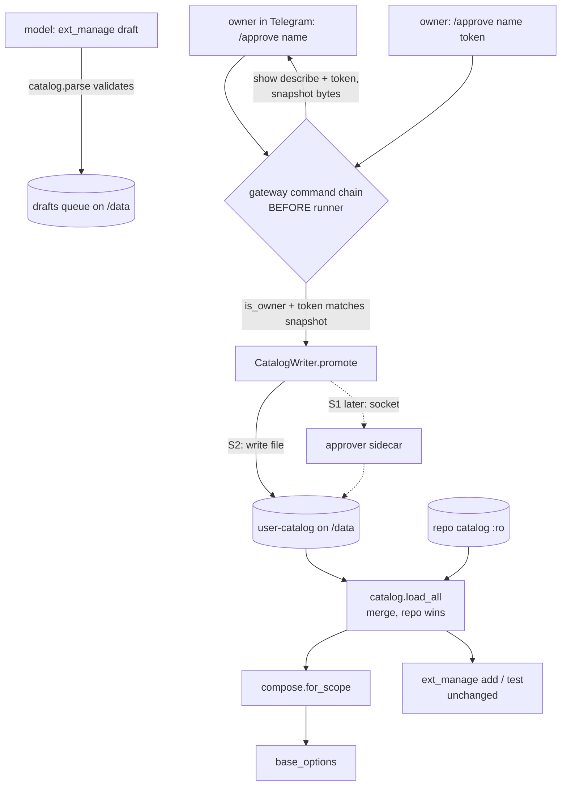

# Growing the Catalog from Chat — Design

**Status:** approved, ready for planning
**Date:** 2026-07-15
**Scope:** let the owner grow the extensions catalog from Telegram — the agent drafts a manifest,
validates it against the same rules the real catalog enforces, the owner approves it in chat, and
the entry becomes installable through the existing `ext_manage(action="add")` path. A shared
validator (skill + CLI script) makes the rules runnable by both the agent and a human. The write
lands in a writable **user-catalog** on `/data`, behind a `CatalogWriter` port so the safer
sidecar variant can be dropped in later without touching call sites.

This does **not** add a new install path. Installation, probing, cloning, secrets and the lane
reset are unchanged. The only new capability is a path that makes a *new catalog entry* exist
without a human on the host.

## Goal

Today the catalog is code: reviewed YAML under `catalog/`, mounted read-only, extendable only by a
human on the host running `scripts/approve_draft.py`. The agent can already *propose* a manifest
(`ext_manage(action="draft")`) — it lands inert in a queue that nothing installs from. Making it
real is a host step, on purpose.

The owner wants to remove that host step: approve a drafted manifest from Telegram and use its
tools in the next message, without touching the host. This trades away part of the current
security boundary; the design's job is to give up as little of it as possible, and to name
exactly what is given up.

## Background: the boundary we are moving

The whole security model is one sentence in `docker-compose.yml`:

> The agent runs as the owner of `/data` and has Bash, so anything it can write to is not a
> boundary. This mount [`./catalog:/app/catalog:ro`] is the only part of the catalog the agent
> cannot forge — that is the whole security model.

Two facts follow, and both shape this design:

1. **The agent's Bash runs as the same uid (`hermes`, 1000) as the bot.** There is no privilege
   separation. The env-scrubbing we already do (`config.py` drops `TELEGRAM_BOT_TOKEN` /
   `OPENAI_API_KEY` from `os.environ`) stops *inheritance*, but a same-uid process can still read
   `/proc/1/environ`. Env-dropping is defense-in-depth, not a hard boundary.
2. **The only hard, uid-independent boundary is the read-only mount.** You cannot have both (a) a
   process *inside* the container writing the catalog on approval, and (b) the agent's Bash unable
   to forge the same entry — without uid separation or an external writer.

We accept (see Locked Decisions) a **soft** boundary for now (S2): the user-catalog lives on
`/data`, the agent can technically write it, and the protection is that the *supported* path —
`/approve` — is intercepted in the gateway so the model can never enact it, plus owner-only
authorization and a mandatory human read of the executable surface. The write goes through a
`CatalogWriter` port so the **hard** boundary can be restored later (S1: an approver sidecar owns
a `:rw` mount that is `:ro` in the agent container) without rewriting the flow.

## Locked Decisions

- **User-catalog on `/data`, soft boundary (S2), write behind a `CatalogWriter` port.** Chosen over
  the sidecar (S1) for now to avoid new infrastructure. The port is the seam: the S2 implementation
  writes a file; a future S1 implementation ships bytes to an isolated approver. Call sites depend
  on the port, never the filesystem. *Rationale:* keeps the door open to the hard boundary without
  a rewrite; makes the accepted risk explicit and reversible.
- **The repo catalog always wins on name collision.** A chat-authored entry may never shadow a
  reviewed one (no swapping a malicious `filesystem` in for the trusted stdio server). On collision
  the user entry is dropped and logged. *Rationale:* anti-downgrade; the reviewed catalog is the
  higher-trust source and must be unshadowable.
- **Every user-catalog entry is re-validated by `catalog.parse` on every load.** A hand-forged file
  that does not pass the validator is inert. *Rationale:* the load-time gate is the same code the
  sidecar would run; it is the floor under the soft boundary.
- **Approval is gateway-intercepted, owner-only, and never a model tool.** The model may `draft`
  (propose) and `drafts` (list); it has no `approve` action. Only a literal `/approve` typed by the
  owner enacts, intercepted before `runner.run_turn` exactly as `/secret` is. *Rationale:* a
  prompt-injected turn must not be able to enact its own draft.
- **Two-step confirm over a content-hash snapshot.** `/approve <name>` shows the executable surface
  (`describe`) and a short token = prefix of `sha256` over a *snapshot* of the draft bytes;
  `/approve <name> <token>` promotes **the snapshot**, not the live file. *Rationale:* the token
  makes blind approval hard; promoting the snapshot closes the TOCTOU where the agent edits the
  draft on `/data` between show and confirm.
- **stdio is allowed in the user-catalog, flagged loudly.** A chat-authored entry may be an stdio
  server (a local `npx`/`uvx`/`python` command), but `describe` renders a prominent banner marking
  it as a local command that will execute in the container. *Rationale:* the owner asked for full
  catalog growth from chat; the mitigation is visibility, not prohibition. (The safer default —
  forbidding stdio under S2 — is recorded in Open Questions in case the accepted risk feels too
  wide in practice.)
- **Validation rules stay in `catalog.parse`.** The skill and the CLI script are thin wrappers; no
  rule logic is duplicated. *Rationale:* one source of truth for the most security-relevant code.
- **The user-catalog path has exactly one resolver and no environment variable of its own.**
  `paths.user_catalog_dir()` derives it from `CH_HOME` on every call; the writer, the directory
  creator and `catalog.load_all` all go through it. The asymmetry with `CH_CATALOG` is deliberate:
  the reviewed catalog is *code* whose location is genuinely not derivable (src layout vs
  site-packages), while the user-catalog is *state*, whose location NFR-5 already fixes. *Rationale:*
  a second derivation of the same path agreed only inside the image, where the Dockerfile set both
  consistently, and diverged silently everywhere else — `/approve` reported success for an entry
  nothing could install. An env var restating a fact the system already knows also lets state escape
  the `/data` volume that `tar` is meant to back up whole.
- **`/approve` verifies the effect before reporting success.** After `CatalogWriter.promote`, the
  handler confirms `catalog.get(name)` actually resolves before saying the entry is in the catalog;
  otherwise it reports an honest error and leaves the draft queued. *Rationale:* PRD P5 — the agent
  must not claim work it did not do. This holds independently of how the path is derived, so it
  survives a future S1 writer.

## Architecture



The model never touches the `owner → gateway → CatalogWriter` lane. Its only edge is producing a
draft, which is inert.

### New modules / files

| File | Purpose |
|---|---|
| `src/claude_hermes/extensions/usercatalog.py` | Owns the user-catalog path (`CH_HOME/user-catalog/{mcp,plugins}`) and the `CatalogWriter` port. S2 `FileCatalogWriter.promote(kind, name, yaml_bytes)` writes the file atomically. |
| `src/claude_hermes/extensions/approvals.py` | The `/approve` state: snapshot store keyed by token, token computation (`sha256` prefix over canonical bytes), `describe`-with-stdio-banner. Pure; no Telegram, no filesystem side effects beyond the snapshot. |
| `scripts/validate_manifest.py` | CLI: read YAML (file or stdin) → `catalog.parse` (kind via `drafts.kind_of`) → print `PASS` + `describe`, or the `ManifestError`; exit 0/1. |
| `bundle/.claude/skills/catalog-manifest/SKILL.md` | Teaches the agent the manifest shape and the rules, and to run `validate_manifest.py` to self-check and fix a draft before filing it. Seeded like the other bundle skills. |

### Changed

| File | Change |
|---|---|
| `extensions/catalog.py` | `load_all` merges the repo catalog with the user-catalog when `root is None` (production). Explicit `root` (tests) is honored verbatim — no user merge — so tests stay hermetic. A new `user_root` param lets a test exercise the merge deliberately. Repo entries win on collision. |
| `gateway/telegram.py` | Intercept `/approve` in the command chain before the runner, next to `/secret`. Owner-only. Calls into `approvals` and `CatalogWriter`. |
| `gateway/presenter.py` | A status line for the `/approve` command (like `/secret`). |
| `extensions/drafts.py` | Unchanged. `approvals` reuses its `describe` and `safe` (ANSI strip) as-is; the stdio banner is added by `approvals` wrapping `describe`, not by editing `drafts`. |
| `Dockerfile` | No new `ENV` — the user-catalog is state and is derived from `CH_HOME` (`/data/user-catalog`). No compose change under S2 either: the dir is already inside the `/data` volume. |
| `paths.py` | `home_dir()` (pure resolution, no side effects) and `user_catalog_dir(home=None)` — the single resolver every side goes through. `get_home()` builds on both and ensures `user-catalog/{mcp,plugins}` and `pending-approvals` exist at startup. |

Nothing in `runner.py`, `compose.py`, or the `ext_manage` `add`/`test`/`remove` paths changes:
they consume `catalog.load_all`, which now simply returns a larger dict.

## Data flow: draft → approve → install

```mermaid
sequenceDiagram
    participant Model
    participant Gateway
    participant Approvals
    participant Writer as CatalogWriter (S2: file)
    participant Catalog as load_all
    Model->>Model: ext_manage(draft, manifest) — catalog.parse validates, queues inert
    Note over Model: model tells owner: "review & /approve <name>"
    Gateway->>Approvals: /approve <name>
    Approvals-->>Gateway: describe(m) + stdio banner + token; snapshot stored
    Gateway-->>Model: (relayed to owner) surface + "confirm: /approve <name> <token>"
    Gateway->>Approvals: /approve <name> <token> (owner)
    Approvals->>Approvals: is_owner? token == hash(snapshot)?
    Approvals->>Writer: promote(kind, name, snapshot_bytes)
    Writer-->>Catalog: user-catalog/<kind>/<name>.yaml
    Note over Model: next: ext_manage(add, name) — unchanged (probe/clone/secrets/reset lane)
```

## The `/approve` command

| Call | Guard | Effect |
|---|---|---|
| `/approve <name>` | owner | Load pending draft. If none → say so. Else snapshot its bytes, compute token, reply with `describe` (stdio banner if stdio) + `confirm: /approve <name> <token>`. Nothing written. |
| `/approve <name> <token>` | owner + token matches live snapshot | `CatalogWriter.promote(snapshot)`. Record provenance. Reply: "'<label>' is now in your catalog — say 'add <name>' to install it." |
| token mismatch / no snapshot | — | Refuse; re-show the current surface and a fresh token. |
| non-owner | — | Refuse. (No secret to delete, unlike `/secret`.) |

`/approve` is handled in the gateway command chain (`gateway/telegram.py`), before
`runner.run_turn` — so the key facts (draft bytes, the confirm token) never enter the LLM context,
and the model has no tool that reaches this path.

## Merge rules (`catalog.load_all`)

- Production (`root is None`): scan `_CATALOG_DIR` (repo, `:ro`) then `_USER_CATALOG_DIR`
  (`CH_USER_CATALOG`, `/data`). Each file is parsed by `catalog.parse`; invalid files are skipped
  and logged (existing behavior).
- **Repo wins on name collision:** a user entry whose name already exists in the repo catalog is
  dropped and logged. Repo entries are loaded last-write-wins over nothing, user entries only fill
  names the repo does not define.
- Tests: an explicit `root` is honored verbatim (no user merge). A `user_root` param merges a
  fixture user-catalog for the merge tests.

## Error handling

| Failure | Behavior |
|---|---|
| No pending draft for `<name>` | `/approve` says so; nothing snapshotted. |
| Draft edited between show and confirm | Token no longer matches the snapshot → refused, re-shown. The snapshot, not the live file, is what would be promoted. |
| `/approve` from a non-owner | Refused. |
| User entry collides with a repo name | `promote` refused with a clear reason — the reviewed entry cannot be shadowed. |
| User entry collides with an existing user name | Overwrite (re-approval is an update); provenance updated. |
| A user-catalog file is malformed at load | Skipped and logged; the rest of the catalog still loads. |
| stdio manifest | Allowed, but `describe` renders a prominent "LOCAL COMMAND — runs in your container" banner above `command`/`args`. |

## Testing

- **`validate_manifest.py`** — exits 0 on a good manifest, 1 with the reason on each rejection class
  the catalog already tests (shell command, non-list args, non-`https` url, undeclared `${VAR}`,
  moving ref, unknown key). Mirrors the existing `catalog.py` validator tests through the CLI.
- **Merge** — repo wins over user on name collision; a user-only entry is visible; a malformed user
  file is skipped; an explicit test `root` sees no user merge (hermetic).
- **`approvals.py`** — token is stable for unchanged bytes and changes when the draft changes;
  snapshot is what gets promoted (TOCTOU test: edit the file after show, confirm is refused);
  `describe` shows the stdio banner for stdio and not otherwise.
- **`gateway/telegram.py`** — `/approve` never reaches the runner; a non-owner is refused; a
  successful confirm calls `CatalogWriter.promote` exactly once with the snapshot bytes.
- **`CatalogWriter` (S2)** — `promote` writes the file atomically at the right path; the port
  surface is what the flow depends on (so S1 can replace it).
- **No model path to approve** — a regression test that `ext_manage` exposes no `approve` action.
- The existing suite (install/compose/store/secrets) must pass unchanged.

## Out of scope (deliberate)

The approver sidecar (S1) itself — only the port that makes it a drop-in later. OAuth. Webhooks.
Plugin updates (`git pull`). Editing an approved user entry in place (re-draft + re-approve
instead). Any model-callable approval.

## Residual risk

S2 downgrades the hard `:ro` boundary to a soft one. A deeply prompt-injected agent that chooses to
use Bash can write a *valid* manifest directly into `/data/user-catalog`, bypassing `/approve`, and
`load_all` will honor it (it passes the validator). This is strictly more power than the agent has
today, where a novel executable spec is impossible without a human on the host. It is accepted for
now. The mitigations are: the load-time validator still applies; the *supported* path (`/approve`)
cannot be triggered by the model; and the `CatalogWriter` port plus the separate user-catalog
directory are the seam to restore the hard boundary via the S1 sidecar. If the accepted risk proves
too wide, the first tightening is Open Question 1.

## Open Questions

1. **Forbid stdio in the user-catalog?** *Recommended default:* allow it, flagged loudly (Locked
   Decisions). If the soft boundary feels too wide once real entries appear, the cheapest tightening
   is to make `load_all` refuse stdio entries from the user-catalog — remote MCP (`http`/`sse`) and
   pinned plugins stay allowed, but a novel local command again needs the host/sidecar. This is a
   one-line load-time filter and does not change any interface.
2. **Where does provenance live?** *Recommended default:* a header comment in the promoted YAML
   (`# approved by <user_id> at <iso> from <source>`) plus a line in the existing log. A separate
   ledger file is more queryable but is more surface for little gain at this scale.
3. **Confirm-token length.** *Recommended default:* 8 hex chars of `sha256`. Long enough that the
   owner cannot guess-confirm without seeing it, short enough to type on a phone.
