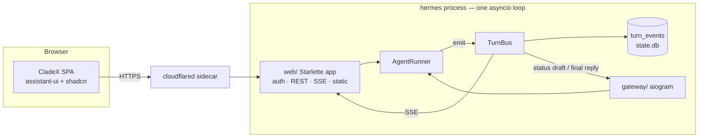
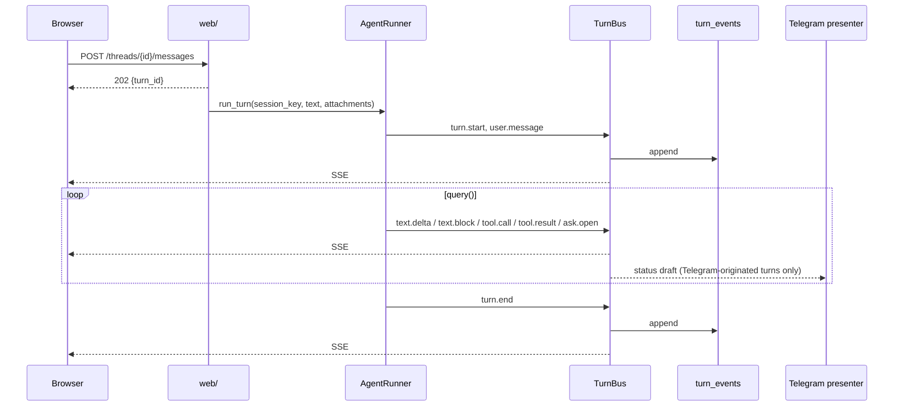

# CladeX web UI — design

**Goal:** a desktop web interface for the agent, built on assistant-ui and shadcn/ui,
that becomes the primary surface on a computer while Telegram stays a full channel:
the same sessions, the same memory, the same agent, continued from either side.

**Product name:** CladeX. The repository and Python package keep the name
`claude-hermes` / `claude_hermes`; CladeX is the name the user sees.

**Scope of this cut:** part 1 of three. Part 2 is the Telegram Mini App (same SPA,
`initData` auth, Telegram theme). Part 3 is Connectors (a UI over the extensions
machinery plus remote MCP by URL). This document locks the decisions those two parts
depend on and scopes part 1 to the smallest cut that proves the approach: HTTP API and
turn-event stream inside the existing process, a React SPA with sidebar, chat with
streamed text and tool-step groups, `ask_user` cards, attachments, file panel, voice,
Routines over the existing cron jobs, light and dark themes, login through Telegram.

Design system, tokens, mockups and logo live in `docs/design/` (`DESIGN.md`,
`globals.css`, `logo/`, `mockups/`). This spec references them and does not repeat them.

## Why this exists

Telegram is a good mobile surface and a poor desktop one: no view into what the agent
did during a turn, no file previews, no way to manage scheduled jobs except by asking
the agent, and a 4000-character wall for replies. The runtime already has everything a
desktop UI needs — per-session locking, resumable SDK sessions, an ask-user broker, a
document delivery path, a job store — but exposes it only through aiogram. This design
adds a second channel next to Telegram without touching the agent loop, the tools, or
the prompt prefix.

## Verified constraints

- `claude-agent-sdk==0.2.126` (pyproject) has `include_partial_messages` and the
  `StreamEvent`, `ThinkingBlock`, `ToolResultBlock`, `UserMessage` types
  (`claude_agent_sdk/types.py`). Token streaming needs no workaround.
- `AgentRunner._execute` (runner.py:243) iterates `query()` and today reports progress
  through a `progress(name, input)` callback; `UserMessage` (tool results) is ignored.
  The Telegram `Presenter` (gateway/presenter.py) maps tool names to one status line via
  `status_for` and sends the reply once, at the end.
- `main.py` pops `TELEGRAM_BOT_TOKEN` from `os.environ` at startup (main.py:75). Anything
  that needs a value derived from the token must derive it before that point.
- `AskBroker` (gateway/questions.py) owns the race between an answer and the timeout; the
  `ask_user` tool is registered only for lanes whose `chat_type_from_key` is `private`.
- `session_key` formats are pinned by tests: `tg:private:1`, `tg:private:1:t9`,
  `tg:supergroup:-5:7`, `cron:<id>`.
- `docker-compose.yml` has one service and publishes no ports. PRD P8: "No public inbound
  surface"; PRD non-goals: "Telegram is the UI". Both change with this design (see
  Locked Decisions).
- Cloudflare Tunnel terminates requests that exceed 100 seconds; a turn can run for
  minutes.
- assistant-ui: `ExternalStoreRuntime` exposes attachments, dictation, speech and thread-list
  adapters; `AssistantTransport` does not expose speech or dictation and its resume needs a
  paid sync server. `groupPartByType` folds adjacent `reasoning` and `tool-call` parts into
  one collapsible group; `human` toolkit entries render standalone.

## What it reuses

| Existing piece | Role in this design |
|---|---|
| `AgentRunner.run_turn` + per-session lock | every web turn is a normal turn; a lane is busy for both channels while it runs |
| `SessionRouter`, `sessions` table, `session_key` | the thread id; web threads are new lanes routed the same way |
| `AccessControl` | who may log in and which lanes they see |
| `AskBroker` | `ask_user` answers from the browser resolve the same future as Telegram taps |
| `send_document` closure, inbox/outbox layout, `attachments.py` | files in and out of a turn |
| `Titler` | automatic thread titles |
| `JobStore`, `parse_schedule`, `scan_prompt`, `_job_timeout` | Routines: same validation as `cron_manage` |
| voice module (OpenAI STT/TTS) | dictation and read-aloud endpoints |
| `record_message`, `record_cost` | FTS and cost accounting stay as they are |
| `status_for` (presenter) | the Telegram status line; the web copies its label table |
| assistant-ui registry elements, shadcn/ui | the component kit; see "Frontend" |

## Architecture



- `src/claude_hermes/web/` is a new package: `app.py` (Starlette application, static
  files from `web/dist`), `auth.py`, and routers `threads.py`, `turns.py`, `files.py`,
  `routines.py`, `voice.py`. It runs as `uvicorn.Server.serve()` in a task next to
  `dp.start_polling`. With `web_enabled: false` it is never constructed.
- `src/claude_hermes/turnbus.py` is a new small module: the runner publishes typed turn
  events; subscribers receive them per `session_key`. Two permanent subscribers: the
  `turn_events` writer and the SSE fan-out. The Telegram presenter becomes a third.
- The runner changes in one place: the `query()` loop in `_execute` emits events instead
  of calling `progress`. `progress` is removed; `include_partial_messages=True` is added
  to the options for text deltas.
- `src/claude_hermes/filestore.py` is a port (`put`, `get`, `url`, `delete`) with one
  implementation, `LocalFileStore`, over `inbox/` and `outbox/` under `agent_home`.
- The frontend lives in `web/` at the repository root (Vite, React, TypeScript,
  Tailwind v4, shadcn/ui, assistant-ui). The Dockerfile gains a Node build stage; the
  final image copies only `web/dist`.
- `docker-compose.yml` gains a `cloudflared` sidecar. The agent listens on `0.0.0.0:8080`
  inside the compose network only; no port is published.

## Locked Decisions

Hard to reverse once the browser, the database, or part 2 depend on them.

- **Web is a channel next to Telegram; one thread list.** A thread is a `session_key`.
  Telegram lanes and web lanes appear in one sidebar and any of them can be continued
  from either channel. *Rationale:* one SDK session per lane already exists; a mapping
  table would be a second source of truth.
- **Thread id on the wire is the `session_key`.** Web threads are `web:<user_id>:<uuid4>`.
  `chat_type_from_key` treats the `web:` prefix as `private`. *Rationale:* no id mapping;
  the `ask_user` gate keeps working unchanged.
- **Identity is the Telegram user id, everywhere.** Login is the Telegram Login Widget;
  part 2 adds Mini App `initData` as a second way to obtain the same cookie. The ACL is
  the existing `AccessControl`. *Rationale:* one identity for both channels, no user table.
- **Turn events are the wire format and the persistence format.** Types and payloads are
  listed under "Turn events"; the same rows replay a stored thread and tail a live one.
  *Rationale:* a pure fold on the client cannot disagree with itself across reload.
- **Text deltas are not persisted.** Only `text.block` rows are written; deltas exist only
  on the SSE stream. *Rationale:* `turn_events` grows per block, not per token.
- **SSE, not WebSocket.** One `GET /stream?after=<id>` per open thread; commands are plain
  POSTs. *Rationale:* passes Cloudflare Tunnel without care, `EventSource` reconnects on
  its own, the cursor makes reconnection lossless.
- **`POST /messages` returns immediately.** The turn runs in the background; the browser
  reads it from the stream. *Rationale:* Cloudflare cuts requests over 100 seconds.
- **Exposure is Cloudflare Tunnel.** No host port is opened; TLS and the domain are on
  Cloudflare. PRD P8 is reworded to: *no inbound ports on the host, all connectivity is
  outbound; the single public surface is an HTTPS URL behind Cloudflare Tunnel, behind
  Telegram-identity authorization.* The non-goal "Telegram is the UI" is removed.
- **Files are local, behind a `FileStore` port.** `inbox/` and `outbox/` under
  `agent_home`, all under `CH_HOME`; NFR-5 (`tar ./data` is a full backup) holds. An R2
  implementation can be added for large uploads without touching endpoints or UI.
- **Session cookie.** `cladex_session`, signed with `CH_WEB_SECRET` from `.env`, httpOnly,
  Secure, SameSite=Lax, 30 days. Every mutation requires the cookie and an `Origin`
  matching the configured domain, no exceptions. Content types are per route: JSON
  routes require `application/json`, `POST /uploads` requires `multipart/form-data`,
  `POST /voice/transcribe` accepts `audio/*`; anything else is `415`.
- **Thread metadata lives in its own table.** `threads(session_key PK, title, channel,
  owner_user_id, archived_at, last_event_at, created_at)`; `sessions` keeps only SDK
  state. *Rationale:* `Database.reset_session` deletes the `sessions` row and is called on
  `/new`, on expiry, on a failed resume and on a toolset change; a title or an archive
  flag must survive all of those.
- **Deletion is archival.** `DELETE /threads/{id}` sets `archived_at` and hides the lane;
  SDK transcripts and `turn_events` are never removed (PRD P4).
- **No branching, no history editing.** The SDK session is linear (`resume`); "edit" is not
  offered. "Retry" sends the same user text as a new turn.
- **Design system is `docs/design/DESIGN.md`.** Monochrome neutral scale; one signal
  blue for links, keyboard focus and running-tool indicators only; Inter + JetBrains Mono,
  self-hosted; logo "Open Channel". Widths: sidebar 256, thread max 768, file panel 432,
  panel docks at ≥1280 px, overlays below.
- **Layout.** Two panes (sidebar + thread) with a right file panel that opens on demand.
  Tool calls fold into one collapsible group per run segment; `ask_user` and file cards
  stay standalone.

## Turn events

Emitted by the runner into `TurnBus`, keyed by `session_key`, ordered by `seq` inside a
`turn_id`. "DB" means written to `turn_events`; every type goes to SSE.

| Type | Payload | DB |
|---|---|---|
| `turn.start` | `turn_id`, `channel` (`web`/`telegram`), `user_id`, `ts` | yes |
| `user.message` | `text`, `attachments[]` `{file_id, name, media_type, size, url}` | yes |
| `text.delta` | `delta` | no |
| `text.block` | `text` (a finished assistant text block) | yes |
| `thinking.delta` | `delta` (summarized reasoning as it streams) | no |
| `thinking` | `text` (the finished reasoning block; replaces the deltas) | yes |
| `tool.call` | `call_id`, `name`, `input` | yes |
| `tool.result` | `call_id`, `output` (truncated to `web_tool_output_max_chars`), `is_error`, `duration_ms` | yes |
| `ask.open` | `qid`, `question`, `options[]` | yes |
| `ask.answer` | `qid`, `answer`, `source` (`web`/`telegram`/`timeout`) | yes |
| `file` | `file_id`, `name`, `media_type`, `size`, `url`, `telegram_sent` | yes |
| `thread.title` | `title` | yes |
| `turn.end` | `status` (`ok`/`error`/`cancelled`/`timeout`), `cost_usd`, `sdk_session_id`, `error` | yes |

Storage:

| Column | Type | Notes |
|---|---|---|
| `id` | INTEGER PK | the SSE cursor |
| `session_key` | TEXT | indexed with `id` |
| `turn_id` | TEXT | uuid4 per turn |
| `seq` | INTEGER | order within the turn |
| `ts` | TEXT | ISO-8601 UTC |
| `type` | TEXT | one of the types above |
| `payload` | TEXT | JSON |

A new `threads` table holds `title`, `channel`, `owner_user_id`, `archived_at`,
`last_event_at`, `created_at`, keyed by `session_key`; it is upserted on every
`turn.start` and never touched by `reset_session`. `sessions` is unchanged.
`messages_fts` keeps receiving the same user/assistant rows as today, so
`session_search` is unchanged.

**Cron runs are turns on the delivery lane.** After `run_job` returns, the ticker emits
into the job's delivery lane: `turn.start` with `channel: cron`, `job_id`, `run_id`;
one `text.block` with the report (or the `⚠️`-prefixed failure text); `turn.end` with the
run status. The `cron:<id>` SDK session stays isolated as today; these events describe
the delivery, not the run, so the Routine page and any reload show every report.
`_with_cron_context` keeps reading `messages_fts` and is unchanged.

**Late subscribers.** `TurnBus` keeps, per active turn, the events since `turn.start`
plus the not-yet-flushed text. A new SSE subscriber gets that snapshot first, then the
live tail. The client loads history with `GET /events?after=` and opens the stream from
the same cursor, so a reload mid-turn shows the partial answer and keeps streaming.

**Telegram presenter as subscriber.** `tool.call` → `status_for(name, input)` → draft
(only when the status text changes, as today); `turn.end` → `finalize(text)`. Events
carry `channel`; the presenter acts only on turns started from Telegram, so a web turn on
a Telegram lane does not post a duplicate reply into the chat.

**`ask_user` from the web.** `ask.open` renders a card with option buttons; the click
posts `POST /asks/{qid}` which resolves the same `AskBroker` future. Whichever answer
arrives first wins, exactly as between two Telegram taps.

**Cancel.** `POST /threads/{id}/cancel` cancels the turn task; the SDK transport closes;
the runner writes `turn.end` with `cancelled`. Partial text stays in the thread.



## HTTP API

All paths under `/api`; all except `/auth/telegram` require the session cookie. Errors
are `{"error": {"code", "message"}}` with the matching HTTP status.

| Method and path | Purpose |
|---|---|
| `POST /auth/telegram` | verify Login Widget payload, set cookie |
| `POST /auth/logout`, `GET /me` | clear cookie; current user and role (`owner`/`user`) |
| `GET /threads?after=` | visible threads, newest `last_event_at` first, cursor paging |
| `POST /threads` | create `web:<user>:<uuid>`; returns the key |
| `PATCH /threads/{id}` | rename (manual title overrides auto-title permanently) |
| `POST /threads/{id}/archive`, `DELETE /threads/{id}` | both set `archived_at` |
| `GET /threads/{id}/events?after=` | history from `turn_events` |
| `GET /threads/{id}/stream?after=` | SSE: active-turn snapshot, live tail, heartbeat every 15 s |
| `POST /threads/{id}/messages` | `{text, attachment_ids[]}` → `202 {turn_id}`; `409` if the lane is busy |
| `POST /threads/{id}/cancel` | cancel the active turn |
| `POST /asks/{qid}` | `{answer}` for an open `ask_user` |
| `POST /uploads` | multipart, ≤ `web_upload_max_mb`, into `inbox/<lane>/`; returns `attachment_id` |
| `GET /files/{file_id}` | download/preview from `outbox/`, `inbox/` or `agent_home/`; owner of the lane only |
| `GET /routines`, `POST /routines`, `GET /routines/{id}`, `PATCH /routines/{id}` | list, create, read, edit — same validation as `cron_manage` |
| `POST /routines/{id}/run`, `/pause`, `/resume`, `DELETE /routines/{id}` | job actions |
| `GET /routines/{id}/runs` | recent run history for the header strip |
| `POST /voice/transcribe` | audio blob → text |
| `POST /voice/speak` | text → audio |

**Login.** The widget returns `id`, `first_name`, `auth_date`, `hash`. The server checks
HMAC-SHA256 over the data-check string with key `sha256(bot_token)`, `auth_date` no older
than 24 h, and `id ∈ ACL`. The key is computed in `main.py` before the token is popped and
is the only token-derived value the web app holds.

**Visibility.** A user sees their own `web:` lanes and their `tg:private:` lanes; the
owner also sees group lanes and topics. `cron:<id>` sessions are never listed.

**Titles.** The first turn on an untitled thread schedules the existing `Titler` in the
background; the result is stored in `sessions.title` and emitted as `thread.title`.

**Files.** `GET /files/{id}` resolves the path, checks containment against the allowed
roots (same approach as `plugin_root` in extensions), and checks lane ownership.
`send_document` on a `web:` lane writes to `outbox/<lane>/` and emits `file`; on a
Telegram lane it also sends to Telegram as today and sets `telegram_sent`.

## Frontend

```
web/
  src/
    app/            router, layout (sidebar + outlet), auth guard, theme provider
    api/            typed client: fetch wrappers, SSE subscription, event types
    store/          zustand: threads, events per thread, active turn, open file
    runtime/        ExternalStoreRuntime wiring, foldEvents, adapters
    toolkit/        defineToolkit: labels/icons per tool, ask_user (human), send_document (standalone)
    components/
      assistant-ui/ registry elements copied into the repo
      ui/           shadcn
      cladex/      AskCard, FilePanel, RoutineHeader, RoutineForm, LoginPage, EmptyState
    pages/          Chat, Routines, Routine, Login
    styles/         globals.css from docs/design, self-hosted fonts
  public/
```

- **`foldEvents(events) → { messages, isRunning, pendingAsk, files }`** is a pure
  function. `user.message` → user message with attachments. `text.block`, `thinking`,
  `tool.call`, `tool.result` inside one `turn_id` → one assistant message with parts in
  arrival order; `text.delta` appends to the last text part. `ask.open` without
  `ask.answer` → a `tool-call` part for `ask_user` in `requires-action`. `turn.end` →
  message status. This function carries the frontend's main test suite.
- **Runtime.** `useExternalStoreRuntime` with `messages` from the fold; `onNew` → `POST
  /messages`; `onCancel` → `/cancel`; `onReload` → resend the last user text; `onAddToolResult`
  → `POST /asks/{qid}`. Adapters: `threadList` (`ExternalStoreThreadListAdapter` over the
  store), `attachments` (→ `POST /uploads`), `dictation` (MediaRecorder → `/voice/transcribe`),
  `speech` (→ `/voice/speak`). No `onEdit`, so no edit button.
- **Grouping.** `MessagePrimitive.GroupedParts` with `groupPartByType`: `reasoning` and
  `tool-call` → `group-chainOfThought`; `standalone-tool-call` ungrouped. `ask_user` is
  `type: "human"` (standalone by rule); `send_document` is `display: "standalone"` and renders
  as a file card. The group stays open while `status.type === "running"` and collapses at the
  first `text.block` after it; its header shows the current step's label from the toolkit
  table, the web counterpart of `status_for`.
- **File panel.** `openFile` in the store; opened from a file card or from a `Write`/`Edit`
  step whose path is under `agent_home`. Preview by type via `GET /files/{id}`: markdown
  through `markdown-text`, images through `image`, PDF in an `<iframe>`, everything else a
  download button. Actions: download, copy, "Open in Telegram" when `telegram_sent`.
  Built on `canvas-split`.
- **Routines.** `/routines` lists jobs; `/routines/:id` is `RoutineHeader` (schedule, prompt,
  next run, timeout, run strip, actions) above a normal `Thread` on the job's delivery lane.
  Reports are the `channel: cron` turns the ticker emits there, rendered with a left rule
  and the run's timestamp, duration and status; replies are ordinary turns on that lane.
  `RoutineForm` (shadcn `Dialog`) creates and edits; server-side validation errors are the
  same strings `cron_manage` returns to the model.
- **Theme.** `.dark` on `<html>`, persisted in `localStorage`, default from
  `prefers-color-scheme`. Part 2 maps Telegram's theme onto the same two.
- **Registry elements used:** thread, thread-list-sidebar, thread-list, thread-search,
  composer, empty-state, command-palette, tool-group, tool-call, tool-fallback, reasoning,
  thinking-indicator, terminal-block, code-diff, markdown-text, message-actions,
  streaming-text, scroll-anchor, stopped-run, error-state, day-separator, file, image,
  attachment, composer-attachments, composer-voice, read-aloud, schedule-card,
  activity-graph, cost-meter, connection-state, canvas-split.

## Deployment and configuration

- Dockerfile: a `node:20-alpine` stage builds `web/`; the Python stage copies `web/dist`
  into the package as static files.
- `docker-compose.yml`: `cloudflared` sidecar with `TUNNEL_TOKEN` from `.env`, same
  compose network; no `ports:` on either service.
- Development: `vite dev` proxies `/api` to `localhost:8080`; no CORS anywhere.
- `config.yaml`: `web_enabled: bool = False`, `web_port: int = 8080`,
  `web_public_origin: str` (for the `Origin` check and the widget domain),
  `web_upload_max_mb: int = 20`, `web_tool_output_max_chars: int = 8000`,
  `web_session_days: int = 30`.
- `.env`: `CH_WEB_SECRET`, `TUNNEL_TOKEN`. Secrets in env, behavior in `config.yaml` (P7).
- Rollback: `web_enabled: false` restores today's behavior; the tunnel container can stay
  down independently.

## Error handling

- A failure inside a turn never breaks the connection: it arrives as `turn.end` with
  `error` and a message; the UI shows a banner with retry. The lane lock is released.
- SSE drops are recovered by reconnecting with `after=<last id>`; the `connection-state`
  element shows the gap.
- `409` on `POST /messages` when the lane is busy (a Telegram turn in flight, or a second
  tab); the composer shows "the agent is busy in this thread".
- Upload over the size limit or a disallowed path → `413` / `403` with the shared error
  shape; nothing is written.
- Login failures (bad hash, stale `auth_date`, not in ACL) → `401` with a neutral message;
  no hint which check failed.
- `ask_user` timeout: `AskBroker` returns `None` as today; `ask.answer` with `source:
  timeout` closes the card.

## Testing

Python (no network, fake `query()`, as the suite does today):

- `test_turn_bus.py`: ordering, per-lane isolation, snapshot for a late subscriber,
  deltas not persisted.
- `test_runner.py` (extended): `_execute` emits `tool.call`, `tool.result`, `text.block`,
  `turn.end` from a fake `query()`; the retry path emits one `turn.start`.
- `test_presenter.py` (adapted): same status expectations, driven by bus events; ignores
  web-originated turns.
- `test_web_auth.py`: HMAC, freshness, ACL, cookie signing, `Origin` check.
- `test_web_threads.py`: visibility per role, cursors, archive semantics, `web:` key format;
  `threads` metadata survives `reset_session` on `/new`, expiry, failed resume and toolset
  change.
- `test_web_uploads.py`: per-route content types (`multipart` accepted on `/uploads`,
  rejected on JSON routes and vice versa), `Origin` enforced on both.
- `test_cron_ticker.py` (extended): a completed run emits `turn.start`/`text.block`/`turn.end`
  with `channel: cron` into the delivery lane; the cron SDK session is not resumed.
- `test_web_files.py`: containment, ownership, size limit.
- `test_web_routines.py`: the same validation errors as `cron_manage`.

Frontend:

- Vitest on `foldEvents` with fixtures: plain turn, turn with `ask_user`, error turn,
  cancelled turn, replay from a cursor, thread with mixed channels.
- One Playwright smoke: login, send, see a streamed reply, against a fake SSE server.
  Runs in CI, does not gate deploy.

## Boundaries this must not cross

- No new tool schema in the prompt; the web is a channel, not a capability (P1, P2).
- The runner and tools stay HTTP-agnostic; `web/` depends on them, never the reverse.
- No route serves files outside `agent_home`, `inbox/`, `outbox/`.
- The bot token never reaches the web app; only `sha256(token)` does.
- No public port on the host; only the tunnel's outbound connection.

## Wiki maintenance this triggers

- New component page `docs/llm-wiki/components/web.md` (app, auth, routers, TurnBus,
  FileStore), linked from `index.md` and `system.md`.
- `components/core-runtime.md`: `_execute` emits events; `progress` is gone.
- `components/gateway.md`: presenter subscribes to `TurnBus`.
- `contracts/state-db.md`: `turn_events`, `threads`.
- `components/cron.md`: the ticker emits delivery turns into the lane.
- `decisions/`: new page for "web as a channel; P8 reworded".
- `flows/message-turn.md`: web path added.
- README: features, install (tunnel, `.env` keys), config keys.

## Open Questions

Each has a default so work can proceed.

1. **Delivery lane for routines created from the web.** Jobs today create a Telegram
   forum topic for delivery. *Default:* web-created jobs deliver to the owner's private
   chat (flat) as the existing fallback does, and their page thread is that lane; a
   dedicated `job:<id>` lane is deferred.
2. **Model picker in the composer.** *Default:* no picker in part 1; the composer shows
   the configured model name. Per-thread model override is deferred.
3. **Dark-theme input border contrast** measures 3.19:1, at the edge for non-text.
   *Default:* keep `DESIGN.md` values; revisit after the first real screen.
4. **Files the agent wrote but did not send.** Opening `Write`/`Edit` steps in the file
   panel exposes any path under `agent_home`, including the wiki. *Default:* allowed for
   the owner, read-only; non-owner users see only `outbox/` and their own `inbox/`.
5. **Thread search from the UI.** `session_search` exists as a tool. *Default:*
   sidebar search filters titles client-side in part 1; full-text search endpoint deferred.
6. **Group lanes for non-owner users.** *Default:* hidden; only the owner sees group
   and topic lanes.
