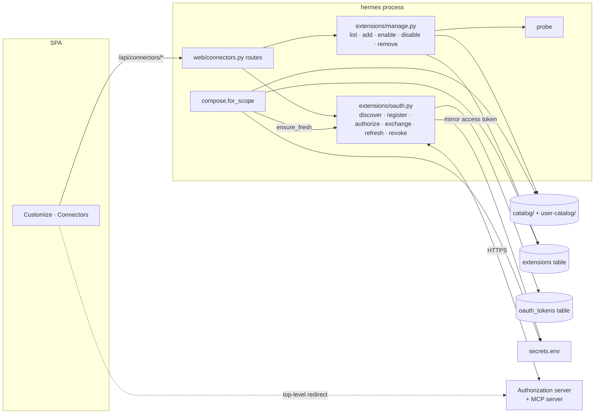

# CladeX web: Customize and Connectors — design

**Goal:** a Customize page in the web app where the owner connects remote MCP
servers the way Claude Desktop does — pick one from a curated list or paste a
URL, sign in with OAuth in the browser, and the agent gains the tools on its next
turn — while the project's rule stays intact: no chat message can make the agent
run something it was not given.

**Scope of this cut:** the `/customize` page with three tabs and the Connectors
tab filled in. Plugins and Skills are placeholder tabs here and get their own
specs. Connectors covers remote MCP servers over `http`/`sse` with OAuth, API
tokens or no auth, *and* the stdio servers already in the catalog (their secrets
are entered on the same tab). The interface strings follow the two-locale
dictionary from the interface-language design
(`2026-09-09-cladex-i18n-user-menu-design.md`), which lands first.

## Why this exists

The extensions machinery exists and works from chat: a reviewed catalog of MCP
servers and plugins, a registry of what is installed, secrets on disk, a
connection probe, a draft → approve path for new entries. What it lacks is the
thing every desktop assistant has: a page where you see what is connected, press
Connect, and sign in. Remote MCP servers from Notion, GitHub, Figma and others
authenticate with OAuth, and OAuth needs a browser and a callback URL — which the
web channel now has and Telegram never will.

## Verified constraints

- `claude-agent-sdk` 0.2.126: `McpHttpServerConfig` / `McpSSEServerConfig` take
  `url` and `headers` (`types.py:612-626`). A bearer token in a header is all a
  remote server needs once we hold the token.
- The bundled Claude Code CLI contains an MCP OAuth client (dynamic registration,
  PKCE, resource metadata), but it is interactive and listens for the callback on
  localhost inside the container. It cannot complete a flow that starts in the
  user's browser, so the web layer runs its own client.
- The catalog already composes headers from `auth[].header` + `format` with
  `${VAR}` interpolated from `secrets.env` (`compose.server_spec`,
  compose.py:54); `probe` (probe.py:25) connects a server config with no model
  call; `for_scope` (compose.py:83) drops a broken server into `last_error` and
  never raises.
- `catalog.parse` is the single validator; `user-catalog/` is written only
  through the `CatalogWriter` port (`usercatalog.py`); the repo catalog wins on
  name collision. `ext_manage` mutations are owner-only (`acl.is_owner`) and
  flag a lane reset because tool schemas sit in the cached prompt prefix.
- The web layer checks the session cookie on every `/api` route and the exact
  `Origin` on every mutation (`web/app.py`). A top-level GET navigation back from
  a provider carries the `SameSite=Lax` cookie.
- Providers checked on 2026-09-09: Notion `https://mcp.notion.com/mcp` (OAuth,
  dynamic client registration); GitHub `https://api.githubcopilot.com/mcp/`
  (OAuth 2.1 + PKCE, or a PAT in `Authorization`); Figma `https://mcp.figma.com/mcp`
  (OAuth, but the `mcp:connect` scope is granted only to approved clients — a
  self-registered client may be refused); Hostinger is an npm stdio server
  (`hostinger-api-mcp`, token in `HOSTINGER_API_TOKEN`, requires Node 24 — the
  runtime image ships Node 20).
- The OAuth callback must be reachable by the user's browser: `http://localhost:8080`
  works for local runs (authorization servers accept loopback redirects for public
  clients); production needs the tunnel and an `https` `web_public_origin`.

## Locked decisions

- **A connector is a catalog MCP entry + a registry row + its credentials.** No
  new entity. The catalog stays the only source of *what runs*; the registry says
  *that* it runs; credentials live beside, never inside, the manifest.
- **Manifest `auth[].kind` ∈ `{secret, oauth}`, default `secret`.** `oauth`
  requires `header: Authorization` and `format: "Bearer ${NAME}"` and forbids
  `prompt`; `${NAME}` is the access token the OAuth module maintains. One
  validator for repo catalog, user catalog and the web form.
- **Token source of truth is the `oauth_tokens` table** in `state.db`; the
  access token is *mirrored* into `secrets.env` under `${NAME}` so
  `server_spec` needs no new code path. Refresh tokens never leave the table.
- **Custom connectors are user-catalog manifests written by the owner from the
  browser** through `CatalogWriter` — the same soft boundary as `/approve`: a
  person with the owner cookie and a matching `Origin` performs the write; the
  model has no route to it. Names collide with the repo catalog → refused.
- **Connector `name` is the manifest `name`**: `^[a-z0-9][a-z0-9_-]*$`, the
  registry key, the token row key, the secret prefix.
- **Owner-only mutations; every allowed user may read** the list — the same
  split as `ext_manage`.
- **Wire shape of a connector** (below) is the contract the SPA, the palette and
  later tabs read.
- **OAuth `redirect_uri` is exactly `<web_public_origin>/api/connectors/oauth/callback`**;
  one per deployment, registered with the provider at first use.

## Architecture



`extensions/manage.py` is the one implementation of list/add/test/enable/
disable/remove; `ext_manage` in `tools.py` and the web routes both call it, so
chat and browser cannot drift.

## Data model

### Manifest: `auth[].kind`

| Field | `secret` (default) | `oauth` |
|---|---|---|
| `name` | secret variable | token variable |
| `prompt` | required | forbidden |
| `header` / `format` | optional | required: `Authorization` / `Bearer ${NAME}` |
| `url` | optional help link | optional |

Example — repo catalog `catalog/mcp/notion.yaml` (an example of the shape, not
the whole list):

```yaml
manifest_version: 1
name: notion
label: Notion
description: Pages, databases and search in your Notion workspace.
version: "1"
transport: http
url: https://mcp.notion.com/mcp
scopes: [turn, cron]
auth:
  - name: NOTION_MCP_TOKEN
    kind: oauth
    header: Authorization
    format: "Bearer ${NOTION_MCP_TOKEN}"
```

### Table `oauth_tokens`

| Column | Type | Notes |
|---|---|---|
| `name` | TEXT PK | extension name |
| `issuer` | TEXT | authorization server URL from discovery |
| `client_id` | TEXT | from dynamic registration or the owner's Advanced fields |
| `client_secret` | TEXT | empty for public clients |
| `access_token` | TEXT | mirrored to `secrets.env` |
| `refresh_token` | TEXT | may be empty |
| `expires_at` | TEXT | ISO; empty when the server did not say |
| `scope` | TEXT | as granted |
| `updated_at` | TEXT | |

### Connector wire shape (`GET /api/connectors` items)

```json
{
  "name": "notion", "label": "Notion", "description": "…",
  "source": "catalog" | "custom",
  "transport": "http" | "sse" | "stdio",
  "auth": "none" | "secret" | "oauth",
  "secrets": [{"name": "HOSTINGER_API_TOKEN", "prompt": "…", "set": false}],
  "state": "available" | "connected" | "disabled" | "needs_reauth" | "error",
  "tools": 12,
  "last_error": null,
  "scopes": ["turn", "cron"]
}
```

`state` is derived: no registry row → `available`; row `enabled` and no error →
`connected`; row `disabled` → `disabled`; `last_error == "needs_reauth"` →
`needs_reauth`; any other error → `error`. `tools` is the count from the last
probe, kept on the registry row (`tool_count`, a new nullable column).

## OAuth flow (`extensions/oauth.py`)

Reuses: `httpx.AsyncClient` from the process, `secrets.put`, `probe`.

```mermaid
sequenceDiagram
  participant B as Browser (owner)
  participant H as hermes /api/connectors
  participant AS as Authorization server
  participant S as MCP server
  B->>H: POST /{name}/oauth/start
  H->>S: GET url (no token)
  S-->>H: 401 WWW-Authenticate resource_metadata=…
  H->>AS: metadata (RFC 9728 → RFC 8414)
  H->>AS: dynamic client registration (if no client_id)
  H-->>B: {url: authorize?…code_challenge&state&resource}
  B->>AS: top-level navigation, sign in, consent
  AS-->>B: 302 redirect_uri?code&state
  B->>H: GET /oauth/callback?code&state (owner cookie)
  H->>AS: token exchange (code_verifier, resource)
  H->>H: store tokens; mirror access token; probe with header
  H-->>B: 302 /customize?connected=name
```

- **Start**: discovery from the 401's `resource_metadata`; fallback to
  `<origin>/.well-known/oauth-authorization-server`. Registration is skipped when
  a `client_id` is stored (previous flow or Advanced fields). The pending
  `state` (random, 32 bytes) maps to `{name, verifier, owner_id, expires}` in
  process memory for ten minutes, single use.
- **Callback**: requires the owner cookie; `state` must exist, belong to this
  user and be unexpired; exchange with PKCE; store; mirror; probe; register
  (`manage.add` semantics: enabled only on `connected`); lane reset flag; redirect.
  Any failure redirects to `/customize?error=<code>` and stores nothing.
- **Refresh**: `ensure_fresh(name)` is called by `for_scope` before `server_spec`
  for every `oauth` auth entry: refresh when `expires_at` is within 60 s (or the
  last probe said unauthorized). A failed refresh sets `last_error =
  "needs_reauth"` and the server is dropped from the turn.
- **Disconnect**: revoke via `revocation_endpoint` when advertised (best effort),
  delete the token row, remove the mirrored secret, remove the registry row.
- **Registration unsupported** (`registration_endpoint` absent or the server
  refuses): the flow stops with `registration_unsupported`; the owner can paste a
  `client_id` / `client_secret` under Advanced and start again.

## API (`web/connectors.py`)

All routes need the session cookie; mutations need `is_owner` and the `Origin`
check that `ApiMiddleware` already applies.

| Method | Path | Request | Response |
|---|---|---|---|
| GET | `/api/connectors` | — | `{connectors: [...]}` |
| POST | `/api/connectors` | `{name, label, url, auth: "none"\|"oauth"\|"header", header?, token?, client_id?, client_secret?}` | 201 connector; 400 `bad_manifest` with the validator message; 409 `name_taken` |
| POST | `/api/connectors/{name}/secrets` | `{VAR: value, …}` (declared names only) | 204 |
| POST | `/api/connectors/{name}/connect` | — | 200 connector; 409 `oauth_required`; 400 `secrets_missing` `{missing: [...]}`; 502 `probe_failed` |
| POST | `/api/connectors/{name}/oauth/start` | — | `{url}`; 502 `discovery_failed` / `registration_unsupported` |
| GET | `/api/connectors/oauth/callback` | `?code&state` (or `?error`) | 302 `/customize?connected=` or `?error=` |
| POST | `/api/connectors/{name}/test` | — | `{ok, tools: ["…"], error}` |
| POST | `/api/connectors/{name}/enable` · `/disable` | — | 200 connector |
| DELETE | `/api/connectors/{name}` | — | 204 (custom: also removes the manifest) |

Error codes the UI translates: `bad_manifest`, `name_taken`, `secrets_missing`,
`oauth_required`, `discovery_failed`, `registration_unsupported`,
`state_mismatch`, `exchange_failed`, `probe_failed`, `needs_reauth`,
`not_owner`.

Secret and token values are never logged and never returned by any route.

## Interface

Reuses: the routines page row layout, shadcn `Dialog`, `Select`,
`DropdownMenu`, `Input`, `Label`, `sonner` toasts, the sidebar nav row style.

- **Sidebar**: a `Customize` row (sliders icon) under `Scheduled`, linking to
  `/customize`. The palette gets the same entry.
- **`/customize`**: page title, tab strip Connectors · Plugins · Skills (tabs are
  URL segments: `/customize/connectors`, `/customize/plugins`, `/customize/skills`;
  `/customize` redirects to connectors). Plugins and Skills render a short
  "coming soon" placeholder.
- **Connectors tab**: header with a subtitle and, for the owner, `Add custom
  connector`. Rows: a letter tile, label, description, a status line (`Connected ·
  12 tools`, `Not connected`, `Needs reconnect`, `Disabled`, `Error: …`) and, on
  the right, the primary action for the state (`Connect`, `Reconnect`, `Enable`)
  plus a `…` menu (`Test`, `Disable`, `Disconnect`). Non-owners see rows without
  actions. Catalog entries come first, custom ones after, both sorted by label.
- **Connect** on an `oauth` connector: `POST …/oauth/start`, then
  `window.location.assign(url)`. On a `secret` connector with missing secrets: a
  dialog with one field per declared secret (labels from `prompt`, inputs of type
  password), Save posts the secrets and then `connect`. On `none`: `connect`
  directly.
- **Return**: `?connected=name` → toast "Notion connected" and the row updates;
  `?error=code` → toast with the translated code; the query is cleared from the
  URL.
- **Add custom connector** dialog: Name (slug, validated live), Label, URL,
  Authentication (`OAuth` · `API token in header` · `None`), for the header option
  Header name (default `Authorization`) and Token, and a collapsible Advanced with
  Client ID and Client secret. Save → `POST /api/connectors`, then the row appears
  in `available`; for `oauth` the dialog offers `Connect now`.

## Errors and edge cases

- A provider that answers 200 without auth is treated as `none`.
- Expired or reused `state` → `state_mismatch`; the user starts again.
- Probe timeout (as in `probe`) → `probe_failed`; nothing is registered.
- Refresh failure at turn time never blocks the turn; the row shows
  `Needs reconnect` and the agent simply lacks those tools until then.
- Removing a custom connector that is connected first disconnects it.
- A catalog entry that disappears from disk while installed keeps today's
  behaviour (`no longer in the catalog` in `last_error`).

## Curated list (content, shipped as repo catalog files)

Examples of the manifests this cut ships; each is a normal reviewed catalog
entry:

| File | Transport | Auth | Note |
|---|---|---|---|
| `catalog/mcp/notion.yaml` | http | oauth | first live test |
| `catalog/mcp/github.yaml` | http | oauth | |
| `catalog/mcp/github-pat.yaml` | http | secret (`GITHUB_PAT`) | the token route |
| `catalog/mcp/figma.yaml` | http | oauth | may refuse self-registered clients; Advanced fields are the fallback |
| `catalog/mcp/hostinger.yaml` | stdio (`npx hostinger-api-mcp`) | secret (`HOSTINGER_API_TOKEN`) | needs Node 24 in the runtime image |

`filesystem`, `fetch` and `fatsecret` appear on the tab unchanged.

## Testing

- `oauth.py` against a fake authorization server on `httpx.MockTransport`:
  discovery from the 401, the well-known fallback, registration, PKCE
  parameters, exchange, refresh, revoke, every failure code.
- Routes through `tests/web_helpers.make_client`: the list's derived states,
  custom-connector validation and name collision, secrets → connect, the
  callback with a good and a bad `state`, owner vs user.
- `for_scope`: an expiring token is refreshed before `server_spec`; a refusing
  refresh yields `needs_reauth` and the server is absent from the turn.
- `manage.py` covered once; `ext_manage` tests keep passing through it.
- Frontend: vitest for the row states and both dialogs; Playwright smoke opens
  `/customize/connectors` against the fake API.
- Live: Notion end to end; GitHub with OAuth and with a PAT; Hostinger with a
  token; Figma documented as the registration-unsupported path.

## Open questions

1. **Node 24 for the runtime image?** Hostinger's server requires it; the image
   has 20. Options: bump the nodesource setup to 24 / keep 20 and drop Hostinger.
   **Default: bump to 24** — an LTS line, and other npx servers move the same way.
2. **Where do the pending OAuth states live?** Options: process memory / a
   table. **Default: memory** — ten-minute, single-process, nothing to migrate;
   a restart mid-flow just means pressing Connect again.
3. **Per-scope switches on the tab (turn vs cron)?** Options: expose both as
   toggles / keep the manifest's `scopes`. **Default: keep the manifest's
   `scopes`** — the tab shows them as badges; editing scopes is a later cut.
4. **Should `ext_manage` gain `connect`-by-URL for chat?** **Default: no** — a
   URL from chat stays a draft; the browser is the human's approval surface.
