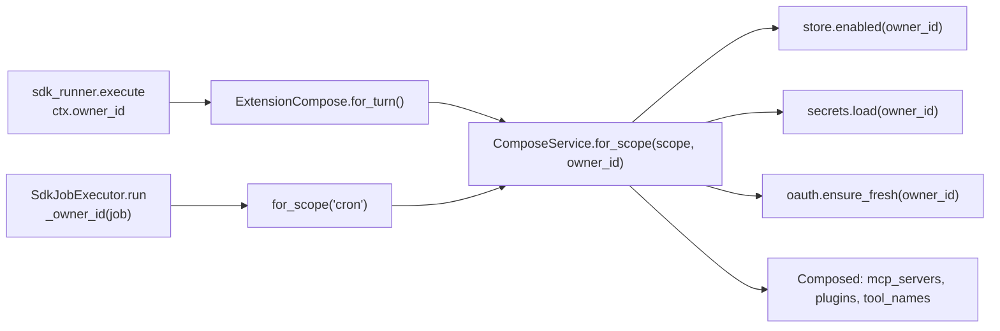

# Per-user connectors — design

**Goal:** a second person on the deployment gets their own connectors, under
their own credentials. Extensions are the last piece of user-owned state that is
still deploy-wide: the catalog stays shared and human-approved, but *which*
connectors are enabled, *whose* API keys they launch with and *whose* OAuth
account they act as become properties of a user.

**Scope of this cut:** `extensions`, `extension_secrets` and `oauth_tokens` get an
owner; `ComposeService` composes per user; the connectors and plugins APIs and
their pages act on the caller's own set. The read-only catalog, the draft queue,
the approval snapshots and the plugin clones on disk stay deploy-wide.

**Out of scope:** per-user catalog entries, per-user plugin clones, per-user
drafts or approvals, and any quota or per-user meter on what a connector costs.
A container per user remains the follow-up that would make this a real boundary
([[decision.multi-user-isolation]], "What this is NOT").

## Why this exists

A deployment already gives every admitted person their own workspace, wiki,
skills library, threads, files, routines and spend report. One thing is still
shared: an installed extension changes the MCP server set of every turn the
deployment composes, so a second user's agent runs with the owner's Notion token
and the owner's Google account — and cannot have their own.

For a household of two that is the difference between "a second agent" and "a
second chat window onto the first agent's tools".

## Verified constraints

- `ComposeService.for_scope(scope)` takes no user and is called from exactly two
  places: `ExtensionCompose.for_turn()` (`core/app_context.py:374`, the turns
  port) and `SdkJobExecutor.run` (`modules/scheduler/infrastructure/executor.py:91`,
  the cron pass). Both already hold the owner — `ctx.owner_id` for a turn,
  `job["owner_id"]` for a routine, which the line above already resolves into a
  workspace.
- `extensions`, `oauth_tokens` and `extension_secrets` are keyed by `name` alone
  (`modules/extensions/domain/models.py`). `extension_secrets.name` is the *env
  var name* a manifest declares (`NOTION_TOKEN`), so secrets share one namespace
  across every extension and every user.
- `extensions.state`, `last_error`, `tool_count` and `tool_names` are already
  per-user facts stored in a deploy-wide row: a probe with one person's token can
  fail while another's succeeds, and today the second verdict overwrites the first.
- `PendingStateStore.issue(name, owner_id, verifier, now)` and
  `take(state, owner_id, now)` already bind a started OAuth flow to the user who
  started it, and the callback route already runs as `current_user`
  (`presentation/routers/connectors.py:128`).
- `SessionRepository.reset_owned(owner_id, *, include_unowned=False)` already
  exists (`modules/sessions/infrastructure/repositories.py:110`) and is what the
  skills library uses to drop one person's lanes.
- Every turn runs under `permission_mode="bypassPermissions"`, where the control
  that removes a tool is `disallowed_tools`, not `allowed_tools`. Tool presence
  must be a property of the lane, never of the sender, or the cached prompt
  prefix flips mid-session ([[decision.multi-user-isolation]], D6).
- `plugin_root(home, m)` resolves under `CH_HOME/plugins`, which the read guard
  admits for every tree (`ws.plugins_dir` is in the allowed roots of every lane).
- The OAuth refresh lock key `lock:oauth:<name>` is a wire value shared between
  the agent and the worker, which may run different builds during a rolling
  deploy ([[system.operations]]).

## Locked decisions

1. **The key is `(owner_id, name)` on all three tables** — not an overlay table
   beside a deploy-wide install row. One row, one owner, one truth about whether
   a connector is enabled, and `last_error` / `tool_count` land where they were
   always meant to be.
2. **`owner_id` is `NOT NULL` with `ON DELETE CASCADE`**, unlike the nullable
   `ON DELETE SET NULL` that migration `0005` gave the other six tables. There a
   row could outlive its owner harmlessly; here an ownerless row is a decryptable
   credential belonging to nobody and therefore to everybody.
3. **`owner_id` is a required keyword-only argument on every extensions port**,
   with no default. A call site that forgets it must be a `TypeError` under test,
   never a silent read of the deploy owner's secrets — the same posture as an
   empty allowed-roots list denying everything rather than allowing everything.
4. **The catalog is untouched.** `catalog/` stays mounted `:ro`, `user_catalog/`
   stays deploy-wide, and creating a catalog entry (`POST /api/connectors`) stays
   owner-only. What exists as an installable connector is still decided by a
   human on the host ([[decision.readonly-catalog-boundary]]).
5. **A plugin's clone is shared; its enablement is personal.** `git clone` runs
   code inside the shared container, so installing and deleting a clone stay
   owner-only. Enabling one for yourself does not.
6. **No "shared" connector.** There is no `owner_id IS NULL` meaning "everyone's".
   Two people who want the same connector each enable it and each supply
   credentials; an unauthenticated server costs one click.
7. **Mutations stay out of the model's hands.** `ext_manage` gains per-user
   *reads*; installing, enabling, disabling and setting a secret remain
   owner-gated and fail closed. A prompt-injected turn must not be able to give
   itself a new server.

## Data model

| Table | Key before | Key after | New column |
|---|---|---|---|
| `extensions` | `name` | `(owner_id, name)` | `owner_id BIGINT NOT NULL → users.id ON DELETE CASCADE` |
| `extension_secrets` | `name` | `(owner_id, name)` | same |
| `oauth_tokens` | `name` | `(owner_id, name)` | same |

Unchanged and deploy-wide: `catalog_drafts` (which keeps its audit-only
`owner_id`), `approval_snapshots`, the `catalog/` and `user_catalog/` trees, and
the plugin clones under `CH_HOME/plugins/<name>`.

### Migration `0006_per_user_extensions`

Per table, in order:

1. `ADD COLUMN owner_id BIGINT` — nullable at first.
2. Backfill from the deploy owner:
   `UPDATE … SET owner_id = (SELECT id FROM users WHERE role = 'owner')`.
3. **Abort loudly when there are rows and no owner row.** That state should be
   unreachable — only an owner can install — but handing every existing
   credential to nobody, or guessing at an id, is worse than a failed upgrade.
4. `SET NOT NULL`; drop the old primary key; `PRIMARY KEY (owner_id, name)`; add
   the foreign key.

`downgrade` keeps the deploy owner's rows and **deletes everybody else's** — a
primary key on `name` alone cannot hold two people. Their OAuth tokens do not
come back: `CH_SECRETS_KEY` protects a dump, not a deleted row. Dump the three
tables before any downgrade:

```
docker compose exec -T db pg_dump -U hermes -t extensions -t extension_secrets \
  -t oauth_tokens hermes > ext-backup-$(date +%F).sql
```

## How the owner reaches `compose`



### Ports

| Port | Signature after |
|---|---|
| `ExtensionRepository` | `enabled(*, owner_id)`, `list(kind, *, owner_id)`, `get(name, *, owner_id)`, `add` / `set_state` / `set_error` / `set_tools` / `remove(…, *, owner_id)` |
| `SecretStore` | `load(*, owner_id)`, `put(name, value, *, owner_id)`, `forget(name, *, owner_id)` |
| `TokenRepository` | `get(name, *, owner_id)`, `put(name, *, owner_id, **fields)`, `delete(name, *, owner_id)` |
| `OAuthRefresher` | `ensure_fresh(home, tokens, m, *, owner_id, now=None)` |
| `ComposeService` | `for_scope(scope, *, owner_id)` |
| `PromptCacheInvalidator` | `__call__(owner_id) -> None` |

`CatalogReader` is untouched: the catalog is shared.

**Why threaded arguments and not a per-user scope object.** The learning module
builds a `LearningScope` per user because a scope owns file-backed state in a
tree. Extensions are rows over one engine, and the established shape for a row
with an owner is an explicit argument at the call: `messages.search(query,
owner_id)`, `jobs.list(owner_id)`, and the file store resolving a blob root from
the *row's* owner rather than the requester's.

### Reuse

| Unit | Reuses | Adds |
|---|---|---|
| Compose per user | `for_scope`'s existing total, never-raising loop; `Composed`; `server_spec` | one `owner_id` argument, threaded to three ports |
| Cron composition | `SdkJobExecutor._workspace`'s NULL-owner-means-deploy-owner rule | `_owner_id(job)`, extracted so the workspace and the connectors cannot disagree |
| Prompt cache | `SessionRepository.reset_owned(owner_id, include_unowned=)` | `reset_owned` on the runner; `_invalidate(owner_id)` in `main.build_app` |
| OAuth start / callback | `PendingStateStore.issue` / `take`, already owner-bound | drop `require_owner` from `/oauth/start` |
| Connectors page | the whole existing tab and its state derivation | the `owner` flag narrows to the New-connector button |
| Two-user tests | `tests/modules/turns/test_turns_two_users.py` | a case asserting B's turn composes none of A's servers |

### Prompt cache

Changing a user's connector set changes that user's cached prefix. `_invalidate`
(`main.py:359`) resets **every** lane on the deployment today; it becomes
`_invalidate(owner_id)` and resets that owner's lanes through `reset_owned`,
with `include_unowned=True` only for the deploy owner, whose set includes group
and pre-`0005` lanes with a NULL owner.

P1 holds: a lane's connector set is decided once per turn from the lane owner and
does not depend on the sender, exactly like `skill_admin` on a group lane.

### The one dangerous key

`lock:oauth:<name>` becomes `lock:oauth:<owner_id>:<name>`. While an old agent and
a new worker are both live they take different keys for one connector, so two
refreshes can run at once and a provider that rotates refresh tokens (Notion)
refuses the loser, recording `needs_reauth` for a connector that had just
refreshed. **Drain the queue before the upgrade** — the procedure the 4a → 4b
rollout already used.

## API and UI

| Route | Now | After | Why |
|---|---|---|---|
| `GET /api/connectors` | `current_user` | unchanged; state is the **caller's** | the catalog is shared, "connected / needs re-auth" is not |
| `POST /api/connectors/{n}/secrets` | `require_owner` | `current_user` | their key, their row |
| `.../connect`, `.../test`, `.../enable`, `.../disable` | `require_owner` | `current_user` | act on the caller's row and credentials |
| `DELETE /api/connectors/{n}` | `require_owner` | `current_user` | removes the caller's row and secrets only |
| `.../oauth/start` | `require_owner` | `current_user` | the pending state is already bound to the caller |
| OAuth callback | `current_user` | unchanged | `take(state, owner_id)` already refuses another user's state |
| `POST /api/connectors` | `require_owner` | **unchanged** | writes a manifest into the shared `user_catalog/` |
| `POST /api/plugins/{n}/install`, `/install/confirm`, `DELETE` | `require_owner` | **unchanged** | `git clone` puts code in the shared container |
| `POST /api/plugins/{n}/enable`, `/disable` | `require_owner` | `current_user` | the caller's row over a shared clone |

**Deleting a clone cascades.** `DELETE /api/plugins/{n}` removes every owner's row
for that plugin and calls `on_change(owner_id)` once per affected owner —
otherwise a second user keeps an enabled row pointing at a directory that is gone,
which `for_scope` can only report as an error on every turn.

A connector disappearing from the catalog needs nothing new: `for_scope` already
drops it with `no longer in the catalog`, per user, without taking the chat down.

**SPA.** `ConnectorsTab.tsx:25` and `ConnectorPage.tsx:27` stop hiding Connect,
Secrets, Enable, Disable and Delete; the `owner` flag survives on one control,
New connector. `PluginsTab.tsx` and `PluginPage.tsx` keep the flag on Install and
Delete and lose it on Enable and Disable. This is the path the Skills page
already took: the buttons follow the API rather than the role.

## `ext_manage`

The tool is present on every lane and stays present — its existence shapes the
cached prefix and may depend only on facts fixed for the lane.

| Action | Scope |
|---|---|
| `catalog` | the shared catalog, unchanged |
| `list` | the **lane owner's** installed set and their errors |
| `drafts` | the shared queue, unchanged |
| `add`, `remove`, `enable`, `disable`, `draft`, `secret` | owner-gated, fail closed, unchanged |

The refusal string gains an address: a non-owner is told their own connectors are
managed on the Connectors page. Nothing that changes what the agent *is* becomes
model-callable.

## Inventory

No new module and no new layer. Roughly 25 files inside `extensions` plus two
seams outward:

| Area | Files |
|---|---|
| Migration | `core/db/migrations/versions/0006_per_user_extensions.py` |
| ORM | `extensions/domain/models.py` |
| Repositories | `extension_repository`, `oauth_token_repository`, `pg_secrets` |
| Services | `compose_service`, `extension_service`, `oauth_service`, `plugin_service`, `admin_service`, `queries` |
| Ports | `extensions/application/ports.py`, `scheduler/application/ports.py`, `turns/application/ports.py` |
| Routers | `routers/connectors.py`, `routers/plugins.py`, `presentation/agent_tool.py` |
| Seams outward | `core/app_context.py` (`ExtensionCompose`), `scheduler/infrastructure/executor.py`, `main.py` (`_invalidate`), the turn runner's `reset_owned` |
| Locks | `extensions/infrastructure/refresh_locks.py` |
| SPA | `ConnectorsTab.tsx`, `ConnectorPage.tsx`, `PluginsTab.tsx`, `PluginPage.tsx` |
| Tests | the existing extensions suite (mechanically, via the keyword-only argument) plus the cases below |

## Rollout

1. **Back up.** `scripts/deploy.sh` already takes database, bucket and volume.
   `CH_SECRETS_KEY` has no second copy; confirm it is backed up where `.env` is.
2. **Drain the queue** — stop `agent` and `worker` before the upgrade (the
   `lock:oauth:` key change above).
3. **Deploy.** The agent runs `alembic upgrade head`.
4. **Create `config.yaml` on the host.** There is none today, so every knob sits
   at its default and `allowed_users` is empty. Add the second user's Telegram id.
   Two keys deserve a decision at the same time:
   - `users_shell_enabled` — leave `false`. With `Bash`, one admitted user reads
     every other user's tree and can dump the credentials this design just
     separated. The separation is bookkeeping, not a sandbox.
   - `users_learning_enabled` — the owner's call. On, the second user's wiki and
     skills grow from their own conversations; the review forks and the weekly
     curator pass are spend on the owner's account with no per-user meter.
5. **First contact.** They message the bot: a `users` row and `/data/users/<id>`
   are created lazily. They sign in at the web origin and connect their own
   accounts on the Connectors tab. None of the owner's connectors appear — after
   the migration every existing row belongs to the owner.

## Testing

Making `owner_id` keyword-only without a default turns the existing extensions
tests into the checklist of call sites. Beyond that:

- two users with different sets: `for_scope` returns each their own;
- a `needs_reauth` recorded for one user does not overwrite the other's
  `last_error` (today `set_error` writes by `name`);
- two users holding the same declared secret name do not overwrite each other —
  the regression against the shared namespace;
- deleting a plugin clone clears both rows and invalidates both lane sets;
- `POST /api/connectors` as a non-owner is 403; `/oauth/start` as a non-owner is
  200 and its state is bound to them; a callback carrying another user's state is
  refused;
- in `tests/modules/turns/test_turns_two_users.py`: B's turn composes none of A's
  MCP servers.

## What this is not

Both users' MCP servers run in one container as one uid, and a credential reaches
its server as an environment variable on a process. Sealing `extension_secrets`
protects a database dump, not a neighbour. With `users_shell_enabled` on, either
user's agent can read the other's tokens.

This is isolation against accident and against a well-behaved model — the same
posture the workspace split already has. The hard boundary is still the `:ro`
catalog mount, and a container per user is still the follow-up.

## Open questions

1. **Does a second user need anything new to see connector spend?** No —
   `turn_costs.owner_id` already scopes `cost_report` to their own turns, and a
   connector's own cost is not billed through the agent. *Default: change nothing.*
2. **Should a connector the owner deletes from `user_catalog/` take other users'
   rows with it?** *Default: no.* `for_scope` already drops it per user with a
   recorded reason, and deleting rows on a catalog edit would make a catalog edit
   silently destroy credentials.
3. **Should `GET /api/connectors` show that another user has a connector enabled?**
   *Default: no.* The list shows the catalog plus the caller's own state; who else
   connected what is not the caller's business.
4. **Does the second user get `users_learning_enabled`?** *Default: false*, the
   config default, revisited once there is a per-user meter.
